# Как пользоваться системой. Две проходки простым языком

**Проходка 1 — ежедневный расход. Проходка 2 — охранное мероприятие (внутреннее и визит иностранного гостя).**

12 сентября 2026 года. Plane №1195.

---

## Как читать эту инструкцию

Здесь всё написано так, будто вы открываете систему первый раз в жизни.

Каждый шаг устроен одинаково:

- **Кто делает** — под чьим именем нужно войти.
- **Что делать** — пронумерованные действия, одно действие в одной строке.
- **✅ Получилось, если** — что вы должны увидеть на экране. Если этого нет, шаг не закончен.
- **⚠️ Частая ошибка** — то, на чём спотыкаются чаще всего.

Проходка — это путь от начала до конца. Проходку делает не один человек: каждый участник входит под своим именем и выполняет свою часть, как эстафету. Если вы ждёте своей очереди — значит, предыдущий человек ещё не нажал свою кнопку.

**Про картинки.** Это настоящие учебные экраны от 9–10 сентября 2026 года. Фамилии, числа и даты на них — учебные, не настоящие. Система развивается, поэтому подписи и расположение у вас могут немного отличаться. Ориентируйтесь на названия кнопок, а не на их место на картинке.

---

## Перед началом: пять вещей, которые нужно знать

**1. Что это за система.** Она отвечает на два вопроса. Первый: где сегодня каждый сотрудник — на работе, на дежурстве, на больничном, в отпуске. Второй: как подготовить и провести охранное мероприятие — кто поедет, кто где встанет, кто это утвердил.

**2. Как войти.** Адрес системы, логин и пароль вам выдаёт администратор вашей организации. Входите **только под своим именем**. Система по вашему имени понимает, что вам можно, а что нельзя.

**3. Вы видите не всё — и это нормально.** Меню слева у разных людей разное. Если пункт бледный или его нет совсем — значит, эта работа не ваша. Это не поломка.

**4. Как устроен экран.**

- Слева — меню, разбитое на группы: «Личный кабинет», «Ежедневный расход», «Объекты», «Охранные мероприятия», «Обратная связь».
- Сверху по центру — путь, где вы сейчас находитесь. Справа сверху — ваша роль и кнопка «Обновить».
- Всё главное — в середине экрана.

**5. Самое важное правило.** Сохранить — это ещё не значит передать дальше. Почти везде есть два разных действия: сначала вы **сохраняете** свою работу, потом отдельной кнопкой **отправляете** её следующему человеку. Пока вторая кнопка не нажата, следующий вас не видит и ждёт.

---

## Маленький словарик

Эти слова встречаются в системе постоянно. Запомните их — дальше будет легко.

| Слово в системе | Что это значит простым языком |
|---|---|
| **Расход** | Список: кто сегодня на работе, кто на дежурстве, кого нет и почему |
| **Статус** | Отметка у человека: «в строю», «в отпуске», «на больничном», «на дежурстве» |
| **Сдать день** | Сказать системе: «за моё подразделение всё проверено, данные готовы» |
| **Свод** | Общий подсчёт: сначала по департаменту, потом по всей организации |
| **ОМ** | Охранное мероприятие: событие, которое надо охранять |
| **ОЛ** | Охраняемое лицо: человек, которого охраняют |
| **Бюллетень** | Карточка мероприятия: что, где, когда и кого охраняем |
| **Объект** | Место, куда приедет охраняемое лицо: зал, гостиница, аэропорт |
| **Пост** | Точка, где стоит сотрудник на объекте |
| **Рекогносцировка** | Осмотр места заранее: где ставить посты и сколько нужно людей |
| **Расстановка** | Кто из сотрудников на каком посту стоит |
| **Ознакомление** | Каждый сотрудник прочитал своё задание и подтвердил, что заступит |
| **ГВО** | Группа выездной охраны: люди, которые сопровождают иностранного гостя |
| **Штаб** | Те, кто собирает людей со всех департаментов и распределяет по объектам |

---
---

# ПРОХОДКА 1. ЕЖЕДНЕВНЫЙ РАСХОД

## Простыми словами

Это как журнал в школе.

Утром учитель отмечает: Азамат пришёл, Данияр заболел, Алия уехала на олимпиаду. Потом староста собирает такие журналы со всех классов и считает по школе. Потом директор смотрит общий подсчёт.

В системе то же самое, только вместо классов — управления, вместо старосты — ответственный за департамент, вместо директора — Служба.

**Весь путь одной строкой:**

> Начальник проверил своих людей → **сдал день** → ответственный посмотрел, кто сдал → **собрал свод** → **отправил дежурному** → видно по всей Службе

Важное правило: **все работают за один и тот же день.** Обычно система сама предлагает завтрашний день. Если вы выбрали 16 сентября, а ваш начальник смотрит 15-е — вы друг друга не увидите, и оба будете думать, что другой не работает.

## Кто участвует

| Кто | Что делает |
|---|---|
| **Начальник управления** | Проверяет своих людей и сдаёт день |
| **Ответственный за расход департамента** | Смотрит, кто сдал, собирает свод, отправляет дежурному |
| **Тот, кто сводит по Службе** | Смотрит готовность всех департаментов |
| **Обычный сотрудник** | Может проверить свои данные в «Моём профиле» |

---

## Шаг 1. Войдите и выберите день

**Кто делает:** начальник управления или тот, кому это поручено.

1. Откройте систему и войдите под своим именем.
2. В меню слева, в группе «Ежедневный расход», откройте страницу с расходом.
3. Наверху увидите вкладки: **«Ежедневный расход организации»**, **«Сбор сил на ОМ»**, и у некоторых — **«Свод департамента»**. Нажмите первую вкладку — **«Ежедневный расход организации»**.
4. Под вкладками стоит дата — например, «10 сентября 2026». Нажмите на неё и выберите тот день, за который готовите сведения.
5. Если вы случайно ушли не туда, рядом есть надпись **«Вернуть „завтра“»** — она возвращает день по умолчанию.
6. Скажите своему ответственному по департаменту, за какой день вы работаете. Он должен смотреть тот же день.

**✅ Получилось, если:** вверху стоит нужная дата, а ниже видно ваше подразделение и список людей.

**⚠️ Частая ошибка:** проверить людей за сегодня, а сдать за завтра. Дату проверяйте на каждом экране заново.

> **Что означают пять карточек вверху.** «По штату» — сколько мест положено. «По списку» — сколько людей реально есть. «Вакансий» — сколько мест пустует. «Прикомандировано» — пришли из другого подразделения. «Вне списка» — числятся, но в основной список не входят.

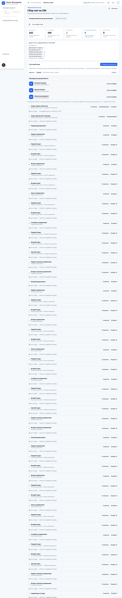

*Учебный экран 9–10 сентября 2026 года. Вверху — вкладки и дата. Ниже — карточки с числами, строка «Сдано 0 из 51 управлений», блок «Суточный свод» и список подразделений с пометкой «День не сдан».*

---

## Шаг 2. Проверьте каждого человека

**Кто делает:** начальник управления.

1. Найдите своё подразделение в списке и нажмите на стрелочку слева от названия — список людей раскроется.
2. Посмотрите на каждого человека: какая у него отметка. «В строю» значит, что он на работе и здоров.
3. Если отметка неправильная, нажмите в строке человека кнопку **«Проставить»**.
4. В открывшемся окне выберите нужное состояние и снова нажмите **«Проставить»**.
5. Если нужно указать больше подробностей — например, точные даты отпуска, — откройте в меню **«Статусы сотрудников»**. Страница называется «Управление статусами».
6. Найдите человека в таблице и нажмите на его строку. Откроется окно с его отметками.
7. В окне сверху — **«Текущий статус»**: даты начала и окончания, комментарий, кнопки **«Продлить»** и **«Завершить досрочно»**.
8. Чтобы записать отметку на будущее, нажмите **«Запланировать»**, укажите даты и сохраните.
9. Вернитесь в ежедневный расход **за тот же день** и убедитесь, что человек теперь отмечен правильно.

**✅ Получилось, если:** у каждого человека в списке стоит та отметка, которая соответствует правде на выбранный день.

**⚠️ Частая ошибка:** увидеть надпись «Без отдельной отметки · в строю» и решить, что человек уже проверен. Эта надпись означает только одно: никто ничего про него не записал. Проверить его всё равно нужно.

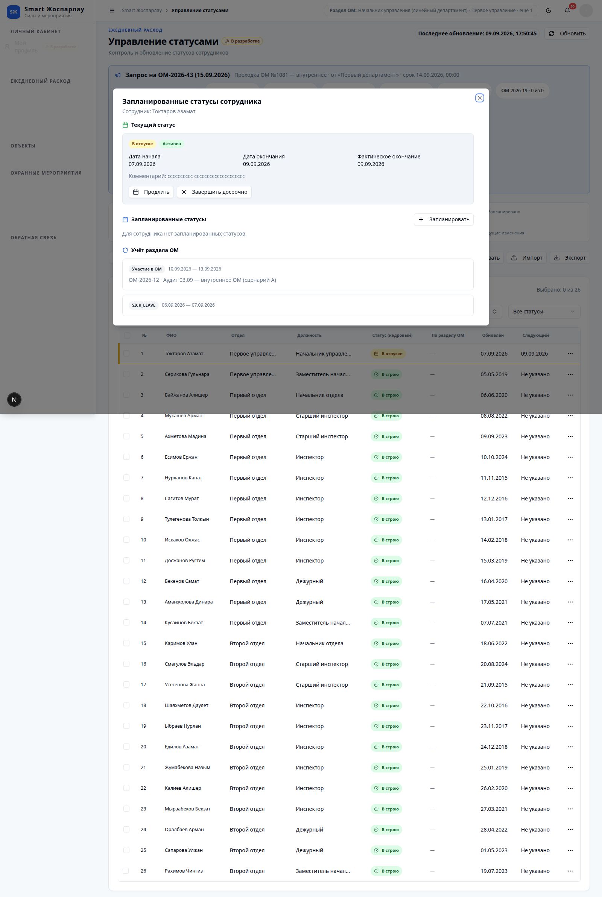

*Учебный экран 9–10 сентября 2026 года. Окно «Запланированные статусы сотрудника»: сверху текущая отметка «В отпуске» с датами, ниже — кнопка «Запланировать» и блок «Учёт раздела ОМ».*

---

## Шаг 3. Если человек заступает на дежурство

**Кто делает:** начальник управления или тот, кому разрешено менять отметки.

1. Откройте **«Статусы сотрудников»** и найдите нужного человека.
2. Откройте его окно и выберите состояние **«На дежурстве»**.
3. Появится блок **«Наряд на дежурство»**. Выберите вид дежурства: **«Постовое»** — человек стоит на конкретном посту, **«Групповое»** — работает в составе группы.
4. Для постового укажите объект и пост. Для группового — объект и группу.
5. Укажите, когда дежурство начинается и когда заканчивается. Если дежурство на один день — обе даты одинаковые.
6. Нажмите **«Сохранить»**, потом откройте запись ещё раз и проверьте, что даты и место сохранились.

**✅ Получилось, если:** в ежедневном расходе за этот день человек отмечен как дежурный.

**⚠️ Частая ошибка:** не найти нужный пост или группу в списке и вписать «примерно похожее». Если нужного поста нет — обратитесь к ответственному за объект, чтобы его завели.

---

## Шаг 4. Сдайте день за своё подразделение

**Кто делает:** начальник управления.

1. Ещё раз проверьте три вещи: дату, название своего подразделения, список людей.
2. Убедитесь, что все правки сохранены.
3. В шапке своего подразделения найдите блок **«Сдача дня»** и нажмите **«Сдать день»**.
4. Откроется окно. Прочитайте, за какое подразделение и за какую дату вы сдаёте.
5. Подтвердите сдачу и дождитесь, когда надпись «День не сдан» сменится на отметку о сдаче с датой и временем.

**✅ Получилось, если:** рядом с вашим подразделением больше не написано «День не сдан», а стоит время сдачи.

**⚠️ Частая ошибка:** думать, что сохранённые отметки сами уйдут наверх. Не уйдут. Пока не нажата кнопка «Сдать день», для ответственного ваше подразделение не сдавало ничего.

> **Если система не даёт сдать за нужный день.** Она может разрешать сдачу только за сегодня или за завтра — тогда появится подсказка «Сдать можно только за сегодня или завтра». Более далёкие дни пока просто заполните и предупредите ответственного.

---

## Шаг 5. Посмотрите, кто сдал, а кто нет

**Кто делает:** ответственный за расход департамента.

1. Войдите под своим именем и откройте вкладку **«Свод департамента»**.
2. Поставьте ту же дату, за которую сдавали начальники.
3. Найдите строку **«Сдано … из … управлений»** — это главный показатель готовности.
4. Ниже написано **«Не сдали:»** и перечислены подразделения, которых вы ещё ждёте.
5. Если есть кнопка напоминания — нажмите её. Если напоминание не уходит, позвоните начальнику сами.
6. Раскройте сдавшие подразделения и посмотрите людей. Список раскрывается после сдачи.

**✅ Получилось, если:** вы точно знаете, чьи данные уже готовы, а кого ещё ждёте.

**⚠️ Частая ошибка:** увидеть надпись «Отправлено» в блоке свода и решить, что все сдали. Это разные вещи: «отправлено» — про свод, «сдано … из …» — про подразделения.

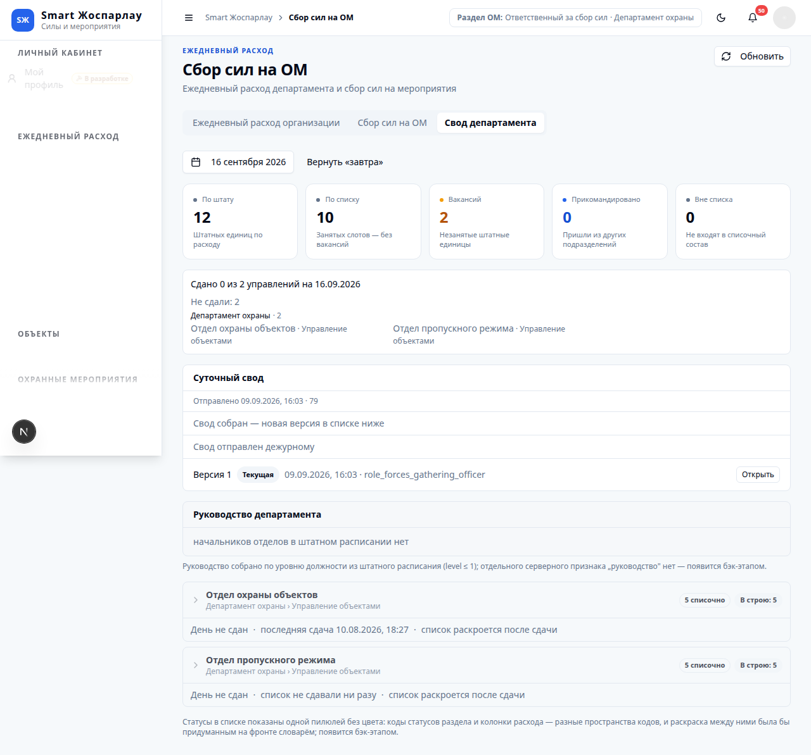

*Учебный экран 9–10 сентября 2026 года. Видно строку «Сдано 0 из 2 управлений на 16.09.2026», список несдавших, блок «Суточный свод» с надписью «Свод отправлен дежурному» и сохранённую «Версию 1». Пример показывает отправку при неполных данных.*

---

## Шаг 6. Соберите свод и отправьте его дежурному

**Кто делает:** ответственный за расход департамента.

Это **два разных действия**. Сначала собрать, потом отправить.

1. В блоке **«Суточный свод»** нажмите **«Собрать свод»**.
2. Дождитесь, пока в списке появится новая версия — с номером, временем и вашим именем.
3. Проверьте дату и числа. Кнопка **«Открыть»** покажет содержимое версии.
4. Теперь нажмите **«Отправить дежурному»**.
5. Если сдали не все, система спросит причину неполной отправки — её нужно написать словами, иначе отправка не пройдёт.
6. Убедитесь, что появилась надпись **«Свод отправлен дежурному»** и время отправки.

**✅ Получилось, если:** в блоке свода стоят обе отметки — свод собран и свод отправлен.

**⚠️ Частая ошибка:** собрать свод и уйти. Собранный, но не отправленный свод дальше не идёт.

> Если кнопка не нажимается, система обычно пишет причину рядом: например, «Свод ещё не собран — сначала „Собрать свод“». Прочитайте эту надпись — в ней ответ.

---

## Шаг 7. Посмотрите готовность по всей Службе

**Кто делает:** тот, кому поручено сводить по Службе.

1. В меню откройте **«Свод по Службе»**.
2. Вверху выберите один день или сразу период: поле «с» и поле «по».
3. Для каждого дня система покажет карточку: **«Сдали … из … департаментов»** и список тех, кто не сдал.
4. Раскройте департамент, чтобы увидеть его подразделения.
5. Справа у каждого департамента видна метка: **«Не собран»** или **«Отправлено дежурному»** с временем.
6. Если вам положено собирать общий итог — нажмите **«Собрать свод Службы»**.

**✅ Получилось, если:** по каждому дню видно, какие департаменты готовы, а какие нет.

**⚠️ Частая ошибка:** пытаться исправить отметку сотрудника прямо здесь. На этой странице отметки не правят — ошибку передают вниз, начальнику управления.

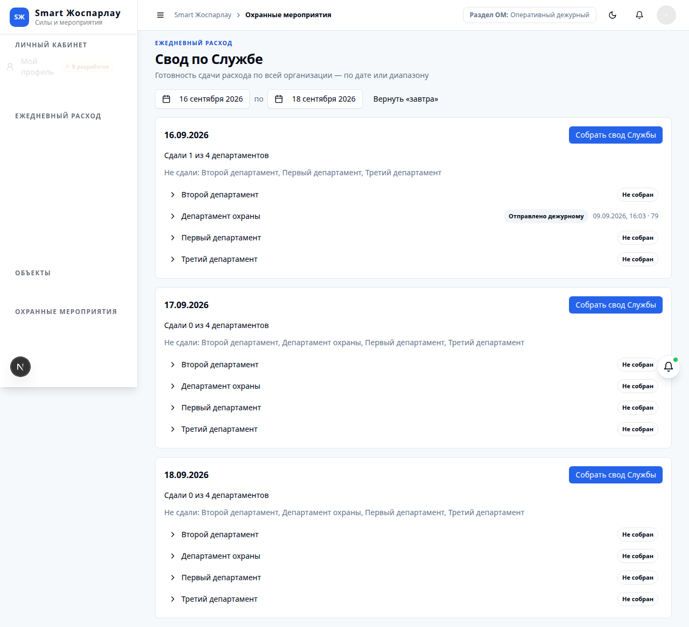

*Учебный экран 9–10 сентября 2026 года. Период с 16 по 18 сентября, по каждому дню — «Сдали 1 из 4 департаментов», список несдавших и метки «Не собран» / «Отправлено дежурному».*

---

## Шаг 8. Если ошибку нашли уже после сдачи

**Кто делает:** сначала начальник управления, потом ответственный департамента.

1. Проверьте, в чём именно ошибка: фамилия, дата, неправильная отметка.
2. Исправьте отметку человека обычным способом — через «Проставить» или через «Статусы сотрудников».
3. В блоке сдачи нажмите **«Исправить сдачу»**.
4. Напишите причину: почему данные меняются. Это обязательно.
5. Если есть поле про разрешение — укажите, кто разрешил исправление.
6. Подтвердите. Появится новая версия сдачи.
7. **Сообщите ответственному департамента.** Он должен собрать свод заново и отправить его ещё раз.

**✅ Получилось, если:** видна новая версия сдачи, а свод департамента пересобран и отправлен повторно.

**⚠️ Частая ошибка:** исправить человека и успокоиться. Ранее отправленный свод сам не меняется — в нём остаются старые числа, пока его не собрали заново.

> Сотрудник может проверить свои данные сам: **«Мой профиль»** в меню слева. Если он видит про себя неправду — пусть скажет начальнику.

---
---

# ПРОХОДКА 2. ОХРАННОЕ МЕРОПРИЯТИЕ

## Простыми словами

Представьте, что школа готовит большое городское мероприятие.

Сначала завуч пишет приказ: что за мероприятие, когда и кто главный гость. Потом решают, в каких зданиях всё пройдёт, и назначают старшего за каждое здание. Старший ходит по зданию и считает, сколько дежурных нужно и где они встанут. Потом просят классы выделить людей. Классные руководители называют фамилии. Потом решают, кто в какое здание идёт, а старший здания говорит, кто на какой двери стоит. Потом расписание подписывают двое руководителей. Потом каждый дежурный читает своё задание и отвечает «понял, буду». Проводят мероприятие. В конце ставят оценки и закрывают.

Система устроена ровно так же.

**Весь путь одной строкой:**

> Бюллетень → объекты и старшие → осмотр объекта → запрос людей → подбор людей → распределение по объектам → расстановка по постам → две подписи → ознакомление → проведение → закрытие и оценки

**Главное, что нужно понять новичку:** мероприятие состоит из **объектов**, и почти всё происходит внутри объекта. У каждого объекта свой старший и свои пять этапов: **Рекогносцировка → Расстановка → Согласование → Ознакомление → Закрытие**. Мероприятие заканчивается, когда закрыты все его объекты.

## Кто участвует

| Кто | Что делает |
|---|---|
| **Сотрудник второго департамента** | Заводит бюллетень мероприятия |
| **Старший мероприятия** | Добавляет объекты и назначает старших объектов |
| **Старший объекта** | Осматривает объект, ставит посты, расставляет людей, закрывает объект |
| **Штаб** | Запрашивает людей у департаментов и распределяет их по объектам |
| **Ответственный за сбор сил департамента** | Отвечает Штабу и передаёт задание своим управлениям |
| **Начальник управления** | Называет конкретных сотрудников |
| **Сотрудник** | Читает своё задание и подтверждает, что заступит |
| **Два руководителя** | Подписывают расстановку по очереди |
| **Старший ГВО** | Только для иностранных гостей: ведёт карточку визита |

---

## Шаг 1. Заведите бюллетень мероприятия

**Кто делает:** сотрудник второго департамента.

Бюллетень — это «паспорт» мероприятия. С него всё начинается.

1. В меню слева, в группе «Охранные мероприятия», откройте **«Реестр ОМ»**.
2. Справа вверху нажмите **«+ Создать бюллетень»**.
3. Выберите **тип мероприятия**: **«Внутреннее»** или **«С участием иностранцев»**.
4. Укажите дату начала и дату окончания. Если мероприятие на один день — поставьте одинаковые даты.
5. Заполните время и, если известно, рейс или тип борта.
6. В поле **«Охраняемые лица»** найдите нужного человека в справочнике. Если лиц несколько, **первым ставьте главного** — именно он печатается в бланке.
7. Заполните **«Название ОМ»**: коротко и понятно, например «Международный экономический форум».
8. Заполните **«Локация»**: страна, город, при необходимости адрес.
9. Назначьте старшего. У иностранного визита это поле называется **«Старший ГВО»**.
10. Внизу окна система показывает **«Так строка ляжет в бланке»** — прочитайте её, это проверка от ошибок.
11. Нажмите **«Создать бюллетень»**.
12. Найдите мероприятие в реестре и запомните его номер — вида «ОМ-2026-44». Этот номер называют все участники.

**✅ Получилось, если:** мероприятие появилось в списке, у него есть номер, название и даты.

**⚠️ Частая ошибка:** не найти своё мероприятие и завести его второй раз. Два одинаковых мероприятия — это двойная работа для всех остальных. Сначала ищите, потом создавайте.

> Кнопка «Создать бюллетень» не нажимается, пока не заполнены поля со звёздочкой.

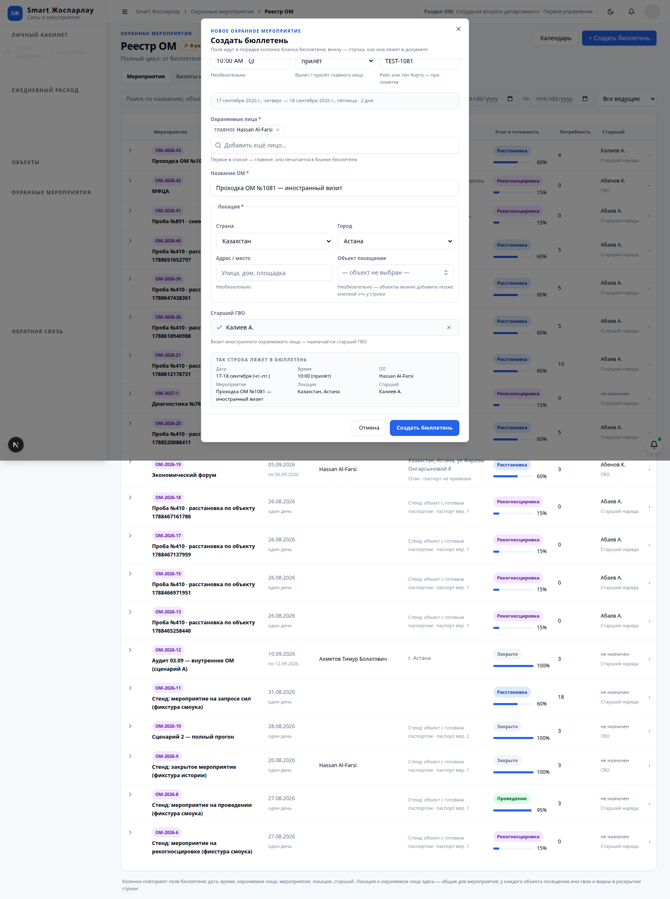

*Учебный экран 9–10 сентября 2026 года. Заполненный бюллетень иностранного визита: главное лицо, название, страна и город, поле «Старший ГВО» и предпросмотр «Так строка ляжет в бланке».*

---

## Шаг 2. Добавьте объекты и назначьте старших

**Кто делает:** старший мероприятия.

1. Откройте **«Реестр ОМ»** и найдите своё мероприятие по номеру.
2. Нажмите на стрелочку слева от строки — строка раскроется, внутри будут объекты.
3. Нажмите **«Добавить объект»**.
4. Выберите место проведения и **паспорт объекта**. Паспорт — это заранее сохранённое описание места: какие там секторы, входы, посты.
5. Укажите дату посещения этого объекта.
6. Назначьте **старшего объекта**: начните вводить фамилию и выберите человека из списка.
7. Если фамилии одинаковые — сверьте подразделение, оно написано рядом.
8. Повторите для каждого объекта.
9. Позвоните или напишите каждому старшему: назовите номер мероприятия и его объект.

**✅ Получилось, если:** у мероприятия есть все нужные объекты и у каждого написана фамилия старшего.

**⚠️ Частая ошибка:** думать, что старший мероприятия автоматически стал старшим каждого объекта. Это не так — старших объектов назначают отдельно, иначе следующий шаг не сможет сделать никто.

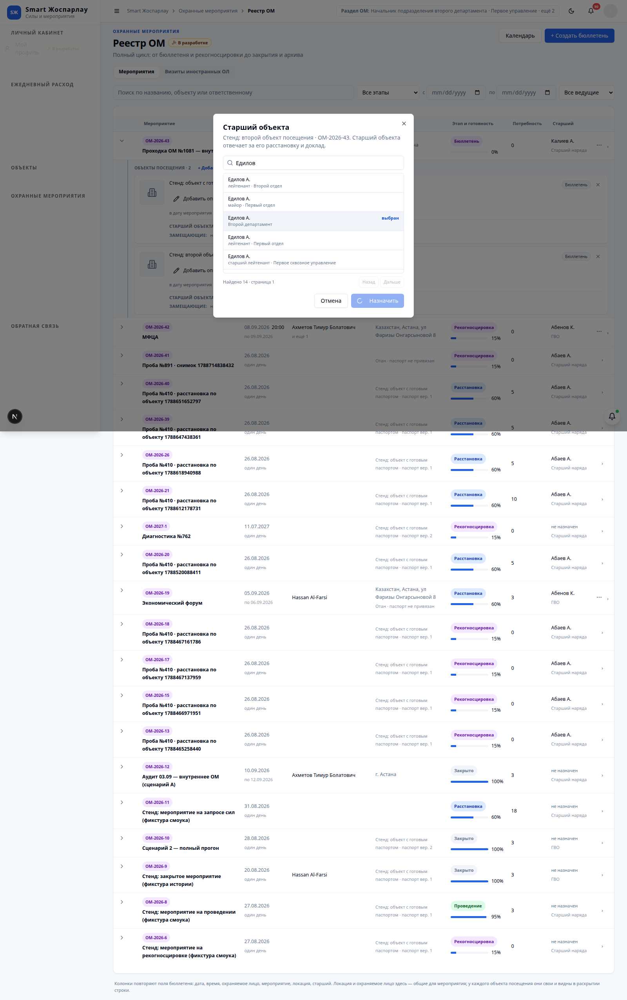

*Учебный экран 9–10 сентября 2026 года. Окно «Старший объекта»: при одинаковых фамилиях сверяйте подразделение.*

---

## Шаг 3. Осмотрите свой объект и посчитайте людей

**Кто делает:** старший объекта. Этап называется **«Рекогносцировка»**.

1. Откройте мероприятие, найдите свой объект и войдите в первый этап — **«Рекогносцировка»**.
2. Пройдите список обязательных пунктов проверки. По каждому поставьте **«Норма»** или **«Замечание»**.
3. Замечание нужно объяснить словами — одной галочки мало.
4. Нажмите **«Импорт из паспорта»** — секторы и посты подтянутся из описания места. Недостающее добавьте руками.
5. По каждому посту укажите: задачу, сколько человек нужно, смену и требования.
6. Отдельно укажите, нужны ли специальные группы.
7. Посмотрите итоговое число людей — именно оно уйдёт в «Сбор сил на ОМ».
8. Нажмите **«Сохранить»**, затем **«Завершить рекогносцировку»** и подтвердите.

**✅ Получилось, если:** этап отмечен как завершённый, а посчитанная потребность ушла Штабу.

**⚠️ Частая ошибка:** кнопка завершения не нажимается. Проверьте три вещи: вы назначены старшим этого объекта; все обязательные пункты отмечены; хотя бы один пост заведён.

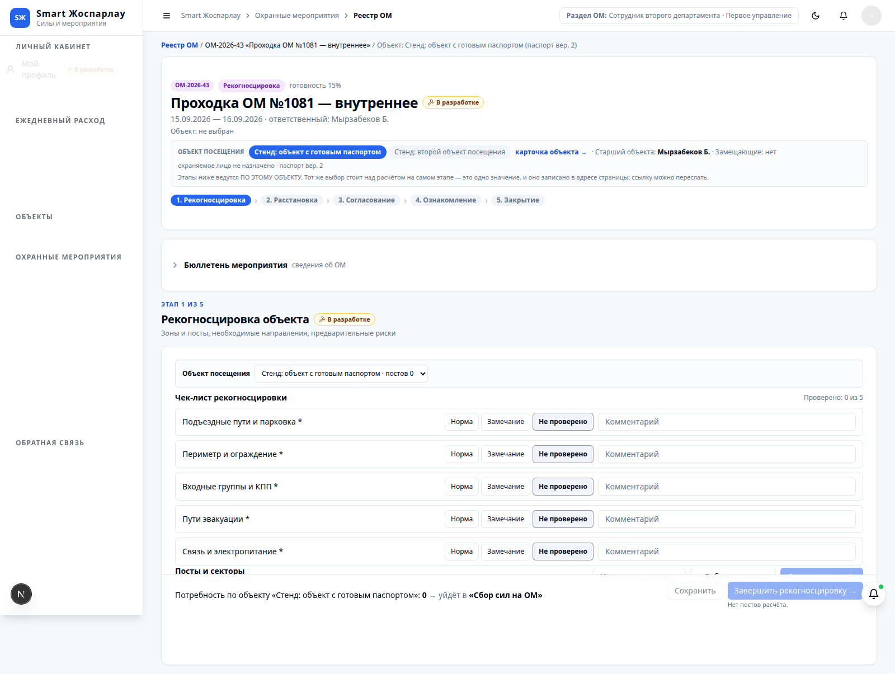

*Учебный экран 9–10 сентября 2026 года. На первом этапе отмечают результаты осмотра, внизу — «Сохранить» и «Завершить рекогносцировку».*

---

## Шаг 4. Запросите людей у департаментов

**Кто делает:** Штаб.

1. Откройте **«Сбор сил на ОМ»**.
2. Найдите потребность объектов, которые уже прошли осмотр.
3. Откройте или создайте **распределение**: название, период и список мероприятий с объектами.
4. Проверьте, сколько людей нужно на обычные посты и сколько — в специальные группы.
5. Укажите, сколько людей вы просите у каждого департамента.
6. Нажмите **«Отправить запросы»**.
7. В окне подтверждения ещё раз прочитайте: какому департаменту сколько людей. Подтвердите.

**✅ Получилось, если:** запросы ушли и у каждого департамента видно запрошенное число.

**⚠️ Частая ошибка:** искать в списке объект, который ещё не прошёл осмотр. Его там не будет — сначала старший объекта должен завершить рекогносцировку.

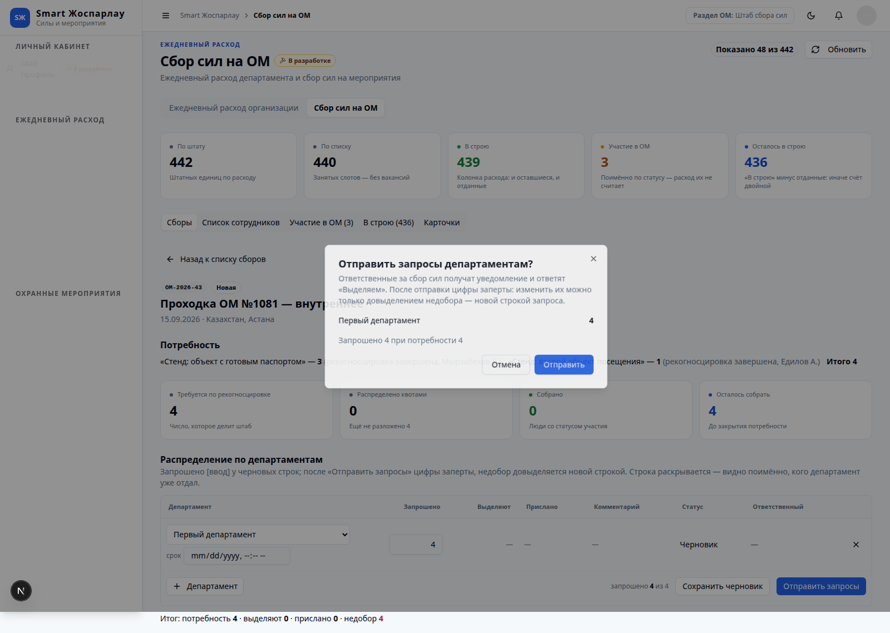

*Учебный экран 9–10 сентября 2026 года. Перед отправкой видно, какому департаменту и сколько людей запрашивают.*

---

## Шаг 5. Ответьте Штабу и передайте задание управлениям

**Кто делает:** ответственный за сбор сил департамента.

1. Откройте **«Сбор сил на ОМ»** → **«Заявки»** или перейдите по уведомлению.
2. Прочитайте запрос: какое мероприятие, период, сколько людей просят.
3. В поле **«Выделяем»** напишите, сколько человек вы реально можете дать.
4. Если меньше, чем просят, — объясните причину словами.
5. Нажмите **«Сохранить ответ»**.
6. Разделите это количество между своими управлениями.
7. Нажмите **«Отправить в управления»** и убедитесь, что появилась отметка отправки.

**✅ Получилось, если:** начальники управлений получили задание, а у заявки видно ваше обещанное число.

**⚠️ Частая ошибка:** считать, что на этом ваша часть закончена. Обещанное число — это ещё не фамилии. Фамилии появятся после шага 6, и отправить их Штабу тоже нужно вам (шаг 7).

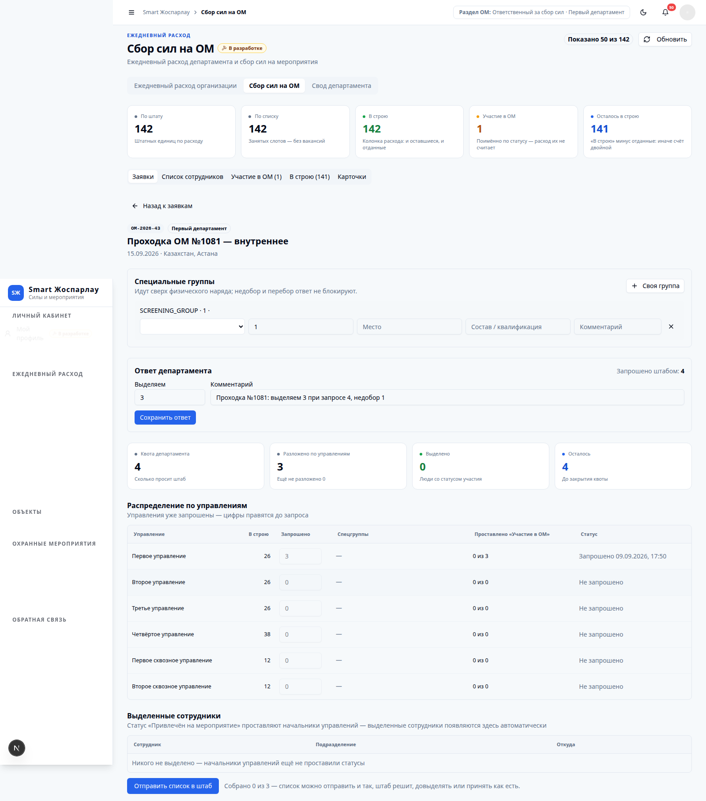

*Учебный экран 9–10 сентября 2026 года. Пример: запросили 4 человека, департамент обещал 3.*

---

## Шаг 6. Назовите конкретных людей

**Кто делает:** начальник управления.

1. Откройте **«Статусы сотрудников»**. Вверху вы увидите полосу с заданием: номер мероприятия, кто просит и до какого срока.
2. Выберите подходящих сотрудников своего управления.
3. Откройте действие **«Участие в ОМ»**.
4. Выберите вид участия:
   - **«Физнаряд»** — обычные сотрудники на обычные посты. Мероприятие и объект им назначит Штаб позже.
   - **«Группы»** — сотрудник идёт в составе специальной группы. Тогда укажите ещё группу, специальность и мероприятие.
5. Если нужна группа из другого подразделения — воспользуйтесь поиском по чужим группам.
6. Сохраните и откройте запись ещё раз: проверьте, что всё записалось.
7. Сообщите ответственному департамента, что люди подобраны.

**✅ Получилось, если:** у выбранных сотрудников появилась отметка об участии в мероприятии.

**⚠️ Частая ошибка:** при смене группы забыть про специальность. Специальность должна относиться к новой группе, иначе получится бессмыслица.

---

## Шаг 7. Отправьте список фамилий Штабу

**Кто делает:** ответственный за сбор сил департамента.

1. Вернитесь в ту же заявку.
2. Найдите блок **«Выделенные сотрудники»**.
3. Проверьте фамилии и количество по управлениям. Для групп проверьте ещё группу и специальность.
4. Если что-то не так — сначала разберитесь с начальником управления, потом отправляйте.
5. Нажмите **«Отправить список в штаб»**.
6. Если людей меньше, чем обещали, напишите причину.
7. Если Штаб вернул список — прочитайте причину, исправьте и отправьте снова.

**✅ Получилось, если:** Штаб видит фамилии, а не только числа.

**⚠️ Частая ошибка:** отправить пустой список. Пустой блок «Выделенные сотрудники» означает, что начальники ещё никого не выбрали, — отправлять нечего.

---

## Шаг 8. Распределите людей по объектам

**Кто делает:** Штаб.

1. Откройте нужное распределение и посмотрите пришедшие списки.
2. Слева — **«Общий пул»**: все выделенные сотрудники.
3. Выберите человека, затем справа укажите мероприятие, объект и строку потребности, которую он закрывает.
4. Нажмите **«Назначить»**.
5. Повторите для остальных. Следите за счётчиком: сколько назначено и сколько ещё нужно.
6. Если система предупреждает, что у человека совпадает время с другим заданием, — разберитесь. Подтверждайте только осознанно и с объяснением.
7. Нажмите **«Передать в расстановку»**. В разных формах кнопка называется «Передать в расстановку» или «Передать на расстановку» — это одно и то же.

**✅ Получилось, если:** старший объекта видит выделенных ему людей.

**⚠️ Частая ошибка:** думать, что Штаб ставит людей на посты. Нет: Штаб выбирает **объект**, а посты раздаёт старший объекта.

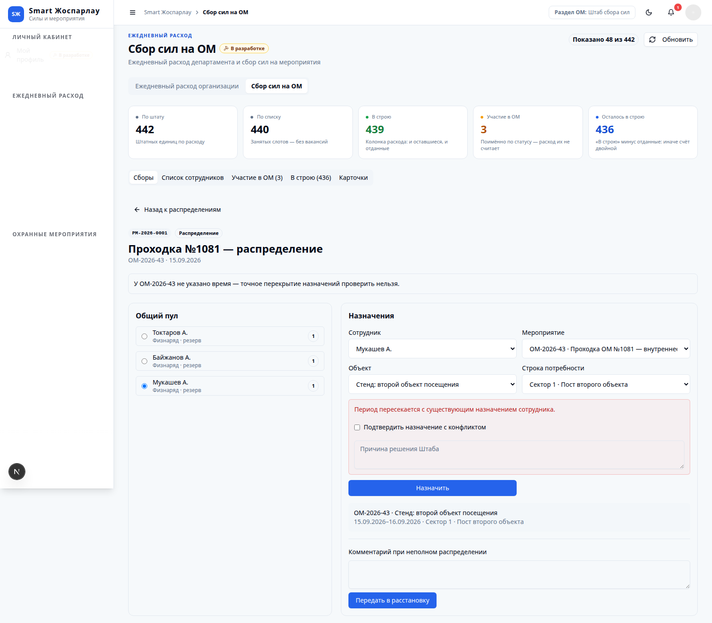

*Учебный экран 9–10 сентября 2026 года. Слева выбирают сотрудника, справа — мероприятие и объект; внизу — передача состава на расстановку.*

---

## Шаг 9. Расставьте людей по постам

**Кто делает:** старший объекта. Этап **«Расстановка»**.

1. Откройте мероприятие → свой объект → этап **«Расстановка»**.
2. Найдите список **«Выделено на объект штабом»**. Если он пуст — Штаб ещё не передал людей, ждите.
3. Выберите пост, нажмите **«Назначить»** и выберите человека из выделенного списка.
4. Проверьте смену и требования поста.
5. Можно нажать **«Распределить автоматически»** — система предложит вариант. **Сначала прочитайте предложение**, потом подтверждайте.
6. Пройдите по всем постам и проверьте, не осталось ли пустых мест.
7. При необходимости назначьте старшего поста.
8. Нажмите **«Завершить расстановку»**. Если места остались пустыми, придётся указать причину недобора.

**✅ Получилось, если:** у каждого поста стоят фамилии, а этап завершён.

**⚠️ Частая ошибка:** пытаться поставить на пост человека, которого Штаб не передавал на этот объект. Так нельзя — сначала шаг 8.

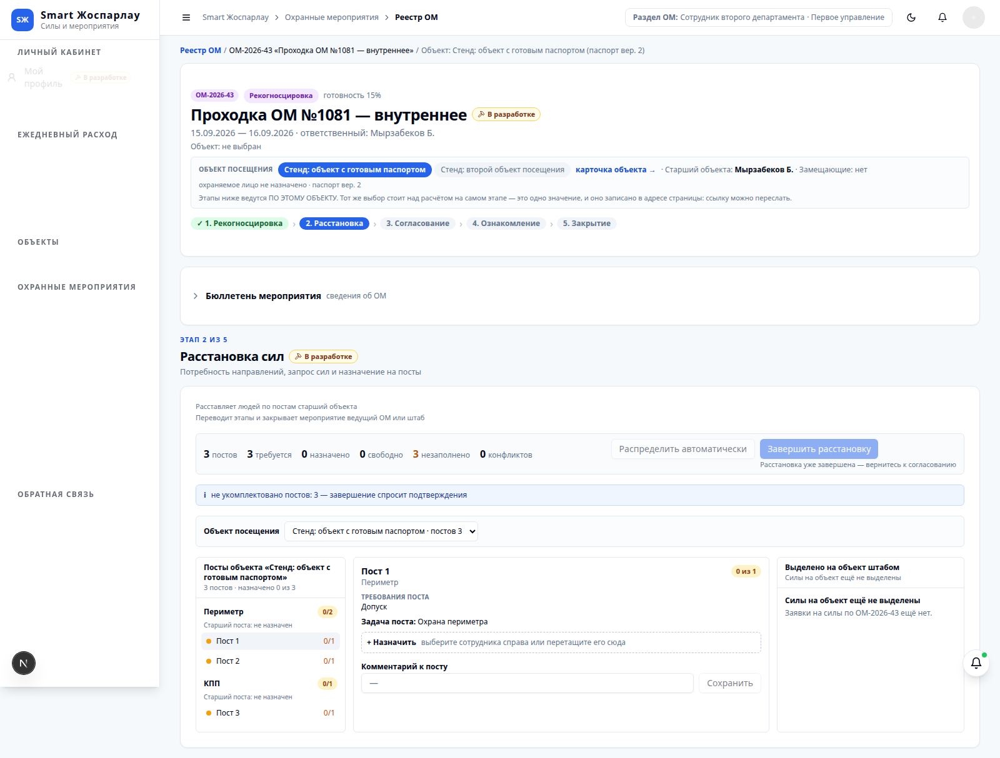

*Учебный экран 9–10 сентября 2026 года. На снимке состав ещё не передан Штабом — правая часть пустая.*

---

## Шаг 10. Отправьте расстановку на две подписи

**Кто делает:** старший объекта. Этап **«Согласование»**.

Подписей всегда **две**, и они идут **по очереди**: пока не подписал первый, второй не подписывает.

1. Откройте этап **«Согласование»** своего объекта.
2. Прочитайте готовую расстановку ещё раз.
3. Выберите **первого согласующего** — руководителя второго департамента — и нажмите **«Назначить первым согласующим»**.
4. Проверьте **второго согласующего** — заместителя руководителя организации. Если его нет, обратитесь к администратору.
5. Нажмите **«Отправить на согласование»**.
6. Первый руководитель заходит под своим именем, читает и нажимает **«Согласовать»** или **«Вернуть на доработку»**.
7. После первой подписи ту же редакцию смотрит второй руководитель.

**✅ Получилось, если:** стоят обе подписи.

**⚠️ Частая ошибка:** после доработки ждать только одну подпись. Нет: исправленный документ снова проходит **обе** подписи с начала.

> Если документ вернули — прочитайте замечания, исправьте и отметьте «Устранено». Если вы не согласны, так и напишите, с объяснением.

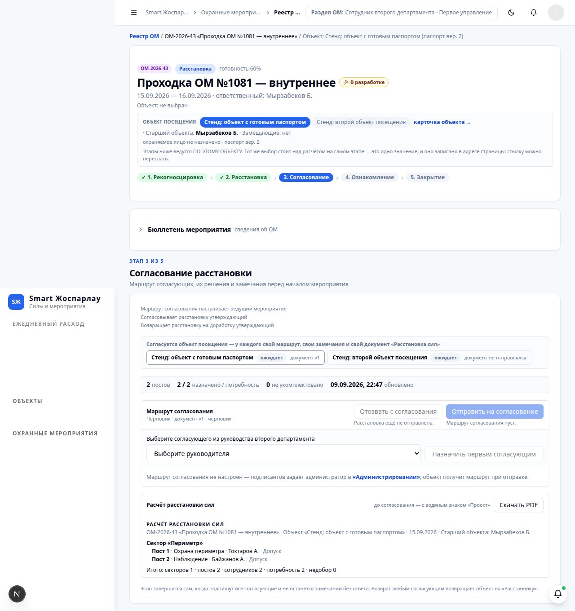

*Учебный экран 9–10 сентября 2026 года. На этапе «Согласование» выбирают первого руководителя и отправляют документ.*

---

## Шаг 11. Прочитайте своё задание и подтвердите

**Кто делает:** каждый назначенный сотрудник — сам за себя.

1. Войдите под своим именем.
2. Откройте **«Мой профиль»** → **«Мои назначения»**.
3. Найдите мероприятие и прочитайте: объект, пост, дата, время, задача.
4. Если всё понятно и вы можете заступить — нажмите **«Ознакомлен, заступлю»**.
5. Проверьте, что появилась зелёная отметка со временем.
6. Если заступить не можете — нажмите **«Не могу заступить»**, напишите причину и сохраните. Чем раньше, тем лучше: старший успеет найти замену.

**✅ Получилось, если:** у вашего назначения стоит зелёная отметка об ознакомлении.

**⚠️ Частая ошибка:** отмечать ознакомление за коллегу. За человека, у которого есть свой вход, подтверждает только он сам.

> Если у сотрудника нет своего входа в систему, начальник управления доводит задание лично, а потом оформляет отметку «Ознакомлен лично» с объяснением.

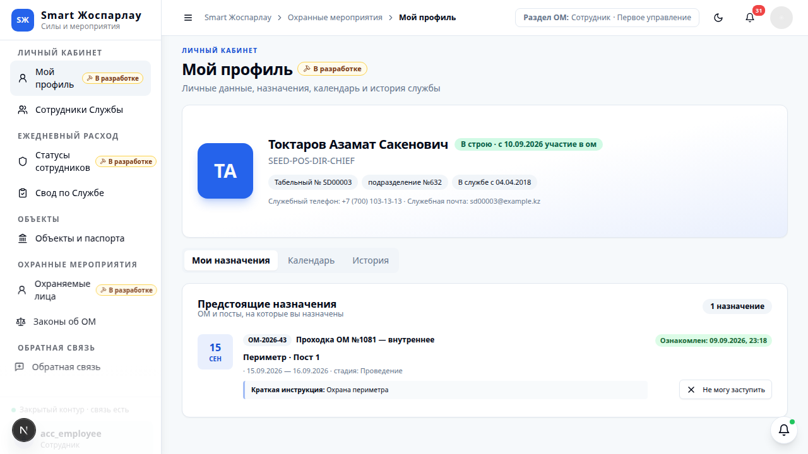

*Учебный экран 9–10 сентября 2026 года. Зелёная отметка означает, что сотрудник подтвердил ознакомление сам.*

---

## Шаг 12. Проверьте готовность и проведите мероприятие

**Кто делает:** старший объекта; завершает ознакомление ведущий мероприятие.

1. После двух подписей откройте этап **«Ознакомление»**.
2. Посмотрите три числа: сколько подтвердили, сколько молчат, сколько отказались.
3. Молчащим отправьте напоминание. По людям без своего входа свяжитесь с их начальниками.
4. По отказам найдите замену **до** начала работы.
5. Когда всё готово, ведущий мероприятие нажимает **«Завершить ознакомление»**.
6. Во время проведения записывайте важные события и замечания. Каждый раз проверяйте, что выбран правильный объект.

**✅ Получилось, если:** этап ознакомления завершён, а события записываются по нужному объекту.

**⚠️ Частая ошибка:** считать, что «ознакомлен» значит «отработал». Ознакомление — это только про то, что человек прочитал задание.

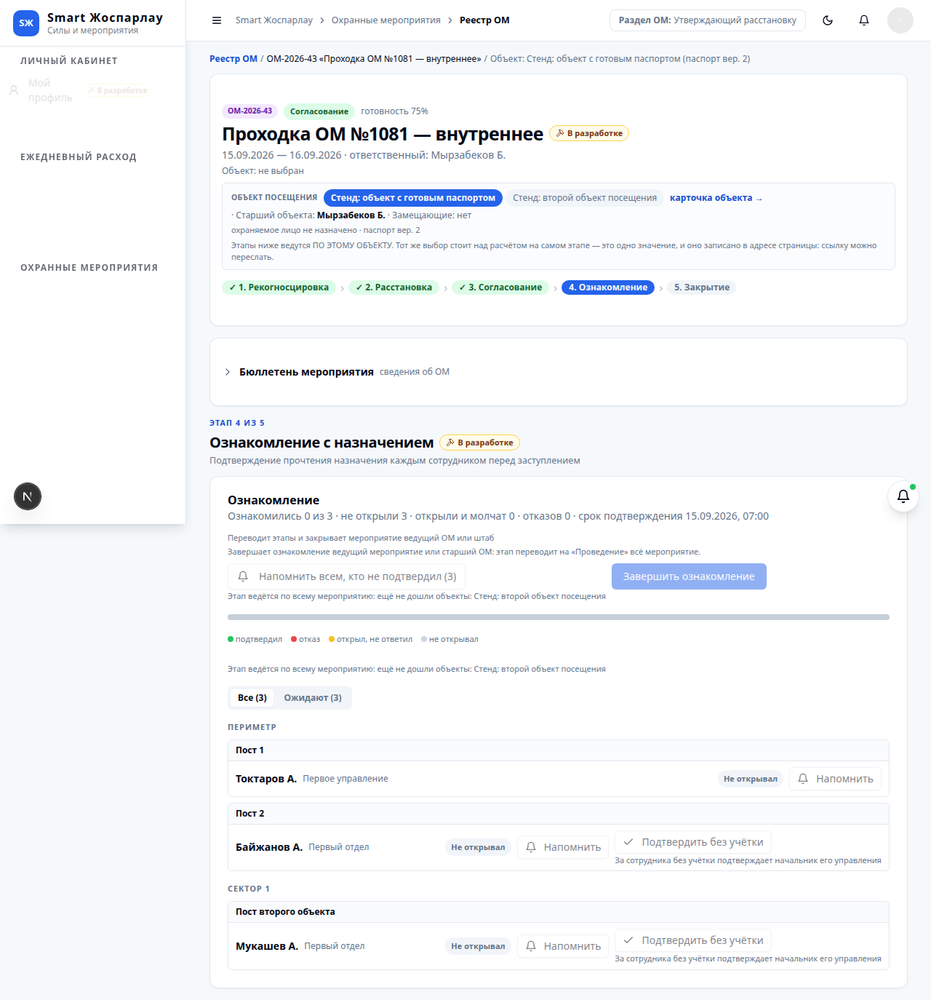

*Учебный экран 9–10 сентября 2026 года. Видно число ознакомленных, ожидающих и отказов.*

---

## Шаг 13. Поставьте оценки и закройте объект

**Кто делает:** старший объекта — **после** того, как работа реально закончилась.

1. Откройте свой объект и этап **«Закрытие»**.
2. В блоке **«Оценка сотрудников»** отметьте тех, кто действительно работал.
3. Поставьте каждому оценку. Если нужно — добавьте пояснение.
4. Проверьте записанные замечания и происшествия.
5. Нажмите **«Закрыть объект»**, прочитайте подтверждение, добавьте итоговый комментарий и подтвердите.

**✅ Получилось, если:** объект отмечен как закрытый. Когда закрыты все объекты — закрыто и мероприятие.

**⚠️ Частая ошибка:** закрыть объект «пораньше, чтобы не забыть». После закрытия обычное изменение данных объекта недоступно — проверяйте всё до нажатия.

> Сотрудник может посмотреть свою работу и оценку: **«Мой профиль»** → **«История»**. Если оценки пока нет — это не ноль, это значит «ещё не поставили».

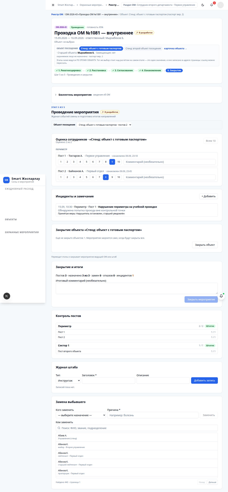

*Учебный экран 9–10 сентября 2026 года. Оценки и происшествия на последнем этапе объекта.*

---
---

# ЧАСТЬ 2Б. ЕСЛИ ГОСТЬ ИНОСТРАННЫЙ: КАРТОЧКА ВИЗИТА

## Простыми словами

Всё, что описано выше, остаётся в силе — объекты, посты, подписи, ознакомление. Но к мероприятию добавляется **ещё одна папка**: карточка визита.

Представьте, что к вам едет гость из другой страны. Мало знать, где он выступает. Нужно знать: когда прилетает и каким рейсом, кто его встречает, где он живёт, кто с ним приехал, какие машины ему выделены, кто из наших его сопровождает. Всё это и есть карточка визита. По ней потом печатают документ.

**Где эта карточка вклинивается в общий путь:**

> Шаг 1 (бюллетень, тип «С участием иностранцев») → **карточка визита заполняется параллельно шагам 2–3** → утверждается до проведения → дальше всё как обычно

У **внутреннего** мероприятия карточки визита нет вообще. Если вы откроете её у внутреннего ОМ, система честно напишет: «визита у него нет».

---

## Шаг В1. При создании укажите тип и старшего ГВО

**Кто делает:** сотрудник второго департамента, в том же окне, что и в шаге 1.

1. В окне **«Создать бюллетень»** выберите тип **«С участием иностранцев»**.
2. Выберите охраняемое лицо из справочника — иностранного гостя.
3. Заполните страну и город.
4. Заполните дату и время прилёта, рейс или тип борта, если они известны.
5. Заполните поле **«Старший ГВО»** — это человек, который будет вести карточку визита.
6. Создайте бюллетень.

**✅ Получилось, если:** в реестре у мероприятия стоит тип «С участием иностранцев», а в поле старшего ГВО есть фамилия.

**⚠️ Частая ошибка:** оставить тип «Внутреннее» у визита иностранного гостя. Тогда карточки визита просто не будет, и заполнять станет нечего.

---

## Шаг В2. Найдите визит в реестре

**Кто делает:** старший ГВО или тот, кто ведёт визит.

1. Откройте **«Реестр ОМ»**.
2. Вверху переключите вкладку с **«Мероприятия»** на **«Визиты иностранных ОЛ»**.
3. Здесь только мероприятия с иностранными гостями. Переключатель **«Мои» / «Все»** показывает либо ваши визиты, либо все.
4. В таблице видно: мероприятие, страна и охраняемое лицо, прибытие и убытие, старший ГВО, состав и состояние сводки.
5. Обратите внимание на цветную метку в колонке «Сводка»: например, **«Черновик · заполнено 4 из 6»**.
6. Нажмите **«Сводные данные →»** в конце строки.

**✅ Получилось, если:** открылась страница визита с заголовком «Сводные данные ГВО».

**⚠️ Частая ошибка:** искать визит на обычной вкладке «Мероприятия» и решить, что его не завели. Визиты живут на соседней вкладке.

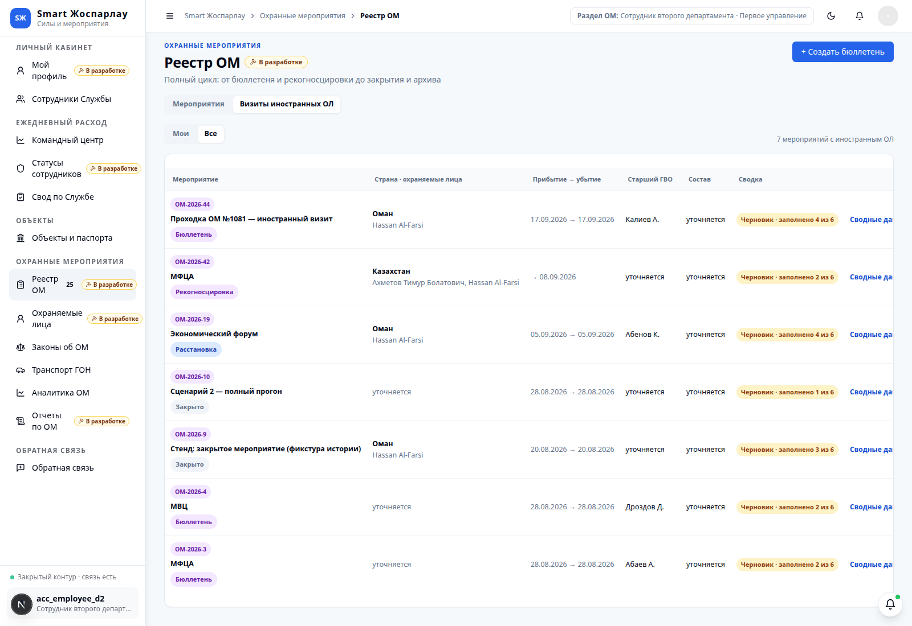

*Учебный экран 9–10 сентября 2026 года. В колонке «Сводка» видны метки «Черновик · заполнено 4 из 6», справа — ссылка на сводные данные.*

---

## Шаг В3. Заполните сводные данные визита

**Кто делает:** старший ГВО.

Вся страница правится **одной кнопкой**: нельзя править блоки по отдельности.

1. Вверху справа в карточке нажмите **«Редактировать»** — все поля станут доступны для ввода.
2. Заполняйте блоки сверху вниз, они идут в том же порядке, что и в печатном документе:
   - **Охраняемые лица** — гость: должность, фамилия, страна. Можно загрузить фотографию.
   - **Прибытие / тип борта** и **Убытие / тип борта** — две колонки: дата, время, маршрут, рейс, кто встречает и кто провожает.
   - **Организация** — место проживания, номер, руководитель службы безопасности делегации, вооружение, вариант охраны, канал связи, пожелания и состав делегации.
   - **Состав ГВО СГО РК** — наши люди: ответственный, старший ГВО, группы и сотрудники с позывными.
   - **Выделяемый транспорт** — кнопка **«+ Машина из реестра»**: марка, госномер, водитель.
   - **Объекты посещения** — кнопка **«+ Добавить объект»**: куда гость поедет и когда.
3. Людей и машины **выбирайте из справочников**, а не вписывайте текстом. Кнопка «Выбрать из списка» есть у нужных полей.
4. Нажмите **«Сохранить»**.

**✅ Получилось, если:** появилась надпись об успешном сохранении, а поля показывают введённые значения.

**⚠️ Частая ошибка:** заполнить половину полей и закрыть страницу, не нажав «Сохранить». Тогда всё введённое пропадёт.

> Если вы всё испортили и хотите начать заново — есть кнопка **«Вернуть исходные»**. Она отменяет ваши правки и возвращает данные к прежнему виду.

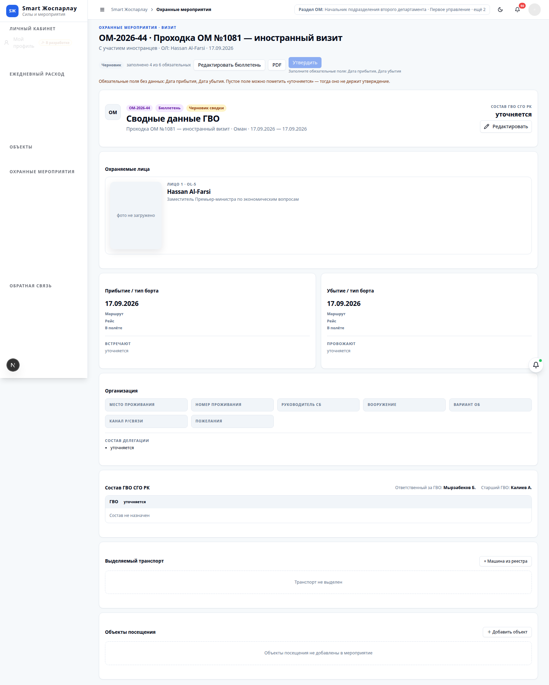

*Учебный экран 9–10 сентября 2026 года. Вверху — метка «Черновик», надпись «заполнено 4 из 6 обязательных» и предупреждение, каких полей не хватает.*

---

## Шаг В4. Если данных ещё нет — пометьте «уточняется»

**Кто делает:** старший ГВО.

Часто принимающая сторона ещё не сообщила рейс или гостиницу. Выдумывать нельзя, а пустое поле мешает утвердить визит. Для этого есть отметка **«уточняется»**.

1. Найдите поле, данных для которого пока нет.
2. Поставьте у него отметку **«уточняется»**.
3. Сохраните.
4. В печатном документе в этом месте так и будет напечатано словом: «уточняется».

**✅ Получилось, если:** поле показывает «уточняется», а счётчик обязательных полей перестал считать его незаполненным.

**⚠️ Частая ошибка:** писать слово «уточняется» руками в обычное поле или ставить прочерк. Система такое не понимает — используйте именно отметку.

---

## Шаг В5. Проверьте готовность и утвердите визит

**Кто делает:** заполняет старший ГВО, утверждает Штаб или руководство второго департамента.

1. Посмотрите на шапку страницы. Там три подсказки:
   - метка состояния: **«Черновик»**, **«Заполнен»** или **«Утверждён»**;
   - счётчик: **«заполнено 4 из 6 обязательных»**;
   - оранжевая строка со списком незаполненных полей — например, «Дата прибытия, Дата убытия».
2. Заполните перечисленные поля или пометьте их «уточняется».
3. Когда счётчик покажет, что заполнено всё, нажмите **«Утвердить»**.
4. Метка сменится на зелёную **«Утверждён»**, рядом появится дата и время утверждения.

**✅ Получилось, если:** метка зелёная, написано «Утверждён» и указано время.

**⚠️ Частая ошибка:** жать на серую кнопку «Утвердить» и не понимать, почему ничего не происходит. Рядом с кнопкой система пишет причину: «Заполните обязательные поля: …», «Визит уже утверждён», «Утверждает штаб», «Сводка ещё загружается». Прочитайте её — в ней ответ.

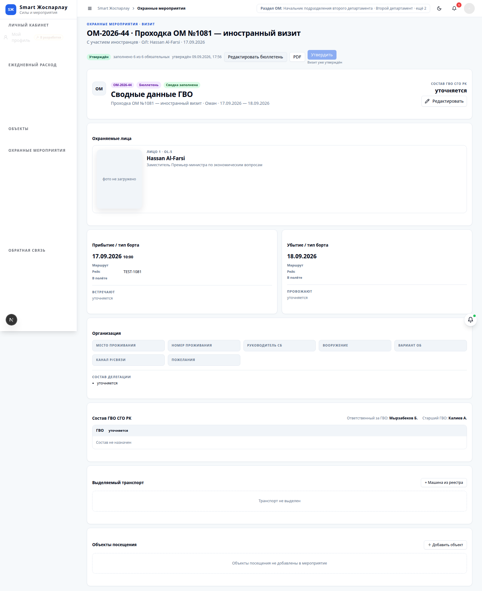

*Учебный экран 9–10 сентября 2026 года. После утверждения кнопка «Утвердить» гаснет с подсказкой «Визит уже утверждён».*

---

## Шаг В6. Выгрузите документ

**Кто делает:** старший ГВО или тот, у кого открыт визит.

1. В шапке страницы нажмите кнопку **«PDF»**.
2. Дождитесь надписи «Собираем…» — документ готовится.
3. Файл сохранится на ваш компьютер. Откройте и проверьте его.
4. Если нужно поправить сведения бюллетеня — даты, название, гостя, — нажмите **«Редактировать бюллетень»** прямо в шапке визита.

**✅ Получилось, если:** файл скачался и в нём те же данные, что на экране.

**⚠️ Частая ошибка:** выгрузить документ из черновика и отдать его дальше. Сначала доведите сводку до состояния «Утверждён».

---

## Что дальше после карточки визита

Дальше — обычный путь мероприятия из проходки 2: объекты и старшие (шаг 2), осмотр (шаг 3), запрос людей (шаги 4–7), распределение и расстановка (шаги 8–9), две подписи (шаг 10), ознакомление (шаги 11–12), закрытие и оценки (шаг 13).

Карточка визита эти шаги не заменяет. Она добавляется к ним.

---
---

# ЕСЛИ ЧТО-ТО НЕ ПОЛУЧАЕТСЯ

**Кнопка серая и не нажимается.** Это почти всегда не поломка. Рядом с кнопкой или под ней система пишет причину словами. Прочитайте её.

**Список пустой, хотя там должны быть люди.** Скорее всего, предыдущий человек в цепочке ещё не нажал свою кнопку. Проверьте, на каком шаге стоит работа, и спросите у него.

**Нужного раздела нет в меню.** Значит, эта работа поручена не вам. Если вы уверены, что должна быть, — обратитесь к администратору.

**Данные не те, что вчера.** Проверьте дату вверху экрана. Больше половины непониманий — из-за разных дат у разных людей.

**Ничего не помогло.** Сообщите ответственному и опишите пять вещей:

1. под каким именем вошли;
2. какой раздел открыли;
3. какую дату, человека или мероприятие выбрали;
4. что нажали;
5. что увидели на экране.

Приложите снимок экрана с сообщением об ошибке. **Не нажимайте кнопку отправки много раз подряд** — это создаёт лишние записи, в которых потом трудно разобраться.

---

## Две проходки одной картинкой

**Проходка 1 — ежедневный расход, каждый день:**

> выбрал день → проверил людей → **сдал день** → ответственный увидел, кто сдал → **собрал свод** → **отправил дежурному** → видно по всей Службе

**Проходка 2 — охранное мероприятие, от начала до конца:**

> бюллетень → объекты и старшие → осмотр объекта → запрос людей → фамилии → распределение по объектам → расстановка по постам → две подписи → ознакомление → проведение → закрытие и оценки

**Если гость иностранный, к проходке 2 добавляется:**

> тип «С участием иностранцев» и старший ГВО → вкладка «Визиты иностранных ОЛ» → заполнить сводные данные → пометить неизвестное «уточняется» → утвердить → выгрузить PDF
