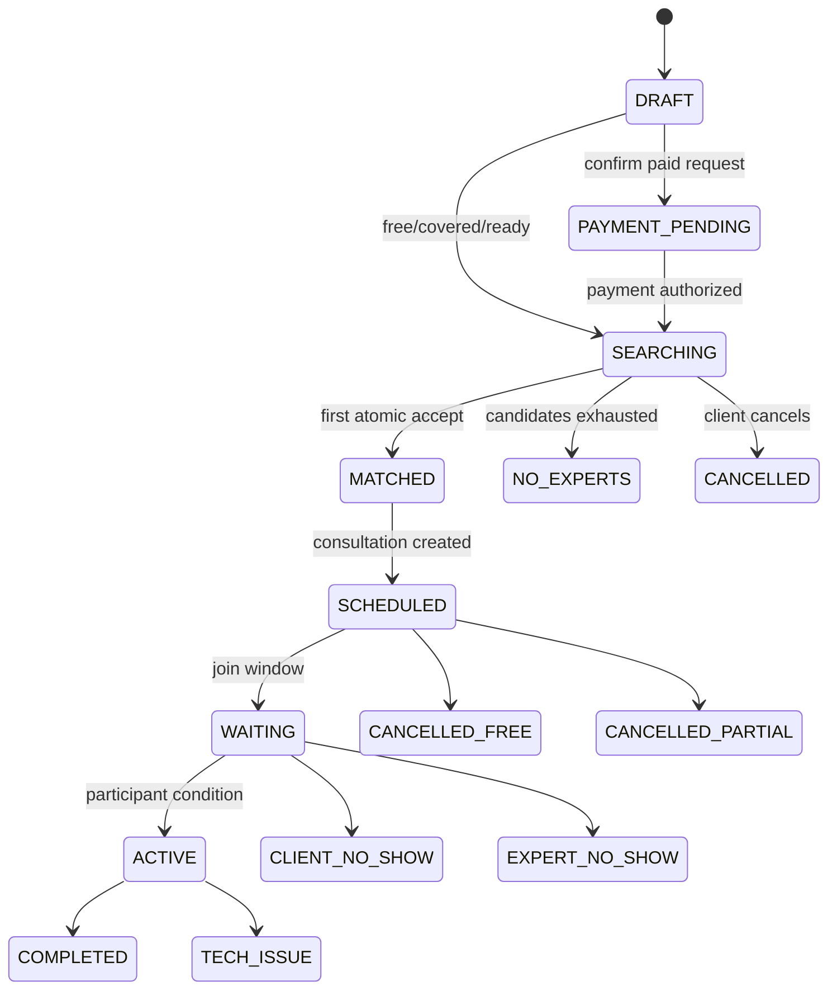
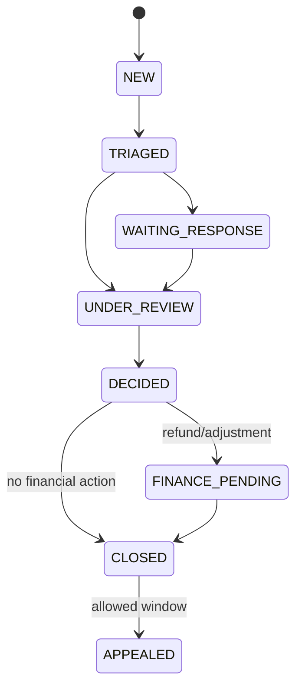
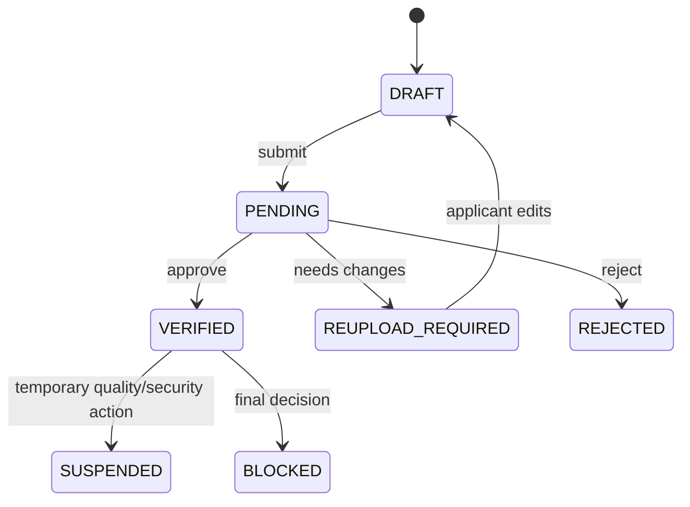
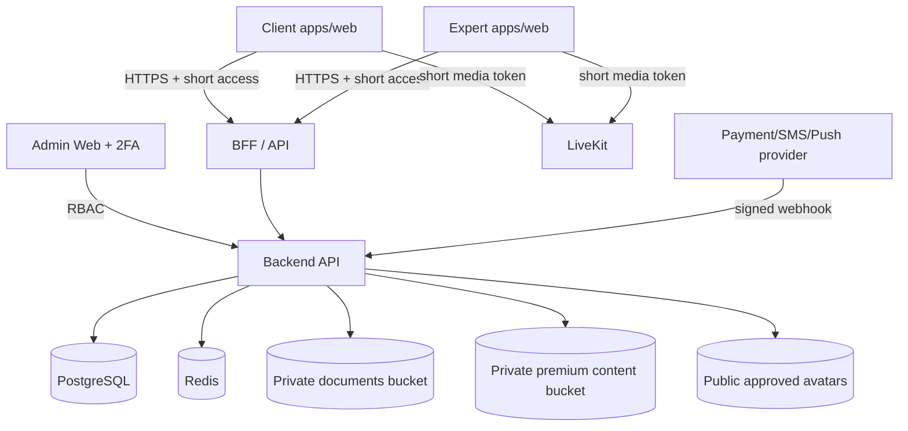

# SmartQoldau Product & Frontend Blueprint — COMPLETE
Generated 2026-09-13; repo snapshot `7cc08784eca34402f4b9a8ade42d858724fbeb8d`; code not changed.
# SmartQoldau — итоговый отчёт бизнес- и frontend-blueprint

**Дата:** 2026-09-13  
**Репозиторий:** `main@7cc08784`  
**Код изменён:** нет.

## 1. Главный диагноз

Проект уже содержит значительную реализацию Fable, поэтому главная угроза срокам — не нехватка кода, а расхождение бизнес-канона, прототипа и четырёх frontend-поверхностей.

Критические источники будущих переделок:

1. конфликт цены и преимуществ Premium;
2. маркетинговое обещание подключения за 1–2 минуты;
3. «полная анонимность» вместо псевдонимности;
4. публичный отзыв и приватная оценка качества смешаны;
5. cancellation/no-show/payment модель не утверждена как единый канон;
6. Expert Mobile и Expert Web пересекаются без явного primary ownership;
7. B2B/B2G прототип выглядит готовым, но операционная и backend-модель неполны;
8. visual parity v2 не доказана системными screenshot/device tests;
9. часть planning Fable находится в недоступном локальном SmartQoldau Obsidian;
10. admin prototype содержит модули, для которых README отмечает backend gaps.

## 2. Что сохранить

- текущую модульную backend-реализацию и тестовые инварианты;
- Flutter client/expert apps и общий пакет;
- Next.js SSR/BFF/httpOnly архитектуру;
- admin RBAC/TOTP/operational queues;
- profile moderation и private/public storage separation;
- Premium content entitlement на сервере;
- атомарный matching и realtime foundation;
- визуальный язык prototype v2;
- методологию Fable: source hierarchy, plan-before-code, click-map, decision log, GO/NO-GO.

## 3. Что утвердить до следующего coding release

- PD-001…PD-020;
- psychology-only MVP;
- Premium 2 990/23 900 без бесплатных консультаций;
- pseudonymous client model;
- Expert Mobile/Web ownership;
- cancellation/no-show/provider model;
- 18+ и crisis copy;
- RU/KK locale convention;
- один канонический screen registry.

## 4. Рекомендуемая последовательность

1. **R0:** сверка с локальным Obsidian, решения, visual baselines.
2. **R1:** закончить и доказать core client/expert/admin/public flow.
3. **R2:** деньги, звонки на устройствах, complaints/refunds, admin operations.
4. **R3:** Premium, контент, reviews, privacy operations и метрики.
5. **R4:** B2B pilot.
6. **R5:** B2G pilot.
7. **R6:** legal/wearables/AI как отдельные исследования.

## 5. Масштаб blueprint

| Артефакт | Количество |
| --- | --- |
| Роли | 19 |
| Use cases | 112 |
| Бизнес-процессы | 28 |
| Бизнес-правила | 100 |
| State machines | 15 |
| Prototype screens | 106 |
| Epics | 17 |
| Stories | 95 |

## 6. Следующая практическая команда Fable

```text
Прочитай docs/product-blueprint/00_INDEX.md и 23_IMPLEMENTATION_OPERATING_RULES.md.
Сверь этот пакет с локальным smart_qoldau_vault/WIKI/planning.
Не меняй код. Подготовь один reconciliation report: совпадения, конфликты,
уникальные утверждённые решения и предлагаемая каноническая версия.
Заверши строкой R0 RECONCILIATION READY — CODE NOT CHANGED.
```

После утверждения reconciliation:

```text
BUSINESS AND FRONTEND CANON APPROVED — START R1 DELTA IMPLEMENTATION
```


---

# 00. Индекс blueprint

**Продукт:** SmartQoldau  
**Дата:** 2026-09-13  
**Кодовая точка:** `7cc08784eca34402f4b9a8ade42d858724fbeb8d`  
**Статус:** `BLUEPRINT COMPLETE — CODE NOT CHANGED`

## Документы

| Файл | Назначение | Статус |
| --- | --- | --- |
| 01_SOURCE_MAP_AND_FABLE_WORK_REVIEW.md | Источники, текущее состояние и использованные методы Fable. | READY |
| 02_EXECUTIVE_PRODUCT_DECISIONS.md | 20 рекомендуемых канонических решений. | READY |
| 03_PRODUCT_SCOPE_AND_BUSINESS_MODEL.md | Продукт, value, scope и revenue model. | READY |
| 04_ROLES_PERMISSIONS_JTBD.md | 19 ролей и permission boundaries. | READY |
| 05_USE_CASE_CATALOG.md | 112 подробных use cases. | READY |
| 06_BUSINESS_PROCESS_CATALOG.md | 28 сквозных бизнес-процессов. | READY |
| 07_BUSINESS_RULES_AND_POLICIES.md | 100 правил. | READY |
| 08_STATES_LIFECYCLES_AND_RACI.md | 15 state machines и RACI. | READY |
| 09_MONETIZATION_AND_UNIT_ECONOMICS.md | Формулы, settlement и коммерческие решения. | READY |
| 10_B2B_B2G_OPERATING_MODEL.md | Контракты, privacy, entitlement и supervision. | READY |
| 11_SAFETY_PRIVACY_AND_TRUST.md | Safety boundary, data classes и threat model. | READY |
| 12_METRICS_AND_OPERATIONS.md | North Star, funnels, queues и SLA. | READY |
| 13_FRONTEND_INFORMATION_ARCHITECTURE.md | IA всех поверхностей и границы mobile/web. | READY |
| 14_SCREEN_REGISTRY_AND_FRONTEND_DELTA.md | Реестр 106 экранов и current delta. | READY |
| 15_SCREEN_SPECIFICATIONS.md | Исполнимые specs каждого prototype screen. | READY |
| 16_DESIGN_SYSTEM_AND_VISUAL_CONTRACT.md | Токены, компоненты и visual acceptance. | READY |
| 17_RESPONSIVE_STATES_CONTENT_I18N.md | Responsive, states, copy, RU/KK. | READY |
| 18_BACKEND_SUPPORT_AND_GAP_MATRIX.md | Что поддержано и где API gaps. | READY |
| 19_RELEASE_PLAN_AND_BACKLOG.md | 17 epics и 95 stories. | READY |
| 20_QA_ACCEPTANCE_AND_CLICK_MAP.md | Testing, click-map, GO/NO-GO. | READY |
| 21_TRACEABILITY_MATRIX.md | Use case→rules→screens→release→epic. | READY |
| 22_DECISION_LOG_RISKS_AND_OPEN_QUESTIONS.md | Риски и блокирующие вопросы. | READY |
| 23_IMPLEMENTATION_OPERATING_RULES.md | Правила последующей AI-разработки. | READY |

## Machine-readable

- `machine/product-manifest.yaml`
- `machine/roles.yaml`
- `machine/use-cases.yaml`
- `machine/business-processes.yaml`
- `machine/business-rules.yaml`
- `machine/state-catalog.yaml`
- `machine/screen-manifest.yaml`
- `machine/route-manifest.yaml`
- `machine/traceability.yaml`
- `machine/epics.yaml`
- `machine/decisions.yaml`
- `machine/risks.yaml`
- `machine/open-questions.yaml`
- `machine/frontend-delta.yaml`

## Порядок исполнения

1. Сверить пакет с недоступным локальным SmartQoldau Obsidian vault.
2. Утвердить решения из документа 02.
3. Зафиксировать visual baselines по документам 14–17.
4. Исполнять backlog 19 по правилам 23.
5. Каждый релиз принимать через документ 20.


---

# 01. Источники, канон и разбор работ Fable

**Дата фиксации:** 2026-09-13  
**GitHub snapshot:** `7cc08784eca34402f4b9a8ade42d858724fbeb8d`  
**Статус:** blueprint; продуктовый код не изменялся.

## 1. Источники

| ID | Источник | Роль | Приоритет | Ограничение |
| --- | --- | --- | --- | --- |
| SRC-001 | SmartQoldau prototype v2 | Визуальный эталон, перечень экранов, демонстрационные переходы и тексты | 3 | Не является каноном цен, статусов, прав, SLA и юридических обещаний; содержит противоречия и экспериментальные функции. |
| SRC-002 | Prototype data dictionary | Нормализованная предметная модель прототипа | 2 | Производный документ; требует сверки с текущим кодом и решениями владельца. |
| SRC-003 | Текущий репозиторий SmartQoldau | Факт as-is: реализованные приложения, контракты, тесты и ограничения | 2 | Код показывает поведение, но сам по себе не утверждает коммерческие и юридические решения. |
| SRC-004 | CLAUDE.md и README приложений | Зафиксированные Fable решения, зоны ответственности и известный долг | 1 | Часть ссылок ведёт в локальное Obsidian-хранилище, которого нет в переданном SmartQoldau архиве. |
| SRC-005 | Fable vault Smart Josparlau | Методология: канон, планы до кода, журнал решений, click-map, role-by-role acceptance, NO-GO gates | 4 | Другой продукт. Его предметные факты, роли и бизнес-правила не переносятся в SmartQoldau. |
| SRC-006 | Master prompt | Требования к составу данного blueprint | 1 | Промпт задаёт объём, но не заменяет анализ источников. |

## 2. Иерархия канона

1. Утверждённые решения владельца продукта и применимые юридические/безопасностные ограничения.
2. Фактическое поведение текущего кода, OpenAPI, миграций и автоматических тестов.
3. Нормализованные бизнес-правила данного blueprint.
4. Prototype v2 как визуальный эталон: layout, композиция, компоненты, плотность, эмоциональный тон.
5. Старые планы, demo data и маркетинговые тексты — только как evidence, если не конфликтуют с пунктами выше.

**Ключевое правило:** прототип не имеет права переопределять цену, статус, permission, SLA или юридическое обещание.

## 3. Что Fable уже реализовал в SmartQoldau

[FACT] На актуальном `main` присутствуют отдельные `app_client`, `app_expert`, `web`, `admin`, `backend`, `packages/shared`, `infra` и API-контракт. Это уже не greenfield.

| Поверхность | Текущее направление | Сильные стороны | Главный оставшийся риск |
| --- | --- | --- | --- |
| Client Mobile | Flutter `app_client` | router guards, guest/OTP, matching, каталог, booking, chat/call, content, Premium, notifications | визуальное соответствие v2 и реальные device tests звонков |
| Expert Mobile | Flutter `app_expert` | отдельный auth без guest, verification, offers, schedule, session, earnings, reviews, RU/KK | killed-state offer limitation, device acceptance, граница с Expert Web |
| Public/Client/Expert Web | Next.js `web` | SSR/SEO, локализация, BFF с httpOnly cookie, публичный каталог, кабинеты | визуальный drift между web и Flutter, единый screen registry |
| Admin | React/Vite `admin` | RBAC, TOTP flow, verification, profile moderation, reviews, payouts, tickets | dashboard/client block/dictionaries/ledger/B2B/B2G не должны симулироваться без API |
| Shared | Flutter `packages/shared` | API/models/design primitives и общая session logic | не превращать package в свалку platform-specific UI |
| Backend | NestJS/Prisma/Postgres/Redis/MinIO/LiveKit | значительный домен и тесты, privacy/security решения | README всё ещё частично starter-like; бизнес-канон находится вне репозитория |

## 4. Какие работы Fable прочитаны и использованы

Переданный `smart-josparlau-vault.zip` относится к другому продукту — Smart Josparlau/VAPS. Его предметные сущности и роли **не перенесены**. Из него использованы только проверенные подходы работы:

- явная карта источников и правило старшинства;
- разделение `[FACT]`, `[INFERENCE]`, `[RECOMMENDATION]`, `[DECISION]`, `[RISK]`;
- сначала макет/решение и критерии, затем код;
- route/role click-map с колонками Expected / Actual / Verdict / Evidence;
- различение места симптома и владельца дефекта;
- конкретные acceptance criteria вместо «улучшить UX»;
- журнал решений и visual changelog;
- role-by-role browser/device acceptance;
- GO/NO-GO по доказательствам, а не по ощущению;
- сохранение истории и запрет big-bang rewrite.

## 5. Недоступная часть прежней работы Fable

`CLAUDE.md` актуального репозитория ссылается на локальное Obsidian-хранилище `smart_qoldau_vault/WIKI/planning`, включая `11a_SCREEN_REGISTRY.md` и ADR-006. Само это SmartQoldau-хранилище в переданном архиве отсутствует; загруженный vault — Smart Josparlau.

Дополнительно проверен предыдущий Git-снимок до коммита переноса документации. В истории подтверждён перенос старого prototype v1, deeplinks и BMAD-инструментария, однако содержимое локального `WIKI/planning` через отслеживаемые файлы восстановить не удалось. Поэтому этот пакет не выдаёт предполагаемые решения Fable за прочитанные факты.

Следствие: перед началом следующего coding release нужно выполнить **одну сверку**, а не заново планировать продукт:

1. сравнить `WIKI/planning` с `docs/product-blueprint` этого пакета;
2. перенести уникальные утверждённые решения;
3. разрешить конфликт через владельца продукта;
4. объявить один screen registry каноническим;
5. не держать две параллельные версии требований.

## 6. Что нельзя делать дальше

- Не переписывать уже работающие приложения с нуля.
- Не сливать Expert Mobile и Expert Web до проверки реального usage.
- Не копировать demo prices/statuses из HTML напрямую.
- Не считать наличие красивого экрана доказательством backend support.
- Не рисовать B2B/B2G/admin dashboard на фиктивных данных.
- Не закрывать device acceptance unit/widget-тестами.
- Не называть server-side AES-шифрование end-to-end.
- Не обещать 1–2 минуты до накопления производственной статистики.


---

# 02. Исполнительные продуктовые решения

Этот документ сокращает число будущих поправок: для каждого противоречия выбран один рекомендуемый канон. Решения со статусом `REQUIRES_*` нельзя выдавать за юридически/клинически подтверждённые.

## Быстрый approval-пакет

| ID | Тема | Статус | Владелец |
| --- | --- | --- | --- |
| PD-001 | Вертикаль MVP | RECOMMENDED_FOR_APPROVAL | Product Owner |
| PD-002 | Продуктовые поверхности | APPROVE_AS_CANON | Product Owner |
| PD-003 | Граница Expert Mobile / Expert Web | RECOMMENDED_FOR_APPROVAL | Product Owner + UX Lead |
| PD-004 | Граница Client Mobile / Client Web | RECOMMENDED_FOR_APPROVAL | Product Owner + UX Lead |
| PD-005 | Premium | RECOMMENDED_FOR_APPROVAL | Commercial Owner |
| PD-006 | Цена консультации | RECOMMENDED_FOR_APPROVAL | Commercial Owner |
| PD-007 | Анонимность | RECOMMENDED_FOR_APPROVAL | Privacy Owner + Legal |
| PD-008 | Отзывы и качество | RECOMMENDED_FOR_APPROVAL | Quality Lead |
| PD-009 | Обещание скорости подбора | RECOMMENDED_FOR_APPROVAL | Product Owner + Marketing |
| PD-010 | Отмена и no-show | REQUIRES_LEGAL_VALIDATION | Legal + Finance |
| PD-011 | Модель оплаты | REQUIRES_PROVIDER_VALIDATION | Finance + Backend Lead |
| PD-012 | Время | APPROVE_AS_CANON | Product Owner |
| PD-013 | Языки запуска | RECOMMENDED_FOR_APPROVAL | Product Owner + Localization Owner |
| PD-014 | Несовершеннолетние | REQUIRES_LEGAL_VALIDATION | Legal |
| PD-015 | Кризисный сценарий | REQUIRES_SAFETY_REVIEW | Clinical/Safety Owner |
| PD-016 | B2B-конфиденциальность | RECOMMENDED_FOR_APPROVAL | Privacy Owner + B2B Owner |
| PD-017 | B2G и практиканты | DEFER_TO_RELEASE_5 | Product Owner + University Partner |
| PD-018 | Wearables/AI-анализ | DEFER_TO_RESEARCH | Product Owner + Safety Owner |
| PD-019 | Admin RBAC | RECOMMENDED_FOR_APPROVAL | Security Owner |
| PD-020 | Канон frontend | APPROVE_AS_CANON | Product Owner + Design Lead |

## Решения подробно

### PD-001 — Вертикаль MVP

**Решение:** Запускать MVP только как платформу психологической помощи; юридическую помощь вынести в отдельный будущий vertical discovery.

**Почему:** Психология подтверждена прототипом и текущими приложениями; юридическая вертикаль требует других ролей, договоров, классификации рисков и контента.

**Статус:** `RECOMMENDED_FOR_APPROVAL`  
**Владелец подтверждения:** Product Owner
### PD-002 — Продуктовые поверхности

**Решение:** Сохранить пять поверхностей: Public Web, Client Mobile, Expert Mobile, Expert Web, Admin Web.

**Почему:** Они уже реализуются отдельно; объединение сейчас создаст регрессии и задержку.

**Статус:** `APPROVE_AS_CANON`  
**Владелец подтверждения:** Product Owner
### PD-003 — Граница Expert Mobile / Expert Web

**Решение:** Expert Mobile — офферы, доступность, уведомления, быстрые сессии; Expert Web — профиль, документы, расписание, история, аналитика и финансы. Пересекающиеся функции допускаются только для continuity, а не как два независимых продукта.

**Почему:** Убирает дублирование и определяет, где появляется новая функция первой.

**Статус:** `RECOMMENDED_FOR_APPROVAL`  
**Владелец подтверждения:** Product Owner + UX Lead
### PD-004 — Граница Client Mobile / Client Web

**Решение:** Client Mobile — основной продукт консультации; Client Web — desktop-доступ и parity по критическим сценариям, но не отдельный набор правил.

**Почему:** Один домен и один API, различается только presentation.

**Статус:** `RECOMMENDED_FOR_APPROVAL`  
**Владелец подтверждения:** Product Owner + UX Lead
### PD-005 — Premium

**Решение:** Канон: 2 990 ₸/мес или 23 900 ₸/год; преимущества — приоритетный подбор и Premium-контент. Консультации не входят и не становятся бесплатными.

**Почему:** Совпадает с data dictionary и текущим web README; устраняет конфликт с 4 990 ₸ в старом публичном прототипе.

**Статус:** `RECOMMENDED_FOR_APPROVAL`  
**Владелец подтверждения:** Commercial Owner
### PD-006 — Цена консультации

**Решение:** Специалист задаёт цену в диапазоне 15 000–35 000 ₸; цена фиксируется snapshot при матче/бронировании. Практикант — 0 ₸ или контрактная льготная цена.

**Почему:** Предотвращает перерасчёт уже подтверждённой сессии.

**Статус:** `RECOMMENDED_FOR_APPROVAL`  
**Владелец подтверждения:** Commercial Owner
### PD-007 — Анонимность

**Решение:** Использовать псевдонимность: платформа знает внутреннюю идентичность, специалист видит код клиента. Guest может изучать продукт, но платная/сохраняемая консультация требует защищённой учётной записи или контролируемой guest-сессии.

**Почему:** Фраза «полная анонимность» юридически и технически рискованна.

**Статус:** `RECOMMENDED_FOR_APPROVAL`  
**Владелец подтверждения:** Privacy Owner + Legal
### PD-008 — Отзывы и качество

**Решение:** Разделить публичный отзыв (оценка + модерируемый текст) и приватную оценку качества для команды. Не публиковать чувствительные подробности консультации.

**Почему:** Устраняет конфликт прототипа между публичными отзывами и закрытой обратной связью.

**Статус:** `RECOMMENDED_FOR_APPROVAL`  
**Владелец подтверждения:** Quality Lead
### PD-009 — Обещание скорости подбора

**Решение:** Не обещать «1–2 минуты» или «до 2 минут» как SLA до накопления статистики. Канон copy: «обычно несколько минут; зависит от доступности».

**Почему:** Прототип содержит маркетинговое обещание без доказанной операционной гарантии.

**Статус:** `RECOMMENDED_FOR_APPROVAL`  
**Владелец подтверждения:** Product Owner + Marketing
### PD-010 — Отмена и no-show

**Решение:** Базовое правило: >2 часов — 100% возврат; <2 часов — 50% возврат клиенту и 50% компенсация специалисту; no-show специалиста — 100% возврат; техническая вина платформы — 100% возврат.

**Почему:** Уже отражено в словаре прототипа; требуется юридическое подтверждение оферты.

**Статус:** `REQUIRES_LEGAL_VALIDATION`  
**Владелец подтверждения:** Legal + Finance
### PD-011 — Модель оплаты

**Решение:** На запуске: авторизация/hold до сессии, capture по завершению или согласно политике отмены; все операции идемпотентны и сверяются reconciliation job.

**Почему:** Снижает споры и поддерживает возвраты/no-show. Точный сценарий зависит от платёжного провайдера.

**Статус:** `REQUIRES_PROVIDER_VALIDATION`  
**Владелец подтверждения:** Finance + Backend Lead
### PD-012 — Время

**Решение:** Backend хранит UTC; интерфейсы явно показывают Asia/Almaty, пока продукт запускается в Казахстане.

**Почему:** Уже применено в плановых консультациях клиента; предотвращает ошибки записи.

**Статус:** `APPROVE_AS_CANON`  
**Владелец подтверждения:** Product Owner
### PD-013 — Языки запуска

**Решение:** RU и KK обязательны с паритетом ключей; EN — после запуска. Использовать код locale `ru|kk` во frontend и единое отображение «Қазақша», не смешивать `kz/kk` без адаптера.

**Почему:** Текущие приложения уже имеют RU/KK, но route-код web использует kz. Нужна явная граница представления/домена.

**Статус:** `RECOMMENDED_FOR_APPROVAL`  
**Владелец подтверждения:** Product Owner + Localization Owner
### PD-014 — Несовершеннолетние

**Решение:** До юридически подтверждённого consent-процесса сервис 18+. Возраст и согласие проверяются до первой консультации.

**Почему:** Психологическая помощь несовершеннолетним требует отдельной модели законного представителя.

**Статус:** `REQUIRES_LEGAL_VALIDATION`  
**Владелец подтверждения:** Legal
### PD-015 — Кризисный сценарий

**Решение:** SmartQoldau не является экстренной службой. При непосредственной угрозе показывать 102/103 и утверждённые горячие линии; не обещать, что подбор специалиста заменяет экстренную помощь.

**Почему:** Это критичная граница безопасности.

**Статус:** `REQUIRES_SAFETY_REVIEW`  
**Владелец подтверждения:** Clinical/Safety Owner
### PD-016 — B2B-конфиденциальность

**Решение:** Работодатель видит только агрегированную статистику, использование пула и финансовые данные; не видит темы, специалиста, сообщения, диагнозы и факт конкретной консультации без отдельного законного основания.

**Почему:** Ключевой trust-инвариант корпоративной модели.

**Статус:** `RECOMMENDED_FOR_APPROVAL`  
**Владелец подтверждения:** Privacy Owner + B2B Owner
### PD-017 — B2G и практиканты

**Решение:** B2G запускать после core marketplace. Практикант — отдельная роль с ограниченными темами, явным согласием клиента, назначенным супервайзером и журналом часов.

**Почему:** Прототип показывает идею, но текущая операционная модель неполна.

**Статус:** `DEFER_TO_RELEASE_5`  
**Владелец подтверждения:** Product Owner + University Partner
### PD-018 — Wearables/AI-анализ

**Решение:** Экран анализа состояния по часам не входит в MVP и не должен использовать медицинские формулировки без клинической валидации.

**Почему:** Это экспериментальная функция с высоким privacy/medical risk.

**Статус:** `DEFER_TO_RESEARCH`  
**Владелец подтверждения:** Product Owner + Safety Owner
### PD-019 — Admin RBAC

**Решение:** Канон ролей сотрудников: VERIFICATION_OPERATOR, SUPPORT_OPERATOR, QUALITY_TEAM, FINANCE_CONTROL, CONTENT_MANAGER, B2B_MANAGER, SUPERADMIN. SUPERADMIN не заменяет аудит.

**Почему:** Расширяет уже реализованную RBAC-модель и разносит чувствительные полномочия.

**Статус:** `RECOMMENDED_FOR_APPROVAL`  
**Владелец подтверждения:** Security Owner
### PD-020 — Канон frontend

**Решение:** Бизнес-решения и API имеют приоритет над прототипом; прототип v2 имеет приоритет для layout, композиции, визуального языка и эмоционального тона. Любое осознанное отклонение фиксируется в visual changelog.

**Почему:** Прямо предотвращает перенос устаревшей цены/обещаний и одновременно защищает визуальную цельность.

**Статус:** `APPROVE_AS_CANON`  
**Владелец подтверждения:** Product Owner + Design Lead


## Approval gate R0

R0 считается закрытым, когда владелец продукта:

- утверждает или заменяет PD-001…PD-020;
- отдельно получает legal/safety/provider validation для PD-010, PD-011, PD-014 и PD-015;
- назначает owner каждому нерешённому пункту;
- запрещает дальнейшее использование противоречащего demo copy.

Рекомендуемая команда после утверждения:

```text
BUSINESS AND FRONTEND CANON APPROVED — START R1 DELTA IMPLEMENTATION
```


---

# 03. Product scope и бизнес-модель

## 1. Определение продукта

**SmartQoldau** — двуязычная цифровая платформа конфиденциальной психологической поддержки, которая соединяет клиента с проверенным специалистом для чата, аудио- или видеоконсультации, поддерживает плановую запись, безопасный urgent flow и библиотеку самопомощи.

### Проблема

- человеку трудно быстро выбрать проверенного специалиста;
- стигма и страх раскрытия личности мешают обратиться;
- качество, доступность, оплата и спорные случаи непрозрачны;
- специалистам сложно управлять спросом, расписанием, верификацией и выплатами в одном месте;
- компаниям и вузам нужен доступ без нарушения конфиденциальности конечного пользователя.

### Ценность

| Сегмент | Основная ценность | Доказуемый результат |
| --- | --- | --- |
| Клиент | понятный и конфиденциальный путь от потребности до сессии | успешный match/booking, completed session, понятный outcome |
| Специалист | проверенный поток заявок и операционный кабинет | accepted offers, загрузка расписания, прозрачный net income |
| Компания | доступ сотрудников без индивидуального надзора | utilization и aggregate quality без re-identification |
| Вуз/ведомство | управляемая практика под супервизией | verified students, approved hours, safety compliance |
| Платформа | marketplace revenue + subscription + contracts | contribution margin при приемлемом quality/refund rate |

## 2. Чем продукт не является

- экстренной медицинской/психиатрической службой;
- системой постановки диагноза;
- гарантией результата терапии;
- полностью анонимным сервисом в техническом смысле;
- юридическим marketplace в MVP;
- медицинским wearable-анализатором в MVP;
- работодателем специалистов, если договорная модель не определяет иное.

## 3. Scope по релизам

| Release | Цель | Входит | Не входит |
| --- | --- | --- | --- |
| R0 | Канон | решения, роли, правила, screen registry, visual baseline | изменение runtime-кода |
| R1 | Core marketplace | identity, safety boundary, тема/формат, каталог, instant match, offers, chat, completion, RU/KK | полноценные деньги, B2B/B2G, wearables |
| R2 | Transaction-ready | booking, schedule, payments/refunds/payouts, audio/video device acceptance, complaints/support, admin operations | Premium growth, B2B/B2G |
| R3 | Retention и monetization | reviews split, Premium, content, privacy operations, metrics | B2B/B2G full lifecycle |
| R4 | B2B | lead, contract, pool, employee entitlement, aggregate reporting | individual employer analytics |
| R5 | B2G | student, supervisor, restrictions, consent, hours, reporting | heavy/crisis topics for interns |
| R6 | Research | legal vertical, wearables, AI discovery | автоматический production launch |

## 4. Основные продуктовые петли

1. **Client value loop:** потребность → безопасный выбор → match/booking → сессия → quality feedback → повторное обращение.
2. **Expert supply loop:** verification → availability → offer → качественная сессия → rating/earnings → удержание.
3. **Marketplace trust loop:** eligibility → прозрачная цена → корректный settlement → complaint resolution → улучшение качества.
4. **Content loop:** безопасный контент → progress → повторное использование → Premium conversion, без замены профессиональной помощи.
5. **B2B loop:** contract → private entitlement → aggregate value proof → renewal.

## 5. Каналы дохода

- комиссия с settled консультаций;
- абонентская плата экспертных тарифов, если коммерчески утверждена;
- Premium клиента;
- B2B session pool / subscription contract;
- B2G договор или финансирование программы;
- будущие verticals только через отдельный бизнес-кейс.

## 6. Критические инварианты доверия

- специалист видит client code, а не избыточную идентичность;
- работодатель/вуз не видит содержание и индивидуальные темы;
- цена и cancellation consequence известны до подтверждения;
- нет fake success при неопределённом результате;
- safety flow не скрывается за matching;
- роль в UI не заменяет server authorization;
- визуальная мягкость не маскирует реальные ограничения и риски.


---

# 04. Роли, JTBD и permission boundaries

## 1. Обозначения матрицы

- `R` — read;
- `C/U/D` — create/update/delete;
- `own` — только собственные данные;
- `assigned` — только назначенный объект;
- `aggregate` — только агрегат;
- `conditional` — только после подтверждения бизнес-условия;
- `purpose-limited` — доступ с обоснованной целью и audit;
- `-` — доступа нет.

## 2. Permission matrix

| Role | Public content | Own profile | Expert public profile | Own consultation | Other consultation content | Payments/ledger | Verification documents | Complaints | Staff/RBAC | B2B aggregate | B2G hours | Content management |
| --- | --- | --- | --- | --- | --- | --- | --- | --- | --- | --- | --- | --- |
| PUBLIC_VISITOR | R | - | R | - | - | - | - | - | - | - | - | - |
| GUEST_CLIENT | R | RU | R | conditional | - | conditional | - | C own | - | - | - | R |
| REGISTERED_CLIENT | R | RU | R | CRUD own | - | R own | - | CRUD own | - | own entitlement | - | R |
| PREMIUM_CLIENT | R | RU | R | CRUD own | - | R own | - | CRUD own | - | own entitlement | - | R premium |
| CORPORATE_BENEFICIARY | R | RU | R | CRUD own | - | R own | - | CRUD own | - | own entitlement | - | R |
| EXPERT_APPLICANT | R | RU | R | - | - | own billing | CRUD own | - | - | - | - | R |
| VERIFIED_EXPERT | R | RU | R | CRUD assigned | - | R own earnings | R own | CRUD own/respond | - | - | - | R |
| INTERN_EXPERT | R | RU | R | CRUD assigned allowed | - | R own | R own | CRUD own | - | - | R own | R |
| SUPERVISOR | R | RU | R | de-identified assigned | - | - | - | escalate | - | - | CRUD assigned | R |
| VERIFICATION_OPERATOR | R | R | R | - | - | - | review | - | - | - | verify status | - |
| SUPPORT_OPERATOR | R | limited | R | metadata by ticket | - | limited status | - | route | - | - | - | - |
| QUALITY_TEAM | R | limited | R | evidence by case | no default | decision context | - | review/decision | - | aggregate | aggregate | review |
| FINANCE_CONTROL | R | - | R | metadata only | - | review/execute | - | financial outcome | - | contract finance | contract finance | - |
| CONTENT_MANAGER | R | own | R | - | - | - | - | - | - | - | - | CRUD/review |
| B2B_MANAGER | R | own | R | - | - | contract finance | - | aggregate only | - | CRUD aggregate | CRUD aggregate | - |
| ORGANIZATION_REP | R | own | R | - | - | contract summary | - | - | - | R aggregate | - | - |
| B2G_COORDINATOR | R | own | R | - | - | contract summary | student status | aggregate only | - | - | R aggregate/hours | - |
| SUPERADMIN | R | purpose-limited | R | purpose-limited | no default | admin controls | policy-limited | oversight | CRUD | CRUD aggregate | CRUD aggregate | oversight |
| SYSTEM_ACTOR | service | service | service | state transitions | - | automated | automated | automated | - | aggregate | aggregate | delivery |

## 3. Роли подробно

### ROLE-001 — Посетитель сайта (`PUBLIC_VISITOR`)

**Цель:** Понять ценность сервиса и безопасно перейти к следующему действию.  
**Точка входа:** Публичная ссылка, поиск, реклама, рекомендация.  
**Поверхности:** Public Web

**Разрешено**
- читать публичные страницы
- просматривать каталог и публичный профиль
- начать подбор
- отправить B2B/B2G lead
- читать юридические документы

**Запрещено**
- видеть приватные данные
- начинать платную сессию без идентичности
- видеть внутренние рейтинги/жалобы

**Данные:** Только публичный контент и технические cookie по consent.
### ROLE-002 — Гостевой клиент (`GUEST_CLIENT`)

**Цель:** Получить минимальный безопасный доступ без раскрытия имени.  
**Точка входа:** «Продолжить анонимно».  
**Поверхности:** Client Mobile, Client Web

**Разрешено**
- выбрать тему и формат
- получить псевдоним
- изучить специалистов
- начать ограниченный flow по утверждённой политике

**Запрещено**
- рассчитывать на бессрочную историю
- обходить оплату/consent
- получать Premium без entitlement

**Данные:** Внутренний user/device id, locale, consent, технические данные; специалисту — только код.
### ROLE-003 — Зарегистрированный клиент (`REGISTERED_CLIENT`)

**Цель:** Найти подходящего специалиста и пройти конфиденциальную консультацию.  
**Точка входа:** Вход по телефону/OTP или конвертация гостя.  
**Поверхности:** Client Mobile, Client Web

**Разрешено**
- управлять профилем
- искать и бронировать
- оплачивать
- участвовать в сессии
- оценивать
- подавать жалобы
- управлять избранным и историей

**Запрещено**
- видеть приватные данные специалиста
- изменять закрытые статусы/платежи
- получать данные других клиентов

**Данные:** Профиль, история, платежи, consent, pseudonym, жалобы.
### ROLE-004 — Premium-клиент (`PREMIUM_CLIENT`)

**Цель:** Получить приоритет в подборе и полный доступ к self-help контенту.  
**Точка входа:** Активная подписка.  
**Поверхности:** Client Mobile, Client Web, Public Web

**Разрешено**
- все права клиента
- получать Premium entitlement
- отменять автопродление

**Запрещено**
- получать бесплатные консультации без отдельного покрытия
- обходить правила безопасности

**Данные:** Статус подписки и история биллинга.
### ROLE-005 — Участник корпоративной программы (`CORPORATE_BENEFICIARY`)

**Цель:** Использовать оплаченный компанией пакет без раскрытия содержания работодателю.  
**Точка входа:** Корпоративный код/приглашение.  
**Поверхности:** Client Mobile, Client Web

**Разрешено**
- активировать покрытие
- видеть остаток личного права
- доплачивать при необходимости

**Запрещено**
- видеть данные договора компании сверх своего покрытия
- передавать entitlement другому лицу

**Данные:** Связь с контрактом, entitlement, агрегируемое usage-событие.
### ROLE-006 — Кандидат в специалисты (`EXPERT_APPLICANT`)

**Цель:** Пройти проверку и получить право консультировать.  
**Точка входа:** Регистрация специалиста.  
**Поверхности:** Expert Mobile, Expert Web

**Разрешено**
- заполнять анкету
- загружать документы
- исправлять замечания
- видеть статус

**Запрещено**
- получать заявки до VERIFIED
- видеть клиентов/сессии
- самостоятельно одобрять профиль

**Данные:** Профессиональные и идентификационные данные, документы.
### ROLE-007 — Верифицированный специалист (`VERIFIED_EXPERT`)

**Цель:** Получать релевантные заявки и проводить качественные консультации.  
**Точка входа:** Решение оператора VERIFIED.  
**Поверхности:** Expert Mobile, Expert Web

**Разрешено**
- настраивать профиль/расписание/доступность
- принимать офферы
- вести сессии
- оставлять приватные заметки
- получать выплаты
- отвечать на отзывы/жалобы

**Запрещено**
- видеть личность псевдонимного клиента
- работать вне разрешённых тем/форматов
- менять финансовые статусы вручную

**Данные:** Профиль, документы, расписание, сессии, доход, ограниченные данные клиента.
### ROLE-008 — Студент-практикант (`INTERN_EXPERT`)

**Цель:** Получать практику под супервизией в разрешённых сценариях.  
**Точка входа:** B2G-код, проверка документов и назначение супервайзера.  
**Поверхности:** Expert Mobile, Expert Web

**Разрешено**
- работать только с разрешёнными темами
- вести сессии при явном согласии клиента
- получать feedback супервайзера
- накапливать часы

**Запрещено**
- видеть тяжёлые/кризисные заявки
- работать без активного супервайзера
- позиционироваться как полностью верифицированный психолог

**Данные:** Учебные документы, supervisor assignment, часы, de-identified case notes.
### ROLE-009 — Супервайзер (`SUPERVISOR`)

**Цель:** Контролировать качество практики и подтверждать часы.  
**Точка входа:** Назначение B2G-координатором/администратором.  
**Поверхности:** Expert Web, Admin Web

**Разрешено**
- видеть назначенных практикантов
- получать обезличенные case summaries
- давать рекомендации
- подтверждать часы
- эскалировать риск

**Запрещено**
- читать чат по умолчанию
- контактировать с клиентом без основания
- управлять выплатами/контрактом

**Данные:** Назначения, обезличенные summary, журнал supervision.
### ROLE-010 — Оператор верификации (`VERIFICATION_OPERATOR`)

**Цель:** Проверять специалистов по единым критериям и SLA.  
**Точка входа:** Admin login + роль.  
**Поверхности:** Admin Web

**Разрешено**
- видеть очередь/документы
- approve/reject/reupload
- модерировать публичный профиль

**Запрещено**
- видеть переписку
- управлять финансами
- назначать себе дополнительные роли

**Данные:** Документы кандидата, audit, moderation fields.
### ROLE-011 — Оператор поддержки (`SUPPORT_OPERATOR`)

**Цель:** Решать технические и организационные обращения.  
**Точка входа:** Admin login + роль.  
**Поверхности:** Admin Web

**Разрешено**
- читать назначенные тикеты
- отвечать
- закрывать/эскалировать
- видеть необходимый технический контекст

**Запрещено**
- читать содержимое консультации без отдельного основания
- выполнять возврат без finance/quality решения

**Данные:** Ticket, safe metadata, session id, технические события.
### ROLE-012 — Команда качества (`QUALITY_TEAM`)

**Цель:** Рассматривать жалобы и защищать клиента и специалиста.  
**Точка входа:** Admin login + роль.  
**Поверхности:** Admin Web

**Разрешено**
- видеть жалобу и допустимые доказательства
- запрашивать объяснение
- назначать решение/страйк
- модерировать отзывы

**Запрещено**
- просматривать лишние данные
- осуществлять выплату без financial control
- редактировать исходные сообщения

**Данные:** Жалоба, audit, ограниченные evidence, история решений.
### ROLE-013 — Финансовый контролёр (`FINANCE_CONTROL`)

**Цель:** Сверять платежи, возвраты и выплаты.  
**Точка входа:** Admin login + роль.  
**Поверхности:** Admin Web

**Разрешено**
- видеть ledger/платежи/пэйауты
- подтверждать исключения
- запускать ручной refund по утверждённому решению

**Запрещено**
- читать содержание консультации
- менять результат жалобы
- изменять RBAC

**Данные:** Финансовые записи, provider refs, суммы, причины.
### ROLE-014 — Контент-менеджер (`CONTENT_MANAGER`)

**Цель:** Поддерживать безопасную двуязычную библиотеку.  
**Точка входа:** Admin login + роль.  
**Поверхности:** Admin Web

**Разрешено**
- создавать/редактировать/архивировать контент
- управлять переводами
- передавать на экспертную проверку

**Запрещено**
- самостоятельно публиковать клинически чувствительный материал без review
- видеть консультации

**Данные:** Content items, translations, review status, audit.
### ROLE-015 — Менеджер B2B/B2G (`B2B_MANAGER`)

**Цель:** Вести лид до активного договора и продления.  
**Точка входа:** Admin/CRM access.  
**Поверхности:** Admin Web

**Разрешено**
- квалифицировать lead
- готовить договорные параметры
- создавать контракт после approval
- сопровождать клиента

**Запрещено**
- видеть индивидуальные темы/сессии работников
- менять клинические правила

**Данные:** Lead, contacts, contract, pool, aggregate usage.
### ROLE-016 — Представитель компании (`ORGANIZATION_REP`)

**Цель:** Подключить сотрудников и контролировать договор на агрегированном уровне.  
**Точка входа:** B2B договор.  
**Поверхности:** B2B Portal (R4), Public Web

**Разрешено**
- получать коды/инвайты
- видеть pool и агрегаты
- продлевать/расширять договор

**Запрещено**
- видеть факт обращения конкретного сотрудника
- видеть тему, специалиста или содержание

**Данные:** Contract, employee invitations, aggregate metrics.
### ROLE-017 — Координатор вуза/ведомства (`B2G_COORDINATOR`)

**Цель:** Организовать практику и контролировать формальные результаты.  
**Точка входа:** B2G договор.  
**Поверхности:** B2G Portal (R5), Admin Web

**Разрешено**
- подключать студентов
- предлагать/назначать супервайзеров
- видеть статус проверки и часы
- получать агрегаты

**Запрещено**
- видеть содержание сессий
- назначать студента на запрещённую тему

**Данные:** Contract, students, supervisors, hours, aggregate quality.
### ROLE-018 — Супер-администратор (`SUPERADMIN`)

**Цель:** Управлять конфигурацией и доступом без обхода аудита.  
**Точка входа:** Защищённый admin login + 2FA.  
**Поверхности:** Admin Web

**Разрешено**
- управлять staff/RBAC
- настройками и справочниками
- реагировать на инциденты
- видеть cross-module operational status

**Запрещено**
- отключать аудит
- удалять последнего активного SUPERADMIN
- читать чувствительные данные без purpose/legal basis

**Данные:** Все административные данные по принципу need-to-know, audit неизменяем.
### ROLE-019 — Системный актор (`SYSTEM_ACTOR`)

**Цель:** Выполнять таймеры, уведомления, сверки и автоматические переходы.  
**Точка входа:** Scheduler/queue/webhook/event.  
**Поверхности:** Backend/Workers

**Разрешено**
- истекать офферы
- создавать уведомления после commit
- сверять платежи
- закрывать безопасные таймеры

**Запрещено**
- принимать субъективные решения о жалобе/верификации
- создавать success без commit

**Данные:** Event payload, timers, audit metadata.


## 4. Правила ролей

1. Роль — это не только пункт меню. Каждый backend endpoint проверяет role, ownership и scope.
2. `SUPERADMIN` не получает автоматическое право читать содержимое консультаций.
3. `INTERN_EXPERT` не является дешёвым вариантом обычного эксперта: это отдельная модель consent/supervision.
4. `ORGANIZATION_REP` и `B2G_COORDINATOR` не получают индивидуальную историю пользователей.
5. Любое временное повышение прав имеет срок, причину и audit.
6. Disabled menu item не заменяет скрытие недоступного модуля и server 403.


---

# 05. Каталог use cases

**Всего:** 112 use cases.  
Каждый сценарий связан с процессом, правилами, поверхностью и экранным реестром. Текущий статус — не обещание готовности: `IMPLEMENTED` означает наличие подтверждений в структуре/README/ранее просмотренном коде, а visual/device acceptance проводится отдельно.

## Индекс

| ID | Use case | Actor | Release | Current | Process |
| --- | --- | --- | --- | --- | --- |
| UC-PUB-001 | Открыть публичную главную | PUBLIC_VISITOR | R1 | IMPLEMENTED_CLAIMED | BP-001 |
| UC-PUB-002 | Переключить язык сайта | PUBLIC_VISITOR | R1 | IMPLEMENTED_CLAIMED | BP-001 |
| UC-PUB-003 | Просмотреть каталог и профиль | PUBLIC_VISITOR | R1 | IMPLEMENTED_CLAIMED | BP-001 |
| UC-PUB-004 | Начать подбор с сайта | PUBLIC_VISITOR | R1 | IMPLEMENTED_CLAIMED | BP-001 |
| UC-PUB-005 | Изучить Premium | PUBLIC_VISITOR | R3 | IMPLEMENTED_CLAIMED | BP-001 |
| UC-PUB-006 | Отправить B2B-заявку | PUBLIC_VISITOR | R4 | PROTOTYPE_ONLY | BP-001 |
| UC-PUB-007 | Отправить B2G-заявку | PUBLIC_VISITOR | R5 | PROTOTYPE_ONLY | BP-001 |
| UC-PUB-008 | Подать заявку специалиста | PUBLIC_VISITOR | R1 | IMPLEMENTED_CLAIMED | BP-001 |
| UC-ID-001 | Продолжить как гость | PUBLIC_VISITOR | R1 | IMPLEMENTED | BP-002 |
| UC-ID-002 | Запросить SMS-код | PUBLIC_VISITOR | R1 | IMPLEMENTED | BP-002 |
| UC-ID-003 | Подтвердить SMS-код | PUBLIC_VISITOR | R1 | IMPLEMENTED | BP-002 |
| UC-ID-004 | Пройти onboarding клиента | GUEST_CLIENT | R1 | IMPLEMENTED | BP-002 |
| UC-ID-005 | Конвертировать гостя в аккаунт | GUEST_CLIENT | R1 | IMPLEMENTED_OR_PARTIAL | BP-002 |
| UC-ID-006 | Изменить профиль/locale | REGISTERED_CLIENT | R1 | IMPLEMENTED | BP-002 |
| UC-ID-007 | Выйти со всех устройств | REGISTERED_CLIENT | R2 | GAP | BP-002 |
| UC-ID-008 | Запросить экспорт/удаление данных | REGISTERED_CLIENT | R3 | GAP | BP-002 |
| UC-SAFE-001 | Запустить SOS-screening | GUEST_CLIENT | R1 | IMPLEMENTED | BP-003 |
| UC-SAFE-002 | Позвонить 102/103/горячей линии | GUEST_CLIENT | R1 | IMPLEMENTED | BP-003 |
| UC-SAFE-003 | Начать urgent matching без непосредственной угрозы | REGISTERED_CLIENT | R1 | IMPLEMENTED_OR_PARTIAL | BP-003 |
| UC-SAFE-004 | Сообщить о safety concern во время сессии | REGISTERED_CLIENT | R2 | PARTIAL | BP-003 |
| UC-DISC-001 | Выбрать тему | GUEST_CLIENT | R1 | IMPLEMENTED | BP-004 |
| UC-DISC-002 | Выбрать формат | GUEST_CLIENT | R1 | IMPLEMENTED | BP-004 |
| UC-DISC-003 | Фильтровать каталог | REGISTERED_CLIENT | R1 | IMPLEMENTED | BP-004 |
| UC-DISC-004 | Открыть профиль специалиста | REGISTERED_CLIENT | R1 | IMPLEMENTED | BP-004 |
| UC-DISC-005 | Добавить/удалить избранное | REGISTERED_CLIENT | R1 | IMPLEMENTED | BP-004 |
| UC-DISC-006 | Начать мгновенный подбор | REGISTERED_CLIENT | R1 | IMPLEMENTED | BP-005 |
| UC-DISC-007 | Наблюдать поиск и получить match | REGISTERED_CLIENT | R1 | IMPLEMENTED | BP-005 |
| UC-DISC-008 | Отменить поиск | REGISTERED_CLIENT | R1 | IMPLEMENTED | BP-005 |
| UC-DISC-009 | Обработать отсутствие специалистов | REGISTERED_CLIENT | R1 | IMPLEMENTED_OR_PARTIAL | BP-005 |
| UC-BOOK-001 | Выбрать свободный слот | REGISTERED_CLIENT | R2 | IMPLEMENTED | BP-006 |
| UC-BOOK-002 | Подтвердить плановую запись | REGISTERED_CLIENT | R2 | IMPLEMENTED_OR_PARTIAL | BP-006 |
| UC-BOOK-003 | Перенести консультацию | REGISTERED_CLIENT | R2 | IMPLEMENTED_OR_PARTIAL | BP-006 |
| UC-PAY-001 | Добавить карту | REGISTERED_CLIENT | R2 | PROTOTYPE_OR_PARTIAL | BP-007 |
| UC-PAY-002 | Оплатить консультацию | REGISTERED_CLIENT | R2 | PARTIAL | BP-007 |
| UC-PAY-003 | Использовать корпоративное покрытие | CORPORATE_BENEFICIARY | R4 | GAP | BP-007 |
| UC-PAY-004 | Отменить более чем за 2 часа | REGISTERED_CLIENT | R2 | PARTIAL | BP-007 |
| UC-PAY-005 | Отменить менее чем за 2 часа | REGISTERED_CLIENT | R2 | PARTIAL | BP-007 |
| UC-PAY-006 | Получить полный/частичный возврат | REGISTERED_CLIENT | R2 | PARTIAL | BP-007 |
| UC-PAY-007 | Просмотреть чек и историю платежей | REGISTERED_CLIENT | R3 | GAP | BP-007 |
| UC-PAY-008 | Обработать неизвестный результат оплаты | REGISTERED_CLIENT | R2 | GAP | BP-007 |
| UC-SES-001 | Войти в активную консультацию | REGISTERED_CLIENT | R1 | IMPLEMENTED | BP-009 |
| UC-SES-002 | Отправить сообщение в чат | REGISTERED_CLIENT | R1 | IMPLEMENTED | BP-009 |
| UC-SES-003 | Начать аудиозвонок | REGISTERED_CLIENT | R2 | IMPLEMENTED_HEADLESS_NOT_DEVICE_VERIFIED | BP-010 |
| UC-SES-004 | Начать видеозвонок | REGISTERED_CLIENT | R2 | IMPLEMENTED_HEADLESS_NOT_DEVICE_VERIFIED | BP-010 |
| UC-SES-005 | Переключить формат | REGISTERED_CLIENT | R2 | IMPLEMENTED_OR_PARTIAL | BP-010 |
| UC-SES-006 | Восстановить соединение | REGISTERED_CLIENT | R1 | PARTIAL_DEVICE_VERIFICATION_REQUIRED | BP-010 |
| UC-SES-007 | Завершить консультацию клиентом | REGISTERED_CLIENT | R1 | IMPLEMENTED | BP-011 |
| UC-SES-008 | Зафиксировать no-show клиента | VERIFIED_EXPERT | R2 | PARTIAL | BP-011 |
| UC-SES-009 | Обработать no-show специалиста | REGISTERED_CLIENT | R2 | PARTIAL | BP-011 |
| UC-SES-010 | Сообщить о технической проблеме | REGISTERED_CLIENT | R2 | PARTIAL | BP-011 |
| UC-SES-011 | Просмотреть историю консультаций | REGISTERED_CLIENT | R1 | IMPLEMENTED | BP-009 |
| UC-SES-012 | Открыть детали консультации | REGISTERED_CLIENT | R1 | IMPLEMENTED | BP-009 |
| UC-POST-001 | Поставить оценку | REGISTERED_CLIENT | R2 | IMPLEMENTED_OR_PARTIAL | BP-012 |
| UC-POST-002 | Оставить публичный отзыв | REGISTERED_CLIENT | R3 | PARTIAL | BP-012 |
| UC-POST-003 | Добавить специалиста в избранное после сессии | REGISTERED_CLIENT | R1 | IMPLEMENTED | BP-012 |
| UC-POST-004 | Подать жалобу | REGISTERED_CLIENT | R2 | PARTIAL | BP-013 |
| UC-POST-005 | Отслеживать жалобу | REGISTERED_CLIENT | R2 | PROTOTYPE_OR_PARTIAL | BP-013 |
| UC-POST-006 | Открыть поддержку по консультации | REGISTERED_CLIENT | R2 | IMPLEMENTED | BP-012 |
| UC-PREM-001 | Купить Premium | REGISTERED_CLIENT | R3 | IMPLEMENTED_OR_PARTIAL | BP-018 |
| UC-PREM-002 | Отменить автопродление Premium | PREMIUM_CLIENT | R3 | PARTIAL | BP-018 |
| UC-PREM-003 | Восстановить Premium после renewal | PREMIUM_CLIENT | R3 | PARTIAL | BP-018 |
| UC-CONT-001 | Просмотреть библиотеку | GUEST_CLIENT | R3 | IMPLEMENTED | BP-019 |
| UC-CONT-002 | Прочитать статью | GUEST_CLIENT | R3 | IMPLEMENTED | BP-019 |
| UC-CONT-003 | Запустить медитацию/музыку | GUEST_CLIENT | R3 | IMPLEMENTED | BP-019 |
| UC-CONT-004 | Выполнить дыхательную практику | GUEST_CLIENT | R3 | IMPLEMENTED | BP-019 |
| UC-CONT-005 | Продолжить материал с прогресса | REGISTERED_CLIENT | R3 | IMPLEMENTED_OR_PARTIAL | BP-019 |
| UC-EXP-001 | Зарегистрироваться как специалист | PUBLIC_VISITOR | R1 | IMPLEMENTED | BP-014 |
| UC-EXP-002 | Заполнить профессиональную анкету | EXPERT_APPLICANT | R1 | IMPLEMENTED | BP-014 |
| UC-EXP-003 | Загрузить документы | EXPERT_APPLICANT | R1 | IMPLEMENTED | BP-014 |
| UC-EXP-004 | Отправить заявку на верификацию | EXPERT_APPLICANT | R1 | IMPLEMENTED | BP-014 |
| UC-EXP-005 | Исправить замечания верификации | EXPERT_APPLICANT | R1 | IMPLEMENTED | BP-014 |
| UC-EXP-006 | Настроить публичный профиль | VERIFIED_EXPERT | R1 | IMPLEMENTED | BP-015 |
| UC-EXP-007 | Выбрать тариф | VERIFIED_EXPERT | R2 | PROTOTYPE_OR_PARTIAL | BP-018 |
| UC-EXP-008 | Настроить недельное расписание | VERIFIED_EXPERT | R1 | IMPLEMENTED | BP-016 |
| UC-EXP-009 | Добавить исключение расписания | VERIFIED_EXPERT | R2 | IMPLEMENTED_OR_PARTIAL | BP-016 |
| UC-EXP-010 | Изменить статус приёма | VERIFIED_EXPERT | R1 | IMPLEMENTED | BP-016 |
| UC-EXP-011 | Получить входящий оффер | VERIFIED_EXPERT | R1 | IMPLEMENTED_WITH_KILLED_STATE_LIMITATION | BP-008 |
| UC-EXP-012 | Принять оффер | VERIFIED_EXPERT | R1 | IMPLEMENTED | BP-008 |
| UC-EXP-013 | Отклонить/пропустить оффер | VERIFIED_EXPERT | R1 | IMPLEMENTED | BP-008 |
| UC-EXP-014 | Вести консультацию и заметку | VERIFIED_EXPERT | R1 | IMPLEMENTED | BP-009 |
| UC-EXP-015 | Просмотреть доход и запросить выплату | VERIFIED_EXPERT | R2 | IMPLEMENTED_OR_PARTIAL | BP-017 |
| UC-EXP-016 | Ответить на отзыв или пожаловаться | VERIFIED_EXPERT | R3 | IMPLEMENTED | BP-012 |
| UC-ADM-001 | Войти сотруднику с 2FA | SUPERADMIN | R1 | IMPLEMENTED | BP-021 |
| UC-ADM-002 | Обработать очередь верификации | VERIFICATION_OPERATOR | R1 | IMPLEMENTED | BP-014 |
| UC-ADM-003 | Модерировать публичный профиль | VERIFICATION_OPERATOR | R1 | IMPLEMENTED | BP-015 |
| UC-ADM-004 | Обработать support ticket | SUPPORT_OPERATOR | R2 | IMPLEMENTED | BP-020 |
| UC-ADM-005 | Рассмотреть жалобу | QUALITY_TEAM | R2 | IMPLEMENTED_OR_PARTIAL | BP-013 |
| UC-ADM-006 | Модерировать flagged review | QUALITY_TEAM | R3 | IMPLEMENTED | BP-013 |
| UC-ADM-007 | Проверить/исполнить refund | FINANCE_CONTROL | R2 | PARTIAL | BP-017 |
| UC-ADM-008 | Проверить payout | FINANCE_CONTROL | R2 | IMPLEMENTED_OR_PARTIAL | BP-017 |
| UC-ADM-009 | Управлять сотрудниками и ролями | SUPERADMIN | R1 | IMPLEMENTED | BP-021 |
| UC-ADM-010 | Заблокировать специалиста | QUALITY_TEAM | R2 | PARTIAL | BP-013 |
| UC-ADM-011 | Заблокировать клиента | QUALITY_TEAM | R3 | BACKEND_GAP | BP-013 |
| UC-ADM-012 | Управлять справочниками | SUPERADMIN | R3 | BACKEND_GAP | BP-021 |
| UC-ADM-013 | Управлять контентом | CONTENT_MANAGER | R3 | BACKEND_OR_PARTIAL | BP-019 |
| UC-ADM-014 | Просмотреть операционный dashboard | SUPERADMIN | R3 | BACKEND_GAP | BP-021 |
| UC-ADM-015 | Обработать системный инцидент | SUPERADMIN | R2 | GAP | BP-026 |
| UC-B2B-001 | Квалифицировать корпоративный lead | B2B_MANAGER | R4 | GAP | BP-022 |
| UC-B2B-002 | Активировать B2B-контракт | B2B_MANAGER | R4 | PROTOTYPE_ONLY | BP-022 |
| UC-B2B-003 | Активировать корпоративный доступ сотрудника | CORPORATE_BENEFICIARY | R4 | GAP | BP-023 |
| UC-B2B-004 | Просмотреть остаток корпоративного пакета | CORPORATE_BENEFICIARY | R4 | GAP | BP-023 |
| UC-B2B-005 | Получить агрегированный отчёт компании | ORGANIZATION_REP | R4 | PROTOTYPE_ONLY | BP-023 |
| UC-B2B-006 | Продлить/расширить B2B-контракт | ORGANIZATION_REP | R4 | GAP | BP-023 |
| UC-B2G-001 | Активировать студента по B2G-коду | INTERN_EXPERT | R5 | PROTOTYPE_ONLY | BP-024 |
| UC-B2G-002 | Проверить документы практиканта | VERIFICATION_OPERATOR | R5 | PROTOTYPE_ONLY | BP-024 |
| UC-B2G-003 | Назначить супервайзера | B2G_COORDINATOR | R5 | PROTOTYPE_ONLY | BP-024 |
| UC-B2G-004 | Дать согласие на практиканта | REGISTERED_CLIENT | R5 | PROTOTYPE_ONLY | BP-025 |
| UC-B2G-005 | Провести разрешённую сессию практиканта | INTERN_EXPERT | R5 | PROTOTYPE_ONLY | BP-025 |
| UC-B2G-006 | Провести супервизию | SUPERVISOR | R5 | PROTOTYPE_ONLY | BP-025 |
| UC-B2G-007 | Подтвердить часы практики | SUPERVISOR | R5 | PROTOTYPE_ONLY | BP-025 |
| UC-B2G-008 | Получить B2G-отчёт | B2G_COORDINATOR | R5 | PROTOTYPE_ONLY | BP-025 |
| UC-B2G-009 | Завершить практику и конвертировать роль | B2G_COORDINATOR | R5 | PROTOTYPE_ONLY | BP-025 |

---

## UC-PUB-001 — Открыть публичную главную

| Поле | Значение |
| --- | --- |
| Основной актор | `PUBLIC_VISITOR` |
| Дополнительные акторы | `SYSTEM_ACTOR` |
| Цель | Понять, что делает SmartQoldau и как получить помощь. |
| Триггер | Открыта главная страница. |
| Процесс | `BP-001` |
| Релиз | `R1` |
| Текущий статус | `IMPLEMENTED_CLAIMED` |
| Поверхности | Public Web |
| Экраны | SCR-099 |
| Бизнес-правила | BR-DISC-007, BR-UX-001, BR-UX-002 |

### Предусловия
- Нет специальных предусловий, кроме доступа к указанной поверхности.

### Основной сценарий
1. Определить locale из URL/выбора.
2. Показать ценностное предложение без недоказанных обещаний.
3. Показать основные CTA: подобрать специалиста, каталог, материалы, SOS.
4. Сохранить только разрешённые cookie.

### Альтернативы и ошибки
- Backend каталога недоступен — карточки не подменяются fake data.
- Неизвестная locale — редирект на каноническую.

### Данные
- Только данные, необходимые для сценария; чувствительные поля минимизируются.

### Уведомления
- Уведомления создаются только после подтверждённого перехода состояния.

### Финансовый эффект
Нет прямого финансового эффекта.

### Постусловие
Состояние сохранено и доступно участнику согласно правам.

### Acceptance criteria
- [ ] Happy path «Открыть публичную главную» завершается без ручной правки данных.
- [ ] Повтор действия не создаёт дубль и не показывает ложный успех.
- [ ] Forbidden, validation, network и empty состояния имеют понятный UI.
- [ ] Доступ и переходы повторно проверены на сервере.
## UC-PUB-002 — Переключить язык сайта

| Поле | Значение |
| --- | --- |
| Основной актор | `PUBLIC_VISITOR` |
| Дополнительные акторы | `SYSTEM_ACTOR` |
| Цель | Читать сайт на RU или KK. |
| Триггер | Выбран переключатель языка. |
| Процесс | `BP-001` |
| Релиз | `R1` |
| Текущий статус | `IMPLEMENTED_CLAIMED` |
| Поверхности | Public Web |
| Экраны | SCR-092 |
| Бизнес-правила | BR-ID-008, BR-CONT-002 |

### Предусловия
- Нет специальных предусловий, кроме доступа к указанной поверхности.

### Основной сценарий
1. Сохранить текущий semantic route.
2. Перейти на эквивалентную locale.
3. Сохранить locale preference при consent.
4. Проверить паритет критических текстов.

### Альтернативы и ошибки
- Страница не переведена — не показывать смесь языков; использовать утверждённый fallback.

### Данные
- Только данные, необходимые для сценария; чувствительные поля минимизируются.

### Уведомления
- Уведомления создаются только после подтверждённого перехода состояния.

### Финансовый эффект
Нет прямого финансового эффекта.

### Постусловие
Состояние сохранено и доступно участнику согласно правам.

### Acceptance criteria
- [ ] Happy path «Переключить язык сайта» завершается без ручной правки данных.
- [ ] Повтор действия не создаёт дубль и не показывает ложный успех.
- [ ] Forbidden, validation, network и empty состояния имеют понятный UI.
- [ ] Доступ и переходы повторно проверены на сервере.
## UC-PUB-003 — Просмотреть каталог и профиль

| Поле | Значение |
| --- | --- |
| Основной актор | `PUBLIC_VISITOR` |
| Дополнительные акторы | `SYSTEM_ACTOR` |
| Цель | Сравнить доступных проверенных специалистов. |
| Триггер | Открыт каталог/профиль. |
| Процесс | `BP-001` |
| Релиз | `R1` |
| Текущий статус | `IMPLEMENTED_CLAIMED` |
| Поверхности | Public Web |
| Экраны | SCR-097, SCR-104 |
| Бизнес-правила | BR-DISC-001, BR-DISC-003, BR-DISC-005, BR-DISC-006 |

### Предусловия
- Нет специальных предусловий, кроме доступа к указанной поверхности.

### Основной сценарий
1. Получить только публичных специалистов.
2. Применить фильтры темы, языка, формата, цены.
3. Открыть профиль с одобренными photo/about.
4. Предложить установить/открыть клиентское приложение или продолжить web flow.

### Альтернативы и ошибки
- Нет результатов — предложить изменить фильтры.
- Профиль снят с публикации — корректный 404/empty.

### Данные
- Только данные, необходимые для сценария; чувствительные поля минимизируются.

### Уведомления
- Уведомления создаются только после подтверждённого перехода состояния.

### Финансовый эффект
Нет прямого финансового эффекта.

### Постусловие
Состояние сохранено и доступно участнику согласно правам.

### Acceptance criteria
- [ ] Happy path «Просмотреть каталог и профиль» завершается без ручной правки данных.
- [ ] Повтор действия не создаёт дубль и не показывает ложный успех.
- [ ] Forbidden, validation, network и empty состояния имеют понятный UI.
- [ ] Доступ и переходы повторно проверены на сервере.
## UC-PUB-004 — Начать подбор с сайта

| Поле | Значение |
| --- | --- |
| Основной актор | `PUBLIC_VISITOR` |
| Дополнительные акторы | `SYSTEM_ACTOR` |
| Цель | Передать выбранную тему/формат в клиентский flow. |
| Триггер | Нажат CTA «Найти специалиста». |
| Процесс | `BP-001` |
| Релиз | `R1` |
| Текущий статус | `IMPLEMENTED_CLAIMED` |
| Поверхности | Public Web, Client Mobile, Client Web |
| Экраны | SCR-007, SCR-021, SCR-094, SCR-101 |
| Бизнес-правила | BR-DISC-001, BR-OPS-003 |

### Предусловия
- Нет специальных предусловий, кроме доступа к указанной поверхности.

### Основной сценарий
1. Выбрать тему и формат.
2. Показать privacy/safety boundary.
3. Сформировать deep link без чувствительных данных.
4. Открыть app или web client с сохранённым контекстом.

### Альтернативы и ошибки
- App не установлен — web fallback/store page.
- Deep link неизвестен — безопасная главная.

### Данные
- Только данные, необходимые для сценария; чувствительные поля минимизируются.

### Уведомления
- Уведомления создаются только после подтверждённого перехода состояния.

### Финансовый эффект
Нет прямого финансового эффекта.

### Постусловие
Состояние сохранено и доступно участнику согласно правам.

### Acceptance criteria
- [ ] Happy path «Начать подбор с сайта» завершается без ручной правки данных.
- [ ] Повтор действия не создаёт дубль и не показывает ложный успех.
- [ ] Forbidden, validation, network и empty состояния имеют понятный UI.
- [ ] Доступ и переходы повторно проверены на сервере.
## UC-PUB-005 — Изучить Premium

| Поле | Значение |
| --- | --- |
| Основной актор | `PUBLIC_VISITOR` |
| Дополнительные акторы | `SYSTEM_ACTOR` |
| Цель | Понять цену и реальные преимущества подписки. |
| Триггер | Открыта Premium-страница. |
| Процесс | `BP-001` |
| Релиз | `R3` |
| Текущий статус | `IMPLEMENTED_CLAIMED` |
| Поверхности | Public Web |
| Экраны | SCR-093 |
| Бизнес-правила | BR-PREM-001, BR-PREM-002, BR-OPS-004 |

### Предусловия
- Нет специальных предусловий, кроме доступа к указанной поверхности.

### Основной сценарий
1. Загрузить server-owned планы.
2. Показать 2 990/23 900 и benefit list.
3. Прямо указать, что консультации оплачиваются отдельно.
4. Предложить авторизацию для покупки.

### Альтернативы и ошибки
- Plans API недоступен — скрыть покупку, не показывать устаревшую цену.

### Данные
- Только данные, необходимые для сценария; чувствительные поля минимизируются.

### Уведомления
- Уведомления создаются только после подтверждённого перехода состояния.

### Финансовый эффект
Нет прямого финансового эффекта.

### Постусловие
Состояние сохранено и доступно участнику согласно правам.

### Acceptance criteria
- [ ] Happy path «Изучить Premium» завершается без ручной правки данных.
- [ ] Повтор действия не создаёт дубль и не показывает ложный успех.
- [ ] Forbidden, validation, network и empty состояния имеют понятный UI.
- [ ] Доступ и переходы повторно проверены на сервере.
## UC-PUB-006 — Отправить B2B-заявку

| Поле | Значение |
| --- | --- |
| Основной актор | `PUBLIC_VISITOR` |
| Дополнительные акторы | `B2B_MANAGER`, `SYSTEM_ACTOR` |
| Цель | Связаться с отделом корпоративных программ. |
| Триггер | Отправлена форма «Для бизнеса». |
| Процесс | `BP-001` |
| Релиз | `R4` |
| Текущий статус | `PROTOTYPE_ONLY` |
| Поверхности | Public Web, Admin Web |
| Экраны | SCR-095 |
| Бизнес-правила | BR-B2B-001, BR-OPS-004 |

### Предусловия
- Нет специальных предусловий, кроме доступа к указанной поверхности.

### Основной сценарий
1. Проверить обязательные поля и consent.
2. Создать lead с source/locale.
3. Показать reference ID.
4. Уведомить B2B_MANAGER и отправить acknowledgement.

### Альтернативы и ошибки
- Duplicate email/company — связать с существующим lead.
- Ошибка CRM — сохранить durable retry, не терять форму.

### Данные
- Компания
- Контакт
- Email/телефон
- Размер
- Комментарий

### Уведомления
- Уведомления создаются только после подтверждённого перехода состояния.

### Финансовый эффект
Нет прямого финансового эффекта.

### Постусловие
Состояние сохранено и доступно участнику согласно правам.

### Acceptance criteria
- [ ] Happy path «Отправить B2B-заявку» завершается без ручной правки данных.
- [ ] Повтор действия не создаёт дубль и не показывает ложный успех.
- [ ] Forbidden, validation, network и empty состояния имеют понятный UI.
- [ ] Доступ и переходы повторно проверены на сервере.
## UC-PUB-007 — Отправить B2G-заявку

| Поле | Значение |
| --- | --- |
| Основной актор | `PUBLIC_VISITOR` |
| Дополнительные акторы | `B2B_MANAGER`, `SYSTEM_ACTOR` |
| Цель | Обсудить программу практики/поддержки с вузом или ведомством. |
| Триггер | Отправлена форма «Для вузов». |
| Процесс | `BP-001` |
| Релиз | `R5` |
| Текущий статус | `PROTOTYPE_ONLY` |
| Поверхности | Public Web, Admin Web |
| Экраны | SCR-096 |
| Бизнес-правила | BR-B2G-001, BR-OPS-004 |

### Предусловия
- Нет специальных предусловий, кроме доступа к указанной поверхности.

### Основной сценарий
1. Проверить поля и consent.
2. Создать B2G lead.
3. Отправить acknowledgement.
4. Назначить B2B_MANAGER/B2G owner.

### Альтернативы и ошибки
- Дубликат организации.
- Неподдерживаемая модель — квалифицировать вручную.

### Данные
- Только данные, необходимые для сценария; чувствительные поля минимизируются.

### Уведомления
- Уведомления создаются только после подтверждённого перехода состояния.

### Финансовый эффект
Нет прямого финансового эффекта.

### Постусловие
Состояние сохранено и доступно участнику согласно правам.

### Acceptance criteria
- [ ] Happy path «Отправить B2G-заявку» завершается без ручной правки данных.
- [ ] Повтор действия не создаёт дубль и не показывает ложный успех.
- [ ] Forbidden, validation, network и empty состояния имеют понятный UI.
- [ ] Доступ и переходы повторно проверены на сервере.
## UC-PUB-008 — Подать заявку специалиста

| Поле | Значение |
| --- | --- |
| Основной актор | `PUBLIC_VISITOR` |
| Дополнительные акторы | `SYSTEM_ACTOR` |
| Цель | Перейти к регистрации кандидата и понять требования. |
| Триггер | Нажат CTA «Стать психологом». |
| Процесс | `BP-001` |
| Релиз | `R1` |
| Текущий статус | `IMPLEMENTED_CLAIMED` |
| Поверхности | Public Web, Expert Mobile, Expert Web |
| Экраны | SCR-105 |
| Бизнес-правила | BR-VER-001, BR-EXP-003 |

### Предусловия
- Нет специальных предусловий, кроме доступа к указанной поверхности.

### Основной сценарий
1. Показать требования и тарифы как информационные.
2. Перейти в Expert surface.
3. Создать зарегистрированную учётную запись.
4. Продолжить анкету без потери source.

### Альтернативы и ошибки
- Пользователь уже эксперт — открыть кабинет.
- Неподдерживаемый тип специалиста — показать границы.

### Данные
- Только данные, необходимые для сценария; чувствительные поля минимизируются.

### Уведомления
- Уведомления создаются только после подтверждённого перехода состояния.

### Финансовый эффект
Нет прямого финансового эффекта.

### Постусловие
Состояние сохранено и доступно участнику согласно правам.

### Acceptance criteria
- [ ] Happy path «Подать заявку специалиста» завершается без ручной правки данных.
- [ ] Повтор действия не создаёт дубль и не показывает ложный успех.
- [ ] Forbidden, validation, network и empty состояния имеют понятный UI.
- [ ] Доступ и переходы повторно проверены на сервере.
## UC-ID-001 — Продолжить как гость

| Поле | Значение |
| --- | --- |
| Основной актор | `PUBLIC_VISITOR` |
| Дополнительные акторы | `SYSTEM_ACTOR` |
| Цель | Получить псевдонимный ограниченный доступ. |
| Триггер | Выбрано «Продолжить анонимно». |
| Процесс | `BP-002` |
| Релиз | `R1` |
| Текущий статус | `IMPLEMENTED` |
| Поверхности | Client Mobile, Client Web |
| Экраны | SCR-010, SCR-025, SCR-026 |
| Бизнес-правила | BR-ID-001, BR-ID-002, BR-ID-004, BR-ID-005 |

### Предусловия
- Приняты обязательные consent/age условия.

### Основной сценарий
1. Создать/восстановить device identity.
2. Выдать guest session и client code.
3. Показать ограничения истории и восстановления.
4. Перейти в onboarding/home.

### Альтернативы и ошибки
- Device identity конфликтует — создать безопасную новую session.
- Storage недоступен — предложить вход по телефону.

### Данные
- Только данные, необходимые для сценария; чувствительные поля минимизируются.

### Уведомления
- Уведомления создаются только после подтверждённого перехода состояния.

### Финансовый эффект
Нет прямого финансового эффекта.

### Постусловие
Состояние сохранено и доступно участнику согласно правам.

### Acceptance criteria
- [ ] Happy path «Продолжить как гость» завершается без ручной правки данных.
- [ ] Повтор действия не создаёт дубль и не показывает ложный успех.
- [ ] Forbidden, validation, network и empty состояния имеют понятный UI.
- [ ] Доступ и переходы повторно проверены на сервере.
## UC-ID-002 — Запросить SMS-код

| Поле | Значение |
| --- | --- |
| Основной актор | `PUBLIC_VISITOR` |
| Дополнительные акторы | `SYSTEM_ACTOR` |
| Цель | Начать вход по телефону. |
| Триггер | Отправлен валидный номер. |
| Процесс | `BP-002` |
| Релиз | `R1` |
| Текущий статус | `IMPLEMENTED` |
| Поверхности | Client Mobile, Client Web, Expert Mobile, Expert Web |
| Экраны | SCR-029, SCR-071 |
| Бизнес-правила | BR-ID-003, BR-OPS-004 |

### Предусловия
- Нет специальных предусловий, кроме доступа к указанной поверхности.

### Основной сценарий
1. Нормализовать номер.
2. Применить rate limit/anti-abuse.
3. Создать challenge и отправить код.
4. Показать таймер повторной отправки без раскрытия существования аккаунта.

### Альтернативы и ошибки
- Rate limited.
- SMS provider failed — безопасный retry.

### Данные
- Только данные, необходимые для сценария; чувствительные поля минимизируются.

### Уведомления
- Уведомления создаются только после подтверждённого перехода состояния.

### Финансовый эффект
Нет прямого финансового эффекта.

### Постусловие
Состояние сохранено и доступно участнику согласно правам.

### Acceptance criteria
- [ ] Happy path «Запросить SMS-код» завершается без ручной правки данных.
- [ ] Повтор действия не создаёт дубль и не показывает ложный успех.
- [ ] Forbidden, validation, network и empty состояния имеют понятный UI.
- [ ] Доступ и переходы повторно проверены на сервере.
## UC-ID-003 — Подтвердить SMS-код

| Поле | Значение |
| --- | --- |
| Основной актор | `PUBLIC_VISITOR` |
| Дополнительные акторы | `SYSTEM_ACTOR` |
| Цель | Получить зарегистрированную session. |
| Триггер | Введён код. |
| Процесс | `BP-002` |
| Релиз | `R1` |
| Текущий статус | `IMPLEMENTED` |
| Поверхности | Client Mobile, Client Web, Expert Mobile, Expert Web |
| Экраны | SCR-029, SCR-031, SCR-071, SCR-074 |
| Бизнес-правила | BR-ID-003, BR-ID-006, BR-OPS-003 |

### Предусловия
- Нет специальных предусловий, кроме доступа к указанной поверхности.

### Основной сценарий
1. Проверить challenge/TTL/attempts.
2. Создать или найти пользователя.
3. Выдать access/refresh.
4. Восстановить pending deep link/onboarding state.

### Альтернативы и ошибки
- Неверный/просроченный код.
- Аккаунт suspended — ограниченный экран поддержки.

### Данные
- Только данные, необходимые для сценария; чувствительные поля минимизируются.

### Уведомления
- Уведомления создаются только после подтверждённого перехода состояния.

### Финансовый эффект
Нет прямого финансового эффекта.

### Постусловие
Состояние сохранено и доступно участнику согласно правам.

### Acceptance criteria
- [ ] Happy path «Подтвердить SMS-код» завершается без ручной правки данных.
- [ ] Повтор действия не создаёт дубль и не показывает ложный успех.
- [ ] Forbidden, validation, network и empty состояния имеют понятный UI.
- [ ] Доступ и переходы повторно проверены на сервере.
## UC-ID-004 — Пройти onboarding клиента

| Поле | Значение |
| --- | --- |
| Основной актор | `GUEST_CLIENT` |
| Дополнительные акторы | `SYSTEM_ACTOR` |
| Цель | Понять конфиденциальность, возможности и permissions. |
| Триггер | Первая авторизованная сессия. |
| Процесс | `BP-002` |
| Релиз | `R1` |
| Текущий статус | `IMPLEMENTED` |
| Поверхности | Client Mobile, Client Web |
| Экраны | SCR-018, SCR-027 |
| Бизнес-правила | BR-ID-008, BR-UX-001 |

### Предусловия
- Есть guest/registered session.

### Основной сценарий
1. Показать короткие слайды без маркетингового преувеличения.
2. Выбрать locale/city, если нужны.
3. Запросить уведомления/microphone/camera только в контексте.
4. Сохранить flags и открыть home.

### Альтернативы и ошибки
- Permission denied — приложение остаётся работоспособным.
- Повторный запуск — onboarding не зацикливается.

### Данные
- Только данные, необходимые для сценария; чувствительные поля минимизируются.

### Уведомления
- Уведомления создаются только после подтверждённого перехода состояния.

### Финансовый эффект
Нет прямого финансового эффекта.

### Постусловие
Состояние сохранено и доступно участнику согласно правам.

### Acceptance criteria
- [ ] Happy path «Пройти onboarding клиента» завершается без ручной правки данных.
- [ ] Повтор действия не создаёт дубль и не показывает ложный успех.
- [ ] Forbidden, validation, network и empty состояния имеют понятный UI.
- [ ] Доступ и переходы повторно проверены на сервере.
## UC-ID-005 — Конвертировать гостя в аккаунт

| Поле | Значение |
| --- | --- |
| Основной актор | `GUEST_CLIENT` |
| Дополнительные акторы | `SYSTEM_ACTOR` |
| Цель | Сохранить допустимую историю и получить восстановление доступа. |
| Триггер | Выбран вход/регистрация из профиля. |
| Процесс | `BP-002` |
| Релиз | `R1` |
| Текущий статус | `IMPLEMENTED_OR_PARTIAL` |
| Поверхности | Client Mobile, Client Web |
| Экраны | SCR-025, SCR-026, SCR-029 |
| Бизнес-правила | BR-ID-002, BR-ID-003, BR-ID-006 |

### Предусловия
- Активная guest session.

### Основной сценарий
1. Запустить OTP flow.
2. После подтверждения связать guest data транзакционно.
3. Разрешить конфликт существующего аккаунта по правилам merge.
4. Обновить session и UI.

### Альтернативы и ошибки
- Телефон уже имеет аккаунт — безопасный merge/выбор данных.
- Merge failed — guest session сохраняется.

### Данные
- Только данные, необходимые для сценария; чувствительные поля минимизируются.

### Уведомления
- Уведомления создаются только после подтверждённого перехода состояния.

### Финансовый эффект
Нет прямого финансового эффекта.

### Постусловие
Состояние сохранено и доступно участнику согласно правам.

### Acceptance criteria
- [ ] Happy path «Конвертировать гостя в аккаунт» завершается без ручной правки данных.
- [ ] Повтор действия не создаёт дубль и не показывает ложный успех.
- [ ] Forbidden, validation, network и empty состояния имеют понятный UI.
- [ ] Доступ и переходы повторно проверены на сервере.
## UC-ID-006 — Изменить профиль/locale

| Поле | Значение |
| --- | --- |
| Основной актор | `REGISTERED_CLIENT` |
| Дополнительные акторы | `SYSTEM_ACTOR` |
| Цель | Управлять непубличными настройками. |
| Триггер | Открыт профиль. |
| Процесс | `BP-002` |
| Релиз | `R1` |
| Текущий статус | `IMPLEMENTED` |
| Поверхности | Client Mobile, Client Web |
| Экраны | SCR-025, SCR-026 |
| Бизнес-правила | BR-ID-008, BR-OPS-004 |

### Предусловия
- Нет специальных предусловий, кроме доступа к указанной поверхности.

### Основной сценарий
1. Загрузить актуальный профиль.
2. Изменить разрешённые поля.
3. Проверить и сохранить.
4. Синхронизировать locale/notifications.

### Альтернативы и ошибки
- Validation failure.
- Concurrent update — показать актуальные данные.

### Данные
- Только данные, необходимые для сценария; чувствительные поля минимизируются.

### Уведомления
- Уведомления создаются только после подтверждённого перехода состояния.

### Финансовый эффект
Нет прямого финансового эффекта.

### Постусловие
Состояние сохранено и доступно участнику согласно правам.

### Acceptance criteria
- [ ] Happy path «Изменить профиль/locale» завершается без ручной правки данных.
- [ ] Повтор действия не создаёт дубль и не показывает ложный успех.
- [ ] Forbidden, validation, network и empty состояния имеют понятный UI.
- [ ] Доступ и переходы повторно проверены на сервере.
## UC-ID-007 — Выйти со всех устройств

| Поле | Значение |
| --- | --- |
| Основной актор | `REGISTERED_CLIENT` |
| Дополнительные акторы | `SYSTEM_ACTOR` |
| Цель | Отозвать активные сессии после риска. |
| Триггер | Выбрана security action. |
| Процесс | `BP-002` |
| Релиз | `R2` |
| Текущий статус | `GAP` |
| Поверхности | Client Mobile, Client Web |
| Экраны | SCR-025, SCR-026 |
| Бизнес-правила | BR-ID-006, BR-OPS-004 |

### Предусловия
- Повторная проверка личности при необходимости.

### Основной сценарий
1. Показать последствия.
2. Отозвать refresh/device sessions.
3. Сохранить текущую session только если выбран соответствующий вариант.
4. Подтвердить без раскрытия device secrets.

### Альтернативы и ошибки
- Network timeout — проверить состояние, не показывать fake success.

### Данные
- Только данные, необходимые для сценария; чувствительные поля минимизируются.

### Уведомления
- Уведомления создаются только после подтверждённого перехода состояния.

### Финансовый эффект
Нет прямого финансового эффекта.

### Постусловие
Состояние сохранено и доступно участнику согласно правам.

### Acceptance criteria
- [ ] Happy path «Выйти со всех устройств» завершается без ручной правки данных.
- [ ] Повтор действия не создаёт дубль и не показывает ложный успех.
- [ ] Forbidden, validation, network и empty состояния имеют понятный UI.
- [ ] Доступ и переходы повторно проверены на сервере.
## UC-ID-008 — Запросить экспорт/удаление данных

| Поле | Значение |
| --- | --- |
| Основной актор | `REGISTERED_CLIENT` |
| Дополнительные акторы | `SUPERADMIN`, `SYSTEM_ACTOR` |
| Цель | Реализовать право субъекта данных. |
| Триггер | Отправлен verified request. |
| Процесс | `BP-002` |
| Релиз | `R3` |
| Текущий статус | `GAP` |
| Поверхности | Client Mobile, Client Web, Admin Web |
| Экраны | SCR-025, SCR-026 |
| Бизнес-правила | BR-ID-004, BR-ID-007 |

### Предусловия
- Пользователь повторно аутентифицирован.

### Основной сценарий
1. Выбрать export/delete.
2. Показать retention exceptions.
3. Создать privacy request.
4. Выполнить workflow и уведомить.

### Альтернативы и ошибки
- Открытый спор/платёж — staged deletion.
- Identity не подтверждена.

### Данные
- Только данные, необходимые для сценария; чувствительные поля минимизируются.

### Уведомления
- Уведомления создаются только после подтверждённого перехода состояния.

### Финансовый эффект
Нет прямого финансового эффекта.

### Постусловие
Состояние сохранено и доступно участнику согласно правам.

### Acceptance criteria
- [ ] Happy path «Запросить экспорт/удаление данных» завершается без ручной правки данных.
- [ ] Повтор действия не создаёт дубль и не показывает ложный успех.
- [ ] Forbidden, validation, network и empty состояния имеют понятный UI.
- [ ] Доступ и переходы повторно проверены на сервере.
## UC-SAFE-001 — Запустить SOS-screening

| Поле | Значение |
| --- | --- |
| Основной актор | `GUEST_CLIENT` |
| Дополнительные акторы | `SYSTEM_ACTOR` |
| Цель | Получить безопасное следующее действие. |
| Триггер | Нажата SOS/urgent кнопка. |
| Процесс | `BP-003` |
| Релиз | `R1` |
| Текущий статус | `IMPLEMENTED` |
| Поверхности | Client Mobile, Client Web |
| Экраны | SCR-008, SCR-035 |
| Бизнес-правила | BR-SAFE-001, BR-SAFE-002, BR-SAFE-005 |

### Предусловия
- Нет специальных предусловий, кроме доступа к указанной поверхности.

### Основной сценарий
1. Показать короткий вопрос о непосредственной угрозе.
2. Не собирать свободный текст до необходимости.
3. Разветвить на emergency resources или urgent support.
4. Сохранить минимальный event.

### Альтернативы и ошибки
- Нет сети — номера доступны локально.
- Пользователь закрывает flow — emergency CTA остаётся доступным.

### Данные
- Только данные, необходимые для сценария; чувствительные поля минимизируются.

### Уведомления
- Уведомления создаются только после подтверждённого перехода состояния.

### Финансовый эффект
Нет прямого финансового эффекта.

### Постусловие
Состояние сохранено и доступно участнику согласно правам.

### Acceptance criteria
- [ ] Happy path «Запустить SOS-screening» завершается без ручной правки данных.
- [ ] Повтор действия не создаёт дубль и не показывает ложный успех.
- [ ] Forbidden, validation, network и empty состояния имеют понятный UI.
- [ ] Доступ и переходы повторно проверены на сервере.
## UC-SAFE-002 — Позвонить 102/103/горячей линии

| Поле | Значение |
| --- | --- |
| Основной актор | `GUEST_CLIENT` |
| Дополнительные акторы | `SYSTEM_ACTOR` |
| Цель | Связаться с экстренной помощью. |
| Триггер | Screening указывает на непосредственную угрозу. |
| Процесс | `BP-003` |
| Релиз | `R1` |
| Текущий статус | `IMPLEMENTED` |
| Поверхности | Client Mobile, Client Web |
| Экраны | SCR-035 |
| Бизнес-правила | BR-SAFE-001, BR-SAFE-002 |

### Предусловия
- Нет специальных предусловий, кроме доступа к указанной поверхности.

### Основной сценарий
1. Показать локальные номера и предупреждение.
2. Выполнить tel-link только после явного действия.
3. Оставить альтернативы и безопасный выход.

### Альтернативы и ошибки
- Телефонный вызов недоступен — показать номер для копирования.

### Данные
- Только данные, необходимые для сценария; чувствительные поля минимизируются.

### Уведомления
- Уведомления создаются только после подтверждённого перехода состояния.

### Финансовый эффект
Нет прямого финансового эффекта.

### Постусловие
Состояние сохранено и доступно участнику согласно правам.

### Acceptance criteria
- [ ] Happy path «Позвонить 102/103/горячей линии» завершается без ручной правки данных.
- [ ] Повтор действия не создаёт дубль и не показывает ложный успех.
- [ ] Forbidden, validation, network и empty состояния имеют понятный UI.
- [ ] Доступ и переходы повторно проверены на сервере.
## UC-SAFE-003 — Начать urgent matching без непосредственной угрозы

| Поле | Значение |
| --- | --- |
| Основной актор | `REGISTERED_CLIENT` |
| Дополнительные акторы | `SYSTEM_ACTOR` |
| Цель | Быстро найти доступного проверенного специалиста. |
| Триггер | Пользователь выбирает поддержку сейчас после screening. |
| Процесс | `BP-003` |
| Релиз | `R1` |
| Текущий статус | `IMPLEMENTED_OR_PARTIAL` |
| Поверхности | Client Mobile, Client Web |
| Экраны | SCR-021, SCR-035 |
| Бизнес-правила | BR-SAFE-004, BR-DISC-007, BR-MATCH-004 |

### Предусловия
- Screening не выявил immediate danger.

### Основной сценарий
1. Выбрать формат.
2. Создать urgent request с приоритетом, но обычными eligibility checks.
3. Показывать честное ожидание.
4. При отсутствии экспертов предложить hotline/callback/другое время.

### Альтернативы и ошибки
- Payment/coverage not ready.
- Нет экспертов.

### Данные
- Только данные, необходимые для сценария; чувствительные поля минимизируются.

### Уведомления
- Уведомления создаются только после подтверждённого перехода состояния.

### Финансовый эффект
Нет прямого финансового эффекта.

### Постусловие
Состояние сохранено и доступно участнику согласно правам.

### Acceptance criteria
- [ ] Happy path «Начать urgent matching без непосредственной угрозы» завершается без ручной правки данных.
- [ ] Повтор действия не создаёт дубль и не показывает ложный успех.
- [ ] Forbidden, validation, network и empty состояния имеют понятный UI.
- [ ] Доступ и переходы повторно проверены на сервере.
## UC-SAFE-004 — Сообщить о safety concern во время сессии

| Поле | Значение |
| --- | --- |
| Основной актор | `REGISTERED_CLIENT` |
| Дополнительные акторы | `SYSTEM_ACTOR` |
| Цель | Быстро остановить опасный сценарий и передать команде качества. |
| Триггер | Нажато «Сообщить о проблеме». |
| Процесс | `BP-003` |
| Релиз | `R2` |
| Текущий статус | `PARTIAL` |
| Поверхности | Client Mobile, Client Web, Admin Web |
| Экраны | SCR-005, SCR-006, SCR-020, SCR-034 |
| Бизнес-правила | BR-SAFE-001, BR-COMP-001, BR-COMP-002 |

### Предусловия
- Активная консультация.

### Основной сценарий
1. Показать категории, включая непосредственную угрозу.
2. Для угрозы показать emergency resources.
3. Создать priority complaint/ticket с минимальным context.
4. При необходимости безопасно завершить/скрыть session.

### Альтернативы и ошибки
- Связь потеряна — локальный emergency CTA.

### Данные
- Только данные, необходимые для сценария; чувствительные поля минимизируются.

### Уведомления
- Уведомления создаются только после подтверждённого перехода состояния.

### Финансовый эффект
Нет прямого финансового эффекта.

### Постусловие
Состояние сохранено и доступно участнику согласно правам.

### Acceptance criteria
- [ ] Happy path «Сообщить о safety concern во время сессии» завершается без ручной правки данных.
- [ ] Повтор действия не создаёт дубль и не показывает ложный успех.
- [ ] Forbidden, validation, network и empty состояния имеют понятный UI.
- [ ] Доступ и переходы повторно проверены на сервере.
## UC-DISC-001 — Выбрать тему

| Поле | Значение |
| --- | --- |
| Основной актор | `GUEST_CLIENT` |
| Дополнительные акторы | `SYSTEM_ACTOR` |
| Цель | Указать основную потребность для подбора. |
| Триггер | Открыт экран тем. |
| Процесс | `BP-004` |
| Релиз | `R1` |
| Текущий статус | `IMPLEMENTED` |
| Поверхности | Client Mobile, Client Web, Public Web |
| Экраны | SCR-007, SCR-094 |
| Бизнес-правила | BR-DISC-001, BR-SAFE-004 |

### Предусловия
- Справочник тем загружен.

### Основной сценарий
1. Показать активные темы на locale.
2. Выбрать одну тему.
3. Показать contextual safety hint при тяжёлой теме.
4. Сохранить selection для следующего шага.

### Альтернативы и ошибки
- Справочник недоступен — retry/назад.
- Тема выключена — обновить список.

### Данные
- Только данные, необходимые для сценария; чувствительные поля минимизируются.

### Уведомления
- Уведомления создаются только после подтверждённого перехода состояния.

### Финансовый эффект
Нет прямого финансового эффекта.

### Постусловие
Состояние сохранено и доступно участнику согласно правам.

### Acceptance criteria
- [ ] Happy path «Выбрать тему» завершается без ручной правки данных.
- [ ] Повтор действия не создаёт дубль и не показывает ложный успех.
- [ ] Forbidden, validation, network и empty состояния имеют понятный UI.
- [ ] Доступ и переходы повторно проверены на сервере.
## UC-DISC-002 — Выбрать формат

| Поле | Значение |
| --- | --- |
| Основной актор | `GUEST_CLIENT` |
| Дополнительные акторы | `SYSTEM_ACTOR` |
| Цель | Выбрать чат, аудио или видео. |
| Триггер | Тема выбрана. |
| Процесс | `BP-004` |
| Релиз | `R1` |
| Текущий статус | `IMPLEMENTED` |
| Поверхности | Client Mobile, Client Web |
| Экраны | SCR-007 |
| Бизнес-правила | BR-DISC-002, BR-UX-001 |

### Предусловия
- Есть хотя бы один разрешённый формат.

### Основной сценарий
1. Показать отличия форматов.
2. Проверить permissions только при старте звонка, не заранее.
3. Выбрать format.
4. Продолжить в instant match/catalog.

### Альтернативы и ошибки
- Формат временно недоступен — объяснить и предложить другой.

### Данные
- Только данные, необходимые для сценария; чувствительные поля минимизируются.

### Уведомления
- Уведомления создаются только после подтверждённого перехода состояния.

### Финансовый эффект
Нет прямого финансового эффекта.

### Постусловие
Состояние сохранено и доступно участнику согласно правам.

### Acceptance criteria
- [ ] Happy path «Выбрать формат» завершается без ручной правки данных.
- [ ] Повтор действия не создаёт дубль и не показывает ложный успех.
- [ ] Forbidden, validation, network и empty состояния имеют понятный UI.
- [ ] Доступ и переходы повторно проверены на сервере.
## UC-DISC-003 — Фильтровать каталог

| Поле | Значение |
| --- | --- |
| Основной актор | `REGISTERED_CLIENT` |
| Дополнительные акторы | `SYSTEM_ACTOR` |
| Цель | Сузить список специалистов. |
| Триггер | Открыт каталог. |
| Процесс | `BP-004` |
| Релиз | `R1` |
| Текущий статус | `IMPLEMENTED` |
| Поверхности | Client Mobile, Client Web, Public Web |
| Экраны | SCR-013, SCR-097 |
| Бизнес-правила | BR-DISC-001, BR-DISC-002, BR-DISC-005 |

### Предусловия
- Нет специальных предусловий, кроме доступа к указанной поверхности.

### Основной сценарий
1. Загрузить серверные фильтры.
2. Применить тему, язык, формат, цену, availability.
3. Синхронизировать URL/state.
4. Показать total/empty.

### Альтернативы и ошибки
- Нет совпадений — reset suggestions.

### Данные
- Только данные, необходимые для сценария; чувствительные поля минимизируются.

### Уведомления
- Уведомления создаются только после подтверждённого перехода состояния.

### Финансовый эффект
Нет прямого финансового эффекта.

### Постусловие
Состояние сохранено и доступно участнику согласно правам.

### Acceptance criteria
- [ ] Happy path «Фильтровать каталог» завершается без ручной правки данных.
- [ ] Повтор действия не создаёт дубль и не показывает ложный успех.
- [ ] Forbidden, validation, network и empty состояния имеют понятный UI.
- [ ] Доступ и переходы повторно проверены на сервере.
## UC-DISC-004 — Открыть профиль специалиста

| Поле | Значение |
| --- | --- |
| Основной актор | `REGISTERED_CLIENT` |
| Дополнительные акторы | `SYSTEM_ACTOR` |
| Цель | Оценить квалификацию и условия. |
| Триггер | Выбрана карточка. |
| Процесс | `BP-004` |
| Релиз | `R1` |
| Текущий статус | `IMPLEMENTED` |
| Поверхности | Client Mobile, Client Web, Public Web |
| Экраны | SCR-025, SCR-026, SCR-104 |
| Бизнес-правила | BR-DISC-003, BR-DISC-005, BR-DISC-006, BR-REV-002 |

### Предусловия
- Специалист публичен.

### Основной сценарий
1. Показать approved profile, topics, formats, price, rating.
2. Разделить verified facts и user reviews.
3. Показать доступные действия.
4. Не показывать документы/IIN/internal flags.

### Альтернативы и ошибки
- Профиль стал недоступен — безопасный empty.

### Данные
- Только данные, необходимые для сценария; чувствительные поля минимизируются.

### Уведомления
- Уведомления создаются только после подтверждённого перехода состояния.

### Финансовый эффект
Нет прямого финансового эффекта.

### Постусловие
Состояние сохранено и доступно участнику согласно правам.

### Acceptance criteria
- [ ] Happy path «Открыть профиль специалиста» завершается без ручной правки данных.
- [ ] Повтор действия не создаёт дубль и не показывает ложный успех.
- [ ] Forbidden, validation, network и empty состояния имеют понятный UI.
- [ ] Доступ и переходы повторно проверены на сервере.
## UC-DISC-005 — Добавить/удалить избранное

| Поле | Значение |
| --- | --- |
| Основной актор | `REGISTERED_CLIENT` |
| Дополнительные акторы | `SYSTEM_ACTOR` |
| Цель | Сохранить специалиста для повторного обращения. |
| Триггер | Нажата иконка избранного. |
| Процесс | `BP-004` |
| Релиз | `R1` |
| Текущий статус | `IMPLEMENTED` |
| Поверхности | Client Mobile, Client Web |
| Экраны | SCR-012, SCR-025, SCR-026 |
| Бизнес-правила | BR-OPS-004 |

### Предусловия
- Пользователь авторизован.

### Основной сценарий
1. Выполнить idempotent add/remove.
2. Обновить UI после подтверждения или безопасно optimistic.
3. Синхронизировать список.

### Альтернативы и ошибки
- Специалист больше не публичен — скрыть из выдачи, связь можно сохранить по политике.

### Данные
- Только данные, необходимые для сценария; чувствительные поля минимизируются.

### Уведомления
- Уведомления создаются только после подтверждённого перехода состояния.

### Финансовый эффект
Нет прямого финансового эффекта.

### Постусловие
Состояние сохранено и доступно участнику согласно правам.

### Acceptance criteria
- [ ] Happy path «Добавить/удалить избранное» завершается без ручной правки данных.
- [ ] Повтор действия не создаёт дубль и не показывает ложный успех.
- [ ] Forbidden, validation, network и empty состояния имеют понятный UI.
- [ ] Доступ и переходы повторно проверены на сервере.
## UC-DISC-006 — Начать мгновенный подбор

| Поле | Значение |
| --- | --- |
| Основной актор | `REGISTERED_CLIENT` |
| Дополнительные акторы | `SYSTEM_ACTOR` |
| Цель | Создать request и увидеть честный прогресс. |
| Триггер | Подтверждены тема/формат/цена/coverage. |
| Процесс | `BP-005` |
| Релиз | `R1` |
| Текущий статус | `IMPLEMENTED` |
| Поверхности | Client Mobile, Client Web |
| Экраны | SCR-007, SCR-021 |
| Бизнес-правила | BR-DISC-007, BR-MATCH-001, BR-OPS-004 |

### Предусловия
- Identity/consent валидны.

### Основной сценарий
1. Создать idempotent request.
2. Перейти на экран поиска по requestId.
3. Подписаться на authoritative updates.
4. Показать отмену и fallback.

### Альтернативы и ошибки
- Duplicate submit — вернуть существующий request.
- Network unknown — запросить статус по idempotency key.

### Данные
- Только данные, необходимые для сценария; чувствительные поля минимизируются.

### Уведомления
- Уведомления создаются только после подтверждённого перехода состояния.

### Финансовый эффект
Нет прямого финансового эффекта.

### Постусловие
Состояние сохранено и доступно участнику согласно правам.

### Acceptance criteria
- [ ] Happy path «Начать мгновенный подбор» завершается без ручной правки данных.
- [ ] Повтор действия не создаёт дубль и не показывает ложный успех.
- [ ] Forbidden, validation, network и empty состояния имеют понятный UI.
- [ ] Доступ и переходы повторно проверены на сервере.
## UC-DISC-007 — Наблюдать поиск и получить match

| Поле | Значение |
| --- | --- |
| Основной актор | `REGISTERED_CLIENT` |
| Дополнительные акторы | `SYSTEM_ACTOR` |
| Цель | Понять, что происходит, и перейти к найденному специалисту. |
| Триггер | Request SEARCHING. |
| Процесс | `BP-005` |
| Релиз | `R1` |
| Текущий статус | `IMPLEMENTED` |
| Поверхности | Client Mobile, Client Web |
| Экраны | SCR-021, SCR-030 |
| Бизнес-правила | BR-DISC-007, BR-DISC-009, BR-SES-004 |

### Предусловия
- Есть request ownership.

### Основной сценарий
1. Показывать этап и не выдумывать точное время.
2. Получать request.updated/reconnect sync.
3. При MATCHED показать найденного специалиста и условия.
4. Перейти к оплате/сессии.

### Альтернативы и ошибки
- NO_EXPERTS — варианты.
- CANCELLED/EXPIRED — финальный экран.
- Socket lost — polling/resync.

### Данные
- Только данные, необходимые для сценария; чувствительные поля минимизируются.

### Уведомления
- Уведомления создаются только после подтверждённого перехода состояния.

### Финансовый эффект
Нет прямого финансового эффекта.

### Постусловие
Состояние сохранено и доступно участнику согласно правам.

### Acceptance criteria
- [ ] Happy path «Наблюдать поиск и получить match» завершается без ручной правки данных.
- [ ] Повтор действия не создаёт дубль и не показывает ложный успех.
- [ ] Forbidden, validation, network и empty состояния имеют понятный UI.
- [ ] Доступ и переходы повторно проверены на сервере.
## UC-DISC-008 — Отменить поиск

| Поле | Значение |
| --- | --- |
| Основной актор | `REGISTERED_CLIENT` |
| Дополнительные акторы | `SYSTEM_ACTOR` |
| Цель | Остановить ненужный request. |
| Триггер | Нажата отмена во время SEARCHING. |
| Процесс | `BP-005` |
| Релиз | `R1` |
| Текущий статус | `IMPLEMENTED` |
| Поверхности | Client Mobile, Client Web |
| Экраны | SCR-021 |
| Бизнес-правила | BR-MATCH-001, BR-OPS-004 |

### Предусловия
- Request ещё не matched.

### Основной сценарий
1. Попросить подтверждение при необходимости.
2. Отменить сервером атомарно.
3. Отозвать pending offers.
4. Вернуть на безопасный экран.

### Альтернативы и ошибки
- Параллельно уже matched — показать актуальный статус и правила cancellation.

### Данные
- Только данные, необходимые для сценария; чувствительные поля минимизируются.

### Уведомления
- Уведомления создаются только после подтверждённого перехода состояния.

### Финансовый эффект
Нет прямого финансового эффекта.

### Постусловие
Состояние сохранено и доступно участнику согласно правам.

### Acceptance criteria
- [ ] Happy path «Отменить поиск» завершается без ручной правки данных.
- [ ] Повтор действия не создаёт дубль и не показывает ложный успех.
- [ ] Forbidden, validation, network и empty состояния имеют понятный UI.
- [ ] Доступ и переходы повторно проверены на сервере.
## UC-DISC-009 — Обработать отсутствие специалистов

| Поле | Значение |
| --- | --- |
| Основной актор | `REGISTERED_CLIENT` |
| Дополнительные акторы | `SYSTEM_ACTOR` |
| Цель | Получить полезные альтернативы вместо тупика. |
| Триггер | Request получил NO_EXPERTS. |
| Процесс | `BP-005` |
| Релиз | `R1` |
| Текущий статус | `IMPLEMENTED_OR_PARTIAL` |
| Поверхности | Client Mobile, Client Web |
| Экраны | SCR-021 |
| Бизнес-правила | BR-DISC-009, BR-PAY-002 |

### Предусловия
- Поиск исчерпан по политике.

### Основной сценарий
1. Показать честный результат.
2. Предложить другой формат/время/каталог/callback.
3. Для urgent flow сохранить hotlines.
4. Не списывать деньги за несостоявшийся match.

### Альтернативы и ошибки
- Callback недоступен — не показывать кнопку.

### Данные
- Только данные, необходимые для сценария; чувствительные поля минимизируются.

### Уведомления
- Уведомления создаются только после подтверждённого перехода состояния.

### Финансовый эффект
Нет прямого финансового эффекта.

### Постусловие
Состояние сохранено и доступно участнику согласно правам.

### Acceptance criteria
- [ ] Happy path «Обработать отсутствие специалистов» завершается без ручной правки данных.
- [ ] Повтор действия не создаёт дубль и не показывает ложный успех.
- [ ] Forbidden, validation, network и empty состояния имеют понятный UI.
- [ ] Доступ и переходы повторно проверены на сервере.
## UC-BOOK-001 — Выбрать свободный слот

| Поле | Значение |
| --- | --- |
| Основной актор | `REGISTERED_CLIENT` |
| Дополнительные акторы | `SYSTEM_ACTOR` |
| Цель | Записаться к конкретному специалисту. |
| Триггер | Открыт slot picker. |
| Процесс | `BP-006` |
| Релиз | `R2` |
| Текущий статус | `IMPLEMENTED` |
| Поверхности | Client Mobile, Client Web |
| Экраны | SCR-025, SCR-026 |
| Бизнес-правила | BR-BOOK-001, BR-BOOK-002, BR-DISC-008 |

### Предусловия
- Выбраны expert/topic/format.

### Основной сценарий
1. Загрузить слоты UTC.
2. Показать Asia/Almaty.
3. Выбрать день/время.
4. Повторно проверить на confirm.

### Альтернативы и ошибки
- Слот занят — обновить сетку.
- Нет слотов — предложить instant matching.

### Данные
- Только данные, необходимые для сценария; чувствительные поля минимизируются.

### Уведомления
- Уведомления создаются только после подтверждённого перехода состояния.

### Финансовый эффект
Нет прямого финансового эффекта.

### Постусловие
Состояние сохранено и доступно участнику согласно правам.

### Acceptance criteria
- [ ] Happy path «Выбрать свободный слот» завершается без ручной правки данных.
- [ ] Повтор действия не создаёт дубль и не показывает ложный успех.
- [ ] Forbidden, validation, network и empty состояния имеют понятный UI.
- [ ] Доступ и переходы повторно проверены на сервере.
## UC-BOOK-002 — Подтвердить плановую запись

| Поле | Значение |
| --- | --- |
| Основной актор | `REGISTERED_CLIENT` |
| Дополнительные акторы | `SYSTEM_ACTOR` |
| Цель | Создать scheduled consultation. |
| Триггер | Выбран слот. |
| Процесс | `BP-006` |
| Релиз | `R2` |
| Текущий статус | `IMPLEMENTED_OR_PARTIAL` |
| Поверхности | Client Mobile, Client Web |
| Экраны | SCR-030 |
| Бизнес-правила | BR-DISC-004, BR-BOOK-002, BR-PAY-002, BR-OPS-002 |

### Предусловия
- Слот доступен, пользователь eligible.

### Основной сценарий
1. Рассчитать price/coverage.
2. Показать cancellation policy.
3. Зарезервировать оплату/пул и слот транзакционно.
4. Создать consultation и уведомления после commit.

### Альтернативы и ошибки
- Оплата успешна, слот потерян — void/refund.
- Double click — одна запись.

### Данные
- Только данные, необходимые для сценария; чувствительные поля минимизируются.

### Уведомления
- Уведомления создаются только после подтверждённого перехода состояния.

### Финансовый эффект
Создаётся payment authorization/корпоративный reserve.

### Постусловие
Состояние сохранено и доступно участнику согласно правам.

### Acceptance criteria
- [ ] Happy path «Подтвердить плановую запись» завершается без ручной правки данных.
- [ ] Повтор действия не создаёт дубль и не показывает ложный успех.
- [ ] Forbidden, validation, network и empty состояния имеют понятный UI.
- [ ] Доступ и переходы повторно проверены на сервере.
## UC-BOOK-003 — Перенести консультацию

| Поле | Значение |
| --- | --- |
| Основной актор | `REGISTERED_CLIENT` |
| Дополнительные акторы | `SYSTEM_ACTOR` |
| Цель | Сменить время без потери существующей записи. |
| Триггер | Выбрано «Перенести». |
| Процесс | `BP-006` |
| Релиз | `R2` |
| Текущий статус | `IMPLEMENTED_OR_PARTIAL` |
| Поверхности | Client Mobile, Client Web, Expert Mobile, Expert Web |
| Экраны | SCR-014, SCR-062, SCR-070, SCR-084, SCR-087 |
| Бизнес-правила | BR-BOOK-003, BR-PAY-005, BR-PAY-006 |

### Предусловия
- Consultation допускает перенос.

### Основной сценарий
1. Показать доступные слоты.
2. Выбрать новый.
3. Атомарно зафиксировать новый или оставить старый.
4. Уведомить специалиста.

### Альтернативы и ошибки
- Новый слот занят.
- Вошли в penalty window — показать последствия.

### Данные
- Только данные, необходимые для сценария; чувствительные поля минимизируются.

### Уведомления
- Уведомления создаются только после подтверждённого перехода состояния.

### Финансовый эффект
Нет прямого финансового эффекта.

### Постусловие
Состояние сохранено и доступно участнику согласно правам.

### Acceptance criteria
- [ ] Happy path «Перенести консультацию» завершается без ручной правки данных.
- [ ] Повтор действия не создаёт дубль и не показывает ложный успех.
- [ ] Forbidden, validation, network и empty состояния имеют понятный UI.
- [ ] Доступ и переходы повторно проверены на сервере.
## UC-PAY-001 — Добавить карту

| Поле | Значение |
| --- | --- |
| Основной актор | `REGISTERED_CLIENT` |
| Дополнительные акторы | `SYSTEM_ACTOR` |
| Цель | Сохранить tokenized payment method. |
| Триггер | Открыта форма карты. |
| Процесс | `BP-007` |
| Релиз | `R2` |
| Текущий статус | `PROTOTYPE_OR_PARTIAL` |
| Поверхности | Client Mobile, Client Web |
| Экраны | SCR-009, SCR-032 |
| Бизнес-правила | BR-PAY-001, BR-PAY-002, BR-OPS-004 |

### Предусловия
- Провайдер поддерживает tokenization.

### Основной сценарий
1. Собрать данные в provider-owned/PCI-compliant form.
2. Получить token, не хранить PAN/CVC.
3. Сохранить masked metadata.
4. Показать success/failure.

### Альтернативы и ошибки
- 3DS/action required.
- Provider error.

### Данные
- Только данные, необходимые для сценария; чувствительные поля минимизируются.

### Уведомления
- Уведомления создаются только после подтверждённого перехода состояния.

### Финансовый эффект
Создаётся tokenized payment method; деньги не списываются.

### Постусловие
Состояние сохранено и доступно участнику согласно правам.

### Acceptance criteria
- [ ] Happy path «Добавить карту» завершается без ручной правки данных.
- [ ] Повтор действия не создаёт дубль и не показывает ложный успех.
- [ ] Forbidden, validation, network и empty состояния имеют понятный UI.
- [ ] Доступ и переходы повторно проверены на сервере.
## UC-PAY-002 — Оплатить консультацию

| Поле | Значение |
| --- | --- |
| Основной актор | `REGISTERED_CLIENT` |
| Дополнительные акторы | `SYSTEM_ACTOR` |
| Цель | Подтвердить финансовые условия и подготовить settlement. |
| Триггер | Подтверждается match/booking. |
| Процесс | `BP-007` |
| Релиз | `R2` |
| Текущий статус | `PARTIAL` |
| Поверхности | Client Mobile, Client Web |
| Экраны | SCR-030, SCR-032 |
| Бизнес-правила | BR-PAY-001, BR-PAY-002, BR-PAY-003, BR-PAY-004 |

### Предусловия
- Есть price snapshot и method/coverage.

### Основной сценарий
1. Показать итог и policy.
2. Создать idempotent payment intent.
3. Пройти provider action при необходимости.
4. После authoritative success продолжить flow.

### Альтернативы и ошибки
- Failure/timeout — retry/check status.
- Webhook раньше client response — сервер authoritative.

### Данные
- Только данные, необходимые для сценария; чувствительные поля минимизируются.

### Уведомления
- Уведомления создаются только после подтверждённого перехода состояния.

### Финансовый эффект
Авторизация/hold или списание согласно утверждённой provider модели.

### Постусловие
Состояние сохранено и доступно участнику согласно правам.

### Acceptance criteria
- [ ] Happy path «Оплатить консультацию» завершается без ручной правки данных.
- [ ] Повтор действия не создаёт дубль и не показывает ложный успех.
- [ ] Forbidden, validation, network и empty состояния имеют понятный UI.
- [ ] Доступ и переходы повторно проверены на сервере.
## UC-PAY-003 — Использовать корпоративное покрытие

| Поле | Значение |
| --- | --- |
| Основной актор | `CORPORATE_BENEFICIARY` |
| Дополнительные акторы | `SYSTEM_ACTOR` |
| Цель | Оплатить сессию из B2B pool. |
| Триггер | Выбрано corporate coverage. |
| Процесс | `BP-007` |
| Релиз | `R4` |
| Текущий статус | `GAP` |
| Поверхности | Client Mobile, Client Web |
| Экраны | SCR-025, SCR-026, SCR-032 |
| Бизнес-правила | BR-B2B-002, BR-B2B-003, BR-PAY-002 |

### Предусловия
- Контракт активен и пользователь eligible.

### Основной сценарий
1. Показать покрытие/доплату.
2. Reserve pool unit.
3. Подтвердить booking/match.
4. Consume или release reserve по outcome.

### Альтернативы и ошибки
- Pool исчерпан.
- Контракт истёк.
- Требуется доплата.

### Данные
- Только данные, необходимые для сценария; чувствительные поля минимизируются.

### Уведомления
- Уведомления создаются только после подтверждённого перехода состояния.

### Финансовый эффект
Резерв/списание из корпоративного пула; возможна доплата.

### Постусловие
Состояние сохранено и доступно участнику согласно правам.

### Acceptance criteria
- [ ] Happy path «Использовать корпоративное покрытие» завершается без ручной правки данных.
- [ ] Повтор действия не создаёт дубль и не показывает ложный успех.
- [ ] Forbidden, validation, network и empty состояния имеют понятный UI.
- [ ] Доступ и переходы повторно проверены на сервере.
## UC-PAY-004 — Отменить более чем за 2 часа

| Поле | Значение |
| --- | --- |
| Основной актор | `REGISTERED_CLIENT` |
| Дополнительные акторы | `SYSTEM_ACTOR` |
| Цель | Отменить с полным возвратом. |
| Триггер | Нажата отмена вне penalty window. |
| Процесс | `BP-007` |
| Релиз | `R2` |
| Текущий статус | `PARTIAL` |
| Поверхности | Client Mobile, Client Web, Expert Mobile, Expert Web |
| Экраны | SCR-014, SCR-062, SCR-084 |
| Бизнес-правила | BR-PAY-005, BR-PAY-002 |

### Предусловия
- Scheduled consultation.

### Основной сценарий
1. Показать точную сумму возврата.
2. Подтвердить отмену.
3. Отменить consultation и void/refund idempotently.
4. Уведомить специалиста.

### Альтернативы и ошибки
- Параллельный старт сессии — сервер возвращает актуальную policy.

### Данные
- Только данные, необходимые для сценария; чувствительные поля минимизируются.

### Уведомления
- Уведомления создаются только после подтверждённого перехода состояния.

### Финансовый эффект
100% возврат/void по канону после legal validation.

### Постусловие
Состояние сохранено и доступно участнику согласно правам.

### Acceptance criteria
- [ ] Happy path «Отменить более чем за 2 часа» завершается без ручной правки данных.
- [ ] Повтор действия не создаёт дубль и не показывает ложный успех.
- [ ] Forbidden, validation, network и empty состояния имеют понятный UI.
- [ ] Доступ и переходы повторно проверены на сервере.
## UC-PAY-005 — Отменить менее чем за 2 часа

| Поле | Значение |
| --- | --- |
| Основной актор | `REGISTERED_CLIENT` |
| Дополнительные акторы | `SYSTEM_ACTOR` |
| Цель | Отменить, понимая удержание. |
| Триггер | Нажата отмена в penalty window. |
| Процесс | `BP-007` |
| Релиз | `R2` |
| Текущий статус | `PARTIAL` |
| Поверхности | Client Mobile, Client Web, Expert Mobile, Expert Web |
| Экраны | SCR-014, SCR-062, SCR-084 |
| Бизнес-правила | BR-PAY-006, BR-PAY-002 |

### Предусловия
- Scheduled consultation.

### Основной сценарий
1. До подтверждения показать 50/50.
2. Запросить явное подтверждение.
3. Закрыть consultation outcome.
4. Создать partial refund и expert compensation.

### Альтернативы и ошибки
- Policy изменена server-side — показать актуальный расчёт.

### Данные
- Только данные, необходимые для сценария; чувствительные поля минимизируются.

### Уведомления
- Уведомления создаются только после подтверждённого перехода состояния.

### Финансовый эффект
50% возврат; 50% компенсация специалисту после legal validation.

### Постусловие
Состояние сохранено и доступно участнику согласно правам.

### Acceptance criteria
- [ ] Happy path «Отменить менее чем за 2 часа» завершается без ручной правки данных.
- [ ] Повтор действия не создаёт дубль и не показывает ложный успех.
- [ ] Forbidden, validation, network и empty состояния имеют понятный UI.
- [ ] Доступ и переходы повторно проверены на сервере.
## UC-PAY-006 — Получить полный/частичный возврат

| Поле | Значение |
| --- | --- |
| Основной актор | `REGISTERED_CLIENT` |
| Дополнительные акторы | `FINANCE_CONTROL`, `SYSTEM_ACTOR` |
| Цель | Видеть статус и сумму remedy. |
| Триггер | Quality/automatic policy создала refund. |
| Процесс | `BP-007` |
| Релиз | `R2` |
| Текущий статус | `PARTIAL` |
| Поверхности | Client Mobile, Client Web, Admin Web |
| Экраны | SCR-017, SCR-040, SCR-045 |
| Бизнес-правила | BR-PAY-002, BR-PAY-003, BR-PAY-004, BR-PAY-010 |

### Предусловия
- Есть captured payment и решение.

### Основной сценарий
1. Создать idempotent refund.
2. Показать PROCESSING/REFUNDED/FAILED.
3. Сверить provider result.
4. Отправить receipt/notification.

### Альтернативы и ошибки
- Provider rejected/timeout — finance queue.
- Chargeback — отдельный процесс.

### Данные
- Только данные, необходимые для сценария; чувствительные поля минимизируются.

### Уведомления
- Уведомления создаются только после подтверждённого перехода состояния.

### Финансовый эффект
Возврат утверждённой суммы.

### Постусловие
Состояние сохранено и доступно участнику согласно правам.

### Acceptance criteria
- [ ] Happy path «Получить полный/частичный возврат» завершается без ручной правки данных.
- [ ] Повтор действия не создаёт дубль и не показывает ложный успех.
- [ ] Forbidden, validation, network и empty состояния имеют понятный UI.
- [ ] Доступ и переходы повторно проверены на сервере.
## UC-PAY-007 — Просмотреть чек и историю платежей

| Поле | Значение |
| --- | --- |
| Основной актор | `REGISTERED_CLIENT` |
| Дополнительные акторы | `SYSTEM_ACTOR` |
| Цель | Понимать все финансовые операции. |
| Триггер | Открыт финансовый раздел. |
| Процесс | `BP-007` |
| Релиз | `R3` |
| Текущий статус | `GAP` |
| Поверхности | Client Mobile, Client Web |
| Экраны | SCR-014, SCR-032 |
| Бизнес-правила | BR-PAY-010, BR-UX-001 |

### Предусловия
- Пользователь владеет операциями.

### Основной сценарий
1. Загрузить authoritative ledger projection.
2. Показать amount/status/date/purpose/provider receipt.
3. Не показывать секреты/token.
4. Открыть support по операции.

### Альтернативы и ошибки
- Операция pending — объяснить.

### Данные
- Только данные, необходимые для сценария; чувствительные поля минимизируются.

### Уведомления
- Уведомления создаются только после подтверждённого перехода состояния.

### Финансовый эффект
Нет прямого финансового эффекта.

### Постусловие
Состояние сохранено и доступно участнику согласно правам.

### Acceptance criteria
- [ ] Happy path «Просмотреть чек и историю платежей» завершается без ручной правки данных.
- [ ] Повтор действия не создаёт дубль и не показывает ложный успех.
- [ ] Forbidden, validation, network и empty состояния имеют понятный UI.
- [ ] Доступ и переходы повторно проверены на сервере.
## UC-PAY-008 — Обработать неизвестный результат оплаты

| Поле | Значение |
| --- | --- |
| Основной актор | `REGISTERED_CLIENT` |
| Дополнительные акторы | `SYSTEM_ACTOR` |
| Цель | Не получить двойное списание и ложный success. |
| Триггер | Client timeout/закрытие во время оплаты. |
| Процесс | `BP-007` |
| Релиз | `R2` |
| Текущий статус | `GAP` |
| Поверхности | Client Mobile, Client Web |
| Экраны | SCR-032 |
| Бизнес-правила | BR-PAY-002, BR-PAY-004, BR-OPS-004 |

### Предусловия
- Есть idempotency key/paymentId.

### Основной сценарий
1. Показать «Проверяем оплату».
2. Запросить состояние у backend.
3. Backend сверяет provider при необходимости.
4. Продолжить только после authoritative result.

### Альтернативы и ошибки
- Долго pending — support/retry без нового paymentId.

### Данные
- Только данные, необходимые для сценария; чувствительные поля минимизируются.

### Уведомления
- Уведомления создаются только после подтверждённого перехода состояния.

### Финансовый эффект
Нет прямого финансового эффекта.

### Постусловие
Состояние сохранено и доступно участнику согласно правам.

### Acceptance criteria
- [ ] Happy path «Обработать неизвестный результат оплаты» завершается без ручной правки данных.
- [ ] Повтор действия не создаёт дубль и не показывает ложный успех.
- [ ] Forbidden, validation, network и empty состояния имеют понятный UI.
- [ ] Доступ и переходы повторно проверены на сервере.
## UC-SES-001 — Войти в активную консультацию

| Поле | Значение |
| --- | --- |
| Основной актор | `REGISTERED_CLIENT` |
| Дополнительные акторы | `SYSTEM_ACTOR` |
| Цель | Открыть назначенную сессию. |
| Триггер | Нажат CTA активной/предстоящей консультации. |
| Процесс | `BP-009` |
| Релиз | `R1` |
| Текущий статус | `IMPLEMENTED` |
| Поверхности | Client Mobile, Client Web |
| Экраны | SCR-014 |
| Бизнес-правила | BR-SES-001, BR-OPS-003 |

### Предусловия
- Пользователь — участник; start window разрешён.

### Основной сценарий
1. Проверить access и authoritative status.
2. Выбрать chat/call screen по format.
3. Подписаться на events.
4. Показать counterpart безопасно.

### Альтернативы и ошибки
- Слишком рано.
- Session completed/cancelled.
- Forbidden direct URL.

### Данные
- Только данные, необходимые для сценария; чувствительные поля минимизируются.

### Уведомления
- Уведомления создаются только после подтверждённого перехода состояния.

### Финансовый эффект
Нет прямого финансового эффекта.

### Постусловие
Состояние сохранено и доступно участнику согласно правам.

### Acceptance criteria
- [ ] Happy path «Войти в активную консультацию» завершается без ручной правки данных.
- [ ] Повтор действия не создаёт дубль и не показывает ложный успех.
- [ ] Forbidden, validation, network и empty состояния имеют понятный UI.
- [ ] Доступ и переходы повторно проверены на сервере.
## UC-SES-002 — Отправить сообщение в чат

| Поле | Значение |
| --- | --- |
| Основной актор | `REGISTERED_CLIENT` |
| Дополнительные акторы | `SYSTEM_ACTOR` |
| Цель | Обменяться сообщением со специалистом. |
| Триггер | Нажата отправка. |
| Процесс | `BP-009` |
| Релиз | `R1` |
| Текущий статус | `IMPLEMENTED` |
| Поверхности | Client Mobile, Client Web, Expert Mobile, Expert Web |
| Экраны | SCR-034, SCR-078, SCR-090 |
| Бизнес-правила | BR-SES-001, BR-SES-002, BR-SES-003 |

### Предусловия
- ACTIVE consultation, chat доступен.

### Основной сценарий
1. Валидировать размер/тип.
2. Присвоить client message id.
3. Отправить idempotently.
4. Показать sent/delivered/failed.

### Альтернативы и ошибки
- Duplicate retry.
- Offline queue по утверждённой политике.

### Данные
- Только данные, необходимые для сценария; чувствительные поля минимизируются.

### Уведомления
- Уведомления создаются только после подтверждённого перехода состояния.

### Финансовый эффект
Нет прямого финансового эффекта.

### Постусловие
Состояние сохранено и доступно участнику согласно правам.

### Acceptance criteria
- [ ] Happy path «Отправить сообщение в чат» завершается без ручной правки данных.
- [ ] Повтор действия не создаёт дубль и не показывает ложный успех.
- [ ] Forbidden, validation, network и empty состояния имеют понятный UI.
- [ ] Доступ и переходы повторно проверены на сервере.
## UC-SES-003 — Начать аудиозвонок

| Поле | Значение |
| --- | --- |
| Основной актор | `REGISTERED_CLIENT` |
| Дополнительные акторы | `SYSTEM_ACTOR` |
| Цель | Провести аудиоконсультацию. |
| Триггер | Открыт audio format/escalation. |
| Процесс | `BP-010` |
| Релиз | `R2` |
| Текущий статус | `IMPLEMENTED_HEADLESS_NOT_DEVICE_VERIFIED` |
| Поверхности | Client Mobile, Client Web, Expert Mobile, Expert Web |
| Экраны | SCR-005, SCR-046 |
| Бизнес-правила | BR-SES-001, BR-SES-004, BR-SES-005 |

### Предусловия
- ACTIVE consultation.

### Основной сценарий
1. Запросить microphone permission.
2. Получить short-lived token.
3. Подключиться и показать join state.
4. Обрабатывать mute/reconnect/end.

### Альтернативы и ошибки
- Permission denied — chat fallback.
- LiveKit unavailable — tech issue flow.

### Данные
- Только данные, необходимые для сценария; чувствительные поля минимизируются.

### Уведомления
- Уведомления создаются только после подтверждённого перехода состояния.

### Финансовый эффект
Нет прямого финансового эффекта.

### Постусловие
Состояние сохранено и доступно участнику согласно правам.

### Acceptance criteria
- [ ] Happy path «Начать аудиозвонок» завершается без ручной правки данных.
- [ ] Повтор действия не создаёт дубль и не показывает ложный успех.
- [ ] Forbidden, validation, network и empty состояния имеют понятный UI.
- [ ] Доступ и переходы повторно проверены на сервере.
## UC-SES-004 — Начать видеозвонок

| Поле | Значение |
| --- | --- |
| Основной актор | `REGISTERED_CLIENT` |
| Дополнительные акторы | `SYSTEM_ACTOR` |
| Цель | Провести видеоконсультацию. |
| Триггер | Открыт video format/escalation. |
| Процесс | `BP-010` |
| Релиз | `R2` |
| Текущий статус | `IMPLEMENTED_HEADLESS_NOT_DEVICE_VERIFIED` |
| Поверхности | Client Mobile, Client Web, Expert Mobile, Expert Web |
| Экраны | SCR-006, SCR-048, SCR-063, SCR-079 |
| Бизнес-правила | BR-SES-001, BR-SES-004, BR-SES-005 |

### Предусловия
- ACTIVE consultation.

### Основной сценарий
1. Запросить camera/microphone.
2. Получить short-lived token.
3. Подключиться с preview/controls.
4. Обрабатывать camera off/reconnect/end.

### Альтернативы и ошибки
- Permission denied — audio/chat fallback.
- Bandwidth low — downgrade.

### Данные
- Только данные, необходимые для сценария; чувствительные поля минимизируются.

### Уведомления
- Уведомления создаются только после подтверждённого перехода состояния.

### Финансовый эффект
Нет прямого финансового эффекта.

### Постусловие
Состояние сохранено и доступно участнику согласно правам.

### Acceptance criteria
- [ ] Happy path «Начать видеозвонок» завершается без ручной правки данных.
- [ ] Повтор действия не создаёт дубль и не показывает ложный успех.
- [ ] Forbidden, validation, network и empty состояния имеют понятный UI.
- [ ] Доступ и переходы повторно проверены на сервере.
## UC-SES-005 — Переключить формат

| Поле | Значение |
| --- | --- |
| Основной актор | `REGISTERED_CLIENT` |
| Дополнительные акторы | `SYSTEM_ACTOR` |
| Цель | Повысить или понизить формат по согласию. |
| Триггер | Выбрано переключение chat/audio/video. |
| Процесс | `BP-010` |
| Релиз | `R2` |
| Текущий статус | `IMPLEMENTED_OR_PARTIAL` |
| Поверхности | Client Mobile, Client Web, Expert Mobile, Expert Web |
| Экраны | SCR-005, SCR-006, SCR-034, SCR-046, SCR-048, SCR-078, SCR-090 |
| Бизнес-правила | BR-SES-005, BR-DISC-002 |

### Предусловия
- ACTIVE consultation; формат поддержан.

### Основной сценарий
1. Отправить proposal другой стороне.
2. Получить accept/decline.
3. Выпустить media token при accept.
4. Синхронно обновить session format.

### Альтернативы и ошибки
- Вторая сторона отказала.
- Permission/media failure — старый формат остаётся.

### Данные
- Только данные, необходимые для сценария; чувствительные поля минимизируются.

### Уведомления
- Уведомления создаются только после подтверждённого перехода состояния.

### Финансовый эффект
Нет прямого финансового эффекта.

### Постусловие
Состояние сохранено и доступно участнику согласно правам.

### Acceptance criteria
- [ ] Happy path «Переключить формат» завершается без ручной правки данных.
- [ ] Повтор действия не создаёт дубль и не показывает ложный успех.
- [ ] Forbidden, validation, network и empty состояния имеют понятный UI.
- [ ] Доступ и переходы повторно проверены на сервере.
## UC-SES-006 — Восстановить соединение

| Поле | Значение |
| --- | --- |
| Основной актор | `REGISTERED_CLIENT` |
| Дополнительные акторы | `SYSTEM_ACTOR` |
| Цель | Продолжить сессию после разрыва. |
| Триггер | Socket/media disconnect. |
| Процесс | `BP-010` |
| Релиз | `R1` |
| Текущий статус | `PARTIAL_DEVICE_VERIFICATION_REQUIRED` |
| Поверхности | Client Mobile, Client Web, Expert Mobile, Expert Web |
| Экраны | SCR-005, SCR-006, SCR-034, SCR-046, SCR-048, SCR-078, SCR-090 |
| Бизнес-правила | BR-SES-004, BR-OPS-004 |

### Предусловия
- Session не завершена.

### Основной сценарий
1. Показать reconnect overlay.
2. Повторно проверить network/token.
3. Запросить authoritative messages/session state.
4. Восстановить UI без дублей.

### Альтернативы и ошибки
- Token expired — refresh.
- Session завершилась во время offline — показать outcome.

### Данные
- Только данные, необходимые для сценария; чувствительные поля минимизируются.

### Уведомления
- Уведомления создаются только после подтверждённого перехода состояния.

### Финансовый эффект
Нет прямого финансового эффекта.

### Постусловие
Состояние сохранено и доступно участнику согласно правам.

### Acceptance criteria
- [ ] Happy path «Восстановить соединение» завершается без ручной правки данных.
- [ ] Повтор действия не создаёт дубль и не показывает ложный успех.
- [ ] Forbidden, validation, network и empty состояния имеют понятный UI.
- [ ] Доступ и переходы повторно проверены на сервере.
## UC-SES-007 — Завершить консультацию клиентом

| Поле | Значение |
| --- | --- |
| Основной актор | `REGISTERED_CLIENT` |
| Дополнительные акторы | `SYSTEM_ACTOR` |
| Цель | Безопасно завершить активную сессию. |
| Триггер | Нажато завершение. |
| Процесс | `BP-011` |
| Релиз | `R1` |
| Текущий статус | `IMPLEMENTED` |
| Поверхности | Client Mobile, Client Web |
| Экраны | SCR-034 |
| Бизнес-правила | BR-SES-006, BR-OPS-004 |

### Предусловия
- ACTIVE consultation.

### Основной сценарий
1. Показать confirmation и возможные последствия.
2. Отправить idempotent complete/cancel command.
3. Получить canonical outcome.
4. Перейти к rating/summary.

### Альтернативы и ошибки
- Эксперт уже завершил — тот же outcome.
- Network unknown — проверить state.

### Данные
- Только данные, необходимые для сценария; чувствительные поля минимизируются.

### Уведомления
- Уведомления создаются только после подтверждённого перехода состояния.

### Финансовый эффект
Нет прямого финансового эффекта.

### Постусловие
Состояние сохранено и доступно участнику согласно правам.

### Acceptance criteria
- [ ] Happy path «Завершить консультацию клиентом» завершается без ручной правки данных.
- [ ] Повтор действия не создаёт дубль и не показывает ложный успех.
- [ ] Forbidden, validation, network и empty состояния имеют понятный UI.
- [ ] Доступ и переходы повторно проверены на сервере.
## UC-SES-008 — Зафиксировать no-show клиента

| Поле | Значение |
| --- | --- |
| Основной актор | `VERIFIED_EXPERT` |
| Дополнительные акторы | `SYSTEM_ACTOR` |
| Цель | Получить корректный outcome и компенсацию. |
| Триггер | Клиент не присоединился после grace period. |
| Процесс | `BP-011` |
| Релиз | `R2` |
| Текущий статус | `PARTIAL` |
| Поверхности | Expert Mobile, Expert Web, Admin Web |
| Экраны | SCR-056, SCR-057 |
| Бизнес-правила | BR-SES-008, BR-PAY-008, BR-COMP-001 |

### Предусловия
- Есть join evidence и разрешённый timer.

### Основной сценарий
1. Показать timer/evidence.
2. Эксперт инициирует или system предлагает outcome.
3. Сервер проверяет join events.
4. Создать settlement и открыть dispute window.

### Альтернативы и ошибки
- Late join.
- Webhook delayed.
- Клиент оспаривает.

### Данные
- Только данные, необходимые для сценария; чувствительные поля минимизируются.

### Уведомления
- Уведомления создаются только после подтверждённого перехода состояния.

### Финансовый эффект
Компенсация специалисту по утверждённой политике.

### Постусловие
Состояние сохранено и доступно участнику согласно правам.

### Acceptance criteria
- [ ] Happy path «Зафиксировать no-show клиента» завершается без ручной правки данных.
- [ ] Повтор действия не создаёт дубль и не показывает ложный успех.
- [ ] Forbidden, validation, network и empty состояния имеют понятный UI.
- [ ] Доступ и переходы повторно проверены на сервере.
## UC-SES-009 — Обработать no-show специалиста

| Поле | Значение |
| --- | --- |
| Основной актор | `REGISTERED_CLIENT` |
| Дополнительные акторы | `SYSTEM_ACTOR` |
| Цель | Получить возврат и поддержку. |
| Триггер | Специалист не присоединился после grace period. |
| Процесс | `BP-011` |
| Релиз | `R2` |
| Текущий статус | `PARTIAL` |
| Поверхности | Client Mobile, Client Web, Admin Web |
| Экраны | SCR-014, SCR-017, SCR-040 |
| Бизнес-правила | BR-PAY-007, BR-SES-008, BR-COMP-001 |

### Предусловия
- Есть join evidence.

### Основной сценарий
1. Сервер фиксирует/предлагает outcome.
2. Клиент видит полный возврат и альтернативный подбор.
3. Quality incident создаётся.
4. Уведомить специалиста.

### Альтернативы и ошибки
- Webhook delayed.
- Специалист оспаривает.

### Данные
- Только данные, необходимые для сценария; чувствительные поля минимизируются.

### Уведомления
- Уведомления создаются только после подтверждённого перехода состояния.

### Финансовый эффект
100% возврат; возможный strike.

### Постусловие
Состояние сохранено и доступно участнику согласно правам.

### Acceptance criteria
- [ ] Happy path «Обработать no-show специалиста» завершается без ручной правки данных.
- [ ] Повтор действия не создаёт дубль и не показывает ложный успех.
- [ ] Forbidden, validation, network и empty состояния имеют понятный UI.
- [ ] Доступ и переходы повторно проверены на сервере.
## UC-SES-010 — Сообщить о технической проблеме

| Поле | Значение |
| --- | --- |
| Основной актор | `REGISTERED_CLIENT` |
| Дополнительные акторы | `SYSTEM_ACTOR` |
| Цель | Получить помощь и корректный financial outcome. |
| Триггер | Нажато report issue/автоматически обнаружен outage. |
| Процесс | `BP-011` |
| Релиз | `R2` |
| Текущий статус | `PARTIAL` |
| Поверхности | Client Mobile, Client Web, Expert Mobile, Expert Web, Admin Web |
| Экраны | SCR-005, SCR-006, SCR-034, SCR-046, SCR-048, SCR-067, SCR-078, SCR-085, SCR-090 |
| Бизнес-правила | BR-PAY-009, BR-COMP-002, BR-SES-004 |

### Предусловия
- Есть session context.

### Основной сценарий
1. Выбрать проблему без раскрытия содержания.
2. Сохранить diagnostics с consent.
3. Попробовать reconnect/fallback.
4. При подтверждении оформить TECH_ISSUE и remedy.

### Альтернативы и ошибки
- Локальная проблема пользователя.
- Platform-wide incident.

### Данные
- Только данные, необходимые для сценария; чувствительные поля минимизируются.

### Уведомления
- Уведомления создаются только после подтверждённого перехода состояния.

### Финансовый эффект
Нет прямого финансового эффекта.

### Постусловие
Состояние сохранено и доступно участнику согласно правам.

### Acceptance criteria
- [ ] Happy path «Сообщить о технической проблеме» завершается без ручной правки данных.
- [ ] Повтор действия не создаёт дубль и не показывает ложный успех.
- [ ] Forbidden, validation, network и empty состояния имеют понятный UI.
- [ ] Доступ и переходы повторно проверены на сервере.
## UC-SES-011 — Просмотреть историю консультаций

| Поле | Значение |
| --- | --- |
| Основной актор | `REGISTERED_CLIENT` |
| Дополнительные акторы | `SYSTEM_ACTOR` |
| Цель | Найти предстоящие и завершённые сессии. |
| Триггер | Открыта вкладка консультаций. |
| Процесс | `BP-009` |
| Релиз | `R1` |
| Текущий статус | `IMPLEMENTED` |
| Поверхности | Client Mobile, Client Web |
| Экраны | SCR-014 |
| Бизнес-правила | BR-SES-001, BR-UX-001 |

### Предусловия
- Авторизован.

### Основной сценарий
1. Загрузить own consultations с pagination.
2. Разделить active/upcoming/history.
3. Показать разрешённые действия по status.
4. Открыть details/deep links.

### Альтернативы и ошибки
- Empty.
- Partial API failure.

### Данные
- Только данные, необходимые для сценария; чувствительные поля минимизируются.

### Уведомления
- Уведомления создаются только после подтверждённого перехода состояния.

### Финансовый эффект
Нет прямого финансового эффекта.

### Постусловие
Состояние сохранено и доступно участнику согласно правам.

### Acceptance criteria
- [ ] Happy path «Просмотреть историю консультаций» завершается без ручной правки данных.
- [ ] Повтор действия не создаёт дубль и не показывает ложный успех.
- [ ] Forbidden, validation, network и empty состояния имеют понятный UI.
- [ ] Доступ и переходы повторно проверены на сервере.
## UC-SES-012 — Открыть детали консультации

| Поле | Значение |
| --- | --- |
| Основной актор | `REGISTERED_CLIENT` |
| Дополнительные акторы | `SYSTEM_ACTOR` |
| Цель | Понять время, специалиста, цену, outcome и доступные действия. |
| Триггер | Выбрана карточка. |
| Процесс | `BP-009` |
| Релиз | `R1` |
| Текущий статус | `IMPLEMENTED` |
| Поверхности | Client Mobile, Client Web |
| Экраны | SCR-014 |
| Бизнес-правила | BR-DISC-004, BR-SES-007, BR-BOOK-001 |

### Предусловия
- Ownership.

### Основной сценарий
1. Загрузить snapshot данных.
2. Показать timezone/price/outcome.
3. Показать join/reschedule/cancel/review/complaint по правилам.
4. Не показывать внутренние notes.

### Альтернативы и ошибки
- Consultation deleted/retained minimally.

### Данные
- Только данные, необходимые для сценария; чувствительные поля минимизируются.

### Уведомления
- Уведомления создаются только после подтверждённого перехода состояния.

### Финансовый эффект
Нет прямого финансового эффекта.

### Постусловие
Состояние сохранено и доступно участнику согласно правам.

### Acceptance criteria
- [ ] Happy path «Открыть детали консультации» завершается без ручной правки данных.
- [ ] Повтор действия не создаёт дубль и не показывает ложный успех.
- [ ] Forbidden, validation, network и empty состояния имеют понятный UI.
- [ ] Доступ и переходы повторно проверены на сервере.
## UC-POST-001 — Поставить оценку

| Поле | Значение |
| --- | --- |
| Основной актор | `REGISTERED_CLIENT` |
| Дополнительные акторы | `SYSTEM_ACTOR` |
| Цель | Дать рейтинг завершённой консультации. |
| Триггер | Открыт post-session экран. |
| Процесс | `BP-012` |
| Релиз | `R2` |
| Текущий статус | `IMPLEMENTED_OR_PARTIAL` |
| Поверхности | Client Mobile, Client Web |
| Экраны | SCR-019 |
| Бизнес-правила | BR-REV-001, BR-REV-002, BR-REV-003 |

### Предусловия
- COMPLETED; review not yet created.

### Основной сценарий
1. Выбрать 1–5.
2. Предложить теги по оценке.
3. Разделить public/private text.
4. Сохранить один review.

### Альтернативы и ошибки
- Повтор — открыть существующий.
- Low rating — предложить private complaint без давления.

### Данные
- Только данные, необходимые для сценария; чувствительные поля минимизируются.

### Уведомления
- Уведомления создаются только после подтверждённого перехода состояния.

### Финансовый эффект
Нет прямого финансового эффекта.

### Постусловие
Состояние сохранено и доступно участнику согласно правам.

### Acceptance criteria
- [ ] Happy path «Поставить оценку» завершается без ручной правки данных.
- [ ] Повтор действия не создаёт дубль и не показывает ложный успех.
- [ ] Forbidden, validation, network и empty состояния имеют понятный UI.
- [ ] Доступ и переходы повторно проверены на сервере.
## UC-POST-002 — Оставить публичный отзыв

| Поле | Значение |
| --- | --- |
| Основной актор | `REGISTERED_CLIENT` |
| Дополнительные акторы | `SYSTEM_ACTOR` |
| Цель | Поделиться допустимым опытом без чувствительных деталей. |
| Триггер | Введён public text. |
| Процесс | `BP-012` |
| Релиз | `R3` |
| Текущий статус | `PARTIAL` |
| Поверхности | Client Mobile, Client Web, Admin Web |
| Экраны | SCR-019 |
| Бизнес-правила | BR-REV-002, BR-COMP-002 |

### Предусловия
- Есть rating.

### Основной сценарий
1. Показать правила.
2. Проверить PII/unsafe content.
3. Опубликовать или отправить на moderation.
4. Показать status.

### Альтернативы и ошибки
- Flagged — скрыт до review.
- User chooses private-only.

### Данные
- Только данные, необходимые для сценария; чувствительные поля минимизируются.

### Уведомления
- Уведомления создаются только после подтверждённого перехода состояния.

### Финансовый эффект
Нет прямого финансового эффекта.

### Постусловие
Состояние сохранено и доступно участнику согласно правам.

### Acceptance criteria
- [ ] Happy path «Оставить публичный отзыв» завершается без ручной правки данных.
- [ ] Повтор действия не создаёт дубль и не показывает ложный успех.
- [ ] Forbidden, validation, network и empty состояния имеют понятный UI.
- [ ] Доступ и переходы повторно проверены на сервере.
## UC-POST-003 — Добавить специалиста в избранное после сессии

| Поле | Значение |
| --- | --- |
| Основной актор | `REGISTERED_CLIENT` |
| Дополнительные акторы | `SYSTEM_ACTOR` |
| Цель | Упростить повторную запись. |
| Триггер | Post-session CTA. |
| Процесс | `BP-012` |
| Релиз | `R1` |
| Текущий статус | `IMPLEMENTED` |
| Поверхности | Client Mobile, Client Web |
| Экраны | SCR-012, SCR-019 |
| Бизнес-правила | BR-OPS-004 |

### Предусловия
- Завершённая консультация.

### Основной сценарий
1. Idempotent add.
2. Показать confirmation.
3. Предложить повторную запись.

### Альтернативы и ошибки
- Специалист больше не принимает.

### Данные
- Только данные, необходимые для сценария; чувствительные поля минимизируются.

### Уведомления
- Уведомления создаются только после подтверждённого перехода состояния.

### Финансовый эффект
Нет прямого финансового эффекта.

### Постусловие
Состояние сохранено и доступно участнику согласно правам.

### Acceptance criteria
- [ ] Happy path «Добавить специалиста в избранное после сессии» завершается без ручной правки данных.
- [ ] Повтор действия не создаёт дубль и не показывает ложный успех.
- [ ] Forbidden, validation, network и empty состояния имеют понятный UI.
- [ ] Доступ и переходы повторно проверены на сервере.
## UC-POST-004 — Подать жалобу

| Поле | Значение |
| --- | --- |
| Основной актор | `REGISTERED_CLIENT` |
| Дополнительные акторы | `SYSTEM_ACTOR` |
| Цель | Запустить справедливое рассмотрение. |
| Триггер | Выбран complaint CTA. |
| Процесс | `BP-013` |
| Релиз | `R2` |
| Текущий статус | `PARTIAL` |
| Поверхности | Client Mobile, Client Web, Admin Web |
| Экраны | SCR-020 |
| Бизнес-правила | BR-COMP-001, BR-COMP-002, BR-COMP-003 |

### Предусловия
- Есть eligible consultation или safety exception.

### Основной сценарий
1. Выбрать reason.
2. Описать проблему с предупреждением о sensitive data.
3. Прикрепить только разрешённые evidence.
4. Создать complaint и reference.
5. Показать SLA/status.

### Альтернативы и ошибки
- Окно 48h истекло — safety/support route.
- Duplicate — открыть существующую.

### Данные
- Только данные, необходимые для сценария; чувствительные поля минимизируются.

### Уведомления
- Уведомления создаются только после подтверждённого перехода состояния.

### Финансовый эффект
Нет прямого финансового эффекта.

### Постусловие
Состояние сохранено и доступно участнику согласно правам.

### Acceptance criteria
- [ ] Happy path «Подать жалобу» завершается без ручной правки данных.
- [ ] Повтор действия не создаёт дубль и не показывает ложный успех.
- [ ] Forbidden, validation, network и empty состояния имеют понятный UI.
- [ ] Доступ и переходы повторно проверены на сервере.
## UC-POST-005 — Отслеживать жалобу

| Поле | Значение |
| --- | --- |
| Основной актор | `REGISTERED_CLIENT` |
| Дополнительные акторы | `SYSTEM_ACTOR` |
| Цель | Понимать статус и решение. |
| Триггер | Открыты «Мои жалобы». |
| Процесс | `BP-013` |
| Релиз | `R2` |
| Текущий статус | `PROTOTYPE_OR_PARTIAL` |
| Поверхности | Client Mobile, Client Web |
| Экраны | SCR-017 |
| Бизнес-правила | BR-COMP-003, BR-UX-001 |

### Предусловия
- Ownership.

### Основной сценарий
1. Показать timeline без внутренних заметок.
2. Показывать запрос дополнительной информации.
3. Показать решение и financial status.
4. Предложить appeal/support, если разрешено.

### Альтернативы и ошибки
- Finance ещё pending.
- Complaint merged.

### Данные
- Только данные, необходимые для сценария; чувствительные поля минимизируются.

### Уведомления
- Уведомления создаются только после подтверждённого перехода состояния.

### Финансовый эффект
Нет прямого финансового эффекта.

### Постусловие
Состояние сохранено и доступно участнику согласно правам.

### Acceptance criteria
- [ ] Happy path «Отслеживать жалобу» завершается без ручной правки данных.
- [ ] Повтор действия не создаёт дубль и не показывает ложный успех.
- [ ] Forbidden, validation, network и empty состояния имеют понятный UI.
- [ ] Доступ и переходы повторно проверены на сервере.
## UC-POST-006 — Открыть поддержку по консультации

| Поле | Значение |
| --- | --- |
| Основной актор | `REGISTERED_CLIENT` |
| Дополнительные акторы | `SYSTEM_ACTOR` |
| Цель | Решить технический/организационный вопрос. |
| Триггер | Support CTA из details/session. |
| Процесс | `BP-012` |
| Релиз | `R2` |
| Текущий статус | `IMPLEMENTED` |
| Поверхности | Client Mobile, Client Web, Admin Web |
| Экраны | SCR-008, SCR-026, SCR-039 |
| Бизнес-правила | BR-COMP-002, BR-OPS-003 |

### Предусловия
- Есть consultation id.

### Основной сценарий
1. Предзаполнить безопасный context.
2. Выбрать категорию.
3. Создать ticket.
4. Открыть thread/status.

### Альтернативы и ошибки
- Safety/complaint — перенаправить с объяснением.

### Данные
- Только данные, необходимые для сценария; чувствительные поля минимизируются.

### Уведомления
- Уведомления создаются только после подтверждённого перехода состояния.

### Финансовый эффект
Нет прямого финансового эффекта.

### Постусловие
Состояние сохранено и доступно участнику согласно правам.

### Acceptance criteria
- [ ] Happy path «Открыть поддержку по консультации» завершается без ручной правки данных.
- [ ] Повтор действия не создаёт дубль и не показывает ложный успех.
- [ ] Forbidden, validation, network и empty состояния имеют понятный UI.
- [ ] Доступ и переходы повторно проверены на сервере.
## UC-PREM-001 — Купить Premium

| Поле | Значение |
| --- | --- |
| Основной актор | `REGISTERED_CLIENT` |
| Дополнительные акторы | `SYSTEM_ACTOR` |
| Цель | Активировать subscription entitlement. |
| Триггер | Нажата покупка плана. |
| Процесс | `BP-018` |
| Релиз | `R3` |
| Текущий статус | `IMPLEMENTED_OR_PARTIAL` |
| Поверхности | Client Mobile, Client Web, Public Web |
| Экраны | SCR-003, SCR-093 |
| Бизнес-правила | BR-PREM-001, BR-PREM-002, BR-PREM-003, BR-PAY-002 |

### Предусловия
- Планы загружены server-side.

### Основной сценарий
1. Показать цену/benefits/no-free-sessions.
2. Выбрать monthly/yearly.
3. Подтвердить оплату.
4. Активировать только по authoritative payment.

### Альтернативы и ошибки
- Price changed — обновить confirmation.
- Payment failed/pending.

### Данные
- Только данные, необходимые для сценария; чувствительные поля минимизируются.

### Уведомления
- Уведомления создаются только после подтверждённого перехода состояния.

### Финансовый эффект
Оплата подписки.

### Постусловие
Состояние сохранено и доступно участнику согласно правам.

### Acceptance criteria
- [ ] Happy path «Купить Premium» завершается без ручной правки данных.
- [ ] Повтор действия не создаёт дубль и не показывает ложный успех.
- [ ] Forbidden, validation, network и empty состояния имеют понятный UI.
- [ ] Доступ и переходы повторно проверены на сервере.
## UC-PREM-002 — Отменить автопродление Premium

| Поле | Значение |
| --- | --- |
| Основной актор | `PREMIUM_CLIENT` |
| Дополнительные акторы | `SYSTEM_ACTOR` |
| Цель | Остановить будущие списания, сохранив оплаченный период. |
| Триггер | Нажата отмена. |
| Процесс | `BP-018` |
| Релиз | `R3` |
| Текущий статус | `PARTIAL` |
| Поверхности | Client Mobile, Client Web |
| Экраны | SCR-003, SCR-025, SCR-026 |
| Бизнес-правила | BR-PREM-004, BR-OPS-004 |

### Предусловия
- Нет специальных предусловий, кроме доступа к указанной поверхности.

### Основной сценарий
1. Показать дату окончания benefit.
2. Подтвердить.
3. Установить cancel_at_period_end.
4. Отправить confirmation.

### Альтернативы и ошибки
- Provider subscription already cancelled.

### Данные
- Только данные, необходимые для сценария; чувствительные поля минимизируются.

### Уведомления
- Уведомления создаются только после подтверждённого перехода состояния.

### Финансовый эффект
Нет прямого финансового эффекта.

### Постусловие
Состояние сохранено и доступно участнику согласно правам.

### Acceptance criteria
- [ ] Happy path «Отменить автопродление Premium» завершается без ручной правки данных.
- [ ] Повтор действия не создаёт дубль и не показывает ложный успех.
- [ ] Forbidden, validation, network и empty состояния имеют понятный UI.
- [ ] Доступ и переходы повторно проверены на сервере.
## UC-PREM-003 — Восстановить Premium после renewal

| Поле | Значение |
| --- | --- |
| Основной актор | `PREMIUM_CLIENT` |
| Дополнительные акторы | `SYSTEM_ACTOR` |
| Цель | Продолжить entitlement после успешного продления. |
| Триггер | Provider webhook/reconciliation. |
| Процесс | `BP-018` |
| Релиз | `R3` |
| Текущий статус | `PARTIAL` |
| Поверхности | Client Mobile, Client Web |
| Экраны | SCR-003, SCR-033 |
| Бизнес-правила | BR-PAY-003, BR-PAY-004, BR-PREM-003 |

### Предусловия
- Subscription active/past_due.

### Основной сценарий
1. Проверить подпись/idempotency.
2. Обновить period/entitlement.
3. Уведомить.
4. Синхронизировать client.

### Альтернативы и ошибки
- Renewal failed — PAST_DUE/EXPIRED.

### Данные
- Только данные, необходимые для сценария; чувствительные поля минимизируются.

### Уведомления
- Уведомления создаются только после подтверждённого перехода состояния.

### Финансовый эффект
Нет прямого финансового эффекта.

### Постусловие
Состояние сохранено и доступно участнику согласно правам.

### Acceptance criteria
- [ ] Happy path «Восстановить Premium после renewal» завершается без ручной правки данных.
- [ ] Повтор действия не создаёт дубль и не показывает ложный успех.
- [ ] Forbidden, validation, network и empty состояния имеют понятный UI.
- [ ] Доступ и переходы повторно проверены на сервере.
## UC-CONT-001 — Просмотреть библиотеку

| Поле | Значение |
| --- | --- |
| Основной актор | `GUEST_CLIENT` |
| Дополнительные акторы | `SYSTEM_ACTOR` |
| Цель | Найти self-help материал. |
| Триггер | Открыты материалы. |
| Процесс | `BP-019` |
| Релиз | `R3` |
| Текущий статус | `IMPLEMENTED` |
| Поверхности | Client Mobile, Client Web, Public Web |
| Экраны | SCR-015, SCR-098 |
| Бизнес-правила | BR-CONT-001, BR-CONT-002, BR-UX-001 |

### Предусловия
- Нет специальных предусловий, кроме доступа к указанной поверхности.

### Основной сценарий
1. Загрузить опубликованные материалы locale.
2. Показать тип, длительность, Premium lock.
3. Фильтровать без fake content.
4. Открыть material.

### Альтернативы и ошибки
- Нет перевода — не смешивать locale.
- Empty/error.

### Данные
- Только данные, необходимые для сценария; чувствительные поля минимизируются.

### Уведомления
- Уведомления создаются только после подтверждённого перехода состояния.

### Финансовый эффект
Нет прямого финансового эффекта.

### Постусловие
Состояние сохранено и доступно участнику согласно правам.

### Acceptance criteria
- [ ] Happy path «Просмотреть библиотеку» завершается без ручной правки данных.
- [ ] Повтор действия не создаёт дубль и не показывает ложный успех.
- [ ] Forbidden, validation, network и empty состояния имеют понятный UI.
- [ ] Доступ и переходы повторно проверены на сервере.
## UC-CONT-002 — Прочитать статью

| Поле | Значение |
| --- | --- |
| Основной актор | `GUEST_CLIENT` |
| Дополнительные акторы | `SYSTEM_ACTOR` |
| Цель | Получить безопасный образовательный материал. |
| Триггер | Открыта статья. |
| Процесс | `BP-019` |
| Релиз | `R3` |
| Текущий статус | `IMPLEMENTED` |
| Поверхности | Client Mobile, Client Web, Public Web |
| Экраны | SCR-015, SCR-022, SCR-098 |
| Бизнес-правила | BR-CONT-002, BR-CONT-003, BR-SAFE-003 |

### Предусловия
- Материал published на locale.

### Основной сценарий
1. Показать author/review/disclaimer.
2. Рендерить безопасный markdown.
3. Сохранять progress без sensitive text.
4. Предложить помощь, не диагноз.

### Альтернативы и ошибки
- Premium required.
- Content archived.

### Данные
- Только данные, необходимые для сценария; чувствительные поля минимизируются.

### Уведомления
- Уведомления создаются только после подтверждённого перехода состояния.

### Финансовый эффект
Нет прямого финансового эффекта.

### Постусловие
Состояние сохранено и доступно участнику согласно правам.

### Acceptance criteria
- [ ] Happy path «Прочитать статью» завершается без ручной правки данных.
- [ ] Повтор действия не создаёт дубль и не показывает ложный успех.
- [ ] Forbidden, validation, network и empty состояния имеют понятный UI.
- [ ] Доступ и переходы повторно проверены на сервере.
## UC-CONT-003 — Запустить медитацию/музыку

| Поле | Значение |
| --- | --- |
| Основной актор | `GUEST_CLIENT` |
| Дополнительные акторы | `SYSTEM_ACTOR` |
| Цель | Прослушать аудиоматериал. |
| Триггер | Открыт audio content. |
| Процесс | `BP-019` |
| Релиз | `R3` |
| Текущий статус | `IMPLEMENTED` |
| Поверхности | Client Mobile, Client Web |
| Экраны | SCR-016, SCR-028 |
| Бизнес-правила | BR-PREM-003, BR-CONT-004 |

### Предусловия
- Entitlement разрешает.

### Основной сценарий
1. Запросить media URL после entitlement check.
2. Показать player/loading/offline.
3. Обновлять progress.
4. Не хранить signed URL дольше TTL.

### Альтернативы и ошибки
- 403 PREMIUM_REQUIRED — offer Premium.
- URL expired — перевыпустить.

### Данные
- Только данные, необходимые для сценария; чувствительные поля минимизируются.

### Уведомления
- Уведомления создаются только после подтверждённого перехода состояния.

### Финансовый эффект
Нет прямого финансового эффекта.

### Постусловие
Состояние сохранено и доступно участнику согласно правам.

### Acceptance criteria
- [ ] Happy path «Запустить медитацию/музыку» завершается без ручной правки данных.
- [ ] Повтор действия не создаёт дубль и не показывает ложный успех.
- [ ] Forbidden, validation, network и empty состояния имеют понятный UI.
- [ ] Доступ и переходы повторно проверены на сервере.
## UC-CONT-004 — Выполнить дыхательную практику

| Поле | Значение |
| --- | --- |
| Основной актор | `GUEST_CLIENT` |
| Дополнительные акторы | `SYSTEM_ACTOR` |
| Цель | Пройти безопасную пошаговую технику. |
| Триггер | Выбрана breathing technique. |
| Процесс | `BP-019` |
| Релиз | `R3` |
| Текущий статус | `IMPLEMENTED` |
| Поверхности | Client Mobile, Client Web |
| Экраны | SCR-011 |
| Бизнес-правила | BR-CONT-003, BR-SAFE-003 |

### Предусловия
- Материал published.

### Основной сценарий
1. Показать подготовку и противопоказания/disclaimer.
2. Запустить cycles/phases.
3. Дать pause/stop.
4. Сохранить completion локально/server по consent.

### Альтернативы и ошибки
- Пользователь чувствует ухудшение — stop + support/SOS.

### Данные
- Только данные, необходимые для сценария; чувствительные поля минимизируются.

### Уведомления
- Уведомления создаются только после подтверждённого перехода состояния.

### Финансовый эффект
Нет прямого финансового эффекта.

### Постусловие
Состояние сохранено и доступно участнику согласно правам.

### Acceptance criteria
- [ ] Happy path «Выполнить дыхательную практику» завершается без ручной правки данных.
- [ ] Повтор действия не создаёт дубль и не показывает ложный успех.
- [ ] Forbidden, validation, network и empty состояния имеют понятный UI.
- [ ] Доступ и переходы повторно проверены на сервере.
## UC-CONT-005 — Продолжить материал с прогресса

| Поле | Значение |
| --- | --- |
| Основной актор | `REGISTERED_CLIENT` |
| Дополнительные акторы | `SYSTEM_ACTOR` |
| Цель | Возобновить чтение/прослушивание. |
| Триггер | Открыт ранее начатый material. |
| Процесс | `BP-019` |
| Релиз | `R3` |
| Текущий статус | `IMPLEMENTED_OR_PARTIAL` |
| Поверхности | Client Mobile, Client Web |
| Экраны | SCR-015 |
| Бизнес-правила | BR-CONT-001, BR-OPS-004 |

### Предусловия
- Есть progress.

### Основной сценарий
1. Получить position_permille.
2. Предложить продолжить/начать заново.
3. Синхронизировать progress идемпотентно.

### Альтернативы и ошибки
- С другого устройства newer progress.

### Данные
- Только данные, необходимые для сценария; чувствительные поля минимизируются.

### Уведомления
- Уведомления создаются только после подтверждённого перехода состояния.

### Финансовый эффект
Нет прямого финансового эффекта.

### Постусловие
Состояние сохранено и доступно участнику согласно правам.

### Acceptance criteria
- [ ] Happy path «Продолжить материал с прогресса» завершается без ручной правки данных.
- [ ] Повтор действия не создаёт дубль и не показывает ложный успех.
- [ ] Forbidden, validation, network и empty состояния имеют понятный UI.
- [ ] Доступ и переходы повторно проверены на сервере.
## UC-EXP-001 — Зарегистрироваться как специалист

| Поле | Значение |
| --- | --- |
| Основной актор | `PUBLIC_VISITOR` |
| Дополнительные акторы | `SYSTEM_ACTOR` |
| Цель | Создать экспертную учётную запись. |
| Триггер | Начат expert auth. |
| Процесс | `BP-014` |
| Релиз | `R1` |
| Текущий статус | `IMPLEMENTED` |
| Поверхности | Expert Mobile, Expert Web |
| Экраны | SCR-052, SCR-071 |
| Бизнес-правила | BR-ID-003, BR-VER-001 |

### Предусловия
- Телефон не заблокирован.

### Основной сценарий
1. Пройти OTP без guest mode.
2. Создать applicant identity.
3. Показать onboarding.
4. Сохранить progress.

### Альтернативы и ошибки
- Аккаунт клиента уже существует — явное role upgrade/linking.

### Данные
- Только данные, необходимые для сценария; чувствительные поля минимизируются.

### Уведомления
- Уведомления создаются только после подтверждённого перехода состояния.

### Финансовый эффект
Нет прямого финансового эффекта.

### Постусловие
Состояние сохранено и доступно участнику согласно правам.

### Acceptance criteria
- [ ] Happy path «Зарегистрироваться как специалист» завершается без ручной правки данных.
- [ ] Повтор действия не создаёт дубль и не показывает ложный успех.
- [ ] Forbidden, validation, network и empty состояния имеют понятный UI.
- [ ] Доступ и переходы повторно проверены на сервере.
## UC-EXP-002 — Заполнить профессиональную анкету

| Поле | Значение |
| --- | --- |
| Основной актор | `EXPERT_APPLICANT` |
| Дополнительные акторы | `SYSTEM_ACTOR` |
| Цель | Предоставить данные для проверки. |
| Триггер | Открыт onboarding. |
| Процесс | `BP-014` |
| Релиз | `R1` |
| Текущий статус | `IMPLEMENTED` |
| Поверхности | Expert Mobile, Expert Web |
| Экраны | SCR-066, SCR-068, SCR-069, SCR-086 |
| Бизнес-правила | BR-DISC-003, BR-VER-001 |

### Предусловия
- Нет специальных предусловий, кроме доступа к указанной поверхности.

### Основной сценарий
1. Заполнить имя, город, опыт, образование, языки, темы, форматы, цену.
2. Валидировать шаги без потери черновика.
3. Показать публичные/приватные поля.
4. Сохранить DRAFT.

### Альтернативы и ошибки
- Закрытие — draft сохраняется.
- Цена вне диапазона.

### Данные
- Только данные, необходимые для сценария; чувствительные поля минимизируются.

### Уведомления
- Уведомления создаются только после подтверждённого перехода состояния.

### Финансовый эффект
Нет прямого финансового эффекта.

### Постусловие
Состояние сохранено и доступно участнику согласно правам.

### Acceptance criteria
- [ ] Happy path «Заполнить профессиональную анкету» завершается без ручной правки данных.
- [ ] Повтор действия не создаёт дубль и не показывает ложный успех.
- [ ] Forbidden, validation, network и empty состояния имеют понятный UI.
- [ ] Доступ и переходы повторно проверены на сервере.
## UC-EXP-003 — Загрузить документы

| Поле | Значение |
| --- | --- |
| Основной актор | `EXPERT_APPLICANT` |
| Дополнительные акторы | `SYSTEM_ACTOR` |
| Цель | Подтвердить идентичность и квалификацию. |
| Триггер | Открыт documents step. |
| Процесс | `BP-014` |
| Релиз | `R1` |
| Текущий статус | `IMPLEMENTED` |
| Поверхности | Expert Mobile, Expert Web |
| Экраны | SCR-053 |
| Бизнес-правила | BR-VER-002, BR-VER-003 |

### Предусловия
- Есть draft expert.

### Основной сценарий
1. Выбрать тип документа.
2. Проверить size/signature.
3. Загрузить в private bucket.
4. Показать status per document.

### Альтернативы и ошибки
- Invalid file.
- Upload interrupted/resume/retry.

### Данные
- Только данные, необходимые для сценария; чувствительные поля минимизируются.

### Уведомления
- Уведомления создаются только после подтверждённого перехода состояния.

### Финансовый эффект
Нет прямого финансового эффекта.

### Постусловие
Состояние сохранено и доступно участнику согласно правам.

### Acceptance criteria
- [ ] Happy path «Загрузить документы» завершается без ручной правки данных.
- [ ] Повтор действия не создаёт дубль и не показывает ложный успех.
- [ ] Forbidden, validation, network и empty состояния имеют понятный UI.
- [ ] Доступ и переходы повторно проверены на сервере.
## UC-EXP-004 — Отправить заявку на верификацию

| Поле | Значение |
| --- | --- |
| Основной актор | `EXPERT_APPLICANT` |
| Дополнительные акторы | `SYSTEM_ACTOR` |
| Цель | Передать complete application оператору. |
| Триггер | Нажат submit. |
| Процесс | `BP-014` |
| Релиз | `R1` |
| Текущий статус | `IMPLEMENTED` |
| Поверхности | Expert Mobile, Expert Web, Admin Web |
| Экраны | SCR-038, SCR-047, SCR-075 |
| Бизнес-правила | BR-VER-001, BR-OPS-002 |

### Предусловия
- Обязательные поля/документы complete.

### Основной сценарий
1. Показать summary и consent.
2. Сервер валидирует completeness.
3. Перевести DRAFT→PENDING и зафиксировать submittedAt.
4. Уведомить очередь и кандидата.

### Альтернативы и ошибки
- Incomplete — вернуть field errors.
- Повтор — тот же PENDING.

### Данные
- Только данные, необходимые для сценария; чувствительные поля минимизируются.

### Уведомления
- Уведомления создаются только после подтверждённого перехода состояния.

### Финансовый эффект
Нет прямого финансового эффекта.

### Постусловие
Состояние сохранено и доступно участнику согласно правам.

### Acceptance criteria
- [ ] Happy path «Отправить заявку на верификацию» завершается без ручной правки данных.
- [ ] Повтор действия не создаёт дубль и не показывает ложный успех.
- [ ] Forbidden, validation, network и empty состояния имеют понятный UI.
- [ ] Доступ и переходы повторно проверены на сервере.
## UC-EXP-005 — Исправить замечания верификации

| Поле | Значение |
| --- | --- |
| Основной актор | `EXPERT_APPLICANT` |
| Дополнительные акторы | `SYSTEM_ACTOR` |
| Цель | Повторно отправить только требуемые данные. |
| Триггер | Статус REUPLOAD_REQUIRED. |
| Процесс | `BP-014` |
| Релиз | `R1` |
| Текущий статус | `IMPLEMENTED` |
| Поверхности | Expert Mobile, Expert Web |
| Экраны | SCR-053, SCR-075 |
| Бизнес-правила | BR-VER-004, BR-VER-001 |

### Предусловия
- Есть комментарии.

### Основной сценарий
1. Показать конкретные замечания.
2. Разрешить замену нужных файлов/полей.
3. Сохранить draft.
4. Повторно submit с новым submittedAt.

### Альтернативы и ошибки
- Комментарий отсутствует — системный дефект.

### Данные
- Только данные, необходимые для сценария; чувствительные поля минимизируются.

### Уведомления
- Уведомления создаются только после подтверждённого перехода состояния.

### Финансовый эффект
Нет прямого финансового эффекта.

### Постусловие
Состояние сохранено и доступно участнику согласно правам.

### Acceptance criteria
- [ ] Happy path «Исправить замечания верификации» завершается без ручной правки данных.
- [ ] Повтор действия не создаёт дубль и не показывает ложный успех.
- [ ] Forbidden, validation, network и empty состояния имеют понятный UI.
- [ ] Доступ и переходы повторно проверены на сервере.
## UC-EXP-006 — Настроить публичный профиль

| Поле | Значение |
| --- | --- |
| Основной актор | `VERIFIED_EXPERT` |
| Дополнительные акторы | `SYSTEM_ACTOR` |
| Цель | Опубликовать безопасное описание и фото. |
| Триггер | Открыт профессиональный профиль. |
| Процесс | `BP-015` |
| Релиз | `R1` |
| Текущий статус | `IMPLEMENTED` |
| Поверхности | Expert Mobile, Expert Web, Admin Web |
| Экраны | SCR-068, SCR-069, SCR-072, SCR-086 |
| Бизнес-правила | BR-DISC-003, BR-DISC-006, BR-VER-003 |

### Предусловия
- VERIFIED.

### Основной сценарий
1. Редактировать topics/formats/price/about/photo.
2. Отправить photo/about на moderation.
3. Показывать current published + pending status.
4. После approve обновить публичный профиль.

### Альтернативы и ошибки
- Reject с причиной.
- Photo invalid.

### Данные
- Только данные, необходимые для сценария; чувствительные поля минимизируются.

### Уведомления
- Уведомления создаются только после подтверждённого перехода состояния.

### Финансовый эффект
Нет прямого финансового эффекта.

### Постусловие
Состояние сохранено и доступно участнику согласно правам.

### Acceptance criteria
- [ ] Happy path «Настроить публичный профиль» завершается без ручной правки данных.
- [ ] Повтор действия не создаёт дубль и не показывает ложный успех.
- [ ] Forbidden, validation, network и empty состояния имеют понятный UI.
- [ ] Доступ и переходы повторно проверены на сервере.
## UC-EXP-007 — Выбрать тариф

| Поле | Значение |
| --- | --- |
| Основной актор | `VERIFIED_EXPERT` |
| Дополнительные акторы | `SYSTEM_ACTOR` |
| Цель | Понять commission/visibility и выбрать пакет. |
| Триггер | Открыты тарифы. |
| Процесс | `BP-018` |
| Релиз | `R2` |
| Текущий статус | `PROTOTYPE_OR_PARTIAL` |
| Поверхности | Expert Mobile, Expert Web |
| Экраны | SCR-076 |
| Бизнес-правила | BR-EXP-003, BR-PAY-002 |

### Предусловия
- Тарифы доступны.

### Основной сценарий
1. Загрузить server-owned tariff matrix.
2. Показать commission/fee/visibility без гарантий дохода.
3. Подтвердить effective date/payment.
4. Применить после authoritative success.

### Альтернативы и ошибки
- Downgrade/upgrade mid-period.
- Price changed.

### Данные
- Только данные, необходимые для сценария; чувствительные поля минимизируются.

### Уведомления
- Уведомления создаются только после подтверждённого перехода состояния.

### Финансовый эффект
Абонплата/комиссия по выбранному тарифу.

### Постусловие
Состояние сохранено и доступно участнику согласно правам.

### Acceptance criteria
- [ ] Happy path «Выбрать тариф» завершается без ручной правки данных.
- [ ] Повтор действия не создаёт дубль и не показывает ложный успех.
- [ ] Forbidden, validation, network и empty состояния имеют понятный UI.
- [ ] Доступ и переходы повторно проверены на сервере.
## UC-EXP-008 — Настроить недельное расписание

| Поле | Значение |
| --- | --- |
| Основной актор | `VERIFIED_EXPERT` |
| Дополнительные акторы | `SYSTEM_ACTOR` |
| Цель | Определить регулярные часы. |
| Триггер | Открыто расписание. |
| Процесс | `BP-016` |
| Релиз | `R1` |
| Текущий статус | `IMPLEMENTED` |
| Поверхности | Expert Mobile, Expert Web |
| Экраны | SCR-070, SCR-087 |
| Бизнес-правила | BR-BOOK-001, BR-EXP-002 |

### Предусловия
- Нет специальных предусловий, кроме доступа к указанной поверхности.

### Основной сценарий
1. Указать enabled/start/end/break по дням.
2. Проверить диапазоны.
3. Показать timezone.
4. Сохранить и пересчитать future slots.

### Альтернативы и ошибки
- Конфликт с bookings — не отменять молча.

### Данные
- Только данные, необходимые для сценария; чувствительные поля минимизируются.

### Уведомления
- Уведомления создаются только после подтверждённого перехода состояния.

### Финансовый эффект
Нет прямого финансового эффекта.

### Постусловие
Состояние сохранено и доступно участнику согласно правам.

### Acceptance criteria
- [ ] Happy path «Настроить недельное расписание» завершается без ручной правки данных.
- [ ] Повтор действия не создаёт дубль и не показывает ложный успех.
- [ ] Forbidden, validation, network и empty состояния имеют понятный UI.
- [ ] Доступ и переходы повторно проверены на сервере.
## UC-EXP-009 — Добавить исключение расписания

| Поле | Значение |
| --- | --- |
| Основной актор | `VERIFIED_EXPERT` |
| Дополнительные акторы | `SYSTEM_ACTOR` |
| Цель | Изменить отдельный день. |
| Триггер | Выбрана дата. |
| Процесс | `BP-016` |
| Релиз | `R2` |
| Текущий статус | `IMPLEMENTED_OR_PARTIAL` |
| Поверхности | Expert Mobile, Expert Web |
| Экраны | SCR-070, SCR-087 |
| Бизнес-правила | BR-EXP-002, BR-BOOK-003 |

### Предусловия
- Есть weekly schedule.

### Основной сценарий
1. Указать unavailable/custom hours.
2. Показать affected bookings.
3. Сохранить exception с приоритетом.
4. Уведомить при необходимости.

### Альтернативы и ошибки
- Есть booking — reschedule workflow.

### Данные
- Только данные, необходимые для сценария; чувствительные поля минимизируются.

### Уведомления
- Уведомления создаются только после подтверждённого перехода состояния.

### Финансовый эффект
Нет прямого финансового эффекта.

### Постусловие
Состояние сохранено и доступно участнику согласно правам.

### Acceptance criteria
- [ ] Happy path «Добавить исключение расписания» завершается без ручной правки данных.
- [ ] Повтор действия не создаёт дубль и не показывает ложный успех.
- [ ] Forbidden, validation, network и empty состояния имеют понятный UI.
- [ ] Доступ и переходы повторно проверены на сервере.
## UC-EXP-010 — Изменить статус приёма

| Поле | Значение |
| --- | --- |
| Основной актор | `VERIFIED_EXPERT` |
| Дополнительные акторы | `SYSTEM_ACTOR` |
| Цель | Включить/выключить новые офферы. |
| Триггер | Toggle availability. |
| Процесс | `BP-016` |
| Релиз | `R1` |
| Текущий статус | `IMPLEMENTED` |
| Поверхности | Expert Mobile, Expert Web |
| Экраны | SCR-051, SCR-054, SCR-080 |
| Бизнес-правила | BR-EXP-001, BR-MATCH-004 |

### Предусловия
- VERIFIED, not blocked.

### Основной сценарий
1. Выбрать ACCEPTING/NOT_ACCEPTING.
2. Сервер проверяет состояние.
3. Обновить heartbeat/presence отдельно.
4. Показать effective status.

### Альтернативы и ошибки
- BUSY — изменение применяется после active session по policy.

### Данные
- Только данные, необходимые для сценария; чувствительные поля минимизируются.

### Уведомления
- Уведомления создаются только после подтверждённого перехода состояния.

### Финансовый эффект
Нет прямого финансового эффекта.

### Постусловие
Состояние сохранено и доступно участнику согласно правам.

### Acceptance criteria
- [ ] Happy path «Изменить статус приёма» завершается без ручной правки данных.
- [ ] Повтор действия не создаёт дубль и не показывает ложный успех.
- [ ] Forbidden, validation, network и empty состояния имеют понятный UI.
- [ ] Доступ и переходы повторно проверены на сервере.
## UC-EXP-011 — Получить входящий оффер

| Поле | Значение |
| --- | --- |
| Основной актор | `VERIFIED_EXPERT` |
| Дополнительные акторы | `SYSTEM_ACTOR` |
| Цель | Увидеть релевантную заявку вовремя. |
| Триггер | Создан PENDING offer. |
| Процесс | `BP-008` |
| Релиз | `R1` |
| Текущий статус | `IMPLEMENTED_WITH_KILLED_STATE_LIMITATION` |
| Поверхности | Expert Mobile, Expert Web |
| Экраны | SCR-049, SCR-059, SCR-060, SCR-082 |
| Бизнес-правила | BR-MATCH-002, BR-MATCH-004, BR-OPS-003 |

### Предусловия
- Expert eligible.

### Основной сценарий
1. Получить WS/push.
2. Показать topic/format/price/client code/deadline.
3. Не раскрывать PII.
4. Дать accept/decline.

### Альтернативы и ошибки
- App killed — обычный push может быть недостаточен; не обещать CallKit без реализации.
- Offer уже revoked.

### Данные
- Только данные, необходимые для сценария; чувствительные поля минимизируются.

### Уведомления
- Уведомления создаются только после подтверждённого перехода состояния.

### Финансовый эффект
Нет прямого финансового эффекта.

### Постусловие
Состояние сохранено и доступно участнику согласно правам.

### Acceptance criteria
- [ ] Happy path «Получить входящий оффер» завершается без ручной правки данных.
- [ ] Повтор действия не создаёт дубль и не показывает ложный успех.
- [ ] Forbidden, validation, network и empty состояния имеют понятный UI.
- [ ] Доступ и переходы повторно проверены на сервере.
## UC-EXP-012 — Принять оффер

| Поле | Значение |
| --- | --- |
| Основной актор | `VERIFIED_EXPERT` |
| Дополнительные акторы | `SYSTEM_ACTOR` |
| Цель | Получить консультацию без гонки. |
| Триггер | Нажат accept. |
| Процесс | `BP-008` |
| Релиз | `R1` |
| Текущий статус | `IMPLEMENTED` |
| Поверхности | Expert Mobile, Expert Web |
| Экраны | SCR-049, SCR-059 |
| Бизнес-правила | BR-MATCH-001, BR-MATCH-002, BR-SES-006 |

### Предусловия
- Offer PENDING и не истёк.

### Основной сценарий
1. Отправить accept idempotently.
2. Сервер атомарно проверяет offer/request/expert.
3. Создать consultation и BUSY.
4. Показать session.

### Альтернативы и ошибки
- Offer timeout/revoked.
- Другой эксперт выиграл.

### Данные
- Только данные, необходимые для сценария; чувствительные поля минимизируются.

### Уведомления
- Уведомления создаются только после подтверждённого перехода состояния.

### Финансовый эффект
Нет прямого финансового эффекта.

### Постусловие
Состояние сохранено и доступно участнику согласно правам.

### Acceptance criteria
- [ ] Happy path «Принять оффер» завершается без ручной правки данных.
- [ ] Повтор действия не создаёт дубль и не показывает ложный успех.
- [ ] Forbidden, validation, network и empty состояния имеют понятный UI.
- [ ] Доступ и переходы повторно проверены на сервере.
## UC-EXP-013 — Отклонить/пропустить оффер

| Поле | Значение |
| --- | --- |
| Основной актор | `VERIFIED_EXPERT` |
| Дополнительные акторы | `SYSTEM_ACTOR` |
| Цель | Отказаться без блокировки request. |
| Триггер | Нажат decline или истёк deadline. |
| Процесс | `BP-008` |
| Релиз | `R1` |
| Текущий статус | `IMPLEMENTED` |
| Поверхности | Expert Mobile, Expert Web |
| Экраны | SCR-049, SCR-059 |
| Бизнес-правила | BR-MATCH-002, BR-MATCH-005 |

### Предусловия
- Offer PENDING.

### Основной сценарий
1. Сохранить DECLINED/TIMEOUT.
2. Убрать алерт.
3. Продолжить matching следующему кандидату.
4. Обновить метрики без punitive hidden logic.

### Альтернативы и ошибки
- Offline response after timeout.

### Данные
- Только данные, необходимые для сценария; чувствительные поля минимизируются.

### Уведомления
- Уведомления создаются только после подтверждённого перехода состояния.

### Финансовый эффект
Нет прямого финансового эффекта.

### Постусловие
Состояние сохранено и доступно участнику согласно правам.

### Acceptance criteria
- [ ] Happy path «Отклонить/пропустить оффер» завершается без ручной правки данных.
- [ ] Повтор действия не создаёт дубль и не показывает ложный успех.
- [ ] Forbidden, validation, network и empty состояния имеют понятный UI.
- [ ] Доступ и переходы повторно проверены на сервере.
## UC-EXP-014 — Вести консультацию и заметку

| Поле | Значение |
| --- | --- |
| Основной актор | `VERIFIED_EXPERT` |
| Дополнительные акторы | `SYSTEM_ACTOR` |
| Цель | Провести сессию и сохранить приватную профессиональную заметку. |
| Триггер | Consultation ACTIVE. |
| Процесс | `BP-009` |
| Релиз | `R1` |
| Текущий статус | `IMPLEMENTED` |
| Поверхности | Expert Mobile, Expert Web |
| Экраны | SCR-058, SCR-063, SCR-078, SCR-079 |
| Бизнес-правила | BR-SES-001, BR-SES-007, BR-SES-006 |

### Предусловия
- Expert participant.

### Основной сценарий
1. Открыть chat/call.
2. Использовать client code.
3. Сохранить заметку отдельно от чата.
4. Завершить с outcome.

### Альтернативы и ошибки
- Client disconnect/no-show.
- Note too long/failed — session не ломается.

### Данные
- Только данные, необходимые для сценария; чувствительные поля минимизируются.

### Уведомления
- Уведомления создаются только после подтверждённого перехода состояния.

### Финансовый эффект
Нет прямого финансового эффекта.

### Постусловие
Состояние сохранено и доступно участнику согласно правам.

### Acceptance criteria
- [ ] Happy path «Вести консультацию и заметку» завершается без ручной правки данных.
- [ ] Повтор действия не создаёт дубль и не показывает ложный успех.
- [ ] Forbidden, validation, network и empty состояния имеют понятный UI.
- [ ] Доступ и переходы повторно проверены на сервере.
## UC-EXP-015 — Просмотреть доход и запросить выплату

| Поле | Значение |
| --- | --- |
| Основной актор | `VERIFIED_EXPERT` |
| Дополнительные акторы | `FINANCE_CONTROL`, `SYSTEM_ACTOR` |
| Цель | Понимать gross/commission/net и получить деньги. |
| Триггер | Открыт earnings/payout. |
| Процесс | `BP-017` |
| Релиз | `R2` |
| Текущий статус | `IMPLEMENTED_OR_PARTIAL` |
| Поверхности | Expert Mobile, Expert Web, Admin Web |
| Экраны | SCR-050, SCR-055, SCR-081 |
| Бизнес-правила | BR-PAY-011, BR-EXP-004 |

### Предусловия
- Нет специальных предусловий, кроме доступа к указанной поверхности.

### Основной сценарий
1. Показать settled/pending amounts.
2. Открыть transaction breakdown.
3. Создать payout request.
4. Отслеживать processing/paid/rejected.

### Альтернативы и ошибки
- Недостаточный balance.
- Реквизиты/провайдер error.

### Данные
- Только данные, необходимые для сценария; чувствительные поля минимизируются.

### Уведомления
- Уведомления создаются только после подтверждённого перехода состояния.

### Финансовый эффект
Payout net balance.

### Постусловие
Состояние сохранено и доступно участнику согласно правам.

### Acceptance criteria
- [ ] Happy path «Просмотреть доход и запросить выплату» завершается без ручной правки данных.
- [ ] Повтор действия не создаёт дубль и не показывает ложный успех.
- [ ] Forbidden, validation, network и empty состояния имеют понятный UI.
- [ ] Доступ и переходы повторно проверены на сервере.
## UC-EXP-016 — Ответить на отзыв или пожаловаться

| Поле | Значение |
| --- | --- |
| Основной актор | `VERIFIED_EXPERT` |
| Дополнительные акторы | `SYSTEM_ACTOR` |
| Цель | Корректно отреагировать на публичный отзыв. |
| Триггер | Выбран review. |
| Процесс | `BP-012` |
| Релиз | `R3` |
| Текущий статус | `IMPLEMENTED` |
| Поверхности | Expert Mobile, Expert Web, Admin Web |
| Экраны | SCR-040, SCR-064, SCR-073, SCR-088 |
| Бизнес-правила | BR-REV-002, BR-COMP-004 |

### Предусловия
- Review относится к эксперту.

### Основной сценарий
1. Открыть private expert review endpoint с id.
2. Добавить публичный ответ или complaint.
3. Провести moderation.
4. Показать status.

### Альтернативы и ошибки
- Публичный anonymous endpoint не содержит id — использовать private endpoint.

### Данные
- Только данные, необходимые для сценария; чувствительные поля минимизируются.

### Уведомления
- Уведомления создаются только после подтверждённого перехода состояния.

### Финансовый эффект
Нет прямого финансового эффекта.

### Постусловие
Состояние сохранено и доступно участнику согласно правам.

### Acceptance criteria
- [ ] Happy path «Ответить на отзыв или пожаловаться» завершается без ручной правки данных.
- [ ] Повтор действия не создаёт дубль и не показывает ложный успех.
- [ ] Forbidden, validation, network и empty состояния имеют понятный UI.
- [ ] Доступ и переходы повторно проверены на сервере.
## UC-ADM-001 — Войти сотруднику с 2FA

| Поле | Значение |
| --- | --- |
| Основной актор | `SUPERADMIN` |
| Дополнительные акторы | `SYSTEM_ACTOR` |
| Цель | Получить защищённый admin access. |
| Триггер | Открыта admin login. |
| Процесс | `BP-021` |
| Релиз | `R1` |
| Текущий статус | `IMPLEMENTED` |
| Поверхности | Admin Web |
| Экраны | SCR-039 |
| Бизнес-правила | BR-ADM-001, BR-ADM-002, BR-ADM-003 |

### Предусловия
- Нет специальных предусловий, кроме доступа к указанной поверхности.

### Основной сценарий
1. Проверить email/password.
2. При policy запросить TOTP/recovery code.
3. Выдать role-scoped session.
4. Открыть разрешённое меню.

### Альтернативы и ошибки
- TOTP setup required.
- Lost device — controlled CLI/admin recovery.

### Данные
- Только данные, необходимые для сценария; чувствительные поля минимизируются.

### Уведомления
- Уведомления создаются только после подтверждённого перехода состояния.

### Финансовый эффект
Нет прямого финансового эффекта.

### Постусловие
Состояние сохранено и доступно участнику согласно правам.

### Acceptance criteria
- [ ] Happy path «Войти сотруднику с 2FA» завершается без ручной правки данных.
- [ ] Повтор действия не создаёт дубль и не показывает ложный успех.
- [ ] Forbidden, validation, network и empty состояния имеют понятный UI.
- [ ] Доступ и переходы повторно проверены на сервере.
## UC-ADM-002 — Обработать очередь верификации

| Поле | Значение |
| --- | --- |
| Основной актор | `VERIFICATION_OPERATOR` |
| Дополнительные акторы | `SYSTEM_ACTOR` |
| Цель | Принять обоснованное решение в SLA. |
| Триггер | Открыта очередь. |
| Процесс | `BP-014` |
| Релиз | `R1` |
| Текущий статус | `IMPLEMENTED` |
| Поверхности | Admin Web |
| Экраны | SCR-038 |
| Бизнес-правила | BR-VER-001, BR-VER-002, BR-VER-004, BR-ADM-004 |

### Предусловия
- Роль и scope.

### Основной сценарий
1. Сортировать по submittedAt/overdue.
2. Открыть документы signed URL.
3. Проверить checklist/duplicate.
4. Approve/reject/reupload с причиной.
5. Audit после commit.

### Альтернативы и ошибки
- Concurrent decision — one wins.
- Expired signed URL.

### Данные
- Только данные, необходимые для сценария; чувствительные поля минимизируются.

### Уведомления
- Уведомления создаются только после подтверждённого перехода состояния.

### Финансовый эффект
Нет прямого финансового эффекта.

### Постусловие
Состояние сохранено и доступно участнику согласно правам.

### Acceptance criteria
- [ ] Happy path «Обработать очередь верификации» завершается без ручной правки данных.
- [ ] Повтор действия не создаёт дубль и не показывает ложный успех.
- [ ] Forbidden, validation, network и empty состояния имеют понятный UI.
- [ ] Доступ и переходы повторно проверены на сервере.
## UC-ADM-003 — Модерировать публичный профиль

| Поле | Значение |
| --- | --- |
| Основной актор | `VERIFICATION_OPERATOR` |
| Дополнительные акторы | `SYSTEM_ACTOR` |
| Цель | Одобрить photo/about без исчезновения старой версии. |
| Триггер | Есть PENDING field. |
| Процесс | `BP-015` |
| Релиз | `R1` |
| Текущий статус | `IMPLEMENTED` |
| Поверхности | Admin Web |
| Экраны | SCR-044 |
| Бизнес-правила | BR-DISC-006, BR-VER-003, BR-ADM-004 |

### Предусловия
- Роль.

### Основной сценарий
1. Сравнить current и pending.
2. Проверить content/image policy.
3. Approve/reject с comment.
4. Обновить catalog после commit.

### Альтернативы и ошибки
- Nothing to moderate.
- Concurrent review.

### Данные
- Только данные, необходимые для сценария; чувствительные поля минимизируются.

### Уведомления
- Уведомления создаются только после подтверждённого перехода состояния.

### Финансовый эффект
Нет прямого финансового эффекта.

### Постусловие
Состояние сохранено и доступно участнику согласно правам.

### Acceptance criteria
- [ ] Happy path «Модерировать публичный профиль» завершается без ручной правки данных.
- [ ] Повтор действия не создаёт дубль и не показывает ложный успех.
- [ ] Forbidden, validation, network и empty состояния имеют понятный UI.
- [ ] Доступ и переходы повторно проверены на сервере.
## UC-ADM-004 — Обработать support ticket

| Поле | Значение |
| --- | --- |
| Основной актор | `SUPPORT_OPERATOR` |
| Дополнительные акторы | `SYSTEM_ACTOR` |
| Цель | Решить запрос и сохранить понятную историю. |
| Триггер | Назначен ticket. |
| Процесс | `BP-020` |
| Релиз | `R2` |
| Текущий статус | `IMPLEMENTED` |
| Поверхности | Admin Web |
| Экраны | SCR-039 |
| Бизнес-правила | BR-OPS-001, BR-COMP-002, BR-ADM-004 |

### Предусловия
- Role.

### Основной сценарий
1. Проверить category/priority/context.
2. Ответить или запросить данные.
3. Эскалировать Quality/Finance/Security.
4. Resolve/close с code.

### Альтернативы и ошибки
- Safety P1.
- Duplicate/related incident.

### Данные
- Только данные, необходимые для сценария; чувствительные поля минимизируются.

### Уведомления
- Уведомления создаются только после подтверждённого перехода состояния.

### Финансовый эффект
Нет прямого финансового эффекта.

### Постусловие
Состояние сохранено и доступно участнику согласно правам.

### Acceptance criteria
- [ ] Happy path «Обработать support ticket» завершается без ручной правки данных.
- [ ] Повтор действия не создаёт дубль и не показывает ложный успех.
- [ ] Forbidden, validation, network и empty состояния имеют понятный UI.
- [ ] Доступ и переходы повторно проверены на сервере.
## UC-ADM-005 — Рассмотреть жалобу

| Поле | Значение |
| --- | --- |
| Основной актор | `QUALITY_TEAM` |
| Дополнительные акторы | `SYSTEM_ACTOR` |
| Цель | Принять справедливое решение. |
| Триггер | Complaint TRIAGED. |
| Процесс | `BP-013` |
| Релиз | `R2` |
| Текущий статус | `IMPLEMENTED_OR_PARTIAL` |
| Поверхности | Admin Web |
| Экраны | SCR-040 |
| Бизнес-правила | BR-COMP-002, BR-COMP-003, BR-COMP-004, BR-COMP-005 |

### Предусловия
- Role.

### Основной сценарий
1. Проверить минимальные evidence и историю.
2. Запросить response.
3. Выбрать resolution/reason.
4. Создать financial action/strike.
5. Audit и уведомить.

### Альтернативы и ошибки
- Safety case.
- Appeal.
- Insufficient evidence.

### Данные
- Только данные, необходимые для сценария; чувствительные поля минимизируются.

### Уведомления
- Уведомления создаются только после подтверждённого перехода состояния.

### Финансовый эффект
Нет прямого финансового эффекта.

### Постусловие
Состояние сохранено и доступно участнику согласно правам.

### Acceptance criteria
- [ ] Happy path «Рассмотреть жалобу» завершается без ручной правки данных.
- [ ] Повтор действия не создаёт дубль и не показывает ложный успех.
- [ ] Forbidden, validation, network и empty состояния имеют понятный UI.
- [ ] Доступ и переходы повторно проверены на сервере.
## UC-ADM-006 — Модерировать flagged review

| Поле | Значение |
| --- | --- |
| Основной актор | `QUALITY_TEAM` |
| Дополнительные акторы | `SYSTEM_ACTOR` |
| Цель | Защитить публичную витрину от PII/abuse. |
| Триггер | Review flagged. |
| Процесс | `BP-013` |
| Релиз | `R3` |
| Текущий статус | `IMPLEMENTED` |
| Поверхности | Admin Web |
| Экраны | SCR-040 |
| Бизнес-правила | BR-REV-002, BR-REV-003 |

### Предусловия
- Role.

### Основной сценарий
1. Открыть public text и reason, не session content.
2. Publish/edit request/hide.
3. Обработать expert complaint.
4. Audit.

### Альтернативы и ошибки
- Automated false positive.

### Данные
- Только данные, необходимые для сценария; чувствительные поля минимизируются.

### Уведомления
- Уведомления создаются только после подтверждённого перехода состояния.

### Финансовый эффект
Нет прямого финансового эффекта.

### Постусловие
Состояние сохранено и доступно участнику согласно правам.

### Acceptance criteria
- [ ] Happy path «Модерировать flagged review» завершается без ручной правки данных.
- [ ] Повтор действия не создаёт дубль и не показывает ложный успех.
- [ ] Forbidden, validation, network и empty состояния имеют понятный UI.
- [ ] Доступ и переходы повторно проверены на сервере.
## UC-ADM-007 — Проверить/исполнить refund

| Поле | Значение |
| --- | --- |
| Основной актор | `FINANCE_CONTROL` |
| Дополнительные акторы | `SYSTEM_ACTOR` |
| Цель | Исполнить денежное решение без изменения quality outcome. |
| Триггер | Создан finance action. |
| Процесс | `BP-017` |
| Релиз | `R2` |
| Текущий статус | `PARTIAL` |
| Поверхности | Admin Web |
| Экраны | SCR-040, SCR-045 |
| Бизнес-правила | BR-PAY-002, BR-PAY-004, BR-PAY-012, BR-ADM-006 |

### Предусловия
- Quality/automatic decision exists.

### Основной сценарий
1. Сверить payment/amount/reason.
2. Применить threshold/four-eyes.
3. Запустить idempotent refund.
4. Отслеживать provider/reconciliation.

### Альтернативы и ошибки
- Provider failure.
- Amount mismatch.

### Данные
- Только данные, необходимые для сценария; чувствительные поля минимизируются.

### Уведомления
- Уведомления создаются только после подтверждённого перехода состояния.

### Финансовый эффект
Нет прямого финансового эффекта.

### Постусловие
Состояние сохранено и доступно участнику согласно правам.

### Acceptance criteria
- [ ] Happy path «Проверить/исполнить refund» завершается без ручной правки данных.
- [ ] Повтор действия не создаёт дубль и не показывает ложный успех.
- [ ] Forbidden, validation, network и empty состояния имеют понятный UI.
- [ ] Доступ и переходы повторно проверены на сервере.
## UC-ADM-008 — Проверить payout

| Поле | Значение |
| --- | --- |
| Основной актор | `FINANCE_CONTROL` |
| Дополнительные акторы | `SYSTEM_ACTOR` |
| Цель | Выплатить корректный net баланс. |
| Триггер | Payout PENDING_REVIEW. |
| Процесс | `BP-017` |
| Релиз | `R2` |
| Текущий статус | `IMPLEMENTED_OR_PARTIAL` |
| Поверхности | Admin Web |
| Экраны | SCR-045 |
| Бизнес-правила | BR-PAY-011, BR-PAY-012 |

### Предусловия
- Role.

### Основной сценарий
1. Проверить balance/identity/risk.
2. Approve/reject с reason.
3. Отправить provider.
4. Сверить и закрыть.

### Альтернативы и ошибки
- Provider timeout/reject.
- Refund after payout.

### Данные
- Только данные, необходимые для сценария; чувствительные поля минимизируются.

### Уведомления
- Уведомления создаются только после подтверждённого перехода состояния.

### Финансовый эффект
Нет прямого финансового эффекта.

### Постусловие
Состояние сохранено и доступно участнику согласно правам.

### Acceptance criteria
- [ ] Happy path «Проверить payout» завершается без ручной правки данных.
- [ ] Повтор действия не создаёт дубль и не показывает ложный успех.
- [ ] Forbidden, validation, network и empty состояния имеют понятный UI.
- [ ] Доступ и переходы повторно проверены на сервере.
## UC-ADM-009 — Управлять сотрудниками и ролями

| Поле | Значение |
| --- | --- |
| Основной актор | `SUPERADMIN` |
| Дополнительные акторы | `SYSTEM_ACTOR` |
| Цель | Предоставлять минимально необходимые права. |
| Триггер | Открыт staff module. |
| Процесс | `BP-021` |
| Релиз | `R1` |
| Текущий статус | `IMPLEMENTED` |
| Поверхности | Admin Web |
| Экраны | SCR-042 |
| Бизнес-правила | BR-ADM-001, BR-ADM-002, BR-ADM-003 |

### Предусловия
- 2FA.

### Основной сценарий
1. Создать/пригласить сотрудника.
2. Назначить роли.
3. Изменить/deactivate с last-superadmin check.
4. Audit изменения.

### Альтернативы и ошибки
- Попытка снять последнего SUPERADMIN.
- Self-lockout.

### Данные
- Только данные, необходимые для сценария; чувствительные поля минимизируются.

### Уведомления
- Уведомления создаются только после подтверждённого перехода состояния.

### Финансовый эффект
Нет прямого финансового эффекта.

### Постусловие
Состояние сохранено и доступно участнику согласно правам.

### Acceptance criteria
- [ ] Happy path «Управлять сотрудниками и ролями» завершается без ручной правки данных.
- [ ] Повтор действия не создаёт дубль и не показывает ложный успех.
- [ ] Forbidden, validation, network и empty состояния имеют понятный UI.
- [ ] Доступ и переходы повторно проверены на сервере.
## UC-ADM-010 — Заблокировать специалиста

| Поле | Значение |
| --- | --- |
| Основной актор | `QUALITY_TEAM` |
| Дополнительные акторы | `SYSTEM_ACTOR` |
| Цель | Остановить опасную деятельность с due process. |
| Триггер | Подтверждён risk/decision. |
| Процесс | `BP-013` |
| Релиз | `R2` |
| Текущий статус | `PARTIAL` |
| Поверхности | Admin Web |
| Экраны | SCR-044 |
| Бизнес-правила | BR-COMP-005, BR-ADM-006 |

### Предусловия
- Role; reason/evidence.

### Основной сценарий
1. Выбрать temporary/permanent action.
2. Показать affected active/upcoming sessions.
3. Применить block после confirmations.
4. Уведомить и открыть appeal.

### Альтернативы и ошибки
- Active crisis session — controlled handoff.
- Permanent block threshold requires second approver.

### Данные
- Только данные, необходимые для сценария; чувствительные поля минимизируются.

### Уведомления
- Уведомления создаются только после подтверждённого перехода состояния.

### Финансовый эффект
Нет прямого финансового эффекта.

### Постусловие
Состояние сохранено и доступно участнику согласно правам.

### Acceptance criteria
- [ ] Happy path «Заблокировать специалиста» завершается без ручной правки данных.
- [ ] Повтор действия не создаёт дубль и не показывает ложный успех.
- [ ] Forbidden, validation, network и empty состояния имеют понятный UI.
- [ ] Доступ и переходы повторно проверены на сервере.
## UC-ADM-011 — Заблокировать клиента

| Поле | Значение |
| --- | --- |
| Основной актор | `QUALITY_TEAM` |
| Дополнительные акторы | `SYSTEM_ACTOR` |
| Цель | Остановить abuse/fraud без потери обязательных remedy. |
| Триггер | Подтверждён risk. |
| Процесс | `BP-013` |
| Релиз | `R3` |
| Текущий статус | `BACKEND_GAP` |
| Поверхности | Admin Web |
| Экраны | SCR-041 |
| Бизнес-правила | BR-ADM-006, BR-ID-006 |

### Предусловия
- Role/reason.

### Основной сценарий
1. Оценить active sessions/payments.
2. Применить scoped suspension.
3. Уведомить/appeal.
4. Audit.

### Альтернативы и ошибки
- Safety need — доступ к emergency resources остаётся.

### Данные
- Только данные, необходимые для сценария; чувствительные поля минимизируются.

### Уведомления
- Уведомления создаются только после подтверждённого перехода состояния.

### Финансовый эффект
Нет прямого финансового эффекта.

### Постусловие
Состояние сохранено и доступно участнику согласно правам.

### Acceptance criteria
- [ ] Happy path «Заблокировать клиента» завершается без ручной правки данных.
- [ ] Повтор действия не создаёт дубль и не показывает ложный успех.
- [ ] Forbidden, validation, network и empty состояния имеют понятный UI.
- [ ] Доступ и переходы повторно проверены на сервере.
## UC-ADM-012 — Управлять справочниками

| Поле | Значение |
| --- | --- |
| Основной актор | `SUPERADMIN` |
| Дополнительные акторы | `SYSTEM_ACTOR` |
| Цель | Централизованно менять темы/настройки без hardcode drift. |
| Триггер | Открыты settings/dictionaries. |
| Процесс | `BP-021` |
| Релиз | `R3` |
| Текущий статус | `BACKEND_GAP` |
| Поверхности | Admin Web |
| Экраны | SCR-042 |
| Бизнес-правила | BR-DISC-001, BR-ADM-004 |

### Предусловия
- Role.

### Основной сценарий
1. Редактировать draft справочника.
2. Проверить impact/locale.
3. Опубликовать versioned change.
4. Клиенты получают обновление.

### Альтернативы и ошибки
- Используемый элемент нельзя удалить — deactivate.

### Данные
- Только данные, необходимые для сценария; чувствительные поля минимизируются.

### Уведомления
- Уведомления создаются только после подтверждённого перехода состояния.

### Финансовый эффект
Нет прямого финансового эффекта.

### Постусловие
Состояние сохранено и доступно участнику согласно правам.

### Acceptance criteria
- [ ] Happy path «Управлять справочниками» завершается без ручной правки данных.
- [ ] Повтор действия не создаёт дубль и не показывает ложный успех.
- [ ] Forbidden, validation, network и empty состояния имеют понятный UI.
- [ ] Доступ и переходы повторно проверены на сервере.
## UC-ADM-013 — Управлять контентом

| Поле | Значение |
| --- | --- |
| Основной актор | `CONTENT_MANAGER` |
| Дополнительные акторы | `SYSTEM_ACTOR` |
| Цель | Публиковать безопасный RU/KK контент. |
| Триггер | Создан/изменён material. |
| Процесс | `BP-019` |
| Релиз | `R3` |
| Текущий статус | `BACKEND_OR_PARTIAL` |
| Поверхности | Admin Web |
| Экраны | SCR-042 |
| Бизнес-правила | BR-CONT-001, BR-CONT-002, BR-CONT-003, BR-CONT-004 |

### Предусловия
- Role.

### Основной сценарий
1. Создать draft/переводы.
2. Передать review.
3. Publish/archive.
4. Проверить premium media.

### Альтернативы и ошибки
- Missing translation/safety reject.

### Данные
- Только данные, необходимые для сценария; чувствительные поля минимизируются.

### Уведомления
- Уведомления создаются только после подтверждённого перехода состояния.

### Финансовый эффект
Нет прямого финансового эффекта.

### Постусловие
Состояние сохранено и доступно участнику согласно правам.

### Acceptance criteria
- [ ] Happy path «Управлять контентом» завершается без ручной правки данных.
- [ ] Повтор действия не создаёт дубль и не показывает ложный успех.
- [ ] Forbidden, validation, network и empty состояния имеют понятный UI.
- [ ] Доступ и переходы повторно проверены на сервере.
## UC-ADM-014 — Просмотреть операционный dashboard

| Поле | Значение |
| --- | --- |
| Основной актор | `SUPERADMIN` |
| Дополнительные акторы | `SYSTEM_ACTOR` |
| Цель | Видеть очереди/SLA/инциденты без sensitive content. |
| Триггер | Открыт dashboard. |
| Процесс | `BP-021` |
| Релиз | `R3` |
| Текущий статус | `BACKEND_GAP` |
| Поверхности | Admin Web |
| Экраны | SCR-039 |
| Бизнес-правила | BR-OPS-001, BR-ADM-001 |

### Предусловия
- Role.

### Основной сценарий
1. Показать verification/tickets/complaints/payout aging.
2. Показать marketplace health.
3. Провалиться только в разрешённые модули.
4. Не показывать vanity/fake metrics.

### Альтернативы и ошибки
- Partial metrics unavailable.

### Данные
- Только данные, необходимые для сценария; чувствительные поля минимизируются.

### Уведомления
- Уведомления создаются только после подтверждённого перехода состояния.

### Финансовый эффект
Нет прямого финансового эффекта.

### Постусловие
Состояние сохранено и доступно участнику согласно правам.

### Acceptance criteria
- [ ] Happy path «Просмотреть операционный dashboard» завершается без ручной правки данных.
- [ ] Повтор действия не создаёт дубль и не показывает ложный успех.
- [ ] Forbidden, validation, network и empty состояния имеют понятный UI.
- [ ] Доступ и переходы повторно проверены на сервере.
## UC-ADM-015 — Обработать системный инцидент

| Поле | Значение |
| --- | --- |
| Основной актор | `SUPERADMIN` |
| Дополнительные акторы | `SYSTEM_ACTOR` |
| Цель | Минимизировать ущерб и восстановить consistency. |
| Триггер | Alert/manual report. |
| Процесс | `BP-026` |
| Релиз | `R2` |
| Текущий статус | `GAP` |
| Поверхности | Admin Web |
| Экраны | SCR-039, SCR-043 |
| Бизнес-правила | BR-OPS-001, BR-OPS-002, BR-ADM-004 |

### Предусловия
- Incident role.

### Основной сценарий
1. Назначить severity/owner.
2. Остановить опасный flow feature flag.
3. Коммуницировать.
4. Восстановить/reconcile.
5. Postmortem/actions.

### Альтернативы и ошибки
- Security/data breach path.
- Provider outage.

### Данные
- Только данные, необходимые для сценария; чувствительные поля минимизируются.

### Уведомления
- Уведомления создаются только после подтверждённого перехода состояния.

### Финансовый эффект
Нет прямого финансового эффекта.

### Постусловие
Состояние сохранено и доступно участнику согласно правам.

### Acceptance criteria
- [ ] Happy path «Обработать системный инцидент» завершается без ручной правки данных.
- [ ] Повтор действия не создаёт дубль и не показывает ложный успех.
- [ ] Forbidden, validation, network и empty состояния имеют понятный UI.
- [ ] Доступ и переходы повторно проверены на сервере.
## UC-B2B-001 — Квалифицировать корпоративный lead

| Поле | Значение |
| --- | --- |
| Основной актор | `B2B_MANAGER` |
| Дополнительные акторы | `SYSTEM_ACTOR` |
| Цель | Определить fit и параметры предложения. |
| Триггер | Создан B2B lead. |
| Процесс | `BP-022` |
| Релиз | `R4` |
| Текущий статус | `GAP` |
| Поверхности | Admin Web |
| Экраны | SCR-036 |
| Бизнес-правила | BR-B2B-001, BR-OPS-001 |

### Предусловия
- Нет специальных предусловий, кроме доступа к указанной поверхности.

### Основной сценарий
1. Связаться в SLA.
2. Уточнить employees/use case/privacy/budget.
3. Оценить package/pool.
4. Перевести lead в qualified/rejected.

### Альтернативы и ошибки
- Нет ответа.
- Запрос индивидуальной отчётности — объяснить privacy boundary.

### Данные
- Только данные, необходимые для сценария; чувствительные поля минимизируются.

### Уведомления
- Уведомления создаются только после подтверждённого перехода состояния.

### Финансовый эффект
Нет прямого финансового эффекта.

### Постусловие
Состояние сохранено и доступно участнику согласно правам.

### Acceptance criteria
- [ ] Happy path «Квалифицировать корпоративный lead» завершается без ручной правки данных.
- [ ] Повтор действия не создаёт дубль и не показывает ложный успех.
- [ ] Forbidden, validation, network и empty состояния имеют понятный UI.
- [ ] Доступ и переходы повторно проверены на сервере.
## UC-B2B-002 — Активировать B2B-контракт

| Поле | Значение |
| --- | --- |
| Основной актор | `B2B_MANAGER` |
| Дополнительные акторы | `SYSTEM_ACTOR` |
| Цель | Создать управляемый entitlement после договора. |
| Триггер | Договор подписан/оплачен. |
| Процесс | `BP-022` |
| Релиз | `R4` |
| Текущий статус | `PROTOTYPE_ONLY` |
| Поверхности | Admin Web, B2B Portal (R4) |
| Экраны | SCR-036 |
| Бизнес-правила | BR-B2B-002, BR-B2B-004 |

### Предусловия
- Commercial/legal approval.

### Основной сценарий
1. Создать contract dates/pool/discount.
2. Сгенерировать code/invite policy.
3. Назначить ORG_REP.
4. Активировать и audit.

### Альтернативы и ошибки
- Duplicate company/contract.
- Activation date future.

### Данные
- Только данные, необходимые для сценария; чувствительные поля минимизируются.

### Уведомления
- Уведомления создаются только после подтверждённого перехода состояния.

### Финансовый эффект
Нет прямого финансового эффекта.

### Постусловие
Состояние сохранено и доступно участнику согласно правам.

### Acceptance criteria
- [ ] Happy path «Активировать B2B-контракт» завершается без ручной правки данных.
- [ ] Повтор действия не создаёт дубль и не показывает ложный успех.
- [ ] Forbidden, validation, network и empty состояния имеют понятный UI.
- [ ] Доступ и переходы повторно проверены на сервере.
## UC-B2B-003 — Активировать корпоративный доступ сотрудника

| Поле | Значение |
| --- | --- |
| Основной актор | `CORPORATE_BENEFICIARY` |
| Дополнительные акторы | `SYSTEM_ACTOR` |
| Цель | Получить coverage без раскрытия консультаций работодателю. |
| Триггер | Введён code/открыт invite. |
| Процесс | `BP-023` |
| Релиз | `R4` |
| Текущий статус | `GAP` |
| Поверхности | Client Mobile, Client Web |
| Экраны | SCR-025, SCR-026 |
| Бизнес-правила | BR-B2B-001, BR-B2B-003 |

### Предусловия
- Contract active.

### Основной сценарий
1. Проверить code/eligibility.
2. Связать entitlement без передачи employer лишних данных.
3. Показать coverage/expiry.
4. Продолжить client flow.

### Альтернативы и ошибки
- Code invalid/exhausted/expired.

### Данные
- Только данные, необходимые для сценария; чувствительные поля минимизируются.

### Уведомления
- Уведомления создаются только после подтверждённого перехода состояния.

### Финансовый эффект
Нет прямого финансового эффекта.

### Постусловие
Состояние сохранено и доступно участнику согласно правам.

### Acceptance criteria
- [ ] Happy path «Активировать корпоративный доступ сотрудника» завершается без ручной правки данных.
- [ ] Повтор действия не создаёт дубль и не показывает ложный успех.
- [ ] Forbidden, validation, network и empty состояния имеют понятный UI.
- [ ] Доступ и переходы повторно проверены на сервере.
## UC-B2B-004 — Просмотреть остаток корпоративного пакета

| Поле | Значение |
| --- | --- |
| Основной актор | `CORPORATE_BENEFICIARY` |
| Дополнительные акторы | `SYSTEM_ACTOR` |
| Цель | Понимать покрытие до booking. |
| Триггер | Открыт profile/payment. |
| Процесс | `BP-023` |
| Релиз | `R4` |
| Текущий статус | `GAP` |
| Поверхности | Client Mobile, Client Web |
| Экраны | SCR-025, SCR-026 |
| Бизнес-правила | BR-B2B-003 |

### Предусловия
- Entitlement active.

### Основной сценарий
1. Показать личное доступное coverage.
2. Пояснить доплату.
3. Не показывать данные других сотрудников.

### Альтернативы и ошибки
- Pool at limit — contact/paid option.

### Данные
- Только данные, необходимые для сценария; чувствительные поля минимизируются.

### Уведомления
- Уведомления создаются только после подтверждённого перехода состояния.

### Финансовый эффект
Нет прямого финансового эффекта.

### Постусловие
Состояние сохранено и доступно участнику согласно правам.

### Acceptance criteria
- [ ] Happy path «Просмотреть остаток корпоративного пакета» завершается без ручной правки данных.
- [ ] Повтор действия не создаёт дубль и не показывает ложный успех.
- [ ] Forbidden, validation, network и empty состояния имеют понятный UI.
- [ ] Доступ и переходы повторно проверены на сервере.
## UC-B2B-005 — Получить агрегированный отчёт компании

| Поле | Значение |
| --- | --- |
| Основной актор | `ORGANIZATION_REP` |
| Дополнительные акторы | `SYSTEM_ACTOR` |
| Цель | Контролировать договор без нарушения конфиденциальности. |
| Триггер | Открыт report period. |
| Процесс | `BP-023` |
| Релиз | `R4` |
| Текущий статус | `PROTOTYPE_ONLY` |
| Поверхности | B2B Portal (R4), Admin Web |
| Экраны | SCR-036 |
| Бизнес-правила | BR-B2B-001 |

### Предусловия
- Contract active/ended with report rights.

### Основной сценарий
1. Применить cohort threshold.
2. Показать invited/activated/aggregate utilization/satisfaction.
3. Скрыть темы и individual events.
4. Экспортировать approved report.

### Альтернативы и ошибки
- Малый cohort — suppress.

### Данные
- Только данные, необходимые для сценария; чувствительные поля минимизируются.

### Уведомления
- Уведомления создаются только после подтверждённого перехода состояния.

### Финансовый эффект
Нет прямого финансового эффекта.

### Постусловие
Состояние сохранено и доступно участнику согласно правам.

### Acceptance criteria
- [ ] Happy path «Получить агрегированный отчёт компании» завершается без ручной правки данных.
- [ ] Повтор действия не создаёт дубль и не показывает ложный успех.
- [ ] Forbidden, validation, network и empty состояния имеют понятный UI.
- [ ] Доступ и переходы повторно проверены на сервере.
## UC-B2B-006 — Продлить/расширить B2B-контракт

| Поле | Значение |
| --- | --- |
| Основной актор | `ORGANIZATION_REP` |
| Дополнительные акторы | `SYSTEM_ACTOR` |
| Цель | Не потерять доступ и скорректировать pool. |
| Триггер | Contract EXPIRING/pool low. |
| Процесс | `BP-023` |
| Релиз | `R4` |
| Текущий статус | `GAP` |
| Поверхности | B2B Portal (R4), Admin Web |
| Экраны | SCR-036 |
| Бизнес-правила | BR-B2B-004 |

### Предусловия
- Account relationship.

### Основной сценарий
1. Показать aggregate forecast.
2. Запросить change.
3. Согласовать proposal/legal/payment.
4. Активировать новый period без раскрытия employee data.

### Альтернативы и ошибки
- Не продлено — entitlement прекращается по policy.

### Данные
- Только данные, необходимые для сценария; чувствительные поля минимизируются.

### Уведомления
- Уведомления создаются только после подтверждённого перехода состояния.

### Финансовый эффект
Нет прямого финансового эффекта.

### Постусловие
Состояние сохранено и доступно участнику согласно правам.

### Acceptance criteria
- [ ] Happy path «Продлить/расширить B2B-контракт» завершается без ручной правки данных.
- [ ] Повтор действия не создаёт дубль и не показывает ложный успех.
- [ ] Forbidden, validation, network и empty состояния имеют понятный UI.
- [ ] Доступ и переходы повторно проверены на сервере.
## UC-B2G-001 — Активировать студента по B2G-коду

| Поле | Значение |
| --- | --- |
| Основной актор | `INTERN_EXPERT` |
| Дополнительные акторы | `SYSTEM_ACTOR` |
| Цель | Начать formal onboarding практиканта. |
| Триггер | Введён B2G code. |
| Процесс | `BP-024` |
| Релиз | `R5` |
| Текущий статус | `PROTOTYPE_ONLY` |
| Поверхности | Expert Mobile, Expert Web |
| Экраны | SCR-066 |
| Бизнес-правила | BR-B2G-001, BR-B2G-002 |

### Предусловия
- Contract active.

### Основной сценарий
1. Проверить code/учебную организацию.
2. Создать intern applicant.
3. Показать ограничения и consent.
4. Перейти к документам.

### Альтернативы и ошибки
- Code invalid/expired.

### Данные
- Только данные, необходимые для сценария; чувствительные поля минимизируются.

### Уведомления
- Уведомления создаются только после подтверждённого перехода состояния.

### Финансовый эффект
Нет прямого финансового эффекта.

### Постусловие
Состояние сохранено и доступно участнику согласно правам.

### Acceptance criteria
- [ ] Happy path «Активировать студента по B2G-коду» завершается без ручной правки данных.
- [ ] Повтор действия не создаёт дубль и не показывает ложный успех.
- [ ] Forbidden, validation, network и empty состояния имеют понятный UI.
- [ ] Доступ и переходы повторно проверены на сервере.
## UC-B2G-002 — Проверить документы практиканта

| Поле | Значение |
| --- | --- |
| Основной актор | `VERIFICATION_OPERATOR` |
| Дополнительные акторы | `SYSTEM_ACTOR` |
| Цель | Подтвердить студент/специальность. |
| Триггер | Intern application PENDING. |
| Процесс | `BP-024` |
| Релиз | `R5` |
| Текущий статус | `PROTOTYPE_ONLY` |
| Поверхности | Admin Web |
| Экраны | SCR-037, SCR-038 |
| Бизнес-правила | BR-VER-002, BR-B2G-002 |

### Предусловия
- Нет специальных предусловий, кроме доступа к указанной поверхности.

### Основной сценарий
1. Проверить справку/курс/специальность.
2. Проверить contract.
3. Approve или reupload/reject.
4. Перевести в SUPERVISOR_PENDING.

### Альтернативы и ошибки
- Duplicate identity.
- Contract ended.

### Данные
- Только данные, необходимые для сценария; чувствительные поля минимизируются.

### Уведомления
- Уведомления создаются только после подтверждённого перехода состояния.

### Финансовый эффект
Нет прямого финансового эффекта.

### Постусловие
Состояние сохранено и доступно участнику согласно правам.

### Acceptance criteria
- [ ] Happy path «Проверить документы практиканта» завершается без ручной правки данных.
- [ ] Повтор действия не создаёт дубль и не показывает ложный успех.
- [ ] Forbidden, validation, network и empty состояния имеют понятный UI.
- [ ] Доступ и переходы повторно проверены на сервере.
## UC-B2G-003 — Назначить супервайзера

| Поле | Значение |
| --- | --- |
| Основной актор | `B2G_COORDINATOR` |
| Дополнительные акторы | `SYSTEM_ACTOR` |
| Цель | Сделать практиканта eligible для безопасных тем. |
| Триггер | Intern verified. |
| Процесс | `BP-024` |
| Релиз | `R5` |
| Текущий статус | `PROTOTYPE_ONLY` |
| Поверхности | Admin Web, B2G Portal (R5), Expert Web |
| Экраны | SCR-037 |
| Бизнес-правила | BR-B2G-002, BR-B2G-003 |

### Предусловия
- Есть supervisor capacity.

### Основной сценарий
1. Выбрать qualified supervisor.
2. Подтвердить assignment/period/capacity.
3. Активировать intern restrictions.
4. Уведомить обоих.

### Альтернативы и ошибки
- Нет capacity — остаётся pending.

### Данные
- Только данные, необходимые для сценария; чувствительные поля минимизируются.

### Уведомления
- Уведомления создаются только после подтверждённого перехода состояния.

### Финансовый эффект
Нет прямого финансового эффекта.

### Постусловие
Состояние сохранено и доступно участнику согласно правам.

### Acceptance criteria
- [ ] Happy path «Назначить супервайзера» завершается без ручной правки данных.
- [ ] Повтор действия не создаёт дубль и не показывает ложный успех.
- [ ] Forbidden, validation, network и empty состояния имеют понятный UI.
- [ ] Доступ и переходы повторно проверены на сервере.
## UC-B2G-004 — Дать согласие на практиканта

| Поле | Значение |
| --- | --- |
| Основной актор | `REGISTERED_CLIENT` |
| Дополнительные акторы | `SYSTEM_ACTOR` |
| Цель | Осознанно выбрать льготную консультацию с практикантом. |
| Триггер | В match/catalog есть intern. |
| Процесс | `BP-025` |
| Релиз | `R5` |
| Текущий статус | `PROTOTYPE_ONLY` |
| Поверхности | Client Mobile, Client Web |
| Экраны | SCR-013, SCR-025, SCR-026 |
| Бизнес-правила | BR-B2G-001, BR-B2G-003, BR-ID-004 |

### Предусловия
- Тема разрешена.

### Основной сценарий
1. Показать статус студента, supervisor model, цену.
2. Получить явное consent.
3. Зафиксировать consent version.
4. Продолжить booking/match.

### Альтернативы и ошибки
- Отказ — скрыть interns для этого request.

### Данные
- Только данные, необходимые для сценария; чувствительные поля минимизируются.

### Уведомления
- Уведомления создаются только после подтверждённого перехода состояния.

### Финансовый эффект
Нет прямого финансового эффекта.

### Постусловие
Состояние сохранено и доступно участнику согласно правам.

### Acceptance criteria
- [ ] Happy path «Дать согласие на практиканта» завершается без ручной правки данных.
- [ ] Повтор действия не создаёт дубль и не показывает ложный успех.
- [ ] Forbidden, validation, network и empty состояния имеют понятный UI.
- [ ] Доступ и переходы повторно проверены на сервере.
## UC-B2G-005 — Провести разрешённую сессию практиканта

| Поле | Значение |
| --- | --- |
| Основной актор | `INTERN_EXPERT` |
| Дополнительные акторы | `SYSTEM_ACTOR` |
| Цель | Получить практический опыт под правилами. |
| Триггер | Matched consultation. |
| Процесс | `BP-025` |
| Релиз | `R5` |
| Текущий статус | `PROTOTYPE_ONLY` |
| Поверхности | Expert Mobile, Expert Web |
| Экраны | SCR-063, SCR-078, SCR-079 |
| Бизнес-правила | BR-B2G-003, BR-B2G-004, BR-SAFE-004 |

### Предусловия
- ACTIVE assignment, allowed topic, consent.

### Основной сценарий
1. Провести стандартную session.
2. Не видеть кризисные/heavy заявки.
3. После завершения создать de-identified summary.
4. Отправить на supervision.

### Альтернативы и ошибки
- Safety concern — немедленная escalation.

### Данные
- Только данные, необходимые для сценария; чувствительные поля минимизируются.

### Уведомления
- Уведомления создаются только после подтверждённого перехода состояния.

### Финансовый эффект
Нет прямого финансового эффекта.

### Постусловие
Состояние сохранено и доступно участнику согласно правам.

### Acceptance criteria
- [ ] Happy path «Провести разрешённую сессию практиканта» завершается без ручной правки данных.
- [ ] Повтор действия не создаёт дубль и не показывает ложный успех.
- [ ] Forbidden, validation, network и empty состояния имеют понятный UI.
- [ ] Доступ и переходы повторно проверены на сервере.
## UC-B2G-006 — Провести супервизию

| Поле | Значение |
| --- | --- |
| Основной актор | `SUPERVISOR` |
| Дополнительные акторы | `SYSTEM_ACTOR` |
| Цель | Дать feedback без лишнего доступа к клиенту. |
| Триггер | Есть completed intern session. |
| Процесс | `BP-025` |
| Релиз | `R5` |
| Текущий статус | `PROTOTYPE_ONLY` |
| Поверхности | Expert Web, B2G Portal (R5) |
| Экраны | SCR-083 |
| Бизнес-правила | BR-B2G-004, BR-B2G-005 |

### Предусловия
- Assignment valid.

### Основной сценарий
1. Открыть de-identified summary.
2. Дать structured feedback.
3. Подтвердить/вернуть hours.
4. Эскалировать quality/safety.

### Альтернативы и ошибки
- Summary содержит PII — скрыть и incident.

### Данные
- Только данные, необходимые для сценария; чувствительные поля минимизируются.

### Уведомления
- Уведомления создаются только после подтверждённого перехода состояния.

### Финансовый эффект
Нет прямого финансового эффекта.

### Постусловие
Состояние сохранено и доступно участнику согласно правам.

### Acceptance criteria
- [ ] Happy path «Провести супервизию» завершается без ручной правки данных.
- [ ] Повтор действия не создаёт дубль и не показывает ложный успех.
- [ ] Forbidden, validation, network и empty состояния имеют понятный UI.
- [ ] Доступ и переходы повторно проверены на сервере.
## UC-B2G-007 — Подтвердить часы практики

| Поле | Значение |
| --- | --- |
| Основной актор | `SUPERVISOR` |
| Дополнительные акторы | `SYSTEM_ACTOR` |
| Цель | Зачесть только проверенные часы. |
| Триггер | Supervision complete. |
| Процесс | `BP-025` |
| Релиз | `R5` |
| Текущий статус | `PROTOTYPE_ONLY` |
| Поверхности | Expert Web, B2G Portal (R5), Admin Web |
| Экраны | SCR-037 |
| Бизнес-правила | BR-B2G-005 |

### Предусловия
- Session eligible.

### Основной сценарий
1. Проверить duration/outcome.
2. Approve/reject с reason.
3. Обновить student ledger.
4. Показать coordinator aggregate.

### Альтернативы и ошибки
- Dispute/correction — audited workflow.

### Данные
- Только данные, необходимые для сценария; чувствительные поля минимизируются.

### Уведомления
- Уведомления создаются только после подтверждённого перехода состояния.

### Финансовый эффект
Нет прямого финансового эффекта.

### Постусловие
Состояние сохранено и доступно участнику согласно правам.

### Acceptance criteria
- [ ] Happy path «Подтвердить часы практики» завершается без ручной правки данных.
- [ ] Повтор действия не создаёт дубль и не показывает ложный успех.
- [ ] Forbidden, validation, network и empty состояния имеют понятный UI.
- [ ] Доступ и переходы повторно проверены на сервере.
## UC-B2G-008 — Получить B2G-отчёт

| Поле | Значение |
| --- | --- |
| Основной актор | `B2G_COORDINATOR` |
| Дополнительные акторы | `SYSTEM_ACTOR` |
| Цель | Видеть формальные показатели программы. |
| Триггер | Открыт report period. |
| Процесс | `BP-025` |
| Релиз | `R5` |
| Текущий статус | `PROTOTYPE_ONLY` |
| Поверхности | B2G Portal (R5), Admin Web |
| Экраны | SCR-037 |
| Бизнес-правила | BR-B2G-004, BR-B2G-005, BR-B2B-001 |

### Предусловия
- Contract access.

### Основной сценарий
1. Показать students verification/supervision/hours/aggregate quality.
2. Не показывать client/session content.
3. Экспортировать approved report.

### Альтернативы и ошибки
- Small cohort privacy suppression.

### Данные
- Только данные, необходимые для сценария; чувствительные поля минимизируются.

### Уведомления
- Уведомления создаются только после подтверждённого перехода состояния.

### Финансовый эффект
Нет прямого финансового эффекта.

### Постусловие
Состояние сохранено и доступно участнику согласно правам.

### Acceptance criteria
- [ ] Happy path «Получить B2G-отчёт» завершается без ручной правки данных.
- [ ] Повтор действия не создаёт дубль и не показывает ложный успех.
- [ ] Forbidden, validation, network и empty состояния имеют понятный UI.
- [ ] Доступ и переходы повторно проверены на сервере.
## UC-B2G-009 — Завершить практику и конвертировать роль

| Поле | Значение |
| --- | --- |
| Основной актор | `B2G_COORDINATOR` |
| Дополнительные акторы | `SYSTEM_ACTOR` |
| Цель | Закрыть программу и при необходимости перевести выпускника в обычного кандидата. |
| Триггер | Достигнуты требования программы. |
| Процесс | `BP-025` |
| Релиз | `R5` |
| Текущий статус | `PROTOTYPE_ONLY` |
| Поверхности | B2G Portal (R5), Expert Web, Admin Web |
| Экраны | SCR-037 |
| Бизнес-правила | BR-B2G-005, BR-VER-001 |

### Предусловия
- Hours approved, contract rules met.

### Основной сценарий
1. Зафиксировать completion.
2. Сформировать certificate/report if applicable.
3. Снять intern eligibility.
4. Предложить standard expert verification без автоматического approve.

### Альтернативы и ошибки
- Невыполненные требования — PAUSED/extension.

### Данные
- Только данные, необходимые для сценария; чувствительные поля минимизируются.

### Уведомления
- Уведомления создаются только после подтверждённого перехода состояния.

### Финансовый эффект
Нет прямого финансового эффекта.

### Постусловие
Состояние сохранено и доступно участнику согласно правам.

### Acceptance criteria
- [ ] Happy path «Завершить практику и конвертировать роль» завершается без ручной правки данных.
- [ ] Повтор действия не создаёт дубль и не показывает ложный успех.
- [ ] Forbidden, validation, network и empty состояния имеют понятный UI.
- [ ] Доступ и переходы повторно проверены на сервере.


---

# 06. Каталог бизнес-процессов

| ID | Процесс | Owner | Trigger | SLA/SLO |
| --- | --- | --- | --- | --- |
| BP-001 | Публичное знакомство и переход в продукт | Product/Growth | Посетитель открывает public web | Страница LCP ≤2.5s p75; переход без тупика |
| BP-002 | Регистрация клиента и гостевой вход | Identity | Пользователь выбирает способ входа | OTP ≤60s при доступности провайдера |
| BP-003 | Кризисный screening и перенаправление | Safety | SOS/«нужна помощь сейчас» | Немедленно, без ожидания matching |
| BP-004 | Выбор темы и формата | Product | Начат подбор | ≤90 секунд до создания запроса |
| BP-005 | Мгновенный matching | Marketplace | Создан instant request | Метрика p50/p90; не маркетинговая гарантия |
| BP-006 | Каталог и направленная запись | Marketplace | Клиент выбирает специалиста | Слоты актуальны на момент подтверждения |
| BP-007 | Подготовка оплаты и coverage | Finance | Подтверждение платной записи | Ответ провайдера по договору |
| BP-008 | Оффер специалисту | Marketplace | Matching выбрал кандидата | Deadline оффера конфигурируем |
| BP-009 | Консультация в чате | Consultation | Началась ACTIVE консультация | Realtime delivery + resync |
| BP-010 | Аудио/видеоконсультация | Consultation | Формат audio/video или escalation | Join/reconnect SLO определяется после нагрузочного теста |
| BP-011 | Завершение, no-show и technical issue | Quality/Finance | End action/timer/incident | Outcome фиксируется сразу; спор — по SLA жалоб |
| BP-012 | Оценка, отзыв и избранное | Quality | COMPLETED consultation | Модерация flagged content ≤24h |
| BP-013 | Жалоба и спор | Quality | Жалоба в разрешённое окно или safety report | Acknowledgement ≤4h; решение целевое ≤3 рабочих дней |
| BP-014 | Верификация специалиста | Verification | Кандидат submit application | Решение ≤24h целевое |
| BP-015 | Публичный профиль специалиста | Verification/Marketplace | Эксперт меняет photo/about | Модерация изменений ≤24h |
| BP-016 | Расписание и доступность специалиста | Marketplace | Изменение weekly schedule/exception/status | Изменение применяется до следующего matching |
| BP-017 | Доход и выплата специалисту | Finance | Settled consultation / payout request | По утверждённому payout calendar |
| BP-018 | Premium subscription | Commercial/Finance | Subscribe/renew/cancel | Entitlement после подтверждённой оплаты |
| BP-019 | Жизненный цикл контента | Content/Safety | Создание/изменение content item | Review зависит от типа, фиксируется в очереди |
| BP-020 | Поддержка и тикеты | Support | Создан тикет | P1 safety немедленно; P2 ≤4h; P3 ≤1 рабочий день |
| BP-021 | Admin access и RBAC | Security | Admin login/action | Immediate enforcement |
| BP-022 | B2B lead-to-contract | B2B Sales | Форма для бизнеса | Lead acknowledgement ≤1 рабочий день |
| BP-023 | B2B entitlement и отчётность | B2B Operations | Activation/booking/report period | Usage near real time, report monthly |
| BP-024 | B2G onboarding практиканта | B2G Operations | Студент вводит B2G code | По договору, целевое ≤3 рабочих дней |
| BP-025 | Супервизия и учёт часов | B2G Operations | Completed intern session | Review case/часов ≤5 рабочих дней |
| BP-026 | Инцидент и коммуникация | Operations/Security | Platform/security/provider incident | По severity matrix |
| BP-027 | Удаление/экспорт данных | Privacy | Data subject request | По применимому праву и внутренней политике |
| BP-028 | Release acceptance frontend | Frontend/QA | Release candidate | До каждого production release |

---

## BP-001 — Публичное знакомство и переход в продукт

**Владелец:** Product/Growth  
**Акторы:** PUBLIC_VISITOR, SYSTEM_ACTOR  
**Триггер:** Посетитель открывает public web  
**SLA/SLO:** Страница LCP ≤2.5s p75; переход без тупика  
**Связанные use cases:** UC-PUB-001, UC-PUB-002, UC-PUB-003, UC-PUB-004, UC-PUB-005, UC-PUB-006, UC-PUB-007, UC-PUB-008

### Основной поток
1. Показать ясное ценностное предложение и границы сервиса
2. Предложить каталог, темы или безопасный вход
3. Сохранить locale/cookie consent
4. Передать deep link в client surface или продолжить в web

### Исключения
- API каталога недоступен — показать честное пустое/ошибочное состояние
- Неизвестный deep link — главная без потери locale

### Контрольные доказательства
- state transition и actor зафиксированы;
- success появляется только после commit;
- owner очереди и escalation известны;
- UI имеет loading/error/partial/offline state;
- audit не содержит лишний sensitive payload;
- процесс можно воспроизвести через role-by-role click map.
## BP-002 — Регистрация клиента и гостевой вход

**Владелец:** Identity  
**Акторы:** GUEST_CLIENT, REGISTERED_CLIENT, SYSTEM_ACTOR  
**Триггер:** Пользователь выбирает способ входа  
**SLA/SLO:** OTP ≤60s при доступности провайдера  
**Связанные use cases:** UC-ID-001, UC-ID-002, UC-ID-003, UC-ID-004, UC-ID-005, UC-ID-006, UC-ID-007, UC-ID-008

### Основной поток
1. Показать различия гостя и аккаунта
2. Получить consent/age acknowledgement
3. Создать guest identity или OTP challenge
4. Выдать session и провести onboarding
5. Сохранить locale/permissions choice

### Исключения
- SMS rate limit
- Неверный/просроченный код
- Guest conversion conflict

### Контрольные доказательства
- state transition и actor зафиксированы;
- success появляется только после commit;
- owner очереди и escalation известны;
- UI имеет loading/error/partial/offline state;
- audit не содержит лишний sensitive payload;
- процесс можно воспроизвести через role-by-role click map.
## BP-003 — Кризисный screening и перенаправление

**Владелец:** Safety  
**Акторы:** GUEST_CLIENT, REGISTERED_CLIENT, SYSTEM_ACTOR  
**Триггер:** SOS/«нужна помощь сейчас»  
**SLA/SLO:** Немедленно, без ожидания matching  
**Связанные use cases:** UC-SAFE-001, UC-SAFE-002, UC-SAFE-003, UC-SAFE-004

### Основной поток
1. Задать минимальный safety question
2. При непосредственной угрозе показать 102/103/hotlines
3. При отсутствии угрозы предложить urgent matching и self-help
4. Зафиксировать только минимальный safety event без чувствительного текста

### Исключения
- Нет сети — номера экстренных служб доступны локально
- Пользователь отказывается отвечать — всё равно показать emergency resources

### Контрольные доказательства
- state transition и actor зафиксированы;
- success появляется только после commit;
- owner очереди и escalation известны;
- UI имеет loading/error/partial/offline state;
- audit не содержит лишний sensitive payload;
- процесс можно воспроизвести через role-by-role click map.
## BP-004 — Выбор темы и формата

**Владелец:** Product  
**Акторы:** GUEST_CLIENT, REGISTERED_CLIENT  
**Триггер:** Начат подбор  
**SLA/SLO:** ≤90 секунд до создания запроса  
**Связанные use cases:** UC-DISC-001, UC-DISC-002, UC-DISC-003, UC-DISC-004, UC-DISC-005

### Основной поток
1. Загрузить серверный справочник тем
2. Выбрать одну тему и формат
3. Показать цену/coverage и ограничения
4. Подтвердить запрос

### Исключения
- Тема/формат деактивированы
- Практикант недоступен для тяжёлой темы

### Контрольные доказательства
- state transition и actor зафиксированы;
- success появляется только после commit;
- owner очереди и escalation известны;
- UI имеет loading/error/partial/offline state;
- audit не содержит лишний sensitive payload;
- процесс можно воспроизвести через role-by-role click map.
## BP-005 — Мгновенный matching

**Владелец:** Marketplace  
**Акторы:** REGISTERED_CLIENT, VERIFIED_EXPERT, SYSTEM_ACTOR  
**Триггер:** Создан instant request  
**SLA/SLO:** Метрика p50/p90; не маркетинговая гарантия  
**Связанные use cases:** UC-DISC-006, UC-DISC-007, UC-DISC-008, UC-DISC-009

### Основной поток
1. Проверить eligibility/coverage/payment readiness
2. Скорить кандидатов
3. Отправлять офферы с deadline
4. Первый атомарный accept создаёт консультацию
5. Отозвать остальные офферы и уведомить клиента

### Исключения
- Нет экспертов — изменить формат/время/callback
- Timeout — следующий кандидат
- Гонка accept — один победитель

### Контрольные доказательства
- state transition и actor зафиксированы;
- success появляется только после commit;
- owner очереди и escalation известны;
- UI имеет loading/error/partial/offline state;
- audit не содержит лишний sensitive payload;
- процесс можно воспроизвести через role-by-role click map.
## BP-006 — Каталог и направленная запись

**Владелец:** Marketplace  
**Акторы:** REGISTERED_CLIENT, VERIFIED_EXPERT  
**Триггер:** Клиент выбирает специалиста  
**SLA/SLO:** Слоты актуальны на момент подтверждения  
**Связанные use cases:** UC-BOOK-001, UC-BOOK-002, UC-BOOK-003

### Основной поток
1. Фильтровать публичных специалистов
2. Открыть профиль
3. Выбрать формат/тему/слот
4. Проверить слот повторно
5. Зафиксировать цену и запись

### Исключения
- Слот занят параллельно
- Специалист стал недоступен
- Coverage не покрывает цену

### Контрольные доказательства
- state transition и actor зафиксированы;
- success появляется только после commit;
- owner очереди и escalation известны;
- UI имеет loading/error/partial/offline state;
- audit не содержит лишний sensitive payload;
- процесс можно воспроизвести через role-by-role click map.
## BP-007 — Подготовка оплаты и coverage

**Владелец:** Finance  
**Акторы:** REGISTERED_CLIENT, CORPORATE_BENEFICIARY, SYSTEM_ACTOR  
**Триггер:** Подтверждение платной записи  
**SLA/SLO:** Ответ провайдера по договору  
**Связанные use cases:** UC-PAY-001, UC-PAY-002, UC-PAY-003, UC-PAY-004, UC-PAY-005, UC-PAY-006, UC-PAY-007, UC-PAY-008

### Основной поток
1. Рассчитать price snapshot/скидку/coverage
2. Показать итог до действия
3. Создать idempotent payment intent/hold или reserve pool
4. Подтвердить запись только при успешном результате
5. Выдать чек/статус

### Исключения
- Payment failed
- Webhook delayed
- Corporate pool exhausted
- Double click

### Контрольные доказательства
- state transition и actor зафиксированы;
- success появляется только после commit;
- owner очереди и escalation известны;
- UI имеет loading/error/partial/offline state;
- audit не содержит лишний sensitive payload;
- процесс можно воспроизвести через role-by-role click map.
## BP-008 — Оффер специалисту

**Владелец:** Marketplace  
**Акторы:** VERIFIED_EXPERT, INTERN_EXPERT, SYSTEM_ACTOR  
**Триггер:** Matching выбрал кандидата  
**SLA/SLO:** Deadline оффера конфигурируем  
**Связанные use cases:** UC-EXP-011, UC-EXP-012, UC-EXP-013

### Основной поток
1. Показать безопасные данные заявки
2. Запустить таймер
3. Accept/decline одним действием
4. Сервер повторно валидирует eligibility
5. Обновить клиента и очереди

### Исключения
- Оффер истёк
- Другой эксперт уже принял
- Эксперт потерял сеть

### Контрольные доказательства
- state transition и actor зафиксированы;
- success появляется только после commit;
- owner очереди и escalation известны;
- UI имеет loading/error/partial/offline state;
- audit не содержит лишний sensitive payload;
- процесс можно воспроизвести через role-by-role click map.
## BP-009 — Консультация в чате

**Владелец:** Consultation  
**Акторы:** REGISTERED_CLIENT, VERIFIED_EXPERT  
**Триггер:** Началась ACTIVE консультация  
**SLA/SLO:** Realtime delivery + resync  
**Связанные use cases:** UC-SES-001, UC-SES-002, UC-SES-011, UC-SES-012, UC-EXP-014

### Основной поток
1. Проверить участников
2. Открыть session state
3. Обмениваться сообщениями без PII analytics
4. Обрабатывать reconnect/resync
5. Завершить с outcome

### Исключения
- Неавторизованный direct URL
- Duplicate message
- Connection loss
- Report issue

### Контрольные доказательства
- state transition и actor зафиксированы;
- success появляется только после commit;
- owner очереди и escalation известны;
- UI имеет loading/error/partial/offline state;
- audit не содержит лишний sensitive payload;
- процесс можно воспроизвести через role-by-role click map.
## BP-010 — Аудио/видеоконсультация

**Владелец:** Consultation  
**Акторы:** REGISTERED_CLIENT, VERIFIED_EXPERT, SYSTEM_ACTOR  
**Триггер:** Формат audio/video или escalation  
**SLA/SLO:** Join/reconnect SLO определяется после нагрузочного теста  
**Связанные use cases:** UC-SES-003, UC-SES-004, UC-SES-005, UC-SES-006

### Основной поток
1. Получить короткоживущий media token
2. Запросить permissions
3. Войти в комнату
4. Обработать join/leave webhook
5. Показать reconnect и fallback в chat
6. Завершить с outcome

### Исключения
- Permission denied
- Media server unavailable
- Один участник не вошёл
- Webhook delayed

### Контрольные доказательства
- state transition и actor зафиксированы;
- success появляется только после commit;
- owner очереди и escalation известны;
- UI имеет loading/error/partial/offline state;
- audit не содержит лишний sensitive payload;
- процесс можно воспроизвести через role-by-role click map.
## BP-011 — Завершение, no-show и technical issue

**Владелец:** Quality/Finance  
**Акторы:** REGISTERED_CLIENT, VERIFIED_EXPERT, QUALITY_TEAM, SYSTEM_ACTOR  
**Триггер:** End action/timer/incident  
**SLA/SLO:** Outcome фиксируется сразу; спор — по SLA жалоб  
**Связанные use cases:** UC-SES-007, UC-SES-008, UC-SES-009, UC-SES-010

### Основной поток
1. Определить допустимый outcome
2. Сохранить один canonical outcome
3. Рассчитать settlement
4. Создать уведомления после commit
5. Открыть окно оценки/жалобы

### Исключения
- Обе стороны спорят о no-show
- Platform incident
- Повторный complete

### Контрольные доказательства
- state transition и actor зафиксированы;
- success появляется только после commit;
- owner очереди и escalation известны;
- UI имеет loading/error/partial/offline state;
- audit не содержит лишний sensitive payload;
- процесс можно воспроизвести через role-by-role click map.
## BP-012 — Оценка, отзыв и избранное

**Владелец:** Quality  
**Акторы:** REGISTERED_CLIENT, VERIFIED_EXPERT, QUALITY_TEAM  
**Триггер:** COMPLETED consultation  
**SLA/SLO:** Модерация flagged content ≤24h  
**Связанные use cases:** UC-POST-001, UC-POST-002, UC-POST-003, UC-POST-006, UC-EXP-016

### Основной поток
1. Собрать rating и необязательные тексты
2. Разделить public/private feedback
3. Провести автоматические/ручные проверки
4. Опубликовать допустимую часть
5. Обновить rating агрегат и favorite

### Исключения
- PII/оскорбление
- Повторный отзыв
- Expert reply/complaint

### Контрольные доказательства
- state transition и actor зафиксированы;
- success появляется только после commit;
- owner очереди и escalation известны;
- UI имеет loading/error/partial/offline state;
- audit не содержит лишний sensitive payload;
- процесс можно воспроизвести через role-by-role click map.
## BP-013 — Жалоба и спор

**Владелец:** Quality  
**Акторы:** REGISTERED_CLIENT, VERIFIED_EXPERT, QUALITY_TEAM, FINANCE_CONTROL  
**Триггер:** Жалоба в разрешённое окно или safety report  
**SLA/SLO:** Acknowledgement ≤4h; решение целевое ≤3 рабочих дней  
**Связанные use cases:** UC-POST-004, UC-POST-005, UC-ADM-005, UC-ADM-006, UC-ADM-010, UC-ADM-011

### Основной поток
1. Классифицировать reason/severity
2. Собрать минимальные evidence
3. Запросить ответ другой стороны
4. Quality фиксирует решение
5. Finance исполняет refund/adjustment
6. Уведомить стороны и закрыть

### Исключения
- Safety escalation
- Недостаточно evidence
- Appeal
- Просроченное обычное обращение

### Контрольные доказательства
- state transition и actor зафиксированы;
- success появляется только после commit;
- owner очереди и escalation известны;
- UI имеет loading/error/partial/offline state;
- audit не содержит лишний sensitive payload;
- процесс можно воспроизвести через role-by-role click map.
## BP-014 — Верификация специалиста

**Владелец:** Verification  
**Акторы:** EXPERT_APPLICANT, VERIFICATION_OPERATOR  
**Триггер:** Кандидат submit application  
**SLA/SLO:** Решение ≤24h целевое  
**Связанные use cases:** UC-EXP-001, UC-EXP-002, UC-EXP-003, UC-EXP-004, UC-EXP-005, UC-ADM-002

### Основной поток
1. Проверить completeness/file signatures
2. Поставить в очередь по submittedAt
3. Оператор проверяет identity/qualification/duplicates
4. Approve/reject/reupload с причиной
5. Уведомить кандидата

### Исключения
- Duplicate IIN
- Документ повреждён
- SLA overdue
- Конкурентное решение двух операторов

### Контрольные доказательства
- state transition и actor зафиксированы;
- success появляется только после commit;
- owner очереди и escalation известны;
- UI имеет loading/error/partial/offline state;
- audit не содержит лишний sensitive payload;
- процесс можно воспроизвести через role-by-role click map.
## BP-015 — Публичный профиль специалиста

**Владелец:** Verification/Marketplace  
**Акторы:** VERIFIED_EXPERT, VERIFICATION_OPERATOR  
**Триггер:** Эксперт меняет photo/about  
**SLA/SLO:** Модерация изменений ≤24h  
**Связанные use cases:** UC-EXP-006, UC-ADM-003

### Основной поток
1. Сохранить pending version
2. Проверить изображение/текст
3. Оператор approve/reject
4. До решения показывать старую версию
5. После approve обновить каталог

### Исключения
- Unsafe/PII content
- Image invalid
- Повторное изменение во время review

### Контрольные доказательства
- state transition и actor зафиксированы;
- success появляется только после commit;
- owner очереди и escalation известны;
- UI имеет loading/error/partial/offline state;
- audit не содержит лишний sensitive payload;
- процесс можно воспроизвести через role-by-role click map.
## BP-016 — Расписание и доступность специалиста

**Владелец:** Marketplace  
**Акторы:** VERIFIED_EXPERT, SYSTEM_ACTOR  
**Триггер:** Изменение weekly schedule/exception/status  
**SLA/SLO:** Изменение применяется до следующего matching  
**Связанные use cases:** UC-EXP-008, UC-EXP-009, UC-EXP-010

### Основной поток
1. Редактировать weekly schedule
2. Добавить исключения
3. Проверить пересечения с консультациями
4. Обновить work status/presence
5. Пересчитать eligibility

### Исключения
- Конфликт с подтверждённой записью
- Heartbeat lost
- Timezone boundary

### Контрольные доказательства
- state transition и actor зафиксированы;
- success появляется только после commit;
- owner очереди и escalation известны;
- UI имеет loading/error/partial/offline state;
- audit не содержит лишний sensitive payload;
- процесс можно воспроизвести через role-by-role click map.
## BP-017 — Доход и выплата специалисту

**Владелец:** Finance  
**Акторы:** VERIFIED_EXPERT, FINANCE_CONTROL, SYSTEM_ACTOR  
**Триггер:** Settled consultation / payout request  
**SLA/SLO:** По утверждённому payout calendar  
**Связанные use cases:** UC-EXP-015, UC-ADM-007, UC-ADM-008

### Основной поток
1. Рассчитать gross/commission/net
2. Выдержать dispute/clearing window
3. Создать payout request
4. Проверить реквизиты/risk
5. Отправить провайдеру и сверить
6. Показать историю

### Исключения
- Rejected payout
- Provider timeout
- Manual hold
- Refund after settlement

### Контрольные доказательства
- state transition и actor зафиксированы;
- success появляется только после commit;
- owner очереди и escalation известны;
- UI имеет loading/error/partial/offline state;
- audit не содержит лишний sensitive payload;
- процесс можно воспроизвести через role-by-role click map.
## BP-018 — Premium subscription

**Владелец:** Commercial/Finance  
**Акторы:** REGISTERED_CLIENT, PREMIUM_CLIENT, SYSTEM_ACTOR  
**Триггер:** Subscribe/renew/cancel  
**SLA/SLO:** Entitlement после подтверждённой оплаты  
**Связанные use cases:** UC-PREM-001, UC-PREM-002, UC-PREM-003, UC-EXP-007

### Основной поток
1. Показать канонические планы/benefits
2. Создать recurring/one-time payment согласно провайдеру
3. Активировать entitlement после подтверждения
4. Управлять renewal/cancel
5. Уведомлять о failed renewal/expiry

### Исключения
- Price mismatch client/server
- Failed renewal
- Refund/chargeback

### Контрольные доказательства
- state transition и actor зафиксированы;
- success появляется только после commit;
- owner очереди и escalation известны;
- UI имеет loading/error/partial/offline state;
- audit не содержит лишний sensitive payload;
- процесс можно воспроизвести через role-by-role click map.
## BP-019 — Жизненный цикл контента

**Владелец:** Content/Safety  
**Акторы:** CONTENT_MANAGER, QUALITY_TEAM, SYSTEM_ACTOR  
**Триггер:** Создание/изменение content item  
**SLA/SLO:** Review зависит от типа, фиксируется в очереди  
**Связанные use cases:** UC-CONT-001, UC-CONT-002, UC-CONT-003, UC-CONT-004, UC-CONT-005, UC-ADM-013

### Основной поток
1. Создать draft RU/KK
2. Провести editorial и safety review
3. Загрузить private media
4. Publish по locale
5. Собирать engagement без sensitive data
6. Archive без ломки истории

### Исключения
- Нет перевода
- Premium media leakage
- Clinical claim rejected

### Контрольные доказательства
- state transition и actor зафиксированы;
- success появляется только после commit;
- owner очереди и escalation известны;
- UI имеет loading/error/partial/offline state;
- audit не содержит лишний sensitive payload;
- процесс можно воспроизвести через role-by-role click map.
## BP-020 — Поддержка и тикеты

**Владелец:** Support  
**Акторы:** REGISTERED_CLIENT, VERIFIED_EXPERT, SUPPORT_OPERATOR  
**Триггер:** Создан тикет  
**SLA/SLO:** P1 safety немедленно; P2 ≤4h; P3 ≤1 рабочий день  
**Связанные use cases:** UC-ADM-004

### Основной поток
1. Выбрать категорию и related entity
2. Скрыть лишние чувствительные данные
3. Маршрутизировать по приоритету
4. Ответить/эскалировать
5. Закрыть с resolution code

### Исключения
- Safety issue routed to Quality
- Financial issue routed to Finance
- Duplicate tickets

### Контрольные доказательства
- state transition и actor зафиксированы;
- success появляется только после commit;
- owner очереди и escalation известны;
- UI имеет loading/error/partial/offline state;
- audit не содержит лишний sensitive payload;
- процесс можно воспроизвести через role-by-role click map.
## BP-021 — Admin access и RBAC

**Владелец:** Security  
**Акторы:** SUPERADMIN, VERIFICATION_OPERATOR, SUPPORT_OPERATOR, QUALITY_TEAM, FINANCE_CONTROL  
**Триггер:** Admin login/action  
**SLA/SLO:** Immediate enforcement  
**Связанные use cases:** UC-ADM-001, UC-ADM-009, UC-ADM-012, UC-ADM-014

### Основной поток
1. Пароль + 2FA policy
2. Выдать short session
3. Показать role-aware navigation
4. Проверить роль сервером
5. Записать audit после commit

### Исключения
- Lost 2FA recovery
- Last superadmin protection
- Forbidden direct URL

### Контрольные доказательства
- state transition и actor зафиксированы;
- success появляется только после commit;
- owner очереди и escalation известны;
- UI имеет loading/error/partial/offline state;
- audit не содержит лишний sensitive payload;
- процесс можно воспроизвести через role-by-role click map.
## BP-022 — B2B lead-to-contract

**Владелец:** B2B Sales  
**Акторы:** PUBLIC_VISITOR, B2B_MANAGER, ORGANIZATION_REP  
**Триггер:** Форма для бизнеса  
**SLA/SLO:** Lead acknowledgement ≤1 рабочий день  
**Связанные use cases:** UC-B2B-001, UC-B2B-002

### Основной поток
1. Принять и квалифицировать lead
2. Согласовать pool/price/privacy
3. Юридически оформить договор
4. Создать contract/code/invites
5. Передать account management

### Исключения
- Duplicate company
- Custom terms
- Rejected compliance

### Контрольные доказательства
- state transition и actor зафиксированы;
- success появляется только после commit;
- owner очереди и escalation известны;
- UI имеет loading/error/partial/offline state;
- audit не содержит лишний sensitive payload;
- процесс можно воспроизвести через role-by-role click map.
## BP-023 — B2B entitlement и отчётность

**Владелец:** B2B Operations  
**Акторы:** CORPORATE_BENEFICIARY, ORGANIZATION_REP, B2B_MANAGER  
**Триггер:** Activation/booking/report period  
**SLA/SLO:** Usage near real time, report monthly  
**Связанные use cases:** UC-B2B-003, UC-B2B-004, UC-B2B-005, UC-B2B-006

### Основной поток
1. Активировать entitlement
2. Показать coverage клиенту
3. Reserve/consume pool
4. Агрегировать без re-identification
5. Сформировать отчёт/renewal forecast

### Исключения
- Pool exhausted
- Contract expired
- Small cohort privacy suppression

### Контрольные доказательства
- state transition и actor зафиксированы;
- success появляется только после commit;
- owner очереди и escalation известны;
- UI имеет loading/error/partial/offline state;
- audit не содержит лишний sensitive payload;
- процесс можно воспроизвести через role-by-role click map.
## BP-024 — B2G onboarding практиканта

**Владелец:** B2G Operations  
**Акторы:** INTERN_EXPERT, B2G_COORDINATOR, VERIFICATION_OPERATOR, SUPERVISOR  
**Триггер:** Студент вводит B2G code  
**SLA/SLO:** По договору, целевое ≤3 рабочих дней  
**Связанные use cases:** UC-B2G-001, UC-B2G-002, UC-B2G-003

### Основной поток
1. Проверить contract/code
2. Собрать учебные документы
3. Верифицировать статус
4. Назначить supervisor
5. Активировать topic restrictions

### Исключения
- Нет supervisor capacity
- Contract expired
- Документы не подтверждены

### Контрольные доказательства
- state transition и actor зафиксированы;
- success появляется только после commit;
- owner очереди и escalation известны;
- UI имеет loading/error/partial/offline state;
- audit не содержит лишний sensitive payload;
- процесс можно воспроизвести через role-by-role click map.
## BP-025 — Супервизия и учёт часов

**Владелец:** B2G Operations  
**Акторы:** INTERN_EXPERT, SUPERVISOR, B2G_COORDINATOR  
**Триггер:** Completed intern session  
**SLA/SLO:** Review case/часов ≤5 рабочих дней  
**Связанные use cases:** UC-B2G-004, UC-B2G-005, UC-B2G-006, UC-B2G-007, UC-B2G-008, UC-B2G-009

### Основной поток
1. Создать de-identified summary
2. Супервайзер даёт feedback
3. Подтверждает/возвращает часы
4. Координатор видит агрегат
5. Эскалировать safety/quality issue

### Исключения
- Sensitive detail accidentally included
- Supervisor unavailable
- Disputed hours

### Контрольные доказательства
- state transition и actor зафиксированы;
- success появляется только после commit;
- owner очереди и escalation известны;
- UI имеет loading/error/partial/offline state;
- audit не содержит лишний sensitive payload;
- процесс можно воспроизвести через role-by-role click map.
## BP-026 — Инцидент и коммуникация

**Владелец:** Operations/Security  
**Акторы:** SUPERADMIN, SUPPORT_OPERATOR, SYSTEM_ACTOR  
**Триггер:** Platform/security/provider incident  
**SLA/SLO:** По severity matrix  
**Связанные use cases:** UC-ADM-015

### Основной поток
1. Классифицировать severity
2. Остановить опасное действие/feature flag
3. Сообщить затронутым без лишних данных
4. Восстановить и сверить state
5. Провести postmortem и corrective actions

### Исключения
- Payment inconsistency
- Message/media outage
- Data exposure suspicion

### Контрольные доказательства
- state transition и actor зафиксированы;
- success появляется только после commit;
- owner очереди и escalation известны;
- UI имеет loading/error/partial/offline state;
- audit не содержит лишний sensitive payload;
- процесс можно воспроизвести через role-by-role click map.
## BP-027 — Удаление/экспорт данных

**Владелец:** Privacy  
**Акторы:** REGISTERED_CLIENT, SUPERADMIN, SYSTEM_ACTOR  
**Триггер:** Data subject request  
**SLA/SLO:** По применимому праву и внутренней политике  
**Связанные use cases:** нет прямой привязки; process-level governance

### Основной поток
1. Подтвердить личность
2. Определить scope и retention exceptions
3. Сформировать export или выполнить staged deletion/anonymization
4. Записать audit без содержания
5. Уведомить пользователя

### Исключения
- Открытый финансовый спор
- Legal hold
- Невозможно подтвердить личность

### Контрольные доказательства
- state transition и actor зафиксированы;
- success появляется только после commit;
- owner очереди и escalation известны;
- UI имеет loading/error/partial/offline state;
- audit не содержит лишний sensitive payload;
- процесс можно воспроизвести через role-by-role click map.
## BP-028 — Release acceptance frontend

**Владелец:** Frontend/QA  
**Акторы:** SYSTEM_ACTOR, SUPERADMIN  
**Триггер:** Release candidate  
**SLA/SLO:** До каждого production release  
**Связанные use cases:** нет прямой привязки; process-level governance

### Основной поток
1. Сверить screen registry и approved decisions
2. Прогнать role-by-role click map
3. Выполнить functional/visual/a11y tests
4. Проверить mobile devices and browsers
5. Собрать evidence
6. GO/NO-GO decision

### Исключения
- Нет visual baseline
- Device flow не проверен
- P0/P1 defect

### Контрольные доказательства
- state transition и actor зафиксированы;
- success появляется только после commit;
- owner очереди и escalation известны;
- UI имеет loading/error/partial/offline state;
- audit не содержит лишний sensitive payload;
- процесс можно воспроизвести через role-by-role click map.


---

# 07. Бизнес-правила и политики

**Всего правил:** 100.  
Статус `RECOMMENDED/REQUIRED` означает целевую норму blueprint; `IMPLEMENTED` — подтверждённое текущее направление; `LEGAL_REVIEW` и `DECISION_REQUIRED` блокируют публичное обещание до подтверждения.

| ID | Категория | Правило | Статус | Owner | Severity |
| --- | --- | --- | --- | --- | --- |
| BR-ID-001 | Identity | Внутренняя идентичность | RECOMMENDED | Privacy Owner | HIGH |
| BR-ID-002 | Identity | Guest history | RECOMMENDED | Product Owner | HIGH |
| BR-ID-003 | Identity | OTP limits | IMPLEMENTED_OR_REQUIRED | Security Owner | HIGH |
| BR-ID-004 | Identity | Consent versioning | RECOMMENDED | Legal | HIGH |
| BR-ID-005 | Identity | Возраст | DECISION_REQUIRED | Legal | HIGH |
| BR-ID-006 | Identity | Session revocation | REQUIRED | Security Owner | HIGH |
| BR-ID-007 | Identity | Deletion/export | RECOMMENDED | Privacy Owner | HIGH |
| BR-ID-008 | Identity | Locale | IMPLEMENTED | Localization Owner | HIGH |
| BR-SAFE-001 | Safety | Не экстренная служба | REQUIRED | Safety Owner | HIGH |
| BR-SAFE-002 | Safety | Непосредственная угроза | REQUIRED | Safety Owner | HIGH |
| BR-SAFE-003 | Safety | Без диагноза | REQUIRED | Clinical Owner | HIGH |
| BR-SAFE-004 | Safety | Тяжёлые темы | RECOMMENDED | Clinical Owner | HIGH |
| BR-SAFE-005 | Safety | Safety copy review | REQUIRED | Safety Owner | HIGH |
| BR-DISC-001 | Discovery | Единый каталог тем | REQUIRED | Product Owner | HIGH |
| BR-DISC-002 | Discovery | Форматы | IMPLEMENTED | Product Owner | HIGH |
| BR-DISC-003 | Discovery | Цена | RECOMMENDED | Commercial Owner | HIGH |
| BR-DISC-004 | Discovery | Price snapshot | CANON_PROPOSED | Finance Owner | HIGH |
| BR-DISC-005 | Discovery | Публичность специалиста | IMPLEMENTED | Verification Owner | HIGH |
| BR-DISC-006 | Discovery | Модерация фото/about | IMPLEMENTED | Verification Owner | HIGH |
| BR-DISC-007 | Discovery | Matching claim | RECOMMENDED | Product Owner | HIGH |
| BR-DISC-008 | Discovery | Directed booking | IMPLEMENTED_OR_REQUIRED | Product Owner | HIGH |
| BR-DISC-009 | Discovery | No experts | REQUIRED | Product Owner | HIGH |
| BR-MATCH-001 | Matching | Один победитель | IMPLEMENTED | Backend Lead | HIGH |
| BR-MATCH-002 | Matching | Offer deadline | IMPLEMENTED | Backend Lead | HIGH |
| BR-MATCH-003 | Matching | Emergency broadcast | IMPLEMENTED | Backend Lead | HIGH |
| BR-MATCH-004 | Matching | Eligibility | REQUIRED | Backend Lead | HIGH |
| BR-MATCH-005 | Matching | Fairness | RECOMMENDED | Marketplace Owner | HIGH |
| BR-BOOK-001 | Booking | Time zone | IMPLEMENTED | Product Owner | HIGH |
| BR-BOOK-002 | Booking | Double booking | REQUIRED | Backend Lead | HIGH |
| BR-BOOK-003 | Booking | Reschedule | RECOMMENDED | Backend Lead | HIGH |
| BR-PAY-001 | Payment | Money units | IMPLEMENTED_OR_REQUIRED | Finance Owner | HIGH |
| BR-PAY-002 | Payment | Idempotency | REQUIRED | Finance Owner | HIGH |
| BR-PAY-003 | Payment | Provider webhook | REQUIRED | Finance Owner | HIGH |
| BR-PAY-004 | Payment | Reconciliation | REQUIRED | Finance Owner | HIGH |
| BR-PAY-005 | Payment | Cancellation >2h | LEGAL_REVIEW | Finance Owner | HIGH |
| BR-PAY-006 | Payment | Cancellation <2h | LEGAL_REVIEW | Finance Owner | HIGH |
| BR-PAY-007 | Payment | Expert no-show | RECOMMENDED | Quality Lead | HIGH |
| BR-PAY-008 | Payment | Client no-show | LEGAL_REVIEW | Finance Owner | HIGH |
| BR-PAY-009 | Payment | Platform tech issue | RECOMMENDED | Quality Lead | HIGH |
| BR-PAY-010 | Payment | Receipt | REQUIRED | Finance Owner | HIGH |
| BR-PAY-011 | Payment | Payout availability | RECOMMENDED | Finance Owner | HIGH |
| BR-PAY-012 | Payment | Manual adjustments | RECOMMENDED | Finance Owner | HIGH |
| BR-SES-001 | Session | Authorization | IMPLEMENTED_OR_REQUIRED | Security Owner | HIGH |
| BR-SES-002 | Session | Chat privacy | REQUIRED | Privacy Owner | HIGH |
| BR-SES-003 | Session | Encryption wording | REQUIRED | Security Owner | HIGH |
| BR-SES-004 | Session | Reconnection | REQUIRED | Frontend Lead | HIGH |
| BR-SES-005 | Session | Format escalation | RECOMMENDED | Product Owner | HIGH |
| BR-SES-006 | Session | Completion | REQUIRED | Backend Lead | HIGH |
| BR-SES-007 | Session | Expert notes | IMPLEMENTED | Privacy Owner | HIGH |
| BR-SES-008 | Session | Grace period | RECOMMENDED | Product Owner | HIGH |
| BR-REV-001 | Reviews | Один отзыв | RECOMMENDED | Quality Lead | HIGH |
| BR-REV-002 | Reviews | Публичный текст | RECOMMENDED | Quality Lead | HIGH |
| BR-REV-003 | Reviews | Private feedback | RECOMMENDED | Quality Lead | HIGH |
| BR-COMP-001 | Complaints | Complaint window | RECOMMENDED | Quality Lead | HIGH |
| BR-COMP-002 | Complaints | Evidence minimization | RECOMMENDED | Privacy Owner | HIGH |
| BR-COMP-003 | Complaints | Decision separation | RECOMMENDED | Quality Lead | HIGH |
| BR-COMP-004 | Complaints | Right to respond | RECOMMENDED | Quality Lead | HIGH |
| BR-COMP-005 | Complaints | Strike policy | RECOMMENDED | Quality Lead | HIGH |
| BR-VER-001 | Verification | SLA 24h | IMPLEMENTED | Verification Owner | HIGH |
| BR-VER-002 | Verification | Document privacy | IMPLEMENTED | Security Owner | HIGH |
| BR-VER-003 | Verification | File validation | IMPLEMENTED_OR_REQUIRED | Security Owner | HIGH |
| BR-VER-004 | Verification | Reupload | IMPLEMENTED_OR_REQUIRED | Verification Owner | HIGH |
| BR-VER-005 | Verification | Duplicate identity | RECOMMENDED | Verification Owner | HIGH |
| BR-EXP-001 | Expert | Availability | REQUIRED | Marketplace Owner | HIGH |
| BR-EXP-002 | Expert | Schedule exceptions | RECOMMENDED | Product Owner | HIGH |
| BR-EXP-003 | Expert | Tariff visibility | RECOMMENDED | Commercial Owner | HIGH |
| BR-EXP-004 | Expert | Payout transparency | RECOMMENDED | Finance Owner | HIGH |
| BR-PREM-001 | Premium | Canonical price | CANON_PROPOSED | Commercial Owner | HIGH |
| BR-PREM-002 | Premium | No free sessions | CANON_PROPOSED | Commercial Owner | HIGH |
| BR-PREM-003 | Premium | Server entitlement | IMPLEMENTED | Security Owner | HIGH |
| BR-PREM-004 | Premium | Cancellation | RECOMMENDED | Commercial Owner | HIGH |
| BR-CONT-001 | Content | Kinds | IMPLEMENTED_OR_REQUIRED | Content Owner | HIGH |
| BR-CONT-002 | Content | Language completeness | IMPLEMENTED | Localization Owner | HIGH |
| BR-CONT-003 | Content | Clinical review | RECOMMENDED | Safety Owner | HIGH |
| BR-CONT-004 | Content | Media URL TTL | IMPLEMENTED | Security Owner | HIGH |
| BR-B2B-001 | B2B | Aggregate only | RECOMMENDED | Privacy Owner | HIGH |
| BR-B2B-002 | B2B | Pool accounting | RECOMMENDED | B2B Owner | HIGH |
| BR-B2B-003 | B2B | Coverage disclosure | RECOMMENDED | B2B Owner | HIGH |
| BR-B2B-004 | B2B | Contract expiry | RECOMMENDED | B2B Owner | HIGH |
| BR-B2G-001 | B2G | Explicit intern consent | REQUIRED_FOR_B2G | B2G Owner | HIGH |
| BR-B2G-002 | B2G | Supervisor required | REQUIRED_FOR_B2G | B2G Owner | HIGH |
| BR-B2G-003 | B2G | Topic restrictions | REQUIRED_FOR_B2G | Safety Owner | HIGH |
| BR-B2G-004 | B2G | De-identification | REQUIRED_FOR_B2G | Privacy Owner | HIGH |
| BR-B2G-005 | B2G | Hours approval | REQUIRED_FOR_B2G | B2G Owner | HIGH |
| BR-ADM-001 | Admin | Least privilege | IMPLEMENTED_OR_REQUIRED | Security Owner | HIGH |
| BR-ADM-002 | Admin | 2FA | IMPLEMENTED_OR_REQUIRED | Security Owner | HIGH |
| BR-ADM-003 | Admin | Last superadmin | IMPLEMENTED | Security Owner | HIGH |
| BR-ADM-004 | Admin | Audit after commit | REQUIRED | Security Owner | HIGH |
| BR-ADM-005 | Admin | Sensitive search | RECOMMENDED | Privacy Owner | HIGH |
| BR-ADM-006 | Admin | Four-eyes | RECOMMENDED | Security Owner | HIGH |
| BR-OPS-001 | Operations | SLA ownership | REQUIRED | Operations Lead | HIGH |
| BR-OPS-002 | Operations | Notifications after commit | REQUIRED | Backend Lead | HIGH |
| BR-OPS-003 | Operations | Deep-link authorization | REQUIRED | Security Owner | HIGH |
| BR-OPS-004 | Operations | No fake success | REQUIRED | Frontend Lead | HIGH |
| BR-OPS-005 | Operations | Analytics minimization | IMPLEMENTED_OR_REQUIRED | Privacy Owner | HIGH |
| BR-UX-001 | UX | All states | REQUIRED | Frontend Lead | HIGH |
| BR-UX-002 | UX | No dead actions | REQUIRED | Product Owner | HIGH |
| BR-UX-003 | UX | Visual canon | REQUIRED | Design Lead | HIGH |
| BR-UX-004 | UX | Accessibility | REQUIRED | Frontend Lead | HIGH |
| BR-UX-005 | UX | Visual change log | REQUIRED | Design Lead | HIGH |

---

## BR-ID-001 — Внутренняя идентичность

**Категория:** Identity  
**Формулировка:** Каждая консультация имеет внутренний user identity; псевдоним скрывает личность от специалиста, но не отменяет security/audit.  
**Статус:** `RECOMMENDED`  
**Владелец:** Privacy Owner  
**Источник/основание:** PD-007  
**Критичность:** HIGH

## BR-ID-002 — Guest history

**Категория:** Identity  
**Формулировка:** Guest явно предупреждается, что история/восстановление могут быть ограничены; конвертация сохраняет разрешённые данные без дубля.  
**Статус:** `RECOMMENDED`  
**Владелец:** Product Owner  
**Источник/основание:** Prototype profile copy  
**Критичность:** HIGH

## BR-ID-003 — OTP limits

**Категория:** Identity  
**Формулировка:** SMS-коды имеют TTL, лимит попыток и resend rate limit; ошибки не раскрывают существование номера.  
**Статус:** `IMPLEMENTED_OR_REQUIRED`  
**Владелец:** Security Owner  
**Источник/основание:** Current auth API  
**Критичность:** HIGH

## BR-ID-004 — Consent versioning

**Категория:** Identity  
**Формулировка:** Согласие хранится с типом, версией документа, временем, locale и каналом.  
**Статус:** `RECOMMENDED`  
**Владелец:** Legal  
**Источник/основание:** Privacy requirement  
**Критичность:** HIGH

## BR-ID-005 — Возраст

**Категория:** Identity  
**Формулировка:** До отдельного решения консультации доступны только 18+.  
**Статус:** `DECISION_REQUIRED`  
**Владелец:** Legal  
**Источник/основание:** PD-014  
**Критичность:** HIGH

## BR-ID-006 — Session revocation

**Категория:** Identity  
**Формулировка:** Выход/компрометация отзывают refresh/session/device credentials.  
**Статус:** `REQUIRED`  
**Владелец:** Security Owner  
**Источник/основание:** Security baseline  
**Критичность:** HIGH

## BR-ID-007 — Deletion/export

**Категория:** Identity  
**Формулировка:** Запрос удаления/экспорта проходит управляемый workflow с исключениями по финансовому и юридическому retention.  
**Статус:** `RECOMMENDED`  
**Владелец:** Privacy Owner  
**Источник/основание:** Data subject rights  
**Критичность:** HIGH

## BR-ID-008 — Locale

**Категория:** Identity  
**Формулировка:** RU/KK preference хранится у пользователя и применяется к UI, уведомлениям и контенту.  
**Статус:** `IMPLEMENTED`  
**Владелец:** Localization Owner  
**Источник/основание:** Current apps  
**Критичность:** HIGH

## BR-SAFE-001 — Не экстренная служба

**Категория:** Safety  
**Формулировка:** На каждом кризисном экране прямо указано, что платформа не заменяет 102/103/экстренную помощь.  
**Статус:** `REQUIRED`  
**Владелец:** Safety Owner  
**Источник/основание:** PD-015  
**Критичность:** HIGH

## BR-SAFE-002 — Непосредственная угроза

**Категория:** Safety  
**Формулировка:** Положительный screening на непосредственную угрозу ведёт к 102/103/горячим линиям; обычный matching не показывается как единственное действие.  
**Статус:** `REQUIRED`  
**Владелец:** Safety Owner  
**Источник/основание:** Prototype emergency flow  
**Критичность:** HIGH

## BR-SAFE-003 — Без диагноза

**Категория:** Safety  
**Формулировка:** UI и контент не ставят диагноз и не обещают лечение/гарантированный результат.  
**Статус:** `REQUIRED`  
**Владелец:** Clinical Owner  
**Источник/основание:** Safety baseline  
**Критичность:** HIGH

## BR-SAFE-004 — Тяжёлые темы

**Категория:** Safety  
**Формулировка:** Практиканты исключаются из тяжёлых тем и кризисных обращений.  
**Статус:** `RECOMMENDED`  
**Владелец:** Clinical Owner  
**Источник/основание:** Prototype HEAVY_TOPICS  
**Критичность:** HIGH

## BR-SAFE-005 — Safety copy review

**Категория:** Safety  
**Формулировка:** Тексты SOS, no-show, complaint и self-help проходят review safety owner перед релизом.  
**Статус:** `REQUIRED`  
**Владелец:** Safety Owner  
**Источник/основание:** Governance  
**Критичность:** HIGH

## BR-DISC-001 — Единый каталог тем

**Категория:** Discovery  
**Формулировка:** Список тем — серверный справочник; mobile/web/admin не держат разные hardcoded наборы.  
**Статус:** `REQUIRED`  
**Владелец:** Product Owner  
**Источник/основание:** Prototype contradiction  
**Критичность:** HIGH

## BR-DISC-002 — Форматы

**Категория:** Discovery  
**Формулировка:** Чат/аудио/видео доступны только если поддерживаются специалистом и платформой.  
**Статус:** `IMPLEMENTED`  
**Владелец:** Product Owner  
**Источник/основание:** Backend expert formats  
**Критичность:** HIGH

## BR-DISC-003 — Цена

**Категория:** Discovery  
**Формулировка:** Показываемая цена — итог за сессию до скидок/coverage; все скидки объясняются отдельно.  
**Статус:** `RECOMMENDED`  
**Владелец:** Commercial Owner  
**Источник/основание:** PD-006  
**Критичность:** HIGH

## BR-DISC-004 — Price snapshot

**Категория:** Discovery  
**Формулировка:** При создании подтверждённой записи/консультации цена сохраняется snapshot и не меняется при редактировании профиля.  
**Статус:** `CANON_PROPOSED`  
**Владелец:** Finance Owner  
**Источник/основание:** Prototype dictionary  
**Критичность:** HIGH

## BR-DISC-005 — Публичность специалиста

**Категория:** Discovery  
**Формулировка:** В каталог попадает только VERIFIED, не blocked и с одобренными публичными полями специалист.  
**Статус:** `IMPLEMENTED`  
**Владелец:** Verification Owner  
**Источник/основание:** Current backend README  
**Критичность:** HIGH

## BR-DISC-006 — Модерация фото/about

**Категория:** Discovery  
**Формулировка:** Новое фото/about не заменяет опубликованное до решения оператора; отклонение требует комментария.  
**Статус:** `IMPLEMENTED`  
**Владелец:** Verification Owner  
**Источник/основание:** Current backend README  
**Критичность:** HIGH

## BR-DISC-007 — Matching claim

**Категория:** Discovery  
**Формулировка:** UI не показывает фиксированный SLA подбора без подтверждённого percentile metric.  
**Статус:** `RECOMMENDED`  
**Владелец:** Product Owner  
**Источник/основание:** PD-009  
**Критичность:** HIGH

## BR-DISC-008 — Directed booking

**Категория:** Discovery  
**Формулировка:** Клиент может выбрать конкретного специалиста; слот и format повторно валидируются при подтверждении.  
**Статус:** `IMPLEMENTED_OR_REQUIRED`  
**Владелец:** Product Owner  
**Источник/основание:** Client booking flow  
**Критичность:** HIGH

## BR-DISC-009 — No experts

**Категория:** Discovery  
**Формулировка:** Если кандидатов нет, система честно сообщает результат, предлагает изменить формат/время или callback; не показывает вечный spinner.  
**Статус:** `REQUIRED`  
**Владелец:** Product Owner  
**Источник/основание:** UX baseline  
**Критичность:** HIGH

## BR-MATCH-001 — Один победитель

**Категория:** Matching  
**Формулировка:** Одна заявка создаёт не более одной активной консультации; конкурентные accept атомарны.  
**Статус:** `IMPLEMENTED`  
**Владелец:** Backend Lead  
**Источник/основание:** Existing transaction/e2e  
**Критичность:** HIGH

## BR-MATCH-002 — Offer deadline

**Категория:** Matching  
**Формулировка:** Каждый оффер имеет deadline; timeout не принимается после истечения.  
**Статус:** `IMPLEMENTED`  
**Владелец:** Backend Lead  
**Источник/основание:** Existing matching  
**Критичность:** HIGH

## BR-MATCH-003 — Emergency broadcast

**Категория:** Matching  
**Формулировка:** Broadcast допускает несколько одновременных офферов разным специалистам, но первый подтверждённый матч отзывает остальные.  
**Статус:** `IMPLEMENTED`  
**Владелец:** Backend Lead  
**Источник/основание:** Existing matching  
**Критичность:** HIGH

## BR-MATCH-004 — Eligibility

**Категория:** Matching  
**Формулировка:** Кандидат фильтруется по verification, block, topic, format, schedule, work status, presence, conflict и intern limits.  
**Статус:** `REQUIRED`  
**Владелец:** Backend Lead  
**Источник/основание:** Domain rules  
**Критичность:** HIGH

## BR-MATCH-005 — Fairness

**Категория:** Matching  
**Формулировка:** Приоритет Premium/тарифа не может обходить eligibility и безопасность; формула и tie-break документируются.  
**Статус:** `RECOMMENDED`  
**Владелец:** Marketplace Owner  
**Источник/основание:** Trust requirement  
**Критичность:** HIGH

## BR-BOOK-001 — Time zone

**Категория:** Booking  
**Формулировка:** Слоты хранятся в UTC и показываются как Asia/Almaty с явной подписью.  
**Статус:** `IMPLEMENTED`  
**Владелец:** Product Owner  
**Источник/основание:** Current client README  
**Критичность:** HIGH

## BR-BOOK-002 — Double booking

**Категория:** Booking  
**Формулировка:** Пересекающиеся подтверждённые слоты одного специалиста запрещены на сервере.  
**Статус:** `REQUIRED`  
**Владелец:** Backend Lead  
**Источник/основание:** Scheduling invariant  
**Критичность:** HIGH

## BR-BOOK-003 — Reschedule

**Категория:** Booking  
**Формулировка:** Перенос создаёт подтверждённое новое время атомарно или оставляет старое; промежуточная потеря записи недопустима.  
**Статус:** `RECOMMENDED`  
**Владелец:** Backend Lead  
**Источник/основание:** Reliability  
**Критичность:** HIGH

## BR-PAY-001 — Money units

**Категория:** Payment  
**Формулировка:** Деньги хранятся в тиынах/целом minor unit, currency KZT.  
**Статус:** `IMPLEMENTED_OR_REQUIRED`  
**Владелец:** Finance Owner  
**Источник/основание:** Existing priceTiyn pattern  
**Критичность:** HIGH

## BR-PAY-002 — Idempotency

**Категория:** Payment  
**Формулировка:** Создание оплаты, capture, refund и payout идемпотентны по внутреннему ключу.  
**Статус:** `REQUIRED`  
**Владелец:** Finance Owner  
**Источник/основание:** Payment safety  
**Критичность:** HIGH

## BR-PAY-003 — Provider webhook

**Категория:** Payment  
**Формулировка:** Webhook проверяет подпись, повтор безопасен; fulfilment выполняется после durable commit.  
**Статус:** `REQUIRED`  
**Владелец:** Finance Owner  
**Источник/основание:** Fable payment methodology  
**Критичность:** HIGH

## BR-PAY-004 — Reconciliation

**Категория:** Payment  
**Формулировка:** Pending/stuck операции периодически сверяются с провайдером.  
**Статус:** `REQUIRED`  
**Владелец:** Finance Owner  
**Источник/основание:** Fable payment methodology  
**Критичность:** HIGH

## BR-PAY-005 — Cancellation >2h

**Категория:** Payment  
**Формулировка:** При отмене клиентом более чем за 2 часа — полный возврат.  
**Статус:** `LEGAL_REVIEW`  
**Владелец:** Finance Owner  
**Источник/основание:** Prototype dictionary  
**Критичность:** HIGH

## BR-PAY-006 — Cancellation <2h

**Категория:** Payment  
**Формулировка:** При отмене менее чем за 2 часа — 50% клиенту, 50% компенсация специалисту.  
**Статус:** `LEGAL_REVIEW`  
**Владелец:** Finance Owner  
**Источник/основание:** Prototype dictionary  
**Критичность:** HIGH

## BR-PAY-007 — Expert no-show

**Категория:** Payment  
**Формулировка:** No-show специалиста — полный возврат клиенту, инцидент качества и возможный strike.  
**Статус:** `RECOMMENDED`  
**Владелец:** Quality Lead  
**Источник/основание:** Prototype dictionary  
**Критичность:** HIGH

## BR-PAY-008 — Client no-show

**Категория:** Payment  
**Формулировка:** No-show клиента после grace period — компенсация специалисту по утверждённой политике.  
**Статус:** `LEGAL_REVIEW`  
**Владелец:** Finance Owner  
**Источник/основание:** Prototype dictionary  
**Критичность:** HIGH

## BR-PAY-009 — Platform tech issue

**Категория:** Payment  
**Формулировка:** Подтверждённая проблема платформы — полный возврат или бесплатный перенос; решение не возлагается на клиента.  
**Статус:** `RECOMMENDED`  
**Владелец:** Quality Lead  
**Источник/основание:** Trust baseline  
**Критичность:** HIGH

## BR-PAY-010 — Receipt

**Категория:** Payment  
**Формулировка:** После capture/refund пользователь получает понятный статус и чек/ссылку на чек по требованиям провайдера.  
**Статус:** `REQUIRED`  
**Владелец:** Finance Owner  
**Источник/основание:** Payment baseline  
**Критичность:** HIGH

## BR-PAY-011 — Payout availability

**Категория:** Payment  
**Формулировка:** Доход специалиста становится доступным к выводу только после завершения dispute window/финансового клиринга.  
**Статус:** `RECOMMENDED`  
**Владелец:** Finance Owner  
**Источник/основание:** Marketplace risk  
**Критичность:** HIGH

## BR-PAY-012 — Manual adjustments

**Категория:** Payment  
**Формулировка:** Ручная корректировка требует роли FINANCE_CONTROL, причины, four-eyes для крупной суммы и audit.  
**Статус:** `RECOMMENDED`  
**Владелец:** Finance Owner  
**Источник/основание:** Admin safety  
**Критичность:** HIGH

## BR-SES-001 — Authorization

**Категория:** Session  
**Формулировка:** К сессии допускаются только клиент и назначенный специалист; direct URL повторно проверяет право.  
**Статус:** `IMPLEMENTED_OR_REQUIRED`  
**Владелец:** Security Owner  
**Источник/основание:** Session access  
**Критичность:** HIGH

## BR-SES-002 — Chat privacy

**Категория:** Session  
**Формулировка:** Тексты сообщений не попадают в analytics, обычные логи и уведомления.  
**Статус:** `REQUIRED`  
**Владелец:** Privacy Owner  
**Источник/основание:** Current analytics invariant  
**Критичность:** HIGH

## BR-SES-003 — Encryption wording

**Категория:** Session  
**Формулировка:** Если сервер хранит ключ и расшифровывает сообщения, продукт не называет это end-to-end encryption.  
**Статус:** `REQUIRED`  
**Владелец:** Security Owner  
**Источник/основание:** Terminology  
**Критичность:** HIGH

## BR-SES-004 — Reconnection

**Категория:** Session  
**Формулировка:** После разрыва клиент видит reconnect state; повторный вход синхронизирует authoritative session state.  
**Статус:** `REQUIRED`  
**Владелец:** Frontend Lead  
**Источник/основание:** Prototype call screens  
**Критичность:** HIGH

## BR-SES-005 — Format escalation

**Категория:** Session  
**Формулировка:** Переход chat→audio→video требует согласия обоих и нового media token; downgrade всегда доступен.  
**Статус:** `RECOMMENDED`  
**Владелец:** Product Owner  
**Источник/основание:** Current LiveKit flow  
**Критичность:** HIGH

## BR-SES-006 — Completion

**Категория:** Session  
**Формулировка:** Завершение фиксирует outcome один раз; повторный запрос возвращает тот же результат.  
**Статус:** `REQUIRED`  
**Владелец:** Backend Lead  
**Источник/основание:** Idempotency  
**Критичность:** HIGH

## BR-SES-007 — Expert notes

**Категория:** Session  
**Формулировка:** Заметка специалиста приватна, не показывается клиенту и не попадает в audit plaintext.  
**Статус:** `IMPLEMENTED`  
**Владелец:** Privacy Owner  
**Источник/основание:** Existing encrypted notes  
**Критичность:** HIGH

## BR-SES-008 — Grace period

**Категория:** Session  
**Формулировка:** No-show определяется только после утверждённого grace period и проверок join/webhook.  
**Статус:** `RECOMMENDED`  
**Владелец:** Product Owner  
**Источник/основание:** No-show safety  
**Критичность:** HIGH

## BR-REV-001 — Один отзыв

**Категория:** Reviews  
**Формулировка:** Одна завершённая консультация — не более одного отзыва клиента; разрешено редактирование в установленное окно, если одобрено.  
**Статус:** `RECOMMENDED`  
**Владелец:** Quality Lead  
**Источник/основание:** Review model  
**Критичность:** HIGH

## BR-REV-002 — Публичный текст

**Категория:** Reviews  
**Формулировка:** Публичный текст проходит PII/sensitive-content moderation; оценка может быть опубликована отдельно.  
**Статус:** `RECOMMENDED`  
**Владелец:** Quality Lead  
**Источник/основание:** PD-008  
**Критичность:** HIGH

## BR-REV-003 — Private feedback

**Категория:** Reviews  
**Формулировка:** Приватная обратная связь не публикуется и видна только quality team по purpose.  
**Статус:** `RECOMMENDED`  
**Владелец:** Quality Lead  
**Источник/основание:** PD-008  
**Критичность:** HIGH

## BR-COMP-001 — Complaint window

**Категория:** Complaints  
**Формулировка:** Жалоба по консультации принимается до 48 часов после завершения; safety/abuse обращения могут приниматься вне окна.  
**Статус:** `RECOMMENDED`  
**Владелец:** Quality Lead  
**Источник/основание:** Prototype dictionary  
**Критичность:** HIGH

## BR-COMP-002 — Evidence minimization

**Категория:** Complaints  
**Формулировка:** Команда качества получает только необходимые evidence; полный чат не открывается автоматически.  
**Статус:** `RECOMMENDED`  
**Владелец:** Privacy Owner  
**Источник/основание:** Data minimization  
**Критичность:** HIGH

## BR-COMP-003 — Decision separation

**Категория:** Complaints  
**Формулировка:** Quality принимает решение, Finance исполняет финансовую часть; каждый шаг аудируется.  
**Статус:** `RECOMMENDED`  
**Владелец:** Quality Lead  
**Источник/основание:** Separation of duties  
**Критичность:** HIGH

## BR-COMP-004 — Right to respond

**Категория:** Complaints  
**Формулировка:** Специалист получает безопасное описание претензии и срок ответа, кроме случаев угрозы/злоупотребления.  
**Статус:** `RECOMMENDED`  
**Владелец:** Quality Lead  
**Источник/основание:** Fair process  
**Критичность:** HIGH

## BR-COMP-005 — Strike policy

**Категория:** Complaints  
**Формулировка:** Strike имеет причину, срок/уровень и appeal path; автоматическая permanent block без review запрещена.  
**Статус:** `RECOMMENDED`  
**Владелец:** Quality Lead  
**Источник/основание:** Governance  
**Критичность:** HIGH

## BR-VER-001 — SLA 24h

**Категория:** Verification  
**Формулировка:** Очередь показывает возраст заявки и просрочку 24 часа; auto-approval отсутствует.  
**Статус:** `IMPLEMENTED`  
**Владелец:** Verification Owner  
**Источник/основание:** Current admin README  
**Критичность:** HIGH

## BR-VER-002 — Document privacy

**Категория:** Verification  
**Формулировка:** Документы хранятся в закрытом bucket и выдаются короткоживущей signed URL уполномоченному оператору.  
**Статус:** `IMPLEMENTED`  
**Владелец:** Security Owner  
**Источник/основание:** Current backend README  
**Критичность:** HIGH

## BR-VER-003 — File validation

**Категория:** Verification  
**Формулировка:** Файл валидируется по magic bytes/фактическому содержимому, размеру и допустимому формату.  
**Статус:** `IMPLEMENTED_OR_REQUIRED`  
**Владелец:** Security Owner  
**Источник/основание:** Existing validator/avatar rules  
**Критичность:** HIGH

## BR-VER-004 — Reupload

**Категория:** Verification  
**Формулировка:** REUPLOAD_REQUIRED возвращает только конкретные документы/поля с комментарием; старая опубликованная информация не исчезает без причины.  
**Статус:** `IMPLEMENTED_OR_REQUIRED`  
**Владелец:** Verification Owner  
**Источник/основание:** Current moderation model  
**Критичность:** HIGH

## BR-VER-005 — Duplicate identity

**Категория:** Verification  
**Формулировка:** Duplicate IIN/identity требует ручного review и не раскрывается кандидату как чужая запись.  
**Статус:** `RECOMMENDED`  
**Владелец:** Verification Owner  
**Источник/основание:** Prototype dictionary  
**Критичность:** HIGH

## BR-EXP-001 — Availability

**Категория:** Expert  
**Формулировка:** Work status и presence — разные сигналы; offline heartbeat не меняет вручную заданный статус навсегда.  
**Статус:** `REQUIRED`  
**Владелец:** Marketplace Owner  
**Источник/основание:** Presence domain  
**Критичность:** HIGH

## BR-EXP-002 — Schedule exceptions

**Категория:** Expert  
**Формулировка:** Исключение конкретного дня имеет приоритет над недельным расписанием.  
**Статус:** `RECOMMENDED`  
**Владелец:** Product Owner  
**Источник/основание:** Scheduling  
**Критичность:** HIGH

## BR-EXP-003 — Tariff visibility

**Категория:** Expert  
**Формулировка:** Тариф влияет на комиссию/visibility только после eligibility; UI показывает точную ставку и дату изменения.  
**Статус:** `RECOMMENDED`  
**Владелец:** Commercial Owner  
**Источник/основание:** Prototype tariffs  
**Критичность:** HIGH

## BR-EXP-004 — Payout transparency

**Категория:** Expert  
**Формулировка:** Доход показывает gross, commission, net, статус и source consultation без раскрытия клиента.  
**Статус:** `RECOMMENDED`  
**Владелец:** Finance Owner  
**Источник/основание:** Expert web prototype  
**Критичность:** HIGH

## BR-PREM-001 — Canonical price

**Категория:** Premium  
**Формулировка:** Premium: 2 990 ₸/мес или 23 900 ₸/год до нового коммерческого решения.  
**Статус:** `CANON_PROPOSED`  
**Владелец:** Commercial Owner  
**Источник/основание:** PD-005  
**Критичность:** HIGH

## BR-PREM-002 — No free sessions

**Категория:** Premium  
**Формулировка:** Premium не включает стоимость консультаций.  
**Статус:** `CANON_PROPOSED`  
**Владелец:** Commercial Owner  
**Источник/основание:** User agreement prototype/current web  
**Критичность:** HIGH

## BR-PREM-003 — Server entitlement

**Категория:** Premium  
**Формулировка:** Доступ к premium media проверяется сервером; визуальный замок не является контролем доступа.  
**Статус:** `IMPLEMENTED`  
**Владелец:** Security Owner  
**Источник/основание:** Current backend README  
**Критичность:** HIGH

## BR-PREM-004 — Cancellation

**Категория:** Premium  
**Формулировка:** Отмена отключает renewal, но entitlement действует до конца оплаченного периода, если иное не требуется законом.  
**Статус:** `RECOMMENDED`  
**Владелец:** Commercial Owner  
**Источник/основание:** Subscription norm  
**Критичность:** HIGH

## BR-CONT-001 — Kinds

**Категория:** Content  
**Формулировка:** Контент имеет тип ARTICLE/MEDITATION/MUSIC/BREATHING и единый lifecycle draft→review→published→archived.  
**Статус:** `IMPLEMENTED_OR_REQUIRED`  
**Владелец:** Content Owner  
**Источник/основание:** Current backend README  
**Критичность:** HIGH

## BR-CONT-002 — Language completeness

**Категория:** Content  
**Формулировка:** Материал публикуется для locale только при наличии утверждённого перевода этой locale.  
**Статус:** `IMPLEMENTED`  
**Владелец:** Localization Owner  
**Источник/основание:** Current backend README  
**Критичность:** HIGH

## BR-CONT-003 — Clinical review

**Категория:** Content  
**Формулировка:** Материал с психологическими рекомендациями требует expert/safety review.  
**Статус:** `RECOMMENDED`  
**Владелец:** Safety Owner  
**Источник/основание:** Content safety  
**Критичность:** HIGH

## BR-CONT-004 — Media URL TTL

**Категория:** Content  
**Формулировка:** Приватное аудио выдаётся signed URL с коротким TTL после entitlement check.  
**Статус:** `IMPLEMENTED`  
**Владелец:** Security Owner  
**Источник/основание:** Current backend README  
**Критичность:** HIGH

## BR-B2B-001 — Aggregate only

**Категория:** B2B  
**Формулировка:** Организация не получает индивидуальные данные обращений; minimum cohort threshold применяется к статистике.  
**Статус:** `RECOMMENDED`  
**Владелец:** Privacy Owner  
**Источник/основание:** PD-016  
**Критичность:** HIGH

## BR-B2B-002 — Pool accounting

**Категория:** B2B  
**Формулировка:** Сессия резервирует единицу пула при подтверждении и окончательно списывает по settlement policy; rollback возвращает резерв.  
**Статус:** `RECOMMENDED`  
**Владелец:** B2B Owner  
**Источник/основание:** Entitlement accounting  
**Критичность:** HIGH

## BR-B2B-003 — Coverage disclosure

**Категория:** B2B  
**Формулировка:** Клиент до подтверждения видит, что покрывает договор, остаток и возможную доплату.  
**Статус:** `RECOMMENDED`  
**Владелец:** B2B Owner  
**Источник/основание:** UX trust  
**Критичность:** HIGH

## BR-B2B-004 — Contract expiry

**Категория:** B2B  
**Формулировка:** Истечение договора не раскрывает историю организации и не прекращает активную оплаченную сессию; новый booking требует нового entitlement.  
**Статус:** `RECOMMENDED`  
**Владелец:** B2B Owner  
**Источник/основание:** Contract lifecycle  
**Критичность:** HIGH

## BR-B2G-001 — Explicit intern consent

**Категория:** B2G  
**Формулировка:** До матча клиент явно видит статус практиканта, supervisor model и цену и подтверждает согласие.  
**Статус:** `REQUIRED_FOR_B2G`  
**Владелец:** B2G Owner  
**Источник/основание:** PD-017  
**Критичность:** HIGH

## BR-B2G-002 — Supervisor required

**Категория:** B2G  
**Формулировка:** Практикант не активируется без действующего supervisor assignment.  
**Статус:** `REQUIRED_FOR_B2G`  
**Владелец:** B2G Owner  
**Источник/основание:** PD-017  
**Критичность:** HIGH

## BR-B2G-003 — Topic restrictions

**Категория:** B2G  
**Формулировка:** Практикант не получает heavy/crisis topics; список централизован и auditable.  
**Статус:** `REQUIRED_FOR_B2G`  
**Владелец:** Safety Owner  
**Источник/основание:** BR-SAFE-004  
**Критичность:** HIGH

## BR-B2G-004 — De-identification

**Категория:** B2G  
**Формулировка:** Супервайзер получает минимально необходимое обезличенное case summary, а не полный чат по умолчанию.  
**Статус:** `REQUIRED_FOR_B2G`  
**Владелец:** Privacy Owner  
**Источник/основание:** Data minimization  
**Критичность:** HIGH

## BR-B2G-005 — Hours approval

**Категория:** B2G  
**Формулировка:** Часы засчитываются только по completed/approved session и подтверждению supervisor; корректировка аудируется.  
**Статус:** `REQUIRED_FOR_B2G`  
**Владелец:** B2G Owner  
**Источник/основание:** Training governance  
**Критичность:** HIGH

## BR-ADM-001 — Least privilege

**Категория:** Admin  
**Формулировка:** Меню скрывает недоступные модули, но сервер повторно проверяет роль и scope на каждом endpoint.  
**Статус:** `IMPLEMENTED_OR_REQUIRED`  
**Владелец:** Security Owner  
**Источник/основание:** Current admin RBAC  
**Критичность:** HIGH

## BR-ADM-002 — 2FA

**Категория:** Admin  
**Формулировка:** SUPERADMIN и чувствительные финансовые роли используют 2FA; recovery аудируется.  
**Статус:** `IMPLEMENTED_OR_REQUIRED`  
**Владелец:** Security Owner  
**Источник/основание:** Current backend README  
**Критичность:** HIGH

## BR-ADM-003 — Last superadmin

**Категория:** Admin  
**Формулировка:** Нельзя деактивировать или разжаловать последнего активного SUPERADMIN.  
**Статус:** `IMPLEMENTED`  
**Владелец:** Security Owner  
**Источник/основание:** Current backend README  
**Критичность:** HIGH

## BR-ADM-004 — Audit after commit

**Категория:** Admin  
**Формулировка:** Успешный audit/notification создаётся только после commit; failed validation не выглядит как success.  
**Статус:** `REQUIRED`  
**Владелец:** Security Owner  
**Источник/основание:** Fable methodology  
**Критичность:** HIGH

## BR-ADM-005 — Sensitive search

**Категория:** Admin  
**Формулировка:** Поиск клиентов/специалистов журналируется и ограничивается purpose/role.  
**Статус:** `RECOMMENDED`  
**Владелец:** Privacy Owner  
**Источник/основание:** Admin privacy  
**Критичность:** HIGH

## BR-ADM-006 — Four-eyes

**Категория:** Admin  
**Формулировка:** Крупный refund, ручная корректировка и permanent block требуют второго подтверждения по настроенному порогу.  
**Статус:** `RECOMMENDED`  
**Владелец:** Security Owner  
**Источник/основание:** Separation of duties  
**Критичность:** HIGH

## BR-OPS-001 — SLA ownership

**Категория:** Operations  
**Формулировка:** У каждой очереди есть owner, SLA, escalation и dashboard aging; SLA без owner запрещён.  
**Статус:** `REQUIRED`  
**Владелец:** Operations Lead  
**Источник/основание:** Operating model  
**Критичность:** HIGH

## BR-OPS-002 — Notifications after commit

**Категория:** Operations  
**Формулировка:** Push/email отправляются только после durable business state; повтор события дедуплицируется.  
**Статус:** `REQUIRED`  
**Владелец:** Backend Lead  
**Источник/основание:** Fable methodology  
**Критичность:** HIGH

## BR-OPS-003 — Deep-link authorization

**Категория:** Operations  
**Формулировка:** Уведомление содержит deep link, но экран повторно проверяет session, role и ownership.  
**Статус:** `REQUIRED`  
**Владелец:** Security Owner  
**Источник/основание:** Fable methodology  
**Критичность:** HIGH

## BR-OPS-004 — No fake success

**Категория:** Operations  
**Формулировка:** Timeout/unknown response не показывает success и не создаёт выдуманный ID; UI предлагает проверить состояние.  
**Статус:** `REQUIRED`  
**Владелец:** Frontend Lead  
**Источник/основание:** Fable methodology  
**Критичность:** HIGH

## BR-OPS-005 — Analytics minimization

**Категория:** Operations  
**Формулировка:** Analytics не содержит телефон, имя специалиста, текст сообщения/отзыва, карту или complaint description.  
**Статус:** `IMPLEMENTED_OR_REQUIRED`  
**Владелец:** Privacy Owner  
**Источник/основание:** Current client README  
**Критичность:** HIGH

## BR-UX-001 — All states

**Категория:** UX  
**Формулировка:** Каждый data screen имеет loading, empty, error, offline/reconnect, forbidden и success/partial states по применимости.  
**Статус:** `REQUIRED`  
**Владелец:** Frontend Lead  
**Источник/основание:** Master prompt  
**Критичность:** HIGH

## BR-UX-002 — No dead actions

**Категория:** UX  
**Формулировка:** Кнопка либо приводит к проверяемому результату, либо отсутствует/помечена «скоро» только вне critical flow.  
**Статус:** `REQUIRED`  
**Владелец:** Product Owner  
**Источник/основание:** Master prompt  
**Критичность:** HIGH

## BR-UX-003 — Visual canon

**Категория:** UX  
**Формулировка:** Цвета, радиусы, типографика и композиция берутся из prototype tokens; arbitrary hex запрещён вне token layer.  
**Статус:** `REQUIRED`  
**Владелец:** Design Lead  
**Источник/основание:** PD-020  
**Критичность:** HIGH

## BR-UX-004 — Accessibility

**Категория:** UX  
**Формулировка:** Touch target ≥44px, keyboard/focus для web, contrast, screen-reader labels, reduced motion.  
**Статус:** `REQUIRED`  
**Владелец:** Frontend Lead  
**Источник/основание:** Accessibility baseline  
**Критичность:** HIGH

## BR-UX-005 — Visual change log

**Категория:** UX  
**Формулировка:** Осознанное отличие от prototype v2 имеет запись: screen, before, after, reason, approver.  
**Статус:** `REQUIRED`  
**Владелец:** Design Lead  
**Источник/основание:** Fable governance  
**Критичность:** HIGH


---

# 08. Жизненные циклы, state machines и RACI

## 1. RACI

- `R` — выполняет;
- `A` — несёт конечную ответственность;
- `C` — консультируется;
- `I` — информируется.

| Процесс | Client | Expert | Verification | Support | Quality | Finance | B2B/B2G | Supervisor | Superadmin | System |
| --- | --- | --- | --- | --- | --- | --- | --- | --- | --- | --- |
| BP-002 Identity | R/A | I | - | C | - | - | - | - | C | R |
| BP-003 Crisis | R | C | - | C | A | - | - | - | I | R |
| BP-005 Matching | R | R | - | - | C | - | - | - | I | A/R |
| BP-006 Booking | R/A | R | - | C | - | C | - | - | I | R |
| BP-007 Payment | R | I | - | C | C | A | C | - | I | R |
| BP-009 Chat session | R | R/A | - | C | C | - | - | - | I | R |
| BP-010 Audio/video | R | R/A | - | C | C | - | - | - | I | R |
| BP-011 Completion/no-show | R | R | - | C | A | C | - | - | I | R |
| BP-013 Complaint | R | R | - | C | A/R | R | - | - | I | C |
| BP-014 Verification | I | R | A/R | - | C | - | C B2G | - | I | C |
| BP-016 Schedule | - | A/R | - | C | - | - | - | - | I | C |
| BP-017 Payout | - | R | - | C | C | A/R | - | - | I | C |
| BP-018 Premium | R/A | - | - | C | - | R | - | - | I | R |
| BP-019 Content | R | C | - | C | A/R | - | - | - | I | C |
| BP-020 Support | R | R | - | A/R | C | C | - | - | I | C |
| BP-021 Admin RBAC | - | - | C | C | C | C | C | C | A/R | C |
| BP-022 B2B contract | I | - | - | C | C | C | A/R | - | I | C |
| BP-023 B2B entitlement | R | - | - | C | C | C | A/R | - | I | R |
| BP-024 B2G onboarding | I | R intern | R | C | A/C | - | A/R | R | I | C |
| BP-025 Supervision | I | R intern | - | C | C | - | A | R | I | C |
| BP-026 Incident | I | I | C | R | C | C | C | C | A | R |
| BP-027 Data request | R | - | - | C | C | C | - | - | A | R |
| BP-028 Release acceptance | C | C | C | C | C | C | C | C | A | R |

## 2. Ключевая диаграмма request → offer → consultation



## 3. Complaint → financial remedy



## 4. Expert verification



## 5. Машины состояний подробно

## SM-001 — ClientIdentity

**Состояния:** `ANONYMOUS`, `GUEST`, `REGISTERED`, `SUSPENDED`, `DELETION_PENDING`, `DELETED`

### Переходы
- ANONYMOUS→GUEST: guest session
- ANONYMOUS/GUEST→REGISTERED: OTP/convert
- REGISTERED→SUSPENDED: admin/security decision
- REGISTERED→DELETION_PENDING: verified request
- DELETION_PENDING→DELETED: retention workflow

### Обязательные поля события перехода
- entity id;
- from/to;
- command/actor;
- occurredAt UTC;
- idempotency/correlation id;
- reason code;
- audit payload без чувствительного текста;
- notification status после commit.
## SM-002 — ExpertVerification

**Состояния:** `DRAFT`, `PENDING`, `REUPLOAD_REQUIRED`, `VERIFIED`, `REJECTED`, `SUSPENDED`, `BLOCKED`

### Переходы
- DRAFT→PENDING: submit
- PENDING→VERIFIED: approve
- PENDING→REUPLOAD_REQUIRED: request changes
- REUPLOAD_REQUIRED→DRAFT: applicant edits
- PENDING→REJECTED: reject
- VERIFIED→SUSPENDED/BLOCKED: quality/security decision

### Обязательные поля события перехода
- entity id;
- from/to;
- command/actor;
- occurredAt UTC;
- idempotency/correlation id;
- reason code;
- audit payload без чувствительного текста;
- notification status после commit.
## SM-003 — ExpertAvailability

**Состояния:** `NOT_ACCEPTING`, `ACCEPTING`, `BUSY`, `UNAVAILABLE`, `OFFLINE`

### Переходы
- NOT_ACCEPTING↔ACCEPTING: expert action
- ACCEPTING→BUSY: consultation matched
- BUSY→ACCEPTING/NOT_ACCEPTING: consultation ended
- *→OFFLINE: heartbeat TTL
- OFFLINE→stored work status: heartbeat restored

### Обязательные поля события перехода
- entity id;
- from/to;
- command/actor;
- occurredAt UTC;
- idempotency/correlation id;
- reason code;
- audit payload без чувствительного текста;
- notification status после commit.
## SM-004 — Request

**Состояния:** `DRAFT`, `PAYMENT_PENDING`, `SEARCHING`, `MATCHED`, `NO_EXPERTS`, `CALLBACK_REQUESTED`, `CANCELLED`, `EXPIRED`

### Переходы
- DRAFT→PAYMENT_PENDING: confirm paid request
- DRAFT/PAYMENT_PENDING→SEARCHING: eligibility/payment ready
- SEARCHING→MATCHED: atomic accept
- SEARCHING→NO_EXPERTS: exhausted
- NO_EXPERTS→CALLBACK_REQUESTED: user opts in
- DRAFT/SEARCHING→CANCELLED: user cancel
- *→EXPIRED: deadline policy

### Обязательные поля события перехода
- entity id;
- from/to;
- command/actor;
- occurredAt UTC;
- idempotency/correlation id;
- reason code;
- audit payload без чувствительного текста;
- notification status после commit.
## SM-005 — Offer

**Состояния:** `PENDING`, `ACCEPTED`, `DECLINED`, `TIMEOUT`, `REVOKED`

### Переходы
- PENDING→ACCEPTED: expert accepts before deadline
- PENDING→DECLINED: expert declines
- PENDING→TIMEOUT: system deadline
- PENDING→REVOKED: another offer wins/request cancelled

### Обязательные поля события перехода
- entity id;
- from/to;
- command/actor;
- occurredAt UTC;
- idempotency/correlation id;
- reason code;
- audit payload без чувствительного текста;
- notification status после commit.
## SM-006 — Consultation

**Состояния:** `SCHEDULED`, `WAITING`, `ACTIVE`, `COMPLETED`, `CANCELLED_FREE`, `CANCELLED_PARTIAL`, `CLIENT_NO_SHOW`, `EXPERT_NO_SHOW`, `TECH_ISSUE`

### Переходы
- SCHEDULED→WAITING: pre-join window
- WAITING→ACTIVE: required join condition
- ACTIVE→COMPLETED: completion
- SCHEDULED/WAITING→CANCELLED_*: cancellation policy
- WAITING→*_NO_SHOW: grace timer + evidence
- ACTIVE/WAITING→TECH_ISSUE: confirmed incident

### Обязательные поля события перехода
- entity id;
- from/to;
- command/actor;
- occurredAt UTC;
- idempotency/correlation id;
- reason code;
- audit payload без чувствительного текста;
- notification status после commit.
## SM-007 — Payment

**Состояния:** `CREATED`, `ACTION_REQUIRED`, `AUTHORIZED`, `CAPTURED`, `FAILED`, `CANCELLED`, `PARTIALLY_REFUNDED`, `REFUNDED`, `CHARGEBACK`

### Переходы
- CREATED→ACTION_REQUIRED/AUTHORIZED: provider response
- AUTHORIZED→CAPTURED: settlement event
- *→FAILED: terminal failure
- AUTHORIZED→CANCELLED: void
- CAPTURED→PARTIALLY_REFUNDED/REFUNDED: approved refund
- CAPTURED→CHARGEBACK: provider dispute

### Обязательные поля события перехода
- entity id;
- from/to;
- command/actor;
- occurredAt UTC;
- idempotency/correlation id;
- reason code;
- audit payload без чувствительного текста;
- notification status после commit.
## SM-008 — Payout

**Состояния:** `DRAFT`, `PENDING_REVIEW`, `PROCESSING`, `PAID`, `REJECTED`, `FAILED`, `REVERSED`

### Переходы
- DRAFT→PENDING_REVIEW: request/schedule
- PENDING_REVIEW→PROCESSING: finance approve
- PROCESSING→PAID/FAILED: provider
- PENDING_REVIEW→REJECTED: decision
- PAID→REVERSED: exceptional provider event

### Обязательные поля события перехода
- entity id;
- from/to;
- command/actor;
- occurredAt UTC;
- idempotency/correlation id;
- reason code;
- audit payload без чувствительного текста;
- notification status после commit.
## SM-009 — Complaint

**Состояния:** `NEW`, `TRIAGED`, `WAITING_RESPONSE`, `UNDER_REVIEW`, `DECIDED`, `FINANCE_PENDING`, `CLOSED`, `APPEALED`

### Переходы
- NEW→TRIAGED: quality intake
- TRIAGED→WAITING_RESPONSE/UNDER_REVIEW: evidence plan
- WAITING_RESPONSE→UNDER_REVIEW: response/timeout
- UNDER_REVIEW→DECIDED: decision
- DECIDED→FINANCE_PENDING: monetary remedy
- FINANCE_PENDING/DECIDED→CLOSED: execution
- CLOSED→APPEALED: permitted appeal

### Обязательные поля события перехода
- entity id;
- from/to;
- command/actor;
- occurredAt UTC;
- idempotency/correlation id;
- reason code;
- audit payload без чувствительного текста;
- notification status после commit.
## SM-010 — PremiumSubscription

**Состояния:** `INACTIVE`, `PAYMENT_PENDING`, `ACTIVE`, `PAST_DUE`, `CANCEL_AT_PERIOD_END`, `EXPIRED`, `REFUNDED`

### Переходы
- INACTIVE→PAYMENT_PENDING: subscribe
- PAYMENT_PENDING→ACTIVE: confirmed payment
- ACTIVE→PAST_DUE: renewal failure
- ACTIVE→CANCEL_AT_PERIOD_END: cancel
- CANCEL_AT_PERIOD_END/PAST_DUE→EXPIRED: period end
- ACTIVE→REFUNDED: approved refund

### Обязательные поля события перехода
- entity id;
- from/to;
- command/actor;
- occurredAt UTC;
- idempotency/correlation id;
- reason code;
- audit payload без чувствительного текста;
- notification status после commit.
## SM-011 — SupportTicket

**Состояния:** `NEW`, `ASSIGNED`, `WAITING_USER`, `WAITING_INTERNAL`, `RESOLVED`, `CLOSED`, `REOPENED`

### Переходы
- NEW→ASSIGNED: routing
- ASSIGNED→WAITING_USER/WAITING_INTERNAL: need info
- *→RESOLVED: solution
- RESOLVED→CLOSED: confirm/timeout
- CLOSED→REOPENED: justified follow-up

### Обязательные поля события перехода
- entity id;
- from/to;
- command/actor;
- occurredAt UTC;
- idempotency/correlation id;
- reason code;
- audit payload без чувствительного текста;
- notification status после commit.
## SM-012 — B2BContract

**Состояния:** `LEAD`, `QUALIFIED`, `PROPOSAL`, `LEGAL_REVIEW`, `ACTIVE`, `EXPIRING`, `SUSPENDED`, `ENDED`

### Переходы
- LEAD→QUALIFIED: sales qualification
- QUALIFIED→PROPOSAL→LEGAL_REVIEW: agreement
- LEGAL_REVIEW→ACTIVE: signatures/activation
- ACTIVE→EXPIRING: threshold
- ACTIVE/EXPIRING→SUSPENDED/ENDED: contract event
- EXPIRING→ACTIVE: renewal

### Обязательные поля события перехода
- entity id;
- from/to;
- command/actor;
- occurredAt UTC;
- idempotency/correlation id;
- reason code;
- audit payload без чувствительного текста;
- notification status после commit.
## SM-013 — B2GStudent

**Состояния:** `INVITED`, `DOCUMENTS_PENDING`, `VERIFICATION_PENDING`, `SUPERVISOR_PENDING`, `ACTIVE`, `PAUSED`, `COMPLETED`, `REJECTED`

### Переходы
- INVITED→DOCUMENTS_PENDING: activation
- DOCUMENTS_PENDING→VERIFICATION_PENDING: submit
- VERIFICATION_PENDING→SUPERVISOR_PENDING: verify
- SUPERVISOR_PENDING→ACTIVE: assign
- ACTIVE→PAUSED: safety/contract/supervision issue
- ACTIVE→COMPLETED: program finish

### Обязательные поля события перехода
- entity id;
- from/to;
- command/actor;
- occurredAt UTC;
- idempotency/correlation id;
- reason code;
- audit payload без чувствительного текста;
- notification status после commit.
## SM-014 — ContentItem

**Состояния:** `DRAFT`, `EDITORIAL_REVIEW`, `SAFETY_REVIEW`, `PUBLISHED`, `UNPUBLISHED`, `ARCHIVED`

### Переходы
- DRAFT→EDITORIAL_REVIEW: submit
- EDITORIAL_REVIEW→SAFETY_REVIEW/DRAFT: editorial decision
- SAFETY_REVIEW→PUBLISHED/DRAFT: safety decision
- PUBLISHED→UNPUBLISHED/ARCHIVED: owner decision
- UNPUBLISHED→PUBLISHED: republish

### Обязательные поля события перехода
- entity id;
- from/to;
- command/actor;
- occurredAt UTC;
- idempotency/correlation id;
- reason code;
- audit payload без чувствительного текста;
- notification status после commit.
## SM-015 — ProfileModeration

**Состояния:** `EMPTY`, `PUBLISHED`, `PENDING`, `REJECTED`

### Переходы
- EMPTY/PUBLISHED/REJECTED→PENDING: expert submits
- PENDING→PUBLISHED: approve; old published stays until then
- PENDING→REJECTED: reason required
- REJECTED→PENDING: resubmit

### Обязательные поля события перехода
- entity id;
- from/to;
- command/actor;
- occurredAt UTC;
- idempotency/correlation id;
- reason code;
- audit payload без чувствительного текста;
- notification status после commit.


## 6. Запрещённые переходы

- frontend не назначает итоговый state локально;
- notification не создаёт business transition;
- refund не меняет complaint decision;
- role menu не меняет permission;
- reconnect не создаёт новую consultation;
- повторный webhook/command не создаёт второй settlement;
- практикант не становится VERIFIED_EXPERT автоматически после B2G completion.


---

# 09. Монетизация и unit economics

## 1. Канонические продуктовые параметры для планирования

| Параметр | Blueprint default | Статус |
| --- | ---: | --- |
| Цена консультации специалиста | 15 000–35 000 ₸ | рекомендуется утвердить PD-006 |
| Цена практиканта | 0 ₸ или B2G contract price | только R5 |
| Premium monthly | 2 990 ₸ | PD-005 |
| Premium yearly | 23 900 ₸ | PD-005 |
| Expert Start | 0 ₸/мес, 0% trial | demo rule требует коммерческого approval |
| Expert Basic | 0 ₸/мес, 15% | prototype dictionary |
| Expert Pro | 12 000 ₸/мес, 13% | prototype dictionary |
| Expert Top | 20 000 ₸/мес, 10–11% | уточнить единую ставку |

**Важно:** эти значения — продуктовый baseline, не финансовая гарантия. Налоги, acquiring, выплаты, chargeback, support, LiveKit/storage, marketing и клинический контроль должны войти в P&L отдельно.

## 2. Формулы

```text
Gross Session Volume = Σ captured_session_price
Platform Session Revenue = Σ captured_session_price × commission_rate
Expert Net = captured_session_price − commission − refunds/adjustments + compensations
Premium MRR = active_monthly × 2 990 + active_annual × (23 900 / 12)
B2B Recognized Revenue = contract revenue recognized by agreed period/usage
Contribution Margin = Revenue − acquiring − media infra − support/quality variable cost − refunds − payout cost
```

### Иллюстрация, не прогноз

При цене сессии 20 000 ₸:

| Комиссия | Доход платформы | Доход специалиста до налогов/корректировок |
| ---: | ---: | ---: |
| 15% | 3 000 ₸ | 17 000 ₸ |
| 13% | 2 600 ₸ | 17 400 ₸ |
| 10% | 2 000 ₸ | 18 000 ₸ |

Годовой Premium эквивалентен приблизительно **1 992 ₸/мес**, поэтому его скидка относительно месячного плана должна быть осознанной retention-инвестицией.

## 3. Settlement matrix

| Outcome | Клиент | Специалист | Платформа | Требует review |
| --- | --- | --- | --- | --- |
| COMPLETED | capture 100% | net после commission | commission | нет |
| CANCELLED_FREE (>2h) | refund/void 100% | 0 | 0 или provider cost | нет |
| CANCELLED_PARTIAL (<2h) | refund 50% | compensation 50% до/после commission — **решить** | зависит от политики | legal/finance |
| CLIENT_NO_SHOW | 0–частичный refund по утверждённой политике | compensation | зависит | dispute allowed |
| EXPERT_NO_SHOW | refund 100% | 0; возможный strike | provider/support cost | quality |
| TECH_ISSUE platform | refund 100% или free reschedule | policy | platform cost | incident evidence |
| Complaint upheld | full/partial refund | adjustment/strike | cost | quality + finance |

## 4. B2B pricing model

Рекомендуемые компоненты предложения:

1. фиксированный contract/platform fee;
2. session pool с unit price или usage-based billing;
3. volume discount;
4. срок действия и rollover rule;
5. activation/support SLA;
6. aggregate report scope;
7. запрет individual reporting;
8. overage и employee co-pay;
9. cancellation/no-show allocation;
10. security/privacy appendix.

## 5. B2G pricing model

Возможные модели, выбрать одну на контракт:

- вуз оплачивает льготные сессии практикантов;
- практика бесплатна клиенту, расходы покрывает вуз/грант;
- платформа получает coordination fee;
- supervisor получает фиксированную оплату за approved case/hour;
- гибрид с limit на бесплатные сессии.

## 6. Unit economics dashboard

Минимальные показатели:

- GMV и recognized revenue по каналу;
- effective commission;
- acquiring/provider cost;
- refund/chargeback rate;
- payout failure rate;
- support + quality cost на completed session;
- media minutes/cost на session;
- CAC по каналу;
- client repeat rate и 30/90-day retention;
- expert utilization/churn;
- Premium conversion/churn;
- B2B pool utilization и renewal;
- contribution margin на client/expert/contract cohort.

## 7. Коммерческие решения, которые нельзя спрятать в коде

- ставка Top: 10% или 11%;
- берётся ли commission с компенсации <2h/no-show;
- trial Start и automatic transition;
- кто оплачивает provider fee при refund;
- minimum payout и payout calendar;
- Premium grace period при failed renewal;
- B2B rollover/overage;
- B2G supervisor compensation.


---

# 10. B2B и B2G operating model

## 1. Почему это отдельные продукты

B2B/B2G — не дополнительные страницы админки. Это договор, entitlement, privacy, support, reporting и account management. Полноценный запуск до стабилизации core marketplace повысит число переделок.

## 2. B2B — роли и границы

| Роль | Делает | Не получает |
| --- | --- | --- |
| B2B_MANAGER | lead, proposal, contract, pool, renewal | содержание консультаций |
| ORGANIZATION_REP | invites, contract usage aggregate, invoices, renewal | темы/специалист/факт обращения человека |
| CORPORATE_BENEFICIARY | activation, coverage, booking, co-pay | данные других сотрудников |
| FINANCE_CONTROL | invoice/settlement | содержание сессий |
| SYSTEM_ACTOR | entitlement and aggregate events | свободный sensitive text |

## 3. B2B end-to-end

```mermaid
flowchart LR
    A[Lead form] --> B[Qualification]
    B --> C[Proposal + privacy terms]
    C --> D[Legal/finance approval]
    D --> E[ACTIVE contract + pool]
    E --> F[Invites / corporate code]
    F --> G[Employee activation]
    G --> H[Reserve coverage]
    H --> I[Session settlement]
    I --> J[Aggregate reporting]
    J --> K[Renewal / expansion]
```



### Contract minimum data

- legal entity and contacts;
- start/end/renewal terms;
- pool/limits/price/discount;
- eligible population/invite method;
- coverage and co-pay;
- cancellation/no-show allocation;
- privacy/reporting clause;
- cohort threshold;
- invoice/closing documents;
- support/security contacts;
- incident notification;
- data retention/termination.

### Aggregate report

Допустимо:

- invited/activated count;
- utilization over period;
- completed sessions aggregate;
- aggregate rating/NPS при достаточной выборке;
- broad non-sensitive category distribution только после privacy approval и threshold;
- financial usage.

Недопустимо:

- список обратившихся;
- individual topic, specialist, time, rating;
- сообщение, complaint, diagnosis/inference;
- small cohort breakdown, позволяющий угадать человека.

## 4. B2G — роли и границы

| Роль | Ответственность |
| --- | --- |
| B2G_COORDINATOR | contract, student roster, supervisor capacity, aggregate hours |
| INTERN_EXPERT | разрешённые сессии и de-identified summary |
| SUPERVISOR | feedback, safety escalation, hours approval |
| VERIFICATION_OPERATOR | student documents/identity |
| QUALITY_TEAM | complaints and quality incidents |
| Client | explicit informed consent |

## 5. B2G eligibility

Практикант eligible только если одновременно:

1. B2G contract ACTIVE;
2. документы VERIFIED;
3. supervisor assignment ACTIVE;
4. capacity не превышена;
5. topic не heavy/crisis;
6. client consent записан;
7. format разрешён программой;
8. no active suspension/quality hold;
9. schedule/presence доступны.

## 6. Supervision data model

Супервайзеру по умолчанию доступны:

- intern id/name;
- session id/date/duration/topic category;
- structured de-identified summary;
- intern reflection;
- risk flag;
- feedback form;
- approved/rejected hours.

Не доступны по умолчанию:

- client identity/contact;
- full chat/audio/video recording;
- payment method;
- unrelated consultations;
- employer/university data сверх assignment.

## 7. Операционные SLA для пилота

| Очередь | Target | Owner | Escalation |
| --- | --- | --- | --- |
| B2B/B2G lead acknowledgement | 1 рабочий день | B2B_MANAGER | Commercial lead |
| Contract activation after signed/paid | 1 рабочий день | B2B_MANAGER + Finance | SUPERADMIN |
| Student verification | 3 рабочих дня | VERIFICATION_OPERATOR | B2G owner |
| Supervisor assignment | 3 рабочих дня | B2G_COORDINATOR | Program lead |
| Supervision feedback/hours | 5 рабочих дней | SUPERVISOR | Coordinator |
| Safety concern | немедленно | QUALITY_TEAM/Safety | Incident lead |

## 8. Release gates

B2B R4 не запускается без:

- privacy-approved reporting;
- pool reserve/consume/release tests;
- contract expiry tests;
- aggregate threshold;
- incident/support process;
- financial reconciliation.

B2G R5 не запускается без:

- explicit client consent;
- central topic restrictions;
- supervisor assignment/capacity;
- de-identification review;
- hours ledger;
- complaint handling;
- pilot agreement with one partner.


---

# 11. Безопасность, privacy и trust model

## 1. Классы данных

| Класс | Примеры | Базовое правило |
| --- | --- | --- |
| Public | approved expert profile, public content | cache/SEO допустимы |
| Account PII | телефон, имя, email, city | encryption/access control, не в analytics |
| Professional sensitive | IIN, дипломы, certificates | private bucket, signed URL, verification role |
| Consultation sensitive | topic, messages, notes, call metadata | strict participant/purpose access, minimal logs |
| Payment | provider ids, amounts, masked method | PCI boundary/provider tokenization, finance role |
| Complaint/safety | description, evidence, decisions | data minimization, quality role, retention policy |
| Corporate/B2G | contracts, roster, usage | aggregate reporting, separation from consultation data |

## 2. Trust boundaries



## 3. Кризисная граница

Обязательный текст по смыслу:

> SmartQoldau не является экстренной службой. Если вам или другому человеку угрожает непосредственная опасность, позвоните 102 или 103 либо обратитесь в доступную экстренную службу. Подбор специалиста может занять время.

Точный текст утверждает Safety/Legal owner и локализатор.

## 4. Анонимность

Разрешённое обещание: **«псевдонимно для специалиста»**, **«можно не показывать имя и фото»**, **«конфиденциально»** при наличии реальных controls.

Запрещённое без отдельного доказательства: **«полная анонимность»**, **«никто не узнает»**, **«данные никогда не хранятся»**.

## 5. Threat register

| Threat | Asset | Control / required action | Severity |
| --- | --- | --- | --- |
| SMS brute force/resend abuse | Account | TTL, attempts, rate limit, generic errors | High |
| Refresh token theft | Consultations/account | httpOnly BFF on web, secure storage mobile, revoke/rotation | Critical |
| Horizontal access | Messages/consultations | ownership checks on every route/socket room | Critical |
| Admin overreach | All sensitive data | RBAC + purpose + audit + 2FA + separation | Critical |
| Document URL leakage | Expert identity docs | private bucket, short signed URL, no logs | Critical |
| Malicious file | Storage/operator browser | magic bytes, re-encode images, malware scanning decision | High |
| Socket room spoofing | Realtime events | short access token, room authorization, recheck ownership | Critical |
| LiveKit webhook spoof/replay | Call state | signature, timestamp, idempotency | High |
| Sensitive analytics/logs | Messages/PII | closed event schema, tests, redaction | Critical |
| Encryption key compromise | Chat/notes | KMS/secret rotation design; truthful wording | Critical |
| Payment duplicate/webhook retry | Money | idempotency, signature, reconciliation | Critical |
| B2B re-identification | Employee privacy | aggregate threshold and forbidden dimensions | Critical |
| Intern receives crisis case | Client safety | central eligibility + consent + tests | Critical |
| Fake success after timeout | Money/state | authoritative recheck, unknown state UI | High |
| Prototype demo data leaks to prod | Trust/business | server-owned config, no hardcoded demos | Medium |

## 6. Retention decisions to approve

Нужно утвердить сроки для:

- account profile;
- consent history;
- chat ciphertext;
- expert notes;
- verification documents;
- call metadata, но не recordings по умолчанию;
- payment/receipt/ledger;
- complaints/evidence;
- support tickets;
- audit logs;
- B2B/B2G contracts;
- analytics raw events.

Blueprint не утверждает правовой срок: его задаёт применимое право и legal review Казахстана.

## 7. Security release gates

- no critical/high unresolved authorization finding;
- all protected deep links return 401/403 correctly;
- no sensitive fields in analytics/log snapshots;
- webhook signature/replay tests;
- admin role matrix tests;
- signed URL expiry and bucket policy tests;
- payment idempotency/concurrency/reconciliation tests;
- B2B aggregate privacy test;
- intern eligibility test;
- incident and credential recovery runbook.


---

# 12. Метрики и операционная модель

## 1. North Star

**Weekly Successful Supported Clients (WSSC):** число уникальных клиентов, завершивших хотя бы одну консультацию с допустимым outcome и без unresolved critical complaint.

Почему не просто «число сессий»: метрика учитывает реальную помощь и качество, а не стимулирует лишние консультации.

## 2. Воронка клиента

| Этап | Метрика | Диагностика |
| --- | --- | --- |
| Landing/app start | unique visitors/starts | канал, locale, platform |
| Safe onboarding | consent completion, guest/registered split | drop-off, permission denial |
| Intent | topic + format selected | topic/format, не free text |
| Request/booking | request created / slot confirmed | payment/coverage error |
| Match | match rate, p50/p90 time | topic, hour, city, format, Premium, supply |
| Join | client/expert join rate | call/chat, device, network |
| Completion | completed/outcome distribution | no-show, tech issue |
| Quality | rating, complaint, refund | cohort, expert, format |
| Retention | repeat 30/90d | acquisition cohort |

## 3. Marketplace metrics

- eligible experts by topic/format/time;
- accepting/present supply;
- offers per request;
- offer accept/decline/timeout/revoke;
- match p50/p90/p95, без обещания в copy до стабильности;
- no-expert rate;
- expert utilization;
- schedule fill rate;
- cancellation/no-show;
- expert churn and time-to-first-session;
- concentration risk by top experts.

## 4. Quality/safety metrics

- rating distribution, не только average;
- complaint rate per 100 completed;
- upheld complaint rate;
- refund rate and reason;
- expert no-show/client no-show;
- platform tech issue rate;
- time to acknowledge/resolve complaint;
- verification backlog/overdue;
- safety escalation count and resolution audit;
- repeat low rating/strike patterns;
- intern complaint/supervision exception rate.

## 5. Financial metrics

- GMV, captured, refunded, chargeback;
- platform revenue and effective commission;
- expert payable/paid/failed;
- payout aging;
- Premium MRR/ARR, conversion, churn, past-due recovery;
- B2B recognized revenue, pool utilization, renewal;
- contribution margin by channel/format;
- reconciliation discrepancy count/value.

## 6. Operations queues

| Queue | Owner | Priority basis | Target SLA | Escalation |
| --- | --- | --- | --- | --- |
| Verification | VERIFICATION_OPERATOR | oldest submittedAt; safety/duplicate flags | 24h target | Verification lead |
| Profile moderation | VERIFICATION_OPERATOR | age + public impact | 24h target | Verification lead |
| Support P1/P2/P3 | SUPPORT_OPERATOR | safety/financial/technical severity | immediate / 4h / 1 business day | Incident/Quality/Finance |
| Complaints | QUALITY_TEAM | safety, money, age | ack 4h; decision 3 business days target | Quality lead |
| Refunds | FINANCE_CONTROL | approved remedy + amount + age | 1 business day target | Finance lead |
| Payouts | FINANCE_CONTROL | risk/age/calendar | payout calendar | Finance lead |
| Content review | CONTENT_MANAGER + Safety | clinical risk + age | configured by kind | Safety owner |
| B2B leads | B2B_MANAGER | fit/value/age | 1 business day acknowledgement | Commercial lead |
| B2G supervision | SUPERVISOR | risk + age | 5 business days target | B2G coordinator |

## 7. Analytics event principles

Каждое событие имеет:

- stable name and version;
- occurredAt UTC;
- actor pseudonymous id;
- surface/release/build;
- correlation/request/consultation id при необходимости;
- enum reason/status, не свободный sensitive text;
- allow-list properties;
- retention/owner;
- unit test на отсутствие PII.

Запрещённые properties: телефон, email, client name, expert name, message/review/complaint text, full card mask, document key, signed URL, access token.

## 8. Weekly operating review

1. Safety/critical incidents.
2. Marketplace supply-demand и no-expert.
3. Payment/refund/reconciliation.
4. Complaints and quality.
5. Verification queues.
6. Device/web reliability.
7. Visual/product regression.
8. Experiment decisions.
9. Owners and due dates.
10. GO/NO-GO for next release.


---

# 13. Frontend information architecture

## 1. Целевые поверхности и ответственность

| Поверхность | Владелец | Основная роль | Базовый route | Правило |
| --- | --- | --- | --- | --- |
| Client Mobile | app_client (Flutter) | REGISTERED_CLIENT | native/web Flutter router | Критический client journey реализуется здесь первым; web parity следует тем же business contracts. |
| Expert Mobile | app_expert (Flutter) | VERIFIED_EXPERT | native/web Flutter router | Офферы, availability, notifications и live session — first-class. |
| Expert Web | web/(expert) (Next.js) | VERIFIED_EXPERT | /[locale]/expert/* | Основной desktop operations: профиль, документы, расписание, история, финансы. |
| Client Web | web/(client) (Next.js) | REGISTERED_CLIENT | /[locale]/client/* | Desktop parity критических client flows, без независимых бизнес-правил. |
| Public Web | web/(public) (Next.js) | PUBLIC_VISITOR | /[locale]/* | SSR/SEO, каталог, маркетинг, legal, B2B/B2G lead capture. |
| Admin Web | admin (React/Vite) | staff roles | /* behind admin origin | Internal operations by RBAC; no demo-only modules without backend. |

## 2. Решение по Expert Mobile / Expert Web

### Expert Mobile — «сейчас и рядом»

- входящий оффер и таймер;
- accept/decline;
- work status/availability;
- ближайшая консультация;
- push/deep link;
- чат/аудио/видео;
- завершение и короткая заметка;
- быстрый просмотр earnings/payout status;
- critical support.

### Expert Web — «планировать и управлять»

- полный профессиональный профиль;
- документы и verification history;
- недельное расписание и exceptions;
- список заявок и консультаций;
- клиенты в пределах разрешённого pseudonymous context;
- длинные заметки и история;
- income/transactions/payout details;
- reviews/complaints;
- support/settings.

### Допустимое пересечение

Профиль, расписание, доход и история могут быть доступны на обеих платформах, но:

1. используют один API и одинаковые статусы;
2. одна поверхность объявляется primary owner для новой функции;
3. copy и validation не расходятся;
4. acceptance проводится на обеих, если функция обещана обеим;
5. platform-specific UX не копируется механически.

## 3. Client Mobile navigation

```text
Splash / Welcome / Auth
└── Onboarding / Permissions
    └── Home
        ├── SOS
        ├── Select topic & format
        │   └── Search → Found → Payment/coverage → Session
        ├── Catalog
        │   └── Expert profile → Slot picker → Booking
        ├── Consultations
        │   ├── Upcoming/details/reschedule/cancel
        │   ├── Active chat/call
        │   └── History → Review/Complaint
        ├── Favorites
        ├── Materials
        │   ├── Articles
        │   ├── Meditation
        │   ├── Breathing
        │   └── Music
        ├── Notifications
        └── Profile
            ├── Premium
            ├── Payment methods
            ├── Complaints/Support
            ├── Locale/privacy
            └── Logout/data request
```

### Bottom navigation recommendation

- Главная;
- Каталог;
- Консультации;
- Материалы;
- Профиль.

SOS — persistent contextual CTA, но не отдельная обычная tab.

## 4. Expert Mobile navigation

```text
Splash / Auth
└── Applicant onboarding
    ├── Professional profile
    ├── Documents
    └── Verification status
        └── Verified Home
            ├── Availability
            ├── Incoming offer / Offers
            ├── Consultations
            │   ├── Client safe card
            │   ├── Chat/call
            │   ├── Note
            │   └── Complete/outcome
            ├── Schedule
            ├── Earnings/Payouts
            ├── Reviews/Complaints
            ├── Notifications
            └── Profile/Support/Settings
```

### Bottom navigation recommendation

- Главная;
- Заявки;
- Консультации;
- Доход;
- Профиль.

Incoming offer может открываться поверх текущего контекста, но route/state остаётся воспроизводимым.

## 5. Public Web sitemap

```text
/[locale]
├── /catalog
│   └── /experts/:id
├── /match
├── /materials
├── /premium
├── /business
├── /universities
├── /become-expert
├── /about
├── /support
└── /legal
    ├── /terms
    ├── /privacy
    └── /cookies (если отдельная политика утверждена)
```

Header не должен смешивать public marketing и authenticated cabinet navigation.

## 6. Client Web sitemap

```text
/[locale]/client
├── /home
├── /match
├── /catalog
├── /consultations
│   └── /:id
├── /session/:id
├── /materials
├── /notifications
├── /premium
├── /support
└── /profile
```

## 7. Expert Web sitemap

```text
/[locale]/expert
├── /offers
├── /consultations
│   └── /:id
├── /chats
├── /clients
├── /schedule
├── /earnings
├── /reviews
├── /notifications
├── /profile
└── /support
```

## 8. Admin navigation by role

| Модуль | Verification | Support | Quality | Finance | Content | B2B | Superadmin |
| --- | ---: | ---: | ---: | ---: | ---: | ---: | ---: |
| Dashboard | scoped | scoped | scoped | scoped | scoped | scoped | full |
| Verification | yes | no | read/escalation | no | no | B2G status | yes |
| Profile moderation | yes | no | read | no | no | no | yes |
| Tickets | no | yes | escalated | finance escalated | content escalated | contract escalated | yes |
| Complaints/reviews | no | escalated | yes | financial action | no | aggregate only | yes |
| Payouts/ledger | no | no | outcome read | yes | no | contract finance | yes |
| Staff/RBAC | no | no | no | no | no | no | yes |
| Dictionaries | no | no | consult | no | content subset | contract subset | yes |
| B2B/B2G | B2G verification | support | quality aggregate | finance | no | yes | yes |
| Incident center | informed | operational | safety | money | content | contract | commander |

## 9. Navigation rules

- Недоступный модуль скрывается; direct URL возвращает 403.
- Badge показывает реальную очередь, не demo counter.
- Deep link сначала восстанавливает session, потом проверяет ownership/role.
- Back navigation не повторяет mutation.
- Critical pending state переживает reload/restart.
- Mobile sheet не используется для длинной формы, требующей клавиатуры и review.
- Web table имеет mobile alternative, но admin остаётся desktop-first.


---

# 14. Screen registry и frontend delta

## 1. Покрытие прототипа

- всего HTML-экранов: **106**;
- внутренних отсутствующих targets по static analysis: **0**;
- визуальный runtime render в текущем окружении не выполнен: браузер блокировал локальные HTML (`ERR_BLOCKED_BY_ADMINISTRATOR`), поэтому layout анализировался по HTML/CSS и переданным image sheets;
- текущий код также не запускался локально из-за отсутствия сетевого доступа к clone/dependencies; статус взят из актуальных README, CLAUDE.md и просмотренного GitHub snapshot.

### По поверхностям

| Surface | Screens |
| --- | --- |
| Admin Web | 10 |
| Client Mobile | 32 |
| Deck/Overview | 2 |
| Expert Mobile | 33 |
| Expert Web | 12 |
| Prototype Overview | 1 |
| Public Web | 16 |

### По текущему статусу

| Status | Screens |
| --- | --- |
| IMPLEMENTED_CLAIMED_VISUAL_PARITY_UNKNOWN | 81 |
| PROTOTYPE_OR_BACKEND_GAP | 5 |
| IMPLEMENTED_OR_PARTIAL | 5 |
| REFERENCE_ONLY | 4 |
| IMPLEMENTED_HEADLESS_DEVICE_NOT_VERIFIED | 4 |
| PARTIAL_OR_NEEDS_CONTRACT_CHECK | 4 |
| DEFERRED_RESEARCH | 1 |
| PARTIAL_BACKEND_GAPS | 1 |
| PARTIAL_PAYOUTS_ONLY | 1 |

## 2. Delta strategy

| Область | Решение | Что уже ценно | Следующее действие |
| --- | --- | --- | --- |
| Client Flutter routing/state | KEEP + ALIGN | Маршруты и feature-состав уже широкие | Сверить 32 client screens, copy, loading/error/offline и visual baselines |
| Expert Flutter app | KEEP + HARDEN | Онбординг, verification, offers, session, earnings, reviews реализованы | Device run, killed-state truth, Mobile/Web ownership |
| Shared Flutter package | KEEP BOUNDED | API/models/session primitives полезны | Не переносить platform UI и client-specific DTO в общий слой |
| Next.js public/client/expert | KEEP + CONVERGE | SSR, BFF/httpOnly, locale routes — сильная основа | Prototype v2 visual audit; один domain contract с Flutter |
| React admin | KEEP + EXTEND | RBAC и операционные очереди уже есть | Не имитировать dashboard/B2B/B2G/client block/ledger без backend |
| Backend/OpenAPI | KEEP + DOCUMENT | Большая часть core поддержана | Сделать generated contract source и gap ledger каноническими |
| Prototype v2 | KEEP AS VISUAL BASELINE | 106 экранов и единый тон | Убрать demo business truth; создать visual changelog |
| Old screenshots/Investor Deck | REFERENCE ONLY | Полезны для storytelling | Не использовать как acceptance без screen spec |

## 3. Реестр 106 экранов

| ID | Surface | Экран | Canonical route | Release | Current status | Action |
| --- | --- | --- | --- | --- | --- | --- |
| SCR-001 | Client Mobile | ER-схема | reference-only | REFERENCE | REFERENCE_ONLY | Не реализовывать как runtime-экран; использовать как evidence. |
| SCR-002 | Deck/Overview | Investor Deck | reference-only | REFERENCE | REFERENCE_ONLY | Не реализовывать как runtime-экран; использовать как evidence. |
| SCR-003 | Client Mobile | Premium | /premium | R3 | IMPLEMENTED_CLAIMED_VISUAL_PARITY_UNKNOWN | Не переписывать; провести visual/state audit по prototype v2. |
| SCR-004 | Client Mobile | Анализ | /analysis | R6 | DEFERRED_RESEARCH | Не переносить в релиз до privacy/clinical discovery. |
| SCR-005 | Client Mobile | Аудиозвонок | /call/:id?format=audio | R2 | IMPLEMENTED_HEADLESS_DEVICE_NOT_VERIFIED | Сохранить код; обязательна device acceptance. |
| SCR-006 | Client Mobile | Видеозвонок | /call/:id?format=video | R2 | IMPLEMENTED_HEADLESS_DEVICE_NOT_VERIFIED | Сохранить код; обязательна device acceptance. |
| SCR-007 | Client Mobile | Выбор темы | /topic | R1 | IMPLEMENTED_CLAIMED_VISUAL_PARITY_UNKNOWN | Не переписывать; провести visual/state audit по prototype v2. |
| SCR-008 | Client Mobile | Главная | /home | R1 | IMPLEMENTED_CLAIMED_VISUAL_PARITY_UNKNOWN | Не переписывать; провести visual/state audit по prototype v2. |
| SCR-009 | Client Mobile | Добавить карту | /cards/add | R2 | PARTIAL_OR_NEEDS_CONTRACT_CHECK | Сверить реальный API и довести states/visual parity. |
| SCR-010 | Client Mobile | Добро пожаловать | /welcome | R1 | IMPLEMENTED_CLAIMED_VISUAL_PARITY_UNKNOWN | Не переписывать; провести visual/state audit по prototype v2. |
| SCR-011 | Client Mobile | Дыхательное упражнение | /materials/:id (kind=BREATHING) | R3 | IMPLEMENTED_CLAIMED_VISUAL_PARITY_UNKNOWN | Не переписывать; провести visual/state audit по prototype v2. |
| SCR-012 | Client Mobile | Избранное | /catalog/favorites | R1 | IMPLEMENTED_CLAIMED_VISUAL_PARITY_UNKNOWN | Не переписывать; провести visual/state audit по prototype v2. |
| SCR-013 | Client Mobile | Каталог | /catalog | R1 | IMPLEMENTED_CLAIMED_VISUAL_PARITY_UNKNOWN | Не переписывать; провести visual/state audit по prototype v2. |
| SCR-014 | Client Mobile | Консультации | /consultations | R1 | IMPLEMENTED_CLAIMED_VISUAL_PARITY_UNKNOWN | Не переписывать; провести visual/state audit по prototype v2. |
| SCR-015 | Client Mobile | Материалы | /materials | R3 | IMPLEMENTED_CLAIMED_VISUAL_PARITY_UNKNOWN | Не переписывать; провести visual/state audit по prototype v2. |
| SCR-016 | Client Mobile | Медитации | /materials?kind=MEDITATION | R3 | IMPLEMENTED_CLAIMED_VISUAL_PARITY_UNKNOWN | Не переписывать; провести visual/state audit по prototype v2. |
| SCR-017 | Client Mobile | Мои жалобы | /complaints | R2 | PARTIAL_OR_NEEDS_CONTRACT_CHECK | Сверить реальный API и довести states/visual parity. |
| SCR-018 | Client Mobile | Онбординг | /onboarding | R1 | IMPLEMENTED_CLAIMED_VISUAL_PARITY_UNKNOWN | Не переписывать; провести visual/state audit по prototype v2. |
| SCR-019 | Client Mobile | Оценка | /review/:consultationId | R2 | IMPLEMENTED_CLAIMED_VISUAL_PARITY_UNKNOWN | Не переписывать; провести visual/state audit по prototype v2. |
| SCR-020 | Client Mobile | Подать жалобу | /complaints/new?consultationId=:id | R2 | PARTIAL_OR_NEEDS_CONTRACT_CHECK | Сверить реальный API и довести states/visual parity. |
| SCR-021 | Client Mobile | Поиск специалиста | /search/:requestId | R1 | IMPLEMENTED_CLAIMED_VISUAL_PARITY_UNKNOWN | Не переписывать; провести visual/state audit по prototype v2. |
| SCR-022 | Client Mobile | Полезные статьи | /materials?kind=ARTICLE | R3 | IMPLEMENTED_CLAIMED_VISUAL_PARITY_UNKNOWN | Не переписывать; провести visual/state audit по prototype v2. |
| SCR-023 | Deck/Overview | Презентация | reference-only | REFERENCE | REFERENCE_ONLY | Не реализовывать как runtime-экран; использовать как evidence. |
| SCR-024 | Prototype Overview | Прототип | reference-only | REFERENCE | REFERENCE_ONLY | Не реализовывать как runtime-экран; использовать как evidence. |
| SCR-025 | Client Mobile | Профиль психолога | /catalog/expert/:id | R1 | IMPLEMENTED_CLAIMED_VISUAL_PARITY_UNKNOWN | Не переписывать; провести visual/state audit по prototype v2. |
| SCR-026 | Client Mobile | Профиль | /profile | R1 | IMPLEMENTED_CLAIMED_VISUAL_PARITY_UNKNOWN | Не переписывать; провести visual/state audit по prototype v2. |
| SCR-027 | Client Mobile | Разрешения | /permissions | R1 | IMPLEMENTED_CLAIMED_VISUAL_PARITY_UNKNOWN | Не переписывать; провести visual/state audit по prototype v2. |
| SCR-028 | Client Mobile | Расслабляющая музыка | /materials?kind=MUSIC | R3 | IMPLEMENTED_CLAIMED_VISUAL_PARITY_UNKNOWN | Не переписывать; провести visual/state audit по prototype v2. |
| SCR-029 | Client Mobile | Регистрация | /auth/phone | R1 | IMPLEMENTED_CLAIMED_VISUAL_PARITY_UNKNOWN | Не переписывать; провести visual/state audit по prototype v2. |
| SCR-030 | Client Mobile | Специалист найден | /found/:requestId | R1 | IMPLEMENTED_CLAIMED_VISUAL_PARITY_UNKNOWN | Не переписывать; провести visual/state audit по prototype v2. |
| SCR-031 | Client Mobile | Сплэш | /splash | R1 | IMPLEMENTED_CLAIMED_VISUAL_PARITY_UNKNOWN | Не переписывать; провести visual/state audit по prototype v2. |
| SCR-032 | Client Mobile | Способы оплаты | /cards | R2 | PARTIAL_OR_NEEDS_CONTRACT_CHECK | Сверить реальный API и довести states/visual parity. |
| SCR-033 | Client Mobile | Уведомления | /notifications | R1 | IMPLEMENTED_CLAIMED_VISUAL_PARITY_UNKNOWN | Не переписывать; провести visual/state audit по prototype v2. |
| SCR-034 | Client Mobile | Чат | /session/:consultationId | R1 | IMPLEMENTED_CLAIMED_VISUAL_PARITY_UNKNOWN | Не переписывать; провести visual/state audit по prototype v2. |
| SCR-035 | Client Mobile | Экстренный поиск | /sos/search | R1 | IMPLEMENTED_CLAIMED_VISUAL_PARITY_UNKNOWN | Не переписывать; провести visual/state audit по prototype v2. |
| SCR-036 | Admin Web | B2B | /b2b | R4 | PROTOTYPE_OR_BACKEND_GAP | Не рисовать fake data; реализовать после API/operating rules. |
| SCR-037 | Admin Web | B2G | /b2g | R5 | PROTOTYPE_OR_BACKEND_GAP | Не рисовать fake data; реализовать после API/operating rules. |
| SCR-038 | Admin Web | Верификация | /verification | R2 | IMPLEMENTED_OR_PARTIAL | Сверить route/role/evidence. |
| SCR-039 | Admin Web | Дашборд | /dashboard | R3 | PROTOTYPE_OR_BACKEND_GAP | Не рисовать fake data; реализовать после API/operating rules. |
| SCR-040 | Admin Web | Жалобы | /complaints | R2 | IMPLEMENTED_OR_PARTIAL | Сверить route/role/evidence. |
| SCR-041 | Admin Web | Клиенты | /clients | R3 | PROTOTYPE_OR_BACKEND_GAP | Не рисовать fake data; реализовать после API/operating rules. |
| SCR-042 | Admin Web | Настройки | /settings | R3 | PARTIAL_BACKEND_GAPS | Settings shell есть; dictionaries/versioning требуют API. |
| SCR-043 | Admin Web | Рассылки | /broadcasts | R3 | PROTOTYPE_OR_BACKEND_GAP | Не рисовать fake data; реализовать после API/operating rules. |
| SCR-044 | Admin Web | Специалисты | /experts | R2 | IMPLEMENTED_OR_PARTIAL | Сверить route/role/evidence. |
| SCR-045 | Admin Web | Финансы | /finance | R2 | PARTIAL_PAYOUTS_ONLY | Добавить ledger/refunds/adjustments только после контрактов. |
| SCR-046 | Expert Mobile | Аудиозвонок (эксперт) | /call/:id?format=audio | R2 | IMPLEMENTED_HEADLESS_DEVICE_NOT_VERIFIED | Провести реальные device tests. |
| SCR-047 | Expert Mobile | Верификация | /verification | R1 | IMPLEMENTED_CLAIMED_VISUAL_PARITY_UNKNOWN | Сохранить; role flow и visual review. |
| SCR-048 | Expert Mobile | Видеозвонок (эксперт) | /call/:id?format=video | R2 | IMPLEMENTED_HEADLESS_DEVICE_NOT_VERIFIED | Провести реальные device tests. |
| SCR-049 | Expert Mobile | Входящий запрос | /offers/:id | R1 | IMPLEMENTED_CLAIMED_VISUAL_PARITY_UNKNOWN | Сохранить; role flow и visual review. |
| SCR-050 | Expert Mobile | Выплаты | /payouts | R2 | IMPLEMENTED_CLAIMED_VISUAL_PARITY_UNKNOWN | Сохранить; role flow и visual review. |
| SCR-051 | Expert Mobile | Главная | /home | R1 | IMPLEMENTED_CLAIMED_VISUAL_PARITY_UNKNOWN | Сохранить; role flow и visual review. |
| SCR-052 | Expert Mobile | Добро пожаловать | /welcome | R1 | IMPLEMENTED_CLAIMED_VISUAL_PARITY_UNKNOWN | Сохранить; role flow и visual review. |
| SCR-053 | Expert Mobile | Документы | /verification/documents | R1 | IMPLEMENTED_CLAIMED_VISUAL_PARITY_UNKNOWN | Сохранить; role flow и visual review. |
| SCR-054 | Expert Mobile | Доступность | /availability | R1 | IMPLEMENTED_CLAIMED_VISUAL_PARITY_UNKNOWN | Сохранить; role flow и visual review. |
| SCR-055 | Expert Mobile | Доход | /earnings | R2 | IMPLEMENTED_CLAIMED_VISUAL_PARITY_UNKNOWN | Сохранить; role flow и visual review. |
| SCR-056 | Expert Mobile | Жалоба на вас | /complaints/:id | R1 | IMPLEMENTED_CLAIMED_VISUAL_PARITY_UNKNOWN | Сохранить; role flow и visual review. |
| SCR-057 | Expert Mobile | Завершение | /consultations/:id/complete | R1 | IMPLEMENTED_CLAIMED_VISUAL_PARITY_UNKNOWN | Сохранить; role flow и visual review. |
| SCR-058 | Expert Mobile | Заметки | /consultations/:id/note | R1 | IMPLEMENTED_CLAIMED_VISUAL_PARITY_UNKNOWN | Сохранить; role flow и visual review. |
| SCR-059 | Expert Mobile | Заявка | /offers/:id/details | R1 | IMPLEMENTED_CLAIMED_VISUAL_PARITY_UNKNOWN | Сохранить; role flow и visual review. |
| SCR-060 | Expert Mobile | Заявки | /offers | R1 | IMPLEMENTED_CLAIMED_VISUAL_PARITY_UNKNOWN | Сохранить; role flow и visual review. |
| SCR-061 | Expert Mobile | Клиент | /clients/:id | R1 | IMPLEMENTED_CLAIMED_VISUAL_PARITY_UNKNOWN | Сохранить; role flow и visual review. |
| SCR-062 | Expert Mobile | Консультации | /consultations | R1 | IMPLEMENTED_CLAIMED_VISUAL_PARITY_UNKNOWN | Сохранить; role flow и visual review. |
| SCR-063 | Expert Mobile | Консультация | /consultations/:id | R1 | IMPLEMENTED_CLAIMED_VISUAL_PARITY_UNKNOWN | Сохранить; role flow и visual review. |
| SCR-064 | Expert Mobile | Мои жалобы и споры | /complaints | R2 | IMPLEMENTED_OR_PARTIAL | Сверить backend contract и визуальную полноту. |
| SCR-065 | Expert Mobile | Настройки | /settings | R1 | IMPLEMENTED_CLAIMED_VISUAL_PARITY_UNKNOWN | Сохранить; role flow и visual review. |
| SCR-066 | Expert Mobile | Онбординг | /onboarding | R1 | IMPLEMENTED_CLAIMED_VISUAL_PARITY_UNKNOWN | Сохранить; role flow и visual review. |
| SCR-067 | Expert Mobile | Поддержка | /support | R1 | IMPLEMENTED_CLAIMED_VISUAL_PARITY_UNKNOWN | Сохранить; role flow и visual review. |
| SCR-068 | Expert Mobile | Профессиональный профиль | /profile/professional | R1 | IMPLEMENTED_CLAIMED_VISUAL_PARITY_UNKNOWN | Сохранить; role flow и visual review. |
| SCR-069 | Expert Mobile | Профиль | /profile | R1 | IMPLEMENTED_CLAIMED_VISUAL_PARITY_UNKNOWN | Сохранить; role flow и visual review. |
| SCR-070 | Expert Mobile | Расписание | /schedule | R1 | IMPLEMENTED_CLAIMED_VISUAL_PARITY_UNKNOWN | Сохранить; role flow и visual review. |
| SCR-071 | Expert Mobile | Регистрация | /auth/phone | R1 | IMPLEMENTED_CLAIMED_VISUAL_PARITY_UNKNOWN | Сохранить; role flow и visual review. |
| SCR-072 | Expert Mobile | Редактирование профиля | /profile/edit | R1 | IMPLEMENTED_CLAIMED_VISUAL_PARITY_UNKNOWN | Сохранить; role flow и visual review. |
| SCR-073 | Expert Mobile | Рейтинг | /reviews | R2 | IMPLEMENTED_CLAIMED_VISUAL_PARITY_UNKNOWN | Сохранить; role flow и visual review. |
| SCR-074 | Expert Mobile | Сплэш | /splash | R1 | IMPLEMENTED_CLAIMED_VISUAL_PARITY_UNKNOWN | Сохранить; role flow и visual review. |
| SCR-075 | Expert Mobile | Статус верификации | /verification/status | R1 | IMPLEMENTED_CLAIMED_VISUAL_PARITY_UNKNOWN | Сохранить; role flow и visual review. |
| SCR-076 | Expert Mobile | Тарифы | /tariffs | R2 | IMPLEMENTED_OR_PARTIAL | Сверить backend contract и визуальную полноту. |
| SCR-077 | Expert Mobile | Уведомления | /notifications | R1 | IMPLEMENTED_CLAIMED_VISUAL_PARITY_UNKNOWN | Сохранить; role flow и visual review. |
| SCR-078 | Expert Mobile | Чат (эксперт) | /session/:id | R1 | IMPLEMENTED_CLAIMED_VISUAL_PARITY_UNKNOWN | Сохранить; role flow и visual review. |
| SCR-079 | Expert Web | Видеоконсультация | /[locale]/expert/consultations/:id/call | R2 | IMPLEMENTED_CLAIMED_VISUAL_PARITY_UNKNOWN | Сверить с mobile ownership, убрать независимую бизнес-логику. |
| SCR-080 | Expert Web | Главная | /[locale]/expert | R1 | IMPLEMENTED_CLAIMED_VISUAL_PARITY_UNKNOWN | Сверить с mobile ownership, убрать независимую бизнес-логику. |
| SCR-081 | Expert Web | Доход | /[locale]/expert/earnings | R2 | IMPLEMENTED_CLAIMED_VISUAL_PARITY_UNKNOWN | Сверить с mobile ownership, убрать независимую бизнес-логику. |
| SCR-082 | Expert Web | Заявки | /[locale]/expert/offers | R1 | IMPLEMENTED_CLAIMED_VISUAL_PARITY_UNKNOWN | Сверить с mobile ownership, убрать независимую бизнес-логику. |
| SCR-083 | Expert Web | Клиенты | /[locale]/expert/clients | R1 | IMPLEMENTED_CLAIMED_VISUAL_PARITY_UNKNOWN | Сверить с mobile ownership, убрать независимую бизнес-логику. |
| SCR-084 | Expert Web | Консультации | /[locale]/expert/consultations | R1 | IMPLEMENTED_CLAIMED_VISUAL_PARITY_UNKNOWN | Сверить с mobile ownership, убрать независимую бизнес-логику. |
| SCR-085 | Expert Web | Поддержка | /[locale]/expert/support | R1 | IMPLEMENTED_CLAIMED_VISUAL_PARITY_UNKNOWN | Сверить с mobile ownership, убрать независимую бизнес-логику. |
| SCR-086 | Expert Web | Профиль | /[locale]/expert/profile | R1 | IMPLEMENTED_CLAIMED_VISUAL_PARITY_UNKNOWN | Сверить с mobile ownership, убрать независимую бизнес-логику. |
| SCR-087 | Expert Web | Расписание | /[locale]/expert/schedule | R1 | IMPLEMENTED_CLAIMED_VISUAL_PARITY_UNKNOWN | Сверить с mobile ownership, убрать независимую бизнес-логику. |
| SCR-088 | Expert Web | Рейтинг | /[locale]/expert/reviews | R2 | IMPLEMENTED_CLAIMED_VISUAL_PARITY_UNKNOWN | Сверить с mobile ownership, убрать независимую бизнес-логику. |
| SCR-089 | Expert Web | Уведомления | /[locale]/expert/notifications | R1 | IMPLEMENTED_CLAIMED_VISUAL_PARITY_UNKNOWN | Сверить с mobile ownership, убрать независимую бизнес-логику. |
| SCR-090 | Expert Web | Чаты | /[locale]/expert/chats | R1 | IMPLEMENTED_CLAIMED_VISUAL_PARITY_UNKNOWN | Сверить с mobile ownership, убрать независимую бизнес-логику. |
| SCR-091 | Public Web | CookieBanner | global component | R1 | IMPLEMENTED_CLAIMED_VISUAL_PARITY_UNKNOWN | Сохранить SEO/SSR; привести тексты и layout к канону. |
| SCR-092 | Public Web | LangSwitch | global component | R1 | IMPLEMENTED_CLAIMED_VISUAL_PARITY_UNKNOWN | Сохранить SEO/SSR; привести тексты и layout к канону. |
| SCR-093 | Public Web | Premium | /[locale]/premium | R3 | IMPLEMENTED_CLAIMED_VISUAL_PARITY_UNKNOWN | Сохранить SEO/SSR; привести тексты и layout к канону. |
| SCR-094 | Public Web | Выбор темы | /[locale]/match | R1 | IMPLEMENTED_CLAIMED_VISUAL_PARITY_UNKNOWN | Сохранить SEO/SSR; привести тексты и layout к канону. |
| SCR-095 | Public Web | Для бизнеса | /[locale]/business | R4 | IMPLEMENTED_CLAIMED_VISUAL_PARITY_UNKNOWN | Сохранить SEO/SSR; привести тексты и layout к канону. |
| SCR-096 | Public Web | Для вузов | /[locale]/universities | R5 | IMPLEMENTED_CLAIMED_VISUAL_PARITY_UNKNOWN | Сохранить SEO/SSR; привести тексты и layout к канону. |
| SCR-097 | Public Web | Каталог | /[locale]/catalog | R1 | IMPLEMENTED_CLAIMED_VISUAL_PARITY_UNKNOWN | Сохранить SEO/SSR; привести тексты и layout к канону. |
| SCR-098 | Public Web | Материалы | /[locale]/materials | R3 | IMPLEMENTED_CLAIMED_VISUAL_PARITY_UNKNOWN | Сохранить SEO/SSR; привести тексты и layout к канону. |
| SCR-099 | Public Web | О нас | /[locale]/about | R1 | IMPLEMENTED_CLAIMED_VISUAL_PARITY_UNKNOWN | Сохранить SEO/SSR; привести тексты и layout к канону. |
| SCR-100 | Public Web | Поддержка | /[locale]/support | R1 | IMPLEMENTED_CLAIMED_VISUAL_PARITY_UNKNOWN | Сохранить SEO/SSR; привести тексты и layout к канону. |
| SCR-101 | Public Web | Поиск специалиста | /[locale]/match/search | R1 | IMPLEMENTED_CLAIMED_VISUAL_PARITY_UNKNOWN | Сохранить SEO/SSR; привести тексты и layout к канону. |
| SCR-102 | Public Web | Политика конфиденциальности | /[locale]/legal/privacy | R1 | IMPLEMENTED_CLAIMED_VISUAL_PARITY_UNKNOWN | Сохранить SEO/SSR; привести тексты и layout к канону. |
| SCR-103 | Public Web | Пользовательское соглашение | /[locale]/legal/terms | R1 | IMPLEMENTED_CLAIMED_VISUAL_PARITY_UNKNOWN | Сохранить SEO/SSR; привести тексты и layout к канону. |
| SCR-104 | Public Web | Профиль психолога | /[locale]/experts/:id | R1 | IMPLEMENTED_CLAIMED_VISUAL_PARITY_UNKNOWN | Сохранить SEO/SSR; привести тексты и layout к канону. |
| SCR-105 | Public Web | Стать психологом | /[locale]/become-expert | R1 | IMPLEMENTED_CLAIMED_VISUAL_PARITY_UNKNOWN | Сохранить SEO/SSR; привести тексты и layout к канону. |
| SCR-106 | Public Web | Prototype Overview | /[locale]/prototype-overview | R1 | IMPLEMENTED_CLAIMED_VISUAL_PARITY_UNKNOWN | Сохранить SEO/SSR; привести тексты и layout к канону. |

## 4. Приоритет visual audit

### P0 — core flow

1. Client: Welcome/Auth → Home → Topic → Search → Found → Session → Complete/Review.
2. Expert: Auth/Verification → Home → Incoming offer → Session → Complete.
3. Admin: Login → Verification/Complaint/Payout decision.
4. Public: Home → Catalog → Profile → Start flow.

### P1 — transaction/reliability

- booking/reschedule/cancel;
- payment/refund;
- audio/video/reconnect;
- support/complaints;
- schedule/earnings;
- Premium entitlement/content.

### P2 — expansion

- admin dashboard/settings/mailings;
- B2B/B2G;
- wearables analysis;
- investor/storytelling artifacts.

## 5. Definition of visual parity

Экран считается aligned, если:

- пользовательская цель и информационная иерархия совпадают с утверждённой screen spec;
- prototype composition узнаваема, но business copy каноничен;
- token diff объясним;
- все data states реализованы;
- screenshot tests проходят на утверждённых viewports;
- keyboard/screen-reader/touch acceptance проходит;
- нет hardcoded demo data в production route;
- отличие записано в visual changelog.


---

# 15. Спецификации экранов

Этот документ делает prototype исполнимым: каждый экран имеет цель, route, release, состояние текущей реализации и acceptance. Prototype buttons/inputs перечислены как evidence, но не становятся автоматическим product requirement.

## SCR-001 — Client Mobile / ER-схема

| Поле | Значение |
| --- | --- |
| Prototype | `SmartQoldau - ER-схема.dc.html` |
| Viewport hint | `not specified` |
| Canonical route | `reference-only` |
| Release | `REFERENCE` |
| Current status | `REFERENCE_ONLY` |
| Use cases | reference / уточнить в R0 |

**Цель:** Реализовать назначение экрана «ER-схема» для поверхности Client Mobile по связанным use cases.

**Рекомендуемое действие:** Не реализовывать как runtime-экран; использовать как evidence.

### Действия из прототипа
- Определяется связанными use cases; demo-only CTA не переносится автоматически.

### Поля из прототипа
- Нет полей ввода либо поля создаются только по каноническому контракту.

### Prototype transitions
- Нет прямых prototype targets или это reference-only artifact.

### Обязательные состояния
- default
- loading
- empty (если применимо)
- error
- offline/reconnect (если применимо)
- forbidden (protected routes)
- success/confirmation
- destructive confirmation (если применимо)

### Frontend acceptance
- [ ] Композиция, иерархия и эмоциональный тон соответствуют prototype v2.
- [ ] Все цвета идут через semantic tokens.
- [ ] На mobile tap target ≥44px; на web виден keyboard focus.
- [ ] Нет demo-only цифр, fake success и мёртвых CTA.
- [ ] Business copy не противоречит PD-001…PD-020.
- [ ] Route восстанавливается после refresh/deep link.
- [ ] Mutation имеет disabled/pending/retry/unknown-result поведение.
- [ ] RU/KK layout выдерживает расширение текста без обрезания смысла.
- [ ] Analytics события не содержат чувствительный текст.
## SCR-002 — Deck/Overview / Investor Deck

| Поле | Значение |
| --- | --- |
| Prototype | `SmartQoldau - Investor Deck.dc.html` |
| Viewport hint | `100%,100%` |
| Canonical route | `reference-only` |
| Release | `REFERENCE` |
| Current status | `REFERENCE_ONLY` |
| Use cases | reference / уточнить в R0 |

**Цель:** Реализовать назначение экрана «Investor Deck» для поверхности Deck/Overview по связанным use cases.

**Рекомендуемое действие:** Не реализовывать как runtime-экран; использовать как evidence.

### Действия из прототипа
- Определяется связанными use cases; demo-only CTA не переносится автоматически.

### Поля из прототипа
- Нет полей ввода либо поля создаются только по каноническому контракту.

### Prototype transitions
- Нет прямых prototype targets или это reference-only artifact.

### Обязательные состояния
- default
- loading
- empty (если применимо)
- error
- offline/reconnect (если применимо)
- forbidden (protected routes)
- success/confirmation
- destructive confirmation (если применимо)

### Frontend acceptance
- [ ] Композиция, иерархия и эмоциональный тон соответствуют prototype v2.
- [ ] Все цвета идут через semantic tokens.
- [ ] На mobile tap target ≥44px; на web виден keyboard focus.
- [ ] Нет demo-only цифр, fake success и мёртвых CTA.
- [ ] Business copy не противоречит PD-001…PD-020.
- [ ] Route восстанавливается после refresh/deep link.
- [ ] Mutation имеет disabled/pending/retry/unknown-result поведение.
- [ ] RU/KK layout выдерживает расширение текста без обрезания смысла.
- [ ] Analytics события не содержат чувствительный текст.
## SCR-003 — Client Mobile / Premium

| Поле | Значение |
| --- | --- |
| Prototype | `SmartQoldau - Premium.dc.html` |
| Viewport hint | `390,844` |
| Canonical route | `/premium` |
| Release | `R3` |
| Current status | `IMPLEMENTED_CLAIMED_VISUAL_PARITY_UNKNOWN` |
| Use cases | UC-PREM-001, UC-PREM-002, UC-PREM-003 |

**Цель:** Показать канонические планы и приобрести/управлять подпиской.

**Рекомендуемое действие:** Не переписывать; провести visual/state audit по prototype v2.

### Действия из прототипа
- Оформить подписку

### Поля из прототипа
- Нет полей ввода либо поля создаются только по каноническому контракту.

### Prototype transitions
- ./SmartQoldau - Профиль.dc.html

### Обязательные состояния
- default
- loading
- empty (если применимо)
- error
- offline/reconnect (если применимо)
- forbidden (protected routes)
- success/confirmation
- destructive confirmation (если применимо)

### Frontend acceptance
- [ ] Композиция, иерархия и эмоциональный тон соответствуют prototype v2.
- [ ] Все цвета идут через semantic tokens.
- [ ] На mobile tap target ≥44px; на web виден keyboard focus.
- [ ] Нет demo-only цифр, fake success и мёртвых CTA.
- [ ] Business copy не противоречит PD-001…PD-020.
- [ ] Route восстанавливается после refresh/deep link.
- [ ] Mutation имеет disabled/pending/retry/unknown-result поведение.
- [ ] RU/KK layout выдерживает расширение текста без обрезания смысла.
- [ ] Analytics события не содержат чувствительный текст.
## SCR-004 — Client Mobile / Анализ

| Поле | Значение |
| --- | --- |
| Prototype | `SmartQoldau - Анализ.dc.html` |
| Viewport hint | `390,844` |
| Canonical route | `/analysis` |
| Release | `R6` |
| Current status | `DEFERRED_RESEARCH` |
| Use cases | reference / уточнить в R0 |

**Цель:** Экспериментальный wearable insight; не релизный MVP.

**Рекомендуемое действие:** Не переносить в релиз до privacy/clinical discovery.

### Действия из прототипа
- Подышать
- Поговорить

### Поля из прототипа
- Нет полей ввода либо поля создаются только по каноническому контракту.

### Prototype transitions
- ./SmartQoldau - Главная.dc.html
- ./SmartQoldau - Дыхательное упражнение.dc.html
- ./SmartQoldau - Выбор темы.dc.html

### Обязательные состояния
- default
- loading
- empty (если применимо)
- error
- offline/reconnect (если применимо)
- forbidden (protected routes)
- success/confirmation
- destructive confirmation (если применимо)

### Frontend acceptance
- [ ] Композиция, иерархия и эмоциональный тон соответствуют prototype v2.
- [ ] Все цвета идут через semantic tokens.
- [ ] На mobile tap target ≥44px; на web виден keyboard focus.
- [ ] Нет demo-only цифр, fake success и мёртвых CTA.
- [ ] Business copy не противоречит PD-001…PD-020.
- [ ] Route восстанавливается после refresh/deep link.
- [ ] Mutation имеет disabled/pending/retry/unknown-result поведение.
- [ ] RU/KK layout выдерживает расширение текста без обрезания смысла.
- [ ] Analytics события не содержат чувствительный текст.
## SCR-005 — Client Mobile / Аудиозвонок

| Поле | Значение |
| --- | --- |
| Prototype | `SmartQoldau - Аудиозвонок.dc.html` |
| Viewport hint | `390,844` |
| Canonical route | `/call/:id?format=audio` |
| Release | `R2` |
| Current status | `IMPLEMENTED_HEADLESS_DEVICE_NOT_VERIFIED` |
| Use cases | UC-SAFE-004, UC-SES-003, UC-SES-005, UC-SES-006, UC-SES-010 |

**Цель:** Провести аудиосессию с controls/reconnect/fallback.

**Рекомендуемое действие:** Сохранить код; обязательна device acceptance.

### Действия из прототипа
- 🤍 Мне трудно говорить

### Поля из прототипа
- Нет полей ввода либо поля создаются только по каноническому контракту.

### Prototype transitions
- ./SmartQoldau - Чат.dc.html
- ./SmartQoldau - Видеозвонок.dc.html
- ./SmartQoldau - Оценка.dc.html

### Обязательные состояния
- default
- loading
- empty (если применимо)
- error
- offline/reconnect (если применимо)
- forbidden (protected routes)
- success/confirmation
- destructive confirmation (если применимо)

### Frontend acceptance
- [ ] Композиция, иерархия и эмоциональный тон соответствуют prototype v2.
- [ ] Все цвета идут через semantic tokens.
- [ ] На mobile tap target ≥44px; на web виден keyboard focus.
- [ ] Нет demo-only цифр, fake success и мёртвых CTA.
- [ ] Business copy не противоречит PD-001…PD-020.
- [ ] Route восстанавливается после refresh/deep link.
- [ ] Mutation имеет disabled/pending/retry/unknown-result поведение.
- [ ] RU/KK layout выдерживает расширение текста без обрезания смысла.
- [ ] Analytics события не содержат чувствительный текст.
## SCR-006 — Client Mobile / Видеозвонок

| Поле | Значение |
| --- | --- |
| Prototype | `SmartQoldau - Видеозвонок.dc.html` |
| Viewport hint | `390,844` |
| Canonical route | `/call/:id?format=video` |
| Release | `R2` |
| Current status | `IMPLEMENTED_HEADLESS_DEVICE_NOT_VERIFIED` |
| Use cases | UC-SAFE-004, UC-SES-004, UC-SES-005, UC-SES-006, UC-SES-010 |

**Цель:** Провести видеосессию с controls/reconnect/fallback.

**Рекомендуемое действие:** Сохранить код; обязательна device acceptance.

### Действия из прототипа
- Переподключиться
- Завершить звонок

### Поля из прототипа
- Нет полей ввода либо поля создаются только по каноническому контракту.

### Prototype transitions
- ./SmartQoldau - Оценка.dc.html

### Обязательные состояния
- default
- loading
- empty (если применимо)
- error
- offline/reconnect (если применимо)
- forbidden (protected routes)
- success/confirmation
- destructive confirmation (если применимо)

### Frontend acceptance
- [ ] Композиция, иерархия и эмоциональный тон соответствуют prototype v2.
- [ ] Все цвета идут через semantic tokens.
- [ ] На mobile tap target ≥44px; на web виден keyboard focus.
- [ ] Нет demo-only цифр, fake success и мёртвых CTA.
- [ ] Business copy не противоречит PD-001…PD-020.
- [ ] Route восстанавливается после refresh/deep link.
- [ ] Mutation имеет disabled/pending/retry/unknown-result поведение.
- [ ] RU/KK layout выдерживает расширение текста без обрезания смысла.
- [ ] Analytics события не содержат чувствительный текст.
## SCR-007 — Client Mobile / Выбор темы

| Поле | Значение |
| --- | --- |
| Prototype | `SmartQoldau - Выбор темы.dc.html` |
| Viewport hint | `390,844` |
| Canonical route | `/topic` |
| Release | `R1` |
| Current status | `IMPLEMENTED_CLAIMED_VISUAL_PARITY_UNKNOWN` |
| Use cases | UC-PUB-004, UC-DISC-001, UC-DISC-002, UC-DISC-006 |

**Цель:** Выбрать потребность и формат для подбора.

**Рекомендуемое действие:** Не переписывать; провести visual/state audit по prototype v2.

### Действия из прототипа
- Продолжить

### Поля из прототипа
- Нет полей ввода либо поля создаются только по каноническому контракту.

### Prototype transitions
- ./SmartQoldau - Поиск специалиста.dc.html?format=
- ./SmartQoldau - Главная.dc.html

### Обязательные состояния
- default
- loading
- empty (если применимо)
- error
- offline/reconnect (если применимо)
- forbidden (protected routes)
- success/confirmation
- destructive confirmation (если применимо)

### Frontend acceptance
- [ ] Композиция, иерархия и эмоциональный тон соответствуют prototype v2.
- [ ] Все цвета идут через semantic tokens.
- [ ] На mobile tap target ≥44px; на web виден keyboard focus.
- [ ] Нет demo-only цифр, fake success и мёртвых CTA.
- [ ] Business copy не противоречит PD-001…PD-020.
- [ ] Route восстанавливается после refresh/deep link.
- [ ] Mutation имеет disabled/pending/retry/unknown-result поведение.
- [ ] RU/KK layout выдерживает расширение текста без обрезания смысла.
- [ ] Analytics события не содержат чувствительный текст.
## SCR-008 — Client Mobile / Главная

| Поле | Значение |
| --- | --- |
| Prototype | `SmartQoldau - Главная.dc.html` |
| Viewport hint | `390,844` |
| Canonical route | `/home` |
| Release | `R1` |
| Current status | `IMPLEMENTED_CLAIMED_VISUAL_PARITY_UNKNOWN` |
| Use cases | UC-SAFE-001, UC-POST-006 |

**Цель:** Дать роли главный следующий шаг и статус незавершённых процессов.

**Рекомендуемое действие:** Не переписывать; провести visual/state audit по prototype v2.

### Действия из прототипа
- Мне нужна помощь сейчас Среднее время подключения — до 2 минут
- 102 · Полиция
- 103 · Скорая
- Нет, но нужна поддержка сейчас

### Поля из прототипа
- Нет полей ввода либо поля создаются только по каноническому контракту.

### Prototype transitions
- tel:102
- tel:103
- ./SmartQoldau - Каталог.dc.html?topic=
- ./SmartQoldau - Уведомления.dc.html
- ./SmartQoldau - Premium.dc.html
- ./SmartQoldau - Экстренный поиск.dc.html?format=audio
- ./SmartQoldau - Выбор темы.dc.html
- ./SmartQoldau - Каталог.dc.html?new=1
- ./SmartQoldau - Выбор темы.dc.html?format=chat
- ./SmartQoldau - Выбор темы.dc.html?format=audio
- ./SmartQoldau - Выбор темы.dc.html?format=video
- ./SmartQoldau - Выбор темы.dc.html
- ./SmartQoldau - Анализ.dc.html
- ./SmartQoldau - Дыхательное упражнение.dc.html
- ./SmartQoldau - Расслабляющая музыка.dc.html
- ./SmartQoldau - Полезные статьи.dc.html
- ./SmartQoldau - Медитации.dc.html
- ./SmartQoldau - Консультации.dc.html
- ./SmartQoldau - Избранное.dc.html
- ./SmartQoldau - Материалы.dc.html

### Обязательные состояния
- default
- loading
- empty (если применимо)
- error
- offline/reconnect (если применимо)
- forbidden (protected routes)
- success/confirmation
- destructive confirmation (если применимо)

### Frontend acceptance
- [ ] Композиция, иерархия и эмоциональный тон соответствуют prototype v2.
- [ ] Все цвета идут через semantic tokens.
- [ ] На mobile tap target ≥44px; на web виден keyboard focus.
- [ ] Нет demo-only цифр, fake success и мёртвых CTA.
- [ ] Business copy не противоречит PD-001…PD-020.
- [ ] Route восстанавливается после refresh/deep link.
- [ ] Mutation имеет disabled/pending/retry/unknown-result поведение.
- [ ] RU/KK layout выдерживает расширение текста без обрезания смысла.
- [ ] Analytics события не содержат чувствительный текст.
## SCR-009 — Client Mobile / Добавить карту

| Поле | Значение |
| --- | --- |
| Prototype | `SmartQoldau - Добавить карту.dc.html` |
| Viewport hint | `390,844` |
| Canonical route | `/cards/add` |
| Release | `R2` |
| Current status | `PARTIAL_OR_NEEDS_CONTRACT_CHECK` |
| Use cases | UC-PAY-001 |

**Цель:** Реализовать назначение экрана «Добавить карту» для поверхности Client Mobile по связанным use cases.

**Рекомендуемое действие:** Сверить реальный API и довести states/visual parity.

### Действия из прототипа
- Привязать карту
- Попробовать снова

### Поля из прототипа
- 0000 0000 0000 0000
- ММ/ГГ
- 123
- IVAN IVANOV

### Prototype transitions
- ./SmartQoldau - Способы оплаты.dc.html
- ./SmartQoldau - Способы оплаты.dc.html

### Обязательные состояния
- default
- loading
- empty (если применимо)
- error
- offline/reconnect (если применимо)
- forbidden (protected routes)
- success/confirmation
- destructive confirmation (если применимо)

### Frontend acceptance
- [ ] Композиция, иерархия и эмоциональный тон соответствуют prototype v2.
- [ ] Все цвета идут через semantic tokens.
- [ ] На mobile tap target ≥44px; на web виден keyboard focus.
- [ ] Нет demo-only цифр, fake success и мёртвых CTA.
- [ ] Business copy не противоречит PD-001…PD-020.
- [ ] Route восстанавливается после refresh/deep link.
- [ ] Mutation имеет disabled/pending/retry/unknown-result поведение.
- [ ] RU/KK layout выдерживает расширение текста без обрезания смысла.
- [ ] Analytics события не содержат чувствительный текст.
## SCR-010 — Client Mobile / Добро пожаловать

| Поле | Значение |
| --- | --- |
| Prototype | `SmartQoldau - Добро пожаловать.dc.html` |
| Viewport hint | `390,844` |
| Canonical route | `/welcome` |
| Release | `R1` |
| Current status | `IMPLEMENTED_CLAIMED_VISUAL_PARITY_UNKNOWN` |
| Use cases | UC-ID-001 |

**Цель:** Объяснить ценность, конфиденциальность и варианты входа.

**Рекомендуемое действие:** Не переписывать; провести visual/state audit по prototype v2.

### Действия из прототипа
- Продолжить с номером телефона
- Продолжить анонимно

### Поля из прототипа
- Нет полей ввода либо поля создаются только по каноническому контракту.

### Prototype transitions
- ./SmartQoldau - Регистрация.dc.html
- ./SmartQoldau - Главная.dc.html

### Обязательные состояния
- default
- loading
- empty (если применимо)
- error
- offline/reconnect (если применимо)
- forbidden (protected routes)
- success/confirmation
- destructive confirmation (если применимо)

### Frontend acceptance
- [ ] Композиция, иерархия и эмоциональный тон соответствуют prototype v2.
- [ ] Все цвета идут через semantic tokens.
- [ ] На mobile tap target ≥44px; на web виден keyboard focus.
- [ ] Нет demo-only цифр, fake success и мёртвых CTA.
- [ ] Business copy не противоречит PD-001…PD-020.
- [ ] Route восстанавливается после refresh/deep link.
- [ ] Mutation имеет disabled/pending/retry/unknown-result поведение.
- [ ] RU/KK layout выдерживает расширение текста без обрезания смысла.
- [ ] Analytics события не содержат чувствительный текст.
## SCR-011 — Client Mobile / Дыхательное упражнение

| Поле | Значение |
| --- | --- |
| Prototype | `SmartQoldau - Дыхательное упражнение.dc.html` |
| Viewport hint | `390,844` |
| Canonical route | `/materials/:id (kind=BREATHING)` |
| Release | `R3` |
| Current status | `IMPLEMENTED_CLAIMED_VISUAL_PARITY_UNKNOWN` |
| Use cases | UC-CONT-004 |

**Цель:** Реализовать назначение экрана «Дыхательное упражнение» для поверхности Client Mobile по связанным use cases.

**Рекомендуемое действие:** Не переписывать; провести visual/state audit по prototype v2.

### Действия из прототипа
- Начать
- Отмена
- Завершить
- Готово

### Поля из прототипа
- Нет полей ввода либо поля создаются только по каноническому контракту.

### Prototype transitions
- ./SmartQoldau - Выбор темы.dc.html
- ./SmartQoldau - Главная.dc.html

### Обязательные состояния
- default
- loading
- empty (если применимо)
- error
- offline/reconnect (если применимо)
- forbidden (protected routes)
- success/confirmation
- destructive confirmation (если применимо)

### Frontend acceptance
- [ ] Композиция, иерархия и эмоциональный тон соответствуют prototype v2.
- [ ] Все цвета идут через semantic tokens.
- [ ] На mobile tap target ≥44px; на web виден keyboard focus.
- [ ] Нет demo-only цифр, fake success и мёртвых CTA.
- [ ] Business copy не противоречит PD-001…PD-020.
- [ ] Route восстанавливается после refresh/deep link.
- [ ] Mutation имеет disabled/pending/retry/unknown-result поведение.
- [ ] RU/KK layout выдерживает расширение текста без обрезания смысла.
- [ ] Analytics события не содержат чувствительный текст.
## SCR-012 — Client Mobile / Избранное

| Поле | Значение |
| --- | --- |
| Prototype | `SmartQoldau - Избранное.dc.html` |
| Viewport hint | `390,844` |
| Canonical route | `/catalog/favorites` |
| Release | `R1` |
| Current status | `IMPLEMENTED_CLAIMED_VISUAL_PARITY_UNKNOWN` |
| Use cases | UC-DISC-005, UC-POST-003 |

**Цель:** Реализовать назначение экрана «Избранное» для поверхности Client Mobile по связанным use cases.

**Рекомендуемое действие:** Не переписывать; провести visual/state audit по prototype v2.

### Действия из прототипа
- Записаться снова
- Профиль

### Поля из прототипа
- Нет полей ввода либо поля создаются только по каноническому контракту.

### Prototype transitions
- ./SmartQoldau - Специалист найден.dc.html
- ./SmartQoldau - Профиль психолога.dc.html

### Обязательные состояния
- default
- loading
- empty (если применимо)
- error
- offline/reconnect (если применимо)
- forbidden (protected routes)
- success/confirmation
- destructive confirmation (если применимо)

### Frontend acceptance
- [ ] Композиция, иерархия и эмоциональный тон соответствуют prototype v2.
- [ ] Все цвета идут через semantic tokens.
- [ ] На mobile tap target ≥44px; на web виден keyboard focus.
- [ ] Нет demo-only цифр, fake success и мёртвых CTA.
- [ ] Business copy не противоречит PD-001…PD-020.
- [ ] Route восстанавливается после refresh/deep link.
- [ ] Mutation имеет disabled/pending/retry/unknown-result поведение.
- [ ] RU/KK layout выдерживает расширение текста без обрезания смысла.
- [ ] Analytics события не содержат чувствительный текст.
## SCR-013 — Client Mobile / Каталог

| Поле | Значение |
| --- | --- |
| Prototype | `SmartQoldau - Каталог.dc.html` |
| Viewport hint | `390,844` |
| Canonical route | `/catalog` |
| Release | `R1` |
| Current status | `IMPLEMENTED_CLAIMED_VISUAL_PARITY_UNKNOWN` |
| Use cases | UC-DISC-003, UC-B2G-004 |

**Цель:** Просмотреть и отфильтровать публичных специалистов.

**Рекомендуемое действие:** Не переписывать; провести visual/state audit по prototype v2.

### Действия из прототипа
- Записаться
- Профиль

### Поля из прототипа
- Нет полей ввода либо поля создаются только по каноническому контракту.

### Prototype transitions
- ./SmartQoldau - Специалист найден.dc.html?format=audio
- ./SmartQoldau - Профиль психолога.dc.html
- ./SmartQoldau - Главная.dc.html
- ./SmartQoldau - Выбор темы.dc.html?topic=

### Обязательные состояния
- default
- loading
- empty (если применимо)
- error
- offline/reconnect (если применимо)
- forbidden (protected routes)
- success/confirmation
- destructive confirmation (если применимо)

### Frontend acceptance
- [ ] Композиция, иерархия и эмоциональный тон соответствуют prototype v2.
- [ ] Все цвета идут через semantic tokens.
- [ ] На mobile tap target ≥44px; на web виден keyboard focus.
- [ ] Нет demo-only цифр, fake success и мёртвых CTA.
- [ ] Business copy не противоречит PD-001…PD-020.
- [ ] Route восстанавливается после refresh/deep link.
- [ ] Mutation имеет disabled/pending/retry/unknown-result поведение.
- [ ] RU/KK layout выдерживает расширение текста без обрезания смысла.
- [ ] Analytics события не содержат чувствительный текст.
## SCR-014 — Client Mobile / Консультации

| Поле | Значение |
| --- | --- |
| Prototype | `SmartQoldau - Консультации.dc.html` |
| Viewport hint | `390,844` |
| Canonical route | `/consultations` |
| Release | `R1` |
| Current status | `IMPLEMENTED_CLAIMED_VISUAL_PARITY_UNKNOWN` |
| Use cases | UC-BOOK-003, UC-PAY-004, UC-PAY-005, UC-PAY-007, UC-SES-001, UC-SES-009, UC-SES-011, UC-SES-012 |

**Цель:** Управлять активными, плановыми и завершёнными консультациями.

**Рекомендуемое действие:** Не переписывать; провести visual/state audit по prototype v2.

### Действия из прототипа
- Новая консультация Выберите тему и формат общения
- Присоединиться
- Перенести
- Отменить
- Да, отменить
- Оставить запись

### Поля из прототипа
- Нет полей ввода либо поля создаются только по каноническому контракту.

### Prototype transitions
- ./SmartQoldau - Выбор темы.dc.html
- ./SmartQoldau - Видеозвонок.dc.html
- ./SmartQoldau - Подать жалобу.dc.html?session=
- ./SmartQoldau - Главная.dc.html
- ./SmartQoldau - Избранное.dc.html
- ./SmartQoldau - Материалы.dc.html
- ./SmartQoldau - Профиль.dc.html

### Обязательные состояния
- default
- loading
- empty (если применимо)
- error
- offline/reconnect (если применимо)
- forbidden (protected routes)
- success/confirmation
- destructive confirmation (если применимо)

### Frontend acceptance
- [ ] Композиция, иерархия и эмоциональный тон соответствуют prototype v2.
- [ ] Все цвета идут через semantic tokens.
- [ ] На mobile tap target ≥44px; на web виден keyboard focus.
- [ ] Нет demo-only цифр, fake success и мёртвых CTA.
- [ ] Business copy не противоречит PD-001…PD-020.
- [ ] Route восстанавливается после refresh/deep link.
- [ ] Mutation имеет disabled/pending/retry/unknown-result поведение.
- [ ] RU/KK layout выдерживает расширение текста без обрезания смысла.
- [ ] Analytics события не содержат чувствительный текст.
## SCR-015 — Client Mobile / Материалы

| Поле | Значение |
| --- | --- |
| Prototype | `SmartQoldau - Материалы.dc.html` |
| Viewport hint | `390,844` |
| Canonical route | `/materials` |
| Release | `R3` |
| Current status | `IMPLEMENTED_CLAIMED_VISUAL_PARITY_UNKNOWN` |
| Use cases | UC-CONT-001, UC-CONT-002, UC-CONT-005 |

**Цель:** Дать доступ к библиотеке самопомощи.

**Рекомендуемое действие:** Не переписывать; провести visual/state audit по prototype v2.

### Действия из прототипа
- Определяется связанными use cases; demo-only CTA не переносится автоматически.

### Поля из прототипа
- Нет полей ввода либо поля создаются только по каноническому контракту.

### Prototype transitions
- ./SmartQoldau - Дыхательное упражнение.dc.html
- ./SmartQoldau - Расслабляющая музыка.dc.html
- ./SmartQoldau - Полезные статьи.dc.html
- ./SmartQoldau - Медитации.dc.html

### Обязательные состояния
- default
- loading
- empty (если применимо)
- error
- offline/reconnect (если применимо)
- forbidden (protected routes)
- success/confirmation
- destructive confirmation (если применимо)

### Frontend acceptance
- [ ] Композиция, иерархия и эмоциональный тон соответствуют prototype v2.
- [ ] Все цвета идут через semantic tokens.
- [ ] На mobile tap target ≥44px; на web виден keyboard focus.
- [ ] Нет demo-only цифр, fake success и мёртвых CTA.
- [ ] Business copy не противоречит PD-001…PD-020.
- [ ] Route восстанавливается после refresh/deep link.
- [ ] Mutation имеет disabled/pending/retry/unknown-result поведение.
- [ ] RU/KK layout выдерживает расширение текста без обрезания смысла.
- [ ] Analytics события не содержат чувствительный текст.
## SCR-016 — Client Mobile / Медитации

| Поле | Значение |
| --- | --- |
| Prototype | `SmartQoldau - Медитации.dc.html` |
| Viewport hint | `390,844` |
| Canonical route | `/materials?kind=MEDITATION` |
| Release | `R3` |
| Current status | `IMPLEMENTED_CLAIMED_VISUAL_PARITY_UNKNOWN` |
| Use cases | UC-CONT-003 |

**Цель:** Реализовать назначение экрана «Медитации» для поверхности Client Mobile по связанным use cases.

**Рекомендуемое действие:** Не переписывать; провести visual/state audit по prototype v2.

### Действия из прототипа
- −15
- +15
- Заново
- Следующая

### Поля из прототипа
- range

### Prototype transitions
- Нет прямых prototype targets или это reference-only artifact.

### Обязательные состояния
- default
- loading
- empty (если применимо)
- error
- offline/reconnect (если применимо)
- forbidden (protected routes)
- success/confirmation
- destructive confirmation (если применимо)

### Frontend acceptance
- [ ] Композиция, иерархия и эмоциональный тон соответствуют prototype v2.
- [ ] Все цвета идут через semantic tokens.
- [ ] На mobile tap target ≥44px; на web виден keyboard focus.
- [ ] Нет demo-only цифр, fake success и мёртвых CTA.
- [ ] Business copy не противоречит PD-001…PD-020.
- [ ] Route восстанавливается после refresh/deep link.
- [ ] Mutation имеет disabled/pending/retry/unknown-result поведение.
- [ ] RU/KK layout выдерживает расширение текста без обрезания смысла.
- [ ] Analytics события не содержат чувствительный текст.
## SCR-017 — Client Mobile / Мои жалобы

| Поле | Значение |
| --- | --- |
| Prototype | `SmartQoldau - Мои жалобы.dc.html` |
| Viewport hint | `390,844` |
| Canonical route | `/complaints` |
| Release | `R2` |
| Current status | `PARTIAL_OR_NEEDS_CONTRACT_CHECK` |
| Use cases | UC-PAY-006, UC-SES-009, UC-POST-005 |

**Цель:** Показать статусы и решения жалоб.

**Рекомендуемое действие:** Сверить реальный API и довести states/visual parity.

### Действия из прототипа
- Определяется связанными use cases; demo-only CTA не переносится автоматически.

### Поля из прототипа
- Нет полей ввода либо поля создаются только по каноническому контракту.

### Prototype transitions
- Нет прямых prototype targets или это reference-only artifact.

### Обязательные состояния
- default
- loading
- empty (если применимо)
- error
- offline/reconnect (если применимо)
- forbidden (protected routes)
- success/confirmation
- destructive confirmation (если применимо)

### Frontend acceptance
- [ ] Композиция, иерархия и эмоциональный тон соответствуют prototype v2.
- [ ] Все цвета идут через semantic tokens.
- [ ] На mobile tap target ≥44px; на web виден keyboard focus.
- [ ] Нет demo-only цифр, fake success и мёртвых CTA.
- [ ] Business copy не противоречит PD-001…PD-020.
- [ ] Route восстанавливается после refresh/deep link.
- [ ] Mutation имеет disabled/pending/retry/unknown-result поведение.
- [ ] RU/KK layout выдерживает расширение текста без обрезания смысла.
- [ ] Analytics события не содержат чувствительный текст.
## SCR-018 — Client Mobile / Онбординг

| Поле | Значение |
| --- | --- |
| Prototype | `SmartQoldau - Онбординг.dc.html` |
| Viewport hint | `390,844` |
| Canonical route | `/onboarding` |
| Release | `R1` |
| Current status | `IMPLEMENTED_CLAIMED_VISUAL_PARITY_UNKNOWN` |
| Use cases | UC-ID-004 |

**Цель:** Собрать минимальные настройки и объяснить правила.

**Рекомендуемое действие:** Не переписывать; провести visual/state audit по prototype v2.

### Действия из прототипа
- {{ nextLabel }}

### Поля из прототипа
- Нет полей ввода либо поля создаются только по каноническому контракту.

### Prototype transitions
- ./SmartQoldau - Добро пожаловать.dc.html
- ./SmartQoldau - Добро пожаловать.dc.html

### Обязательные состояния
- default
- loading
- empty (если применимо)
- error
- offline/reconnect (если применимо)
- forbidden (protected routes)
- success/confirmation
- destructive confirmation (если применимо)

### Frontend acceptance
- [ ] Композиция, иерархия и эмоциональный тон соответствуют prototype v2.
- [ ] Все цвета идут через semantic tokens.
- [ ] На mobile tap target ≥44px; на web виден keyboard focus.
- [ ] Нет demo-only цифр, fake success и мёртвых CTA.
- [ ] Business copy не противоречит PD-001…PD-020.
- [ ] Route восстанавливается после refresh/deep link.
- [ ] Mutation имеет disabled/pending/retry/unknown-result поведение.
- [ ] RU/KK layout выдерживает расширение текста без обрезания смысла.
- [ ] Analytics события не содержат чувствительный текст.
## SCR-019 — Client Mobile / Оценка

| Поле | Значение |
| --- | --- |
| Prototype | `SmartQoldau - Оценка.dc.html` |
| Viewport hint | `390,844` |
| Canonical route | `/review/:consultationId` |
| Release | `R2` |
| Current status | `IMPLEMENTED_CLAIMED_VISUAL_PARITY_UNKNOWN` |
| Use cases | UC-POST-001, UC-POST-002, UC-POST-003 |

**Цель:** Собрать post-session rating, public/private feedback.

**Рекомендуемое действие:** Не переписывать; провести visual/state audit по prototype v2.

### Действия из прототипа
- Пропустить
- Завершить
- Продолжить с тем же психологом

### Поля из прототипа
- Ваш отзыв (необязательно)

### Prototype transitions
- ./SmartQoldau - Главная.dc.html
- ./SmartQoldau - Главная.dc.html

### Обязательные состояния
- default
- loading
- empty (если применимо)
- error
- offline/reconnect (если применимо)
- forbidden (protected routes)
- success/confirmation
- destructive confirmation (если применимо)

### Frontend acceptance
- [ ] Композиция, иерархия и эмоциональный тон соответствуют prototype v2.
- [ ] Все цвета идут через semantic tokens.
- [ ] На mobile tap target ≥44px; на web виден keyboard focus.
- [ ] Нет demo-only цифр, fake success и мёртвых CTA.
- [ ] Business copy не противоречит PD-001…PD-020.
- [ ] Route восстанавливается после refresh/deep link.
- [ ] Mutation имеет disabled/pending/retry/unknown-result поведение.
- [ ] RU/KK layout выдерживает расширение текста без обрезания смысла.
- [ ] Analytics события не содержат чувствительный текст.
## SCR-020 — Client Mobile / Подать жалобу

| Поле | Значение |
| --- | --- |
| Prototype | `SmartQoldau - Подать жалобу.dc.html` |
| Viewport hint | `390,844` |
| Canonical route | `/complaints/new?consultationId=:id` |
| Release | `R2` |
| Current status | `PARTIAL_OR_NEEDS_CONTRACT_CHECK` |
| Use cases | UC-SAFE-004, UC-POST-004 |

**Цель:** Создать complaint с минимальными evidence.

**Рекомендуемое действие:** Сверить реальный API и довести states/visual parity.

### Действия из прототипа
- Отправить жалобу
- Мои жалобы

### Поля из прототипа
- Опишите, что произошло

### Prototype transitions
- ./SmartQoldau - Мои жалобы.dc.html

### Обязательные состояния
- default
- loading
- empty (если применимо)
- error
- offline/reconnect (если применимо)
- forbidden (protected routes)
- success/confirmation
- destructive confirmation (если применимо)

### Frontend acceptance
- [ ] Композиция, иерархия и эмоциональный тон соответствуют prototype v2.
- [ ] Все цвета идут через semantic tokens.
- [ ] На mobile tap target ≥44px; на web виден keyboard focus.
- [ ] Нет demo-only цифр, fake success и мёртвых CTA.
- [ ] Business copy не противоречит PD-001…PD-020.
- [ ] Route восстанавливается после refresh/deep link.
- [ ] Mutation имеет disabled/pending/retry/unknown-result поведение.
- [ ] RU/KK layout выдерживает расширение текста без обрезания смысла.
- [ ] Analytics события не содержат чувствительный текст.
## SCR-021 — Client Mobile / Поиск специалиста

| Поле | Значение |
| --- | --- |
| Prototype | `SmartQoldau - Поиск специалиста.dc.html` |
| Viewport hint | `390,844` |
| Canonical route | `/search/:requestId` |
| Release | `R1` |
| Current status | `IMPLEMENTED_CLAIMED_VISUAL_PARITY_UNKNOWN` |
| Use cases | UC-PUB-004, UC-SAFE-003, UC-DISC-006, UC-DISC-007, UC-DISC-008, UC-DISC-009 |

**Цель:** Показать authoritative progress matching без ложного SLA.

**Рекомендуемое действие:** Не переписывать; провести visual/state audit по prototype v2.

### Действия из прототипа
- Попробовать снова
- На главную
- Отменить поиск
- Да, отменить
- Продолжить ожидание

### Поля из прототипа
- Нет полей ввода либо поля создаются только по каноническому контракту.

### Prototype transitions
- ./SmartQoldau - Специалист найден.dc.html?format=
- ./SmartQoldau - Главная.dc.html
- ./SmartQoldau - Главная.dc.html

### Обязательные состояния
- default
- loading
- empty (если применимо)
- error
- offline/reconnect (если применимо)
- forbidden (protected routes)
- success/confirmation
- destructive confirmation (если применимо)

### Frontend acceptance
- [ ] Композиция, иерархия и эмоциональный тон соответствуют prototype v2.
- [ ] Все цвета идут через semantic tokens.
- [ ] На mobile tap target ≥44px; на web виден keyboard focus.
- [ ] Нет demo-only цифр, fake success и мёртвых CTA.
- [ ] Business copy не противоречит PD-001…PD-020.
- [ ] Route восстанавливается после refresh/deep link.
- [ ] Mutation имеет disabled/pending/retry/unknown-result поведение.
- [ ] RU/KK layout выдерживает расширение текста без обрезания смысла.
- [ ] Analytics события не содержат чувствительный текст.
## SCR-022 — Client Mobile / Полезные статьи

| Поле | Значение |
| --- | --- |
| Prototype | `SmartQoldau - Полезные статьи.dc.html` |
| Viewport hint | `390,844` |
| Canonical route | `/materials?kind=ARTICLE` |
| Release | `R3` |
| Current status | `IMPLEMENTED_CLAIMED_VISUAL_PARITY_UNKNOWN` |
| Use cases | UC-CONT-002 |

**Цель:** Реализовать назначение экрана «Полезные статьи» для поверхности Client Mobile по связанным use cases.

**Рекомендуемое действие:** Не переписывать; провести visual/state audit по prototype v2.

### Действия из прототипа
- Определяется связанными use cases; demo-only CTA не переносится автоматически.

### Поля из прототипа
- Искать по статьям

### Prototype transitions
- Нет прямых prototype targets или это reference-only artifact.

### Обязательные состояния
- default
- loading
- empty (если применимо)
- error
- offline/reconnect (если применимо)
- forbidden (protected routes)
- success/confirmation
- destructive confirmation (если применимо)

### Frontend acceptance
- [ ] Композиция, иерархия и эмоциональный тон соответствуют prototype v2.
- [ ] Все цвета идут через semantic tokens.
- [ ] На mobile tap target ≥44px; на web виден keyboard focus.
- [ ] Нет demo-only цифр, fake success и мёртвых CTA.
- [ ] Business copy не противоречит PD-001…PD-020.
- [ ] Route восстанавливается после refresh/deep link.
- [ ] Mutation имеет disabled/pending/retry/unknown-result поведение.
- [ ] RU/KK layout выдерживает расширение текста без обрезания смысла.
- [ ] Analytics события не содержат чувствительный текст.
## SCR-023 — Deck/Overview / Презентация

| Поле | Значение |
| --- | --- |
| Prototype | `SmartQoldau - Презентация.dc.html` |
| Viewport hint | `100%,100%` |
| Canonical route | `reference-only` |
| Release | `REFERENCE` |
| Current status | `REFERENCE_ONLY` |
| Use cases | reference / уточнить в R0 |

**Цель:** Реализовать назначение экрана «Презентация» для поверхности Deck/Overview по связанным use cases.

**Рекомендуемое действие:** Не реализовывать как runtime-экран; использовать как evidence.

### Действия из прототипа
- Определяется связанными use cases; demo-only CTA не переносится автоматически.

### Поля из прототипа
- Нет полей ввода либо поля создаются только по каноническому контракту.

### Prototype transitions
- Нет прямых prototype targets или это reference-only artifact.

### Обязательные состояния
- default
- loading
- empty (если применимо)
- error
- offline/reconnect (если применимо)
- forbidden (protected routes)
- success/confirmation
- destructive confirmation (если применимо)

### Frontend acceptance
- [ ] Композиция, иерархия и эмоциональный тон соответствуют prototype v2.
- [ ] Все цвета идут через semantic tokens.
- [ ] На mobile tap target ≥44px; на web виден keyboard focus.
- [ ] Нет demo-only цифр, fake success и мёртвых CTA.
- [ ] Business copy не противоречит PD-001…PD-020.
- [ ] Route восстанавливается после refresh/deep link.
- [ ] Mutation имеет disabled/pending/retry/unknown-result поведение.
- [ ] RU/KK layout выдерживает расширение текста без обрезания смысла.
- [ ] Analytics события не содержат чувствительный текст.
## SCR-024 — Prototype Overview / Прототип

| Поле | Значение |
| --- | --- |
| Prototype | `SmartQoldau - Прототип.dc.html` |
| Viewport hint | `not specified` |
| Canonical route | `reference-only` |
| Release | `REFERENCE` |
| Current status | `REFERENCE_ONLY` |
| Use cases | reference / уточнить в R0 |

**Цель:** Реализовать назначение экрана «Прототип» для поверхности Prototype Overview по связанным use cases.

**Рекомендуемое действие:** Не реализовывать как runtime-экран; использовать как evidence.

### Действия из прототипа
- 01 Сплэш
- 02 Добро пожаловать
- 03 Онбординг
- 04 Разрешения
- 05 Регистрация
- 06 Главная
- 07 Выбор темы
- 08 Поиск специалиста
- 09 Экстренный поиск
- 10 Специалист найден
- 11 Профиль психолога
- 12 Каталог

### Поля из прототипа
- Нет полей ввода либо поля создаются только по каноническому контракту.

### Prototype transitions
- ./SmartQoldau - Сплэш.dc.html
- ./SmartQoldau - Добро пожаловать.dc.html
- ./SmartQoldau - Онбординг.dc.html
- ./SmartQoldau - Разрешения.dc.html
- ./SmartQoldau - Регистрация.dc.html
- ./SmartQoldau - Главная.dc.html
- ./SmartQoldau - Выбор темы.dc.html
- ./SmartQoldau - Поиск специалиста.dc.html
- ./SmartQoldau - Экстренный поиск.dc.html
- ./SmartQoldau - Специалист найден.dc.html
- ./SmartQoldau - Профиль психолога.dc.html
- ./SmartQoldau - Каталог.dc.html
- ./SmartQoldau - Чат.dc.html
- ./SmartQoldau - Аудиозвонок.dc.html
- ./SmartQoldau - Видеозвонок.dc.html
- ./SmartQoldau - Оценка.dc.html
- ./SmartQoldau - Консультации.dc.html
- ./SmartQoldau - Материалы.dc.html
- ./SmartQoldau - Полезные статьи.dc.html
- ./SmartQoldau - Медитации.dc.html

### Обязательные состояния
- default
- loading
- empty (если применимо)
- error
- offline/reconnect (если применимо)
- forbidden (protected routes)
- success/confirmation
- destructive confirmation (если применимо)

### Frontend acceptance
- [ ] Композиция, иерархия и эмоциональный тон соответствуют prototype v2.
- [ ] Все цвета идут через semantic tokens.
- [ ] На mobile tap target ≥44px; на web виден keyboard focus.
- [ ] Нет demo-only цифр, fake success и мёртвых CTA.
- [ ] Business copy не противоречит PD-001…PD-020.
- [ ] Route восстанавливается после refresh/deep link.
- [ ] Mutation имеет disabled/pending/retry/unknown-result поведение.
- [ ] RU/KK layout выдерживает расширение текста без обрезания смысла.
- [ ] Analytics события не содержат чувствительный текст.
## SCR-025 — Client Mobile / Профиль психолога

| Поле | Значение |
| --- | --- |
| Prototype | `SmartQoldau - Профиль психолога.dc.html` |
| Viewport hint | `390,844` |
| Canonical route | `/catalog/expert/:id` |
| Release | `R1` |
| Current status | `IMPLEMENTED_CLAIMED_VISUAL_PARITY_UNKNOWN` |
| Use cases | UC-ID-001, UC-ID-005, UC-ID-006, UC-ID-007, UC-ID-008, UC-DISC-004, UC-DISC-005, UC-BOOK-001, UC-PAY-003, UC-PREM-002, UC-B2B-003, UC-B2B-004, UC-B2G-004 |

**Цель:** Показать проверенный публичный профиль и условия записи.

**Рекомендуемое действие:** Не переписывать; провести visual/state audit по prototype v2.

### Действия из прототипа
- Начать консультацию

### Поля из прототипа
- Нет полей ввода либо поля создаются только по каноническому контракту.

### Prototype transitions
- ./SmartQoldau - Выбор темы.dc.html

### Обязательные состояния
- default
- loading
- empty (если применимо)
- error
- offline/reconnect (если применимо)
- forbidden (protected routes)
- success/confirmation
- destructive confirmation (если применимо)

### Frontend acceptance
- [ ] Композиция, иерархия и эмоциональный тон соответствуют prototype v2.
- [ ] Все цвета идут через semantic tokens.
- [ ] На mobile tap target ≥44px; на web виден keyboard focus.
- [ ] Нет demo-only цифр, fake success и мёртвых CTA.
- [ ] Business copy не противоречит PD-001…PD-020.
- [ ] Route восстанавливается после refresh/deep link.
- [ ] Mutation имеет disabled/pending/retry/unknown-result поведение.
- [ ] RU/KK layout выдерживает расширение текста без обрезания смысла.
- [ ] Analytics события не содержат чувствительный текст.
## SCR-026 — Client Mobile / Профиль

| Поле | Значение |
| --- | --- |
| Prototype | `SmartQoldau - Профиль.dc.html` |
| Viewport hint | `390,844` |
| Canonical route | `/profile` |
| Release | `R1` |
| Current status | `IMPLEMENTED_CLAIMED_VISUAL_PARITY_UNKNOWN` |
| Use cases | UC-ID-001, UC-ID-005, UC-ID-006, UC-ID-007, UC-ID-008, UC-DISC-004, UC-DISC-005, UC-BOOK-001, UC-PAY-003, UC-POST-006, UC-PREM-002, UC-B2B-003, UC-B2B-004, UC-B2G-004 |

**Цель:** Управлять данными и разрешёнными действиями роли на поверхности Client Mobile.

**Рекомендуемое действие:** Не переписывать; провести visual/state audit по prototype v2.

### Действия из прототипа
- Создать аккаунт или войти
- 102 · Полиция
- 103 · Скорая
- {{ logoutLabel }}
- Выйти
- Остаться
- Удалить навсегда
- Отмена

### Поля из прототипа
- Нет полей ввода либо поля создаются только по каноническому контракту.

### Prototype transitions
- tel:102
- tel:103
- ./SmartQoldau - Регистрация.dc.html
- ./SmartQoldau - Premium.dc.html
- ./SmartQoldau - Регистрация.dc.html
- ./SmartQoldau - Добро пожаловать.dc.html
- ./SmartQoldau - Добро пожаловать.dc.html
- ./SmartQoldau - Способы оплаты.dc.html
- ./SmartQoldau - Мои жалобы.dc.html
- ./SmartQoldau - Главная.dc.html
- ./SmartQoldau - Консультации.dc.html
- ./SmartQoldau - Избранное.dc.html
- ./SmartQoldau - Материалы.dc.html

### Обязательные состояния
- default
- loading
- empty (если применимо)
- error
- offline/reconnect (если применимо)
- forbidden (protected routes)
- success/confirmation
- destructive confirmation (если применимо)

### Frontend acceptance
- [ ] Композиция, иерархия и эмоциональный тон соответствуют prototype v2.
- [ ] Все цвета идут через semantic tokens.
- [ ] На mobile tap target ≥44px; на web виден keyboard focus.
- [ ] Нет demo-only цифр, fake success и мёртвых CTA.
- [ ] Business copy не противоречит PD-001…PD-020.
- [ ] Route восстанавливается после refresh/deep link.
- [ ] Mutation имеет disabled/pending/retry/unknown-result поведение.
- [ ] RU/KK layout выдерживает расширение текста без обрезания смысла.
- [ ] Analytics события не содержат чувствительный текст.
## SCR-027 — Client Mobile / Разрешения

| Поле | Значение |
| --- | --- |
| Prototype | `SmartQoldau - Разрешения.dc.html` |
| Viewport hint | `390,844` |
| Canonical route | `/permissions` |
| Release | `R1` |
| Current status | `IMPLEMENTED_CLAIMED_VISUAL_PARITY_UNKNOWN` |
| Use cases | UC-ID-004 |

**Цель:** Запросить системные permissions в контексте и без блокировки продукта.

**Рекомендуемое действие:** Не переписывать; провести visual/state audit по prototype v2.

### Действия из прототипа
- Продолжить

### Поля из прототипа
- Нет полей ввода либо поля создаются только по каноническому контракту.

### Prototype transitions
- ./SmartQoldau - Главная.dc.html

### Обязательные состояния
- default
- loading
- empty (если применимо)
- error
- offline/reconnect (если применимо)
- forbidden (protected routes)
- success/confirmation
- destructive confirmation (если применимо)

### Frontend acceptance
- [ ] Композиция, иерархия и эмоциональный тон соответствуют prototype v2.
- [ ] Все цвета идут через semantic tokens.
- [ ] На mobile tap target ≥44px; на web виден keyboard focus.
- [ ] Нет demo-only цифр, fake success и мёртвых CTA.
- [ ] Business copy не противоречит PD-001…PD-020.
- [ ] Route восстанавливается после refresh/deep link.
- [ ] Mutation имеет disabled/pending/retry/unknown-result поведение.
- [ ] RU/KK layout выдерживает расширение текста без обрезания смысла.
- [ ] Analytics события не содержат чувствительный текст.
## SCR-028 — Client Mobile / Расслабляющая музыка

| Поле | Значение |
| --- | --- |
| Prototype | `SmartQoldau - Расслабляющая музыка.dc.html` |
| Viewport hint | `390,844` |
| Canonical route | `/materials?kind=MUSIC` |
| Release | `R3` |
| Current status | `IMPLEMENTED_CLAIMED_VISUAL_PARITY_UNKNOWN` |
| Use cases | UC-CONT-003 |

**Цель:** Реализовать назначение экрана «Расслабляющая музыка» для поверхности Client Mobile по связанным use cases.

**Рекомендуемое действие:** Не переписывать; провести visual/state audit по prototype v2.

### Действия из прототипа
- {{ sleepLabel }}

### Поля из прототипа
- Нет полей ввода либо поля создаются только по каноническому контракту.

### Prototype transitions
- Нет прямых prototype targets или это reference-only artifact.

### Обязательные состояния
- default
- loading
- empty (если применимо)
- error
- offline/reconnect (если применимо)
- forbidden (protected routes)
- success/confirmation
- destructive confirmation (если применимо)

### Frontend acceptance
- [ ] Композиция, иерархия и эмоциональный тон соответствуют prototype v2.
- [ ] Все цвета идут через semantic tokens.
- [ ] На mobile tap target ≥44px; на web виден keyboard focus.
- [ ] Нет demo-only цифр, fake success и мёртвых CTA.
- [ ] Business copy не противоречит PD-001…PD-020.
- [ ] Route восстанавливается после refresh/deep link.
- [ ] Mutation имеет disabled/pending/retry/unknown-result поведение.
- [ ] RU/KK layout выдерживает расширение текста без обрезания смысла.
- [ ] Analytics события не содержат чувствительный текст.
## SCR-029 — Client Mobile / Регистрация

| Поле | Значение |
| --- | --- |
| Prototype | `SmartQoldau - Регистрация.dc.html` |
| Viewport hint | `390,844` |
| Canonical route | `/auth/phone` |
| Release | `R1` |
| Current status | `IMPLEMENTED_CLAIMED_VISUAL_PARITY_UNKNOWN` |
| Use cases | UC-ID-002, UC-ID-003, UC-ID-005 |

**Цель:** Создать/восстановить учётную запись через телефон.

**Рекомендуемое действие:** Не переписывать; провести visual/state audit по prototype v2.

### Действия из прототипа
- Получить код
- Продолжить с Google
- Продолжить с Apple
- Подтвердить код
- Понятно, продолжить
- Подтвердить
- Войти
- Отмена

### Поля из прототипа
- 701 123 45 67
- Например, SQ-KMS-2026
- ••••

### Prototype transitions
- ./SmartQoldau - Главная.dc.html
- ./SmartQoldau - Главная.dc.html
- ./SmartQoldau - Добро пожаловать.dc.html
- ./SmartQoldau - Главная.dc.html

### Обязательные состояния
- default
- loading
- empty (если применимо)
- error
- offline/reconnect (если применимо)
- forbidden (protected routes)
- success/confirmation
- destructive confirmation (если применимо)

### Frontend acceptance
- [ ] Композиция, иерархия и эмоциональный тон соответствуют prototype v2.
- [ ] Все цвета идут через semantic tokens.
- [ ] На mobile tap target ≥44px; на web виден keyboard focus.
- [ ] Нет demo-only цифр, fake success и мёртвых CTA.
- [ ] Business copy не противоречит PD-001…PD-020.
- [ ] Route восстанавливается после refresh/deep link.
- [ ] Mutation имеет disabled/pending/retry/unknown-result поведение.
- [ ] RU/KK layout выдерживает расширение текста без обрезания смысла.
- [ ] Analytics события не содержат чувствительный текст.
## SCR-030 — Client Mobile / Специалист найден

| Поле | Значение |
| --- | --- |
| Prototype | `SmartQoldau - Специалист найден.dc.html` |
| Viewport hint | `390,844` |
| Canonical route | `/found/:requestId` |
| Release | `R1` |
| Current status | `IMPLEMENTED_CLAIMED_VISUAL_PARITY_UNKNOWN` |
| Use cases | UC-DISC-007, UC-BOOK-002, UC-PAY-002 |

**Цель:** Подтвердить match, специалиста, цену и следующий шаг.

**Рекомендуемое действие:** Не переписывать; провести visual/state audit по prototype v2.

### Действия из прототипа
- Начать консультацию
- Продолжить
- Apple Pay
- Kaspi Pay
- Оплатить {{ price }}

### Поля из прототипа
- Нет полей ввода либо поля создаются только по каноническому контракту.

### Prototype transitions
- ./SmartQoldau - Профиль психолога.dc.html
- ./SmartQoldau - Поиск специалиста.dc.html
- ./SmartQoldau - Premium.dc.html

### Обязательные состояния
- default
- loading
- empty (если применимо)
- error
- offline/reconnect (если применимо)
- forbidden (protected routes)
- success/confirmation
- destructive confirmation (если применимо)

### Frontend acceptance
- [ ] Композиция, иерархия и эмоциональный тон соответствуют prototype v2.
- [ ] Все цвета идут через semantic tokens.
- [ ] На mobile tap target ≥44px; на web виден keyboard focus.
- [ ] Нет demo-only цифр, fake success и мёртвых CTA.
- [ ] Business copy не противоречит PD-001…PD-020.
- [ ] Route восстанавливается после refresh/deep link.
- [ ] Mutation имеет disabled/pending/retry/unknown-result поведение.
- [ ] RU/KK layout выдерживает расширение текста без обрезания смысла.
- [ ] Analytics события не содержат чувствительный текст.
## SCR-031 — Client Mobile / Сплэш

| Поле | Значение |
| --- | --- |
| Prototype | `SmartQoldau - Сплэш.dc.html` |
| Viewport hint | `390,844` |
| Canonical route | `/splash` |
| Release | `R1` |
| Current status | `IMPLEMENTED_CLAIMED_VISUAL_PARITY_UNKNOWN` |
| Use cases | UC-ID-003 |

**Цель:** Реализовать назначение экрана «Сплэш» для поверхности Client Mobile по связанным use cases.

**Рекомендуемое действие:** Не переписывать; провести visual/state audit по prototype v2.

### Действия из прототипа
- Определяется связанными use cases; demo-only CTA не переносится автоматически.

### Поля из прототипа
- Нет полей ввода либо поля создаются только по каноническому контракту.

### Prototype transitions
- ./SmartQoldau - Онбординг.dc.html

### Обязательные состояния
- default
- loading
- empty (если применимо)
- error
- offline/reconnect (если применимо)
- forbidden (protected routes)
- success/confirmation
- destructive confirmation (если применимо)

### Frontend acceptance
- [ ] Композиция, иерархия и эмоциональный тон соответствуют prototype v2.
- [ ] Все цвета идут через semantic tokens.
- [ ] На mobile tap target ≥44px; на web виден keyboard focus.
- [ ] Нет demo-only цифр, fake success и мёртвых CTA.
- [ ] Business copy не противоречит PD-001…PD-020.
- [ ] Route восстанавливается после refresh/deep link.
- [ ] Mutation имеет disabled/pending/retry/unknown-result поведение.
- [ ] RU/KK layout выдерживает расширение текста без обрезания смысла.
- [ ] Analytics события не содержат чувствительный текст.
## SCR-032 — Client Mobile / Способы оплаты

| Поле | Значение |
| --- | --- |
| Prototype | `SmartQoldau - Способы оплаты.dc.html` |
| Viewport hint | `390,844` |
| Canonical route | `/cards` |
| Release | `R2` |
| Current status | `PARTIAL_OR_NEEDS_CONTRACT_CHECK` |
| Use cases | UC-PAY-001, UC-PAY-002, UC-PAY-003, UC-PAY-007, UC-PAY-008 |

**Цель:** Реализовать назначение экрана «Способы оплаты» для поверхности Client Mobile по связанным use cases.

**Рекомендуемое действие:** Сверить реальный API и довести states/visual parity.

### Действия из прототипа
- + Добавить карту

### Поля из прототипа
- Нет полей ввода либо поля создаются только по каноническому контракту.

### Prototype transitions
- ./SmartQoldau - Профиль.dc.html
- ./SmartQoldau - Добавить карту.dc.html

### Обязательные состояния
- default
- loading
- empty (если применимо)
- error
- offline/reconnect (если применимо)
- forbidden (protected routes)
- success/confirmation
- destructive confirmation (если применимо)

### Frontend acceptance
- [ ] Композиция, иерархия и эмоциональный тон соответствуют prototype v2.
- [ ] Все цвета идут через semantic tokens.
- [ ] На mobile tap target ≥44px; на web виден keyboard focus.
- [ ] Нет demo-only цифр, fake success и мёртвых CTA.
- [ ] Business copy не противоречит PD-001…PD-020.
- [ ] Route восстанавливается после refresh/deep link.
- [ ] Mutation имеет disabled/pending/retry/unknown-result поведение.
- [ ] RU/KK layout выдерживает расширение текста без обрезания смысла.
- [ ] Analytics события не содержат чувствительный текст.
## SCR-033 — Client Mobile / Уведомления

| Поле | Значение |
| --- | --- |
| Prototype | `SmartQoldau - Уведомления.dc.html` |
| Viewport hint | `390,844` |
| Canonical route | `/notifications` |
| Release | `R1` |
| Current status | `IMPLEMENTED_CLAIMED_VISUAL_PARITY_UNKNOWN` |
| Use cases | UC-PREM-003 |

**Цель:** Показать события с безопасными deep links и read state.

**Рекомендуемое действие:** Не переписывать; провести visual/state audit по prototype v2.

### Действия из прототипа
- Определяется связанными use cases; demo-only CTA не переносится автоматически.

### Поля из прототипа
- Нет полей ввода либо поля создаются только по каноническому контракту.

### Prototype transitions
- ./SmartQoldau - Главная.dc.html

### Обязательные состояния
- default
- loading
- empty (если применимо)
- error
- offline/reconnect (если применимо)
- forbidden (protected routes)
- success/confirmation
- destructive confirmation (если применимо)

### Frontend acceptance
- [ ] Композиция, иерархия и эмоциональный тон соответствуют prototype v2.
- [ ] Все цвета идут через semantic tokens.
- [ ] На mobile tap target ≥44px; на web виден keyboard focus.
- [ ] Нет demo-only цифр, fake success и мёртвых CTA.
- [ ] Business copy не противоречит PD-001…PD-020.
- [ ] Route восстанавливается после refresh/deep link.
- [ ] Mutation имеет disabled/pending/retry/unknown-result поведение.
- [ ] RU/KK layout выдерживает расширение текста без обрезания смысла.
- [ ] Analytics события не содержат чувствительный текст.
## SCR-034 — Client Mobile / Чат

| Поле | Значение |
| --- | --- |
| Prototype | `SmartQoldau - Чат.dc.html` |
| Viewport hint | `390,844` |
| Canonical route | `/session/:consultationId` |
| Release | `R1` |
| Current status | `IMPLEMENTED_CLAIMED_VISUAL_PARITY_UNKNOWN` |
| Use cases | UC-SAFE-004, UC-SES-002, UC-SES-005, UC-SES-006, UC-SES-007, UC-SES-010 |

**Цель:** Провести текстовую консультацию с reconnect и безопасными states.

**Рекомендуемое действие:** Не переписывать; провести visual/state audit по prototype v2.

### Действия из прототипа
- Определяется связанными use cases; demo-only CTA не переносится автоматически.

### Поля из прототипа
- Напишите сообщение...

### Prototype transitions
- ./SmartQoldau - Главная.dc.html
- ./SmartQoldau - Аудиозвонок.dc.html
- ./SmartQoldau - Видеозвонок.dc.html
- ./SmartQoldau - Оценка.dc.html

### Обязательные состояния
- default
- loading
- empty (если применимо)
- error
- offline/reconnect (если применимо)
- forbidden (protected routes)
- success/confirmation
- destructive confirmation (если применимо)

### Frontend acceptance
- [ ] Композиция, иерархия и эмоциональный тон соответствуют prototype v2.
- [ ] Все цвета идут через semantic tokens.
- [ ] На mobile tap target ≥44px; на web виден keyboard focus.
- [ ] Нет demo-only цифр, fake success и мёртвых CTA.
- [ ] Business copy не противоречит PD-001…PD-020.
- [ ] Route восстанавливается после refresh/deep link.
- [ ] Mutation имеет disabled/pending/retry/unknown-result поведение.
- [ ] RU/KK layout выдерживает расширение текста без обрезания смысла.
- [ ] Analytics события не содержат чувствительный текст.
## SCR-035 — Client Mobile / Экстренный поиск

| Поле | Значение |
| --- | --- |
| Prototype | `SmartQoldau - Экстренный поиск.dc.html` |
| Viewport hint | `390,844` |
| Canonical route | `/sos/search` |
| Release | `R1` |
| Current status | `IMPLEMENTED_CLAIMED_VISUAL_PARITY_UNKNOWN` |
| Use cases | UC-SAFE-001, UC-SAFE-002, UC-SAFE-003 |

**Цель:** Реализовать назначение экрана «Экстренный поиск» для поверхности Client Mobile по связанным use cases.

**Рекомендуемое действие:** Не переписывать; провести visual/state audit по prototype v2.

### Действия из прототипа
- Позвонить 103 / 112
- Отменить поиск
- Да, отменить
- Продолжить ожидание

### Поля из прототипа
- Нет полей ввода либо поля создаются только по каноническому контракту.

### Prototype transitions
- ./SmartQoldau - Специалист найден.dc.html?format=
- ./SmartQoldau - Главная.dc.html
- tel:103

### Обязательные состояния
- default
- loading
- empty (если применимо)
- error
- offline/reconnect (если применимо)
- forbidden (protected routes)
- success/confirmation
- destructive confirmation (если применимо)

### Frontend acceptance
- [ ] Композиция, иерархия и эмоциональный тон соответствуют prototype v2.
- [ ] Все цвета идут через semantic tokens.
- [ ] На mobile tap target ≥44px; на web виден keyboard focus.
- [ ] Нет demo-only цифр, fake success и мёртвых CTA.
- [ ] Business copy не противоречит PD-001…PD-020.
- [ ] Route восстанавливается после refresh/deep link.
- [ ] Mutation имеет disabled/pending/retry/unknown-result поведение.
- [ ] RU/KK layout выдерживает расширение текста без обрезания смысла.
- [ ] Analytics события не содержат чувствительный текст.
## SCR-036 — Admin Web / B2B

| Поле | Значение |
| --- | --- |
| Prototype | `SmartQoldau Admin - B2B.dc.html` |
| Viewport hint | `not specified` |
| Canonical route | `/b2b` |
| Release | `R4` |
| Current status | `PROTOTYPE_OR_BACKEND_GAP` |
| Use cases | UC-B2B-001, UC-B2B-002, UC-B2B-005, UC-B2B-006 |

**Цель:** Управлять корпоративными договорами и агрегированной отчётностью.

**Рекомендуемое действие:** Не рисовать fake data; реализовать после API/operating rules.

### Действия из прототипа
- Переключиться на супер-админа (демо)
- + Создать контракт
- ✕
- Продлить контракт
- Приостановить
- Создать
- Отмена
- Готово
- Отправить

### Поля из прототипа
- Название компании
- Контактное лицо
- date
- 200
- 10%
- aliya@company.kz
marat@company.kz

### Prototype transitions
- Нет прямых prototype targets или это reference-only artifact.

### Обязательные состояния
- default
- loading
- empty (если применимо)
- error
- offline/reconnect (если применимо)
- forbidden (protected routes)
- success/confirmation
- destructive confirmation (если применимо)

### Frontend acceptance
- [ ] Композиция, иерархия и эмоциональный тон соответствуют prototype v2.
- [ ] Все цвета идут через semantic tokens.
- [ ] На mobile tap target ≥44px; на web виден keyboard focus.
- [ ] Нет demo-only цифр, fake success и мёртвых CTA.
- [ ] Business copy не противоречит PD-001…PD-020.
- [ ] Route восстанавливается после refresh/deep link.
- [ ] Mutation имеет disabled/pending/retry/unknown-result поведение.
- [ ] RU/KK layout выдерживает расширение текста без обрезания смысла.
- [ ] Analytics события не содержат чувствительный текст.
## SCR-037 — Admin Web / B2G

| Поле | Значение |
| --- | --- |
| Prototype | `SmartQoldau Admin - B2G.dc.html` |
| Viewport hint | `not specified` |
| Canonical route | `/b2g` |
| Release | `R5` |
| Current status | `PROTOTYPE_OR_BACKEND_GAP` |
| Use cases | UC-B2G-002, UC-B2G-003, UC-B2G-007, UC-B2G-008, UC-B2G-009 |

**Цель:** Управлять программой практикантов и супервизии.

**Рекомендуемое действие:** Не рисовать fake data; реализовать после API/operating rules.

### Действия из прототипа
- Переключиться на супер-админа (демо)
- + Создать контракт
- ✕
- Продлить контракт
- Приостановить
- Создать
- Отмена
- Готово

### Поля из прототипа
- Название вуза / ведомства
- Контактное лицо
- Должность
- Номер госконтракта / соглашения (опционально)
- date
- 20

### Prototype transitions
- Нет прямых prototype targets или это reference-only artifact.

### Обязательные состояния
- default
- loading
- empty (если применимо)
- error
- offline/reconnect (если применимо)
- forbidden (protected routes)
- success/confirmation
- destructive confirmation (если применимо)

### Frontend acceptance
- [ ] Композиция, иерархия и эмоциональный тон соответствуют prototype v2.
- [ ] Все цвета идут через semantic tokens.
- [ ] На mobile tap target ≥44px; на web виден keyboard focus.
- [ ] Нет demo-only цифр, fake success и мёртвых CTA.
- [ ] Business copy не противоречит PD-001…PD-020.
- [ ] Route восстанавливается после refresh/deep link.
- [ ] Mutation имеет disabled/pending/retry/unknown-result поведение.
- [ ] RU/KK layout выдерживает расширение текста без обрезания смысла.
- [ ] Analytics события не содержат чувствительный текст.
## SCR-038 — Admin Web / Верификация

| Поле | Значение |
| --- | --- |
| Prototype | `SmartQoldau Admin - Верификация.dc.html` |
| Viewport hint | `not specified` |
| Canonical route | `/verification` |
| Release | `R2` |
| Current status | `IMPLEMENTED_OR_PARTIAL` |
| Use cases | UC-EXP-004, UC-ADM-002, UC-B2G-002 |

**Цель:** Обработать заявки специалистов по checklist и SLA.

**Рекомендуемое действие:** Сверить route/role/evidence.

### Действия из прототипа
- ✕
- Одобрить
- Отклонить
- Подтвердить отказ
- Назад

### Поля из прототипа
- ФИО супервайзера
- Например: документы нечитаемы, требуется повторная загрузка

### Prototype transitions
- Нет прямых prototype targets или это reference-only artifact.

### Обязательные состояния
- default
- loading
- empty (если применимо)
- error
- offline/reconnect (если применимо)
- forbidden (protected routes)
- success/confirmation
- destructive confirmation (если применимо)

### Frontend acceptance
- [ ] Композиция, иерархия и эмоциональный тон соответствуют prototype v2.
- [ ] Все цвета идут через semantic tokens.
- [ ] На mobile tap target ≥44px; на web виден keyboard focus.
- [ ] Нет demo-only цифр, fake success и мёртвых CTA.
- [ ] Business copy не противоречит PD-001…PD-020.
- [ ] Route восстанавливается после refresh/deep link.
- [ ] Mutation имеет disabled/pending/retry/unknown-result поведение.
- [ ] RU/KK layout выдерживает расширение текста без обрезания смысла.
- [ ] Analytics события не содержат чувствительный текст.
## SCR-039 — Admin Web / Дашборд

| Поле | Значение |
| --- | --- |
| Prototype | `SmartQoldau Admin - Дашборд.dc.html` |
| Viewport hint | `not specified` |
| Canonical route | `/dashboard` |
| Release | `R3` |
| Current status | `PROTOTYPE_OR_BACKEND_GAP` |
| Use cases | UC-POST-006, UC-ADM-001, UC-ADM-004, UC-ADM-014, UC-ADM-015 |

**Цель:** Показать operational queues и SLA, а не vanity metrics.

**Рекомендуемое действие:** Не рисовать fake data; реализовать после API/operating rules.

### Действия из прототипа
- Подробнее в разделе «Финансы» →

### Поля из прототипа
- Поиск по платформе...

### Prototype transitions
- ./SmartQoldau Admin - Финансы.dc.html
- ./SmartQoldau Admin - Верификация.dc.html
- ./SmartQoldau Admin - Жалобы.dc.html

### Обязательные состояния
- default
- loading
- empty (если применимо)
- error
- offline/reconnect (если применимо)
- forbidden (protected routes)
- success/confirmation
- destructive confirmation (если применимо)

### Frontend acceptance
- [ ] Композиция, иерархия и эмоциональный тон соответствуют prototype v2.
- [ ] Все цвета идут через semantic tokens.
- [ ] На mobile tap target ≥44px; на web виден keyboard focus.
- [ ] Нет demo-only цифр, fake success и мёртвых CTA.
- [ ] Business copy не противоречит PD-001…PD-020.
- [ ] Route восстанавливается после refresh/deep link.
- [ ] Mutation имеет disabled/pending/retry/unknown-result поведение.
- [ ] RU/KK layout выдерживает расширение текста без обрезания смысла.
- [ ] Analytics события не содержат чувствительный текст.
## SCR-040 — Admin Web / Жалобы

| Поле | Значение |
| --- | --- |
| Prototype | `SmartQoldau Admin - Жалобы.dc.html` |
| Viewport hint | `not specified` |
| Canonical route | `/complaints` |
| Release | `R2` |
| Current status | `IMPLEMENTED_OR_PARTIAL` |
| Use cases | UC-PAY-006, UC-SES-009, UC-EXP-016, UC-ADM-005, UC-ADM-006, UC-ADM-007 |

**Цель:** Рассмотреть complaints/споры по RBAC.

**Рекомендуемое действие:** Сверить route/role/evidence.

### Действия из прототипа
- ✕
- Закрыть жалобу

### Поля из прототипа
- Комментарий к решению (внутренний)

### Prototype transitions
- Нет прямых prototype targets или это reference-only artifact.

### Обязательные состояния
- default
- loading
- empty (если применимо)
- error
- offline/reconnect (если применимо)
- forbidden (protected routes)
- success/confirmation
- destructive confirmation (если применимо)

### Frontend acceptance
- [ ] Композиция, иерархия и эмоциональный тон соответствуют prototype v2.
- [ ] Все цвета идут через semantic tokens.
- [ ] На mobile tap target ≥44px; на web виден keyboard focus.
- [ ] Нет demo-only цифр, fake success и мёртвых CTA.
- [ ] Business copy не противоречит PD-001…PD-020.
- [ ] Route восстанавливается после refresh/deep link.
- [ ] Mutation имеет disabled/pending/retry/unknown-result поведение.
- [ ] RU/KK layout выдерживает расширение текста без обрезания смысла.
- [ ] Analytics события не содержат чувствительный текст.
## SCR-041 — Admin Web / Клиенты

| Поле | Значение |
| --- | --- |
| Prototype | `SmartQoldau Admin - Клиенты.dc.html` |
| Viewport hint | `not specified` |
| Canonical route | `/clients` |
| Release | `R3` |
| Current status | `PROTOTYPE_OR_BACKEND_GAP` |
| Use cases | UC-ADM-011 |

**Цель:** Реализовать назначение экрана «Клиенты» для поверхности Admin Web по связанным use cases.

**Рекомендуемое действие:** Не рисовать fake data; реализовать после API/operating rules.

### Действия из прототипа
- ✕
- Заблокировать клиента
- Заблокировать
- Отмена

### Поля из прототипа
- Нет полей ввода либо поля создаются только по каноническому контракту.

### Prototype transitions
- Нет прямых prototype targets или это reference-only artifact.

### Обязательные состояния
- default
- loading
- empty (если применимо)
- error
- offline/reconnect (если применимо)
- forbidden (protected routes)
- success/confirmation
- destructive confirmation (если применимо)

### Frontend acceptance
- [ ] Композиция, иерархия и эмоциональный тон соответствуют prototype v2.
- [ ] Все цвета идут через semantic tokens.
- [ ] На mobile tap target ≥44px; на web виден keyboard focus.
- [ ] Нет demo-only цифр, fake success и мёртвых CTA.
- [ ] Business copy не противоречит PD-001…PD-020.
- [ ] Route восстанавливается после refresh/deep link.
- [ ] Mutation имеет disabled/pending/retry/unknown-result поведение.
- [ ] RU/KK layout выдерживает расширение текста без обрезания смысла.
- [ ] Analytics события не содержат чувствительный текст.
## SCR-042 — Admin Web / Настройки

| Поле | Значение |
| --- | --- |
| Prototype | `SmartQoldau Admin - Настройки.dc.html` |
| Viewport hint | `not specified` |
| Canonical route | `/settings` |
| Release | `R3` |
| Current status | `PARTIAL_BACKEND_GAPS` |
| Use cases | UC-ADM-009, UC-ADM-012, UC-ADM-013 |

**Цель:** Реализовать назначение экрана «Настройки» для поверхности Admin Web по связанным use cases.

**Рекомендуемое действие:** Settings shell есть; dictionaries/versioning требуют API.

### Действия из прототипа
- Переключиться на супер-админа (демо)
- Сохранить
- Добавить
- + Добавить материал

### Поля из прототипа
- Новая тема...

### Prototype transitions
- Нет прямых prototype targets или это reference-only artifact.

### Обязательные состояния
- default
- loading
- empty (если применимо)
- error
- offline/reconnect (если применимо)
- forbidden (protected routes)
- success/confirmation
- destructive confirmation (если применимо)

### Frontend acceptance
- [ ] Композиция, иерархия и эмоциональный тон соответствуют prototype v2.
- [ ] Все цвета идут через semantic tokens.
- [ ] На mobile tap target ≥44px; на web виден keyboard focus.
- [ ] Нет demo-only цифр, fake success и мёртвых CTA.
- [ ] Business copy не противоречит PD-001…PD-020.
- [ ] Route восстанавливается после refresh/deep link.
- [ ] Mutation имеет disabled/pending/retry/unknown-result поведение.
- [ ] RU/KK layout выдерживает расширение текста без обрезания смысла.
- [ ] Analytics события не содержат чувствительный текст.
## SCR-043 — Admin Web / Рассылки

| Поле | Значение |
| --- | --- |
| Prototype | `SmartQoldau Admin - Рассылки.dc.html` |
| Viewport hint | `not specified` |
| Canonical route | `/broadcasts` |
| Release | `R3` |
| Current status | `PROTOTYPE_OR_BACKEND_GAP` |
| Use cases | UC-ADM-015 |

**Цель:** Реализовать назначение экрана «Рассылки» для поверхности Admin Web по связанным use cases.

**Рекомендуемое действие:** Не рисовать fake data; реализовать после API/operating rules.

### Действия из прототипа
- Отправить сейчас
- Запланировать

### Поля из прототипа
- Например: Новые специалисты со скидкой 15%
- Текст рассылки...

### Prototype transitions
- Нет прямых prototype targets или это reference-only artifact.

### Обязательные состояния
- default
- loading
- empty (если применимо)
- error
- offline/reconnect (если применимо)
- forbidden (protected routes)
- success/confirmation
- destructive confirmation (если применимо)

### Frontend acceptance
- [ ] Композиция, иерархия и эмоциональный тон соответствуют prototype v2.
- [ ] Все цвета идут через semantic tokens.
- [ ] На mobile tap target ≥44px; на web виден keyboard focus.
- [ ] Нет demo-only цифр, fake success и мёртвых CTA.
- [ ] Business copy не противоречит PD-001…PD-020.
- [ ] Route восстанавливается после refresh/deep link.
- [ ] Mutation имеет disabled/pending/retry/unknown-result поведение.
- [ ] RU/KK layout выдерживает расширение текста без обрезания смысла.
- [ ] Analytics события не содержат чувствительный текст.
## SCR-044 — Admin Web / Специалисты

| Поле | Значение |
| --- | --- |
| Prototype | `SmartQoldau Admin - Специалисты.dc.html` |
| Viewport hint | `not specified` |
| Canonical route | `/experts` |
| Release | `R2` |
| Current status | `IMPLEMENTED_OR_PARTIAL` |
| Use cases | UC-ADM-003, UC-ADM-010 |

**Цель:** Реализовать назначение экрана «Специалисты» для поверхности Admin Web по связанным use cases.

**Рекомендуемое действие:** Сверить route/role/evidence.

### Действия из прототипа
- ✕
- Заблокировать специалиста
- Заблокировать
- Отмена

### Поля из прототипа
- Нет полей ввода либо поля создаются только по каноническому контракту.

### Prototype transitions
- Нет прямых prototype targets или это reference-only artifact.

### Обязательные состояния
- default
- loading
- empty (если применимо)
- error
- offline/reconnect (если применимо)
- forbidden (protected routes)
- success/confirmation
- destructive confirmation (если применимо)

### Frontend acceptance
- [ ] Композиция, иерархия и эмоциональный тон соответствуют prototype v2.
- [ ] Все цвета идут через semantic tokens.
- [ ] На mobile tap target ≥44px; на web виден keyboard focus.
- [ ] Нет demo-only цифр, fake success и мёртвых CTA.
- [ ] Business copy не противоречит PD-001…PD-020.
- [ ] Route восстанавливается после refresh/deep link.
- [ ] Mutation имеет disabled/pending/retry/unknown-result поведение.
- [ ] RU/KK layout выдерживает расширение текста без обрезания смысла.
- [ ] Analytics события не содержат чувствительный текст.
## SCR-045 — Admin Web / Финансы

| Поле | Значение |
| --- | --- |
| Prototype | `SmartQoldau Admin - Финансы.dc.html` |
| Viewport hint | `not specified` |
| Canonical route | `/finance` |
| Release | `R2` |
| Current status | `PARTIAL_PAYOUTS_ONLY` |
| Use cases | UC-PAY-006, UC-ADM-007, UC-ADM-008 |

**Цель:** Сверять выплаты, возвраты и ledger.

**Рекомендуемое действие:** Добавить ledger/refunds/adjustments только после контрактов.

### Действия из прототипа
- Переключиться на супер-админа (демо)
- Экспортировать CSV

### Поля из прототипа
- Нет полей ввода либо поля создаются только по каноническому контракту.

### Prototype transitions
- Нет прямых prototype targets или это reference-only artifact.

### Обязательные состояния
- default
- loading
- empty (если применимо)
- error
- offline/reconnect (если применимо)
- forbidden (protected routes)
- success/confirmation
- destructive confirmation (если применимо)

### Frontend acceptance
- [ ] Композиция, иерархия и эмоциональный тон соответствуют prototype v2.
- [ ] Все цвета идут через semantic tokens.
- [ ] На mobile tap target ≥44px; на web виден keyboard focus.
- [ ] Нет demo-only цифр, fake success и мёртвых CTA.
- [ ] Business copy не противоречит PD-001…PD-020.
- [ ] Route восстанавливается после refresh/deep link.
- [ ] Mutation имеет disabled/pending/retry/unknown-result поведение.
- [ ] RU/KK layout выдерживает расширение текста без обрезания смысла.
- [ ] Analytics события не содержат чувствительный текст.
## SCR-046 — Expert Mobile / Аудиозвонок (эксперт)

| Поле | Значение |
| --- | --- |
| Prototype | `SmartQoldau Expert - Аудиозвонок (эксперт).dc.html` |
| Viewport hint | `390,844` |
| Canonical route | `/call/:id?format=audio` |
| Release | `R2` |
| Current status | `IMPLEMENTED_HEADLESS_DEVICE_NOT_VERIFIED` |
| Use cases | UC-SES-003, UC-SES-005, UC-SES-006, UC-SES-010 |

**Цель:** Провести аудиосессию со стороны специалиста.

**Рекомендуемое действие:** Провести реальные device tests.

### Действия из прототипа
- Переподключиться
- Завершить звонок

### Поля из прототипа
- Нет полей ввода либо поля создаются только по каноническому контракту.

### Prototype transitions
- ./SmartQoldau Expert - Завершение.dc.html?format=audio

### Обязательные состояния
- default
- loading
- empty (если применимо)
- error
- offline/reconnect (если применимо)
- forbidden (protected routes)
- success/confirmation
- destructive confirmation (если применимо)

### Frontend acceptance
- [ ] Композиция, иерархия и эмоциональный тон соответствуют prototype v2.
- [ ] Все цвета идут через semantic tokens.
- [ ] На mobile tap target ≥44px; на web виден keyboard focus.
- [ ] Нет demo-only цифр, fake success и мёртвых CTA.
- [ ] Business copy не противоречит PD-001…PD-020.
- [ ] Route восстанавливается после refresh/deep link.
- [ ] Mutation имеет disabled/pending/retry/unknown-result поведение.
- [ ] RU/KK layout выдерживает расширение текста без обрезания смысла.
- [ ] Analytics события не содержат чувствительный текст.
## SCR-047 — Expert Mobile / Верификация

| Поле | Значение |
| --- | --- |
| Prototype | `SmartQoldau Expert - Верификация.dc.html` |
| Viewport hint | `390,844` |
| Canonical route | `/verification` |
| Release | `R1` |
| Current status | `IMPLEMENTED_CLAIMED_VISUAL_PARITY_UNKNOWN` |
| Use cases | UC-EXP-004 |

**Цель:** Обработать заявки специалистов по checklist и SLA.

**Рекомендуемое действие:** Сохранить; role flow и visual review.

### Действия из прототипа
- Демо: имитировать одобрение
- Перейти в приложение

### Поля из прототипа
- Нет полей ввода либо поля создаются только по каноническому контракту.

### Prototype transitions
- ./SmartQoldau Expert - Главная.dc.html

### Обязательные состояния
- default
- loading
- empty (если применимо)
- error
- offline/reconnect (если применимо)
- forbidden (protected routes)
- success/confirmation
- destructive confirmation (если применимо)

### Frontend acceptance
- [ ] Композиция, иерархия и эмоциональный тон соответствуют prototype v2.
- [ ] Все цвета идут через semantic tokens.
- [ ] На mobile tap target ≥44px; на web виден keyboard focus.
- [ ] Нет demo-only цифр, fake success и мёртвых CTA.
- [ ] Business copy не противоречит PD-001…PD-020.
- [ ] Route восстанавливается после refresh/deep link.
- [ ] Mutation имеет disabled/pending/retry/unknown-result поведение.
- [ ] RU/KK layout выдерживает расширение текста без обрезания смысла.
- [ ] Analytics события не содержат чувствительный текст.
## SCR-048 — Expert Mobile / Видеозвонок (эксперт)

| Поле | Значение |
| --- | --- |
| Prototype | `SmartQoldau Expert - Видеозвонок (эксперт).dc.html` |
| Viewport hint | `390,844` |
| Canonical route | `/call/:id?format=video` |
| Release | `R2` |
| Current status | `IMPLEMENTED_HEADLESS_DEVICE_NOT_VERIFIED` |
| Use cases | UC-SES-004, UC-SES-005, UC-SES-006, UC-SES-010 |

**Цель:** Провести видеосессию со стороны специалиста.

**Рекомендуемое действие:** Провести реальные device tests.

### Действия из прототипа
- Подождать ещё
- Завершить консультацию

### Поля из прототипа
- Нет полей ввода либо поля создаются только по каноническому контракту.

### Prototype transitions
- ./SmartQoldau Expert - Завершение.dc.html?format=video

### Обязательные состояния
- default
- loading
- empty (если применимо)
- error
- offline/reconnect (если применимо)
- forbidden (protected routes)
- success/confirmation
- destructive confirmation (если применимо)

### Frontend acceptance
- [ ] Композиция, иерархия и эмоциональный тон соответствуют prototype v2.
- [ ] Все цвета идут через semantic tokens.
- [ ] На mobile tap target ≥44px; на web виден keyboard focus.
- [ ] Нет demo-only цифр, fake success и мёртвых CTA.
- [ ] Business copy не противоречит PD-001…PD-020.
- [ ] Route восстанавливается после refresh/deep link.
- [ ] Mutation имеет disabled/pending/retry/unknown-result поведение.
- [ ] RU/KK layout выдерживает расширение текста без обрезания смысла.
- [ ] Analytics события не содержат чувствительный текст.
## SCR-049 — Expert Mobile / Входящий запрос

| Поле | Значение |
| --- | --- |
| Prototype | `SmartQoldau Expert - Входящий запрос.dc.html` |
| Viewport hint | `390,844` |
| Canonical route | `/offers/:id` |
| Release | `R1` |
| Current status | `IMPLEMENTED_CLAIMED_VISUAL_PARITY_UNKNOWN` |
| Use cases | UC-EXP-011, UC-EXP-012, UC-EXP-013 |

**Цель:** Реализовать назначение экрана «Входящий запрос» для поверхности Expert Mobile по связанным use cases.

**Рекомендуемое действие:** Сохранить; role flow и visual review.

### Действия из прототипа
- Отклонить
- Принять

### Поля из прототипа
- Нет полей ввода либо поля создаются только по каноническому контракту.

### Prototype transitions
- ./SmartQoldau Expert - Заявки.dc.html
- ./SmartQoldau Expert - Главная.dc.html

### Обязательные состояния
- default
- loading
- empty (если применимо)
- error
- offline/reconnect (если применимо)
- forbidden (protected routes)
- success/confirmation
- destructive confirmation (если применимо)

### Frontend acceptance
- [ ] Композиция, иерархия и эмоциональный тон соответствуют prototype v2.
- [ ] Все цвета идут через semantic tokens.
- [ ] На mobile tap target ≥44px; на web виден keyboard focus.
- [ ] Нет demo-only цифр, fake success и мёртвых CTA.
- [ ] Business copy не противоречит PD-001…PD-020.
- [ ] Route восстанавливается после refresh/deep link.
- [ ] Mutation имеет disabled/pending/retry/unknown-result поведение.
- [ ] RU/KK layout выдерживает расширение текста без обрезания смысла.
- [ ] Analytics события не содержат чувствительный текст.
## SCR-050 — Expert Mobile / Выплаты

| Поле | Значение |
| --- | --- |
| Prototype | `SmartQoldau Expert - Выплаты.dc.html` |
| Viewport hint | `390,844` |
| Canonical route | `/payouts` |
| Release | `R2` |
| Current status | `IMPLEMENTED_CLAIMED_VISUAL_PARITY_UNKNOWN` |
| Use cases | UC-EXP-015 |

**Цель:** Показать прозрачные финансовые начисления и действия.

**Рекомендуемое действие:** Сохранить; role flow и visual review.

### Действия из прототипа
- Вывести средства

### Поля из прототипа
- Нет полей ввода либо поля создаются только по каноническому контракту.

### Prototype transitions
- Нет прямых prototype targets или это reference-only artifact.

### Обязательные состояния
- default
- loading
- empty (если применимо)
- error
- offline/reconnect (если применимо)
- forbidden (protected routes)
- success/confirmation
- destructive confirmation (если применимо)

### Frontend acceptance
- [ ] Композиция, иерархия и эмоциональный тон соответствуют prototype v2.
- [ ] Все цвета идут через semantic tokens.
- [ ] На mobile tap target ≥44px; на web виден keyboard focus.
- [ ] Нет demo-only цифр, fake success и мёртвых CTA.
- [ ] Business copy не противоречит PD-001…PD-020.
- [ ] Route восстанавливается после refresh/deep link.
- [ ] Mutation имеет disabled/pending/retry/unknown-result поведение.
- [ ] RU/KK layout выдерживает расширение текста без обрезания смысла.
- [ ] Analytics события не содержат чувствительный текст.
## SCR-051 — Expert Mobile / Главная

| Поле | Значение |
| --- | --- |
| Prototype | `SmartQoldau Expert - Главная.dc.html` |
| Viewport hint | `390,844` |
| Canonical route | `/home` |
| Release | `R1` |
| Current status | `IMPLEMENTED_CLAIMED_VISUAL_PARITY_UNKNOWN` |
| Use cases | UC-EXP-010 |

**Цель:** Дать роли главный следующий шаг и статус незавершённых процессов.

**Рекомендуемое действие:** Сохранить; role flow и visual review.

### Действия из прототипа
- Принять
- Отклонить
- Подготовиться

### Поля из прототипа
- Нет полей ввода либо поля создаются только по каноническому контракту.

### Prototype transitions
- ./SmartQoldau Expert - Входящий запрос.dc.html?emergency=1
- ./SmartQoldau Expert - Уведомления.dc.html
- ./SmartQoldau Expert - Заявка.dc.html?format=video&status=accepted
- ./SmartQoldau Expert - Консультация.dc.html

### Обязательные состояния
- default
- loading
- empty (если применимо)
- error
- offline/reconnect (если применимо)
- forbidden (protected routes)
- success/confirmation
- destructive confirmation (если применимо)

### Frontend acceptance
- [ ] Композиция, иерархия и эмоциональный тон соответствуют prototype v2.
- [ ] Все цвета идут через semantic tokens.
- [ ] На mobile tap target ≥44px; на web виден keyboard focus.
- [ ] Нет demo-only цифр, fake success и мёртвых CTA.
- [ ] Business copy не противоречит PD-001…PD-020.
- [ ] Route восстанавливается после refresh/deep link.
- [ ] Mutation имеет disabled/pending/retry/unknown-result поведение.
- [ ] RU/KK layout выдерживает расширение текста без обрезания смысла.
- [ ] Analytics события не содержат чувствительный текст.
## SCR-052 — Expert Mobile / Добро пожаловать

| Поле | Значение |
| --- | --- |
| Prototype | `SmartQoldau Expert - Добро пожаловать.dc.html` |
| Viewport hint | `390,844` |
| Canonical route | `/welcome` |
| Release | `R1` |
| Current status | `IMPLEMENTED_CLAIMED_VISUAL_PARITY_UNKNOWN` |
| Use cases | UC-EXP-001 |

**Цель:** Объяснить ценность, конфиденциальность и варианты входа.

**Рекомендуемое действие:** Сохранить; role flow и visual review.

### Действия из прототипа
- Продолжить с номером телефона
- Условия для специалистов
- Политику конфиденциальности

### Поля из прототипа
- Нет полей ввода либо поля создаются только по каноническому контракту.

### Prototype transitions
- #
- #
- ./SmartQoldau Expert - Регистрация.dc.html
- ./SmartQoldau - Добро пожаловать.dc.html

### Обязательные состояния
- default
- loading
- empty (если применимо)
- error
- offline/reconnect (если применимо)
- forbidden (protected routes)
- success/confirmation
- destructive confirmation (если применимо)

### Frontend acceptance
- [ ] Композиция, иерархия и эмоциональный тон соответствуют prototype v2.
- [ ] Все цвета идут через semantic tokens.
- [ ] На mobile tap target ≥44px; на web виден keyboard focus.
- [ ] Нет demo-only цифр, fake success и мёртвых CTA.
- [ ] Business copy не противоречит PD-001…PD-020.
- [ ] Route восстанавливается после refresh/deep link.
- [ ] Mutation имеет disabled/pending/retry/unknown-result поведение.
- [ ] RU/KK layout выдерживает расширение текста без обрезания смысла.
- [ ] Analytics события не содержат чувствительный текст.
## SCR-053 — Expert Mobile / Документы

| Поле | Значение |
| --- | --- |
| Prototype | `SmartQoldau Expert - Документы.dc.html` |
| Viewport hint | `390,844` |
| Canonical route | `/verification/documents` |
| Release | `R1` |
| Current status | `IMPLEMENTED_CLAIMED_VISUAL_PARITY_UNKNOWN` |
| Use cases | UC-EXP-003, UC-EXP-005 |

**Цель:** Реализовать назначение экрана «Документы» для поверхности Expert Mobile по связанным use cases.

**Рекомендуемое действие:** Сохранить; role flow и visual review.

### Действия из прототипа
- Отправить на проверку
- Продолжить

### Поля из прототипа
- Нет полей ввода либо поля создаются только по каноническому контракту.

### Prototype transitions
- ./SmartQoldau Expert - Верификация.dc.html

### Обязательные состояния
- default
- loading
- empty (если применимо)
- error
- offline/reconnect (если применимо)
- forbidden (protected routes)
- success/confirmation
- destructive confirmation (если применимо)

### Frontend acceptance
- [ ] Композиция, иерархия и эмоциональный тон соответствуют prototype v2.
- [ ] Все цвета идут через semantic tokens.
- [ ] На mobile tap target ≥44px; на web виден keyboard focus.
- [ ] Нет demo-only цифр, fake success и мёртвых CTA.
- [ ] Business copy не противоречит PD-001…PD-020.
- [ ] Route восстанавливается после refresh/deep link.
- [ ] Mutation имеет disabled/pending/retry/unknown-result поведение.
- [ ] RU/KK layout выдерживает расширение текста без обрезания смысла.
- [ ] Analytics события не содержат чувствительный текст.
## SCR-054 — Expert Mobile / Доступность

| Поле | Значение |
| --- | --- |
| Prototype | `SmartQoldau Expert - Доступность.dc.html` |
| Viewport hint | `390,844` |
| Canonical route | `/availability` |
| Release | `R1` |
| Current status | `IMPLEMENTED_CLAIMED_VISUAL_PARITY_UNKNOWN` |
| Use cases | UC-EXP-010 |

**Цель:** Реализовать назначение экрана «Доступность» для поверхности Expert Mobile по связанным use cases.

**Рекомендуемое действие:** Сохранить; role flow и visual review.

### Действия из прототипа
- Сохранить

### Поля из прототипа
- time

### Prototype transitions
- ./SmartQoldau Expert - Расписание.dc.html

### Обязательные состояния
- default
- loading
- empty (если применимо)
- error
- offline/reconnect (если применимо)
- forbidden (protected routes)
- success/confirmation
- destructive confirmation (если применимо)

### Frontend acceptance
- [ ] Композиция, иерархия и эмоциональный тон соответствуют prototype v2.
- [ ] Все цвета идут через semantic tokens.
- [ ] На mobile tap target ≥44px; на web виден keyboard focus.
- [ ] Нет demo-only цифр, fake success и мёртвых CTA.
- [ ] Business copy не противоречит PD-001…PD-020.
- [ ] Route восстанавливается после refresh/deep link.
- [ ] Mutation имеет disabled/pending/retry/unknown-result поведение.
- [ ] RU/KK layout выдерживает расширение текста без обрезания смысла.
- [ ] Analytics события не содержат чувствительный текст.
## SCR-055 — Expert Mobile / Доход

| Поле | Значение |
| --- | --- |
| Prototype | `SmartQoldau Expert - Доход.dc.html` |
| Viewport hint | `390,844` |
| Canonical route | `/earnings` |
| Release | `R2` |
| Current status | `IMPLEMENTED_CLAIMED_VISUAL_PARITY_UNKNOWN` |
| Use cases | UC-EXP-015 |

**Цель:** Показать прозрачные финансовые начисления и действия.

**Рекомендуемое действие:** Сохранить; role flow и visual review.

### Действия из прототипа
- Определяется связанными use cases; demo-only CTA не переносится автоматически.

### Поля из прототипа
- Нет полей ввода либо поля создаются только по каноническому контракту.

### Prototype transitions
- ./SmartQoldau Expert - Выплаты.dc.html

### Обязательные состояния
- default
- loading
- empty (если применимо)
- error
- offline/reconnect (если применимо)
- forbidden (protected routes)
- success/confirmation
- destructive confirmation (если применимо)

### Frontend acceptance
- [ ] Композиция, иерархия и эмоциональный тон соответствуют prototype v2.
- [ ] Все цвета идут через semantic tokens.
- [ ] На mobile tap target ≥44px; на web виден keyboard focus.
- [ ] Нет demo-only цифр, fake success и мёртвых CTA.
- [ ] Business copy не противоречит PD-001…PD-020.
- [ ] Route восстанавливается после refresh/deep link.
- [ ] Mutation имеет disabled/pending/retry/unknown-result поведение.
- [ ] RU/KK layout выдерживает расширение текста без обрезания смысла.
- [ ] Analytics события не содержат чувствительный текст.
## SCR-056 — Expert Mobile / Жалоба на вас

| Поле | Значение |
| --- | --- |
| Prototype | `SmartQoldau Expert - Жалоба на вас.dc.html` |
| Viewport hint | `390,844` |
| Canonical route | `/complaints/:id` |
| Release | `R1` |
| Current status | `IMPLEMENTED_CLAIMED_VISUAL_PARITY_UNKNOWN` |
| Use cases | UC-SES-008 |

**Цель:** Реализовать назначение экрана «Жалоба на вас» для поверхности Expert Mobile по связанным use cases.

**Рекомендуемое действие:** Сохранить; role flow и visual review.

### Действия из прототипа
- Отправить объяснение

### Поля из прототипа
- Опишите вашу версию произошедшего

### Prototype transitions
- Нет прямых prototype targets или это reference-only artifact.

### Обязательные состояния
- default
- loading
- empty (если применимо)
- error
- offline/reconnect (если применимо)
- forbidden (protected routes)
- success/confirmation
- destructive confirmation (если применимо)

### Frontend acceptance
- [ ] Композиция, иерархия и эмоциональный тон соответствуют prototype v2.
- [ ] Все цвета идут через semantic tokens.
- [ ] На mobile tap target ≥44px; на web виден keyboard focus.
- [ ] Нет demo-only цифр, fake success и мёртвых CTA.
- [ ] Business copy не противоречит PD-001…PD-020.
- [ ] Route восстанавливается после refresh/deep link.
- [ ] Mutation имеет disabled/pending/retry/unknown-result поведение.
- [ ] RU/KK layout выдерживает расширение текста без обрезания смысла.
- [ ] Analytics события не содержат чувствительный текст.
## SCR-057 — Expert Mobile / Завершение

| Поле | Значение |
| --- | --- |
| Prototype | `SmartQoldau Expert - Завершение.dc.html` |
| Viewport hint | `390,844` |
| Canonical route | `/consultations/:id/complete` |
| Release | `R1` |
| Current status | `IMPLEMENTED_CLAIMED_VISUAL_PARITY_UNKNOWN` |
| Use cases | UC-SES-008 |

**Цель:** Реализовать назначение экрана «Завершение» для поверхности Expert Mobile по связанным use cases.

**Рекомендуемое действие:** Сохранить; role flow и visual review.

### Действия из прототипа
- Добавить заметку
- Готово

### Поля из прототипа
- Нет полей ввода либо поля создаются только по каноническому контракту.

### Prototype transitions
- ./SmartQoldau Expert - Заметки.dc.html
- ./SmartQoldau Expert - Главная.dc.html

### Обязательные состояния
- default
- loading
- empty (если применимо)
- error
- offline/reconnect (если применимо)
- forbidden (protected routes)
- success/confirmation
- destructive confirmation (если применимо)

### Frontend acceptance
- [ ] Композиция, иерархия и эмоциональный тон соответствуют prototype v2.
- [ ] Все цвета идут через semantic tokens.
- [ ] На mobile tap target ≥44px; на web виден keyboard focus.
- [ ] Нет demo-only цифр, fake success и мёртвых CTA.
- [ ] Business copy не противоречит PD-001…PD-020.
- [ ] Route восстанавливается после refresh/deep link.
- [ ] Mutation имеет disabled/pending/retry/unknown-result поведение.
- [ ] RU/KK layout выдерживает расширение текста без обрезания смысла.
- [ ] Analytics события не содержат чувствительный текст.
## SCR-058 — Expert Mobile / Заметки

| Поле | Значение |
| --- | --- |
| Prototype | `SmartQoldau Expert - Заметки.dc.html` |
| Viewport hint | `390,844` |
| Canonical route | `/consultations/:id/note` |
| Release | `R1` |
| Current status | `IMPLEMENTED_CLAIMED_VISUAL_PARITY_UNKNOWN` |
| Use cases | UC-EXP-014 |

**Цель:** Реализовать назначение экрана «Заметки» для поверхности Expert Mobile по связанным use cases.

**Рекомендуемое действие:** Сохранить; role flow и visual review.

### Действия из прототипа
- Сохранить

### Поля из прототипа
- Добавьте профессиональные заметки по консультации...

### Prototype transitions
- ./SmartQoldau Expert - Главная.dc.html
- ./SmartQoldau Expert - Главная.dc.html

### Обязательные состояния
- default
- loading
- empty (если применимо)
- error
- offline/reconnect (если применимо)
- forbidden (protected routes)
- success/confirmation
- destructive confirmation (если применимо)

### Frontend acceptance
- [ ] Композиция, иерархия и эмоциональный тон соответствуют prototype v2.
- [ ] Все цвета идут через semantic tokens.
- [ ] На mobile tap target ≥44px; на web виден keyboard focus.
- [ ] Нет demo-only цифр, fake success и мёртвых CTA.
- [ ] Business copy не противоречит PD-001…PD-020.
- [ ] Route восстанавливается после refresh/deep link.
- [ ] Mutation имеет disabled/pending/retry/unknown-result поведение.
- [ ] RU/KK layout выдерживает расширение текста без обрезания смысла.
- [ ] Analytics события не содержат чувствительный текст.
## SCR-059 — Expert Mobile / Заявка

| Поле | Значение |
| --- | --- |
| Prototype | `SmartQoldau Expert - Заявка.dc.html` |
| Viewport hint | `390,844` |
| Canonical route | `/offers/:id/details` |
| Release | `R1` |
| Current status | `IMPLEMENTED_CLAIMED_VISUAL_PARITY_UNKNOWN` |
| Use cases | UC-EXP-011, UC-EXP-012, UC-EXP-013 |

**Цель:** Реализовать назначение экрана «Заявка» для поверхности Expert Mobile по связанным use cases.

**Рекомендуемое действие:** Сохранить; role flow и visual review.

### Действия из прототипа
- Принять консультацию
- Отклонить
- Начать консультацию
- Перейти в расписание

### Поля из прототипа
- Нет полей ввода либо поля создаются только по каноническому контракту.

### Prototype transitions
- ./SmartQoldau Expert - Заявка.dc.html?format=
- ./SmartQoldau Expert - Заявки.dc.html
- ./SmartQoldau Expert - Консультации.dc.html

### Обязательные состояния
- default
- loading
- empty (если применимо)
- error
- offline/reconnect (если применимо)
- forbidden (protected routes)
- success/confirmation
- destructive confirmation (если применимо)

### Frontend acceptance
- [ ] Композиция, иерархия и эмоциональный тон соответствуют prototype v2.
- [ ] Все цвета идут через semantic tokens.
- [ ] На mobile tap target ≥44px; на web виден keyboard focus.
- [ ] Нет demo-only цифр, fake success и мёртвых CTA.
- [ ] Business copy не противоречит PD-001…PD-020.
- [ ] Route восстанавливается после refresh/deep link.
- [ ] Mutation имеет disabled/pending/retry/unknown-result поведение.
- [ ] RU/KK layout выдерживает расширение текста без обрезания смысла.
- [ ] Analytics события не содержат чувствительный текст.
## SCR-060 — Expert Mobile / Заявки

| Поле | Значение |
| --- | --- |
| Prototype | `SmartQoldau Expert - Заявки.dc.html` |
| Viewport hint | `390,844` |
| Canonical route | `/offers` |
| Release | `R1` |
| Current status | `IMPLEMENTED_CLAIMED_VISUAL_PARITY_UNKNOWN` |
| Use cases | UC-EXP-011 |

**Цель:** Реализовать назначение экрана «Заявки» для поверхности Expert Mobile по связанным use cases.

**Рекомендуемое действие:** Сохранить; role flow и visual review.

### Действия из прототипа
- Принять
- Отклонить

### Поля из прототипа
- Нет полей ввода либо поля создаются только по каноническому контракту.

### Prototype transitions
- ./SmartQoldau Expert - Заявка.dc.html?id=
- ./SmartQoldau Expert - Заявка.dc.html?id=

### Обязательные состояния
- default
- loading
- empty (если применимо)
- error
- offline/reconnect (если применимо)
- forbidden (protected routes)
- success/confirmation
- destructive confirmation (если применимо)

### Frontend acceptance
- [ ] Композиция, иерархия и эмоциональный тон соответствуют prototype v2.
- [ ] Все цвета идут через semantic tokens.
- [ ] На mobile tap target ≥44px; на web виден keyboard focus.
- [ ] Нет demo-only цифр, fake success и мёртвых CTA.
- [ ] Business copy не противоречит PD-001…PD-020.
- [ ] Route восстанавливается после refresh/deep link.
- [ ] Mutation имеет disabled/pending/retry/unknown-result поведение.
- [ ] RU/KK layout выдерживает расширение текста без обрезания смысла.
- [ ] Analytics события не содержат чувствительный текст.
## SCR-061 — Expert Mobile / Клиент

| Поле | Значение |
| --- | --- |
| Prototype | `SmartQoldau Expert - Клиент.dc.html` |
| Viewport hint | `390,844` |
| Canonical route | `/clients/:id` |
| Release | `R1` |
| Current status | `IMPLEMENTED_CLAIMED_VISUAL_PARITY_UNKNOWN` |
| Use cases | reference / уточнить в R0 |

**Цель:** Реализовать назначение экрана «Клиент» для поверхности Expert Mobile по связанным use cases.

**Рекомендуемое действие:** Сохранить; role flow и visual review.

### Действия из прототипа
- Начать консультацию

### Поля из прототипа
- Нет полей ввода либо поля создаются только по каноническому контракту.

### Prototype transitions
- Нет прямых prototype targets или это reference-only artifact.

### Обязательные состояния
- default
- loading
- empty (если применимо)
- error
- offline/reconnect (если применимо)
- forbidden (protected routes)
- success/confirmation
- destructive confirmation (если применимо)

### Frontend acceptance
- [ ] Композиция, иерархия и эмоциональный тон соответствуют prototype v2.
- [ ] Все цвета идут через semantic tokens.
- [ ] На mobile tap target ≥44px; на web виден keyboard focus.
- [ ] Нет demo-only цифр, fake success и мёртвых CTA.
- [ ] Business copy не противоречит PD-001…PD-020.
- [ ] Route восстанавливается после refresh/deep link.
- [ ] Mutation имеет disabled/pending/retry/unknown-result поведение.
- [ ] RU/KK layout выдерживает расширение текста без обрезания смысла.
- [ ] Analytics события не содержат чувствительный текст.
## SCR-062 — Expert Mobile / Консультации

| Поле | Значение |
| --- | --- |
| Prototype | `SmartQoldau Expert - Консультации.dc.html` |
| Viewport hint | `390,844` |
| Canonical route | `/consultations` |
| Release | `R1` |
| Current status | `IMPLEMENTED_CLAIMED_VISUAL_PARITY_UNKNOWN` |
| Use cases | UC-BOOK-003, UC-PAY-004, UC-PAY-005 |

**Цель:** Управлять активными, плановыми и завершёнными консультациями.

**Рекомендуемое действие:** Сохранить; role flow и visual review.

### Действия из прототипа
- Определяется связанными use cases; demo-only CTA не переносится автоматически.

### Поля из прототипа
- Нет полей ввода либо поля создаются только по каноническому контракту.

### Prototype transitions
- ./SmartQoldau Expert - Консультация.dc.html?id=

### Обязательные состояния
- default
- loading
- empty (если применимо)
- error
- offline/reconnect (если применимо)
- forbidden (protected routes)
- success/confirmation
- destructive confirmation (если применимо)

### Frontend acceptance
- [ ] Композиция, иерархия и эмоциональный тон соответствуют prototype v2.
- [ ] Все цвета идут через semantic tokens.
- [ ] На mobile tap target ≥44px; на web виден keyboard focus.
- [ ] Нет demo-only цифр, fake success и мёртвых CTA.
- [ ] Business copy не противоречит PD-001…PD-020.
- [ ] Route восстанавливается после refresh/deep link.
- [ ] Mutation имеет disabled/pending/retry/unknown-result поведение.
- [ ] RU/KK layout выдерживает расширение текста без обрезания смысла.
- [ ] Analytics события не содержат чувствительный текст.
## SCR-063 — Expert Mobile / Консультация

| Поле | Значение |
| --- | --- |
| Prototype | `SmartQoldau Expert - Консультация.dc.html` |
| Viewport hint | `390,844` |
| Canonical route | `/consultations/:id` |
| Release | `R1` |
| Current status | `IMPLEMENTED_CLAIMED_VISUAL_PARITY_UNKNOWN` |
| Use cases | UC-SES-004, UC-EXP-014, UC-B2G-005 |

**Цель:** Реализовать назначение экрана «Консультация» для поверхности Expert Mobile по связанным use cases.

**Рекомендуемое действие:** Сохранить; role flow и visual review.

### Действия из прототипа
- Начать консультацию
- Перенести
- Отменить
- Готово
- Да, отменить
- Оставить запись

### Поля из прототипа
- Нет полей ввода либо поля создаются только по каноническому контракту.

### Prototype transitions
- ./SmartQoldau Expert - Клиент.dc.html?format=
- ./SmartQoldau Expert - Консультации.dc.html

### Обязательные состояния
- default
- loading
- empty (если применимо)
- error
- offline/reconnect (если применимо)
- forbidden (protected routes)
- success/confirmation
- destructive confirmation (если применимо)

### Frontend acceptance
- [ ] Композиция, иерархия и эмоциональный тон соответствуют prototype v2.
- [ ] Все цвета идут через semantic tokens.
- [ ] На mobile tap target ≥44px; на web виден keyboard focus.
- [ ] Нет demo-only цифр, fake success и мёртвых CTA.
- [ ] Business copy не противоречит PD-001…PD-020.
- [ ] Route восстанавливается после refresh/deep link.
- [ ] Mutation имеет disabled/pending/retry/unknown-result поведение.
- [ ] RU/KK layout выдерживает расширение текста без обрезания смысла.
- [ ] Analytics события не содержат чувствительный текст.
## SCR-064 — Expert Mobile / Мои жалобы и споры

| Поле | Значение |
| --- | --- |
| Prototype | `SmartQoldau Expert - Мои жалобы и споры.dc.html` |
| Viewport hint | `390,844` |
| Canonical route | `/complaints` |
| Release | `R2` |
| Current status | `IMPLEMENTED_OR_PARTIAL` |
| Use cases | UC-EXP-016 |

**Цель:** Реализовать назначение экрана «Мои жалобы и споры» для поверхности Expert Mobile по связанным use cases.

**Рекомендуемое действие:** Сверить backend contract и визуальную полноту.

### Действия из прототипа
- Определяется связанными use cases; demo-only CTA не переносится автоматически.

### Поля из прототипа
- Нет полей ввода либо поля создаются только по каноническому контракту.

### Prototype transitions
- ./SmartQoldau Expert - Жалоба на вас.dc.html

### Обязательные состояния
- default
- loading
- empty (если применимо)
- error
- offline/reconnect (если применимо)
- forbidden (protected routes)
- success/confirmation
- destructive confirmation (если применимо)

### Frontend acceptance
- [ ] Композиция, иерархия и эмоциональный тон соответствуют prototype v2.
- [ ] Все цвета идут через semantic tokens.
- [ ] На mobile tap target ≥44px; на web виден keyboard focus.
- [ ] Нет demo-only цифр, fake success и мёртвых CTA.
- [ ] Business copy не противоречит PD-001…PD-020.
- [ ] Route восстанавливается после refresh/deep link.
- [ ] Mutation имеет disabled/pending/retry/unknown-result поведение.
- [ ] RU/KK layout выдерживает расширение текста без обрезания смысла.
- [ ] Analytics события не содержат чувствительный текст.
## SCR-065 — Expert Mobile / Настройки

| Поле | Значение |
| --- | --- |
| Prototype | `SmartQoldau Expert - Настройки.dc.html` |
| Viewport hint | `390,844` |
| Canonical route | `/settings` |
| Release | `R1` |
| Current status | `IMPLEMENTED_CLAIMED_VISUAL_PARITY_UNKNOWN` |
| Use cases | reference / уточнить в R0 |

**Цель:** Реализовать назначение экрана «Настройки» для поверхности Expert Mobile по связанным use cases.

**Рекомендуемое действие:** Сохранить; role flow и visual review.

### Действия из прототипа
- Определяется связанными use cases; demo-only CTA не переносится автоматически.

### Поля из прототипа
- Нет полей ввода либо поля создаются только по каноническому контракту.

### Prototype transitions
- ./SmartQoldau Expert - Статус верификации.dc.html
- ./SmartQoldau Expert - Поддержка.dc.html
- ./SmartQoldau Expert - Добро пожаловать.dc.html

### Обязательные состояния
- default
- loading
- empty (если применимо)
- error
- offline/reconnect (если применимо)
- forbidden (protected routes)
- success/confirmation
- destructive confirmation (если применимо)

### Frontend acceptance
- [ ] Композиция, иерархия и эмоциональный тон соответствуют prototype v2.
- [ ] Все цвета идут через semantic tokens.
- [ ] На mobile tap target ≥44px; на web виден keyboard focus.
- [ ] Нет demo-only цифр, fake success и мёртвых CTA.
- [ ] Business copy не противоречит PD-001…PD-020.
- [ ] Route восстанавливается после refresh/deep link.
- [ ] Mutation имеет disabled/pending/retry/unknown-result поведение.
- [ ] RU/KK layout выдерживает расширение текста без обрезания смысла.
- [ ] Analytics события не содержат чувствительный текст.
## SCR-066 — Expert Mobile / Онбординг

| Поле | Значение |
| --- | --- |
| Prototype | `SmartQoldau Expert - Онбординг.dc.html` |
| Viewport hint | `390,844` |
| Canonical route | `/onboarding` |
| Release | `R1` |
| Current status | `IMPLEMENTED_CLAIMED_VISUAL_PARITY_UNKNOWN` |
| Use cases | UC-EXP-002, UC-B2G-001 |

**Цель:** Собрать минимальные настройки и объяснить правила.

**Рекомендуемое действие:** Сохранить; role flow и visual review.

### Действия из прототипа
- {{ nextLabel }}

### Поля из прототипа
- Нет полей ввода либо поля создаются только по каноническому контракту.

### Prototype transitions
- ./SmartQoldau Expert - Добро пожаловать.dc.html
- ./SmartQoldau Expert - Добро пожаловать.dc.html

### Обязательные состояния
- default
- loading
- empty (если применимо)
- error
- offline/reconnect (если применимо)
- forbidden (protected routes)
- success/confirmation
- destructive confirmation (если применимо)

### Frontend acceptance
- [ ] Композиция, иерархия и эмоциональный тон соответствуют prototype v2.
- [ ] Все цвета идут через semantic tokens.
- [ ] На mobile tap target ≥44px; на web виден keyboard focus.
- [ ] Нет demo-only цифр, fake success и мёртвых CTA.
- [ ] Business copy не противоречит PD-001…PD-020.
- [ ] Route восстанавливается после refresh/deep link.
- [ ] Mutation имеет disabled/pending/retry/unknown-result поведение.
- [ ] RU/KK layout выдерживает расширение текста без обрезания смысла.
- [ ] Analytics события не содержат чувствительный текст.
## SCR-067 — Expert Mobile / Поддержка

| Поле | Значение |
| --- | --- |
| Prototype | `SmartQoldau Expert - Поддержка.dc.html` |
| Viewport hint | `390,844` |
| Canonical route | `/support` |
| Release | `R1` |
| Current status | `IMPLEMENTED_CLAIMED_VISUAL_PARITY_UNKNOWN` |
| Use cases | UC-SES-010 |

**Цель:** Создать/отследить support ticket без раскрытия лишних данных.

**Рекомендуемое действие:** Сохранить; role flow и visual review.

### Действия из прототипа
- Связаться с поддержкой

### Поля из прототипа
- Нет полей ввода либо поля создаются только по каноническому контракту.

### Prototype transitions
- Нет прямых prototype targets или это reference-only artifact.

### Обязательные состояния
- default
- loading
- empty (если применимо)
- error
- offline/reconnect (если применимо)
- forbidden (protected routes)
- success/confirmation
- destructive confirmation (если применимо)

### Frontend acceptance
- [ ] Композиция, иерархия и эмоциональный тон соответствуют prototype v2.
- [ ] Все цвета идут через semantic tokens.
- [ ] На mobile tap target ≥44px; на web виден keyboard focus.
- [ ] Нет demo-only цифр, fake success и мёртвых CTA.
- [ ] Business copy не противоречит PD-001…PD-020.
- [ ] Route восстанавливается после refresh/deep link.
- [ ] Mutation имеет disabled/pending/retry/unknown-result поведение.
- [ ] RU/KK layout выдерживает расширение текста без обрезания смысла.
- [ ] Analytics события не содержат чувствительный текст.
## SCR-068 — Expert Mobile / Профессиональный профиль

| Поле | Значение |
| --- | --- |
| Prototype | `SmartQoldau Expert - Профессиональный профиль.dc.html` |
| Viewport hint | `390,844` |
| Canonical route | `/profile/professional` |
| Release | `R1` |
| Current status | `IMPLEMENTED_CLAIMED_VISUAL_PARITY_UNKNOWN` |
| Use cases | UC-EXP-002, UC-EXP-006 |

**Цель:** Реализовать назначение экрана «Профессиональный профиль» для поверхности Expert Mobile по связанным use cases.

**Рекомендуемое действие:** Сохранить; role flow и visual review.

### Действия из прототипа
- Продолжить

### Поля из прототипа
- КазНУ им. Аль-Фараби, психология
- 18500

### Prototype transitions
- ./SmartQoldau Expert - Документы.dc.html

### Обязательные состояния
- default
- loading
- empty (если применимо)
- error
- offline/reconnect (если применимо)
- forbidden (protected routes)
- success/confirmation
- destructive confirmation (если применимо)

### Frontend acceptance
- [ ] Композиция, иерархия и эмоциональный тон соответствуют prototype v2.
- [ ] Все цвета идут через semantic tokens.
- [ ] На mobile tap target ≥44px; на web виден keyboard focus.
- [ ] Нет demo-only цифр, fake success и мёртвых CTA.
- [ ] Business copy не противоречит PD-001…PD-020.
- [ ] Route восстанавливается после refresh/deep link.
- [ ] Mutation имеет disabled/pending/retry/unknown-result поведение.
- [ ] RU/KK layout выдерживает расширение текста без обрезания смысла.
- [ ] Analytics события не содержат чувствительный текст.
## SCR-069 — Expert Mobile / Профиль

| Поле | Значение |
| --- | --- |
| Prototype | `SmartQoldau Expert - Профиль.dc.html` |
| Viewport hint | `390,844` |
| Canonical route | `/profile` |
| Release | `R1` |
| Current status | `IMPLEMENTED_CLAIMED_VISUAL_PARITY_UNKNOWN` |
| Use cases | UC-EXP-002, UC-EXP-006 |

**Цель:** Управлять данными и разрешёнными действиями роли на поверхности Expert Mobile.

**Рекомендуемое действие:** Сохранить; role flow и visual review.

### Действия из прототипа
- Выйти из аккаунта
- Выйти
- Остаться

### Поля из прототипа
- Нет полей ввода либо поля создаются только по каноническому контракту.

### Prototype transitions
- ./SmartQoldau Expert - Добро пожаловать.dc.html
- ./SmartQoldau Expert - Статус верификации.dc.html
- ./SmartQoldau Expert - Тарифы.dc.html

### Обязательные состояния
- default
- loading
- empty (если применимо)
- error
- offline/reconnect (если применимо)
- forbidden (protected routes)
- success/confirmation
- destructive confirmation (если применимо)

### Frontend acceptance
- [ ] Композиция, иерархия и эмоциональный тон соответствуют prototype v2.
- [ ] Все цвета идут через semantic tokens.
- [ ] На mobile tap target ≥44px; на web виден keyboard focus.
- [ ] Нет demo-only цифр, fake success и мёртвых CTA.
- [ ] Business copy не противоречит PD-001…PD-020.
- [ ] Route восстанавливается после refresh/deep link.
- [ ] Mutation имеет disabled/pending/retry/unknown-result поведение.
- [ ] RU/KK layout выдерживает расширение текста без обрезания смысла.
- [ ] Analytics события не содержат чувствительный текст.
## SCR-070 — Expert Mobile / Расписание

| Поле | Значение |
| --- | --- |
| Prototype | `SmartQoldau Expert - Расписание.dc.html` |
| Viewport hint | `390,844` |
| Canonical route | `/schedule` |
| Release | `R1` |
| Current status | `IMPLEMENTED_CLAIMED_VISUAL_PARITY_UNKNOWN` |
| Use cases | UC-BOOK-003, UC-EXP-008, UC-EXP-009 |

**Цель:** Управлять слотами, исключениями и timezone.

**Рекомендуемое действие:** Сохранить; role flow и visual review.

### Действия из прототипа
- Определяется связанными use cases; demo-only CTA не переносится автоматически.

### Поля из прототипа
- Нет полей ввода либо поля создаются только по каноническому контракту.

### Prototype transitions
- ./SmartQoldau Expert - Консультация.dc.html
- ./SmartQoldau Expert - Доступность.dc.html

### Обязательные состояния
- default
- loading
- empty (если применимо)
- error
- offline/reconnect (если применимо)
- forbidden (protected routes)
- success/confirmation
- destructive confirmation (если применимо)

### Frontend acceptance
- [ ] Композиция, иерархия и эмоциональный тон соответствуют prototype v2.
- [ ] Все цвета идут через semantic tokens.
- [ ] На mobile tap target ≥44px; на web виден keyboard focus.
- [ ] Нет demo-only цифр, fake success и мёртвых CTA.
- [ ] Business copy не противоречит PD-001…PD-020.
- [ ] Route восстанавливается после refresh/deep link.
- [ ] Mutation имеет disabled/pending/retry/unknown-result поведение.
- [ ] RU/KK layout выдерживает расширение текста без обрезания смысла.
- [ ] Analytics события не содержат чувствительный текст.
## SCR-071 — Expert Mobile / Регистрация

| Поле | Значение |
| --- | --- |
| Prototype | `SmartQoldau Expert - Регистрация.dc.html` |
| Viewport hint | `390,844` |
| Canonical route | `/auth/phone` |
| Release | `R1` |
| Current status | `IMPLEMENTED_CLAIMED_VISUAL_PARITY_UNKNOWN` |
| Use cases | UC-ID-002, UC-ID-003, UC-EXP-001 |

**Цель:** Создать/восстановить учётную запись через телефон.

**Рекомендуемое действие:** Сохранить; role flow и visual review.

### Действия из прототипа
- Получить код
- Подтвердить

### Поля из прототипа
- 701 123 45 67
- ••••

### Prototype transitions
- ./SmartQoldau Expert - Главная.dc.html
- ./SmartQoldau Expert - Профессиональный профиль.dc.html
- ./SmartQoldau Expert - Добро пожаловать.dc.html

### Обязательные состояния
- default
- loading
- empty (если применимо)
- error
- offline/reconnect (если применимо)
- forbidden (protected routes)
- success/confirmation
- destructive confirmation (если применимо)

### Frontend acceptance
- [ ] Композиция, иерархия и эмоциональный тон соответствуют prototype v2.
- [ ] Все цвета идут через semantic tokens.
- [ ] На mobile tap target ≥44px; на web виден keyboard focus.
- [ ] Нет demo-only цифр, fake success и мёртвых CTA.
- [ ] Business copy не противоречит PD-001…PD-020.
- [ ] Route восстанавливается после refresh/deep link.
- [ ] Mutation имеет disabled/pending/retry/unknown-result поведение.
- [ ] RU/KK layout выдерживает расширение текста без обрезания смысла.
- [ ] Analytics события не содержат чувствительный текст.
## SCR-072 — Expert Mobile / Редактирование профиля

| Поле | Значение |
| --- | --- |
| Prototype | `SmartQoldau Expert - Редактирование профиля.dc.html` |
| Viewport hint | `390,844` |
| Canonical route | `/profile/edit` |
| Release | `R1` |
| Current status | `IMPLEMENTED_CLAIMED_VISUAL_PARITY_UNKNOWN` |
| Use cases | UC-EXP-006 |

**Цель:** Реализовать назначение экрана «Редактирование профиля» для поверхности Expert Mobile по связанным use cases.

**Рекомендуемое действие:** Сохранить; role flow и visual review.

### Действия из прототипа
- Сохранить изменения

### Поля из прототипа
- Нет полей ввода либо поля создаются только по каноническому контракту.

### Prototype transitions
- ./SmartQoldau Expert - Профиль.dc.html

### Обязательные состояния
- default
- loading
- empty (если применимо)
- error
- offline/reconnect (если применимо)
- forbidden (protected routes)
- success/confirmation
- destructive confirmation (если применимо)

### Frontend acceptance
- [ ] Композиция, иерархия и эмоциональный тон соответствуют prototype v2.
- [ ] Все цвета идут через semantic tokens.
- [ ] На mobile tap target ≥44px; на web виден keyboard focus.
- [ ] Нет demo-only цифр, fake success и мёртвых CTA.
- [ ] Business copy не противоречит PD-001…PD-020.
- [ ] Route восстанавливается после refresh/deep link.
- [ ] Mutation имеет disabled/pending/retry/unknown-result поведение.
- [ ] RU/KK layout выдерживает расширение текста без обрезания смысла.
- [ ] Analytics события не содержат чувствительный текст.
## SCR-073 — Expert Mobile / Рейтинг

| Поле | Значение |
| --- | --- |
| Prototype | `SmartQoldau Expert - Рейтинг.dc.html` |
| Viewport hint | `390,844` |
| Canonical route | `/reviews` |
| Release | `R2` |
| Current status | `IMPLEMENTED_CLAIMED_VISUAL_PARITY_UNKNOWN` |
| Use cases | UC-EXP-016 |

**Цель:** Реализовать назначение экрана «Рейтинг» для поверхности Expert Mobile по связанным use cases.

**Рекомендуемое действие:** Сохранить; role flow и visual review.

### Действия из прототипа
- Определяется связанными use cases; demo-only CTA не переносится автоматически.

### Поля из прототипа
- Нет полей ввода либо поля создаются только по каноническому контракту.

### Prototype transitions
- Нет прямых prototype targets или это reference-only artifact.

### Обязательные состояния
- default
- loading
- empty (если применимо)
- error
- offline/reconnect (если применимо)
- forbidden (protected routes)
- success/confirmation
- destructive confirmation (если применимо)

### Frontend acceptance
- [ ] Композиция, иерархия и эмоциональный тон соответствуют prototype v2.
- [ ] Все цвета идут через semantic tokens.
- [ ] На mobile tap target ≥44px; на web виден keyboard focus.
- [ ] Нет demo-only цифр, fake success и мёртвых CTA.
- [ ] Business copy не противоречит PD-001…PD-020.
- [ ] Route восстанавливается после refresh/deep link.
- [ ] Mutation имеет disabled/pending/retry/unknown-result поведение.
- [ ] RU/KK layout выдерживает расширение текста без обрезания смысла.
- [ ] Analytics события не содержат чувствительный текст.
## SCR-074 — Expert Mobile / Сплэш

| Поле | Значение |
| --- | --- |
| Prototype | `SmartQoldau Expert - Сплэш.dc.html` |
| Viewport hint | `390,844` |
| Canonical route | `/splash` |
| Release | `R1` |
| Current status | `IMPLEMENTED_CLAIMED_VISUAL_PARITY_UNKNOWN` |
| Use cases | UC-ID-003 |

**Цель:** Реализовать назначение экрана «Сплэш» для поверхности Expert Mobile по связанным use cases.

**Рекомендуемое действие:** Сохранить; role flow и visual review.

### Действия из прототипа
- Определяется связанными use cases; demo-only CTA не переносится автоматически.

### Поля из прототипа
- Нет полей ввода либо поля создаются только по каноническому контракту.

### Prototype transitions
- ./SmartQoldau Expert - Онбординг.dc.html

### Обязательные состояния
- default
- loading
- empty (если применимо)
- error
- offline/reconnect (если применимо)
- forbidden (protected routes)
- success/confirmation
- destructive confirmation (если применимо)

### Frontend acceptance
- [ ] Композиция, иерархия и эмоциональный тон соответствуют prototype v2.
- [ ] Все цвета идут через semantic tokens.
- [ ] На mobile tap target ≥44px; на web виден keyboard focus.
- [ ] Нет demo-only цифр, fake success и мёртвых CTA.
- [ ] Business copy не противоречит PD-001…PD-020.
- [ ] Route восстанавливается после refresh/deep link.
- [ ] Mutation имеет disabled/pending/retry/unknown-result поведение.
- [ ] RU/KK layout выдерживает расширение текста без обрезания смысла.
- [ ] Analytics события не содержат чувствительный текст.
## SCR-075 — Expert Mobile / Статус верификации

| Поле | Значение |
| --- | --- |
| Prototype | `SmartQoldau Expert - Статус верификации.dc.html` |
| Viewport hint | `390,844` |
| Canonical route | `/verification/status` |
| Release | `R1` |
| Current status | `IMPLEMENTED_CLAIMED_VISUAL_PARITY_UNKNOWN` |
| Use cases | UC-EXP-004, UC-EXP-005 |

**Цель:** Реализовать назначение экрана «Статус верификации» для поверхности Expert Mobile по связанным use cases.

**Рекомендуемое действие:** Сохранить; role flow и visual review.

### Действия из прототипа
- Определяется связанными use cases; demo-only CTA не переносится автоматически.

### Поля из прототипа
- Нет полей ввода либо поля создаются только по каноническому контракту.

### Prototype transitions
- Нет прямых prototype targets или это reference-only artifact.

### Обязательные состояния
- default
- loading
- empty (если применимо)
- error
- offline/reconnect (если применимо)
- forbidden (protected routes)
- success/confirmation
- destructive confirmation (если применимо)

### Frontend acceptance
- [ ] Композиция, иерархия и эмоциональный тон соответствуют prototype v2.
- [ ] Все цвета идут через semantic tokens.
- [ ] На mobile tap target ≥44px; на web виден keyboard focus.
- [ ] Нет demo-only цифр, fake success и мёртвых CTA.
- [ ] Business copy не противоречит PD-001…PD-020.
- [ ] Route восстанавливается после refresh/deep link.
- [ ] Mutation имеет disabled/pending/retry/unknown-result поведение.
- [ ] RU/KK layout выдерживает расширение текста без обрезания смысла.
- [ ] Analytics события не содержат чувствительный текст.
## SCR-076 — Expert Mobile / Тарифы

| Поле | Значение |
| --- | --- |
| Prototype | `SmartQoldau Expert - Тарифы.dc.html` |
| Viewport hint | `390,844` |
| Canonical route | `/tariffs` |
| Release | `R2` |
| Current status | `IMPLEMENTED_OR_PARTIAL` |
| Use cases | UC-EXP-007 |

**Цель:** Реализовать назначение экрана «Тарифы» для поверхности Expert Mobile по связанным use cases.

**Рекомендуемое действие:** Сверить backend contract и визуальную полноту.

### Действия из прототипа
- Перейти на «{{ p.name }}»

### Поля из прототипа
- Нет полей ввода либо поля создаются только по каноническому контракту.

### Prototype transitions
- Нет прямых prototype targets или это reference-only artifact.

### Обязательные состояния
- default
- loading
- empty (если применимо)
- error
- offline/reconnect (если применимо)
- forbidden (protected routes)
- success/confirmation
- destructive confirmation (если применимо)

### Frontend acceptance
- [ ] Композиция, иерархия и эмоциональный тон соответствуют prototype v2.
- [ ] Все цвета идут через semantic tokens.
- [ ] На mobile tap target ≥44px; на web виден keyboard focus.
- [ ] Нет demo-only цифр, fake success и мёртвых CTA.
- [ ] Business copy не противоречит PD-001…PD-020.
- [ ] Route восстанавливается после refresh/deep link.
- [ ] Mutation имеет disabled/pending/retry/unknown-result поведение.
- [ ] RU/KK layout выдерживает расширение текста без обрезания смысла.
- [ ] Analytics события не содержат чувствительный текст.
## SCR-077 — Expert Mobile / Уведомления

| Поле | Значение |
| --- | --- |
| Prototype | `SmartQoldau Expert - Уведомления.dc.html` |
| Viewport hint | `390,844` |
| Canonical route | `/notifications` |
| Release | `R1` |
| Current status | `IMPLEMENTED_CLAIMED_VISUAL_PARITY_UNKNOWN` |
| Use cases | reference / уточнить в R0 |

**Цель:** Показать события с безопасными deep links и read state.

**Рекомендуемое действие:** Сохранить; role flow и visual review.

### Действия из прототипа
- Определяется связанными use cases; demo-only CTA не переносится автоматически.

### Поля из прототипа
- Нет полей ввода либо поля создаются только по каноническому контракту.

### Prototype transitions
- Нет прямых prototype targets или это reference-only artifact.

### Обязательные состояния
- default
- loading
- empty (если применимо)
- error
- offline/reconnect (если применимо)
- forbidden (protected routes)
- success/confirmation
- destructive confirmation (если применимо)

### Frontend acceptance
- [ ] Композиция, иерархия и эмоциональный тон соответствуют prototype v2.
- [ ] Все цвета идут через semantic tokens.
- [ ] На mobile tap target ≥44px; на web виден keyboard focus.
- [ ] Нет demo-only цифр, fake success и мёртвых CTA.
- [ ] Business copy не противоречит PD-001…PD-020.
- [ ] Route восстанавливается после refresh/deep link.
- [ ] Mutation имеет disabled/pending/retry/unknown-result поведение.
- [ ] RU/KK layout выдерживает расширение текста без обрезания смысла.
- [ ] Analytics события не содержат чувствительный текст.
## SCR-078 — Expert Mobile / Чат (эксперт)

| Поле | Значение |
| --- | --- |
| Prototype | `SmartQoldau Expert - Чат (эксперт).dc.html` |
| Viewport hint | `390,844` |
| Canonical route | `/session/:id` |
| Release | `R1` |
| Current status | `IMPLEMENTED_CLAIMED_VISUAL_PARITY_UNKNOWN` |
| Use cases | UC-SES-002, UC-SES-005, UC-SES-006, UC-SES-010, UC-EXP-014, UC-B2G-005 |

**Цель:** Провести текстовую консультацию со стороны специалиста.

**Рекомендуемое действие:** Сохранить; role flow и visual review.

### Действия из прототипа
- Определяется связанными use cases; demo-only CTA не переносится автоматически.

### Поля из прототипа
- Напишите ответ...

### Prototype transitions
- ./SmartQoldau Expert - Главная.dc.html
- ./SmartQoldau Expert - Завершение.dc.html?format=chat

### Обязательные состояния
- default
- loading
- empty (если применимо)
- error
- offline/reconnect (если применимо)
- forbidden (protected routes)
- success/confirmation
- destructive confirmation (если применимо)

### Frontend acceptance
- [ ] Композиция, иерархия и эмоциональный тон соответствуют prototype v2.
- [ ] Все цвета идут через semantic tokens.
- [ ] На mobile tap target ≥44px; на web виден keyboard focus.
- [ ] Нет demo-only цифр, fake success и мёртвых CTA.
- [ ] Business copy не противоречит PD-001…PD-020.
- [ ] Route восстанавливается после refresh/deep link.
- [ ] Mutation имеет disabled/pending/retry/unknown-result поведение.
- [ ] RU/KK layout выдерживает расширение текста без обрезания смысла.
- [ ] Analytics события не содержат чувствительный текст.
## SCR-079 — Expert Web / Видеоконсультация

| Поле | Значение |
| --- | --- |
| Prototype | `SmartQoldau Expert Web - Видеоконсультация.dc.html` |
| Viewport hint | `not specified` |
| Canonical route | `/[locale]/expert/consultations/:id/call` |
| Release | `R2` |
| Current status | `IMPLEMENTED_CLAIMED_VISUAL_PARITY_UNKNOWN` |
| Use cases | UC-SES-004, UC-EXP-014, UC-B2G-005 |

**Цель:** Реализовать назначение экрана «Видеоконсультация» для поверхности Expert Web по связанным use cases.

**Рекомендуемое действие:** Сверить с mobile ownership, убрать независимую бизнес-логику.

### Действия из прототипа
- Определяется связанными use cases; demo-only CTA не переносится автоматически.

### Поля из прототипа
- Написать в чат...

### Prototype transitions
- ./SmartQoldau Expert Web - Консультации.dc.html

### Обязательные состояния
- default
- loading
- empty (если применимо)
- error
- offline/reconnect (если применимо)
- forbidden (protected routes)
- success/confirmation
- destructive confirmation (если применимо)

### Frontend acceptance
- [ ] Композиция, иерархия и эмоциональный тон соответствуют prototype v2.
- [ ] Все цвета идут через semantic tokens.
- [ ] На mobile tap target ≥44px; на web виден keyboard focus.
- [ ] Нет demo-only цифр, fake success и мёртвых CTA.
- [ ] Business copy не противоречит PD-001…PD-020.
- [ ] Route восстанавливается после refresh/deep link.
- [ ] Mutation имеет disabled/pending/retry/unknown-result поведение.
- [ ] RU/KK layout выдерживает расширение текста без обрезания смысла.
- [ ] Analytics события не содержат чувствительный текст.
## SCR-080 — Expert Web / Главная

| Поле | Значение |
| --- | --- |
| Prototype | `SmartQoldau Expert Web - Главная.dc.html` |
| Viewport hint | `not specified` |
| Canonical route | `/[locale]/expert` |
| Release | `R1` |
| Current status | `IMPLEMENTED_CLAIMED_VISUAL_PARITY_UNKNOWN` |
| Use cases | UC-EXP-010 |

**Цель:** Дать роли главный следующий шаг и статус незавершённых процессов.

**Рекомендуемое действие:** Сверить с mobile ownership, убрать независимую бизнес-логику.

### Действия из прототипа
- Настроить доступность
- Принять
- Отклонить
- Открыть консультацию

### Поля из прототипа
- Нет полей ввода либо поля создаются только по каноническому контракту.

### Prototype transitions
- ./SmartQoldau Expert Web - Уведомления.dc.html
- ./SmartQoldau Expert Web - Поддержка.dc.html
- ./SmartQoldau Expert Web - Расписание.dc.html
- ./SmartQoldau Expert Web - Консультации.dc.html
- ./SmartQoldau Expert Web - Консультации.dc.html

### Обязательные состояния
- default
- loading
- empty (если применимо)
- error
- offline/reconnect (если применимо)
- forbidden (protected routes)
- success/confirmation
- destructive confirmation (если применимо)

### Frontend acceptance
- [ ] Композиция, иерархия и эмоциональный тон соответствуют prototype v2.
- [ ] Все цвета идут через semantic tokens.
- [ ] На mobile tap target ≥44px; на web виден keyboard focus.
- [ ] Нет demo-only цифр, fake success и мёртвых CTA.
- [ ] Business copy не противоречит PD-001…PD-020.
- [ ] Route восстанавливается после refresh/deep link.
- [ ] Mutation имеет disabled/pending/retry/unknown-result поведение.
- [ ] RU/KK layout выдерживает расширение текста без обрезания смысла.
- [ ] Analytics события не содержат чувствительный текст.
## SCR-081 — Expert Web / Доход

| Поле | Значение |
| --- | --- |
| Prototype | `SmartQoldau Expert Web - Доход.dc.html` |
| Viewport hint | `not specified` |
| Canonical route | `/[locale]/expert/earnings` |
| Release | `R2` |
| Current status | `IMPLEMENTED_CLAIMED_VISUAL_PARITY_UNKNOWN` |
| Use cases | UC-EXP-015 |

**Цель:** Показать прозрачные финансовые начисления и действия.

**Рекомендуемое действие:** Сверить с mobile ownership, убрать независимую бизнес-логику.

### Действия из прототипа
- Вывести средства

### Поля из прототипа
- Нет полей ввода либо поля создаются только по каноническому контракту.

### Prototype transitions
- ./SmartQoldau Expert Web - Уведомления.dc.html
- ./SmartQoldau Expert Web - Поддержка.dc.html

### Обязательные состояния
- default
- loading
- empty (если применимо)
- error
- offline/reconnect (если применимо)
- forbidden (protected routes)
- success/confirmation
- destructive confirmation (если применимо)

### Frontend acceptance
- [ ] Композиция, иерархия и эмоциональный тон соответствуют prototype v2.
- [ ] Все цвета идут через semantic tokens.
- [ ] На mobile tap target ≥44px; на web виден keyboard focus.
- [ ] Нет demo-only цифр, fake success и мёртвых CTA.
- [ ] Business copy не противоречит PD-001…PD-020.
- [ ] Route восстанавливается после refresh/deep link.
- [ ] Mutation имеет disabled/pending/retry/unknown-result поведение.
- [ ] RU/KK layout выдерживает расширение текста без обрезания смысла.
- [ ] Analytics события не содержат чувствительный текст.
## SCR-082 — Expert Web / Заявки

| Поле | Значение |
| --- | --- |
| Prototype | `SmartQoldau Expert Web - Заявки.dc.html` |
| Viewport hint | `not specified` |
| Canonical route | `/[locale]/expert/offers` |
| Release | `R1` |
| Current status | `IMPLEMENTED_CLAIMED_VISUAL_PARITY_UNKNOWN` |
| Use cases | UC-EXP-011 |

**Цель:** Реализовать назначение экрана «Заявки» для поверхности Expert Web по связанным use cases.

**Рекомендуемое действие:** Сверить с mobile ownership, убрать независимую бизнес-логику.

### Действия из прототипа
- Принять
- Отклонить

### Поля из прототипа
- Нет полей ввода либо поля создаются только по каноническому контракту.

### Prototype transitions
- ./SmartQoldau Expert Web - Консультации.dc.html
- ./SmartQoldau Expert Web - Уведомления.dc.html
- ./SmartQoldau Expert Web - Поддержка.dc.html

### Обязательные состояния
- default
- loading
- empty (если применимо)
- error
- offline/reconnect (если применимо)
- forbidden (protected routes)
- success/confirmation
- destructive confirmation (если применимо)

### Frontend acceptance
- [ ] Композиция, иерархия и эмоциональный тон соответствуют prototype v2.
- [ ] Все цвета идут через semantic tokens.
- [ ] На mobile tap target ≥44px; на web виден keyboard focus.
- [ ] Нет demo-only цифр, fake success и мёртвых CTA.
- [ ] Business copy не противоречит PD-001…PD-020.
- [ ] Route восстанавливается после refresh/deep link.
- [ ] Mutation имеет disabled/pending/retry/unknown-result поведение.
- [ ] RU/KK layout выдерживает расширение текста без обрезания смысла.
- [ ] Analytics события не содержат чувствительный текст.
## SCR-083 — Expert Web / Клиенты

| Поле | Значение |
| --- | --- |
| Prototype | `SmartQoldau Expert Web - Клиенты.dc.html` |
| Viewport hint | `not specified` |
| Canonical route | `/[locale]/expert/clients` |
| Release | `R1` |
| Current status | `IMPLEMENTED_CLAIMED_VISUAL_PARITY_UNKNOWN` |
| Use cases | UC-B2G-006 |

**Цель:** Реализовать назначение экрана «Клиенты» для поверхности Expert Web по связанным use cases.

**Рекомендуемое действие:** Сверить с mobile ownership, убрать независимую бизнес-логику.

### Действия из прототипа
- Открыть

### Поля из прототипа
- Поиск по теме или клиенту

### Prototype transitions
- ./SmartQoldau Expert Web - Уведомления.dc.html
- ./SmartQoldau Expert Web - Поддержка.dc.html
- ./SmartQoldau Expert Web - Чаты.dc.html

### Обязательные состояния
- default
- loading
- empty (если применимо)
- error
- offline/reconnect (если применимо)
- forbidden (protected routes)
- success/confirmation
- destructive confirmation (если применимо)

### Frontend acceptance
- [ ] Композиция, иерархия и эмоциональный тон соответствуют prototype v2.
- [ ] Все цвета идут через semantic tokens.
- [ ] На mobile tap target ≥44px; на web виден keyboard focus.
- [ ] Нет demo-only цифр, fake success и мёртвых CTA.
- [ ] Business copy не противоречит PD-001…PD-020.
- [ ] Route восстанавливается после refresh/deep link.
- [ ] Mutation имеет disabled/pending/retry/unknown-result поведение.
- [ ] RU/KK layout выдерживает расширение текста без обрезания смысла.
- [ ] Analytics события не содержат чувствительный текст.
## SCR-084 — Expert Web / Консультации

| Поле | Значение |
| --- | --- |
| Prototype | `SmartQoldau Expert Web - Консультации.dc.html` |
| Viewport hint | `not specified` |
| Canonical route | `/[locale]/expert/consultations` |
| Release | `R1` |
| Current status | `IMPLEMENTED_CLAIMED_VISUAL_PARITY_UNKNOWN` |
| Use cases | UC-BOOK-003, UC-PAY-004, UC-PAY-005 |

**Цель:** Управлять активными, плановыми и завершёнными консультациями.

**Рекомендуемое действие:** Сверить с mobile ownership, убрать независимую бизнес-логику.

### Действия из прототипа
- Начать консультацию

### Поля из прототипа
- Поиск по клиенту или теме

### Prototype transitions
- ./SmartQoldau Expert Web - Видеоконсультация.dc.html
- ./SmartQoldau Expert Web - Уведомления.dc.html
- ./SmartQoldau Expert Web - Поддержка.dc.html

### Обязательные состояния
- default
- loading
- empty (если применимо)
- error
- offline/reconnect (если применимо)
- forbidden (protected routes)
- success/confirmation
- destructive confirmation (если применимо)

### Frontend acceptance
- [ ] Композиция, иерархия и эмоциональный тон соответствуют prototype v2.
- [ ] Все цвета идут через semantic tokens.
- [ ] На mobile tap target ≥44px; на web виден keyboard focus.
- [ ] Нет demo-only цифр, fake success и мёртвых CTA.
- [ ] Business copy не противоречит PD-001…PD-020.
- [ ] Route восстанавливается после refresh/deep link.
- [ ] Mutation имеет disabled/pending/retry/unknown-result поведение.
- [ ] RU/KK layout выдерживает расширение текста без обрезания смысла.
- [ ] Analytics события не содержат чувствительный текст.
## SCR-085 — Expert Web / Поддержка

| Поле | Значение |
| --- | --- |
| Prototype | `SmartQoldau Expert Web - Поддержка.dc.html` |
| Viewport hint | `not specified` |
| Canonical route | `/[locale]/expert/support` |
| Release | `R1` |
| Current status | `IMPLEMENTED_CLAIMED_VISUAL_PARITY_UNKNOWN` |
| Use cases | UC-SES-010 |

**Цель:** Создать/отследить support ticket без раскрытия лишних данных.

**Рекомендуемое действие:** Сверить с mobile ownership, убрать независимую бизнес-логику.

### Действия из прототипа
- Написать в поддержку

### Поля из прототипа
- Нет полей ввода либо поля создаются только по каноническому контракту.

### Prototype transitions
- ./SmartQoldau Expert Web - Уведомления.dc.html

### Обязательные состояния
- default
- loading
- empty (если применимо)
- error
- offline/reconnect (если применимо)
- forbidden (protected routes)
- success/confirmation
- destructive confirmation (если применимо)

### Frontend acceptance
- [ ] Композиция, иерархия и эмоциональный тон соответствуют prototype v2.
- [ ] Все цвета идут через semantic tokens.
- [ ] На mobile tap target ≥44px; на web виден keyboard focus.
- [ ] Нет demo-only цифр, fake success и мёртвых CTA.
- [ ] Business copy не противоречит PD-001…PD-020.
- [ ] Route восстанавливается после refresh/deep link.
- [ ] Mutation имеет disabled/pending/retry/unknown-result поведение.
- [ ] RU/KK layout выдерживает расширение текста без обрезания смысла.
- [ ] Analytics события не содержат чувствительный текст.
## SCR-086 — Expert Web / Профиль

| Поле | Значение |
| --- | --- |
| Prototype | `SmartQoldau Expert Web - Профиль.dc.html` |
| Viewport hint | `not specified` |
| Canonical route | `/[locale]/expert/profile` |
| Release | `R1` |
| Current status | `IMPLEMENTED_CLAIMED_VISUAL_PARITY_UNKNOWN` |
| Use cases | UC-EXP-002, UC-EXP-006 |

**Цель:** Управлять данными и разрешёнными действиями роли на поверхности Expert Web.

**Рекомендуемое действие:** Сверить с mobile ownership, убрать независимую бизнес-логику.

### Действия из прототипа
- Редактировать профиль
- Изменить тариф

### Поля из прототипа
- Нет полей ввода либо поля создаются только по каноническому контракту.

### Prototype transitions
- ./SmartQoldau Expert - Тарифы.dc.html
- ./SmartQoldau Expert - Тарифы.dc.html
- ./SmartQoldau Expert Web - Уведомления.dc.html
- ./SmartQoldau Expert Web - Поддержка.dc.html

### Обязательные состояния
- default
- loading
- empty (если применимо)
- error
- offline/reconnect (если применимо)
- forbidden (protected routes)
- success/confirmation
- destructive confirmation (если применимо)

### Frontend acceptance
- [ ] Композиция, иерархия и эмоциональный тон соответствуют prototype v2.
- [ ] Все цвета идут через semantic tokens.
- [ ] На mobile tap target ≥44px; на web виден keyboard focus.
- [ ] Нет demo-only цифр, fake success и мёртвых CTA.
- [ ] Business copy не противоречит PD-001…PD-020.
- [ ] Route восстанавливается после refresh/deep link.
- [ ] Mutation имеет disabled/pending/retry/unknown-result поведение.
- [ ] RU/KK layout выдерживает расширение текста без обрезания смысла.
- [ ] Analytics события не содержат чувствительный текст.
## SCR-087 — Expert Web / Расписание

| Поле | Значение |
| --- | --- |
| Prototype | `SmartQoldau Expert Web - Расписание.dc.html` |
| Viewport hint | `not specified` |
| Canonical route | `/[locale]/expert/schedule` |
| Release | `R1` |
| Current status | `IMPLEMENTED_CLAIMED_VISUAL_PARITY_UNKNOWN` |
| Use cases | UC-BOOK-003, UC-EXP-008, UC-EXP-009 |

**Цель:** Управлять слотами, исключениями и timezone.

**Рекомендуемое действие:** Сверить с mobile ownership, убрать независимую бизнес-логику.

### Действия из прототипа
- Настроить расписание
- Сохранить

### Поля из прототипа
- Нет полей ввода либо поля создаются только по каноническому контракту.

### Prototype transitions
- ./SmartQoldau Expert Web - Уведомления.dc.html
- ./SmartQoldau Expert Web - Поддержка.dc.html

### Обязательные состояния
- default
- loading
- empty (если применимо)
- error
- offline/reconnect (если применимо)
- forbidden (protected routes)
- success/confirmation
- destructive confirmation (если применимо)

### Frontend acceptance
- [ ] Композиция, иерархия и эмоциональный тон соответствуют prototype v2.
- [ ] Все цвета идут через semantic tokens.
- [ ] На mobile tap target ≥44px; на web виден keyboard focus.
- [ ] Нет demo-only цифр, fake success и мёртвых CTA.
- [ ] Business copy не противоречит PD-001…PD-020.
- [ ] Route восстанавливается после refresh/deep link.
- [ ] Mutation имеет disabled/pending/retry/unknown-result поведение.
- [ ] RU/KK layout выдерживает расширение текста без обрезания смысла.
- [ ] Analytics события не содержат чувствительный текст.
## SCR-088 — Expert Web / Рейтинг

| Поле | Значение |
| --- | --- |
| Prototype | `SmartQoldau Expert Web - Рейтинг.dc.html` |
| Viewport hint | `not specified` |
| Canonical route | `/[locale]/expert/reviews` |
| Release | `R2` |
| Current status | `IMPLEMENTED_CLAIMED_VISUAL_PARITY_UNKNOWN` |
| Use cases | UC-EXP-016 |

**Цель:** Реализовать назначение экрана «Рейтинг» для поверхности Expert Web по связанным use cases.

**Рекомендуемое действие:** Сверить с mobile ownership, убрать независимую бизнес-логику.

### Действия из прототипа
- Отправить ответ
- Отмена

### Поля из прототипа
- Напишите публичный ответ клиенту...

### Prototype transitions
- ./SmartQoldau Expert Web - Уведомления.dc.html
- ./SmartQoldau Expert Web - Поддержка.dc.html

### Обязательные состояния
- default
- loading
- empty (если применимо)
- error
- offline/reconnect (если применимо)
- forbidden (protected routes)
- success/confirmation
- destructive confirmation (если применимо)

### Frontend acceptance
- [ ] Композиция, иерархия и эмоциональный тон соответствуют prototype v2.
- [ ] Все цвета идут через semantic tokens.
- [ ] На mobile tap target ≥44px; на web виден keyboard focus.
- [ ] Нет demo-only цифр, fake success и мёртвых CTA.
- [ ] Business copy не противоречит PD-001…PD-020.
- [ ] Route восстанавливается после refresh/deep link.
- [ ] Mutation имеет disabled/pending/retry/unknown-result поведение.
- [ ] RU/KK layout выдерживает расширение текста без обрезания смысла.
- [ ] Analytics события не содержат чувствительный текст.
## SCR-089 — Expert Web / Уведомления

| Поле | Значение |
| --- | --- |
| Prototype | `SmartQoldau Expert Web - Уведомления.dc.html` |
| Viewport hint | `not specified` |
| Canonical route | `/[locale]/expert/notifications` |
| Release | `R1` |
| Current status | `IMPLEMENTED_CLAIMED_VISUAL_PARITY_UNKNOWN` |
| Use cases | reference / уточнить в R0 |

**Цель:** Показать события с безопасными deep links и read state.

**Рекомендуемое действие:** Сверить с mobile ownership, убрать независимую бизнес-логику.

### Действия из прототипа
- Определяется связанными use cases; demo-only CTA не переносится автоматически.

### Поля из прототипа
- Нет полей ввода либо поля создаются только по каноническому контракту.

### Prototype transitions
- ./SmartQoldau Expert Web - Поддержка.dc.html

### Обязательные состояния
- default
- loading
- empty (если применимо)
- error
- offline/reconnect (если применимо)
- forbidden (protected routes)
- success/confirmation
- destructive confirmation (если применимо)

### Frontend acceptance
- [ ] Композиция, иерархия и эмоциональный тон соответствуют prototype v2.
- [ ] Все цвета идут через semantic tokens.
- [ ] На mobile tap target ≥44px; на web виден keyboard focus.
- [ ] Нет demo-only цифр, fake success и мёртвых CTA.
- [ ] Business copy не противоречит PD-001…PD-020.
- [ ] Route восстанавливается после refresh/deep link.
- [ ] Mutation имеет disabled/pending/retry/unknown-result поведение.
- [ ] RU/KK layout выдерживает расширение текста без обрезания смысла.
- [ ] Analytics события не содержат чувствительный текст.
## SCR-090 — Expert Web / Чаты

| Поле | Значение |
| --- | --- |
| Prototype | `SmartQoldau Expert Web - Чаты.dc.html` |
| Viewport hint | `not specified` |
| Canonical route | `/[locale]/expert/chats` |
| Release | `R1` |
| Current status | `IMPLEMENTED_CLAIMED_VISUAL_PARITY_UNKNOWN` |
| Use cases | UC-SES-002, UC-SES-005, UC-SES-006, UC-SES-010 |

**Цель:** Реализовать назначение экрана «Чаты» для поверхности Expert Web по связанным use cases.

**Рекомендуемое действие:** Сверить с mobile ownership, убрать независимую бизнес-логику.

### Действия из прототипа
- Начать аудио
- Начать видео

### Поля из прототипа
- Напишите сообщение...

### Prototype transitions
- ./SmartQoldau Expert Web - Уведомления.dc.html
- ./SmartQoldau Expert Web - Поддержка.dc.html
- ./SmartQoldau Expert Web - Видеоконсультация.dc.html

### Обязательные состояния
- default
- loading
- empty (если применимо)
- error
- offline/reconnect (если применимо)
- forbidden (protected routes)
- success/confirmation
- destructive confirmation (если применимо)

### Frontend acceptance
- [ ] Композиция, иерархия и эмоциональный тон соответствуют prototype v2.
- [ ] Все цвета идут через semantic tokens.
- [ ] На mobile tap target ≥44px; на web виден keyboard focus.
- [ ] Нет demo-only цифр, fake success и мёртвых CTA.
- [ ] Business copy не противоречит PD-001…PD-020.
- [ ] Route восстанавливается после refresh/deep link.
- [ ] Mutation имеет disabled/pending/retry/unknown-result поведение.
- [ ] RU/KK layout выдерживает расширение текста без обрезания смысла.
- [ ] Analytics события не содержат чувствительный текст.
## SCR-091 — Public Web / CookieBanner

| Поле | Значение |
| --- | --- |
| Prototype | `SmartQoldau Web - CookieBanner.dc.html` |
| Viewport hint | `not specified` |
| Canonical route | `global component` |
| Release | `R1` |
| Current status | `IMPLEMENTED_CLAIMED_VISUAL_PARITY_UNKNOWN` |
| Use cases | reference / уточнить в R0 |

**Цель:** Реализовать назначение экрана «CookieBanner» для поверхности Public Web по связанным use cases.

**Рекомендуемое действие:** Сохранить SEO/SSR; привести тексты и layout к канону.

### Действия из прототипа
- Политикой конфиденциальности
- Принять

### Поля из прототипа
- Нет полей ввода либо поля создаются только по каноническому контракту.

### Prototype transitions
- ./SmartQoldau Web - Политика конфиденциальности.dc.html

### Обязательные состояния
- default
- loading
- empty (если применимо)
- error
- offline/reconnect (если применимо)
- forbidden (protected routes)
- success/confirmation
- destructive confirmation (если применимо)

### Frontend acceptance
- [ ] Композиция, иерархия и эмоциональный тон соответствуют prototype v2.
- [ ] Все цвета идут через semantic tokens.
- [ ] На mobile tap target ≥44px; на web виден keyboard focus.
- [ ] Нет demo-only цифр, fake success и мёртвых CTA.
- [ ] Business copy не противоречит PD-001…PD-020.
- [ ] Route восстанавливается после refresh/deep link.
- [ ] Mutation имеет disabled/pending/retry/unknown-result поведение.
- [ ] RU/KK layout выдерживает расширение текста без обрезания смысла.
- [ ] Analytics события не содержат чувствительный текст.
## SCR-092 — Public Web / LangSwitch

| Поле | Значение |
| --- | --- |
| Prototype | `SmartQoldau Web - LangSwitch.dc.html` |
| Viewport hint | `not specified` |
| Canonical route | `global component` |
| Release | `R1` |
| Current status | `IMPLEMENTED_CLAIMED_VISUAL_PARITY_UNKNOWN` |
| Use cases | UC-PUB-002 |

**Цель:** Реализовать назначение экрана «LangSwitch» для поверхности Public Web по связанным use cases.

**Рекомендуемое действие:** Сохранить SEO/SSR; привести тексты и layout к канону.

### Действия из прототипа
- Определяется связанными use cases; demo-only CTA не переносится автоматически.

### Поля из прототипа
- Нет полей ввода либо поля создаются только по каноническому контракту.

### Prototype transitions
- Нет прямых prototype targets или это reference-only artifact.

### Обязательные состояния
- default
- loading
- empty (если применимо)
- error
- offline/reconnect (если применимо)
- forbidden (protected routes)
- success/confirmation
- destructive confirmation (если применимо)

### Frontend acceptance
- [ ] Композиция, иерархия и эмоциональный тон соответствуют prototype v2.
- [ ] Все цвета идут через semantic tokens.
- [ ] На mobile tap target ≥44px; на web виден keyboard focus.
- [ ] Нет demo-only цифр, fake success и мёртвых CTA.
- [ ] Business copy не противоречит PD-001…PD-020.
- [ ] Route восстанавливается после refresh/deep link.
- [ ] Mutation имеет disabled/pending/retry/unknown-result поведение.
- [ ] RU/KK layout выдерживает расширение текста без обрезания смысла.
- [ ] Analytics события не содержат чувствительный текст.
## SCR-093 — Public Web / Premium

| Поле | Значение |
| --- | --- |
| Prototype | `SmartQoldau Web - Premium.dc.html` |
| Viewport hint | `100%,0` |
| Canonical route | `/[locale]/premium` |
| Release | `R3` |
| Current status | `IMPLEMENTED_CLAIMED_VISUAL_PARITY_UNKNOWN` |
| Use cases | UC-PUB-005, UC-PREM-001 |

**Цель:** Показать канонические планы и приобрести/управлять подпиской.

**Рекомендуемое действие:** Сохранить SEO/SSR; привести тексты и layout к канону.

### Действия из прототипа
- SmartQoldau
- ← На главную
- Подключить Premium

### Поля из прототипа
- Нет полей ввода либо поля создаются только по каноническому контракту.

### Prototype transitions
- ./SmartQoldau.kz.dc.html
- ./SmartQoldau.kz.dc.html
- ./SmartQoldau - Регистрация.dc.html

### Обязательные состояния
- default
- loading
- empty (если применимо)
- error
- offline/reconnect (если применимо)
- forbidden (protected routes)
- success/confirmation
- destructive confirmation (если применимо)

### Frontend acceptance
- [ ] Композиция, иерархия и эмоциональный тон соответствуют prototype v2.
- [ ] Все цвета идут через semantic tokens.
- [ ] На mobile tap target ≥44px; на web виден keyboard focus.
- [ ] Нет demo-only цифр, fake success и мёртвых CTA.
- [ ] Business copy не противоречит PD-001…PD-020.
- [ ] Route восстанавливается после refresh/deep link.
- [ ] Mutation имеет disabled/pending/retry/unknown-result поведение.
- [ ] RU/KK layout выдерживает расширение текста без обрезания смысла.
- [ ] Analytics события не содержат чувствительный текст.
## SCR-094 — Public Web / Выбор темы

| Поле | Значение |
| --- | --- |
| Prototype | `SmartQoldau Web - Выбор темы.dc.html` |
| Viewport hint | `100%,0` |
| Canonical route | `/[locale]/match` |
| Release | `R1` |
| Current status | `IMPLEMENTED_CLAIMED_VISUAL_PARITY_UNKNOWN` |
| Use cases | UC-PUB-004, UC-DISC-001 |

**Цель:** Выбрать потребность и формат для подбора.

**Рекомендуемое действие:** Сохранить SEO/SSR; привести тексты и layout к канону.

### Действия из прототипа
- SmartQoldau
- ← На главную
- Подобрать специалиста

### Поля из прототипа
- Нет полей ввода либо поля создаются только по каноническому контракту.

### Prototype transitions
- ./SmartQoldau.kz.dc.html
- ./SmartQoldau.kz.dc.html

### Обязательные состояния
- default
- loading
- empty (если применимо)
- error
- offline/reconnect (если применимо)
- forbidden (protected routes)
- success/confirmation
- destructive confirmation (если применимо)

### Frontend acceptance
- [ ] Композиция, иерархия и эмоциональный тон соответствуют prototype v2.
- [ ] Все цвета идут через semantic tokens.
- [ ] На mobile tap target ≥44px; на web виден keyboard focus.
- [ ] Нет demo-only цифр, fake success и мёртвых CTA.
- [ ] Business copy не противоречит PD-001…PD-020.
- [ ] Route восстанавливается после refresh/deep link.
- [ ] Mutation имеет disabled/pending/retry/unknown-result поведение.
- [ ] RU/KK layout выдерживает расширение текста без обрезания смысла.
- [ ] Analytics события не содержат чувствительный текст.
## SCR-095 — Public Web / Для бизнеса

| Поле | Значение |
| --- | --- |
| Prototype | `SmartQoldau Web - Для бизнеса.dc.html` |
| Viewport hint | `100%,0` |
| Canonical route | `/[locale]/business` |
| Release | `R4` |
| Current status | `IMPLEMENTED_CLAIMED_VISUAL_PARITY_UNKNOWN` |
| Use cases | UC-PUB-006 |

**Цель:** Реализовать назначение экрана «Для бизнеса» для поверхности Public Web по связанным use cases.

**Рекомендуемое действие:** Сохранить SEO/SSR; привести тексты и layout к канону.

### Действия из прототипа
- SmartQoldau
- ← На главную
- Оставить заявку

### Поля из прототипа
- Название компании
- Контактное лицо
- Email
- Телефон
- Примерное количество сотрудников
- Комментарий (необязательно)

### Prototype transitions
- ./SmartQoldau.kz.dc.html
- ./SmartQoldau.kz.dc.html

### Обязательные состояния
- default
- loading
- empty (если применимо)
- error
- offline/reconnect (если применимо)
- forbidden (protected routes)
- success/confirmation
- destructive confirmation (если применимо)

### Frontend acceptance
- [ ] Композиция, иерархия и эмоциональный тон соответствуют prototype v2.
- [ ] Все цвета идут через semantic tokens.
- [ ] На mobile tap target ≥44px; на web виден keyboard focus.
- [ ] Нет demo-only цифр, fake success и мёртвых CTA.
- [ ] Business copy не противоречит PD-001…PD-020.
- [ ] Route восстанавливается после refresh/deep link.
- [ ] Mutation имеет disabled/pending/retry/unknown-result поведение.
- [ ] RU/KK layout выдерживает расширение текста без обрезания смысла.
- [ ] Analytics события не содержат чувствительный текст.
## SCR-096 — Public Web / Для вузов

| Поле | Значение |
| --- | --- |
| Prototype | `SmartQoldau Web - Для вузов.dc.html` |
| Viewport hint | `100%,0` |
| Canonical route | `/[locale]/universities` |
| Release | `R5` |
| Current status | `IMPLEMENTED_CLAIMED_VISUAL_PARITY_UNKNOWN` |
| Use cases | UC-PUB-007 |

**Цель:** Реализовать назначение экрана «Для вузов» для поверхности Public Web по связанным use cases.

**Рекомендуемое действие:** Сохранить SEO/SSR; привести тексты и layout к канону.

### Действия из прототипа
- SmartQoldau
- ← На главную
- Оставить заявку на партнёрство

### Поля из прототипа
- Название вуза
- Контактное лицо
- Должность (декан / зав. кафедрой / куратор)
- Email
- Телефон
- Примерное количество студентов для программы
- Комментарий (необязательно)

### Prototype transitions
- ./SmartQoldau.kz.dc.html
- ./SmartQoldau.kz.dc.html

### Обязательные состояния
- default
- loading
- empty (если применимо)
- error
- offline/reconnect (если применимо)
- forbidden (protected routes)
- success/confirmation
- destructive confirmation (если применимо)

### Frontend acceptance
- [ ] Композиция, иерархия и эмоциональный тон соответствуют prototype v2.
- [ ] Все цвета идут через semantic tokens.
- [ ] На mobile tap target ≥44px; на web виден keyboard focus.
- [ ] Нет demo-only цифр, fake success и мёртвых CTA.
- [ ] Business copy не противоречит PD-001…PD-020.
- [ ] Route восстанавливается после refresh/deep link.
- [ ] Mutation имеет disabled/pending/retry/unknown-result поведение.
- [ ] RU/KK layout выдерживает расширение текста без обрезания смысла.
- [ ] Analytics события не содержат чувствительный текст.
## SCR-097 — Public Web / Каталог

| Поле | Значение |
| --- | --- |
| Prototype | `SmartQoldau Web - Каталог.dc.html` |
| Viewport hint | `100%,0` |
| Canonical route | `/[locale]/catalog` |
| Release | `R1` |
| Current status | `IMPLEMENTED_CLAIMED_VISUAL_PARITY_UNKNOWN` |
| Use cases | UC-PUB-003, UC-DISC-003 |

**Цель:** Просмотреть и отфильтровать публичных специалистов.

**Рекомендуемое действие:** Сохранить SEO/SSR; привести тексты и layout к канону.

### Действия из прототипа
- SmartQoldau
- Войти
- Мне нужна помощь
- Смотреть профиль →

### Поля из прототипа
- Нет полей ввода либо поля создаются только по каноническому контракту.

### Prototype transitions
- ./SmartQoldau.kz.dc.html
- ./SmartQoldau - Регистрация.dc.html
- ./SmartQoldau Web - Выбор темы.dc.html
- {{ p.href }}

### Обязательные состояния
- default
- loading
- empty (если применимо)
- error
- offline/reconnect (если применимо)
- forbidden (protected routes)
- success/confirmation
- destructive confirmation (если применимо)

### Frontend acceptance
- [ ] Композиция, иерархия и эмоциональный тон соответствуют prototype v2.
- [ ] Все цвета идут через semantic tokens.
- [ ] На mobile tap target ≥44px; на web виден keyboard focus.
- [ ] Нет demo-only цифр, fake success и мёртвых CTA.
- [ ] Business copy не противоречит PD-001…PD-020.
- [ ] Route восстанавливается после refresh/deep link.
- [ ] Mutation имеет disabled/pending/retry/unknown-result поведение.
- [ ] RU/KK layout выдерживает расширение текста без обрезания смысла.
- [ ] Analytics события не содержат чувствительный текст.
## SCR-098 — Public Web / Материалы

| Поле | Значение |
| --- | --- |
| Prototype | `SmartQoldau Web - Материалы.dc.html` |
| Viewport hint | `100%,0` |
| Canonical route | `/[locale]/materials` |
| Release | `R3` |
| Current status | `IMPLEMENTED_CLAIMED_VISUAL_PARITY_UNKNOWN` |
| Use cases | UC-CONT-001, UC-CONT-002 |

**Цель:** Дать доступ к библиотеке самопомощи.

**Рекомендуемое действие:** Сохранить SEO/SSR; привести тексты и layout к канону.

### Действия из прототипа
- SmartQoldau
- ← На главную
- {{ m.title }} {{ m.text }}

### Поля из прототипа
- Нет полей ввода либо поля создаются только по каноническому контракту.

### Prototype transitions
- ./SmartQoldau.kz.dc.html
- ./SmartQoldau.kz.dc.html
- {{ m.href }}

### Обязательные состояния
- default
- loading
- empty (если применимо)
- error
- offline/reconnect (если применимо)
- forbidden (protected routes)
- success/confirmation
- destructive confirmation (если применимо)

### Frontend acceptance
- [ ] Композиция, иерархия и эмоциональный тон соответствуют prototype v2.
- [ ] Все цвета идут через semantic tokens.
- [ ] На mobile tap target ≥44px; на web виден keyboard focus.
- [ ] Нет demo-only цифр, fake success и мёртвых CTA.
- [ ] Business copy не противоречит PD-001…PD-020.
- [ ] Route восстанавливается после refresh/deep link.
- [ ] Mutation имеет disabled/pending/retry/unknown-result поведение.
- [ ] RU/KK layout выдерживает расширение текста без обрезания смысла.
- [ ] Analytics события не содержат чувствительный текст.
## SCR-099 — Public Web / О нас

| Поле | Значение |
| --- | --- |
| Prototype | `SmartQoldau Web - О нас.dc.html` |
| Viewport hint | `100%,0` |
| Canonical route | `/[locale]/about` |
| Release | `R1` |
| Current status | `IMPLEMENTED_CLAIMED_VISUAL_PARITY_UNKNOWN` |
| Use cases | UC-PUB-001 |

**Цель:** Реализовать назначение экрана «О нас» для поверхности Public Web по связанным use cases.

**Рекомендуемое действие:** Сохранить SEO/SSR; привести тексты и layout к канону.

### Действия из прототипа
- SmartQoldau
- ← На главную
- Связаться с поддержкой

### Поля из прототипа
- Нет полей ввода либо поля создаются только по каноническому контракту.

### Prototype transitions
- ./SmartQoldau.kz.dc.html
- ./SmartQoldau.kz.dc.html
- ./SmartQoldau Web - Поддержка.dc.html

### Обязательные состояния
- default
- loading
- empty (если применимо)
- error
- offline/reconnect (если применимо)
- forbidden (protected routes)
- success/confirmation
- destructive confirmation (если применимо)

### Frontend acceptance
- [ ] Композиция, иерархия и эмоциональный тон соответствуют prototype v2.
- [ ] Все цвета идут через semantic tokens.
- [ ] На mobile tap target ≥44px; на web виден keyboard focus.
- [ ] Нет demo-only цифр, fake success и мёртвых CTA.
- [ ] Business copy не противоречит PD-001…PD-020.
- [ ] Route восстанавливается после refresh/deep link.
- [ ] Mutation имеет disabled/pending/retry/unknown-result поведение.
- [ ] RU/KK layout выдерживает расширение текста без обрезания смысла.
- [ ] Analytics события не содержат чувствительный текст.
## SCR-100 — Public Web / Поддержка

| Поле | Значение |
| --- | --- |
| Prototype | `SmartQoldau Web - Поддержка.dc.html` |
| Viewport hint | `100%,0` |
| Canonical route | `/[locale]/support` |
| Release | `R1` |
| Current status | `IMPLEMENTED_CLAIMED_VISUAL_PARITY_UNKNOWN` |
| Use cases | reference / уточнить в R0 |

**Цель:** Создать/отследить support ticket без раскрытия лишних данных.

**Рекомендуемое действие:** Сохранить SEO/SSR; привести тексты и layout к канону.

### Действия из прототипа
- SmartQoldau
- ← На главную
- {{ submitLabel }}

### Поля из прототипа
- Ваше имя
- Email или телефон
- Опишите вопрос

### Prototype transitions
- ./SmartQoldau.kz.dc.html
- ./SmartQoldau.kz.dc.html

### Обязательные состояния
- default
- loading
- empty (если применимо)
- error
- offline/reconnect (если применимо)
- forbidden (protected routes)
- success/confirmation
- destructive confirmation (если применимо)

### Frontend acceptance
- [ ] Композиция, иерархия и эмоциональный тон соответствуют prototype v2.
- [ ] Все цвета идут через semantic tokens.
- [ ] На mobile tap target ≥44px; на web виден keyboard focus.
- [ ] Нет demo-only цифр, fake success и мёртвых CTA.
- [ ] Business copy не противоречит PD-001…PD-020.
- [ ] Route восстанавливается после refresh/deep link.
- [ ] Mutation имеет disabled/pending/retry/unknown-result поведение.
- [ ] RU/KK layout выдерживает расширение текста без обрезания смысла.
- [ ] Analytics события не содержат чувствительный текст.
## SCR-101 — Public Web / Поиск специалиста

| Поле | Значение |
| --- | --- |
| Prototype | `SmartQoldau Web - Поиск специалиста.dc.html` |
| Viewport hint | `not specified` |
| Canonical route | `/[locale]/match/search` |
| Release | `R1` |
| Current status | `IMPLEMENTED_CLAIMED_VISUAL_PARITY_UNKNOWN` |
| Use cases | UC-PUB-004 |

**Цель:** Показать authoritative progress matching без ложного SLA.

**Рекомендуемое действие:** Сохранить SEO/SSR; привести тексты и layout к канону.

### Действия из прототипа
- Отменить поиск

### Поля из прототипа
- Нет полей ввода либо поля создаются только по каноническому контракту.

### Prototype transitions
- ./SmartQoldau.kz.dc.html

### Обязательные состояния
- default
- loading
- empty (если применимо)
- error
- offline/reconnect (если применимо)
- forbidden (protected routes)
- success/confirmation
- destructive confirmation (если применимо)

### Frontend acceptance
- [ ] Композиция, иерархия и эмоциональный тон соответствуют prototype v2.
- [ ] Все цвета идут через semantic tokens.
- [ ] На mobile tap target ≥44px; на web виден keyboard focus.
- [ ] Нет demo-only цифр, fake success и мёртвых CTA.
- [ ] Business copy не противоречит PD-001…PD-020.
- [ ] Route восстанавливается после refresh/deep link.
- [ ] Mutation имеет disabled/pending/retry/unknown-result поведение.
- [ ] RU/KK layout выдерживает расширение текста без обрезания смысла.
- [ ] Analytics события не содержат чувствительный текст.
## SCR-102 — Public Web / Политика конфиденциальности

| Поле | Значение |
| --- | --- |
| Prototype | `SmartQoldau Web - Политика конфиденциальности.dc.html` |
| Viewport hint | `100%,0` |
| Canonical route | `/[locale]/legal/privacy` |
| Release | `R1` |
| Current status | `IMPLEMENTED_CLAIMED_VISUAL_PARITY_UNKNOWN` |
| Use cases | reference / уточнить в R0 |

**Цель:** Реализовать назначение экрана «Политика конфиденциальности» для поверхности Public Web по связанным use cases.

**Рекомендуемое действие:** Сохранить SEO/SSR; привести тексты и layout к канону.

### Действия из прототипа
- SmartQoldau
- ← На главную

### Поля из прототипа
- Нет полей ввода либо поля создаются только по каноническому контракту.

### Prototype transitions
- ./SmartQoldau.kz.dc.html
- ./SmartQoldau.kz.dc.html

### Обязательные состояния
- default
- loading
- empty (если применимо)
- error
- offline/reconnect (если применимо)
- forbidden (protected routes)
- success/confirmation
- destructive confirmation (если применимо)

### Frontend acceptance
- [ ] Композиция, иерархия и эмоциональный тон соответствуют prototype v2.
- [ ] Все цвета идут через semantic tokens.
- [ ] На mobile tap target ≥44px; на web виден keyboard focus.
- [ ] Нет demo-only цифр, fake success и мёртвых CTA.
- [ ] Business copy не противоречит PD-001…PD-020.
- [ ] Route восстанавливается после refresh/deep link.
- [ ] Mutation имеет disabled/pending/retry/unknown-result поведение.
- [ ] RU/KK layout выдерживает расширение текста без обрезания смысла.
- [ ] Analytics события не содержат чувствительный текст.
## SCR-103 — Public Web / Пользовательское соглашение

| Поле | Значение |
| --- | --- |
| Prototype | `SmartQoldau Web - Пользовательское соглашение.dc.html` |
| Viewport hint | `100%,0` |
| Canonical route | `/[locale]/legal/terms` |
| Release | `R1` |
| Current status | `IMPLEMENTED_CLAIMED_VISUAL_PARITY_UNKNOWN` |
| Use cases | reference / уточнить в R0 |

**Цель:** Реализовать назначение экрана «Пользовательское соглашение» для поверхности Public Web по связанным use cases.

**Рекомендуемое действие:** Сохранить SEO/SSR; привести тексты и layout к канону.

### Действия из прототипа
- SmartQoldau
- ← На главную

### Поля из прототипа
- Нет полей ввода либо поля создаются только по каноническому контракту.

### Prototype transitions
- ./SmartQoldau.kz.dc.html
- ./SmartQoldau.kz.dc.html

### Обязательные состояния
- default
- loading
- empty (если применимо)
- error
- offline/reconnect (если применимо)
- forbidden (protected routes)
- success/confirmation
- destructive confirmation (если применимо)

### Frontend acceptance
- [ ] Композиция, иерархия и эмоциональный тон соответствуют prototype v2.
- [ ] Все цвета идут через semantic tokens.
- [ ] На mobile tap target ≥44px; на web виден keyboard focus.
- [ ] Нет demo-only цифр, fake success и мёртвых CTA.
- [ ] Business copy не противоречит PD-001…PD-020.
- [ ] Route восстанавливается после refresh/deep link.
- [ ] Mutation имеет disabled/pending/retry/unknown-result поведение.
- [ ] RU/KK layout выдерживает расширение текста без обрезания смысла.
- [ ] Analytics события не содержат чувствительный текст.
## SCR-104 — Public Web / Профиль психолога

| Поле | Значение |
| --- | --- |
| Prototype | `SmartQoldau Web - Профиль психолога.dc.html` |
| Viewport hint | `100%,0` |
| Canonical route | `/[locale]/experts/:id` |
| Release | `R1` |
| Current status | `IMPLEMENTED_CLAIMED_VISUAL_PARITY_UNKNOWN` |
| Use cases | UC-PUB-003, UC-DISC-004 |

**Цель:** Показать проверенный публичный профиль и условия записи.

**Рекомендуемое действие:** Сохранить SEO/SSR; привести тексты и layout к канону.

### Действия из прототипа
- SmartQoldau
- ← Все специалисты

### Поля из прототипа
- Нет полей ввода либо поля создаются только по каноническому контракту.

### Prototype transitions
- ./SmartQoldau.kz.dc.html
- ./SmartQoldau Web - Каталог.dc.html

### Обязательные состояния
- default
- loading
- empty (если применимо)
- error
- offline/reconnect (если применимо)
- forbidden (protected routes)
- success/confirmation
- destructive confirmation (если применимо)

### Frontend acceptance
- [ ] Композиция, иерархия и эмоциональный тон соответствуют prototype v2.
- [ ] Все цвета идут через semantic tokens.
- [ ] На mobile tap target ≥44px; на web виден keyboard focus.
- [ ] Нет demo-only цифр, fake success и мёртвых CTA.
- [ ] Business copy не противоречит PD-001…PD-020.
- [ ] Route восстанавливается после refresh/deep link.
- [ ] Mutation имеет disabled/pending/retry/unknown-result поведение.
- [ ] RU/KK layout выдерживает расширение текста без обрезания смысла.
- [ ] Analytics события не содержат чувствительный текст.
## SCR-105 — Public Web / Стать психологом

| Поле | Значение |
| --- | --- |
| Prototype | `SmartQoldau Web - Стать психологом.dc.html` |
| Viewport hint | `100%,0` |
| Canonical route | `/[locale]/become-expert` |
| Release | `R1` |
| Current status | `IMPLEMENTED_CLAIMED_VISUAL_PARITY_UNKNOWN` |
| Use cases | UC-PUB-008 |

**Цель:** Реализовать назначение экрана «Стать психологом» для поверхности Public Web по связанным use cases.

**Рекомендуемое действие:** Сохранить SEO/SSR; привести тексты и layout к канону.

### Действия из прототипа
- SmartQoldau
- Уже специалист? Войти
- Оставить заявку

### Поля из прототипа
- Нет полей ввода либо поля создаются только по каноническому контракту.

### Prototype transitions
- ./SmartQoldau.kz.dc.html
- ./SmartQoldau Expert Web - Главная.dc.html
- ./SmartQoldau Expert - Регистрация.dc.html
- ./SmartQoldau Expert - Регистрация.dc.html

### Обязательные состояния
- default
- loading
- empty (если применимо)
- error
- offline/reconnect (если применимо)
- forbidden (protected routes)
- success/confirmation
- destructive confirmation (если применимо)

### Frontend acceptance
- [ ] Композиция, иерархия и эмоциональный тон соответствуют prototype v2.
- [ ] Все цвета идут через semantic tokens.
- [ ] На mobile tap target ≥44px; на web виден keyboard focus.
- [ ] Нет demo-only цифр, fake success и мёртвых CTA.
- [ ] Business copy не противоречит PD-001…PD-020.
- [ ] Route восстанавливается после refresh/deep link.
- [ ] Mutation имеет disabled/pending/retry/unknown-result поведение.
- [ ] RU/KK layout выдерживает расширение текста без обрезания смысла.
- [ ] Analytics события не содержат чувствительный текст.
## SCR-106 — Public Web / Prototype Overview

| Поле | Значение |
| --- | --- |
| Prototype | `SmartQoldau.kz.dc.html` |
| Viewport hint | `100%,0` |
| Canonical route | `/[locale]/prototype-overview` |
| Release | `R1` |
| Current status | `IMPLEMENTED_CLAIMED_VISUAL_PARITY_UNKNOWN` |
| Use cases | reference / уточнить в R0 |

**Цель:** Реализовать назначение экрана «Prototype Overview» для поверхности Public Web по связанным use cases.

**Рекомендуемое действие:** Сохранить SEO/SSR; привести тексты и layout к канону.

### Действия из прототипа
- {{ l.label }}
- Войти
- SOS
- Найти специалиста
- {{ t.label }}
- Смотреть профиль
- Все специалисты →
- Смотреть все материалы
- Стать специалистом
- Узнать больше
- Узнать про B2B →
- Узнать про партнёрство →

### Поля из прототипа
- Нет полей ввода либо поля создаются только по каноническому контракту.

### Prototype transitions
- {{ l.href }}
- {{ loginHref }}
- tel:103
- {{ catalogHref }}
- {{ t.href }}
- {{ p.href }}
- {{ catalogHref }}
- {{ materialsHref }}
- {{ expertHref }}
- {{ expertHref }}
- {{ b2bHref }}
- {{ b2gHref }}
- {{ catalogHref }}
- {{ l.href }}
- tel:102
- tel:103
- ./SmartQoldau Web - Выбор темы.dc.html

### Обязательные состояния
- default
- loading
- empty (если применимо)
- error
- offline/reconnect (если применимо)
- forbidden (protected routes)
- success/confirmation
- destructive confirmation (если применимо)

### Frontend acceptance
- [ ] Композиция, иерархия и эмоциональный тон соответствуют prototype v2.
- [ ] Все цвета идут через semantic tokens.
- [ ] На mobile tap target ≥44px; на web виден keyboard focus.
- [ ] Нет demo-only цифр, fake success и мёртвых CTA.
- [ ] Business copy не противоречит PD-001…PD-020.
- [ ] Route восстанавливается после refresh/deep link.
- [ ] Mutation имеет disabled/pending/retry/unknown-result поведение.
- [ ] RU/KK layout выдерживает расширение текста без обрезания смысла.
- [ ] Analytics события не содержат чувствительный текст.


---

# 16. Design system и visual contract

## 1. Характер продукта

- спокойный, конфиденциальный, тёплый;
- профессиональный, но не медицински-холодный;
- минимальная когнитивная нагрузка;
- одна явная primary action;
- честные статусы ожидания;
- кризисные элементы заметны, но не создают паники;
- mobile-first для клиента/эксперта, desktop-first для admin.

## 2. Извлечённые prototype tokens

### Цвета

| Token | Prototype value | Назначение |
| --- | --- | --- |
| `color.brand.deep` | `#0F3F3A` | primary text, dark surfaces |
| `color.brand.primary` | `#0F766E` | primary actions, active navigation |
| `color.brand.accent` | `#159A7C` | success/accent, progress |
| `color.surface.base` | `#FFFFFF` | cards/sheets |
| `color.surface.subtle` | `#F8FAF9` / `#FAFCFB` | page canvas |
| `color.surface.mint` | `#EEF2F0` / `#E3F3EE` | secondary blocks |
| `color.text.secondary` | `#6B8580` | secondary copy |
| `color.text.muted` | `#8FA6A1` | metadata/placeholders |
| `color.info` | `#3B82C4` | neutral info |
| `color.warning` | `#C98A2E` / `#E08A4D` | warning/expiring |
| `color.danger` | `#C0392B` / `#C0435F` | destructive/safety error |
| `color.premium` | `#8B5FC9` | Premium only, not generic highlight |

Два близких prototype оттенка объединяются в semantic token только после visual comparison, а не автоматически.

### Типографика

- семейство: `Inter` или system fallback с совместимыми метриками;
- display/hero: 24–32px, 700–800;
- page title: 22–26px, 700–800;
- section title: 16–20px, 700–800;
- body: 13–16px, 450–600;
- metadata: 11–13px, 500–650;
- line-height body: 1.4–1.6;
- цифры таймера/денег используют tabular numbers.

### Радиусы

| Token | Value |
| --- | ---: |
| `radius.control` | 12px |
| `radius.card` | 14–16px |
| `radius.large` | 20px |
| `radius.sheet` | 24–26px top |
| `radius.pill` | 999px |

### Тени

- default card: минимальная или border-first;
- elevated CTA: `0 8px 20px -12px rgba(15,118,110,.4)`;
- modal/sheet: мягкая большая тень;
- danger action не усиливается декоративной красной glow без причины.

### Spacing

Использовать 4px base grid:

`4, 8, 12, 16, 20, 24, 32, 40, 48, 64`.

Prototype random values нормализуются к ближайшему token только после screenshot diff.

## 3. Semantic components

### Core

- AppShell / PublicShell / AdminShell;
- TopBar / BottomNavigation / Sidebar;
- PrimaryButton / SecondaryButton / GhostButton / DestructiveButton;
- TextField / PhoneField / OTPField / Select / SegmentedControl;
- Card / ListItem / EmptyState / ErrorState / Skeleton;
- Dialog / BottomSheet / Toast / InlineAlert;
- Badge / StatusDot / SLAChip;
- Tabs / FilterChips / SearchField;
- Avatar / ExpertCard / RatingSummary;

### Domain

- TopicCard;
- FormatSelector;
- MatchProgress;
- OfferCountdown;
- ConsultationCard;
- SessionHeader;
- ChatComposer / MessageBubble;
- CallControls / ReconnectOverlay;
- PriceBreakdown / CoverageBadge;
- CancellationPolicyCard;
- VerificationChecklist;
- ScheduleGrid / SlotPicker;
- EarningsBreakdown / PayoutStatus;
- ComplaintTimeline;
- PremiumPlanCard;
- ContentCard / AudioPlayer / BreathingTimer;
- QueueTable / DecisionModal / AuditTimeline.

## 4. Status semantics

| Domain status | Visual semantic | Do not do |
| --- | --- | --- |
| SEARCHING | brand/accent progress + truthful copy | не показывать fake countdown |
| MATCHED/ACTIVE/VERIFIED/PAID | success token | не использовать success до commit |
| PENDING/PROCESSING | info/neutral + spinner/progress | не блокировать без объяснения |
| EXPIRING/WARNING | warning | не смешивать с error |
| FAILED/REJECTED/BLOCKED | danger + recovery path | не показывать только цвет |
| CANCELLED/REVOKED/ARCHIVED | muted neutral | не выдавать за error |
| URGENT/SAFETY | danger/high contrast + emergency action | не использовать как маркетинговый акцент |
| PREMIUM | premium purple only for entitlement | не применять ко всем CTA |

## 5. Запреты

- произвольные hex в feature-коде;
- generic SaaS dashboard визуальный язык для client app;
- градиенты/иллюстрации, меняющие спокойный характер без approval;
- три primary CTA на одном экране;
- icon-only critical action без label/tooltip;
- disabled action без объяснения, если пользователь ожидает действие;
- обрезание важных правил ellipsis;
- skeleton, не соответствующий реальному layout;
- success toast до server confirmation;
- использование цвета как единственного носителя статуса.

## 6. Visual baseline viewports

| Surface | Viewports |
| --- | --- |
| Client/Expert mobile | 390×844, 430×932, compact 360×800 |
| Tablet/web responsive | 768×1024, 1024×768 |
| Public/Expert web | 1440×900, 1280×800 |
| Admin | 1440×900 minimum; responsive degradation documented |

## 7. Visual acceptance workflow

1. Prototype screenshot/reference.
2. Current implementation screenshot.
3. Overlay/diff.
4. Classification: intentional / defect / business-copy change.
5. Fix only defect.
6. Intentional change enters visual changelog with owner approval.
7. Golden/visual regression stored per canonical viewport.


---

# 17. Responsive behavior, UI states, content и i18n

## 1. Универсальная state matrix

| State | Когда | Требование |
| --- | --- | --- |
| Initial | До запроса | Статический layout, CTA разрешён по conditions |
| Loading | Первый fetch | Skeleton сохраняет geometry; cancel/back доступны |
| Refreshing | Есть старые данные | Не заменять весь экран spinner |
| Empty | Запрос успешен, данных нет | Причина + полезный next action |
| Validation error | Неверный ввод | Inline у поля + summary для web form |
| Business conflict | 409/state changed | Показать актуальное состояние и recovery |
| Forbidden | 401/403 | Не маскировать под 404, кроме privacy-specific use case |
| Network error | Нет ответа | Retry; не терять safe draft |
| Offline | Нет сети | Локально доступные emergency/support данные |
| Reconnect | Session/realtime lost | Overlay + authoritative resync |
| Partial | Часть API недоступна | Показать доступную часть и scope проблемы |
| Unknown mutation result | Timeout после submit | «Проверяем» + status query; не повторять слепо |
| Success | Commit подтверждён | Краткий feedback + следующий шаг |
| Destructive confirm | Cancel/delete/block | Последствие, сумма/данные, explicit confirm |

## 2. Mobile behavior

- safe area и системная клавиатура не перекрывают CTA;
- bottom navigation скрывается/адаптируется в call/session;
- bottom sheet имеет drag/close semantics и accessibility;
- длинная форма разбивается на шаги с draft persistence;
- таймер не зависит от локального render frame, использует deadline;
- pull-to-refresh не повторяет mutation;
- входящий offer не уничтожает текущий unsaved safe draft;
- back из payment/call имеет явную policy;
- tap target ≥44×44;
- landscape call поддержан либо явно заблокирован с UX reason.

## 3. Web behavior

- keyboard navigation и visible focus;
- route refresh восстанавливает state;
- BFF/httpOnly model сохраняется;
- socket/media token короткоживущий;
- table имеет sorting/filter/pagination и screen-reader headers;
- modal trap focus/escape/return focus;
- admin destructive actions требуют reason;
- responsive layout не превращает desktop table в горизонтальный бесконечный scroll без альтернативы.

## 4. RU/KK

- один semantic key на смысл, не на конкретную фразу;
- паритет ключей проверяется CI;
- длинный KK-текст тестируется визуально;
- plural/date/number/currency через locale formatter;
- KZT: `15 000 ₸`, время: `19:00`, дата — локализована;
- backend enum code не выводится напрямую;
- web route может оставаться `/kz`, но domain locale нормализуется через adapter к `kk`;
- юридические документы имеют version и locale;
- notification сохраняет locale на момент отправки.

## 5. Product copy rules

### Разрешённый тон

- спокойно;
- прямо;
- без осуждения;
- без диагноза;
- без гарантии результата;
- последствия до действия;
- короткое действие + подробность вторым уровнем.

### Примеры замен

| Не использовать | Использовать |
| --- | --- |
| «Специалист подключится за 1–2 минуты» | «Подбор обычно занимает несколько минут и зависит от доступности» |
| «Полная анонимность» | «Специалист видит ваш код, а не имя и фото» |
| «Premium — бесплатные консультации» | «Premium даёт приоритет в подборе и доступ к библиотеке; консультации оплачиваются отдельно» |
| «Оплата прошла» при timeout | «Проверяем статус оплаты. Не повторяйте платёж» |
| «Ошибка» | конкретная причина + действие, если безопасно раскрывать |
| «Вы заблокированы» | причина уровня category, срок, последствия и appeal path |

## 6. Sensitive content

- notification preview не содержит topic/message/complaint text;
- app switcher blur/secure screen для sensitive session рассматривается по платформе;
- screenshot blocking не обещается там, где OS не гарантирует;
- clipboard для документов/token запрещён или ограничен;
- deep links не несут phone/topic/free text;
- error telemetry redacts body/headers.

## 7. Performance budgets

Целевые бюджеты подтверждаются измерением:

- public web LCP p75 ≤2.5s на целевом регионе;
- route interaction INP p75 ≤200ms;
- mobile first meaningful screen без network не блокируется лишней инициализацией;
- каталог использует pagination/virtualization по необходимости;
- audio/video media не проксируется через application server;
- images имеют размер/format/placeholder;
- admin table не загружает весь dataset;
- socket reconnect имеет backoff/jitter.


---

# 18. Backend support и gap matrix

## 1. Принцип

Frontend не создаёт новую бизнес-истину. Для каждого экрана возможны только четыре режима:

1. живой API и полноценные states;
2. локальный UI state, если операция по определению локальна;
3. честный disabled/«позже» вне critical flow;
4. экран не выпускается.

Demo data как будто production — запрещены.

## 2. Capability matrix

| Capability | Current evidence status | Evidence | Delta/action | Release |
| --- | --- | --- | --- | --- |
| Identity: SMS/JWT/refresh/guest | SUPPORTED | Current backend/app client evidence | Verify guest merge, revoke-all and consent versioning | R1 |
| RU/KK locale | SUPPORTED | Client/expert localization and web next-intl | Normalize kk/kz boundary; parity CI on every surface | R1 |
| Topics | SUPPORTED | Backend topics + prototype taxonomy | Make server-owned and reconcile 12-topic conflict/heavy topics | R1 |
| Public expert catalog/profile | SUPPORTED | Current web/client and backend moderation | Visual parity, filters, approved-field contract | R1 |
| Expert application/verification/docs | SUPPORTED | Current apps/admin/backend | SLA evidence, duplicate policy, file scan decision | R1 |
| Expert profile photo/about moderation | SUPPORTED | Current backend/admin README | Align mobile/web pending/rejected UI | R1 |
| Schedule/presence/availability | SUPPORTED | Current expert apps/backend | Double-booking/exceptions/timezone tests | R1-R2 |
| Instant matching/offers/deadlines | SUPPORTED | Existing modules/concurrency tests | Copy/SLA, fairness, killed-state limitation | R1 |
| Consultation creation/outcomes | SUPPORTED | Current backend/apps | Unify cancellation/no-show commercial policy | R1-R2 |
| Chat + private expert notes | SUPPORTED | Current backend/apps | Truthful encryption wording, device/reconnect acceptance | R1 |
| LiveKit audio/video | SUPPORTED_HEADLESS | Current apps/backend; device run blocked in prior Fable environment | Install toolchain and run real devices/network interruption | R2 |
| Favorites | SUPPORTED | Existing backend/client | Public-hidden behavior and visual parity | R1 |
| Planned booking/reschedule | SUPPORTED_OR_PARTIAL | Current client README | Concurrency/payment atomicity/manual acceptance | R2 |
| Push/device/deep links | SUPPORTED_DISABLED_BY_CONFIG | FCM/APNs code documented, credentials absent | Production credentials, killed-state and deep-link device tests | R2 |
| Reviews/rating/expert reply/complaint | SUPPORTED_OR_PARTIAL | Current expert README/backends | Split public/private review, client complaint status | R2-R3 |
| Support tickets | SUPPORTED | Current web/admin README | Category/SLA/escalation and sensitive context boundaries | R2 |
| Payouts | SUPPORTED_OR_PARTIAL | Current expert/admin README | Ledger, provider reconciliation, rejected/failed flows | R2 |
| Client payments/cards/refunds | PARTIAL_VERIFY_OPENAPI | Prototype + client features; complete provider contract not proven here | Provider ADR, idempotency, webhook, reconciliation, receipts | R2 |
| Premium entitlement/subscription | SUPPORTED_OR_PARTIAL | Current web/backend content docs and client feature | Canonical price, renewal/cancel/past-due/payment evidence | R3 |
| Self-help content/media/progress | SUPPORTED | Current backend README and client features | Admin authoring/review, RU/KK completeness, visual parity | R3 |
| Admin auth/TOTP/staff/RBAC | SUPPORTED | Current admin/backend README | Role matrix and purpose audit | R1 |
| Admin verification/profile/reviews/tickets/payouts | SUPPORTED | Current admin README | Role-by-role click map and visual alignment | R1-R3 |
| Admin operational dashboard | BACKEND_GAP | Admin README explicitly marks metrics outside E8 scope | Define metrics APIs; no fake cards | R3 |
| Client blocking | BACKEND_GAP | Admin README explicit | Due process, active session/payment impact, appeal | R3 |
| Dictionaries CRUD/versioning | BACKEND_GAP | Admin README explicit | Topics/config API with deactivate/versioning | R3 |
| Ledger view/manual adjustments | BACKEND_GAP | Admin README explicit | Immutable ledger + four-eyes adjustment | R2-R3 |
| Content admin workflow | PARTIAL_OR_GAP | Backend content exists; admin capability not confirmed | Draft/review/publish/archive/locale UI | R3 |
| Data export/deletion | GAP_NOT_CONFIRMED | No current evidence in reviewed README | Privacy request workflow/retention | R3 |
| B2B contracts/pool/portal/reporting | PROTOTYPE_ONLY_OR_GAP | Prototype screens only; current admin README says no support | Build after R1-R3 with privacy model | R4 |
| B2G students/supervisors/hours | PROTOTYPE_ONLY_OR_GAP | Prototype/data dictionary only | Separate domain and pilot | R5 |
| Wearable analysis | PROTOTYPE_ONLY_RESEARCH | Single prototype screen | Privacy/clinical study before code | R6 |
| Legal consultation vertical | OUT_OF_SCOPE | Not supported by current prototype implementation evidence | Separate discovery/business/legal model | R6 |
| Incident center/status communication | GAP_OR_MANUAL | No integrated evidence | Severity/runbook/feature flags/reconciliation UI | R2-R3 |
| Visual regression infrastructure | GAP_NOT_CONFIRMED | Prototype source exists; current screenshot suite not reviewed | Golden baselines for 106-screen registry prioritised by release | R0-R2 |

## 3. API contract rules

- OpenAPI — machine-readable source для HTTP contract;
- generated clients обновляются через отдельный deterministic step;
- DTO не копируются вручную между NestJS, Flutter и TypeScript;
- WebSocket events имеют отдельную versioned schema;
- error envelope имеет stable `code`, safe `message`, structured `details`, correlation id;
- money — integer minor units;
- date/time — ISO UTC, UI locale timezone;
- pagination/filter/sort документированы;
- mutations с финансовым/critical эффектом используют idempotency;
- deprecation имеет срок и telemetry usage;
- contract test доказывает, что client expectations совпадают с API.

## 4. Frontend/API gap workflow

| Шаг | Результат |
| --- | --- |
| 1. Screen/use case | точный outcome и states |
| 2. Existing contract check | endpoint/event/model найден или отсутствует |
| 3. Gap record | owner, source screen, privacy/security impact |
| 4. API proposal | request/response/errors/idempotency/authorization |
| 5. Backend implementation + tests | contract доступен |
| 6. Generated client | no manual DTO drift |
| 7. UI implementation | live data, all states |
| 8. Click-map evidence | Expected=Actual |

## 5. Блокирующие gaps перед R2/R3

- payment provider ADR и authoritative settlement;
- real-device audio/video and reconnect;
- complaint→refund handoff;
- ledger/manual adjustment;
- admin operational aging;
- cancellation/no-show legal policy;
- data retention/privacy operations;
- visual baseline and cross-surface status/copy parity.


---

# 19. Release plan и backlog

## 1. Стратегия скорости

Быстро закончить проект означает не писать больше кода параллельно, а закрывать вертикальные потоки в правильном порядке:

1. заморозить канон;
2. не переделывать уже работающий foundation;
3. сначала core role flows;
4. затем деньги и надёжность;
5. затем retention/monetization;
6. B2B/B2G после стабилизации core;
7. исследования отдельно от production roadmap.

## 2. Release gates

| Release | Exit gate |
| --- | --- |
| R0 | PD-001…020 resolved; one registry; visual baseline; local Obsidian reconciled |
| R1 | Core client/expert/admin/public flows; no critical auth/safety/matching defects; visual P0 parity |
| R2 | Money authoritative; device calls; complaint/refund; operational admin; reliability evidence |
| R3 | Premium/content/reviews/privacy ops; retention metrics; no entitlement leak |
| R4 | B2B privacy/pool/contract/reporting pilot passed |
| R5 | B2G consent/supervision/restrictions/hours pilot passed |
| R6 | Separate business/legal/safety approval per experiment |

## 3. Epics

## E00 — Заморозка канона и экранного реестра (R0)

**Outcome:** Одна утверждённая версия решений, терминов, цен, ролей и экранов.  
**Owner:** Product Owner + Design Lead  
**Affected:** docs + all surfaces  
**Dependencies:** нет

**Stories:**
- S00-01 Утвердить PD-001…PD-020
- S00-02 Зафиксировать screen registry 106 экранов
- S00-03 Создать visual baseline и changelog
- S00-04 Сверить локальный Obsidian planning с этим blueprint

**Epic exit:** outcome воспроизводится сквозным role flow; screen/API/rules связаны; GO/NO-GO evidence приложено.
## E01 — Identity, consent и onboarding (R1)

**Outcome:** Клиент и эксперт безопасно входят, восстанавливают session и понимают режим доступа.  
**Owner:** Identity Lead  
**Affected:** app_client, app_expert, web, backend  
**Dependencies:** E00

**Stories:**
- S01-01 Client guest/OTP flow parity
- S01-02 Guest→registered conversion
- S01-03 Expert auth без guest
- S01-04 Consent/age versioning
- S01-05 RU/KK parity and route adapter

**Epic exit:** outcome воспроизводится сквозным role flow; screen/API/rules связаны; GO/NO-GO evidence приложено.
## E02 — Safety entry и кризисная граница (R1)

**Outcome:** SOS никогда не превращается в опасный обычный matching.  
**Owner:** Safety Owner  
**Affected:** app_client, web, backend, admin  
**Dependencies:** E00, E01

**Stories:**
- S02-01 Safety-approved screening copy
- S02-02 Offline emergency numbers
- S02-03 Urgent-but-not-emergency flow
- S02-04 Safety event/ticket routing

**Epic exit:** outcome воспроизводится сквозным role flow; screen/API/rules связаны; GO/NO-GO evidence приложено.
## E03 — Каталог, профиль и подбор (R1)

**Outcome:** Клиент выбирает тему/формат и получает только eligible специалистов.  
**Owner:** Marketplace Lead  
**Affected:** app_client, web, backend  
**Dependencies:** E01, E02

**Stories:**
- S03-01 Server-owned topic taxonomy
- S03-02 Catalog filters and empty states
- S03-03 Public profile moderation parity
- S03-04 Instant request/search/found flow
- S03-05 No-experts alternatives
- S03-06 Favorites

**Epic exit:** outcome воспроизводится сквозным role flow; screen/API/rules связаны; GO/NO-GO evidence приложено.
## E04 — Офферы и атомарный матч (R1)

**Outcome:** Один request создаёт одну консультацию даже при гонках.  
**Owner:** Backend/Realtime Lead  
**Affected:** app_expert, app_client, web, backend  
**Dependencies:** E03

**Stories:**
- S04-01 Offer alert/deadline states
- S04-02 Accept/decline/timeout/revoke
- S04-03 Reconnect/resync
- S04-04 Killed-state limitation copy
- S04-05 Concurrency evidence

**Epic exit:** outcome воспроизводится сквозным role flow; screen/API/rules связаны; GO/NO-GO evidence приложено.
## E05 — Чат и завершение core-сессии (R1)

**Outcome:** Клиент и эксперт проводят чат, восстанавливаются после сети и корректно завершают.  
**Owner:** Consultation Lead  
**Affected:** app_client, app_expert, web, backend  
**Dependencies:** E04

**Stories:**
- S05-01 Participant authorization
- S05-02 Idempotent messages
- S05-03 Offline/reconnect state
- S05-04 Expert private notes
- S05-05 Complete outcome and post-session CTA

**Epic exit:** outcome воспроизводится сквозным role flow; screen/API/rules связаны; GO/NO-GO evidence приложено.
## E06 — Frontend visual convergence core (R1)

**Outcome:** Core flow визуально соответствует prototype v2 на mobile/web.  
**Owner:** Frontend Lead  
**Affected:** app_client, app_expert, web, admin, packages/shared  
**Dependencies:** E01, E02, E03, E04, E05

**Stories:**
- S06-01 Token layer from prototype
- S06-02 Client mobile golden baselines
- S06-03 Expert mobile golden baselines
- S06-04 Public web baseline
- S06-05 Accessibility and reduced motion
- S06-06 Visual change log approvals

**Epic exit:** outcome воспроизводится сквозным role flow; screen/API/rules связаны; GO/NO-GO evidence приложено.
## E07 — Плановая запись и расписание (R2)

**Outcome:** Клиент бронирует/переносит, эксперт управляет слотами без double booking.  
**Owner:** Scheduling Lead  
**Affected:** app_client, app_expert, web, backend  
**Dependencies:** E03

**Stories:**
- S07-01 UTC/Asia-Almaty slot contract
- S07-02 Booking confirm and conflict
- S07-03 Reschedule/cancel UX
- S07-04 Weekly schedule/exceptions
- S07-05 Reminder notifications

**Epic exit:** outcome воспроизводится сквозным role flow; screen/API/rules связаны; GO/NO-GO evidence приложено.
## E08 — Платежи, возвраты и ledger (R2)

**Outcome:** Все деньги имеют authoritative status, idempotency и reconciliation.  
**Owner:** Finance Lead  
**Affected:** app_client, app_expert, web, admin, backend  
**Dependencies:** E00, E07

**Stories:**
- S08-01 Provider decision record
- S08-02 Payment intent/hold
- S08-03 Capture/void/refund matrix
- S08-04 Cancellation/no-show settlement
- S08-05 Reconciliation and stuck queue
- S08-06 Receipts/history
- S08-07 Admin finance evidence

**Epic exit:** outcome воспроизводится сквозным role flow; screen/API/rules связаны; GO/NO-GO evidence приложено.
## E09 — Аудио/видео и device acceptance (R2)

**Outcome:** Звонки работают на реальных устройствах с permissions/reconnect/fallback.  
**Owner:** Media/QA Lead  
**Affected:** app_client, app_expert, web, backend, infra  
**Dependencies:** E05

**Stories:**
- S09-01 Install JDK/device toolchain
- S09-02 Audio device walkthrough
- S09-03 Video device walkthrough
- S09-04 Chat→audio→video escalation
- S09-05 Network interruption test
- S09-06 LiveKit webhook/security test

**Epic exit:** outcome воспроизводится сквозным role flow; screen/API/rules связаны; GO/NO-GO evidence приложено.
## E10 — Жалобы, поддержка и качество (R2)

**Outcome:** Каждый спор имеет owner, SLA, evidence boundary и исполнимое решение.  
**Owner:** Quality Lead  
**Affected:** app_client, app_expert, web, admin, backend  
**Dependencies:** E05, E08

**Stories:**
- S10-01 Complaint create/status
- S10-02 Expert response
- S10-03 Quality decision
- S10-04 Refund/strike handoff
- S10-05 Support ticket categories/SLA
- S10-06 Appeal and audit

**Epic exit:** outcome воспроизводится сквозным role flow; screen/API/rules связаны; GO/NO-GO evidence приложено.
## E11 — Admin operational completeness (R2)

**Outcome:** Сотрудники выполняют работу по RBAC без скрытых ручных обходов.  
**Owner:** Operations/Admin Lead  
**Affected:** admin, backend  
**Dependencies:** E08, E10

**Stories:**
- S11-01 Queue dashboard/aging
- S11-02 Client block workflow
- S11-03 Dictionaries/versioning
- S11-04 Ledger/manual adjustment four-eyes
- S11-05 Incident center
- S11-06 Role-by-role click map

**Epic exit:** outcome воспроизводится сквозным role flow; screen/API/rules связаны; GO/NO-GO evidence приложено.
## E12 — Отзывы, Premium и контент (R3)

**Outcome:** Монетизация подписки и библиотека работают без ложных обещаний и media leakage.  
**Owner:** Growth/Content Lead  
**Affected:** app_client, app_expert, web, admin, backend  
**Dependencies:** E08, E10

**Stories:**
- S12-01 Public/private review split
- S12-02 Review moderation/reply
- S12-03 Canonical Premium plans
- S12-04 Renewal/cancel/past-due
- S12-05 Content lifecycle RU/KK
- S12-06 Premium media entitlement
- S12-07 Content safety review

**Epic exit:** outcome воспроизводится сквозным role flow; screen/API/rules связаны; GO/NO-GO evidence приложено.
## E13 — Privacy operations и analytics (R3)

**Outcome:** Data subject rights, минимизация и метрики доказуемы.  
**Owner:** Privacy/Data Lead  
**Affected:** all apps + analytics/ops  
**Dependencies:** E01, E10, E11

**Stories:**
- S13-01 Data export/delete workflow
- S13-02 Analytics PII invariant
- S13-03 Admin sensitive search audit
- S13-04 Retention matrix
- S13-05 Marketplace/quality dashboards

**Epic exit:** outcome воспроизводится сквозным role flow; screen/API/rules связаны; GO/NO-GO evidence приложено.
## E14 — B2B lifecycle (R4)

**Outcome:** Компания покупает pool, сотрудник использует coverage, отчёт остаётся анонимным.  
**Owner:** B2B Lead  
**Affected:** web, admin, backend, client surfaces  
**Dependencies:** E08, E13

**Stories:**
- S14-01 Lead/CRM pipeline
- S14-02 Contract/pool/code
- S14-03 Beneficiary activation
- S14-04 Reserve/consume/release
- S14-05 Aggregate report thresholds
- S14-06 Renewal/expiry

**Epic exit:** outcome воспроизводится сквозным role flow; screen/API/rules связаны; GO/NO-GO evidence приложено.
## E15 — B2G, практиканты и супервизия (R5)

**Outcome:** Практиканты работают только в безопасной управляемой модели.  
**Owner:** B2G Lead  
**Affected:** expert/client/admin/web/backend  
**Dependencies:** E10, E13, E14

**Stories:**
- S15-01 B2G contract/code
- S15-02 Student verification
- S15-03 Supervisor capacity/assignment
- S15-04 Client explicit consent
- S15-05 Topic eligibility
- S15-06 De-identified supervision
- S15-07 Hours ledger/report
- S15-08 Graduation to standard applicant

**Epic exit:** outcome воспроизводится сквозным role flow; screen/API/rules связаны; GO/NO-GO evidence приложено.
## E16 — Исследовательские направления (R6)

**Outcome:** Legal vertical, wearables и AI допускаются только после discovery, safety и legal gates.  
**Owner:** Discovery Lead  
**Affected:** separate discovery artifacts only  
**Dependencies:** E13

**Stories:**
- S16-01 Legal service discovery
- S16-02 Wearable privacy/clinical study
- S16-03 AI feature risk assessment
- S16-04 Separate prototype and business case

**Epic exit:** outcome воспроизводится сквозным role flow; screen/API/rules связаны; GO/NO-GO evidence приложено.


## 4. Story index

| Story | Epic | Release | Название | Owner | Affected |
| --- | --- | --- | --- | --- | --- |
| S00-01 | E00 | R0 | Утвердить PD-001…PD-020 | Product Owner + Design Lead | docs + all surfaces |
| S00-02 | E00 | R0 | Зафиксировать screen registry 106 экранов | Product Owner + Design Lead | docs + all surfaces |
| S00-03 | E00 | R0 | Создать visual baseline и changelog | Product Owner + Design Lead | docs + all surfaces |
| S00-04 | E00 | R0 | Сверить локальный Obsidian planning с этим blueprint | Product Owner + Design Lead | docs + all surfaces |
| S01-01 | E01 | R1 | Client guest/OTP flow parity | Identity Lead | app_client, app_expert, web, backend |
| S01-02 | E01 | R1 | Guest→registered conversion | Identity Lead | app_client, app_expert, web, backend |
| S01-03 | E01 | R1 | Expert auth без guest | Identity Lead | app_client, app_expert, web, backend |
| S01-04 | E01 | R1 | Consent/age versioning | Identity Lead | app_client, app_expert, web, backend |
| S01-05 | E01 | R1 | RU/KK parity and route adapter | Identity Lead | app_client, app_expert, web, backend |
| S02-01 | E02 | R1 | Safety-approved screening copy | Safety Owner | app_client, web, backend, admin |
| S02-02 | E02 | R1 | Offline emergency numbers | Safety Owner | app_client, web, backend, admin |
| S02-03 | E02 | R1 | Urgent-but-not-emergency flow | Safety Owner | app_client, web, backend, admin |
| S02-04 | E02 | R1 | Safety event/ticket routing | Safety Owner | app_client, web, backend, admin |
| S03-01 | E03 | R1 | Server-owned topic taxonomy | Marketplace Lead | app_client, web, backend |
| S03-02 | E03 | R1 | Catalog filters and empty states | Marketplace Lead | app_client, web, backend |
| S03-03 | E03 | R1 | Public profile moderation parity | Marketplace Lead | app_client, web, backend |
| S03-04 | E03 | R1 | Instant request/search/found flow | Marketplace Lead | app_client, web, backend |
| S03-05 | E03 | R1 | No-experts alternatives | Marketplace Lead | app_client, web, backend |
| S03-06 | E03 | R1 | Favorites | Marketplace Lead | app_client, web, backend |
| S04-01 | E04 | R1 | Offer alert/deadline states | Backend/Realtime Lead | app_expert, app_client, web, backend |
| S04-02 | E04 | R1 | Accept/decline/timeout/revoke | Backend/Realtime Lead | app_expert, app_client, web, backend |
| S04-03 | E04 | R1 | Reconnect/resync | Backend/Realtime Lead | app_expert, app_client, web, backend |
| S04-04 | E04 | R1 | Killed-state limitation copy | Backend/Realtime Lead | app_expert, app_client, web, backend |
| S04-05 | E04 | R1 | Concurrency evidence | Backend/Realtime Lead | app_expert, app_client, web, backend |
| S05-01 | E05 | R1 | Participant authorization | Consultation Lead | app_client, app_expert, web, backend |
| S05-02 | E05 | R1 | Idempotent messages | Consultation Lead | app_client, app_expert, web, backend |
| S05-03 | E05 | R1 | Offline/reconnect state | Consultation Lead | app_client, app_expert, web, backend |
| S05-04 | E05 | R1 | Expert private notes | Consultation Lead | app_client, app_expert, web, backend |
| S05-05 | E05 | R1 | Complete outcome and post-session CTA | Consultation Lead | app_client, app_expert, web, backend |
| S06-01 | E06 | R1 | Token layer from prototype | Frontend Lead | app_client, app_expert, web, admin, packages/shared |
| S06-02 | E06 | R1 | Client mobile golden baselines | Frontend Lead | app_client, app_expert, web, admin, packages/shared |
| S06-03 | E06 | R1 | Expert mobile golden baselines | Frontend Lead | app_client, app_expert, web, admin, packages/shared |
| S06-04 | E06 | R1 | Public web baseline | Frontend Lead | app_client, app_expert, web, admin, packages/shared |
| S06-05 | E06 | R1 | Accessibility and reduced motion | Frontend Lead | app_client, app_expert, web, admin, packages/shared |
| S06-06 | E06 | R1 | Visual change log approvals | Frontend Lead | app_client, app_expert, web, admin, packages/shared |
| S07-01 | E07 | R2 | UTC/Asia-Almaty slot contract | Scheduling Lead | app_client, app_expert, web, backend |
| S07-02 | E07 | R2 | Booking confirm and conflict | Scheduling Lead | app_client, app_expert, web, backend |
| S07-03 | E07 | R2 | Reschedule/cancel UX | Scheduling Lead | app_client, app_expert, web, backend |
| S07-04 | E07 | R2 | Weekly schedule/exceptions | Scheduling Lead | app_client, app_expert, web, backend |
| S07-05 | E07 | R2 | Reminder notifications | Scheduling Lead | app_client, app_expert, web, backend |
| S08-01 | E08 | R2 | Provider decision record | Finance Lead | app_client, app_expert, web, admin, backend |
| S08-02 | E08 | R2 | Payment intent/hold | Finance Lead | app_client, app_expert, web, admin, backend |
| S08-03 | E08 | R2 | Capture/void/refund matrix | Finance Lead | app_client, app_expert, web, admin, backend |
| S08-04 | E08 | R2 | Cancellation/no-show settlement | Finance Lead | app_client, app_expert, web, admin, backend |
| S08-05 | E08 | R2 | Reconciliation and stuck queue | Finance Lead | app_client, app_expert, web, admin, backend |
| S08-06 | E08 | R2 | Receipts/history | Finance Lead | app_client, app_expert, web, admin, backend |
| S08-07 | E08 | R2 | Admin finance evidence | Finance Lead | app_client, app_expert, web, admin, backend |
| S09-01 | E09 | R2 | Install JDK/device toolchain | Media/QA Lead | app_client, app_expert, web, backend, infra |
| S09-02 | E09 | R2 | Audio device walkthrough | Media/QA Lead | app_client, app_expert, web, backend, infra |
| S09-03 | E09 | R2 | Video device walkthrough | Media/QA Lead | app_client, app_expert, web, backend, infra |
| S09-04 | E09 | R2 | Chat→audio→video escalation | Media/QA Lead | app_client, app_expert, web, backend, infra |
| S09-05 | E09 | R2 | Network interruption test | Media/QA Lead | app_client, app_expert, web, backend, infra |
| S09-06 | E09 | R2 | LiveKit webhook/security test | Media/QA Lead | app_client, app_expert, web, backend, infra |
| S10-01 | E10 | R2 | Complaint create/status | Quality Lead | app_client, app_expert, web, admin, backend |
| S10-02 | E10 | R2 | Expert response | Quality Lead | app_client, app_expert, web, admin, backend |
| S10-03 | E10 | R2 | Quality decision | Quality Lead | app_client, app_expert, web, admin, backend |
| S10-04 | E10 | R2 | Refund/strike handoff | Quality Lead | app_client, app_expert, web, admin, backend |
| S10-05 | E10 | R2 | Support ticket categories/SLA | Quality Lead | app_client, app_expert, web, admin, backend |
| S10-06 | E10 | R2 | Appeal and audit | Quality Lead | app_client, app_expert, web, admin, backend |
| S11-01 | E11 | R2 | Queue dashboard/aging | Operations/Admin Lead | admin, backend |
| S11-02 | E11 | R2 | Client block workflow | Operations/Admin Lead | admin, backend |
| S11-03 | E11 | R2 | Dictionaries/versioning | Operations/Admin Lead | admin, backend |
| S11-04 | E11 | R2 | Ledger/manual adjustment four-eyes | Operations/Admin Lead | admin, backend |
| S11-05 | E11 | R2 | Incident center | Operations/Admin Lead | admin, backend |
| S11-06 | E11 | R2 | Role-by-role click map | Operations/Admin Lead | admin, backend |
| S12-01 | E12 | R3 | Public/private review split | Growth/Content Lead | app_client, app_expert, web, admin, backend |
| S12-02 | E12 | R3 | Review moderation/reply | Growth/Content Lead | app_client, app_expert, web, admin, backend |
| S12-03 | E12 | R3 | Canonical Premium plans | Growth/Content Lead | app_client, app_expert, web, admin, backend |
| S12-04 | E12 | R3 | Renewal/cancel/past-due | Growth/Content Lead | app_client, app_expert, web, admin, backend |
| S12-05 | E12 | R3 | Content lifecycle RU/KK | Growth/Content Lead | app_client, app_expert, web, admin, backend |
| S12-06 | E12 | R3 | Premium media entitlement | Growth/Content Lead | app_client, app_expert, web, admin, backend |
| S12-07 | E12 | R3 | Content safety review | Growth/Content Lead | app_client, app_expert, web, admin, backend |
| S13-01 | E13 | R3 | Data export/delete workflow | Privacy/Data Lead | all apps + analytics/ops |
| S13-02 | E13 | R3 | Analytics PII invariant | Privacy/Data Lead | all apps + analytics/ops |
| S13-03 | E13 | R3 | Admin sensitive search audit | Privacy/Data Lead | all apps + analytics/ops |
| S13-04 | E13 | R3 | Retention matrix | Privacy/Data Lead | all apps + analytics/ops |
| S13-05 | E13 | R3 | Marketplace/quality dashboards | Privacy/Data Lead | all apps + analytics/ops |
| S14-01 | E14 | R4 | Lead/CRM pipeline | B2B Lead | web, admin, backend, client surfaces |
| S14-02 | E14 | R4 | Contract/pool/code | B2B Lead | web, admin, backend, client surfaces |
| S14-03 | E14 | R4 | Beneficiary activation | B2B Lead | web, admin, backend, client surfaces |
| S14-04 | E14 | R4 | Reserve/consume/release | B2B Lead | web, admin, backend, client surfaces |
| S14-05 | E14 | R4 | Aggregate report thresholds | B2B Lead | web, admin, backend, client surfaces |
| S14-06 | E14 | R4 | Renewal/expiry | B2B Lead | web, admin, backend, client surfaces |
| S15-01 | E15 | R5 | B2G contract/code | B2G Lead | expert/client/admin/web/backend |
| S15-02 | E15 | R5 | Student verification | B2G Lead | expert/client/admin/web/backend |
| S15-03 | E15 | R5 | Supervisor capacity/assignment | B2G Lead | expert/client/admin/web/backend |
| S15-04 | E15 | R5 | Client explicit consent | B2G Lead | expert/client/admin/web/backend |
| S15-05 | E15 | R5 | Topic eligibility | B2G Lead | expert/client/admin/web/backend |
| S15-06 | E15 | R5 | De-identified supervision | B2G Lead | expert/client/admin/web/backend |
| S15-07 | E15 | R5 | Hours ledger/report | B2G Lead | expert/client/admin/web/backend |
| S15-08 | E15 | R5 | Graduation to standard applicant | B2G Lead | expert/client/admin/web/backend |
| S16-01 | E16 | R6 | Legal service discovery | Discovery Lead | separate discovery artifacts only |
| S16-02 | E16 | R6 | Wearable privacy/clinical study | Discovery Lead | separate discovery artifacts only |
| S16-03 | E16 | R6 | AI feature risk assessment | Discovery Lead | separate discovery artifacts only |
| S16-04 | E16 | R6 | Separate prototype and business case | Discovery Lead | separate discovery artifacts only |

## 5. Stories подробно

### S00-01 — Утвердить PD-001…PD-020

**Epic/Release:** `E00` / `R0`  
**Owner:** Product Owner + Design Lead  
**Affected:** docs + all surfaces

**Outcome:** вклад этой истории в результат «Одна утверждённая версия решений, терминов, цен, ролей и экранов.».

**Scope**
- минимальный вертикальный срез, необходимый для названного outcome;
- существующий код сохраняется, если он не нарушает канон;
- contract, UI states, permissions, analytics и evidence входят в одну историю, если без них outcome нельзя проверить.

**Out of scope**
- несвязанный рефакторинг;
- обновление стека «заодно»;
- новые функции, отсутствующие в use case;
- массовое переименование/переформатирование;
- fake data в production route.

**Acceptance**
- [ ] happy path automated or reproducible
- [ ] error/empty/offline states covered
- [ ] RU/KK copy and accessibility checked
- [ ] Все связанные тесты зелёные; новые critical branches покрыты.
- [ ] Screen registry/traceability/decision log обновлены.
- [ ] Нет P0/P1 regression соседнего flow.
- [ ] Есть точная команда или сценарий проверки и evidence.

**Rollback:** feature flag/совместимый route/обратимая миграция либо документированная процедура возврата к предыдущему поведению.
### S00-02 — Зафиксировать screen registry 106 экранов

**Epic/Release:** `E00` / `R0`  
**Owner:** Product Owner + Design Lead  
**Affected:** docs + all surfaces

**Outcome:** вклад этой истории в результат «Одна утверждённая версия решений, терминов, цен, ролей и экранов.».

**Scope**
- минимальный вертикальный срез, необходимый для названного outcome;
- существующий код сохраняется, если он не нарушает канон;
- contract, UI states, permissions, analytics и evidence входят в одну историю, если без них outcome нельзя проверить.

**Out of scope**
- несвязанный рефакторинг;
- обновление стека «заодно»;
- новые функции, отсутствующие в use case;
- массовое переименование/переформатирование;
- fake data в production route.

**Acceptance**
- [ ] happy path automated or reproducible
- [ ] error/empty/offline states covered
- [ ] RU/KK copy and accessibility checked
- [ ] Все связанные тесты зелёные; новые critical branches покрыты.
- [ ] Screen registry/traceability/decision log обновлены.
- [ ] Нет P0/P1 regression соседнего flow.
- [ ] Есть точная команда или сценарий проверки и evidence.

**Rollback:** feature flag/совместимый route/обратимая миграция либо документированная процедура возврата к предыдущему поведению.
### S00-03 — Создать visual baseline и changelog

**Epic/Release:** `E00` / `R0`  
**Owner:** Product Owner + Design Lead  
**Affected:** docs + all surfaces

**Outcome:** вклад этой истории в результат «Одна утверждённая версия решений, терминов, цен, ролей и экранов.».

**Scope**
- минимальный вертикальный срез, необходимый для названного outcome;
- существующий код сохраняется, если он не нарушает канон;
- contract, UI states, permissions, analytics и evidence входят в одну историю, если без них outcome нельзя проверить.

**Out of scope**
- несвязанный рефакторинг;
- обновление стека «заодно»;
- новые функции, отсутствующие в use case;
- массовое переименование/переформатирование;
- fake data в production route.

**Acceptance**
- [ ] approved viewport screenshots exist
- [ ] diff classified as defect/intentional
- [ ] no arbitrary feature hex
- [ ] Все связанные тесты зелёные; новые critical branches покрыты.
- [ ] Screen registry/traceability/decision log обновлены.
- [ ] Нет P0/P1 regression соседнего flow.
- [ ] Есть точная команда или сценарий проверки и evidence.

**Rollback:** feature flag/совместимый route/обратимая миграция либо документированная процедура возврата к предыдущему поведению.
### S00-04 — Сверить локальный Obsidian planning с этим blueprint

**Epic/Release:** `E00` / `R0`  
**Owner:** Product Owner + Design Lead  
**Affected:** docs + all surfaces

**Outcome:** вклад этой истории в результат «Одна утверждённая версия решений, терминов, цен, ролей и экранов.».

**Scope**
- минимальный вертикальный срез, необходимый для названного outcome;
- существующий код сохраняется, если он не нарушает канон;
- contract, UI states, permissions, analytics и evidence входят в одну историю, если без них outcome нельзя проверить.

**Out of scope**
- несвязанный рефакторинг;
- обновление стека «заодно»;
- новые функции, отсутствующие в use case;
- массовое переименование/переформатирование;
- fake data в production route.

**Acceptance**
- [ ] happy path automated or reproducible
- [ ] error/empty/offline states covered
- [ ] RU/KK copy and accessibility checked
- [ ] Все связанные тесты зелёные; новые critical branches покрыты.
- [ ] Screen registry/traceability/decision log обновлены.
- [ ] Нет P0/P1 regression соседнего flow.
- [ ] Есть точная команда или сценарий проверки и evidence.

**Rollback:** feature flag/совместимый route/обратимая миграция либо документированная процедура возврата к предыдущему поведению.
### S01-01 — Client guest/OTP flow parity

**Epic/Release:** `E01` / `R1`  
**Owner:** Identity Lead  
**Affected:** app_client, app_expert, web, backend

**Outcome:** вклад этой истории в результат «Клиент и эксперт безопасно входят, восстанавливают session и понимают режим доступа.».

**Scope**
- минимальный вертикальный срез, необходимый для названного outcome;
- существующий код сохраняется, если он не нарушает канон;
- contract, UI states, permissions, analytics и evidence входят в одну историю, если без них outcome нельзя проверить.

**Out of scope**
- несвязанный рефакторинг;
- обновление стека «заодно»;
- новые функции, отсутствующие в use case;
- массовое переименование/переформатирование;
- fake data в production route.

**Acceptance**
- [ ] happy path automated or reproducible
- [ ] error/empty/offline states covered
- [ ] RU/KK copy and accessibility checked
- [ ] Все связанные тесты зелёные; новые critical branches покрыты.
- [ ] Screen registry/traceability/decision log обновлены.
- [ ] Нет P0/P1 regression соседнего flow.
- [ ] Есть точная команда или сценарий проверки и evidence.

**Rollback:** feature flag/совместимый route/обратимая миграция либо документированная процедура возврата к предыдущему поведению.
### S01-02 — Guest→registered conversion

**Epic/Release:** `E01` / `R1`  
**Owner:** Identity Lead  
**Affected:** app_client, app_expert, web, backend

**Outcome:** вклад этой истории в результат «Клиент и эксперт безопасно входят, восстанавливают session и понимают режим доступа.».

**Scope**
- минимальный вертикальный срез, необходимый для названного outcome;
- существующий код сохраняется, если он не нарушает канон;
- contract, UI states, permissions, analytics и evidence входят в одну историю, если без них outcome нельзя проверить.

**Out of scope**
- несвязанный рефакторинг;
- обновление стека «заодно»;
- новые функции, отсутствующие в use case;
- массовое переименование/переформатирование;
- fake data в production route.

**Acceptance**
- [ ] happy path automated or reproducible
- [ ] error/empty/offline states covered
- [ ] RU/KK copy and accessibility checked
- [ ] Все связанные тесты зелёные; новые critical branches покрыты.
- [ ] Screen registry/traceability/decision log обновлены.
- [ ] Нет P0/P1 regression соседнего flow.
- [ ] Есть точная команда или сценарий проверки и evidence.

**Rollback:** feature flag/совместимый route/обратимая миграция либо документированная процедура возврата к предыдущему поведению.
### S01-03 — Expert auth без guest

**Epic/Release:** `E01` / `R1`  
**Owner:** Identity Lead  
**Affected:** app_client, app_expert, web, backend

**Outcome:** вклад этой истории в результат «Клиент и эксперт безопасно входят, восстанавливают session и понимают режим доступа.».

**Scope**
- минимальный вертикальный срез, необходимый для названного outcome;
- существующий код сохраняется, если он не нарушает канон;
- contract, UI states, permissions, analytics и evidence входят в одну историю, если без них outcome нельзя проверить.

**Out of scope**
- несвязанный рефакторинг;
- обновление стека «заодно»;
- новые функции, отсутствующие в use case;
- массовое переименование/переформатирование;
- fake data в production route.

**Acceptance**
- [ ] happy path automated or reproducible
- [ ] error/empty/offline states covered
- [ ] RU/KK copy and accessibility checked
- [ ] Все связанные тесты зелёные; новые critical branches покрыты.
- [ ] Screen registry/traceability/decision log обновлены.
- [ ] Нет P0/P1 regression соседнего flow.
- [ ] Есть точная команда или сценарий проверки и evidence.

**Rollback:** feature flag/совместимый route/обратимая миграция либо документированная процедура возврата к предыдущему поведению.
### S01-04 — Consent/age versioning

**Epic/Release:** `E01` / `R1`  
**Owner:** Identity Lead  
**Affected:** app_client, app_expert, web, backend

**Outcome:** вклад этой истории в результат «Клиент и эксперт безопасно входят, восстанавливают session и понимают режим доступа.».

**Scope**
- минимальный вертикальный срез, необходимый для названного outcome;
- существующий код сохраняется, если он не нарушает канон;
- contract, UI states, permissions, analytics и evidence входят в одну историю, если без них outcome нельзя проверить.

**Out of scope**
- несвязанный рефакторинг;
- обновление стека «заодно»;
- новые функции, отсутствующие в use case;
- массовое переименование/переформатирование;
- fake data в production route.

**Acceptance**
- [ ] happy path automated or reproducible
- [ ] error/empty/offline states covered
- [ ] RU/KK copy and accessibility checked
- [ ] Все связанные тесты зелёные; новые critical branches покрыты.
- [ ] Screen registry/traceability/decision log обновлены.
- [ ] Нет P0/P1 regression соседнего flow.
- [ ] Есть точная команда или сценарий проверки и evidence.

**Rollback:** feature flag/совместимый route/обратимая миграция либо документированная процедура возврата к предыдущему поведению.
### S01-05 — RU/KK parity and route adapter

**Epic/Release:** `E01` / `R1`  
**Owner:** Identity Lead  
**Affected:** app_client, app_expert, web, backend

**Outcome:** вклад этой истории в результат «Клиент и эксперт безопасно входят, восстанавливают session и понимают режим доступа.».

**Scope**
- минимальный вертикальный срез, необходимый для названного outcome;
- существующий код сохраняется, если он не нарушает канон;
- contract, UI states, permissions, analytics и evidence входят в одну историю, если без них outcome нельзя проверить.

**Out of scope**
- несвязанный рефакторинг;
- обновление стека «заодно»;
- новые функции, отсутствующие в use case;
- массовое переименование/переформатирование;
- fake data в production route.

**Acceptance**
- [ ] happy path automated or reproducible
- [ ] error/empty/offline states covered
- [ ] RU/KK copy and accessibility checked
- [ ] Все связанные тесты зелёные; новые critical branches покрыты.
- [ ] Screen registry/traceability/decision log обновлены.
- [ ] Нет P0/P1 regression соседнего flow.
- [ ] Есть точная команда или сценарий проверки и evidence.

**Rollback:** feature flag/совместимый route/обратимая миграция либо документированная процедура возврата к предыдущему поведению.
### S02-01 — Safety-approved screening copy

**Epic/Release:** `E02` / `R1`  
**Owner:** Safety Owner  
**Affected:** app_client, web, backend, admin

**Outcome:** вклад этой истории в результат «SOS никогда не превращается в опасный обычный matching.».

**Scope**
- минимальный вертикальный срез, необходимый для названного outcome;
- существующий код сохраняется, если он не нарушает канон;
- contract, UI states, permissions, analytics и evidence входят в одну историю, если без них outcome нельзя проверить.

**Out of scope**
- несвязанный рефакторинг;
- обновление стека «заодно»;
- новые функции, отсутствующие в use case;
- массовое переименование/переформатирование;
- fake data в production route.

**Acceptance**
- [ ] happy path automated or reproducible
- [ ] error/empty/offline states covered
- [ ] RU/KK copy and accessibility checked
- [ ] Все связанные тесты зелёные; новые critical branches покрыты.
- [ ] Screen registry/traceability/decision log обновлены.
- [ ] Нет P0/P1 regression соседнего flow.
- [ ] Есть точная команда или сценарий проверки и evidence.

**Rollback:** feature flag/совместимый route/обратимая миграция либо документированная процедура возврата к предыдущему поведению.
### S02-02 — Offline emergency numbers

**Epic/Release:** `E02` / `R1`  
**Owner:** Safety Owner  
**Affected:** app_client, web, backend, admin

**Outcome:** вклад этой истории в результат «SOS никогда не превращается в опасный обычный matching.».

**Scope**
- минимальный вертикальный срез, необходимый для названного outcome;
- существующий код сохраняется, если он не нарушает канон;
- contract, UI states, permissions, analytics и evidence входят в одну историю, если без них outcome нельзя проверить.

**Out of scope**
- несвязанный рефакторинг;
- обновление стека «заодно»;
- новые функции, отсутствующие в use case;
- массовое переименование/переформатирование;
- fake data в production route.

**Acceptance**
- [ ] happy path automated or reproducible
- [ ] error/empty/offline states covered
- [ ] RU/KK copy and accessibility checked
- [ ] Все связанные тесты зелёные; новые critical branches покрыты.
- [ ] Screen registry/traceability/decision log обновлены.
- [ ] Нет P0/P1 regression соседнего flow.
- [ ] Есть точная команда или сценарий проверки и evidence.

**Rollback:** feature flag/совместимый route/обратимая миграция либо документированная процедура возврата к предыдущему поведению.
### S02-03 — Urgent-but-not-emergency flow

**Epic/Release:** `E02` / `R1`  
**Owner:** Safety Owner  
**Affected:** app_client, web, backend, admin

**Outcome:** вклад этой истории в результат «SOS никогда не превращается в опасный обычный matching.».

**Scope**
- минимальный вертикальный срез, необходимый для названного outcome;
- существующий код сохраняется, если он не нарушает канон;
- contract, UI states, permissions, analytics и evidence входят в одну историю, если без них outcome нельзя проверить.

**Out of scope**
- несвязанный рефакторинг;
- обновление стека «заодно»;
- новые функции, отсутствующие в use case;
- массовое переименование/переформатирование;
- fake data в production route.

**Acceptance**
- [ ] happy path automated or reproducible
- [ ] error/empty/offline states covered
- [ ] RU/KK copy and accessibility checked
- [ ] Все связанные тесты зелёные; новые critical branches покрыты.
- [ ] Screen registry/traceability/decision log обновлены.
- [ ] Нет P0/P1 regression соседнего flow.
- [ ] Есть точная команда или сценарий проверки и evidence.

**Rollback:** feature flag/совместимый route/обратимая миграция либо документированная процедура возврата к предыдущему поведению.
### S02-04 — Safety event/ticket routing

**Epic/Release:** `E02` / `R1`  
**Owner:** Safety Owner  
**Affected:** app_client, web, backend, admin

**Outcome:** вклад этой истории в результат «SOS никогда не превращается в опасный обычный matching.».

**Scope**
- минимальный вертикальный срез, необходимый для названного outcome;
- существующий код сохраняется, если он не нарушает канон;
- contract, UI states, permissions, analytics и evidence входят в одну историю, если без них outcome нельзя проверить.

**Out of scope**
- несвязанный рефакторинг;
- обновление стека «заодно»;
- новые функции, отсутствующие в use case;
- массовое переименование/переформатирование;
- fake data в production route.

**Acceptance**
- [ ] happy path automated or reproducible
- [ ] error/empty/offline states covered
- [ ] RU/KK copy and accessibility checked
- [ ] Все связанные тесты зелёные; новые critical branches покрыты.
- [ ] Screen registry/traceability/decision log обновлены.
- [ ] Нет P0/P1 regression соседнего flow.
- [ ] Есть точная команда или сценарий проверки и evidence.

**Rollback:** feature flag/совместимый route/обратимая миграция либо документированная процедура возврата к предыдущему поведению.
### S03-01 — Server-owned topic taxonomy

**Epic/Release:** `E03` / `R1`  
**Owner:** Marketplace Lead  
**Affected:** app_client, web, backend

**Outcome:** вклад этой истории в результат «Клиент выбирает тему/формат и получает только eligible специалистов.».

**Scope**
- минимальный вертикальный срез, необходимый для названного outcome;
- существующий код сохраняется, если он не нарушает канон;
- contract, UI states, permissions, analytics и evidence входят в одну историю, если без них outcome нельзя проверить.

**Out of scope**
- несвязанный рефакторинг;
- обновление стека «заодно»;
- новые функции, отсутствующие в use case;
- массовое переименование/переформатирование;
- fake data в production route.

**Acceptance**
- [ ] happy path automated or reproducible
- [ ] error/empty/offline states covered
- [ ] RU/KK copy and accessibility checked
- [ ] Все связанные тесты зелёные; новые critical branches покрыты.
- [ ] Screen registry/traceability/decision log обновлены.
- [ ] Нет P0/P1 regression соседнего flow.
- [ ] Есть точная команда или сценарий проверки и evidence.

**Rollback:** feature flag/совместимый route/обратимая миграция либо документированная процедура возврата к предыдущему поведению.
### S03-02 — Catalog filters and empty states

**Epic/Release:** `E03` / `R1`  
**Owner:** Marketplace Lead  
**Affected:** app_client, web, backend

**Outcome:** вклад этой истории в результат «Клиент выбирает тему/формат и получает только eligible специалистов.».

**Scope**
- минимальный вертикальный срез, необходимый для названного outcome;
- существующий код сохраняется, если он не нарушает канон;
- contract, UI states, permissions, analytics и evidence входят в одну историю, если без них outcome нельзя проверить.

**Out of scope**
- несвязанный рефакторинг;
- обновление стека «заодно»;
- новые функции, отсутствующие в use case;
- массовое переименование/переформатирование;
- fake data в production route.

**Acceptance**
- [ ] happy path automated or reproducible
- [ ] error/empty/offline states covered
- [ ] RU/KK copy and accessibility checked
- [ ] Все связанные тесты зелёные; новые critical branches покрыты.
- [ ] Screen registry/traceability/decision log обновлены.
- [ ] Нет P0/P1 regression соседнего flow.
- [ ] Есть точная команда или сценарий проверки и evidence.

**Rollback:** feature flag/совместимый route/обратимая миграция либо документированная процедура возврата к предыдущему поведению.
### S03-03 — Public profile moderation parity

**Epic/Release:** `E03` / `R1`  
**Owner:** Marketplace Lead  
**Affected:** app_client, web, backend

**Outcome:** вклад этой истории в результат «Клиент выбирает тему/формат и получает только eligible специалистов.».

**Scope**
- минимальный вертикальный срез, необходимый для названного outcome;
- существующий код сохраняется, если он не нарушает канон;
- contract, UI states, permissions, analytics и evidence входят в одну историю, если без них outcome нельзя проверить.

**Out of scope**
- несвязанный рефакторинг;
- обновление стека «заодно»;
- новые функции, отсутствующие в use case;
- массовое переименование/переформатирование;
- fake data в production route.

**Acceptance**
- [ ] happy path automated or reproducible
- [ ] error/empty/offline states covered
- [ ] RU/KK copy and accessibility checked
- [ ] Все связанные тесты зелёные; новые critical branches покрыты.
- [ ] Screen registry/traceability/decision log обновлены.
- [ ] Нет P0/P1 regression соседнего flow.
- [ ] Есть точная команда или сценарий проверки и evidence.

**Rollback:** feature flag/совместимый route/обратимая миграция либо документированная процедура возврата к предыдущему поведению.
### S03-04 — Instant request/search/found flow

**Epic/Release:** `E03` / `R1`  
**Owner:** Marketplace Lead  
**Affected:** app_client, web, backend

**Outcome:** вклад этой истории в результат «Клиент выбирает тему/формат и получает только eligible специалистов.».

**Scope**
- минимальный вертикальный срез, необходимый для названного outcome;
- существующий код сохраняется, если он не нарушает канон;
- contract, UI states, permissions, analytics и evidence входят в одну историю, если без них outcome нельзя проверить.

**Out of scope**
- несвязанный рефакторинг;
- обновление стека «заодно»;
- новые функции, отсутствующие в use case;
- массовое переименование/переформатирование;
- fake data в production route.

**Acceptance**
- [ ] happy path automated or reproducible
- [ ] error/empty/offline states covered
- [ ] RU/KK copy and accessibility checked
- [ ] Все связанные тесты зелёные; новые critical branches покрыты.
- [ ] Screen registry/traceability/decision log обновлены.
- [ ] Нет P0/P1 regression соседнего flow.
- [ ] Есть точная команда или сценарий проверки и evidence.

**Rollback:** feature flag/совместимый route/обратимая миграция либо документированная процедура возврата к предыдущему поведению.
### S03-05 — No-experts alternatives

**Epic/Release:** `E03` / `R1`  
**Owner:** Marketplace Lead  
**Affected:** app_client, web, backend

**Outcome:** вклад этой истории в результат «Клиент выбирает тему/формат и получает только eligible специалистов.».

**Scope**
- минимальный вертикальный срез, необходимый для названного outcome;
- существующий код сохраняется, если он не нарушает канон;
- contract, UI states, permissions, analytics и evidence входят в одну историю, если без них outcome нельзя проверить.

**Out of scope**
- несвязанный рефакторинг;
- обновление стека «заодно»;
- новые функции, отсутствующие в use case;
- массовое переименование/переформатирование;
- fake data в production route.

**Acceptance**
- [ ] happy path automated or reproducible
- [ ] error/empty/offline states covered
- [ ] RU/KK copy and accessibility checked
- [ ] Все связанные тесты зелёные; новые critical branches покрыты.
- [ ] Screen registry/traceability/decision log обновлены.
- [ ] Нет P0/P1 regression соседнего flow.
- [ ] Есть точная команда или сценарий проверки и evidence.

**Rollback:** feature flag/совместимый route/обратимая миграция либо документированная процедура возврата к предыдущему поведению.
### S03-06 — Favorites

**Epic/Release:** `E03` / `R1`  
**Owner:** Marketplace Lead  
**Affected:** app_client, web, backend

**Outcome:** вклад этой истории в результат «Клиент выбирает тему/формат и получает только eligible специалистов.».

**Scope**
- минимальный вертикальный срез, необходимый для названного outcome;
- существующий код сохраняется, если он не нарушает канон;
- contract, UI states, permissions, analytics и evidence входят в одну историю, если без них outcome нельзя проверить.

**Out of scope**
- несвязанный рефакторинг;
- обновление стека «заодно»;
- новые функции, отсутствующие в use case;
- массовое переименование/переформатирование;
- fake data в production route.

**Acceptance**
- [ ] happy path automated or reproducible
- [ ] error/empty/offline states covered
- [ ] RU/KK copy and accessibility checked
- [ ] Все связанные тесты зелёные; новые critical branches покрыты.
- [ ] Screen registry/traceability/decision log обновлены.
- [ ] Нет P0/P1 regression соседнего flow.
- [ ] Есть точная команда или сценарий проверки и evidence.

**Rollback:** feature flag/совместимый route/обратимая миграция либо документированная процедура возврата к предыдущему поведению.
### S04-01 — Offer alert/deadline states

**Epic/Release:** `E04` / `R1`  
**Owner:** Backend/Realtime Lead  
**Affected:** app_expert, app_client, web, backend

**Outcome:** вклад этой истории в результат «Один request создаёт одну консультацию даже при гонках.».

**Scope**
- минимальный вертикальный срез, необходимый для названного outcome;
- существующий код сохраняется, если он не нарушает канон;
- contract, UI states, permissions, analytics и evidence входят в одну историю, если без них outcome нельзя проверить.

**Out of scope**
- несвязанный рефакторинг;
- обновление стека «заодно»;
- новые функции, отсутствующие в use case;
- массовое переименование/переформатирование;
- fake data в production route.

**Acceptance**
- [ ] happy path automated or reproducible
- [ ] error/empty/offline states covered
- [ ] RU/KK copy and accessibility checked
- [ ] Все связанные тесты зелёные; новые critical branches покрыты.
- [ ] Screen registry/traceability/decision log обновлены.
- [ ] Нет P0/P1 regression соседнего flow.
- [ ] Есть точная команда или сценарий проверки и evidence.

**Rollback:** feature flag/совместимый route/обратимая миграция либо документированная процедура возврата к предыдущему поведению.
### S04-02 — Accept/decline/timeout/revoke

**Epic/Release:** `E04` / `R1`  
**Owner:** Backend/Realtime Lead  
**Affected:** app_expert, app_client, web, backend

**Outcome:** вклад этой истории в результат «Один request создаёт одну консультацию даже при гонках.».

**Scope**
- минимальный вертикальный срез, необходимый для названного outcome;
- существующий код сохраняется, если он не нарушает канон;
- contract, UI states, permissions, analytics и evidence входят в одну историю, если без них outcome нельзя проверить.

**Out of scope**
- несвязанный рефакторинг;
- обновление стека «заодно»;
- новые функции, отсутствующие в use case;
- массовое переименование/переформатирование;
- fake data в production route.

**Acceptance**
- [ ] happy path automated or reproducible
- [ ] error/empty/offline states covered
- [ ] RU/KK copy and accessibility checked
- [ ] Все связанные тесты зелёные; новые critical branches покрыты.
- [ ] Screen registry/traceability/decision log обновлены.
- [ ] Нет P0/P1 regression соседнего flow.
- [ ] Есть точная команда или сценарий проверки и evidence.

**Rollback:** feature flag/совместимый route/обратимая миграция либо документированная процедура возврата к предыдущему поведению.
### S04-03 — Reconnect/resync

**Epic/Release:** `E04` / `R1`  
**Owner:** Backend/Realtime Lead  
**Affected:** app_expert, app_client, web, backend

**Outcome:** вклад этой истории в результат «Один request создаёт одну консультацию даже при гонках.».

**Scope**
- минимальный вертикальный срез, необходимый для названного outcome;
- существующий код сохраняется, если он не нарушает канон;
- contract, UI states, permissions, analytics и evidence входят в одну историю, если без них outcome нельзя проверить.

**Out of scope**
- несвязанный рефакторинг;
- обновление стека «заодно»;
- новые функции, отсутствующие в use case;
- массовое переименование/переформатирование;
- fake data в production route.

**Acceptance**
- [ ] happy path automated or reproducible
- [ ] error/empty/offline states covered
- [ ] RU/KK copy and accessibility checked
- [ ] Все связанные тесты зелёные; новые critical branches покрыты.
- [ ] Screen registry/traceability/decision log обновлены.
- [ ] Нет P0/P1 regression соседнего flow.
- [ ] Есть точная команда или сценарий проверки и evidence.

**Rollback:** feature flag/совместимый route/обратимая миграция либо документированная процедура возврата к предыдущему поведению.
### S04-04 — Killed-state limitation copy

**Epic/Release:** `E04` / `R1`  
**Owner:** Backend/Realtime Lead  
**Affected:** app_expert, app_client, web, backend

**Outcome:** вклад этой истории в результат «Один request создаёт одну консультацию даже при гонках.».

**Scope**
- минимальный вертикальный срез, необходимый для названного outcome;
- существующий код сохраняется, если он не нарушает канон;
- contract, UI states, permissions, analytics и evidence входят в одну историю, если без них outcome нельзя проверить.

**Out of scope**
- несвязанный рефакторинг;
- обновление стека «заодно»;
- новые функции, отсутствующие в use case;
- массовое переименование/переформатирование;
- fake data в production route.

**Acceptance**
- [ ] happy path automated or reproducible
- [ ] error/empty/offline states covered
- [ ] RU/KK copy and accessibility checked
- [ ] Все связанные тесты зелёные; новые critical branches покрыты.
- [ ] Screen registry/traceability/decision log обновлены.
- [ ] Нет P0/P1 regression соседнего flow.
- [ ] Есть точная команда или сценарий проверки и evidence.

**Rollback:** feature flag/совместимый route/обратимая миграция либо документированная процедура возврата к предыдущему поведению.
### S04-05 — Concurrency evidence

**Epic/Release:** `E04` / `R1`  
**Owner:** Backend/Realtime Lead  
**Affected:** app_expert, app_client, web, backend

**Outcome:** вклад этой истории в результат «Один request создаёт одну консультацию даже при гонках.».

**Scope**
- минимальный вертикальный срез, необходимый для названного outcome;
- существующий код сохраняется, если он не нарушает канон;
- contract, UI states, permissions, analytics и evidence входят в одну историю, если без них outcome нельзя проверить.

**Out of scope**
- несвязанный рефакторинг;
- обновление стека «заодно»;
- новые функции, отсутствующие в use case;
- массовое переименование/переформатирование;
- fake data в production route.

**Acceptance**
- [ ] happy path automated or reproducible
- [ ] error/empty/offline states covered
- [ ] RU/KK copy and accessibility checked
- [ ] Все связанные тесты зелёные; новые critical branches покрыты.
- [ ] Screen registry/traceability/decision log обновлены.
- [ ] Нет P0/P1 regression соседнего flow.
- [ ] Есть точная команда или сценарий проверки и evidence.

**Rollback:** feature flag/совместимый route/обратимая миграция либо документированная процедура возврата к предыдущему поведению.
### S05-01 — Participant authorization

**Epic/Release:** `E05` / `R1`  
**Owner:** Consultation Lead  
**Affected:** app_client, app_expert, web, backend

**Outcome:** вклад этой истории в результат «Клиент и эксперт проводят чат, восстанавливаются после сети и корректно завершают.».

**Scope**
- минимальный вертикальный срез, необходимый для названного outcome;
- существующий код сохраняется, если он не нарушает канон;
- contract, UI states, permissions, analytics и evidence входят в одну историю, если без них outcome нельзя проверить.

**Out of scope**
- несвязанный рефакторинг;
- обновление стека «заодно»;
- новые функции, отсутствующие в use case;
- массовое переименование/переформатирование;
- fake data в production route.

**Acceptance**
- [ ] menu visibility matrix
- [ ] direct URL/API 403 test
- [ ] audit after commit
- [ ] Все связанные тесты зелёные; новые critical branches покрыты.
- [ ] Screen registry/traceability/decision log обновлены.
- [ ] Нет P0/P1 regression соседнего flow.
- [ ] Есть точная команда или сценарий проверки и evidence.

**Rollback:** feature flag/совместимый route/обратимая миграция либо документированная процедура возврата к предыдущему поведению.
### S05-02 — Idempotent messages

**Epic/Release:** `E05` / `R1`  
**Owner:** Consultation Lead  
**Affected:** app_client, app_expert, web, backend

**Outcome:** вклад этой истории в результат «Клиент и эксперт проводят чат, восстанавливаются после сети и корректно завершают.».

**Scope**
- минимальный вертикальный срез, необходимый для названного outcome;
- существующий код сохраняется, если он не нарушает канон;
- contract, UI states, permissions, analytics и evidence входят в одну историю, если без них outcome нельзя проверить.

**Out of scope**
- несвязанный рефакторинг;
- обновление стека «заодно»;
- новые функции, отсутствующие в use case;
- массовое переименование/переформатирование;
- fake data в production route.

**Acceptance**
- [ ] happy path automated or reproducible
- [ ] error/empty/offline states covered
- [ ] RU/KK copy and accessibility checked
- [ ] Все связанные тесты зелёные; новые critical branches покрыты.
- [ ] Screen registry/traceability/decision log обновлены.
- [ ] Нет P0/P1 regression соседнего flow.
- [ ] Есть точная команда или сценарий проверки и evidence.

**Rollback:** feature flag/совместимый route/обратимая миграция либо документированная процедура возврата к предыдущему поведению.
### S05-03 — Offline/reconnect state

**Epic/Release:** `E05` / `R1`  
**Owner:** Consultation Lead  
**Affected:** app_client, app_expert, web, backend

**Outcome:** вклад этой истории в результат «Клиент и эксперт проводят чат, восстанавливаются после сети и корректно завершают.».

**Scope**
- минимальный вертикальный срез, необходимый для названного outcome;
- существующий код сохраняется, если он не нарушает канон;
- contract, UI states, permissions, analytics и evidence входят в одну историю, если без них outcome нельзя проверить.

**Out of scope**
- несвязанный рефакторинг;
- обновление стека «заодно»;
- новые функции, отсутствующие в use case;
- массовое переименование/переформатирование;
- fake data в production route.

**Acceptance**
- [ ] happy path automated or reproducible
- [ ] error/empty/offline states covered
- [ ] RU/KK copy and accessibility checked
- [ ] Все связанные тесты зелёные; новые critical branches покрыты.
- [ ] Screen registry/traceability/decision log обновлены.
- [ ] Нет P0/P1 regression соседнего flow.
- [ ] Есть точная команда или сценарий проверки и evidence.

**Rollback:** feature flag/совместимый route/обратимая миграция либо документированная процедура возврата к предыдущему поведению.
### S05-04 — Expert private notes

**Epic/Release:** `E05` / `R1`  
**Owner:** Consultation Lead  
**Affected:** app_client, app_expert, web, backend

**Outcome:** вклад этой истории в результат «Клиент и эксперт проводят чат, восстанавливаются после сети и корректно завершают.».

**Scope**
- минимальный вертикальный срез, необходимый для названного outcome;
- существующий код сохраняется, если он не нарушает канон;
- contract, UI states, permissions, analytics и evidence входят в одну историю, если без них outcome нельзя проверить.

**Out of scope**
- несвязанный рефакторинг;
- обновление стека «заодно»;
- новые функции, отсутствующие в use case;
- массовое переименование/переформатирование;
- fake data в production route.

**Acceptance**
- [ ] happy path automated or reproducible
- [ ] error/empty/offline states covered
- [ ] RU/KK copy and accessibility checked
- [ ] Все связанные тесты зелёные; новые critical branches покрыты.
- [ ] Screen registry/traceability/decision log обновлены.
- [ ] Нет P0/P1 regression соседнего flow.
- [ ] Есть точная команда или сценарий проверки и evidence.

**Rollback:** feature flag/совместимый route/обратимая миграция либо документированная процедура возврата к предыдущему поведению.
### S05-05 — Complete outcome and post-session CTA

**Epic/Release:** `E05` / `R1`  
**Owner:** Consultation Lead  
**Affected:** app_client, app_expert, web, backend

**Outcome:** вклад этой истории в результат «Клиент и эксперт проводят чат, восстанавливаются после сети и корректно завершают.».

**Scope**
- минимальный вертикальный срез, необходимый для названного outcome;
- существующий код сохраняется, если он не нарушает канон;
- contract, UI states, permissions, analytics и evidence входят в одну историю, если без них outcome нельзя проверить.

**Out of scope**
- несвязанный рефакторинг;
- обновление стека «заодно»;
- новые функции, отсутствующие в use case;
- массовое переименование/переформатирование;
- fake data в production route.

**Acceptance**
- [ ] happy path automated or reproducible
- [ ] error/empty/offline states covered
- [ ] RU/KK copy and accessibility checked
- [ ] Все связанные тесты зелёные; новые critical branches покрыты.
- [ ] Screen registry/traceability/decision log обновлены.
- [ ] Нет P0/P1 regression соседнего flow.
- [ ] Есть точная команда или сценарий проверки и evidence.

**Rollback:** feature flag/совместимый route/обратимая миграция либо документированная процедура возврата к предыдущему поведению.
### S06-01 — Token layer from prototype

**Epic/Release:** `E06` / `R1`  
**Owner:** Frontend Lead  
**Affected:** app_client, app_expert, web, admin, packages/shared

**Outcome:** вклад этой истории в результат «Core flow визуально соответствует prototype v2 на mobile/web.».

**Scope**
- минимальный вертикальный срез, необходимый для названного outcome;
- существующий код сохраняется, если он не нарушает канон;
- contract, UI states, permissions, analytics и evidence входят в одну историю, если без них outcome нельзя проверить.

**Out of scope**
- несвязанный рефакторинг;
- обновление стека «заодно»;
- новые функции, отсутствующие в use case;
- массовое переименование/переформатирование;
- fake data в production route.

**Acceptance**
- [ ] approved viewport screenshots exist
- [ ] diff classified as defect/intentional
- [ ] no arbitrary feature hex
- [ ] Все связанные тесты зелёные; новые critical branches покрыты.
- [ ] Screen registry/traceability/decision log обновлены.
- [ ] Нет P0/P1 regression соседнего flow.
- [ ] Есть точная команда или сценарий проверки и evidence.

**Rollback:** feature flag/совместимый route/обратимая миграция либо документированная процедура возврата к предыдущему поведению.
### S06-02 — Client mobile golden baselines

**Epic/Release:** `E06` / `R1`  
**Owner:** Frontend Lead  
**Affected:** app_client, app_expert, web, admin, packages/shared

**Outcome:** вклад этой истории в результат «Core flow визуально соответствует prototype v2 на mobile/web.».

**Scope**
- минимальный вертикальный срез, необходимый для названного outcome;
- существующий код сохраняется, если он не нарушает канон;
- contract, UI states, permissions, analytics и evidence входят в одну историю, если без них outcome нельзя проверить.

**Out of scope**
- несвязанный рефакторинг;
- обновление стека «заодно»;
- новые функции, отсутствующие в use case;
- массовое переименование/переформатирование;
- fake data в production route.

**Acceptance**
- [ ] approved viewport screenshots exist
- [ ] diff classified as defect/intentional
- [ ] no arbitrary feature hex
- [ ] Все связанные тесты зелёные; новые critical branches покрыты.
- [ ] Screen registry/traceability/decision log обновлены.
- [ ] Нет P0/P1 regression соседнего flow.
- [ ] Есть точная команда или сценарий проверки и evidence.

**Rollback:** feature flag/совместимый route/обратимая миграция либо документированная процедура возврата к предыдущему поведению.
### S06-03 — Expert mobile golden baselines

**Epic/Release:** `E06` / `R1`  
**Owner:** Frontend Lead  
**Affected:** app_client, app_expert, web, admin, packages/shared

**Outcome:** вклад этой истории в результат «Core flow визуально соответствует prototype v2 на mobile/web.».

**Scope**
- минимальный вертикальный срез, необходимый для названного outcome;
- существующий код сохраняется, если он не нарушает канон;
- contract, UI states, permissions, analytics и evidence входят в одну историю, если без них outcome нельзя проверить.

**Out of scope**
- несвязанный рефакторинг;
- обновление стека «заодно»;
- новые функции, отсутствующие в use case;
- массовое переименование/переформатирование;
- fake data в production route.

**Acceptance**
- [ ] approved viewport screenshots exist
- [ ] diff classified as defect/intentional
- [ ] no arbitrary feature hex
- [ ] Все связанные тесты зелёные; новые critical branches покрыты.
- [ ] Screen registry/traceability/decision log обновлены.
- [ ] Нет P0/P1 regression соседнего flow.
- [ ] Есть точная команда или сценарий проверки и evidence.

**Rollback:** feature flag/совместимый route/обратимая миграция либо документированная процедура возврата к предыдущему поведению.
### S06-04 — Public web baseline

**Epic/Release:** `E06` / `R1`  
**Owner:** Frontend Lead  
**Affected:** app_client, app_expert, web, admin, packages/shared

**Outcome:** вклад этой истории в результат «Core flow визуально соответствует prototype v2 на mobile/web.».

**Scope**
- минимальный вертикальный срез, необходимый для названного outcome;
- существующий код сохраняется, если он не нарушает канон;
- contract, UI states, permissions, analytics и evidence входят в одну историю, если без них outcome нельзя проверить.

**Out of scope**
- несвязанный рефакторинг;
- обновление стека «заодно»;
- новые функции, отсутствующие в use case;
- массовое переименование/переформатирование;
- fake data в production route.

**Acceptance**
- [ ] approved viewport screenshots exist
- [ ] diff classified as defect/intentional
- [ ] no arbitrary feature hex
- [ ] Все связанные тесты зелёные; новые critical branches покрыты.
- [ ] Screen registry/traceability/decision log обновлены.
- [ ] Нет P0/P1 regression соседнего flow.
- [ ] Есть точная команда или сценарий проверки и evidence.

**Rollback:** feature flag/совместимый route/обратимая миграция либо документированная процедура возврата к предыдущему поведению.
### S06-05 — Accessibility and reduced motion

**Epic/Release:** `E06` / `R1`  
**Owner:** Frontend Lead  
**Affected:** app_client, app_expert, web, admin, packages/shared

**Outcome:** вклад этой истории в результат «Core flow визуально соответствует prototype v2 на mobile/web.».

**Scope**
- минимальный вертикальный срез, необходимый для названного outcome;
- существующий код сохраняется, если он не нарушает канон;
- contract, UI states, permissions, analytics и evidence входят в одну историю, если без них outcome нельзя проверить.

**Out of scope**
- несвязанный рефакторинг;
- обновление стека «заодно»;
- новые функции, отсутствующие в use case;
- массовое переименование/переформатирование;
- fake data в production route.

**Acceptance**
- [ ] happy path automated or reproducible
- [ ] error/empty/offline states covered
- [ ] RU/KK copy and accessibility checked
- [ ] Все связанные тесты зелёные; новые critical branches покрыты.
- [ ] Screen registry/traceability/decision log обновлены.
- [ ] Нет P0/P1 regression соседнего flow.
- [ ] Есть точная команда или сценарий проверки и evidence.

**Rollback:** feature flag/совместимый route/обратимая миграция либо документированная процедура возврата к предыдущему поведению.
### S06-06 — Visual change log approvals

**Epic/Release:** `E06` / `R1`  
**Owner:** Frontend Lead  
**Affected:** app_client, app_expert, web, admin, packages/shared

**Outcome:** вклад этой истории в результат «Core flow визуально соответствует prototype v2 на mobile/web.».

**Scope**
- минимальный вертикальный срез, необходимый для названного outcome;
- существующий код сохраняется, если он не нарушает канон;
- contract, UI states, permissions, analytics и evidence входят в одну историю, если без них outcome нельзя проверить.

**Out of scope**
- несвязанный рефакторинг;
- обновление стека «заодно»;
- новые функции, отсутствующие в use case;
- массовое переименование/переформатирование;
- fake data в production route.

**Acceptance**
- [ ] approved viewport screenshots exist
- [ ] diff classified as defect/intentional
- [ ] no arbitrary feature hex
- [ ] Все связанные тесты зелёные; новые critical branches покрыты.
- [ ] Screen registry/traceability/decision log обновлены.
- [ ] Нет P0/P1 regression соседнего flow.
- [ ] Есть точная команда или сценарий проверки и evidence.

**Rollback:** feature flag/совместимый route/обратимая миграция либо документированная процедура возврата к предыдущему поведению.
### S07-01 — UTC/Asia-Almaty slot contract

**Epic/Release:** `E07` / `R2`  
**Owner:** Scheduling Lead  
**Affected:** app_client, app_expert, web, backend

**Outcome:** вклад этой истории в результат «Клиент бронирует/переносит, эксперт управляет слотами без double booking.».

**Scope**
- минимальный вертикальный срез, необходимый для названного outcome;
- существующий код сохраняется, если он не нарушает канон;
- contract, UI states, permissions, analytics и evidence входят в одну историю, если без них outcome нельзя проверить.

**Out of scope**
- несвязанный рефакторинг;
- обновление стека «заодно»;
- новые функции, отсутствующие в use case;
- массовое переименование/переформатирование;
- fake data в production route.

**Acceptance**
- [ ] small-cohort suppression
- [ ] no individual usage fields
- [ ] contract expiry test
- [ ] Все связанные тесты зелёные; новые critical branches покрыты.
- [ ] Screen registry/traceability/decision log обновлены.
- [ ] Нет P0/P1 regression соседнего flow.
- [ ] Есть точная команда или сценарий проверки и evidence.

**Rollback:** feature flag/совместимый route/обратимая миграция либо документированная процедура возврата к предыдущему поведению.
### S07-02 — Booking confirm and conflict

**Epic/Release:** `E07` / `R2`  
**Owner:** Scheduling Lead  
**Affected:** app_client, app_expert, web, backend

**Outcome:** вклад этой истории в результат «Клиент бронирует/переносит, эксперт управляет слотами без double booking.».

**Scope**
- минимальный вертикальный срез, необходимый для названного outcome;
- существующий код сохраняется, если он не нарушает канон;
- contract, UI states, permissions, analytics и evidence входят в одну историю, если без них outcome нельзя проверить.

**Out of scope**
- несвязанный рефакторинг;
- обновление стека «заодно»;
- новые функции, отсутствующие в use case;
- массовое переименование/переформатирование;
- fake data в production route.

**Acceptance**
- [ ] happy path automated or reproducible
- [ ] error/empty/offline states covered
- [ ] RU/KK copy and accessibility checked
- [ ] Все связанные тесты зелёные; новые critical branches покрыты.
- [ ] Screen registry/traceability/decision log обновлены.
- [ ] Нет P0/P1 regression соседнего flow.
- [ ] Есть точная команда или сценарий проверки и evidence.

**Rollback:** feature flag/совместимый route/обратимая миграция либо документированная процедура возврата к предыдущему поведению.
### S07-03 — Reschedule/cancel UX

**Epic/Release:** `E07` / `R2`  
**Owner:** Scheduling Lead  
**Affected:** app_client, app_expert, web, backend

**Outcome:** вклад этой истории в результат «Клиент бронирует/переносит, эксперт управляет слотами без double booking.».

**Scope**
- минимальный вертикальный срез, необходимый для названного outcome;
- существующий код сохраняется, если он не нарушает канон;
- contract, UI states, permissions, analytics и evidence входят в одну историю, если без них outcome нельзя проверить.

**Out of scope**
- несвязанный рефакторинг;
- обновление стека «заодно»;
- новые функции, отсутствующие в use case;
- массовое переименование/переформатирование;
- fake data в production route.

**Acceptance**
- [ ] happy path automated or reproducible
- [ ] error/empty/offline states covered
- [ ] RU/KK copy and accessibility checked
- [ ] Все связанные тесты зелёные; новые critical branches покрыты.
- [ ] Screen registry/traceability/decision log обновлены.
- [ ] Нет P0/P1 regression соседнего flow.
- [ ] Есть точная команда или сценарий проверки и evidence.

**Rollback:** feature flag/совместимый route/обратимая миграция либо документированная процедура возврата к предыдущему поведению.
### S07-04 — Weekly schedule/exceptions

**Epic/Release:** `E07` / `R2`  
**Owner:** Scheduling Lead  
**Affected:** app_client, app_expert, web, backend

**Outcome:** вклад этой истории в результат «Клиент бронирует/переносит, эксперт управляет слотами без double booking.».

**Scope**
- минимальный вертикальный срез, необходимый для названного outcome;
- существующий код сохраняется, если он не нарушает канон;
- contract, UI states, permissions, analytics и evidence входят в одну историю, если без них outcome нельзя проверить.

**Out of scope**
- несвязанный рефакторинг;
- обновление стека «заодно»;
- новые функции, отсутствующие в use case;
- массовое переименование/переформатирование;
- fake data в production route.

**Acceptance**
- [ ] happy path automated or reproducible
- [ ] error/empty/offline states covered
- [ ] RU/KK copy and accessibility checked
- [ ] Все связанные тесты зелёные; новые critical branches покрыты.
- [ ] Screen registry/traceability/decision log обновлены.
- [ ] Нет P0/P1 regression соседнего flow.
- [ ] Есть точная команда или сценарий проверки и evidence.

**Rollback:** feature flag/совместимый route/обратимая миграция либо документированная процедура возврата к предыдущему поведению.
### S07-05 — Reminder notifications

**Epic/Release:** `E07` / `R2`  
**Owner:** Scheduling Lead  
**Affected:** app_client, app_expert, web, backend

**Outcome:** вклад этой истории в результат «Клиент бронирует/переносит, эксперт управляет слотами без double booking.».

**Scope**
- минимальный вертикальный срез, необходимый для названного outcome;
- существующий код сохраняется, если он не нарушает канон;
- contract, UI states, permissions, analytics и evidence входят в одну историю, если без них outcome нельзя проверить.

**Out of scope**
- несвязанный рефакторинг;
- обновление стека «заодно»;
- новые функции, отсутствующие в use case;
- массовое переименование/переформатирование;
- fake data в production route.

**Acceptance**
- [ ] happy path automated or reproducible
- [ ] error/empty/offline states covered
- [ ] RU/KK copy and accessibility checked
- [ ] Все связанные тесты зелёные; новые critical branches покрыты.
- [ ] Screen registry/traceability/decision log обновлены.
- [ ] Нет P0/P1 regression соседнего flow.
- [ ] Есть точная команда или сценарий проверки и evidence.

**Rollback:** feature flag/совместимый route/обратимая миграция либо документированная процедура возврата к предыдущему поведению.
### S08-01 — Provider decision record

**Epic/Release:** `E08` / `R2`  
**Owner:** Finance Lead  
**Affected:** app_client, app_expert, web, admin, backend

**Outcome:** вклад этой истории в результат «Все деньги имеют authoritative status, idempotency и reconciliation.».

**Scope**
- минимальный вертикальный срез, необходимый для названного outcome;
- существующий код сохраняется, если он не нарушает канон;
- contract, UI states, permissions, analytics и evidence входят в одну историю, если без них outcome нельзя проверить.

**Out of scope**
- несвязанный рефакторинг;
- обновление стека «заодно»;
- новые функции, отсутствующие в use case;
- массовое переименование/переформатирование;
- fake data в production route.

**Acceptance**
- [ ] happy path automated or reproducible
- [ ] error/empty/offline states covered
- [ ] RU/KK copy and accessibility checked
- [ ] Все связанные тесты зелёные; новые critical branches покрыты.
- [ ] Screen registry/traceability/decision log обновлены.
- [ ] Нет P0/P1 regression соседнего flow.
- [ ] Есть точная команда или сценарий проверки и evidence.

**Rollback:** feature flag/совместимый route/обратимая миграция либо документированная процедура возврата к предыдущему поведению.
### S08-02 — Payment intent/hold

**Epic/Release:** `E08` / `R2`  
**Owner:** Finance Lead  
**Affected:** app_client, app_expert, web, admin, backend

**Outcome:** вклад этой истории в результат «Все деньги имеют authoritative status, idempotency и reconciliation.».

**Scope**
- минимальный вертикальный срез, необходимый для названного outcome;
- существующий код сохраняется, если он не нарушает канон;
- contract, UI states, permissions, analytics и evidence входят в одну историю, если без них outcome нельзя проверить.

**Out of scope**
- несвязанный рефакторинг;
- обновление стека «заодно»;
- новые функции, отсутствующие в use case;
- массовое переименование/переформатирование;
- fake data в production route.

**Acceptance**
- [ ] idempotency test
- [ ] provider duplicate/timeout test
- [ ] money shown from authoritative state
- [ ] Все связанные тесты зелёные; новые critical branches покрыты.
- [ ] Screen registry/traceability/decision log обновлены.
- [ ] Нет P0/P1 regression соседнего flow.
- [ ] Есть точная команда или сценарий проверки и evidence.

**Rollback:** feature flag/совместимый route/обратимая миграция либо документированная процедура возврата к предыдущему поведению.
### S08-03 — Capture/void/refund matrix

**Epic/Release:** `E08` / `R2`  
**Owner:** Finance Lead  
**Affected:** app_client, app_expert, web, admin, backend

**Outcome:** вклад этой истории в результат «Все деньги имеют authoritative status, idempotency и reconciliation.».

**Scope**
- минимальный вертикальный срез, необходимый для названного outcome;
- существующий код сохраняется, если он не нарушает канон;
- contract, UI states, permissions, analytics и evidence входят в одну историю, если без них outcome нельзя проверить.

**Out of scope**
- несвязанный рефакторинг;
- обновление стека «заодно»;
- новые функции, отсутствующие в use case;
- массовое переименование/переформатирование;
- fake data в production route.

**Acceptance**
- [ ] idempotency test
- [ ] provider duplicate/timeout test
- [ ] money shown from authoritative state
- [ ] Все связанные тесты зелёные; новые critical branches покрыты.
- [ ] Screen registry/traceability/decision log обновлены.
- [ ] Нет P0/P1 regression соседнего flow.
- [ ] Есть точная команда или сценарий проверки и evidence.

**Rollback:** feature flag/совместимый route/обратимая миграция либо документированная процедура возврата к предыдущему поведению.
### S08-04 — Cancellation/no-show settlement

**Epic/Release:** `E08` / `R2`  
**Owner:** Finance Lead  
**Affected:** app_client, app_expert, web, admin, backend

**Outcome:** вклад этой истории в результат «Все деньги имеют authoritative status, idempotency и reconciliation.».

**Scope**
- минимальный вертикальный срез, необходимый для названного outcome;
- существующий код сохраняется, если он не нарушает канон;
- contract, UI states, permissions, analytics и evidence входят в одну историю, если без них outcome нельзя проверить.

**Out of scope**
- несвязанный рефакторинг;
- обновление стека «заодно»;
- новые функции, отсутствующие в use case;
- массовое переименование/переформатирование;
- fake data в production route.

**Acceptance**
- [ ] happy path automated or reproducible
- [ ] error/empty/offline states covered
- [ ] RU/KK copy and accessibility checked
- [ ] Все связанные тесты зелёные; новые critical branches покрыты.
- [ ] Screen registry/traceability/decision log обновлены.
- [ ] Нет P0/P1 regression соседнего flow.
- [ ] Есть точная команда или сценарий проверки и evidence.

**Rollback:** feature flag/совместимый route/обратимая миграция либо документированная процедура возврата к предыдущему поведению.
### S08-05 — Reconciliation and stuck queue

**Epic/Release:** `E08` / `R2`  
**Owner:** Finance Lead  
**Affected:** app_client, app_expert, web, admin, backend

**Outcome:** вклад этой истории в результат «Все деньги имеют authoritative status, idempotency и reconciliation.».

**Scope**
- минимальный вертикальный срез, необходимый для названного outcome;
- существующий код сохраняется, если он не нарушает канон;
- contract, UI states, permissions, analytics и evidence входят в одну историю, если без них outcome нельзя проверить.

**Out of scope**
- несвязанный рефакторинг;
- обновление стека «заодно»;
- новые функции, отсутствующие в use case;
- массовое переименование/переформатирование;
- fake data в production route.

**Acceptance**
- [ ] idempotency test
- [ ] provider duplicate/timeout test
- [ ] money shown from authoritative state
- [ ] Все связанные тесты зелёные; новые critical branches покрыты.
- [ ] Screen registry/traceability/decision log обновлены.
- [ ] Нет P0/P1 regression соседнего flow.
- [ ] Есть точная команда или сценарий проверки и evidence.

**Rollback:** feature flag/совместимый route/обратимая миграция либо документированная процедура возврата к предыдущему поведению.
### S08-06 — Receipts/history

**Epic/Release:** `E08` / `R2`  
**Owner:** Finance Lead  
**Affected:** app_client, app_expert, web, admin, backend

**Outcome:** вклад этой истории в результат «Все деньги имеют authoritative status, idempotency и reconciliation.».

**Scope**
- минимальный вертикальный срез, необходимый для названного outcome;
- существующий код сохраняется, если он не нарушает канон;
- contract, UI states, permissions, analytics и evidence входят в одну историю, если без них outcome нельзя проверить.

**Out of scope**
- несвязанный рефакторинг;
- обновление стека «заодно»;
- новые функции, отсутствующие в use case;
- массовое переименование/переформатирование;
- fake data в production route.

**Acceptance**
- [ ] happy path automated or reproducible
- [ ] error/empty/offline states covered
- [ ] RU/KK copy and accessibility checked
- [ ] Все связанные тесты зелёные; новые critical branches покрыты.
- [ ] Screen registry/traceability/decision log обновлены.
- [ ] Нет P0/P1 regression соседнего flow.
- [ ] Есть точная команда или сценарий проверки и evidence.

**Rollback:** feature flag/совместимый route/обратимая миграция либо документированная процедура возврата к предыдущему поведению.
### S08-07 — Admin finance evidence

**Epic/Release:** `E08` / `R2`  
**Owner:** Finance Lead  
**Affected:** app_client, app_expert, web, admin, backend

**Outcome:** вклад этой истории в результат «Все деньги имеют authoritative status, idempotency и reconciliation.».

**Scope**
- минимальный вертикальный срез, необходимый для названного outcome;
- существующий код сохраняется, если он не нарушает канон;
- contract, UI states, permissions, analytics и evidence входят в одну историю, если без них outcome нельзя проверить.

**Out of scope**
- несвязанный рефакторинг;
- обновление стека «заодно»;
- новые функции, отсутствующие в use case;
- массовое переименование/переформатирование;
- fake data в production route.

**Acceptance**
- [ ] menu visibility matrix
- [ ] direct URL/API 403 test
- [ ] audit after commit
- [ ] Все связанные тесты зелёные; новые critical branches покрыты.
- [ ] Screen registry/traceability/decision log обновлены.
- [ ] Нет P0/P1 regression соседнего flow.
- [ ] Есть точная команда или сценарий проверки и evidence.

**Rollback:** feature flag/совместимый route/обратимая миграция либо документированная процедура возврата к предыдущему поведению.
### S09-01 — Install JDK/device toolchain

**Epic/Release:** `E09` / `R2`  
**Owner:** Media/QA Lead  
**Affected:** app_client, app_expert, web, backend, infra

**Outcome:** вклад этой истории в результат «Звонки работают на реальных устройствах с permissions/reconnect/fallback.».

**Scope**
- минимальный вертикальный срез, необходимый для названного outcome;
- существующий код сохраняется, если он не нарушает канон;
- contract, UI states, permissions, analytics и evidence входят в одну историю, если без них outcome нельзя проверить.

**Out of scope**
- несвязанный рефакторинг;
- обновление стека «заодно»;
- новые функции, отсутствующие в use case;
- массовое переименование/переформатирование;
- fake data в production route.

**Acceptance**
- [ ] real device or supported emulator evidence
- [ ] permission denied flow
- [ ] 10s network loss/reconnect evidence
- [ ] Все связанные тесты зелёные; новые critical branches покрыты.
- [ ] Screen registry/traceability/decision log обновлены.
- [ ] Нет P0/P1 regression соседнего flow.
- [ ] Есть точная команда или сценарий проверки и evidence.

**Rollback:** feature flag/совместимый route/обратимая миграция либо документированная процедура возврата к предыдущему поведению.
### S09-02 — Audio device walkthrough

**Epic/Release:** `E09` / `R2`  
**Owner:** Media/QA Lead  
**Affected:** app_client, app_expert, web, backend, infra

**Outcome:** вклад этой истории в результат «Звонки работают на реальных устройствах с permissions/reconnect/fallback.».

**Scope**
- минимальный вертикальный срез, необходимый для названного outcome;
- существующий код сохраняется, если он не нарушает канон;
- contract, UI states, permissions, analytics и evidence входят в одну историю, если без них outcome нельзя проверить.

**Out of scope**
- несвязанный рефакторинг;
- обновление стека «заодно»;
- новые функции, отсутствующие в use case;
- массовое переименование/переформатирование;
- fake data в production route.

**Acceptance**
- [ ] real device or supported emulator evidence
- [ ] permission denied flow
- [ ] 10s network loss/reconnect evidence
- [ ] Все связанные тесты зелёные; новые critical branches покрыты.
- [ ] Screen registry/traceability/decision log обновлены.
- [ ] Нет P0/P1 regression соседнего flow.
- [ ] Есть точная команда или сценарий проверки и evidence.

**Rollback:** feature flag/совместимый route/обратимая миграция либо документированная процедура возврата к предыдущему поведению.
### S09-03 — Video device walkthrough

**Epic/Release:** `E09` / `R2`  
**Owner:** Media/QA Lead  
**Affected:** app_client, app_expert, web, backend, infra

**Outcome:** вклад этой истории в результат «Звонки работают на реальных устройствах с permissions/reconnect/fallback.».

**Scope**
- минимальный вертикальный срез, необходимый для названного outcome;
- существующий код сохраняется, если он не нарушает канон;
- contract, UI states, permissions, analytics и evidence входят в одну историю, если без них outcome нельзя проверить.

**Out of scope**
- несвязанный рефакторинг;
- обновление стека «заодно»;
- новые функции, отсутствующие в use case;
- массовое переименование/переформатирование;
- fake data в production route.

**Acceptance**
- [ ] real device or supported emulator evidence
- [ ] permission denied flow
- [ ] 10s network loss/reconnect evidence
- [ ] Все связанные тесты зелёные; новые critical branches покрыты.
- [ ] Screen registry/traceability/decision log обновлены.
- [ ] Нет P0/P1 regression соседнего flow.
- [ ] Есть точная команда или сценарий проверки и evidence.

**Rollback:** feature flag/совместимый route/обратимая миграция либо документированная процедура возврата к предыдущему поведению.
### S09-04 — Chat→audio→video escalation

**Epic/Release:** `E09` / `R2`  
**Owner:** Media/QA Lead  
**Affected:** app_client, app_expert, web, backend, infra

**Outcome:** вклад этой истории в результат «Звонки работают на реальных устройствах с permissions/reconnect/fallback.».

**Scope**
- минимальный вертикальный срез, необходимый для названного outcome;
- существующий код сохраняется, если он не нарушает канон;
- contract, UI states, permissions, analytics и evidence входят в одну историю, если без них outcome нельзя проверить.

**Out of scope**
- несвязанный рефакторинг;
- обновление стека «заодно»;
- новые функции, отсутствующие в use case;
- массовое переименование/переформатирование;
- fake data в production route.

**Acceptance**
- [ ] real device or supported emulator evidence
- [ ] permission denied flow
- [ ] 10s network loss/reconnect evidence
- [ ] Все связанные тесты зелёные; новые critical branches покрыты.
- [ ] Screen registry/traceability/decision log обновлены.
- [ ] Нет P0/P1 regression соседнего flow.
- [ ] Есть точная команда или сценарий проверки и evidence.

**Rollback:** feature flag/совместимый route/обратимая миграция либо документированная процедура возврата к предыдущему поведению.
### S09-05 — Network interruption test

**Epic/Release:** `E09` / `R2`  
**Owner:** Media/QA Lead  
**Affected:** app_client, app_expert, web, backend, infra

**Outcome:** вклад этой истории в результат «Звонки работают на реальных устройствах с permissions/reconnect/fallback.».

**Scope**
- минимальный вертикальный срез, необходимый для названного outcome;
- существующий код сохраняется, если он не нарушает канон;
- contract, UI states, permissions, analytics и evidence входят в одну историю, если без них outcome нельзя проверить.

**Out of scope**
- несвязанный рефакторинг;
- обновление стека «заодно»;
- новые функции, отсутствующие в use case;
- массовое переименование/переформатирование;
- fake data в production route.

**Acceptance**
- [ ] real device or supported emulator evidence
- [ ] permission denied flow
- [ ] 10s network loss/reconnect evidence
- [ ] Все связанные тесты зелёные; новые critical branches покрыты.
- [ ] Screen registry/traceability/decision log обновлены.
- [ ] Нет P0/P1 regression соседнего flow.
- [ ] Есть точная команда или сценарий проверки и evidence.

**Rollback:** feature flag/совместимый route/обратимая миграция либо документированная процедура возврата к предыдущему поведению.
### S09-06 — LiveKit webhook/security test

**Epic/Release:** `E09` / `R2`  
**Owner:** Media/QA Lead  
**Affected:** app_client, app_expert, web, backend, infra

**Outcome:** вклад этой истории в результат «Звонки работают на реальных устройствах с permissions/reconnect/fallback.».

**Scope**
- минимальный вертикальный срез, необходимый для названного outcome;
- существующий код сохраняется, если он не нарушает канон;
- contract, UI states, permissions, analytics и evidence входят в одну историю, если без них outcome нельзя проверить.

**Out of scope**
- несвязанный рефакторинг;
- обновление стека «заодно»;
- новые функции, отсутствующие в use case;
- массовое переименование/переформатирование;
- fake data в production route.

**Acceptance**
- [ ] real device or supported emulator evidence
- [ ] permission denied flow
- [ ] 10s network loss/reconnect evidence
- [ ] Все связанные тесты зелёные; новые critical branches покрыты.
- [ ] Screen registry/traceability/decision log обновлены.
- [ ] Нет P0/P1 regression соседнего flow.
- [ ] Есть точная команда или сценарий проверки и evidence.

**Rollback:** feature flag/совместимый route/обратимая миграция либо документированная процедура возврата к предыдущему поведению.
### S10-01 — Complaint create/status

**Epic/Release:** `E10` / `R2`  
**Owner:** Quality Lead  
**Affected:** app_client, app_expert, web, admin, backend

**Outcome:** вклад этой истории в результат «Каждый спор имеет owner, SLA, evidence boundary и исполнимое решение.».

**Scope**
- минимальный вертикальный срез, необходимый для названного outcome;
- существующий код сохраняется, если он не нарушает канон;
- contract, UI states, permissions, analytics и evidence входят в одну историю, если без них outcome нельзя проверить.

**Out of scope**
- несвязанный рефакторинг;
- обновление стека «заодно»;
- новые функции, отсутствующие в use case;
- массовое переименование/переформатирование;
- fake data в production route.

**Acceptance**
- [ ] happy path automated or reproducible
- [ ] error/empty/offline states covered
- [ ] RU/KK copy and accessibility checked
- [ ] Все связанные тесты зелёные; новые critical branches покрыты.
- [ ] Screen registry/traceability/decision log обновлены.
- [ ] Нет P0/P1 regression соседнего flow.
- [ ] Есть точная команда или сценарий проверки и evidence.

**Rollback:** feature flag/совместимый route/обратимая миграция либо документированная процедура возврата к предыдущему поведению.
### S10-02 — Expert response

**Epic/Release:** `E10` / `R2`  
**Owner:** Quality Lead  
**Affected:** app_client, app_expert, web, admin, backend

**Outcome:** вклад этой истории в результат «Каждый спор имеет owner, SLA, evidence boundary и исполнимое решение.».

**Scope**
- минимальный вертикальный срез, необходимый для названного outcome;
- существующий код сохраняется, если он не нарушает канон;
- contract, UI states, permissions, analytics и evidence входят в одну историю, если без них outcome нельзя проверить.

**Out of scope**
- несвязанный рефакторинг;
- обновление стека «заодно»;
- новые функции, отсутствующие в use case;
- массовое переименование/переформатирование;
- fake data в production route.

**Acceptance**
- [ ] happy path automated or reproducible
- [ ] error/empty/offline states covered
- [ ] RU/KK copy and accessibility checked
- [ ] Все связанные тесты зелёные; новые critical branches покрыты.
- [ ] Screen registry/traceability/decision log обновлены.
- [ ] Нет P0/P1 regression соседнего flow.
- [ ] Есть точная команда или сценарий проверки и evidence.

**Rollback:** feature flag/совместимый route/обратимая миграция либо документированная процедура возврата к предыдущему поведению.
### S10-03 — Quality decision

**Epic/Release:** `E10` / `R2`  
**Owner:** Quality Lead  
**Affected:** app_client, app_expert, web, admin, backend

**Outcome:** вклад этой истории в результат «Каждый спор имеет owner, SLA, evidence boundary и исполнимое решение.».

**Scope**
- минимальный вертикальный срез, необходимый для названного outcome;
- существующий код сохраняется, если он не нарушает канон;
- contract, UI states, permissions, analytics и evidence входят в одну историю, если без них outcome нельзя проверить.

**Out of scope**
- несвязанный рефакторинг;
- обновление стека «заодно»;
- новые функции, отсутствующие в use case;
- массовое переименование/переформатирование;
- fake data в production route.

**Acceptance**
- [ ] happy path automated or reproducible
- [ ] error/empty/offline states covered
- [ ] RU/KK copy and accessibility checked
- [ ] Все связанные тесты зелёные; новые critical branches покрыты.
- [ ] Screen registry/traceability/decision log обновлены.
- [ ] Нет P0/P1 regression соседнего flow.
- [ ] Есть точная команда или сценарий проверки и evidence.

**Rollback:** feature flag/совместимый route/обратимая миграция либо документированная процедура возврата к предыдущему поведению.
### S10-04 — Refund/strike handoff

**Epic/Release:** `E10` / `R2`  
**Owner:** Quality Lead  
**Affected:** app_client, app_expert, web, admin, backend

**Outcome:** вклад этой истории в результат «Каждый спор имеет owner, SLA, evidence boundary и исполнимое решение.».

**Scope**
- минимальный вертикальный срез, необходимый для названного outcome;
- существующий код сохраняется, если он не нарушает канон;
- contract, UI states, permissions, analytics и evidence входят в одну историю, если без них outcome нельзя проверить.

**Out of scope**
- несвязанный рефакторинг;
- обновление стека «заодно»;
- новые функции, отсутствующие в use case;
- массовое переименование/переформатирование;
- fake data в production route.

**Acceptance**
- [ ] idempotency test
- [ ] provider duplicate/timeout test
- [ ] money shown from authoritative state
- [ ] Все связанные тесты зелёные; новые critical branches покрыты.
- [ ] Screen registry/traceability/decision log обновлены.
- [ ] Нет P0/P1 regression соседнего flow.
- [ ] Есть точная команда или сценарий проверки и evidence.

**Rollback:** feature flag/совместимый route/обратимая миграция либо документированная процедура возврата к предыдущему поведению.
### S10-05 — Support ticket categories/SLA

**Epic/Release:** `E10` / `R2`  
**Owner:** Quality Lead  
**Affected:** app_client, app_expert, web, admin, backend

**Outcome:** вклад этой истории в результат «Каждый спор имеет owner, SLA, evidence boundary и исполнимое решение.».

**Scope**
- минимальный вертикальный срез, необходимый для названного outcome;
- существующий код сохраняется, если он не нарушает канон;
- contract, UI states, permissions, analytics и evidence входят в одну историю, если без них outcome нельзя проверить.

**Out of scope**
- несвязанный рефакторинг;
- обновление стека «заодно»;
- новые функции, отсутствующие в use case;
- массовое переименование/переформатирование;
- fake data в production route.

**Acceptance**
- [ ] happy path automated or reproducible
- [ ] error/empty/offline states covered
- [ ] RU/KK copy and accessibility checked
- [ ] Все связанные тесты зелёные; новые critical branches покрыты.
- [ ] Screen registry/traceability/decision log обновлены.
- [ ] Нет P0/P1 regression соседнего flow.
- [ ] Есть точная команда или сценарий проверки и evidence.

**Rollback:** feature flag/совместимый route/обратимая миграция либо документированная процедура возврата к предыдущему поведению.
### S10-06 — Appeal and audit

**Epic/Release:** `E10` / `R2`  
**Owner:** Quality Lead  
**Affected:** app_client, app_expert, web, admin, backend

**Outcome:** вклад этой истории в результат «Каждый спор имеет owner, SLA, evidence boundary и исполнимое решение.».

**Scope**
- минимальный вертикальный срез, необходимый для названного outcome;
- существующий код сохраняется, если он не нарушает канон;
- contract, UI states, permissions, analytics и evidence входят в одну историю, если без них outcome нельзя проверить.

**Out of scope**
- несвязанный рефакторинг;
- обновление стека «заодно»;
- новые функции, отсутствующие в use case;
- массовое переименование/переформатирование;
- fake data в production route.

**Acceptance**
- [ ] happy path automated or reproducible
- [ ] error/empty/offline states covered
- [ ] RU/KK copy and accessibility checked
- [ ] Все связанные тесты зелёные; новые critical branches покрыты.
- [ ] Screen registry/traceability/decision log обновлены.
- [ ] Нет P0/P1 regression соседнего flow.
- [ ] Есть точная команда или сценарий проверки и evidence.

**Rollback:** feature flag/совместимый route/обратимая миграция либо документированная процедура возврата к предыдущему поведению.
### S11-01 — Queue dashboard/aging

**Epic/Release:** `E11` / `R2`  
**Owner:** Operations/Admin Lead  
**Affected:** admin, backend

**Outcome:** вклад этой истории в результат «Сотрудники выполняют работу по RBAC без скрытых ручных обходов.».

**Scope**
- минимальный вертикальный срез, необходимый для названного outcome;
- существующий код сохраняется, если он не нарушает канон;
- contract, UI states, permissions, analytics и evidence входят в одну историю, если без них outcome нельзя проверить.

**Out of scope**
- несвязанный рефакторинг;
- обновление стека «заодно»;
- новые функции, отсутствующие в use case;
- массовое переименование/переформатирование;
- fake data в production route.

**Acceptance**
- [ ] happy path automated or reproducible
- [ ] error/empty/offline states covered
- [ ] RU/KK copy and accessibility checked
- [ ] Все связанные тесты зелёные; новые critical branches покрыты.
- [ ] Screen registry/traceability/decision log обновлены.
- [ ] Нет P0/P1 regression соседнего flow.
- [ ] Есть точная команда или сценарий проверки и evidence.

**Rollback:** feature flag/совместимый route/обратимая миграция либо документированная процедура возврата к предыдущему поведению.
### S11-02 — Client block workflow

**Epic/Release:** `E11` / `R2`  
**Owner:** Operations/Admin Lead  
**Affected:** admin, backend

**Outcome:** вклад этой истории в результат «Сотрудники выполняют работу по RBAC без скрытых ручных обходов.».

**Scope**
- минимальный вертикальный срез, необходимый для названного outcome;
- существующий код сохраняется, если он не нарушает канон;
- contract, UI states, permissions, analytics и evidence входят в одну историю, если без них outcome нельзя проверить.

**Out of scope**
- несвязанный рефакторинг;
- обновление стека «заодно»;
- новые функции, отсутствующие в use case;
- массовое переименование/переформатирование;
- fake data в production route.

**Acceptance**
- [ ] happy path automated or reproducible
- [ ] error/empty/offline states covered
- [ ] RU/KK copy and accessibility checked
- [ ] Все связанные тесты зелёные; новые critical branches покрыты.
- [ ] Screen registry/traceability/decision log обновлены.
- [ ] Нет P0/P1 regression соседнего flow.
- [ ] Есть точная команда или сценарий проверки и evidence.

**Rollback:** feature flag/совместимый route/обратимая миграция либо документированная процедура возврата к предыдущему поведению.
### S11-03 — Dictionaries/versioning

**Epic/Release:** `E11` / `R2`  
**Owner:** Operations/Admin Lead  
**Affected:** admin, backend

**Outcome:** вклад этой истории в результат «Сотрудники выполняют работу по RBAC без скрытых ручных обходов.».

**Scope**
- минимальный вертикальный срез, необходимый для названного outcome;
- существующий код сохраняется, если он не нарушает канон;
- contract, UI states, permissions, analytics и evidence входят в одну историю, если без них outcome нельзя проверить.

**Out of scope**
- несвязанный рефакторинг;
- обновление стека «заодно»;
- новые функции, отсутствующие в use case;
- массовое переименование/переформатирование;
- fake data в production route.

**Acceptance**
- [ ] happy path automated or reproducible
- [ ] error/empty/offline states covered
- [ ] RU/KK copy and accessibility checked
- [ ] Все связанные тесты зелёные; новые critical branches покрыты.
- [ ] Screen registry/traceability/decision log обновлены.
- [ ] Нет P0/P1 regression соседнего flow.
- [ ] Есть точная команда или сценарий проверки и evidence.

**Rollback:** feature flag/совместимый route/обратимая миграция либо документированная процедура возврата к предыдущему поведению.
### S11-04 — Ledger/manual adjustment four-eyes

**Epic/Release:** `E11` / `R2`  
**Owner:** Operations/Admin Lead  
**Affected:** admin, backend

**Outcome:** вклад этой истории в результат «Сотрудники выполняют работу по RBAC без скрытых ручных обходов.».

**Scope**
- минимальный вертикальный срез, необходимый для названного outcome;
- существующий код сохраняется, если он не нарушает канон;
- contract, UI states, permissions, analytics и evidence входят в одну историю, если без них outcome нельзя проверить.

**Out of scope**
- несвязанный рефакторинг;
- обновление стека «заодно»;
- новые функции, отсутствующие в use case;
- массовое переименование/переформатирование;
- fake data в production route.

**Acceptance**
- [ ] idempotency test
- [ ] provider duplicate/timeout test
- [ ] money shown from authoritative state
- [ ] Все связанные тесты зелёные; новые critical branches покрыты.
- [ ] Screen registry/traceability/decision log обновлены.
- [ ] Нет P0/P1 regression соседнего flow.
- [ ] Есть точная команда или сценарий проверки и evidence.

**Rollback:** feature flag/совместимый route/обратимая миграция либо документированная процедура возврата к предыдущему поведению.
### S11-05 — Incident center

**Epic/Release:** `E11` / `R2`  
**Owner:** Operations/Admin Lead  
**Affected:** admin, backend

**Outcome:** вклад этой истории в результат «Сотрудники выполняют работу по RBAC без скрытых ручных обходов.».

**Scope**
- минимальный вертикальный срез, необходимый для названного outcome;
- существующий код сохраняется, если он не нарушает канон;
- contract, UI states, permissions, analytics и evidence входят в одну историю, если без них outcome нельзя проверить.

**Out of scope**
- несвязанный рефакторинг;
- обновление стека «заодно»;
- новые функции, отсутствующие в use case;
- массовое переименование/переформатирование;
- fake data в production route.

**Acceptance**
- [ ] happy path automated or reproducible
- [ ] error/empty/offline states covered
- [ ] RU/KK copy and accessibility checked
- [ ] Все связанные тесты зелёные; новые critical branches покрыты.
- [ ] Screen registry/traceability/decision log обновлены.
- [ ] Нет P0/P1 regression соседнего flow.
- [ ] Есть точная команда или сценарий проверки и evidence.

**Rollback:** feature flag/совместимый route/обратимая миграция либо документированная процедура возврата к предыдущему поведению.
### S11-06 — Role-by-role click map

**Epic/Release:** `E11` / `R2`  
**Owner:** Operations/Admin Lead  
**Affected:** admin, backend

**Outcome:** вклад этой истории в результат «Сотрудники выполняют работу по RBAC без скрытых ручных обходов.».

**Scope**
- минимальный вертикальный срез, необходимый для названного outcome;
- существующий код сохраняется, если он не нарушает канон;
- contract, UI states, permissions, analytics и evidence входят в одну историю, если без них outcome нельзя проверить.

**Out of scope**
- несвязанный рефакторинг;
- обновление стека «заодно»;
- новые функции, отсутствующие в use case;
- массовое переименование/переформатирование;
- fake data в production route.

**Acceptance**
- [ ] menu visibility matrix
- [ ] direct URL/API 403 test
- [ ] audit after commit
- [ ] Все связанные тесты зелёные; новые critical branches покрыты.
- [ ] Screen registry/traceability/decision log обновлены.
- [ ] Нет P0/P1 regression соседнего flow.
- [ ] Есть точная команда или сценарий проверки и evidence.

**Rollback:** feature flag/совместимый route/обратимая миграция либо документированная процедура возврата к предыдущему поведению.
### S12-01 — Public/private review split

**Epic/Release:** `E12` / `R3`  
**Owner:** Growth/Content Lead  
**Affected:** app_client, app_expert, web, admin, backend

**Outcome:** вклад этой истории в результат «Монетизация подписки и библиотека работают без ложных обещаний и media leakage.».

**Scope**
- минимальный вертикальный срез, необходимый для названного outcome;
- существующий код сохраняется, если он не нарушает канон;
- contract, UI states, permissions, analytics и evidence входят в одну историю, если без них outcome нельзя проверить.

**Out of scope**
- несвязанный рефакторинг;
- обновление стека «заодно»;
- новые функции, отсутствующие в use case;
- массовое переименование/переформатирование;
- fake data в production route.

**Acceptance**
- [ ] happy path automated or reproducible
- [ ] error/empty/offline states covered
- [ ] RU/KK copy and accessibility checked
- [ ] Все связанные тесты зелёные; новые critical branches покрыты.
- [ ] Screen registry/traceability/decision log обновлены.
- [ ] Нет P0/P1 regression соседнего flow.
- [ ] Есть точная команда или сценарий проверки и evidence.

**Rollback:** feature flag/совместимый route/обратимая миграция либо документированная процедура возврата к предыдущему поведению.
### S12-02 — Review moderation/reply

**Epic/Release:** `E12` / `R3`  
**Owner:** Growth/Content Lead  
**Affected:** app_client, app_expert, web, admin, backend

**Outcome:** вклад этой истории в результат «Монетизация подписки и библиотека работают без ложных обещаний и media leakage.».

**Scope**
- минимальный вертикальный срез, необходимый для названного outcome;
- существующий код сохраняется, если он не нарушает канон;
- contract, UI states, permissions, analytics и evidence входят в одну историю, если без них outcome нельзя проверить.

**Out of scope**
- несвязанный рефакторинг;
- обновление стека «заодно»;
- новые функции, отсутствующие в use case;
- массовое переименование/переформатирование;
- fake data в production route.

**Acceptance**
- [ ] happy path automated or reproducible
- [ ] error/empty/offline states covered
- [ ] RU/KK copy and accessibility checked
- [ ] Все связанные тесты зелёные; новые critical branches покрыты.
- [ ] Screen registry/traceability/decision log обновлены.
- [ ] Нет P0/P1 regression соседнего flow.
- [ ] Есть точная команда или сценарий проверки и evidence.

**Rollback:** feature flag/совместимый route/обратимая миграция либо документированная процедура возврата к предыдущему поведению.
### S12-03 — Canonical Premium plans

**Epic/Release:** `E12` / `R3`  
**Owner:** Growth/Content Lead  
**Affected:** app_client, app_expert, web, admin, backend

**Outcome:** вклад этой истории в результат «Монетизация подписки и библиотека работают без ложных обещаний и media leakage.».

**Scope**
- минимальный вертикальный срез, необходимый для названного outcome;
- существующий код сохраняется, если он не нарушает канон;
- contract, UI states, permissions, analytics и evidence входят в одну историю, если без них outcome нельзя проверить.

**Out of scope**
- несвязанный рефакторинг;
- обновление стека «заодно»;
- новые функции, отсутствующие в use case;
- массовое переименование/переформатирование;
- fake data в production route.

**Acceptance**
- [ ] happy path automated or reproducible
- [ ] error/empty/offline states covered
- [ ] RU/KK copy and accessibility checked
- [ ] Все связанные тесты зелёные; новые critical branches покрыты.
- [ ] Screen registry/traceability/decision log обновлены.
- [ ] Нет P0/P1 regression соседнего flow.
- [ ] Есть точная команда или сценарий проверки и evidence.

**Rollback:** feature flag/совместимый route/обратимая миграция либо документированная процедура возврата к предыдущему поведению.
### S12-04 — Renewal/cancel/past-due

**Epic/Release:** `E12` / `R3`  
**Owner:** Growth/Content Lead  
**Affected:** app_client, app_expert, web, admin, backend

**Outcome:** вклад этой истории в результат «Монетизация подписки и библиотека работают без ложных обещаний и media leakage.».

**Scope**
- минимальный вертикальный срез, необходимый для названного outcome;
- существующий код сохраняется, если он не нарушает канон;
- contract, UI states, permissions, analytics и evidence входят в одну историю, если без них outcome нельзя проверить.

**Out of scope**
- несвязанный рефакторинг;
- обновление стека «заодно»;
- новые функции, отсутствующие в use case;
- массовое переименование/переформатирование;
- fake data в production route.

**Acceptance**
- [ ] happy path automated or reproducible
- [ ] error/empty/offline states covered
- [ ] RU/KK copy and accessibility checked
- [ ] Все связанные тесты зелёные; новые critical branches покрыты.
- [ ] Screen registry/traceability/decision log обновлены.
- [ ] Нет P0/P1 regression соседнего flow.
- [ ] Есть точная команда или сценарий проверки и evidence.

**Rollback:** feature flag/совместимый route/обратимая миграция либо документированная процедура возврата к предыдущему поведению.
### S12-05 — Content lifecycle RU/KK

**Epic/Release:** `E12` / `R3`  
**Owner:** Growth/Content Lead  
**Affected:** app_client, app_expert, web, admin, backend

**Outcome:** вклад этой истории в результат «Монетизация подписки и библиотека работают без ложных обещаний и media leakage.».

**Scope**
- минимальный вертикальный срез, необходимый для названного outcome;
- существующий код сохраняется, если он не нарушает канон;
- contract, UI states, permissions, analytics и evidence входят в одну историю, если без них outcome нельзя проверить.

**Out of scope**
- несвязанный рефакторинг;
- обновление стека «заодно»;
- новые функции, отсутствующие в use case;
- массовое переименование/переформатирование;
- fake data в production route.

**Acceptance**
- [ ] happy path automated or reproducible
- [ ] error/empty/offline states covered
- [ ] RU/KK copy and accessibility checked
- [ ] Все связанные тесты зелёные; новые critical branches покрыты.
- [ ] Screen registry/traceability/decision log обновлены.
- [ ] Нет P0/P1 regression соседнего flow.
- [ ] Есть точная команда или сценарий проверки и evidence.

**Rollback:** feature flag/совместимый route/обратимая миграция либо документированная процедура возврата к предыдущему поведению.
### S12-06 — Premium media entitlement

**Epic/Release:** `E12` / `R3`  
**Owner:** Growth/Content Lead  
**Affected:** app_client, app_expert, web, admin, backend

**Outcome:** вклад этой истории в результат «Монетизация подписки и библиотека работают без ложных обещаний и media leakage.».

**Scope**
- минимальный вертикальный срез, необходимый для названного outcome;
- существующий код сохраняется, если он не нарушает канон;
- contract, UI states, permissions, analytics и evidence входят в одну историю, если без них outcome нельзя проверить.

**Out of scope**
- несвязанный рефакторинг;
- обновление стека «заодно»;
- новые функции, отсутствующие в use case;
- массовое переименование/переформатирование;
- fake data в production route.

**Acceptance**
- [ ] happy path automated or reproducible
- [ ] error/empty/offline states covered
- [ ] RU/KK copy and accessibility checked
- [ ] Все связанные тесты зелёные; новые critical branches покрыты.
- [ ] Screen registry/traceability/decision log обновлены.
- [ ] Нет P0/P1 regression соседнего flow.
- [ ] Есть точная команда или сценарий проверки и evidence.

**Rollback:** feature flag/совместимый route/обратимая миграция либо документированная процедура возврата к предыдущему поведению.
### S12-07 — Content safety review

**Epic/Release:** `E12` / `R3`  
**Owner:** Growth/Content Lead  
**Affected:** app_client, app_expert, web, admin, backend

**Outcome:** вклад этой истории в результат «Монетизация подписки и библиотека работают без ложных обещаний и media leakage.».

**Scope**
- минимальный вертикальный срез, необходимый для названного outcome;
- существующий код сохраняется, если он не нарушает канон;
- contract, UI states, permissions, analytics и evidence входят в одну историю, если без них outcome нельзя проверить.

**Out of scope**
- несвязанный рефакторинг;
- обновление стека «заодно»;
- новые функции, отсутствующие в use case;
- массовое переименование/переформатирование;
- fake data в production route.

**Acceptance**
- [ ] happy path automated or reproducible
- [ ] error/empty/offline states covered
- [ ] RU/KK copy and accessibility checked
- [ ] Все связанные тесты зелёные; новые critical branches покрыты.
- [ ] Screen registry/traceability/decision log обновлены.
- [ ] Нет P0/P1 regression соседнего flow.
- [ ] Есть точная команда или сценарий проверки и evidence.

**Rollback:** feature flag/совместимый route/обратимая миграция либо документированная процедура возврата к предыдущему поведению.
### S13-01 — Data export/delete workflow

**Epic/Release:** `E13` / `R3`  
**Owner:** Privacy/Data Lead  
**Affected:** all apps + analytics/ops

**Outcome:** вклад этой истории в результат «Data subject rights, минимизация и метрики доказуемы.».

**Scope**
- минимальный вертикальный срез, необходимый для названного outcome;
- существующий код сохраняется, если он не нарушает канон;
- contract, UI states, permissions, analytics и evidence входят в одну историю, если без них outcome нельзя проверить.

**Out of scope**
- несвязанный рефакторинг;
- обновление стека «заодно»;
- новые функции, отсутствующие в use case;
- массовое переименование/переформатирование;
- fake data в production route.

**Acceptance**
- [ ] happy path automated or reproducible
- [ ] error/empty/offline states covered
- [ ] RU/KK copy and accessibility checked
- [ ] Все связанные тесты зелёные; новые critical branches покрыты.
- [ ] Screen registry/traceability/decision log обновлены.
- [ ] Нет P0/P1 regression соседнего flow.
- [ ] Есть точная команда или сценарий проверки и evidence.

**Rollback:** feature flag/совместимый route/обратимая миграция либо документированная процедура возврата к предыдущему поведению.
### S13-02 — Analytics PII invariant

**Epic/Release:** `E13` / `R3`  
**Owner:** Privacy/Data Lead  
**Affected:** all apps + analytics/ops

**Outcome:** вклад этой истории в результат «Data subject rights, минимизация и метрики доказуемы.».

**Scope**
- минимальный вертикальный срез, необходимый для названного outcome;
- существующий код сохраняется, если он не нарушает канон;
- contract, UI states, permissions, analytics и evidence входят в одну историю, если без них outcome нельзя проверить.

**Out of scope**
- несвязанный рефакторинг;
- обновление стека «заодно»;
- новые функции, отсутствующие в use case;
- массовое переименование/переформатирование;
- fake data в production route.

**Acceptance**
- [ ] PII allow-list test
- [ ] retention/owner documented
- [ ] no sensitive free text
- [ ] Все связанные тесты зелёные; новые critical branches покрыты.
- [ ] Screen registry/traceability/decision log обновлены.
- [ ] Нет P0/P1 regression соседнего flow.
- [ ] Есть точная команда или сценарий проверки и evidence.

**Rollback:** feature flag/совместимый route/обратимая миграция либо документированная процедура возврата к предыдущему поведению.
### S13-03 — Admin sensitive search audit

**Epic/Release:** `E13` / `R3`  
**Owner:** Privacy/Data Lead  
**Affected:** all apps + analytics/ops

**Outcome:** вклад этой истории в результат «Data subject rights, минимизация и метрики доказуемы.».

**Scope**
- минимальный вертикальный срез, необходимый для названного outcome;
- существующий код сохраняется, если он не нарушает канон;
- contract, UI states, permissions, analytics и evidence входят в одну историю, если без них outcome нельзя проверить.

**Out of scope**
- несвязанный рефакторинг;
- обновление стека «заодно»;
- новые функции, отсутствующие в use case;
- массовое переименование/переформатирование;
- fake data в production route.

**Acceptance**
- [ ] menu visibility matrix
- [ ] direct URL/API 403 test
- [ ] audit after commit
- [ ] Все связанные тесты зелёные; новые critical branches покрыты.
- [ ] Screen registry/traceability/decision log обновлены.
- [ ] Нет P0/P1 regression соседнего flow.
- [ ] Есть точная команда или сценарий проверки и evidence.

**Rollback:** feature flag/совместимый route/обратимая миграция либо документированная процедура возврата к предыдущему поведению.
### S13-04 — Retention matrix

**Epic/Release:** `E13` / `R3`  
**Owner:** Privacy/Data Lead  
**Affected:** all apps + analytics/ops

**Outcome:** вклад этой истории в результат «Data subject rights, минимизация и метрики доказуемы.».

**Scope**
- минимальный вертикальный срез, необходимый для названного outcome;
- существующий код сохраняется, если он не нарушает канон;
- contract, UI states, permissions, analytics и evidence входят в одну историю, если без них outcome нельзя проверить.

**Out of scope**
- несвязанный рефакторинг;
- обновление стека «заодно»;
- новые функции, отсутствующие в use case;
- массовое переименование/переформатирование;
- fake data в production route.

**Acceptance**
- [ ] PII allow-list test
- [ ] retention/owner documented
- [ ] no sensitive free text
- [ ] Все связанные тесты зелёные; новые critical branches покрыты.
- [ ] Screen registry/traceability/decision log обновлены.
- [ ] Нет P0/P1 regression соседнего flow.
- [ ] Есть точная команда или сценарий проверки и evidence.

**Rollback:** feature flag/совместимый route/обратимая миграция либо документированная процедура возврата к предыдущему поведению.
### S13-05 — Marketplace/quality dashboards

**Epic/Release:** `E13` / `R3`  
**Owner:** Privacy/Data Lead  
**Affected:** all apps + analytics/ops

**Outcome:** вклад этой истории в результат «Data subject rights, минимизация и метрики доказуемы.».

**Scope**
- минимальный вертикальный срез, необходимый для названного outcome;
- существующий код сохраняется, если он не нарушает канон;
- contract, UI states, permissions, analytics и evidence входят в одну историю, если без них outcome нельзя проверить.

**Out of scope**
- несвязанный рефакторинг;
- обновление стека «заодно»;
- новые функции, отсутствующие в use case;
- массовое переименование/переформатирование;
- fake data в production route.

**Acceptance**
- [ ] happy path automated or reproducible
- [ ] error/empty/offline states covered
- [ ] RU/KK copy and accessibility checked
- [ ] Все связанные тесты зелёные; новые critical branches покрыты.
- [ ] Screen registry/traceability/decision log обновлены.
- [ ] Нет P0/P1 regression соседнего flow.
- [ ] Есть точная команда или сценарий проверки и evidence.

**Rollback:** feature flag/совместимый route/обратимая миграция либо документированная процедура возврата к предыдущему поведению.
### S14-01 — Lead/CRM pipeline

**Epic/Release:** `E14` / `R4`  
**Owner:** B2B Lead  
**Affected:** web, admin, backend, client surfaces

**Outcome:** вклад этой истории в результат «Компания покупает pool, сотрудник использует coverage, отчёт остаётся анонимным.».

**Scope**
- минимальный вертикальный срез, необходимый для названного outcome;
- существующий код сохраняется, если он не нарушает канон;
- contract, UI states, permissions, analytics и evidence входят в одну историю, если без них outcome нельзя проверить.

**Out of scope**
- несвязанный рефакторинг;
- обновление стека «заодно»;
- новые функции, отсутствующие в use case;
- массовое переименование/переформатирование;
- fake data в production route.

**Acceptance**
- [ ] happy path automated or reproducible
- [ ] error/empty/offline states covered
- [ ] RU/KK copy and accessibility checked
- [ ] Все связанные тесты зелёные; новые critical branches покрыты.
- [ ] Screen registry/traceability/decision log обновлены.
- [ ] Нет P0/P1 regression соседнего flow.
- [ ] Есть точная команда или сценарий проверки и evidence.

**Rollback:** feature flag/совместимый route/обратимая миграция либо документированная процедура возврата к предыдущему поведению.
### S14-02 — Contract/pool/code

**Epic/Release:** `E14` / `R4`  
**Owner:** B2B Lead  
**Affected:** web, admin, backend, client surfaces

**Outcome:** вклад этой истории в результат «Компания покупает pool, сотрудник использует coverage, отчёт остаётся анонимным.».

**Scope**
- минимальный вертикальный срез, необходимый для названного outcome;
- существующий код сохраняется, если он не нарушает канон;
- contract, UI states, permissions, analytics и evidence входят в одну историю, если без них outcome нельзя проверить.

**Out of scope**
- несвязанный рефакторинг;
- обновление стека «заодно»;
- новые функции, отсутствующие в use case;
- массовое переименование/переформатирование;
- fake data в production route.

**Acceptance**
- [ ] small-cohort suppression
- [ ] no individual usage fields
- [ ] contract expiry test
- [ ] Все связанные тесты зелёные; новые critical branches покрыты.
- [ ] Screen registry/traceability/decision log обновлены.
- [ ] Нет P0/P1 regression соседнего flow.
- [ ] Есть точная команда или сценарий проверки и evidence.

**Rollback:** feature flag/совместимый route/обратимая миграция либо документированная процедура возврата к предыдущему поведению.
### S14-03 — Beneficiary activation

**Epic/Release:** `E14` / `R4`  
**Owner:** B2B Lead  
**Affected:** web, admin, backend, client surfaces

**Outcome:** вклад этой истории в результат «Компания покупает pool, сотрудник использует coverage, отчёт остаётся анонимным.».

**Scope**
- минимальный вертикальный срез, необходимый для названного outcome;
- существующий код сохраняется, если он не нарушает канон;
- contract, UI states, permissions, analytics и evidence входят в одну историю, если без них outcome нельзя проверить.

**Out of scope**
- несвязанный рефакторинг;
- обновление стека «заодно»;
- новые функции, отсутствующие в use case;
- массовое переименование/переформатирование;
- fake data в production route.

**Acceptance**
- [ ] happy path automated or reproducible
- [ ] error/empty/offline states covered
- [ ] RU/KK copy and accessibility checked
- [ ] Все связанные тесты зелёные; новые critical branches покрыты.
- [ ] Screen registry/traceability/decision log обновлены.
- [ ] Нет P0/P1 regression соседнего flow.
- [ ] Есть точная команда или сценарий проверки и evidence.

**Rollback:** feature flag/совместимый route/обратимая миграция либо документированная процедура возврата к предыдущему поведению.
### S14-04 — Reserve/consume/release

**Epic/Release:** `E14` / `R4`  
**Owner:** B2B Lead  
**Affected:** web, admin, backend, client surfaces

**Outcome:** вклад этой истории в результат «Компания покупает pool, сотрудник использует coverage, отчёт остаётся анонимным.».

**Scope**
- минимальный вертикальный срез, необходимый для названного outcome;
- существующий код сохраняется, если он не нарушает канон;
- contract, UI states, permissions, analytics и evidence входят в одну историю, если без них outcome нельзя проверить.

**Out of scope**
- несвязанный рефакторинг;
- обновление стека «заодно»;
- новые функции, отсутствующие в use case;
- массовое переименование/переформатирование;
- fake data в production route.

**Acceptance**
- [ ] happy path automated or reproducible
- [ ] error/empty/offline states covered
- [ ] RU/KK copy and accessibility checked
- [ ] Все связанные тесты зелёные; новые critical branches покрыты.
- [ ] Screen registry/traceability/decision log обновлены.
- [ ] Нет P0/P1 regression соседнего flow.
- [ ] Есть точная команда или сценарий проверки и evidence.

**Rollback:** feature flag/совместимый route/обратимая миграция либо документированная процедура возврата к предыдущему поведению.
### S14-05 — Aggregate report thresholds

**Epic/Release:** `E14` / `R4`  
**Owner:** B2B Lead  
**Affected:** web, admin, backend, client surfaces

**Outcome:** вклад этой истории в результат «Компания покупает pool, сотрудник использует coverage, отчёт остаётся анонимным.».

**Scope**
- минимальный вертикальный срез, необходимый для названного outcome;
- существующий код сохраняется, если он не нарушает канон;
- contract, UI states, permissions, analytics и evidence входят в одну историю, если без них outcome нельзя проверить.

**Out of scope**
- несвязанный рефакторинг;
- обновление стека «заодно»;
- новые функции, отсутствующие в use case;
- массовое переименование/переформатирование;
- fake data в production route.

**Acceptance**
- [ ] small-cohort suppression
- [ ] no individual usage fields
- [ ] contract expiry test
- [ ] Все связанные тесты зелёные; новые critical branches покрыты.
- [ ] Screen registry/traceability/decision log обновлены.
- [ ] Нет P0/P1 regression соседнего flow.
- [ ] Есть точная команда или сценарий проверки и evidence.

**Rollback:** feature flag/совместимый route/обратимая миграция либо документированная процедура возврата к предыдущему поведению.
### S14-06 — Renewal/expiry

**Epic/Release:** `E14` / `R4`  
**Owner:** B2B Lead  
**Affected:** web, admin, backend, client surfaces

**Outcome:** вклад этой истории в результат «Компания покупает pool, сотрудник использует coverage, отчёт остаётся анонимным.».

**Scope**
- минимальный вертикальный срез, необходимый для названного outcome;
- существующий код сохраняется, если он не нарушает канон;
- contract, UI states, permissions, analytics и evidence входят в одну историю, если без них outcome нельзя проверить.

**Out of scope**
- несвязанный рефакторинг;
- обновление стека «заодно»;
- новые функции, отсутствующие в use case;
- массовое переименование/переформатирование;
- fake data в production route.

**Acceptance**
- [ ] happy path automated or reproducible
- [ ] error/empty/offline states covered
- [ ] RU/KK copy and accessibility checked
- [ ] Все связанные тесты зелёные; новые critical branches покрыты.
- [ ] Screen registry/traceability/decision log обновлены.
- [ ] Нет P0/P1 regression соседнего flow.
- [ ] Есть точная команда или сценарий проверки и evidence.

**Rollback:** feature flag/совместимый route/обратимая миграция либо документированная процедура возврата к предыдущему поведению.
### S15-01 — B2G contract/code

**Epic/Release:** `E15` / `R5`  
**Owner:** B2G Lead  
**Affected:** expert/client/admin/web/backend

**Outcome:** вклад этой истории в результат «Практиканты работают только в безопасной управляемой модели.».

**Scope**
- минимальный вертикальный срез, необходимый для названного outcome;
- существующий код сохраняется, если он не нарушает канон;
- contract, UI states, permissions, analytics и evidence входят в одну историю, если без них outcome нельзя проверить.

**Out of scope**
- несвязанный рефакторинг;
- обновление стека «заодно»;
- новые функции, отсутствующие в use case;
- массовое переименование/переформатирование;
- fake data в production route.

**Acceptance**
- [ ] small-cohort suppression
- [ ] no individual usage fields
- [ ] contract expiry test
- [ ] intern heavy-topic denial
- [ ] active supervisor required
- [ ] explicit client consent
- [ ] Все связанные тесты зелёные; новые critical branches покрыты.
- [ ] Screen registry/traceability/decision log обновлены.
- [ ] Нет P0/P1 regression соседнего flow.
- [ ] Есть точная команда или сценарий проверки и evidence.

**Rollback:** feature flag/совместимый route/обратимая миграция либо документированная процедура возврата к предыдущему поведению.
### S15-02 — Student verification

**Epic/Release:** `E15` / `R5`  
**Owner:** B2G Lead  
**Affected:** expert/client/admin/web/backend

**Outcome:** вклад этой истории в результат «Практиканты работают только в безопасной управляемой модели.».

**Scope**
- минимальный вертикальный срез, необходимый для названного outcome;
- существующий код сохраняется, если он не нарушает канон;
- contract, UI states, permissions, analytics и evidence входят в одну историю, если без них outcome нельзя проверить.

**Out of scope**
- несвязанный рефакторинг;
- обновление стека «заодно»;
- новые функции, отсутствующие в use case;
- массовое переименование/переформатирование;
- fake data в production route.

**Acceptance**
- [ ] intern heavy-topic denial
- [ ] active supervisor required
- [ ] explicit client consent
- [ ] Все связанные тесты зелёные; новые critical branches покрыты.
- [ ] Screen registry/traceability/decision log обновлены.
- [ ] Нет P0/P1 regression соседнего flow.
- [ ] Есть точная команда или сценарий проверки и evidence.

**Rollback:** feature flag/совместимый route/обратимая миграция либо документированная процедура возврата к предыдущему поведению.
### S15-03 — Supervisor capacity/assignment

**Epic/Release:** `E15` / `R5`  
**Owner:** B2G Lead  
**Affected:** expert/client/admin/web/backend

**Outcome:** вклад этой истории в результат «Практиканты работают только в безопасной управляемой модели.».

**Scope**
- минимальный вертикальный срез, необходимый для названного outcome;
- существующий код сохраняется, если он не нарушает канон;
- contract, UI states, permissions, analytics и evidence входят в одну историю, если без них outcome нельзя проверить.

**Out of scope**
- несвязанный рефакторинг;
- обновление стека «заодно»;
- новые функции, отсутствующие в use case;
- массовое переименование/переформатирование;
- fake data в production route.

**Acceptance**
- [ ] intern heavy-topic denial
- [ ] active supervisor required
- [ ] explicit client consent
- [ ] Все связанные тесты зелёные; новые critical branches покрыты.
- [ ] Screen registry/traceability/decision log обновлены.
- [ ] Нет P0/P1 regression соседнего flow.
- [ ] Есть точная команда или сценарий проверки и evidence.

**Rollback:** feature flag/совместимый route/обратимая миграция либо документированная процедура возврата к предыдущему поведению.
### S15-04 — Client explicit consent

**Epic/Release:** `E15` / `R5`  
**Owner:** B2G Lead  
**Affected:** expert/client/admin/web/backend

**Outcome:** вклад этой истории в результат «Практиканты работают только в безопасной управляемой модели.».

**Scope**
- минимальный вертикальный срез, необходимый для названного outcome;
- существующий код сохраняется, если он не нарушает канон;
- contract, UI states, permissions, analytics и evidence входят в одну историю, если без них outcome нельзя проверить.

**Out of scope**
- несвязанный рефакторинг;
- обновление стека «заодно»;
- новые функции, отсутствующие в use case;
- массовое переименование/переформатирование;
- fake data в production route.

**Acceptance**
- [ ] happy path automated or reproducible
- [ ] error/empty/offline states covered
- [ ] RU/KK copy and accessibility checked
- [ ] Все связанные тесты зелёные; новые critical branches покрыты.
- [ ] Screen registry/traceability/decision log обновлены.
- [ ] Нет P0/P1 regression соседнего flow.
- [ ] Есть точная команда или сценарий проверки и evidence.

**Rollback:** feature flag/совместимый route/обратимая миграция либо документированная процедура возврата к предыдущему поведению.
### S15-05 — Topic eligibility

**Epic/Release:** `E15` / `R5`  
**Owner:** B2G Lead  
**Affected:** expert/client/admin/web/backend

**Outcome:** вклад этой истории в результат «Практиканты работают только в безопасной управляемой модели.».

**Scope**
- минимальный вертикальный срез, необходимый для названного outcome;
- существующий код сохраняется, если он не нарушает канон;
- contract, UI states, permissions, analytics и evidence входят в одну историю, если без них outcome нельзя проверить.

**Out of scope**
- несвязанный рефакторинг;
- обновление стека «заодно»;
- новые функции, отсутствующие в use case;
- массовое переименование/переформатирование;
- fake data в production route.

**Acceptance**
- [ ] happy path automated or reproducible
- [ ] error/empty/offline states covered
- [ ] RU/KK copy and accessibility checked
- [ ] Все связанные тесты зелёные; новые critical branches покрыты.
- [ ] Screen registry/traceability/decision log обновлены.
- [ ] Нет P0/P1 regression соседнего flow.
- [ ] Есть точная команда или сценарий проверки и evidence.

**Rollback:** feature flag/совместимый route/обратимая миграция либо документированная процедура возврата к предыдущему поведению.
### S15-06 — De-identified supervision

**Epic/Release:** `E15` / `R5`  
**Owner:** B2G Lead  
**Affected:** expert/client/admin/web/backend

**Outcome:** вклад этой истории в результат «Практиканты работают только в безопасной управляемой модели.».

**Scope**
- минимальный вертикальный срез, необходимый для названного outcome;
- существующий код сохраняется, если он не нарушает канон;
- contract, UI states, permissions, analytics и evidence входят в одну историю, если без них outcome нельзя проверить.

**Out of scope**
- несвязанный рефакторинг;
- обновление стека «заодно»;
- новые функции, отсутствующие в use case;
- массовое переименование/переформатирование;
- fake data в production route.

**Acceptance**
- [ ] happy path automated or reproducible
- [ ] error/empty/offline states covered
- [ ] RU/KK copy and accessibility checked
- [ ] Все связанные тесты зелёные; новые critical branches покрыты.
- [ ] Screen registry/traceability/decision log обновлены.
- [ ] Нет P0/P1 regression соседнего flow.
- [ ] Есть точная команда или сценарий проверки и evidence.

**Rollback:** feature flag/совместимый route/обратимая миграция либо документированная процедура возврата к предыдущему поведению.
### S15-07 — Hours ledger/report

**Epic/Release:** `E15` / `R5`  
**Owner:** B2G Lead  
**Affected:** expert/client/admin/web/backend

**Outcome:** вклад этой истории в результат «Практиканты работают только в безопасной управляемой модели.».

**Scope**
- минимальный вертикальный срез, необходимый для названного outcome;
- существующий код сохраняется, если он не нарушает канон;
- contract, UI states, permissions, analytics и evidence входят в одну историю, если без них outcome нельзя проверить.

**Out of scope**
- несвязанный рефакторинг;
- обновление стека «заодно»;
- новые функции, отсутствующие в use case;
- массовое переименование/переформатирование;
- fake data в production route.

**Acceptance**
- [ ] idempotency test
- [ ] provider duplicate/timeout test
- [ ] money shown from authoritative state
- [ ] intern heavy-topic denial
- [ ] active supervisor required
- [ ] explicit client consent
- [ ] Все связанные тесты зелёные; новые critical branches покрыты.
- [ ] Screen registry/traceability/decision log обновлены.
- [ ] Нет P0/P1 regression соседнего flow.
- [ ] Есть точная команда или сценарий проверки и evidence.

**Rollback:** feature flag/совместимый route/обратимая миграция либо документированная процедура возврата к предыдущему поведению.
### S15-08 — Graduation to standard applicant

**Epic/Release:** `E15` / `R5`  
**Owner:** B2G Lead  
**Affected:** expert/client/admin/web/backend

**Outcome:** вклад этой истории в результат «Практиканты работают только в безопасной управляемой модели.».

**Scope**
- минимальный вертикальный срез, необходимый для названного outcome;
- существующий код сохраняется, если он не нарушает канон;
- contract, UI states, permissions, analytics и evidence входят в одну историю, если без них outcome нельзя проверить.

**Out of scope**
- несвязанный рефакторинг;
- обновление стека «заодно»;
- новые функции, отсутствующие в use case;
- массовое переименование/переформатирование;
- fake data в production route.

**Acceptance**
- [ ] happy path automated or reproducible
- [ ] error/empty/offline states covered
- [ ] RU/KK copy and accessibility checked
- [ ] Все связанные тесты зелёные; новые critical branches покрыты.
- [ ] Screen registry/traceability/decision log обновлены.
- [ ] Нет P0/P1 regression соседнего flow.
- [ ] Есть точная команда или сценарий проверки и evidence.

**Rollback:** feature flag/совместимый route/обратимая миграция либо документированная процедура возврата к предыдущему поведению.
### S16-01 — Legal service discovery

**Epic/Release:** `E16` / `R6`  
**Owner:** Discovery Lead  
**Affected:** separate discovery artifacts only

**Outcome:** вклад этой истории в результат «Legal vertical, wearables и AI допускаются только после discovery, safety и legal gates.».

**Scope**
- минимальный вертикальный срез, необходимый для названного outcome;
- существующий код сохраняется, если он не нарушает канон;
- contract, UI states, permissions, analytics и evidence входят в одну историю, если без них outcome нельзя проверить.

**Out of scope**
- несвязанный рефакторинг;
- обновление стека «заодно»;
- новые функции, отсутствующие в use case;
- массовое переименование/переформатирование;
- fake data в production route.

**Acceptance**
- [ ] happy path automated or reproducible
- [ ] error/empty/offline states covered
- [ ] RU/KK copy and accessibility checked
- [ ] Все связанные тесты зелёные; новые critical branches покрыты.
- [ ] Screen registry/traceability/decision log обновлены.
- [ ] Нет P0/P1 regression соседнего flow.
- [ ] Есть точная команда или сценарий проверки и evidence.

**Rollback:** feature flag/совместимый route/обратимая миграция либо документированная процедура возврата к предыдущему поведению.
### S16-02 — Wearable privacy/clinical study

**Epic/Release:** `E16` / `R6`  
**Owner:** Discovery Lead  
**Affected:** separate discovery artifacts only

**Outcome:** вклад этой истории в результат «Legal vertical, wearables и AI допускаются только после discovery, safety и legal gates.».

**Scope**
- минимальный вертикальный срез, необходимый для названного outcome;
- существующий код сохраняется, если он не нарушает канон;
- contract, UI states, permissions, analytics и evidence входят в одну историю, если без них outcome нельзя проверить.

**Out of scope**
- несвязанный рефакторинг;
- обновление стека «заодно»;
- новые функции, отсутствующие в use case;
- массовое переименование/переформатирование;
- fake data в production route.

**Acceptance**
- [ ] PII allow-list test
- [ ] retention/owner documented
- [ ] no sensitive free text
- [ ] Все связанные тесты зелёные; новые critical branches покрыты.
- [ ] Screen registry/traceability/decision log обновлены.
- [ ] Нет P0/P1 regression соседнего flow.
- [ ] Есть точная команда или сценарий проверки и evidence.

**Rollback:** feature flag/совместимый route/обратимая миграция либо документированная процедура возврата к предыдущему поведению.
### S16-03 — AI feature risk assessment

**Epic/Release:** `E16` / `R6`  
**Owner:** Discovery Lead  
**Affected:** separate discovery artifacts only

**Outcome:** вклад этой истории в результат «Legal vertical, wearables и AI допускаются только после discovery, safety и legal gates.».

**Scope**
- минимальный вертикальный срез, необходимый для названного outcome;
- существующий код сохраняется, если он не нарушает канон;
- contract, UI states, permissions, analytics и evidence входят в одну историю, если без них outcome нельзя проверить.

**Out of scope**
- несвязанный рефакторинг;
- обновление стека «заодно»;
- новые функции, отсутствующие в use case;
- массовое переименование/переформатирование;
- fake data в production route.

**Acceptance**
- [ ] happy path automated or reproducible
- [ ] error/empty/offline states covered
- [ ] RU/KK copy and accessibility checked
- [ ] Все связанные тесты зелёные; новые critical branches покрыты.
- [ ] Screen registry/traceability/decision log обновлены.
- [ ] Нет P0/P1 regression соседнего flow.
- [ ] Есть точная команда или сценарий проверки и evidence.

**Rollback:** feature flag/совместимый route/обратимая миграция либо документированная процедура возврата к предыдущему поведению.
### S16-04 — Separate prototype and business case

**Epic/Release:** `E16` / `R6`  
**Owner:** Discovery Lead  
**Affected:** separate discovery artifacts only

**Outcome:** вклад этой истории в результат «Legal vertical, wearables и AI допускаются только после discovery, safety и legal gates.».

**Scope**
- минимальный вертикальный срез, необходимый для названного outcome;
- существующий код сохраняется, если он не нарушает канон;
- contract, UI states, permissions, analytics и evidence входят в одну историю, если без них outcome нельзя проверить.

**Out of scope**
- несвязанный рефакторинг;
- обновление стека «заодно»;
- новые функции, отсутствующие в use case;
- массовое переименование/переформатирование;
- fake data в production route.

**Acceptance**
- [ ] happy path automated or reproducible
- [ ] error/empty/offline states covered
- [ ] RU/KK copy and accessibility checked
- [ ] Все связанные тесты зелёные; новые critical branches покрыты.
- [ ] Screen registry/traceability/decision log обновлены.
- [ ] Нет P0/P1 regression соседнего flow.
- [ ] Есть точная команда или сценарий проверки и evidence.

**Rollback:** feature flag/совместимый route/обратимая миграция либо документированная процедура возврата к предыдущему поведению.


## 6. WIP и размер изменений

- одна команда/ИИ-сессия — одна story;
- одна story в идеале меняет 2–8 логически связанных файлов на поверхность, но outcome важнее формального лимита;
- не более двух параллельных stories в одном domain boundary;
- schema/API/UI migration разбивается только если промежуточное состояние безопасно;
- feature не считается законченной без соседних error/offline/permission states;
- невыполненный device/manual gate остаётся открытым долгом и блокирует соответствующий release.


---

# 20. QA, acceptance и click-map

## 1. Почему прежних unit/widget тестов недостаточно

Fable уже зафиксировал headless tests для Flutter, но часть Android/device, LiveKit и integration flows не была прогнана из-за окружения. Release gate не закрывается фразой «код покрыт тестами», если пользовательский звонок, permission, killed-state push или reconnect не проверен на целевой платформе.

## 2. Test layers

| Layer | Что доказывает | Обязателен для |
| --- | --- | --- |
| Unit/domain | state/rule/calculation | все business rules |
| Contract | client ↔ OpenAPI/WS | все API changes |
| Repository/integration | DB/Redis/S3/provider adapter | persistence/concurrency |
| API e2e | role, errors, transitions | critical endpoints |
| Widget/component | UI logic/states/a11y basics | screens/components |
| Browser e2e | routes/BFF/auth/role flows | web/admin |
| Mobile integration | navigation/permissions/deep links | Flutter apps |
| Real device | audio/video/push/background | R2 release |
| Visual regression | prototype/token/layout drift | P0/P1 screens |
| Security/privacy | authz/PII/webhook/bucket | sensitive features |
| Performance/reliability | p95/reconnect/load | matching/realtime/media |

## 3. Click-map

`Actual`, `Verdict` и evidence должны заполняться реальным прогоном. Blueprint не подменяет тестирование выдуманным PASS.

| Flow | Step | Role | Action | Expected | Actual | Evidence | Verdict |
| --- | --- | --- | --- | --- | --- | --- | --- |
| CF-001 | 01 | GUEST_CLIENT/REGISTERED_CLIENT | Welcome/Auth | Определено use case/screen spec | TO_EXECUTE | screenshot/video/network/API log | OPEN |
| CF-001 | 02 | GUEST_CLIENT/REGISTERED_CLIENT | Home/SOS boundary | Определено use case/screen spec | TO_EXECUTE | screenshot/video/network/API log | OPEN |
| CF-001 | 03 | GUEST_CLIENT/REGISTERED_CLIENT | Topic/format | Определено use case/screen spec | TO_EXECUTE | screenshot/video/network/API log | OPEN |
| CF-001 | 04 | GUEST_CLIENT/REGISTERED_CLIENT | Search | Определено use case/screen spec | TO_EXECUTE | screenshot/video/network/API log | OPEN |
| CF-001 | 05 | GUEST_CLIENT/REGISTERED_CLIENT | Found/payment | Определено use case/screen spec | TO_EXECUTE | screenshot/video/network/API log | OPEN |
| CF-001 | 06 | GUEST_CLIENT/REGISTERED_CLIENT | Session | Определено use case/screen spec | TO_EXECUTE | screenshot/video/network/API log | OPEN |
| CF-001 | 07 | GUEST_CLIENT/REGISTERED_CLIENT | Complete/review | Определено use case/screen spec | TO_EXECUTE | screenshot/video/network/API log | OPEN |
| CF-002 | 01 | REGISTERED_CLIENT | Catalog | Определено use case/screen spec | TO_EXECUTE | screenshot/video/network/API log | OPEN |
| CF-002 | 02 | REGISTERED_CLIENT | Expert profile | Определено use case/screen spec | TO_EXECUTE | screenshot/video/network/API log | OPEN |
| CF-002 | 03 | REGISTERED_CLIENT | Slot picker | Определено use case/screen spec | TO_EXECUTE | screenshot/video/network/API log | OPEN |
| CF-002 | 04 | REGISTERED_CLIENT | Price/policy | Определено use case/screen spec | TO_EXECUTE | screenshot/video/network/API log | OPEN |
| CF-002 | 05 | REGISTERED_CLIENT | Booking | Определено use case/screen spec | TO_EXECUTE | screenshot/video/network/API log | OPEN |
| CF-002 | 06 | REGISTERED_CLIENT | Reminder | Определено use case/screen spec | TO_EXECUTE | screenshot/video/network/API log | OPEN |
| CF-002 | 07 | REGISTERED_CLIENT | Join/reschedule/cancel | Определено use case/screen spec | TO_EXECUTE | screenshot/video/network/API log | OPEN |
| CF-003 | 01 | REGISTERED_CLIENT | Materials | Определено use case/screen spec | TO_EXECUTE | screenshot/video/network/API log | OPEN |
| CF-003 | 02 | REGISTERED_CLIENT | Locked item | Определено use case/screen spec | TO_EXECUTE | screenshot/video/network/API log | OPEN |
| CF-003 | 03 | REGISTERED_CLIENT | Premium plans | Определено use case/screen spec | TO_EXECUTE | screenshot/video/network/API log | OPEN |
| CF-003 | 04 | REGISTERED_CLIENT | Payment | Определено use case/screen spec | TO_EXECUTE | screenshot/video/network/API log | OPEN |
| CF-003 | 05 | REGISTERED_CLIENT | Entitlement | Определено use case/screen spec | TO_EXECUTE | screenshot/video/network/API log | OPEN |
| CF-003 | 06 | REGISTERED_CLIENT | Media/progress | Определено use case/screen spec | TO_EXECUTE | screenshot/video/network/API log | OPEN |
| CF-003 | 07 | REGISTERED_CLIENT | Cancel renewal | Определено use case/screen spec | TO_EXECUTE | screenshot/video/network/API log | OPEN |
| CF-004 | 01 | EXPERT_APPLICANT | Auth | Определено use case/screen spec | TO_EXECUTE | screenshot/video/network/API log | OPEN |
| CF-004 | 02 | EXPERT_APPLICANT | Onboarding | Определено use case/screen spec | TO_EXECUTE | screenshot/video/network/API log | OPEN |
| CF-004 | 03 | EXPERT_APPLICANT | Documents | Определено use case/screen spec | TO_EXECUTE | screenshot/video/network/API log | OPEN |
| CF-004 | 04 | EXPERT_APPLICANT | Submit | Определено use case/screen spec | TO_EXECUTE | screenshot/video/network/API log | OPEN |
| CF-004 | 05 | EXPERT_APPLICANT | Admin review | Определено use case/screen spec | TO_EXECUTE | screenshot/video/network/API log | OPEN |
| CF-004 | 06 | EXPERT_APPLICANT | Reupload/approve | Определено use case/screen spec | TO_EXECUTE | screenshot/video/network/API log | OPEN |
| CF-004 | 07 | EXPERT_APPLICANT | Profile/tariff/schedule | Определено use case/screen spec | TO_EXECUTE | screenshot/video/network/API log | OPEN |
| CF-005 | 01 | VERIFIED_EXPERT | Availability | Определено use case/screen spec | TO_EXECUTE | screenshot/video/network/API log | OPEN |
| CF-005 | 02 | VERIFIED_EXPERT | Incoming offer | Определено use case/screen spec | TO_EXECUTE | screenshot/video/network/API log | OPEN |
| CF-005 | 03 | VERIFIED_EXPERT | Accept | Определено use case/screen spec | TO_EXECUTE | screenshot/video/network/API log | OPEN |
| CF-005 | 04 | VERIFIED_EXPERT | Session | Определено use case/screen spec | TO_EXECUTE | screenshot/video/network/API log | OPEN |
| CF-005 | 05 | VERIFIED_EXPERT | Note | Определено use case/screen spec | TO_EXECUTE | screenshot/video/network/API log | OPEN |
| CF-005 | 06 | VERIFIED_EXPERT | Complete | Определено use case/screen spec | TO_EXECUTE | screenshot/video/network/API log | OPEN |
| CF-005 | 07 | VERIFIED_EXPERT | Earnings | Определено use case/screen spec | TO_EXECUTE | screenshot/video/network/API log | OPEN |
| CF-006 | 01 | VERIFICATION_OPERATOR | Login/2FA | Определено use case/screen spec | TO_EXECUTE | screenshot/video/network/API log | OPEN |
| CF-006 | 02 | VERIFICATION_OPERATOR | Queue/SLA | Определено use case/screen spec | TO_EXECUTE | screenshot/video/network/API log | OPEN |
| CF-006 | 03 | VERIFICATION_OPERATOR | Documents | Определено use case/screen spec | TO_EXECUTE | screenshot/video/network/API log | OPEN |
| CF-006 | 04 | VERIFICATION_OPERATOR | Decision | Определено use case/screen spec | TO_EXECUTE | screenshot/video/network/API log | OPEN |
| CF-006 | 05 | VERIFICATION_OPERATOR | Audit | Определено use case/screen spec | TO_EXECUTE | screenshot/video/network/API log | OPEN |
| CF-006 | 06 | VERIFICATION_OPERATOR | Expert notification | Определено use case/screen spec | TO_EXECUTE | screenshot/video/network/API log | OPEN |
| CF-007 | 01 | REGISTERED_CLIENT + QUALITY_TEAM + FINANCE_CONTROL | Create complaint | Определено use case/screen spec | TO_EXECUTE | screenshot/video/network/API log | OPEN |
| CF-007 | 02 | REGISTERED_CLIENT + QUALITY_TEAM + FINANCE_CONTROL | Triage | Определено use case/screen spec | TO_EXECUTE | screenshot/video/network/API log | OPEN |
| CF-007 | 03 | REGISTERED_CLIENT + QUALITY_TEAM + FINANCE_CONTROL | Expert response | Определено use case/screen spec | TO_EXECUTE | screenshot/video/network/API log | OPEN |
| CF-007 | 04 | REGISTERED_CLIENT + QUALITY_TEAM + FINANCE_CONTROL | Decision | Определено use case/screen spec | TO_EXECUTE | screenshot/video/network/API log | OPEN |
| CF-007 | 05 | REGISTERED_CLIENT + QUALITY_TEAM + FINANCE_CONTROL | Refund | Определено use case/screen spec | TO_EXECUTE | screenshot/video/network/API log | OPEN |
| CF-007 | 06 | REGISTERED_CLIENT + QUALITY_TEAM + FINANCE_CONTROL | Notifications | Определено use case/screen spec | TO_EXECUTE | screenshot/video/network/API log | OPEN |
| CF-007 | 07 | REGISTERED_CLIENT + QUALITY_TEAM + FINANCE_CONTROL | Close/appeal | Определено use case/screen spec | TO_EXECUTE | screenshot/video/network/API log | OPEN |
| CF-008 | 01 | Client/Expert + SUPPORT_OPERATOR | Create ticket | Определено use case/screen spec | TO_EXECUTE | screenshot/video/network/API log | OPEN |
| CF-008 | 02 | Client/Expert + SUPPORT_OPERATOR | Priority/category | Определено use case/screen spec | TO_EXECUTE | screenshot/video/network/API log | OPEN |
| CF-008 | 03 | Client/Expert + SUPPORT_OPERATOR | Assign | Определено use case/screen spec | TO_EXECUTE | screenshot/video/network/API log | OPEN |
| CF-008 | 04 | Client/Expert + SUPPORT_OPERATOR | Reply/escalate | Определено use case/screen spec | TO_EXECUTE | screenshot/video/network/API log | OPEN |
| CF-008 | 05 | Client/Expert + SUPPORT_OPERATOR | Resolution | Определено use case/screen spec | TO_EXECUTE | screenshot/video/network/API log | OPEN |
| CF-008 | 06 | Client/Expert + SUPPORT_OPERATOR | Close | Определено use case/screen spec | TO_EXECUTE | screenshot/video/network/API log | OPEN |
| CF-009 | 01 | all staff roles | Login | Определено use case/screen spec | TO_EXECUTE | screenshot/video/network/API log | OPEN |
| CF-009 | 02 | all staff roles | Menu visibility | Определено use case/screen spec | TO_EXECUTE | screenshot/video/network/API log | OPEN |
| CF-009 | 03 | all staff roles | Direct URL | Определено use case/screen spec | TO_EXECUTE | screenshot/video/network/API log | OPEN |
| CF-009 | 04 | all staff roles | API permission | Определено use case/screen spec | TO_EXECUTE | screenshot/video/network/API log | OPEN |
| CF-009 | 05 | all staff roles | Audit | Определено use case/screen spec | TO_EXECUTE | screenshot/video/network/API log | OPEN |
| CF-009 | 06 | all staff roles | Last superadmin protection | Определено use case/screen spec | TO_EXECUTE | screenshot/video/network/API log | OPEN |
| CF-010 | 01 | CORPORATE_BENEFICIARY + ORG_REP | Lead/contract | Определено use case/screen spec | TO_EXECUTE | screenshot/video/network/API log | OPEN |
| CF-010 | 02 | CORPORATE_BENEFICIARY + ORG_REP | Activation | Определено use case/screen spec | TO_EXECUTE | screenshot/video/network/API log | OPEN |
| CF-010 | 03 | CORPORATE_BENEFICIARY + ORG_REP | Coverage | Определено use case/screen spec | TO_EXECUTE | screenshot/video/network/API log | OPEN |
| CF-010 | 04 | CORPORATE_BENEFICIARY + ORG_REP | Booking | Определено use case/screen spec | TO_EXECUTE | screenshot/video/network/API log | OPEN |
| CF-010 | 05 | CORPORATE_BENEFICIARY + ORG_REP | Pool settlement | Определено use case/screen spec | TO_EXECUTE | screenshot/video/network/API log | OPEN |
| CF-010 | 06 | CORPORATE_BENEFICIARY + ORG_REP | Aggregate report | Определено use case/screen spec | TO_EXECUTE | screenshot/video/network/API log | OPEN |
| CF-010 | 07 | CORPORATE_BENEFICIARY + ORG_REP | Expiry/renewal | Определено use case/screen spec | TO_EXECUTE | screenshot/video/network/API log | OPEN |
| CF-011 | 01 | INTERN_EXPERT + SUPERVISOR + CLIENT | Code/documents | Определено use case/screen spec | TO_EXECUTE | screenshot/video/network/API log | OPEN |
| CF-011 | 02 | INTERN_EXPERT + SUPERVISOR + CLIENT | Verification | Определено use case/screen spec | TO_EXECUTE | screenshot/video/network/API log | OPEN |
| CF-011 | 03 | INTERN_EXPERT + SUPERVISOR + CLIENT | Assignment | Определено use case/screen spec | TO_EXECUTE | screenshot/video/network/API log | OPEN |
| CF-011 | 04 | INTERN_EXPERT + SUPERVISOR + CLIENT | Client consent | Определено use case/screen spec | TO_EXECUTE | screenshot/video/network/API log | OPEN |
| CF-011 | 05 | INTERN_EXPERT + SUPERVISOR + CLIENT | Allowed match | Определено use case/screen spec | TO_EXECUTE | screenshot/video/network/API log | OPEN |
| CF-011 | 06 | INTERN_EXPERT + SUPERVISOR + CLIENT | Session | Определено use case/screen spec | TO_EXECUTE | screenshot/video/network/API log | OPEN |
| CF-011 | 07 | INTERN_EXPERT + SUPERVISOR + CLIENT | Supervision | Определено use case/screen spec | TO_EXECUTE | screenshot/video/network/API log | OPEN |
| CF-011 | 08 | INTERN_EXPERT + SUPERVISOR + CLIENT | Hours | Определено use case/screen spec | TO_EXECUTE | screenshot/video/network/API log | OPEN |
| CF-012 | 01 | Client + Expert | Socket loss | Определено use case/screen spec | TO_EXECUTE | screenshot/video/network/API log | OPEN |
| CF-012 | 02 | Client + Expert | Media loss | Определено use case/screen spec | TO_EXECUTE | screenshot/video/network/API log | OPEN |
| CF-012 | 03 | Client + Expert | Token refresh | Определено use case/screen spec | TO_EXECUTE | screenshot/video/network/API log | OPEN |
| CF-012 | 04 | Client + Expert | Authoritative resync | Определено use case/screen spec | TO_EXECUTE | screenshot/video/network/API log | OPEN |
| CF-012 | 05 | Client + Expert | No duplicate message/payment/session | Определено use case/screen spec | TO_EXECUTE | screenshot/video/network/API log | OPEN |

## 4. Visual test set

- 390×844 and 430×932 for every P0 client/expert screen;
- 1440×900 for public/expert web/admin P0;
- RU and KK for critical text-heavy screens;
- default/loading/empty/error/offline/forbidden/success;
- light mode only until dark mode approved;
- dynamic text scale 100% and accessibility scale;
- keyboard focus sequence for web/admin;
- screenshot privacy review: no real PII.

## 5. Critical concurrency/reliability tests

- parallel offer accept → one consultation;
- offer timeout vs accept boundary;
- booking same slot from two clients;
- duplicate payment webhook;
- client timeout after provider success;
- refund retry;
- payout retry/provider failure;
- socket disconnect/reconnect and missed-event recovery;
- duplicate message client id;
- LiveKit join webhook delay;
- no-show timer vs late join;
- two admin decisions on one verification/complaint;
- last SUPERADMIN parallel deactivation;
- B2B pool concurrent reserve;
- supervisor removal while intern request is matching.

## 6. GO / NO-GO

### Automatic NO-GO

- unresolved P0/P1 safety, authorization, payment or data loss defect;
- 102/103 flow inaccessible offline/mobile;
- money status can be duplicated or shown as false success;
- client/expert can open чужую consultation;
- critical call flow not tested on target device;
- screen has production fake data;
- RU/KK critical flow incomplete;
- B2B report can identify an employee;
- intern can receive heavy/crisis request;
- visual core flow materially differs from approved prototype without changelog.

### GO evidence bundle

- commit/build identifiers;
- test commands/results;
- click-map with PASS/known accepted deviations;
- visual screenshots/diffs;
- API/DB/provider evidence where applicable;
- accessibility notes;
- incident/rollback plan;
- approvals for intentional deviations.


---

# 21. Traceability matrix

Каждый runtime change начинается с этой цепочки:

```text
Business outcome → Role → Use case → Business process → Rules → Screen/state → API/event/data → Tests → Epic/story → Evidence
```

| Use case | Role | Process | Rules | Screens | Release | Epic | Current |
| --- | --- | --- | --- | --- | --- | --- | --- |
| UC-PUB-001 | PUBLIC_VISITOR | BP-001 | BR-DISC-007, BR-UX-001, BR-UX-002 | SCR-099 | R1 | E03 | IMPLEMENTED_CLAIMED |
| UC-PUB-002 | PUBLIC_VISITOR | BP-001 | BR-ID-008, BR-CONT-002 | SCR-092 | R1 | E03 | IMPLEMENTED_CLAIMED |
| UC-PUB-003 | PUBLIC_VISITOR | BP-001 | BR-DISC-001, BR-DISC-003, BR-DISC-005, BR-DISC-006 | SCR-097, SCR-104 | R1 | E03 | IMPLEMENTED_CLAIMED |
| UC-PUB-004 | PUBLIC_VISITOR | BP-001 | BR-DISC-001, BR-OPS-003 | SCR-007, SCR-021, SCR-094, SCR-101 | R1 | E03 | IMPLEMENTED_CLAIMED |
| UC-PUB-005 | PUBLIC_VISITOR | BP-001 | BR-PREM-001, BR-PREM-002, BR-OPS-004 | SCR-093 | R3 | E12 | IMPLEMENTED_CLAIMED |
| UC-PUB-006 | PUBLIC_VISITOR | BP-001 | BR-B2B-001, BR-OPS-004 | SCR-095 | R4 | E14 | PROTOTYPE_ONLY |
| UC-PUB-007 | PUBLIC_VISITOR | BP-001 | BR-B2G-001, BR-OPS-004 | SCR-096 | R5 | E15 | PROTOTYPE_ONLY |
| UC-PUB-008 | PUBLIC_VISITOR | BP-001 | BR-VER-001, BR-EXP-003 | SCR-105 | R1 | E03 | IMPLEMENTED_CLAIMED |
| UC-ID-001 | PUBLIC_VISITOR | BP-002 | BR-ID-001, BR-ID-002, BR-ID-004, BR-ID-005 | SCR-010, SCR-025, SCR-026 | R1 | E03 | IMPLEMENTED |
| UC-ID-002 | PUBLIC_VISITOR | BP-002 | BR-ID-003, BR-OPS-004 | SCR-029, SCR-071 | R1 | E03 | IMPLEMENTED |
| UC-ID-003 | PUBLIC_VISITOR | BP-002 | BR-ID-003, BR-ID-006, BR-OPS-003 | SCR-029, SCR-031, SCR-071, SCR-074 | R1 | E03 | IMPLEMENTED |
| UC-ID-004 | GUEST_CLIENT | BP-002 | BR-ID-008, BR-UX-001 | SCR-018, SCR-027 | R1 | E03 | IMPLEMENTED |
| UC-ID-005 | GUEST_CLIENT | BP-002 | BR-ID-002, BR-ID-003, BR-ID-006 | SCR-025, SCR-026, SCR-029 | R1 | E03 | IMPLEMENTED_OR_PARTIAL |
| UC-ID-006 | REGISTERED_CLIENT | BP-002 | BR-ID-008, BR-OPS-004 | SCR-025, SCR-026 | R1 | E03 | IMPLEMENTED |
| UC-ID-007 | REGISTERED_CLIENT | BP-002 | BR-ID-006, BR-OPS-004 | SCR-025, SCR-026 | R2 | E10 | GAP |
| UC-ID-008 | REGISTERED_CLIENT | BP-002 | BR-ID-004, BR-ID-007 | SCR-025, SCR-026 | R3 | E12 | GAP |
| UC-SAFE-001 | GUEST_CLIENT | BP-003 | BR-SAFE-001, BR-SAFE-002, BR-SAFE-005 | SCR-008, SCR-035 | R1 | E03 | IMPLEMENTED |
| UC-SAFE-002 | GUEST_CLIENT | BP-003 | BR-SAFE-001, BR-SAFE-002 | SCR-035 | R1 | E03 | IMPLEMENTED |
| UC-SAFE-003 | REGISTERED_CLIENT | BP-003 | BR-SAFE-004, BR-DISC-007, BR-MATCH-004 | SCR-021, SCR-035 | R1 | E03 | IMPLEMENTED_OR_PARTIAL |
| UC-SAFE-004 | REGISTERED_CLIENT | BP-003 | BR-SAFE-001, BR-COMP-001, BR-COMP-002 | SCR-005, SCR-006, SCR-020, SCR-034 | R2 | E10 | PARTIAL |
| UC-DISC-001 | GUEST_CLIENT | BP-004 | BR-DISC-001, BR-SAFE-004 | SCR-007, SCR-094 | R1 | E03 | IMPLEMENTED |
| UC-DISC-002 | GUEST_CLIENT | BP-004 | BR-DISC-002, BR-UX-001 | SCR-007 | R1 | E03 | IMPLEMENTED |
| UC-DISC-003 | REGISTERED_CLIENT | BP-004 | BR-DISC-001, BR-DISC-002, BR-DISC-005 | SCR-013, SCR-097 | R1 | E03 | IMPLEMENTED |
| UC-DISC-004 | REGISTERED_CLIENT | BP-004 | BR-DISC-003, BR-DISC-005, BR-DISC-006, BR-REV-002 | SCR-025, SCR-026, SCR-104 | R1 | E03 | IMPLEMENTED |
| UC-DISC-005 | REGISTERED_CLIENT | BP-004 | BR-OPS-004 | SCR-012, SCR-025, SCR-026 | R1 | E03 | IMPLEMENTED |
| UC-DISC-006 | REGISTERED_CLIENT | BP-005 | BR-DISC-007, BR-MATCH-001, BR-OPS-004 | SCR-007, SCR-021 | R1 | E03 | IMPLEMENTED |
| UC-DISC-007 | REGISTERED_CLIENT | BP-005 | BR-DISC-007, BR-DISC-009, BR-SES-004 | SCR-021, SCR-030 | R1 | E03 | IMPLEMENTED |
| UC-DISC-008 | REGISTERED_CLIENT | BP-005 | BR-MATCH-001, BR-OPS-004 | SCR-021 | R1 | E03 | IMPLEMENTED |
| UC-DISC-009 | REGISTERED_CLIENT | BP-005 | BR-DISC-009, BR-PAY-002 | SCR-021 | R1 | E03 | IMPLEMENTED_OR_PARTIAL |
| UC-BOOK-001 | REGISTERED_CLIENT | BP-006 | BR-BOOK-001, BR-BOOK-002, BR-DISC-008 | SCR-025, SCR-026 | R2 | E10 | IMPLEMENTED |
| UC-BOOK-002 | REGISTERED_CLIENT | BP-006 | BR-DISC-004, BR-BOOK-002, BR-PAY-002, BR-OPS-002 | SCR-030 | R2 | E10 | IMPLEMENTED_OR_PARTIAL |
| UC-BOOK-003 | REGISTERED_CLIENT | BP-006 | BR-BOOK-003, BR-PAY-005, BR-PAY-006 | SCR-014, SCR-062, SCR-070, SCR-084, SCR-087 | R2 | E10 | IMPLEMENTED_OR_PARTIAL |
| UC-PAY-001 | REGISTERED_CLIENT | BP-007 | BR-PAY-001, BR-PAY-002, BR-OPS-004 | SCR-009, SCR-032 | R2 | E10 | PROTOTYPE_OR_PARTIAL |
| UC-PAY-002 | REGISTERED_CLIENT | BP-007 | BR-PAY-001, BR-PAY-002, BR-PAY-003, BR-PAY-004 | SCR-030, SCR-032 | R2 | E10 | PARTIAL |
| UC-PAY-003 | CORPORATE_BENEFICIARY | BP-007 | BR-B2B-002, BR-B2B-003, BR-PAY-002 | SCR-025, SCR-026, SCR-032 | R4 | E14 | GAP |
| UC-PAY-004 | REGISTERED_CLIENT | BP-007 | BR-PAY-005, BR-PAY-002 | SCR-014, SCR-062, SCR-084 | R2 | E10 | PARTIAL |
| UC-PAY-005 | REGISTERED_CLIENT | BP-007 | BR-PAY-006, BR-PAY-002 | SCR-014, SCR-062, SCR-084 | R2 | E10 | PARTIAL |
| UC-PAY-006 | REGISTERED_CLIENT | BP-007 | BR-PAY-002, BR-PAY-003, BR-PAY-004, BR-PAY-010 | SCR-017, SCR-040, SCR-045 | R2 | E10 | PARTIAL |
| UC-PAY-007 | REGISTERED_CLIENT | BP-007 | BR-PAY-010, BR-UX-001 | SCR-014, SCR-032 | R3 | E12 | GAP |
| UC-PAY-008 | REGISTERED_CLIENT | BP-007 | BR-PAY-002, BR-PAY-004, BR-OPS-004 | SCR-032 | R2 | E10 | GAP |
| UC-SES-001 | REGISTERED_CLIENT | BP-009 | BR-SES-001, BR-OPS-003 | SCR-014 | R1 | E03 | IMPLEMENTED |
| UC-SES-002 | REGISTERED_CLIENT | BP-009 | BR-SES-001, BR-SES-002, BR-SES-003 | SCR-034, SCR-078, SCR-090 | R1 | E03 | IMPLEMENTED |
| UC-SES-003 | REGISTERED_CLIENT | BP-010 | BR-SES-001, BR-SES-004, BR-SES-005 | SCR-005, SCR-046 | R2 | E10 | IMPLEMENTED_HEADLESS_NOT_DEVICE_VERIFIED |
| UC-SES-004 | REGISTERED_CLIENT | BP-010 | BR-SES-001, BR-SES-004, BR-SES-005 | SCR-006, SCR-048, SCR-063, SCR-079 | R2 | E10 | IMPLEMENTED_HEADLESS_NOT_DEVICE_VERIFIED |
| UC-SES-005 | REGISTERED_CLIENT | BP-010 | BR-SES-005, BR-DISC-002 | SCR-005, SCR-006, SCR-034, SCR-046, SCR-048, SCR-078, SCR-090 | R2 | E10 | IMPLEMENTED_OR_PARTIAL |
| UC-SES-006 | REGISTERED_CLIENT | BP-010 | BR-SES-004, BR-OPS-004 | SCR-005, SCR-006, SCR-034, SCR-046, SCR-048, SCR-078, SCR-090 | R1 | E03 | PARTIAL_DEVICE_VERIFICATION_REQUIRED |
| UC-SES-007 | REGISTERED_CLIENT | BP-011 | BR-SES-006, BR-OPS-004 | SCR-034 | R1 | E03 | IMPLEMENTED |
| UC-SES-008 | VERIFIED_EXPERT | BP-011 | BR-SES-008, BR-PAY-008, BR-COMP-001 | SCR-056, SCR-057 | R2 | E10 | PARTIAL |
| UC-SES-009 | REGISTERED_CLIENT | BP-011 | BR-PAY-007, BR-SES-008, BR-COMP-001 | SCR-014, SCR-017, SCR-040 | R2 | E10 | PARTIAL |
| UC-SES-010 | REGISTERED_CLIENT | BP-011 | BR-PAY-009, BR-COMP-002, BR-SES-004 | SCR-005, SCR-006, SCR-034, SCR-046, SCR-048, SCR-067, SCR-078, SCR-085, SCR-090 | R2 | E10 | PARTIAL |
| UC-SES-011 | REGISTERED_CLIENT | BP-009 | BR-SES-001, BR-UX-001 | SCR-014 | R1 | E03 | IMPLEMENTED |
| UC-SES-012 | REGISTERED_CLIENT | BP-009 | BR-DISC-004, BR-SES-007, BR-BOOK-001 | SCR-014 | R1 | E03 | IMPLEMENTED |
| UC-POST-001 | REGISTERED_CLIENT | BP-012 | BR-REV-001, BR-REV-002, BR-REV-003 | SCR-019 | R2 | E10 | IMPLEMENTED_OR_PARTIAL |
| UC-POST-002 | REGISTERED_CLIENT | BP-012 | BR-REV-002, BR-COMP-002 | SCR-019 | R3 | E12 | PARTIAL |
| UC-POST-003 | REGISTERED_CLIENT | BP-012 | BR-OPS-004 | SCR-012, SCR-019 | R1 | E03 | IMPLEMENTED |
| UC-POST-004 | REGISTERED_CLIENT | BP-013 | BR-COMP-001, BR-COMP-002, BR-COMP-003 | SCR-020 | R2 | E10 | PARTIAL |
| UC-POST-005 | REGISTERED_CLIENT | BP-013 | BR-COMP-003, BR-UX-001 | SCR-017 | R2 | E10 | PROTOTYPE_OR_PARTIAL |
| UC-POST-006 | REGISTERED_CLIENT | BP-012 | BR-COMP-002, BR-OPS-003 | SCR-008, SCR-026, SCR-039 | R2 | E10 | IMPLEMENTED |
| UC-PREM-001 | REGISTERED_CLIENT | BP-018 | BR-PREM-001, BR-PREM-002, BR-PREM-003, BR-PAY-002 | SCR-003, SCR-093 | R3 | E12 | IMPLEMENTED_OR_PARTIAL |
| UC-PREM-002 | PREMIUM_CLIENT | BP-018 | BR-PREM-004, BR-OPS-004 | SCR-003, SCR-025, SCR-026 | R3 | E12 | PARTIAL |
| UC-PREM-003 | PREMIUM_CLIENT | BP-018 | BR-PAY-003, BR-PAY-004, BR-PREM-003 | SCR-003, SCR-033 | R3 | E12 | PARTIAL |
| UC-CONT-001 | GUEST_CLIENT | BP-019 | BR-CONT-001, BR-CONT-002, BR-UX-001 | SCR-015, SCR-098 | R3 | E12 | IMPLEMENTED |
| UC-CONT-002 | GUEST_CLIENT | BP-019 | BR-CONT-002, BR-CONT-003, BR-SAFE-003 | SCR-015, SCR-022, SCR-098 | R3 | E12 | IMPLEMENTED |
| UC-CONT-003 | GUEST_CLIENT | BP-019 | BR-PREM-003, BR-CONT-004 | SCR-016, SCR-028 | R3 | E12 | IMPLEMENTED |
| UC-CONT-004 | GUEST_CLIENT | BP-019 | BR-CONT-003, BR-SAFE-003 | SCR-011 | R3 | E12 | IMPLEMENTED |
| UC-CONT-005 | REGISTERED_CLIENT | BP-019 | BR-CONT-001, BR-OPS-004 | SCR-015 | R3 | E12 | IMPLEMENTED_OR_PARTIAL |
| UC-EXP-001 | PUBLIC_VISITOR | BP-014 | BR-ID-003, BR-VER-001 | SCR-052, SCR-071 | R1 | E03 | IMPLEMENTED |
| UC-EXP-002 | EXPERT_APPLICANT | BP-014 | BR-DISC-003, BR-VER-001 | SCR-066, SCR-068, SCR-069, SCR-086 | R1 | E03 | IMPLEMENTED |
| UC-EXP-003 | EXPERT_APPLICANT | BP-014 | BR-VER-002, BR-VER-003 | SCR-053 | R1 | E03 | IMPLEMENTED |
| UC-EXP-004 | EXPERT_APPLICANT | BP-014 | BR-VER-001, BR-OPS-002 | SCR-038, SCR-047, SCR-075 | R1 | E03 | IMPLEMENTED |
| UC-EXP-005 | EXPERT_APPLICANT | BP-014 | BR-VER-004, BR-VER-001 | SCR-053, SCR-075 | R1 | E03 | IMPLEMENTED |
| UC-EXP-006 | VERIFIED_EXPERT | BP-015 | BR-DISC-003, BR-DISC-006, BR-VER-003 | SCR-068, SCR-069, SCR-072, SCR-086 | R1 | E03 | IMPLEMENTED |
| UC-EXP-007 | VERIFIED_EXPERT | BP-018 | BR-EXP-003, BR-PAY-002 | SCR-076 | R2 | E10 | PROTOTYPE_OR_PARTIAL |
| UC-EXP-008 | VERIFIED_EXPERT | BP-016 | BR-BOOK-001, BR-EXP-002 | SCR-070, SCR-087 | R1 | E03 | IMPLEMENTED |
| UC-EXP-009 | VERIFIED_EXPERT | BP-016 | BR-EXP-002, BR-BOOK-003 | SCR-070, SCR-087 | R2 | E10 | IMPLEMENTED_OR_PARTIAL |
| UC-EXP-010 | VERIFIED_EXPERT | BP-016 | BR-EXP-001, BR-MATCH-004 | SCR-051, SCR-054, SCR-080 | R1 | E03 | IMPLEMENTED |
| UC-EXP-011 | VERIFIED_EXPERT | BP-008 | BR-MATCH-002, BR-MATCH-004, BR-OPS-003 | SCR-049, SCR-059, SCR-060, SCR-082 | R1 | E03 | IMPLEMENTED_WITH_KILLED_STATE_LIMITATION |
| UC-EXP-012 | VERIFIED_EXPERT | BP-008 | BR-MATCH-001, BR-MATCH-002, BR-SES-006 | SCR-049, SCR-059 | R1 | E03 | IMPLEMENTED |
| UC-EXP-013 | VERIFIED_EXPERT | BP-008 | BR-MATCH-002, BR-MATCH-005 | SCR-049, SCR-059 | R1 | E03 | IMPLEMENTED |
| UC-EXP-014 | VERIFIED_EXPERT | BP-009 | BR-SES-001, BR-SES-007, BR-SES-006 | SCR-058, SCR-063, SCR-078, SCR-079 | R1 | E03 | IMPLEMENTED |
| UC-EXP-015 | VERIFIED_EXPERT | BP-017 | BR-PAY-011, BR-EXP-004 | SCR-050, SCR-055, SCR-081 | R2 | E10 | IMPLEMENTED_OR_PARTIAL |
| UC-EXP-016 | VERIFIED_EXPERT | BP-012 | BR-REV-002, BR-COMP-004 | SCR-040, SCR-064, SCR-073, SCR-088 | R3 | E12 | IMPLEMENTED |
| UC-ADM-001 | SUPERADMIN | BP-021 | BR-ADM-001, BR-ADM-002, BR-ADM-003 | SCR-039 | R1 | E03 | IMPLEMENTED |
| UC-ADM-002 | VERIFICATION_OPERATOR | BP-014 | BR-VER-001, BR-VER-002, BR-VER-004, BR-ADM-004 | SCR-038 | R1 | E03 | IMPLEMENTED |
| UC-ADM-003 | VERIFICATION_OPERATOR | BP-015 | BR-DISC-006, BR-VER-003, BR-ADM-004 | SCR-044 | R1 | E03 | IMPLEMENTED |
| UC-ADM-004 | SUPPORT_OPERATOR | BP-020 | BR-OPS-001, BR-COMP-002, BR-ADM-004 | SCR-039 | R2 | E10 | IMPLEMENTED |
| UC-ADM-005 | QUALITY_TEAM | BP-013 | BR-COMP-002, BR-COMP-003, BR-COMP-004, BR-COMP-005 | SCR-040 | R2 | E10 | IMPLEMENTED_OR_PARTIAL |
| UC-ADM-006 | QUALITY_TEAM | BP-013 | BR-REV-002, BR-REV-003 | SCR-040 | R3 | E12 | IMPLEMENTED |
| UC-ADM-007 | FINANCE_CONTROL | BP-017 | BR-PAY-002, BR-PAY-004, BR-PAY-012, BR-ADM-006 | SCR-040, SCR-045 | R2 | E10 | PARTIAL |
| UC-ADM-008 | FINANCE_CONTROL | BP-017 | BR-PAY-011, BR-PAY-012 | SCR-045 | R2 | E10 | IMPLEMENTED_OR_PARTIAL |
| UC-ADM-009 | SUPERADMIN | BP-021 | BR-ADM-001, BR-ADM-002, BR-ADM-003 | SCR-042 | R1 | E03 | IMPLEMENTED |
| UC-ADM-010 | QUALITY_TEAM | BP-013 | BR-COMP-005, BR-ADM-006 | SCR-044 | R2 | E10 | PARTIAL |
| UC-ADM-011 | QUALITY_TEAM | BP-013 | BR-ADM-006, BR-ID-006 | SCR-041 | R3 | E12 | BACKEND_GAP |
| UC-ADM-012 | SUPERADMIN | BP-021 | BR-DISC-001, BR-ADM-004 | SCR-042 | R3 | E12 | BACKEND_GAP |
| UC-ADM-013 | CONTENT_MANAGER | BP-019 | BR-CONT-001, BR-CONT-002, BR-CONT-003, BR-CONT-004 | SCR-042 | R3 | E12 | BACKEND_OR_PARTIAL |
| UC-ADM-014 | SUPERADMIN | BP-021 | BR-OPS-001, BR-ADM-001 | SCR-039 | R3 | E12 | BACKEND_GAP |
| UC-ADM-015 | SUPERADMIN | BP-026 | BR-OPS-001, BR-OPS-002, BR-ADM-004 | SCR-039, SCR-043 | R2 | E10 | GAP |
| UC-B2B-001 | B2B_MANAGER | BP-022 | BR-B2B-001, BR-OPS-001 | SCR-036 | R4 | E14 | GAP |
| UC-B2B-002 | B2B_MANAGER | BP-022 | BR-B2B-002, BR-B2B-004 | SCR-036 | R4 | E14 | PROTOTYPE_ONLY |
| UC-B2B-003 | CORPORATE_BENEFICIARY | BP-023 | BR-B2B-001, BR-B2B-003 | SCR-025, SCR-026 | R4 | E14 | GAP |
| UC-B2B-004 | CORPORATE_BENEFICIARY | BP-023 | BR-B2B-003 | SCR-025, SCR-026 | R4 | E14 | GAP |
| UC-B2B-005 | ORGANIZATION_REP | BP-023 | BR-B2B-001 | SCR-036 | R4 | E14 | PROTOTYPE_ONLY |
| UC-B2B-006 | ORGANIZATION_REP | BP-023 | BR-B2B-004 | SCR-036 | R4 | E14 | GAP |
| UC-B2G-001 | INTERN_EXPERT | BP-024 | BR-B2G-001, BR-B2G-002 | SCR-066 | R5 | E15 | PROTOTYPE_ONLY |
| UC-B2G-002 | VERIFICATION_OPERATOR | BP-024 | BR-VER-002, BR-B2G-002 | SCR-037, SCR-038 | R5 | E15 | PROTOTYPE_ONLY |
| UC-B2G-003 | B2G_COORDINATOR | BP-024 | BR-B2G-002, BR-B2G-003 | SCR-037 | R5 | E15 | PROTOTYPE_ONLY |
| UC-B2G-004 | REGISTERED_CLIENT | BP-025 | BR-B2G-001, BR-B2G-003, BR-ID-004 | SCR-013, SCR-025, SCR-026 | R5 | E15 | PROTOTYPE_ONLY |
| UC-B2G-005 | INTERN_EXPERT | BP-025 | BR-B2G-003, BR-B2G-004, BR-SAFE-004 | SCR-063, SCR-078, SCR-079 | R5 | E15 | PROTOTYPE_ONLY |
| UC-B2G-006 | SUPERVISOR | BP-025 | BR-B2G-004, BR-B2G-005 | SCR-083 | R5 | E15 | PROTOTYPE_ONLY |
| UC-B2G-007 | SUPERVISOR | BP-025 | BR-B2G-005 | SCR-037 | R5 | E15 | PROTOTYPE_ONLY |
| UC-B2G-008 | B2G_COORDINATOR | BP-025 | BR-B2G-004, BR-B2G-005, BR-B2B-001 | SCR-037 | R5 | E15 | PROTOTYPE_ONLY |
| UC-B2G-009 | B2G_COORDINATOR | BP-025 | BR-B2G-005, BR-VER-001 | SCR-037 | R5 | E15 | PROTOTYPE_ONLY |

## Правила обновления

- новый экран без use case запрещён;
- новый endpoint без actor/permission/use case запрещён;
- бизнес-правило без owner/status не становится production copy;
- story закрывается только после обновления traceability;
- удаление route требует проверки входящих deep links/notifications;
- visual-only change всё равно привязывается к screen ID и acceptance.


---

# 22. Decision log, риски и открытые вопросы

## 1. Decision log

| ID | Решение | Статус | Owner |
| --- | --- | --- | --- |
| PD-001 | Вертикаль MVP | RECOMMENDED_FOR_APPROVAL | Product Owner |
| PD-002 | Продуктовые поверхности | APPROVE_AS_CANON | Product Owner |
| PD-003 | Граница Expert Mobile / Expert Web | RECOMMENDED_FOR_APPROVAL | Product Owner + UX Lead |
| PD-004 | Граница Client Mobile / Client Web | RECOMMENDED_FOR_APPROVAL | Product Owner + UX Lead |
| PD-005 | Premium | RECOMMENDED_FOR_APPROVAL | Commercial Owner |
| PD-006 | Цена консультации | RECOMMENDED_FOR_APPROVAL | Commercial Owner |
| PD-007 | Анонимность | RECOMMENDED_FOR_APPROVAL | Privacy Owner + Legal |
| PD-008 | Отзывы и качество | RECOMMENDED_FOR_APPROVAL | Quality Lead |
| PD-009 | Обещание скорости подбора | RECOMMENDED_FOR_APPROVAL | Product Owner + Marketing |
| PD-010 | Отмена и no-show | REQUIRES_LEGAL_VALIDATION | Legal + Finance |
| PD-011 | Модель оплаты | REQUIRES_PROVIDER_VALIDATION | Finance + Backend Lead |
| PD-012 | Время | APPROVE_AS_CANON | Product Owner |
| PD-013 | Языки запуска | RECOMMENDED_FOR_APPROVAL | Product Owner + Localization Owner |
| PD-014 | Несовершеннолетние | REQUIRES_LEGAL_VALIDATION | Legal |
| PD-015 | Кризисный сценарий | REQUIRES_SAFETY_REVIEW | Clinical/Safety Owner |
| PD-016 | B2B-конфиденциальность | RECOMMENDED_FOR_APPROVAL | Privacy Owner + B2B Owner |
| PD-017 | B2G и практиканты | DEFER_TO_RELEASE_5 | Product Owner + University Partner |
| PD-018 | Wearables/AI-анализ | DEFER_TO_RESEARCH | Product Owner + Safety Owner |
| PD-019 | Admin RBAC | RECOMMENDED_FOR_APPROVAL | Security Owner |
| PD-020 | Канон frontend | APPROVE_AS_CANON | Product Owner + Design Lead |

Подробные формулировки — `02_EXECUTIVE_PRODUCT_DECISIONS.md`.

## 2. Risk register

| ID | Риск | Severity | Mitigation |
| --- | --- | --- | --- |
| RISK-001 | Два параллельных planning vault | High | Сверить локальный SmartQoldau Obsidian и этот пакет в R0; выбрать один канон. |
| RISK-002 | Прототип воспринимается как business truth | Critical | PD-020, server-owned config, review copy/price/status. |
| RISK-003 | Visual drift четырёх frontend поверхностей | High | tokens + screen registry + golden tests + visual changelog. |
| RISK-004 | Дублирование Expert Mobile/Web | High | primary ownership matrix; один contract/state model. |
| RISK-005 | Звонки не проверены на устройстве | Critical R2 | JDK/device lab, real network interruption, permission tests. |
| RISK-006 | Killed-state offer не гарантирован | High | truthful copy, push architecture decision, no false SLA. |
| RISK-007 | Payment provider contract не заморожен | Critical | ADR, idempotency, webhook, reconciliation before R2. |
| RISK-008 | Отмена/no-show юридически не утверждены | Critical | legal/finance approval and terms before public release. |
| RISK-009 | «Полная анонимность» вводит в заблуждение | Critical | pseudonymity copy and privacy model. |
| RISK-010 | SOS воспринимается как экстренная служба | Critical | safety review and offline emergency resources. |
| RISK-011 | Admin fake dashboards из прототипа | High | no release without metrics API; explicit empty/gap. |
| RISK-012 | Sensitive PII в analytics/logs | Critical | closed event schema, tests, redaction. |
| RISK-013 | B2B re-identification | Critical | cohort threshold and forbidden dimensions. |
| RISK-014 | Практикант получает тяжёлый кейс | Critical | central eligibility, supervisor, client consent. |
| RISK-015 | RU/KK semantic drift | High | key parity + visual text expansion + terminology glossary. |
| RISK-016 | Hardcoded темы/тарифы расходятся | High | server-owned dictionaries/versioning. |
| RISK-017 | Refund/payout manual actions без ledger | Critical | immutable ledger + four-eyes + audit. |
| RISK-018 | Shared package становится связанным с client DTO | Medium | bounded shared primitives and adapters. |
| RISK-019 | Backend README/документация устарели | Medium | current architecture/runbook docs in repo; generated OpenAPI. |
| RISK-020 | Big-bang visual rewrite | High | screen-by-screen delta, vertical stories, keep working code. |
| RISK-021 | Неопределённый result показывает success | Critical | unknown state UX + status query/reconciliation. |
| RISK-022 | Premium цена/benefits расходятся | High | server plans + PD-005 + contract tests. |
| RISK-023 | Retention/deletion не утверждены | High | legal retention matrix before privacy feature release. |
| RISK-024 | Content содержит clinical claims | High | safety review lifecycle. |
| RISK-025 | Market expansion legal vertical слишком рано | High | separate R6 discovery; no shared taxonomy shortcut. |

## 3. Открытые вопросы

| ID | Вопрос | Owner | Gate | Рекомендация |
| --- | --- | --- | --- | --- |
| Q-001 | Утвердить психологию-only MVP? | Product Owner | R0 | Рекомендация: да; legal vertical R6. |
| Q-002 | Утвердить 2 990/23 900 Premium и no-free-sessions? | Commercial Owner | R0 | Рекомендация: да. |
| Q-003 | Top tariff 10% или 11%? | Commercial/Finance | R0/R2 | Выбрать одно значение server-side. |
| Q-004 | Точная provider/hold/capture модель? | Finance | R0/R2 | ADR до payment implementation. |
| Q-005 | Cancellation/no-show terms legal-approved? | Legal/Finance | R2 | Подтвердить суммы, grace period, commission. |
| Q-006 | 18+ до отдельной модели minors? | Legal | R0 | Рекомендация: да. |
| Q-007 | Какие горячие линии кроме 102/103 утверждены? | Safety/Legal | R1 | Список по региону и языку. |
| Q-008 | Retention сроки для чата/notes/docs/complaints? | Privacy/Legal | R2/R3 | Создать matrix. |
| Q-009 | Expert Mobile/Web primary ownership утверждено? | Product/UX | R0 | Рекомендация PD-003. |
| Q-010 | Guest может начинать платную consultation без phone? | Security/Product | R0/R1 | Рекомендация: только при безопасной recoverable identity/provider compatibility. |
| Q-011 | Public review edit window и expert reply moderation? | Quality | R3 | Утвердить policy. |
| Q-012 | Minimum B2B cohort threshold? | Privacy/B2B | R4 | Утвердить с DPO/legal. |
| Q-013 | B2G supervisor qualification/capacity/payment? | B2G Owner | R5 | Pilot policy. |
| Q-014 | Recording calls allowed? | Privacy/Legal | R0 | Рекомендация: нет по умолчанию. |
| Q-015 | Production push/VoIP expectation? | Product/Platform | R2 | Не обещать killed-state real-time alert без platform solution. |

## 4. Формат новой записи решения

```text
ID:
Дата:
Контекст:
Источники:
Варианты:
Выбранный вариант:
Почему:
Последствия:
Затронутые use cases/screens/API:
Owner/approver:
Дата пересмотра:
```

## 5. Правило молчаливых предположений

Если решение влияет на деньги, безопасность, privacy, роль, статус, SLA, публичное обещание или B2B/B2G reporting, ИИ/разработчик не выбирает его молча. Он использует утверждённый default этого blueprint либо создаёт decision record и останавливает только затронутую story, не весь проект.


---

# 23. Правила исполнения для Fable/Claude/Codex

## 1. Перед каждой story

1. Прочитать `00_INDEX`, решение/правило/use case/screen spec/epic.
2. Проверить актуальный Git HEAD и clean status.
3. Найти текущую реализацию и тесты; не считать prototype доказательством отсутствия кода.
4. Записать assumptions и conflicts.
5. Определить owner дефекта: UI, API, data, permission, provider или requirement.
6. Сформулировать exact outcome и out-of-scope.
7. Не кодировать, если блокирующее решение имеет `REQUIRES_*` и отсутствует approved default.

## 2. Во время реализации

- минимальное изменение, сохраняющее working state;
- одна business truth, никаких копий enum/price/topic;
- новый API сначала contract/authorization/errors/idempotency;
- mutation pending/unknown/retry states обязательны;
- notification/analytics/audit после commit;
- не запускать mass formatting/fix вне scope;
- не менять stack ради удобства story;
- не удалять старый path до перехода всех consumers;
- visual изменения через tokens и screen ID;
- новые функции не маскировать demo data.

## 3. Обязательный Execution Log

```text
Story:
HEAD before / after:
Assumptions:
Files changed:
Contract/data changes:
Tests run and exact result:
Manual/device/browser checks:
Screens/evidence:
Known limitations:
Traceability/decision/changelog updates:
Rollback:
```

## 4. Проверка story

- build/analyze/lint соответствующей поверхности;
- domain/unit/contract/API tests;
- соседний critical flow;
- role/ownership/403;
- RU/KK;
- loading/empty/error/offline/unknown-result;
- accessibility;
- visual screenshot/diff;
- analytics/privacy;
- device/manual gate, если feature platform-dependent;
- clean git diff без unrelated changes.

## 5. Запреты для ИИ

- «улучшить всё»;
- переписать с нуля без ADR;
- подменить неработающий API mock-данными в production route;
- придумать цену, SLA, permission или status;
- закрыть story только unit test;
- объявить device check выполненным без запуска;
- скрыть ошибку catch-all пустым экраном;
- добавить абстракцию на одно использование;
- менять дизайн на generic dashboard;
- создавать новый parallel planning vault.

## 6. Правило frontend first без отрыва от backend

Уклон на frontend означает:

1. сначала screen/use case/state contract и visual target;
2. затем проверить живой API;
3. если gap — минимальный backend vertical slice;
4. сгенерировать client contract;
5. реализовать screen со всеми states;
6. visual + role click-map;
7. только затем следующая story.

Это **не** означает сначала нарисовать 106 экранов на mocks, а потом пытаться подключить backend.

## 7. Stop conditions

Остановить затронутую story и создать decision/gap, когда:

- два канонических источника конфликтуют;
- изменение денег/безопасности/privacy не утверждено;
- доступных данных недостаточно для честного UI;
- API требует destructive migration без rollback;
- feature создаёт новый юридический vertical;
- acceptance невозможно доказать в окружении.

Остальные независимые stories могут продолжаться.

## 8. Definition of Done

- бизнес outcome воспроизводится;
- acceptance criteria выполнены;
- API/roles/states согласованы;
- tests/evidence приложены;
- visual parity или approved deviation;
- no sensitive data leak;
- docs/traceability/changelog обновлены;
- known limitation явно остаётся open;
- rollback понятен;
- P0/P1 regressions отсутствуют.
