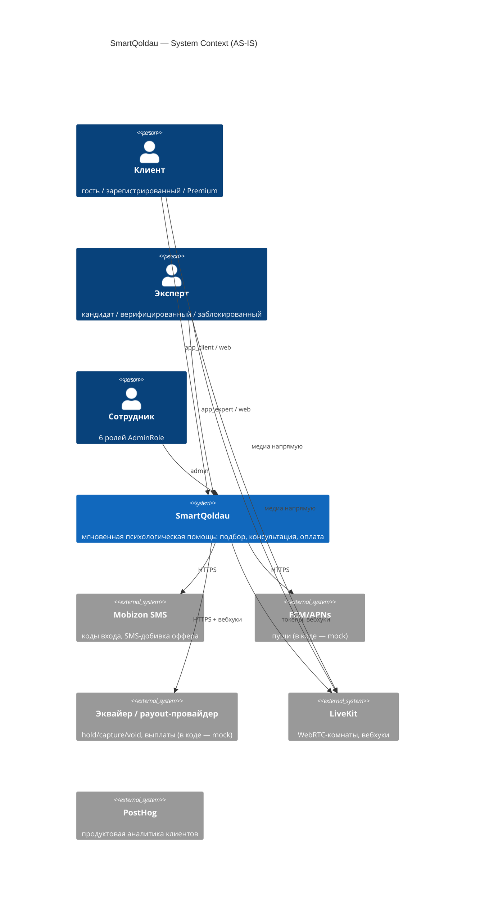
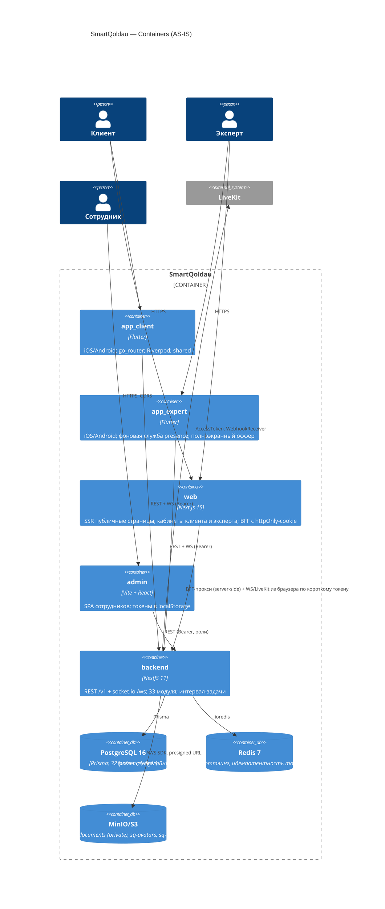
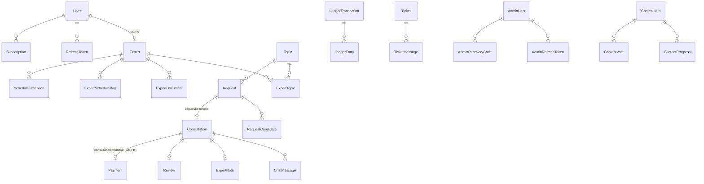
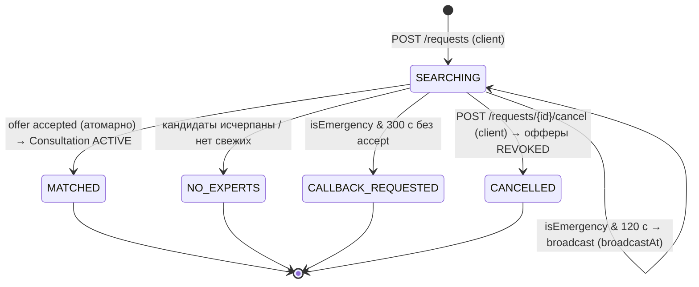
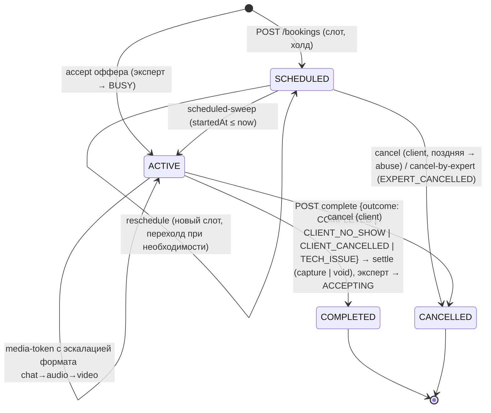
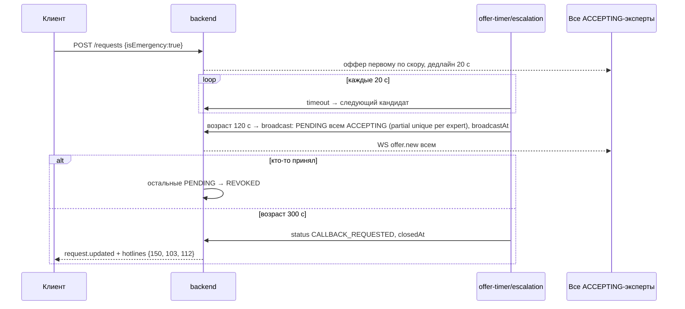
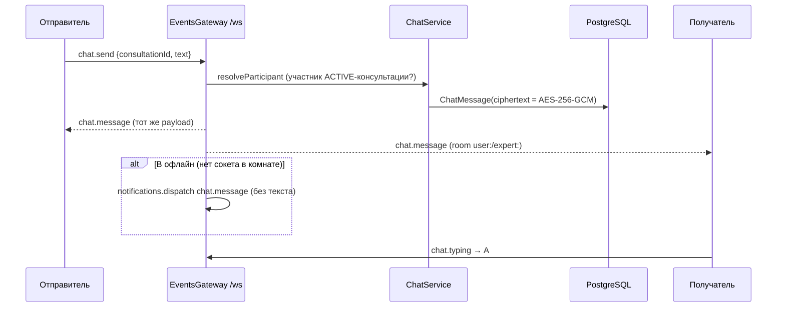

# 03 — Архитектура AS-IS

Статус: готов · Дата: 2026-09-13 · Все утверждения — по коду `main` @ `310dde3`.
Связано: [[02_REPOSITORY_AUDIT]], [[10_DOMAIN_API_AND_EVENTS]], [[12_SECURITY_AND_PRIVACY]].

## 1. Карта приложений (доказательно)

| Вопрос брифа | Ответ | Доказательство |
|---|---|---|
| Сколько исполняемых приложений | **Пять** + одна библиотека: API (`backend/`), WEB (`web/`), ADMIN (`admin/`), APP-CLIENT (`app_client/`), APP-EXPERT (`app_expert/`); `packages/shared` — Dart-пакет | Dockerfile у первых трёх; `pubspec.yaml` у Flutter |
| Существует ли frontend | Да: `web/` — полноценное Next.js-приложение (публичная часть SSR + кабинеты клиента и эксперта) | `web/app/[locale]/(public|client|expert)` |
| Существует ли mobile | Да, **два native-приложения на Flutter** (iOS/Android), не адаптивный веб и не PWA | `app_client/lib/router.dart`, `app_expert/lib/router.dart`, `android/`, `ios/` |
| Существует ли admin | Да: `admin/` — отдельная SPA на Vite с собственной идентичностью (`AdminUser`) | `admin/src/App.tsx`, `backend/src/admin` |
| Только ли API | Нет | — |
| Процессы, запускаемые отдельно | `migrate` (одноразовый), `backend`, `web`, `admin` (nginx), `proxy` (стенд); внутри API — интервал-задачи (§6) | `infra/docker-compose.prod.yml` |
| Внешние зависимости | PostgreSQL, Redis, S3/MinIO, LiveKit, SMS (Mobizon), FCM/APNs (mock), эквайер (mock), payout-провайдер (mock), PostHog (клиенты) | `.env.example`, `packages/shared/lib/analytics` |
| Обязательные локально | Postgres, Redis, MinIO (иначе API не стартует — `StorageService.onModuleInit`); LiveKit — только для ручной проверки звонков | `storage.service.ts:48`, `docker-compose.dev.yml` |
| Swagger UI ≠ пользовательский веб | Верно: `/v1/docs` — документация, выключена в production | `bootstrap.ts`, `SWAGGER_ENABLED` |

## 2. C4 — контекст и контейнеры





## 3. Модули бэкенда

Все модули — `backend/src/<name>`. Guard-модель: `JwtAuthGuard` (пользователи), `ExpertGuard` (требует анкету), `AdminJwtGuard + RolesGuard` (`@Roles(AdminRole…)`); вебхуки без guard, проверяют подпись.

| Модуль | Назначение | Контроллеры (префикс) | Prisma | Redis | Эмитит (WS / уведомления / audit) | Зависит от | Тесты | Связность / долги | Действие |
|---|---|---|---|---|---|---|---|---|---|
| `common` | единый формат ошибок `{error:{code,message,details}}` (`apiError`), `ValidationPipe(whitelist)`, throttler (Redis storage; профили `smsRequest 3/ч`, `smsVerify 10/15 мин`, `adminLogin 5/15 мин`, `createRequest 10/ч`, `paymentAttempt 10/ч`, `createTicket 5/ч`, глобально 60/мин), `ClockService` (виртуальное время в e2e), журнал отклонённых вебхуков | — | — | throttle keys | — | — | `errors`, `throttling`, `cors` e2e | — | KEEP |
| `config` | Joi-валидация env | — | — | — | — | — | — | — | KEEP |
| `prisma` | `PrismaService` + спеки схемы (интеграционные) | — | все | — | — | — | 8 спеков | спеки требуют БД | KEEP (перенести спеки в e2e-профиль) |
| `redis` | клиент ioredis | — | — | — | — | — | 1 | — | KEEP |
| `auth` (+`sms`) | SMS-код (6 цифр, TTL 5 мин, ≤5 попыток, повтор через 45 с, хеш в `sms_codes`), гость по `deviceId` (частичный уникальный индекс), JWT access 15 мин / refresh 30 дн (sha256-хеш в `refresh_tokens`, ротация с отзывом), конверсия гостя Р-22; провайдеры `dev`/`mobizon` | `/auth` | User, SmsCode, RefreshToken | throttle | audit `user.registered` | — | `auth-*` e2e, `sms.mobizon.provider.spec` | — | KEEP |
| `account` | профиль `/me`, согласие Р-27 (`expertVisibilityAcceptedAt` — время, не флаг), удаление аккаунта (обезличивание строки, чистка переписки/заметок/устройств/уведомлений/избранного/карт, отзывы без текста) | `/me` | User (+каскад по модулям) | — | audit | chat, notes, devices… | `account-delete`, `expert-visibility-consent` | 217 строк, много прямых обращений к чужим таблицам | KEEP → REFACTOR IN PLACE при добавлении экспорта данных |
| `topics` | справочник 12 тем ru/kz (seed) | `/topics` | Topic | — | — | — | `topics` | — | KEEP |
| `audit` | `AuditService.log({actorType, actorId, entity, entityId, transition, payload})` | — | AuditLog | — | — | — | `audit.service.spec` (интеграционный) | payload Json — риск PII (см. [[12_SECURITY_AND_PRIVACY]]) | HARDEN |
| `devices` | push-токены (глобально уникальные, upsert), локаль пользователя | `/devices`, `/me/locale` | Device, User | — | — | — | `devices` | — | KEEP |
| `experts` | анкета (цена 2 000–15 000 ₸ в тиынах, языки, форматы, темы), рабочий статус ↔ presence, heartbeat, документы (4 типа, magic-bytes `file-signature.validator.ts`, лимит 10 МБ, приватный бакет), фото (sharp, 5 МБ, модерация), публичный каталог/карточка (без PII), клиенты эксперта Р-27 (журнал доступа) | `/experts`, `/experts/me/*`, `/experts/{id}` | Expert, ExpertTopic, ExpertDocument | presence | audit `expert.work_status_changed` | storage, presence, verification | 12 e2e | 26 файлов; `experts.service.ts` 361 | KEEP; SPLIT «documents/photo/clients» уже сделан контроллерами |
| `verification` | очередь PENDING (с `verificationSubmittedAt`, SLA 24 ч), решения по анкете и по документу (approve/reject → `REUPLOAD_REQUIRED`), блокировка/разблокировка Р-19, флаг <4.0 при ≥20 (Р-20), модерация фото/«о себе» (E2a) | `/admin/verification/*`, `/admin/experts/*`, `/admin/profile-moderation/*` | Expert, ExpertDocument | — | уведомления `verification.approved/rejected`; audit `expert.verified/…` | notifications | `admin-verification`, `profile-moderation`, `admin-experts-flagged` | — | KEEP |
| `schedule` | недельное расписание (мин от полуночи, перерыв), исключения на дату, тумблер срочных | `/experts/me/schedule*`, `/experts/me/availability` | ExpertScheduleDay, ScheduleException | — | — | — | `experts-schedule`, `schedule-exceptions` | — | KEEP |
| `presence` | Redis `set` доступных + `hash` lastSeen; `listFresh(staleMs)` — свежесть по heartbeat; статус BUSY автоматически (Р-13) | — | — | `presence:available`, `presence:lastseen` (имена констант в файле) | — | clock | `presence.service.spec`, `experts-heartbeat` | TTL не на ключах, а фильтром по времени — переживает рестарт Redis без потерь состава | KEEP |
| `matching` | конвейер кандидатов: тема→язык→формат→ACCEPTING+fresh→расписание→исключения; скоринг `scoring.service.ts` (окно 50 последних офферов, целевое время ответа 45 с, рейтинг, доля отмен); `tieBreakSeed` md5 для равных; балансировка по офферам за день; Premium без разведения (Р-08); счётчик онлайн | `/matching/online-count` | Expert, RequestCandidate, Consultation | presence | — | presence, premium | `matching-*` (accept-race, fairness, scoring-batch, online-count-perf) | — | KEEP (**ядро ценности**) |
| `requests` | заявка (обычная/экстренная/направленная), `clientCode` 1000–9999, дедлайны 45/20 с, `offerToNext` с перечиткой статуса, атомарный accept (partial unique + транзакция), decline/timeout → следующий, abuse-гейт (3+ → только ручной выбор, Redis `abuse:client:*` TTL 30 дн), эскалация: 120 с → broadcast всем ACCEPTING, 300 с → `CALLBACK_REQUESTED` + hotlines; `offer-timer.service` тик 1 с, рескан 5 с, макс. возраст 120 с | `/requests`, `/offers/{id}/accept|decline`, `/experts/me/offers` | Request, RequestCandidate, Consultation (создание) | дедлайны | WS `request.updated`, `offer.new`, `offer.revoked`, `consultation.updated`; уведомление `offer.incoming` (+SMS-fallback 10 с); audit `request.*`, `offer.*` | matching, consultations, notifications, ws | `requests-flow`, `request-timers`, `request-emergency`, `matching-lifecycle` | `requests.service.ts` 653 строки | KEEP; SPLIT (offers / escalation уже отдельными сервисами) |
| `favorites` | избранное без FK | `/favorites` | Favorite | — | — | — | `favorites` | — | KEEP |
| `booking` | плановые консультации: слоты (14 дней), запись = `SCHEDULED` + холд, перенос/отмена с учётом поздних Р-17, sweep активации (30 с) и напоминание за 15 мин (`remindedAt`), частичный индекс на слот | `/bookings`, `/experts/{id}/slots`, `/consultations/{id}/reschedule`, `cancel-by-expert` | Consultation, Payment | — | уведомления `consultation.booked/rescheduled/cancelled/reminder` | payments, notifications | `booking-*`, `slots`, `scheduled-*` | — | KEEP |
| `consultations` | создание из матча (атомарно, `requestId` unique, `expert_active_uq`), эскалация формата, no-show 3 мин (`no-show.service`, по вебхукам LiveKit), завершение с исходом → триггер settle; отмена клиентом; список/карточка (клиентское и экспертное DTO); журнал доступа к метаданным (`consultation.metadata_read/list_read/messages_read/note_read`); заметки (шифрованные) | `/consultations*`, `/consultations/{id}/note` | Consultation, ExpertNote | `abuse:*` | WS `consultation.updated`; audit `consultation.*` | payments, presence, notifications, ws | `consultations-*`, `consultation-lifecycle`, `consultation-access-log`, `expert-notes` | 752 строки — самый большой файл | KEEP; SPLIT (outcomes/no-show/access-log) при касании |
| `chat` | история (расшифровка на сервере), `resolveParticipant`, `MessageCipher` AES-256-GCM (iv 12 + tag 16 + data; один ключ из env; версии ключа нет) | `/consultations/{id}/messages` | ChatMessage | — | через gateway | — | `chat`, `message-cipher.spec` | ротации ключа нет | HARDEN (key version) |
| `media` | LiveKit `AccessToken` (identity `client-{code}` / `expert-{id}`, `roomJoin` на конкретную комнату, TTL), вебхуки `WebhookReceiver` (подпись), join/leave → `clientJoinedAt/expertJoinedAt`, no-show | `/consultations/{id}/media-token`, `/webhooks/livekit` | Consultation | — | audit | consultations | `media`, `media.service.spec` | replay-защита вебхука — только TTL подписи LiveKit (см. 12) | KEEP + HARDEN |
| `reviews` | отзыв после COMPLETED (звёзды, теги, публичный/приватный текст), пересчёт рейтинга, удаление автором, ответ эксперта, жалоба эксперта → FLAGGED, модерация (hide/restore) | `/consultations/{id}/review`, `/reviews/{id}*`, `/experts/{id}/reviews`, `/experts/me/reviews`, `/admin/reviews/*` | Review, Expert | — | audit; уведомления | notifications | `reviews*`, `review-tags` | — | KEEP |
| `storage` | 3 бакета, `putObject`, presigned GET (документы 300 с, контент 900 с), `ensureBucket` на старте, политика публичного чтения аватаров | — | — | — | — | — | 3 spec (интеграционные) | требует S3 при старте (CI!) | HARDEN |
| `payments` (+`provider`) | карты (токен провайдера, PAN не хранится), `pay` = холд (идемпотентность по `hold:{id}:{attempt}`), settle (capture по COMPLETED / void по остальным) с ретраями (10 попыток, 60 с), перехолд >5 дней, вебхуки с HMAC-SHA256 timing-safe и дедупом `ProviderEvent(kind, providerEventId)`, earnings + по дням (Алматы) | `/payment-methods`, `/consultations/{id}/pay|payment`, `/experts/me/earnings*`, `/webhooks/payments` | Payment, PaymentMethod, ProviderEvent | `mockpay:*` | audit `payment.*`; уведомление `earning.credited` | ledger, premium, notifications | `payments-*`, `payment-methods`, `money-lifecycle`, `ledger` | 602 строки | KEEP (**деньги — построчное ревью при изменениях**) |
| `ledger` | двойная запись: счета `expert:{id}`, `platform:commission`, `acquirer:settlement`, `payout:pending/sent`; `@@unique(kind, refId)` — идемпотентность проводок; баланс эксперта = сумма по счёту | — | LedgerTransaction, LedgerEntry | — | — | — | `ledger.service.spec`, `ledger` e2e | — | KEEP |
| `payouts` (+`provider`) | заявка на вывод (≥10 000 ₸), автоодобрение ≤300 000 ₸/мес иначе `PENDING_REVIEW`, финконтроль approve/reject, вебхук `payout.paid`, резерв в ledger | `/payouts`, `/experts/me/balance`, `/admin/payouts/*`, `/webhooks/payouts` | Payout | `mockpayout:*` | audit `payout.*`; уведомления `payout.paid/rejected` | ledger, notifications | `payouts*` | — | KEEP |
| `premium` | планы (`GET /premium/plans` публично; MONTH/YEAR), `subscribe` через `charge()`, статус/отмена, автопродление (тик 60 с; 3 ретрая за 72 ч → GRACE → EXPIRED/даунгрейд), скидка 10 % за счёт комиссии (1500 → 500 bp), приоритет подбора | `/premium*` | Subscription, Payment | `sub:*` идемпотентность | уведомления `premium.*` | payments, matching | `premium-*` | цены в `premium.constants.ts` — единственный источник | KEEP |
| `notifications` (+`provider`) | `dispatch` → `Notification` (снимок шаблона ru/kz) + `NotificationOutbox`; sweep 1 с (батч 50, 10 параллельно, 5 попыток, backoff 2 с); критичный `offer.incoming`: push → через 10 с без ack → SMS (бюджеты: cooldown 300 с, 20/день на эксперта, 2000/день всего); чат-пуш офлайн-получателю; центр уведомлений, `ack` устройства (метрика §11.6) | `/notifications*` | Notification, NotificationOutbox, Device | `sms:*` | — | devices, sms, push | `notifications-*`, `outbox`, `offer-push-fallback`, `sms-fallback-budget` | боевого push-адаптера нет | KEEP + HARDEN (FCM/APNs) |
| `tickets` | обращения клиентов/экспертов/гостей, категории по типу автора, маршрутизация в `TicketTeam` (чистая функция), ответы, назначение, решение, уведомление автору | `/tickets*`, `/admin/tickets/*` | Ticket, TicketMessage | — | уведомление `ticket.replied` | notifications | `tickets-*` | 527 строк | KEEP |
| `admin` | `AdminUser` (bcrypt), вход email+пароль → при включённом TOTP второй шаг; TOTP-секрет зашифрован `MessageCipher`; коды восстановления (хеш); lockout; refresh с атомарной ротацией; кеш актуальности сотрудника 30 с; сотрудники (SUPERADMIN); защита последнего суперадмина; bootstrap-сид из env | `/admin/auth/*`, `/admin/staff` | AdminUser, AdminRefreshToken, AdminRecoveryCode | `admin:totp:used:*` | audit | — | `admin-*` e2e, 4 spec | — | KEEP |
| `content` | материалы (`kind`: медитация/музыка/статья/дыхание; `access` FREE/PREMIUM), список и карточка анониму, пейволл на `media` и на теле статьи (закрыт 2026-09-02), прогресс, голос, стрик; CMS для `CONTENT_EDITOR`/`SUPERADMIN` | `/content*`, `/admin/content*` | ContentItem, ContentProgress, ContentVote | — | — | storage, premium | `content-*` | — | KEEP |
| `maintenance` | ретенция: `ProviderEvent` 30 дн, прочитанные уведомления 90 дн (тик 1 ч) | — | — | — | — | — | `retention*` | — | KEEP |
| `ws` | gateway `/ws`: auth по `handshake.auth.token` (тот же JWT), комнаты `user:{id}` и `expert:{id}`, событие `ready` после назначения комнат, `chat.send` (персист + рассылка обеим сторонам + пуш офлайн), `chat.typing` (только второй стороне), `chat.error`; `EventsService.emitToUser/emitToExpert` best-effort; `RedisIoAdapter` для нескольких инстансов | — | — | socket.io adapter | все доменные события | chat, experts, notifications | `redis-io.adapter.spec`, WS-части e2e | нет ack/переотправки пропущенных событий; клиент ресинкает REST-запросами | HARDEN |
| `cli` | сид суперадмина, ручная верификация | — | — | — | — | — | — | — | KEEP |

## 4. Карта данных (сводно; детали и инварианты — [[10_DOMAIN_API_AND_EVENTS]] §7)

32 модели, 21 enum. Осознанные исключения: без FK на `users/experts` у `Favorite, Consultation, PaymentMethod, Payment, Payout, Device, Ticket, Notification, Request(candidates→expert)` — «связь строкой, join вручную» (комментарии в схеме). Частичные уникальные индексы (raw SQL): `users_device_id_guest_uq`, `request_candidates_pending_per_expert_uq` (заменил `one_pending_uq`), `consultations_expert_slot_uq`, `consultations_expert_active_uq`, `subscriptions_active_uq`, частичный индекс sweep-fallback уведомлений. Шифрованные поля: `chat_messages.ciphertext`, `expert_notes.ciphertext`, `admin_users.totp_secret`. Деньги — integer в тиынах; снимки `priceTiyn`, `commissionRateBp`, `discountTiyn`.



## 5. Realtime AS-IS

| Аспект | Как есть | Файл |
|---|---|---|
| Транспорт | socket.io, namespace `/ws`; за прокси `/socket.io/` с upgrade | `events.gateway.ts`, `nginx.stand.conf` |
| Аутентификация | `handshake.auth.token` = access JWT; невалидный → `disconnect(true)` | `events.gateway.ts:66-80` |
| Комнаты | `user:{userId}` всегда; `expert:{expertId}` если есть анкета; подписка на консультации не требуется — адресация по участникам | там же |
| Готовность | сервер шлёт `ready {expertId}` после join; клиенты ждут его (найдено при NestJS 11) | там же |
| Входящие | `chat.send {consultationId, text}` → персист + `chat.message` обеим сторонам (+пуш офлайн); `chat.typing` → второй стороне; ошибки `chat.error {code}` | там же |
| Исходящие | `offer.new`, `offer.revoked`, `request.updated`, `consultation.updated`, `chat.message`, `chat.typing`, `notification.new` (список из клиента `packages/shared/lib/events`) | `events.service.ts`, модули |
| Гарантии | best-effort, без ack, без буфера пропущенных событий; порядок — порядок эмитов одного процесса; дубли возможны при реконнекте (клиент дедупит по id сущности) | `events.service.ts` |
| Масштабирование | `@socket.io/redis-adapter` (E16-14) | `redis-io.adapter.ts` |
| Веб | браузер получает короткоживущий токен через `POST /api/realtime/token` (BFF) и подключается напрямую; онлайн эксперта только при видимой вкладке | `web/app/api/realtime/token/route.ts`, `web/lib/realtime` |

## 6. Фоновые задачи (все — `@Interval`, один процесс на инстанс; при нескольких репликах — конкурируют через идемпотентные обновления)

| Сервис | Период | Что делает |
|---|---|---|
| `requests/offer-timer.service` | 1 с | истечение офферов (TIMEOUT → следующий), рескан 5 с, закрытие заявки старше 120 с |
| `requests/escalation.service` (в тике таймера) | — | 120 с → broadcast; 300 с → CALLBACK_REQUESTED |
| `notifications/outbox-sweep.service` | 1 с | отправка пушей из outbox, ретраи |
| `notifications/offer-push-fallback.service` | (в sweep) | SMS через 10 с без ack |
| `consultations/scheduled-sweep.service` | 30 с | активация SCHEDULED, напоминание за 15 мин |
| `payments/settle-retry.service` | 60 с | ретраи capture/void, перехолд >5 дней |
| `premium/premium-renewal.service` | 60 с | автопродление, GRACE, даунгрейд |
| `maintenance/retention-sweep.service` | 1 ч | ретенция событий провайдера и уведомлений |

## 7. Диаграммы состояний и последовательностей (по коду)

### 7.1 Заявка (Request)



### 7.2 Оффер кандидата (RequestCandidate)

```mermaid
stateDiagram-v2
  [*] --> PENDING : offerToNext / broadcast (deadlineAt = +45 с | +20 с)
  PENDING --> ACCEPTED : POST /offers/{id}/accept (ExpertGuard; 409 если уже ACTIVE, 410 если просрочен)
  PENDING --> DECLINED : POST /offers/{id}/decline
  PENDING --> TIMEOUT : offer-timer (deadlineAt < now)
  PENDING --> REVOKED : заявка CANCELLED / MATCHED другим (broadcast)
```



### 7.3 Консультация



Платёж: `PENDING → HELD → CAPTURED | VOIDED | FAILED` (+ `reheld`, `hold_voided_by_bank`); вывод: `PENDING_REVIEW | PROCESSING → PAID | REJECTED`; подписка: `ACTIVE → GRACE → ACTIVE | EXPIRED`, `ACTIVE → CANCELLED → EXPIRED`.

### 7.4 Верификация эксперта

```mermaid
stateDiagram-v2
  [*] --> DRAFT : POST /experts (анкета)
  DRAFT --> DRAFT : загрузка документов (UPLOADED)
  DRAFT --> PENDING : POST documents/submit (4 документа; verificationSubmittedAt)
  PENDING --> VERIFIED : admin decision approve (VERIFICATION_OPERATOR)
  PENDING --> DRAFT : reject анкеты / документ → REUPLOAD_REQUIRED
  VERIFIED --> VERIFIED : документ заменён → проверка только его (Р-18)
  VERIFIED --> Blocked : isBlocked=true + blockedReason (QUALITY_TEAM/оператор)
  Blocked --> VERIFIED : unblock
```



Доступность: `NOT_ACCEPTING | ACCEPTING | BUSY | UNAVAILABLE` (PATCH work-status; BUSY выставляется системой на время ACTIVE-консультации и снимается при завершении); свежесть — heartbeat.

### 7.5 Обычный матчинг

```mermaid
sequenceDiagram
  participant C as Клиент (app/web)
  participant API as backend
  participant R as Redis
  participant E as Эксперт (app/web)
  C->>API: POST /v1/requests {topic, format}
  API->>R: presence.listFresh(), abuse:client
  API->>API: matching.findCandidates → score → tieBreak
  API->>API: RequestCandidate PENDING (deadline +45 с)
  API-->>E: WS offer.new; notify offer.incoming (push → SMS через 10 с без ack)
  API-->>C: 201 RequestDto SEARCHING; WS request.updated
  alt accept
    E->>API: POST /offers/{id}/accept
    API->>API: tx: candidate ACCEPTED, request MATCHED, Consultation ACTIVE (expert_active_uq), expert BUSY
    API-->>C: WS request.updated MATCHED, consultation.updated
    API-->>E: WS consultation.updated
  else decline / timeout (offer-timer, 1 с)
    API->>API: candidate DECLINED|TIMEOUT → offerToNext (перечитка SEARCHING)
    API-->>E: (следующий эксперт) offer.new
  end
```

### 7.6 Экстренная заявка



### 7.7 Чат



### 7.8 Аудио/видео

```mermaid
sequenceDiagram
  participant P as Участник
  participant API as backend
  participant LK as LiveKit
  P->>API: POST /consultations/{id}/media-token {format}
  API->>API: участник ACTIVE? эскалация формата (chat→audio→video), room = consultation id
  API-->>P: {token (identity client-{code}|expert-{id}, roomJoin, ttl), url, room}
  P->>LK: connect(token) — медиа напрямую (DTLS-SRTP)
  LK->>API: POST /webhooks/livekit participant_joined/left (подпись WebhookReceiver)
  API->>API: clientJoinedAt / expertJoinedAt; no-show 3 мин → consultation.no_show_hint
  P->>API: POST complete {outcome}
```

### 7.9 Аутентификация

```mermaid
sequenceDiagram
  participant U as Пользователь
  participant API as backend
  U->>API: POST /auth/request-code {phone} (throttle 3/ч; повтор ≥45 с)
  API->>API: SmsCode {codeHash, expiresAt +5 мин, attempts 0} → SMS-провайдер
  U->>API: POST /auth/verify-code {phone, code} (≤5 попыток; throttle 10/15 мин)
  API-->>U: {accessToken 15 мин, refreshToken 30 дн}
  U->>API: POST /auth/refresh {refreshToken}
  API->>API: sha256 → найти, отозвать старый, выдать новый (ротация)
  Note over U,API: Гость: POST /auth/guest {deviceId} → токены; конверсия POST /auth/guest/convert
  Note over U,API: Веб: BFF хранит пару в httpOnly-cookie, браузер получает только короткий токен для WS/LiveKit
```

## 8. Внешние сервисы и режимы

| Сервис | Порт/адаптер | Dev | Prod-готовность |
|---|---|---|---|
| SMS | `SmsProvider` (`dev` логирует, `mobizon`) | dev | адаптер есть, ключ нужен |
| Push | `PushProvider` (`mock`) | mock | **боевого адаптера FCM/APNs нет** — критерий §11.6 не проверяем |
| Эквайер | `PaymentProvider` (`mock` с токенизацией, hold/capture/void, вебхуки) | mock | **договор и адаптер — блокер E0** |
| Выплаты | `PayoutProvider` (`mock`) | mock | то же |
| LiveKit | `livekit-server-sdk` | `--dev` контейнер | в бою отдельный сервис + TURN (вне репо) |
| S3 | AWS SDK, MinIO | контейнер | тома, бэкапы вне репо |
| Аналитика | PostHog в `packages/shared/lib/analytics` | — | ключ/хост в конфиге приложения |
