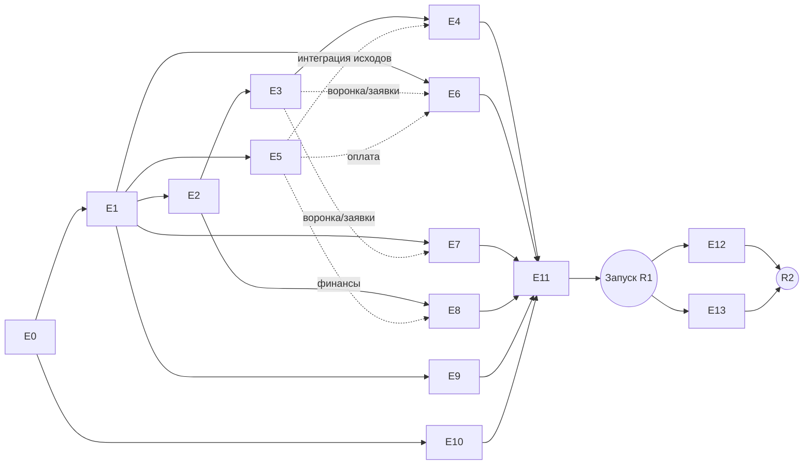

# План разработки MVP SmartQoldau

> **For agentic workers:** REQUIRED SUB-SKILL: перед стартом каждого эпика написать детальный пошаговый план через superpowers:writing-plans (TDD, bite-sized задачи) и исполнять через superpowers:subagent-driven-development. Этот документ — мастер-план: эпики, зависимости, вехи.

**Цель:** довести SmartQoldau от пустого репозитория до запуска R1 (ядро) и R2 (Premium + контент) по [[ТЗ MVP SmartQoldau]].

**Архитектура:** модульный монолит NestJS + PostgreSQL/Redis/WebSocket; медиа — LiveKit; два Flutter-приложения (клиент, эксперт); React-админка; Next.js-лендинг. Монорепо.

**Версия:** 1.0, 2026-08-19. Основание: [[ТЗ MVP SmartQoldau]] (нормативно), [[Бизнес-процессы SmartQoldau]], [[Продуктовые решения по открытым вопросам]].

## Глобальные ограничения (действуют во всех эпиках)

- Денежные суммы — integer в тиынах; ledger — двойная запись (ТЗ §8).
- Все статусные переходы — в `audit_log` с актором и временем (ТЗ §4.5).
- Эксперт нигде не получает ПД клиента — контроль на уровне API-контрактов (ТЗ §11.5).
- Таймеры: заявка 45 с / экстренная 20 с (Р-10); эскалация 2 мин / 5 мин (Р-16); напоминание за 15 мин (Р-15); сессия 50 мин (Р-05).
- Комиссия 15%; Premium-скидка 10% из комиссии платформы (Р-02, Р-03).
- Локализация ru/kz с первого экрана; ₸; Asia/Almaty.
- Платёжные вебхуки идемпотентны; PAN не хранится (токенизация).
- OpenAPI-спецификация в репозитории обновляется в том же PR, что и эндпоинт.

## Структура монорепо

```
smart_qoldau/
├─ backend/          NestJS: modules/{auth,users,experts,verification,topics,
│                    matching,requests,consultations,chat,media,payments,ledger,
│                    payouts,reviews,notifications,tickets,admin,content}
├─ app_client/       Flutter (П1)
├─ app_expert/       Flutter (П2)
├─ packages/shared/  Dart: API-клиент по OpenAPI, модели, дизайн-токены
├─ admin/            React (П4)
├─ landing/          Next.js (П3)
├─ infra/            Docker Compose (dev), IaC, CI/CD
└─ docs/             OpenAPI, ADR
```

## Команда (минимальный состав)

BE1, BE2 — backend · FL1, FL2 — Flutter · FE1 — админка/лендинг · CTO — архитектура, платёжный контур, ревью · DevOps (part-time) · QA (part-time с М2). Оценки ниже — в человеко-неделях (чн).

---

## Эпики R1

### E0. Подготовка и блокеры — 2 нед (CTO + DevOps)
Договор с эквайером (**блокер**: обязательны auth-hold/capture/void, токенизация, выплаты на карты — тестовые транзакции до подписания); юрзаключение по локализации ПД в РК → выбор региона хостинга; аккаунты Apple Developer / Google Play, регистрация VoIP-push; монорепо, CI/CD (lint+test+build на PR), dev-окружение Docker Compose (PostgreSQL, Redis, LiveKit, MinIO); staging.
**Выход:** пайплайн зелёный на пустых каркасах; договор эквайера подписан или выбран запасной.

### E1. Ядро бэкенда — 3 чн (BE1) — после E0
Каркас NestJS, конфигурация, миграции (TypeORM/Prisma); модуль auth: SMS-код (шлюз + мок для dev), JWT+refresh, гостевые профили с device_id, конверсия гостя (Р-22); справочник тем (12, Р-14, ru/kz); audit_log middleware; единый формат ошибок; OpenAPI-каркас.
**Интерфейс для остальных:** guard'ы ролей, `AuditService.log(actor, entity, transition)`, `TopicsService.list(locale)`.

### E2. Эксперт и верификация — 3 чн (BE2) — после E1
Профиль эксперта (анкета §5.1, цена 2 000–15 000 ₸), загрузка документов в шифрованный бакет, статусная машина верификации (БП-04), рабочие статусы (4) + presence в Redis, расписание с перерывами, редактирование профиля (Р-18). API для админки (E8) и приложения эксперта (E7).

### E3. Матчинг и заявки — 4 чн (BE1) — после E2
Presence-реестр доступных экспертов; фильтр-конвейер (тема→язык→формат→статус→расписание) + скоринг Р-12; заявки со статусной машиной БП-01; таймеры 45/20 с на Redis (восстановление после рестарта); цепочка кандидатов с ротацией; экстренная эскалация Р-16 (2 мин → все онлайн, 5 мин → обратный звонок); WebSocket-события клиенту и эксперту; каталог с фильтрами/сортировкой; избранное.
**Критично:** интеграционные тесты таймеров на виртуальном времени (приёмка §11.3).

### E4. Консультации и медиа — 4 чн (BE2 + CTO) — после E3
Чат (WebSocket, хранение шифрованно, индикатор набора); LiveKit: выдача токенов, комнаты, вебхуки входа/выхода → «клиент не подключился 3 мин», автостатус «Занят» (Р-13); эскалация чат→аудио→видео; статусная машина консультации с исходами (триггер для E5); переносы/отмены (БП-03, Р-17) со счётчиком злоупотреблений; заметки эксперта; напоминания за 15 мин (планировщик); отзывы и рейтинг (БП-08, §5.7): оценка после сессии (публичная + приватная), пересчёт рейтинга и распределения, удаление отзыва клиентом, ответ эксперта, жалобы на отзыв → очередь модерации E8, флаг порога <4.0 (Р-20).

### E5. Платёжный контур — 4 чн (CTO + BE1) — после E1, интеграция с E4
Адаптер эквайера (hold/capture/void, токенизация карт, идемпотентные вебхуки с подписью); ledger двойной записи; поток Р-01: холд при подтверждении записи → capture по «состоялась» / void по остальным исходам; перехолд при записи >5 дней; начисление 85% на баланс; выводы (мин 10 000 ₸, автоодобрение до 300 000 ₸/мес, очередь финконтроля) через payout-провайдера; abuse-счётчики Р-01/Р-17 с автоотключением автоподбора.
**Критично:** E2E денежного цикла в обе стороны на sandbox — до интеграции с E4.

### E6. Приложение клиента (Flutter) — 8 чн (FL1) — каркас после E1, воронка после E3/E5
Онбординг/auth/гость (БП-10); главная с темами и «Мне нужна помощь сейчас»; воронка тема→формат→поиск (реалтайм-статусы)→«Специалист найден»→оплата (шторка, 50 мин, карта)→сессия; экстренный флоу со скринингом 102/103; чат/аудио/видео (LiveKit Flutter SDK, реконнект); оценка + приватный отзыв; каталог, профили, избранное; консультации (перенос/отмена); карты; центр уведомлений; профиль, ru/kz.

### E7. Приложение эксперта (Flutter) — 8 чн (FL2) — каркас после E1, заявки после E3
Онбординг: анкета 2 шагов, документы, экраны верификации; **входящая заявка**: VoIP-push (iOS CallKit) / high-priority FCM (Android ConnectionService), полноэкранный запрос с таймером, работа из убитого приложения — самая рискованная часть, прототипировать в первую неделю эпика; главная с рабочим статусом и метриками; заявки (3 таба), консультации, сессии (чат/аудио/видео), завершение с исходом, заметки; доход/выплаты (разбивка «цена − 15%», Р-02); расписание/доступность; рейтинг с ответами на отзывы; профиль.

### E8. Админ-панель — 4 чн (FE1) — после E2, финансы после E5
React + RBAC (§3); модули: верификация (очередь, чек-лист Р-18, SLA-таймер 24 ч), эксперты/клиенты (блокировки с причиной Р-19, abuse-счётчики), финансы (ledger, очередь выводов, корректировки с двойным подтверждением), модерация (жалобы, приватные отзывы, флаг <4.0 Р-20), тикеты (Р-23, маршрутизация), справочники, дашборд метрик §10.

### E9. Уведомления — 2 чн (BE2) — после E1, каналы по мере эпиков
Шина уведомлений: FCM/APNs/VoIP-push, SMS-fallback заявки (10 с без подтверждения доставки), in-app центр; шаблоны событий §5.8 (ru/kz); отслеживание доставки (метрика приёмки §11.6).

### E10. Лендинг и юрстраницы — 1.5 чн (FE1) — независим, после E0
Next.js SSR по прототипам: SmartQoldau.kz, «Стать психологом», Premium-страница (цены Р-08), соглашение, политика, поддержка (форма → тикеты E8), SEO, ru/kz.

### E11. Стабилизация и пилот — 3 нед (вся команда) — после E1–E10
Прогон всех 8 критериев приёмки ТЗ §11; нагрузочный тест (200 сессий, 500 онлайн-экспертов); security-чеклист ASVS L2; закрытый пилот: 20–30 ручных экспертов (операционная задача — стартовать набор с М2), 50–100 клиентов; исправления; публикация в App Store / Google Play (ревью Apple закладывать 1–2 недели); запуск R1.

## Эпики R2 (после запуска R1, 4–6 недель)

### E12. Premium — 3 чн (BE1 + FL1)
Подписки (месяц/год, Р-08), автопродление с 3 ретраями/72 ч и даунгрейдом (Р-09), скидка 10% в чеке и расчёте комиссии (Р-03), приоритет в скоринге матчинга, экраны Premium в П1, пейволл.

### E13. Контент и самопомощь — 4 чн (BE2 + FL1 + FE1)
CMS-модуль в админке (медитации, музыка, статьи, дыхательные техники); разделы «Материалы» в П1 с плеерами и прогрессом; стрики; пейволл Premium на расширенный контент. Закупку/производство контента начать параллельно с E11 (вне разработки).

---

## Зависимости и параллельность



Критический путь: E0 → E1 → E2 → E3 → E4 → E11. Flutter-эпики (E6/E7) стартуют каркасами сразу после E1 и догоняют бэкенд по мере готовности API (контракт-first: OpenAPI фиксируется в начале каждого бэкенд-эпика, приложения работают против моков).

## Вехи

| Веха | Содержание | Проверка |
|---|---|---|
| М1 (≈нед 5) | E0+E1+E2: эксперт регистрируется, проходит верификацию через админку-каркас | Демо: онбординг эксперта end-to-end на staging |
| М2 (≈нед 9) | E3+E5: матчинг с таймерами + денежный цикл на sandbox | Приёмка §11.2 и §11.3 на staging; старт набора пилотных экспертов |
| М3 (≈нед 14) | E4+E6+E7: полная консультация из приложений, все 3 формата | Демо: клиент→заявка→оплата→видео→исход→начисление на реальных телефонах |
| М4 (≈нед 17–18) | E8–E10 закрыты, E11 пройден | Все 8 критериев §11; сабмит в сторы |
| R1 | Публичный запуск | Приложения в сторах, пилотные эксперты онлайн |
| R2 (≈+6 нед) | E12+E13 | Premium продаётся, контент открыт |

Суммарно R1 ≈ 17–18 недель календарно при указанном составе (≈35 чн работы с учётом параллельности). Главные буферы: ревью Apple, интеграция эквайера, VoIP-пуши.

## Правила исполнения

1. Перед стартом эпика — детальный план через writing-plans (bite-sized, TDD, точные пути файлов) в `WIKI/plans/`, исполнение через subagent-driven-development; ревью между задачами.
2. Ветка на эпик, PR на задачу, зелёный CI обязателен; код-ревью CTO для E5 (деньги) и E3 (матчинг) — построчно.
3. Определение готовности эпика: тесты написаны и зелёные, OpenAPI обновлён, критерии из раздела эпика продемонстрированы на staging, запись в LOG.md.
4. Изменение объёма — только через правку ТЗ с новым Р-решением.

## Риски исполнения (сверх рисков ТЗ §12)

| Риск | Сигнал | Действие |
|---|---|---|
| Эквайер затягивает договор | Нет sandbox к концу E0 | Параллельный запасной провайдер с недели 1 |
| VoIP-пуши нестабильны на Android-зоопарке | Прототип E7 недели 1 | SMS-fallback как основной канал + требование «телефон онлайн» в онбординге экспертов |
| Ревью Apple отклоняет (медицинская тематика) | — | Заранее: дисклеймеры, юрдокументы, демо-аккаунт для ревьюеров; сабмит TestFlight с М3 |
| Два Flutter-приложения расползаются по UI | — | packages/shared: единые токены, компоненты, API-клиент |
| Недобор пилотных экспертов к R1 | <15 верифицированных к М4 | Оффер ранним экспертам: комиссия 0% на первый месяц (решение PO, зафиксировать при активации) |
