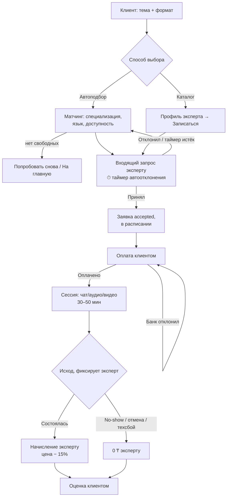

# БП-01 Консультация — заявка, подбор, сессия

> Главный процесс платформы: от запроса клиента до завершённой консультации.
> Хаб: [[Бизнес-процессы SmartQoldau]]. Финансовая часть: [[БП-06 Оплата, начисление и выплаты]]. Экстренная ветка: [[БП-02 Экстренная помощь]].

**Роли:** Клиент · Платформа (матчинг, таймеры) · Эксперт
**Триггер:** клиент нажал «Подобрать специалиста» (или выбрал эксперта в каталоге / избранном).
**Результат:** консультация со статусом «Завершена» и зафиксированным исходом.

## Шаги

1. **Выбор темы и формата.** Клиент указывает тему обращения и формат (чат/аудио/видео). Возможен deeplink с предвыбранным экспертом.
2. **Подбор.** Два пути:
   - *Автоподбор:* платформа ищет эксперта по специализации, языку и доступности (статус «Принимаю клиентов», рабочее расписание). Обещание — до 2 минут; клиент видит прогресс и «Сейчас онлайн: N специалистов». Клиент может отменить поиск. Исключения: нет свободных специалистов → «Попробовать снова / На главную»; нет интернета.
   - *Ручной выбор:* каталог с фильтрами (специализация, формат, язык, город, сортировка по рейтингу/цене/опыту) → профиль эксперта → «Записаться».
3. **Заявка эксперту.** Выбранному эксперту приходит полноэкранный входящий запрос: тема + формат, клиент анонимен. Жёсткий таймер: не ответил — автоотклонение, платформа ищет следующего эксперта (⚠ таймер: 20 с в моб. Expert, 240 с в вебе — открытый вопрос, см. [[Расхождения в прототипе]]). В вебе есть тумблер «Автоматически принимать заявки».
4. **Принятие.** Эксперт нажимает «Принять» → заявка переходит в статус accepted («Ожидает начала консультации»), попадает в расписание. Отклонение → возврат к подбору.
5. **Оплата.** Клиенту показывается шторка оплаты («30 минут · 3 990 ₸») с привязанной картой; Premium даёт скидку 25%. Успешная оплата открывает сессию. Отказ банка → повторная попытка / другая карта. Подробности в [[БП-06 Оплата, начисление и выплаты]].
6. **Сессия.** Чат / аудио / видео, ~30–50 мин, таймер, шифрование, без записи. Внутри: эскалация чат→аудио→видео, «Мне трудно говорить» (клиент), заметки эксперта (приватные, без диагнозов). Исключения: обрыв связи → переподключение («собеседник останется на линии»); клиент не подключился 3 минуты → эксперт ждёт или завершает.
7. **Фиксация исхода экспертом:** состоялась / клиент не явился / клиент отменил / техническая проблема. От исхода зависит начисление (не-состоялась → 0 ₸).
8. **Оценка клиентом.** Звёзды + теги + приватный отзыв (виден только команде качества). Кнопка «Продолжить с тем же психологом» (retention). См. [[БП-08 Отзывы, рейтинг и модерация]].

## Статусы заявки/консультации

`new` → (`accepted` | `declined`/автоотклонение) → `scheduled/ожидает начала` → `in_progress` → `completed` (+ исход) | `cancelled`

## Схема

## Решения ([[Продуктовые решения по открытым вопросам]])

- **Оплата — эскроу-холд (Р-01):** при оплате на карте клиента делается авторизационный холд; списание — только после исхода «состоялась». Несостоявшиеся исходы → холд отменяется, клиенту полный возврат, эксперту 0 ₸. Злоупотребления (3+ no-show за 30 дней) → отключение автоподбора клиенту.
- **Таймер принятия — 45 секунд** для обычных заявок, 20 с для экстренных, одинаково на всех платформах (Р-10).
- **Цена не зависит от формата (Р-04):** одна цена эксперта за консультацию 50 минут (Р-05) во всех форматах; «30 минут» в шторке оплаты — ошибка прототипа.
