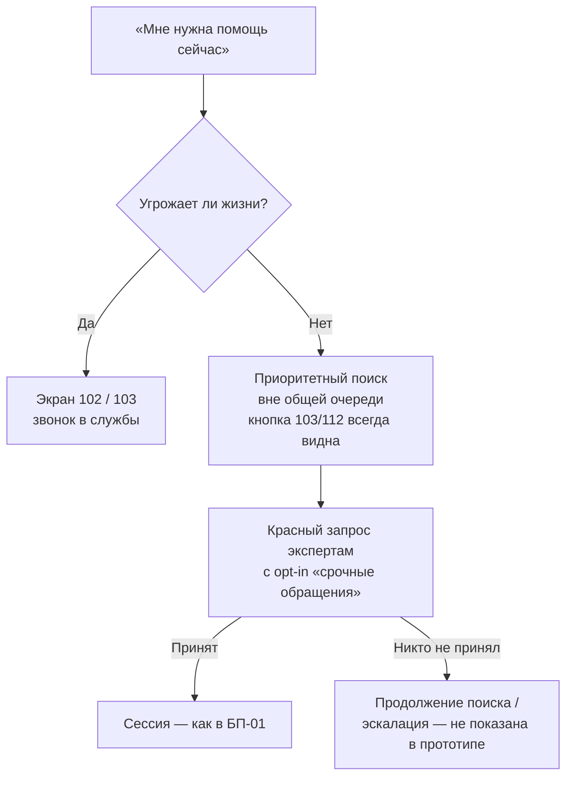

# БП-02 Экстренная помощь

> Приоритетная ветка [[БП-01 Консультация — заявка, подбор, сессия]] для кризисных обращений.
> Хаб: [[Бизнес-процессы SmartQoldau]].

**Роли:** Клиент · Платформа · Эксперт (с включённым «Принимать срочные обращения»)
**Триггер:** кнопка «Мне нужна помощь сейчас» на главной / лендинге.
**Результат:** соединение с экспертом вне общей очереди либо переадресация в экстренные службы.

## Принципы

- Платформа **не** экстренная служба — дисклеймер повторяется на каждом шаге: при угрозе жизни 102 (полиция) / 103 (скорая).
- Перед поиском — проверка «Вам угрожает опасность?» с кнопками вызова 102/103.
- Экстренные заявки идут **вне общей очереди** только экспертам, включившим тумблер «Принимать срочные обращения» ([[БП-05 Управление доступностью эксперта]]).
- У эксперта экстренный запрос выделен красным («Приоритетный запрос», тема «Экстренная ситуация»), карточка подсвечена в списке заявок.
- Во время экстренного поиска у клиента постоянно видна кнопка «Позвонить 103 / 112».

## Шаги

1. Клиент нажимает «Мне нужна помощь сейчас».
2. Скрининг угрозы жизни: «да» → экран с кнопками 102/103; «нет» → приоритетный поиск.
3. Платформа рассылает приоритетный запрос доступным экспертам с opt-in срочных обращений (вне очереди обычных заявок).
4. Далее — как в [[БП-01 Консультация — заявка, подбор, сессия]] с шага «Принятие» (таймер, оплата, сессия, исход).

## Решения ([[Продуктовые решения по открытым вопросам]])

- **Эскалация (Р-16):** таймер принятия экстренной заявки — 20 с (Р-10). Никто не принял за 2 минуты → круг расширяется до всех онлайн-экспертов «Принимаю клиентов» (не только opt-in). За 5 минут → клиенту экран с телефоном доверия 150, 103/112 и заявкой на обратный звонок первым освободившимся экспертом.
- **Тариф:** экстренная консультация оплачивается по обычному тарифу эксперта; автоприём на экстренные не распространяется (Р-11).
