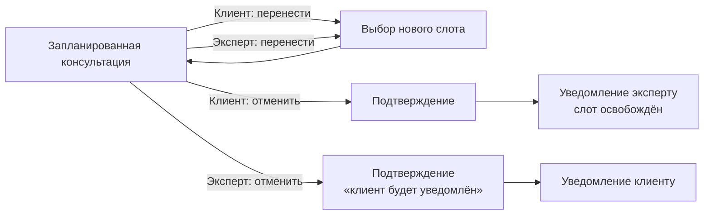

# БП-03 Перенос и отмена консультации

> Вторичные сценарии вокруг записи. Хаб: [[Бизнес-процессы SmartQoldau]]. Основной процесс: [[БП-01 Консультация — заявка, подбор, сессия]].

**Роли:** Клиент · Эксперт · Платформа (уведомления)

## Со стороны клиента

- **Перенос:** в разделе «Консультации» → «Перенести» → выбор нового слота. Платформа подсказывает переносить, если «психолог временно недоступен».
- **Отмена:** модалка подтверждения с текстом «Время освободится для другого пользователя». Эксперт получает уведомление «Клиент отменил запись».
- В чате клиент может договориться о переносе неформально («Можно перенести на вечер?» — реальное сообщение в прототипе), но фиксация — через запись.

## Со стороны эксперта

- В карточке консультации: «Начать» / «Перенести» / «Отменить». Отмена — с подтверждением «Клиент будет уведомлён об отмене».
- Отмена клиентом до сессии → консультация исчезает из расписания, начисления нет.
- Исход «Клиент отменил», зафиксированный на завершении, даёт эксперту 0 ₸ ([[БП-06 Оплата, начисление и выплаты]]).

## Решения ([[Продуктовые решения по открытым вопросам]])

- **Отмена клиентом (Р-17, Р-01):** бесплатна в любой момент до начала — деньги в эскроу-холде, холд просто отменяется. Поздние отмены (<2 ч до начала) считаются в лимит злоупотреблений: 3+ за 30 дней → временное отключение автоподбора.
- **Отмена экспертом (Р-17):** без штрафа в MVP, но фиксируется и снижает скор ранжирования в матчинге (Р-12); 3+ отмены за 30 дней → разбор командой качества.
