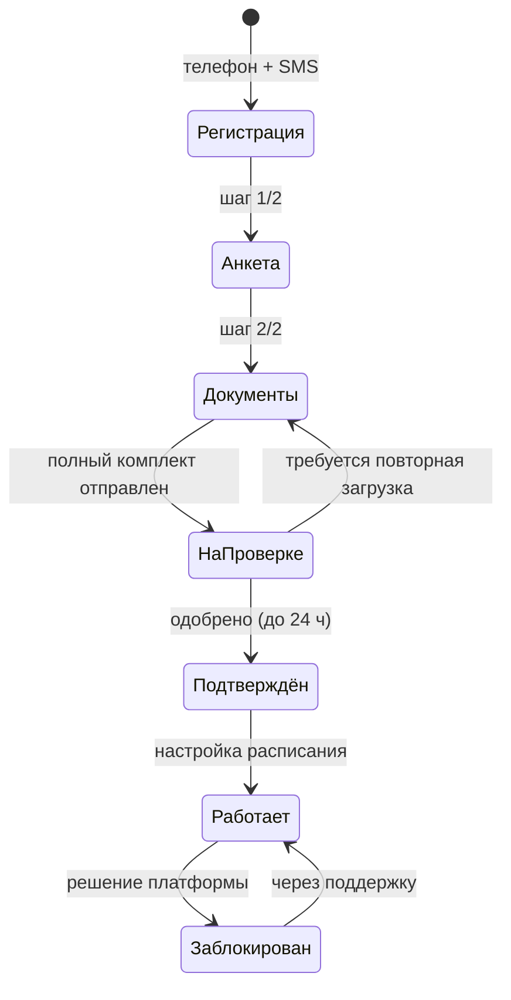

# БП-04 Онбординг и верификация эксперта

> От регистрации психолога до допуска к работе. Хаб: [[Бизнес-процессы SmartQoldau]].

**Роли:** Кандидат-эксперт · Платформа · Оператор верификации (ручная проверка)
**Триггер:** регистрация в SmartQoldau Expert (или заявка со страницы «Стать психологом»).
**Результат:** профиль со статусом «Подтверждён» + бейдж «Верифицированный специалист»; эксперт попадает в подбор.

**Требования к кандидату** (со страницы «Стать психологом»): профильное психологическое образование, документ о квалификации, опыт консультирования, соблюдение стандартов конфиденциальности.

## Шаги

1. **Регистрация:** телефон 🇰🇿 +7 → SMS-код (повтор через 45 с). Новый номер = новый профиль специалиста. Принятие «Условий для специалистов» и Политики конфиденциальности.
2. **Анкета (шаг 1/2):** фото, город (Астана/Алматы/Шымкент), опыт (5 градаций), образование, специализации (мультивыбор из 9), языки (рус/каз/англ), **стоимость консультации в ₸ (назначает сам)**, форматы. Валидация: ≥1 специализация, цена, ≥1 формат.
3. **Документы (шаг 2/2):** 4 документа — удостоверение личности, диплом, сертификаты, документы о квалификации. Статусы каждого: Не загружено → Загружено → Подтверждено → Требуется повторная загрузка. «Отправить на проверку» активна только при полном комплекте.
4. **Ручная верификация (до 24 ч):** степпер «Документы получены → Проверка специалистом → Профиль подтверждён». До одобрения работать нельзя. Если документ отклонён → статус «Требуется повторная загрузка» → возврат к шагу 3.
5. **Допуск:** бейдж «Верифицированный специалист», переход в приложение, настройка расписания ([[БП-05 Управление доступностью эксперта]]).

## Смежные состояния

- **Блокировка:** «Профиль временно заблокирован — приём новых консультаций приостановлен», разблокировка только через поддержку ([[БП-09 Поддержка]]). Основания блокировки в прототипе не описаны (жалобы? качество? документы?).
- **Редактирование профиля** после верификации: имя, образование, опыт, цена, специализации, форматы — без повторной проверки; город и документы не редактируются (смена документов — видимо, через повторную верификацию).

## Решения ([[Продуктовые решения по открытым вопросам]])

- **Регламент проверки (Р-18):** чек-лист оператора — подлинность удостоверения, профильный диплом, действительность сертификатов, стаж; срок до 24 ч.
- **Блокировка (Р-19):** основания — подтверждённые жалобы на этику/безопасность, поддельные документы, систематические отмены, рейтинг < 4.0 при ≥ 20 консультациях (Р-20). Решение команды качества с указанием причины; разблокировка через поддержку.
- **Цена (Р-04):** свободный ввод в коридоре 2 000–15 000 ₸, без модерации.
- **Смена данных (Р-18):** смена документа → повторная проверка только этого документа, профиль продолжает работать; смена города — без проверки (разрешить редактирование).
