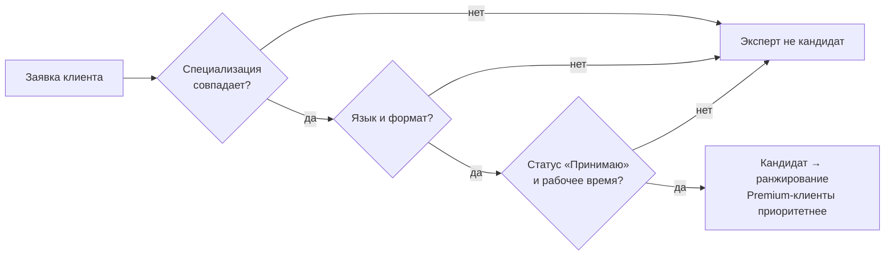

# БП-05 Управление доступностью эксперта

> Как эксперт управляет своим присутствием в подборе. Хаб: [[Бизнес-процессы SmartQoldau]]. Влияет на матчинг в [[БП-01 Консультация — заявка, подбор, сессия]].

**Роли:** Эксперт · Платформа (матчинг)

## Рабочий статус (4 состояния)

| Статус | Эффект |
|---|---|
| Принимаю клиентов | Участвует в подборе, получает заявки |
| Занят (на консультации) | Временно не получает новые заявки |
| Не принимаю | Не получает заявки, профиль виден |
| Временно недоступен | **Профиль скрыт из подбора** |

## Расписание и настройки доступности

- Рабочие дни (чекбоксы), время начала/окончания (напр. 09:00–18:00), перерыв (напр. 13:00–13:30).
- Виды календаря: День / Неделя / Месяц; слоты с клиентом, темой, форматом; свободные слоты доступны для записи.
- Тумблер **«Принимать срочные обращения»** — приоритетные заявки вне очереди ([[БП-02 Экстренная помощь]]).
- Тумблер **«Автоматически принимать заявки»** (только в веб-кабинете) — заявка минует ручное принятие.

## Логика матчинга (реконструкция из прототипа)

Автоподбор фильтрует экспертов по: специализация = тема клиента → язык → формат поддерживается → статус «Принимаю клиентов» → в рабочем времени по расписанию. Premium-клиенты получают приоритет. Ранжирование (рейтинг? цена? загрузка?) в прототипе не раскрыто.

## Решения ([[Продуктовые решения по открытым вопросам]])

- **Ранжирование (Р-12):** скор из рейтинга, скорости принятия заявок и доли отмен/no-show; Premium-клиенты — в начало очереди; при равном скоре — эксперт с меньшим числом сессий за день (балансировка нагрузки).
- **Автостатус (Р-13):** при старте сессии статус автоматически → «Занят», после завершения → обратно «Принимаю клиентов».
- **Автоприём (Р-11):** доступен на обеих платформах (добавить в мобильный Expert), по умолчанию выключен, не действует на экстренные заявки.
