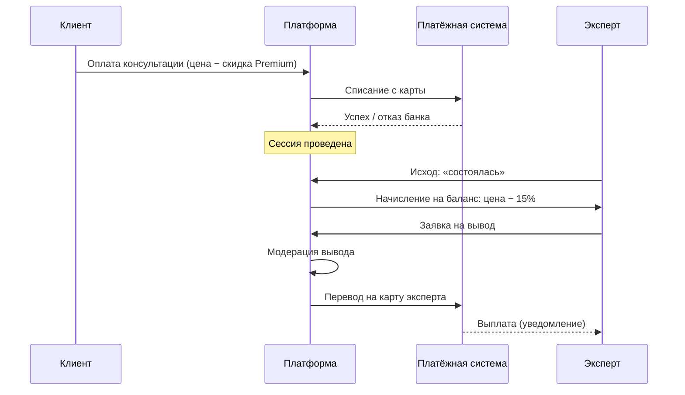

# БП-06 Оплата, начисление и выплаты

> Денежный контур платформы: от оплаты клиентом до вывода средств экспертом.
> Хаб: [[Бизнес-процессы SmartQoldau]]. Контекст: [[БП-01 Консультация — заявка, подбор, сессия]], [[БП-07 Premium-подписка]].

**Роли:** Клиент · Эксперт · Платформа · Оператор выплат · Платёжная система

## 1. Оплата клиентом

- Привязка карты: форма (номер, срок, CVC, имя), «данные передаются в зашифрованном виде и не хранятся на серверах» (намёк на токенизацию через платёжного провайдера). Несколько карт, удаление.
- Оплата перед сессией: шторка «30 минут с психологом · 3 990 ₸» → списание с выбранной карты. Ошибки: «Банк отклонил операцию» → повтор/другая карта.
- Скидка Premium 25% применяется к цене консультации.

## 2. Начисление эксперту (по исходу сессии)

| Исход (фиксирует эксперт) | Эксперту |
|---|---|
| Консультация состоялась | Цена − комиссия 15% (3 990 − 599 = 3 391 ₸) |
| Клиент не явился | 0 ₸ |
| Клиент отменил | 0 ₸ |
| Техническая проблема | 0 ₸ |

- Комиссия строго 15% при любой цене (проверено на 4 990 ₸ → 749 ₸ → 4 241 ₸).
- Начисление попадает на **внутренний баланс** эксперта; статусы транзакции: Начислено → Выплачено. Уведомление «3 391 ₸ зачислено на баланс».

## 3. Вывод средств

- Эксперт видит «Доступно к выводу» (демо: 125 400 ₸), привязывает карту вывода (сменяемая), нажимает «Вывести средства» → «Заявка на вывод отправлена».
- Заявки на вывод **модерируются**: статусы Обрабатывается / Выплачено / **Отклонено** (в демо есть отклонённый вывод 30 000 ₸ — основания не показаны).
- Уведомление о выплате: «48 500 ₸ отправлена на карту **** 4521».

## Решения ([[Продуктовые решения по открытым вопросам]])

- **Эскроу-холд (Р-01):** авторизационный холд при оплате, capture только после исхода «состоялась»; несостоявшиеся исходы → отмена холда, клиенту полный возврат, эксперту 0 ₸.
- **Скидка Premium — 10% за счёт комиссии платформы (Р-03):** эксперт всегда получает 85% полной цены; на Premium-консультации платформа берёт 5%.
- **Вывод (Р-06):** минимум 10 000 ₸; автоодобрение до 300 000 ₸/мес, свыше — ручная AML-проверка; отклонение — карта не на имя эксперта, подозрительная активность, незакрытые споры; зачисление до 3 рабочих дней.
- **Налоги (Р-07):** эксперты — самозанятые/ИП, платформа — посредник по агентской оферте, не налоговый агент.
- **Прозрачность (Р-02):** разбивка «цена − комиссия 15% = итого» показывается на всех поверхностях, включая мобильный Expert.
