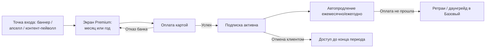

# БП-07 Premium-подписка

> Подписочная монетизация клиентов. Хаб: [[Бизнес-процессы SmartQoldau]]. Денежный контур: [[БП-06 Оплата, начисление и выплаты]].

**Роли:** Клиент · Платформа · Платёжная система

## Состав

| | Базовый (бесплатно) | Premium |
|---|---|---|
| Подбор специалиста | ✓ | ✓ приоритетный |
| Чат/аудио/видео | ✓ | ✓ |
| Дыхательные практики | базовые | расширенные |
| Медитации | — | полная библиотека |
| Статьи | ограниченно | без ограничений |
| Скидка на консультации | — | 10% (Р-03; в прототипе 25% — пересмотрено) |
| Анонимный режим | ✓ | ✓ |

Консультации в подписку **не входят** — оплачиваются отдельно по тарифу специалиста.

## Цены

**Решение Р-08:** единая цена на всех поверхностях — **2 990 ₸/мес или 23 900 ₸/год** (≈1 990 ₸/мес, «выгода 33%»). Веб-страница с 4 990 ₸/мес устарела и приводится к мобильной.

## Процесс

1. Точки входа: баннер на главной, экран Premium, апселл в шторке оплаты («без оплаты за каждый сеанс» — формулировка вводит в заблуждение, консультации платные), мосты из самопомощи.
2. Выбор тарифа (месяц/год) → оплата привязанной картой → «Подписка активирована».
3. **Автопродление** через привязанную карту; отмена в любой момент, доступ до конца оплаченного периода (Р-09).
4. Эффекты подписки: приоритет в матчинге ([[БП-05 Управление доступностью эксперта]]), скидка 10% на каждую оплату консультации (Р-03), разблокировка контента ([[БП-11 Самопомощь и retention]]).

## Решения ([[Продуктовые решения по открытым вопросам]])

- **Цена и состав (Р-08):** единые 2 990 ₸/мес / 23 900 ₸/год и единый список преимуществ на всех поверхностях.
- **Экономика скидки (Р-03):** скидка снижена с 25% до 10% и компенсируется из комиссии платформы — эксперт получает 85% полной цены, платформа на Premium-консультации берёт 5%. При 25% каждая Premium-консультация была бы убыточна для платформы (скидка 998 ₸ > комиссия 599 ₸ при чеке 3 990 ₸).
- **Автопродление (Р-09):** 3 ретрая списания за 72 ч с сохранением доступа (grace), затем даунгрейд в Базовый.
