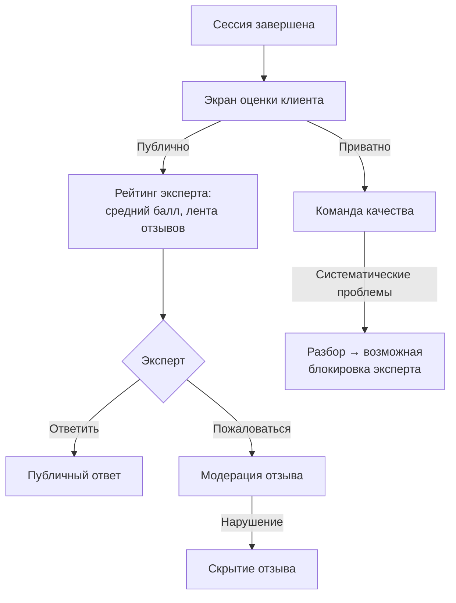

# БП-08 Отзывы, рейтинг и модерация

> Контур качества: оценка консультаций, рейтинг экспертов, жалобы. Хаб: [[Бизнес-процессы SmartQoldau]].

**Роли:** Клиент · Эксперт · Команда качества · Модерация

## Оценка после консультации (клиент)

1. После сессии — экран оценки: звёзды (1–5) + теги-причины.
2. Два канала обратной связи:
   - **Публичная оценка/отзыв** — попадает в рейтинг и ленту отзывов эксперта (клиент отображается анонимно: «Анонимный клиент», «Пользователь 4821»).
   - **Приватный отзыв** — «видит только команда качества, психолог не увидит».
3. Оценку можно пропустить.

## Рейтинг эксперта

- Средний балл + число отзывов (демо: 4.9★, 247–312) + распределение по звёздам.
- Показывается клиентам в каталоге/профиле и участвует в сортировке каталога; вероятно, влияет на ранжирование в матчинге (не подтверждено прототипом).

## Реакции эксперта на отзыв

- **«Ответить»** — публичный ответ на отзыв.
- **«Пожаловаться»** — отправка отзыва на модерацию («Жалоба отправлена»).

## Жалобы во время сессии

- У клиента в чате/звонке: «Пожаловаться», «Сообщить о проблеме».
- У эксперта: «Сообщить о проблеме» (меню сессии).
- Куда попадают жалобы и SLA разбора — в прототипе не показано; логично — в [[БП-09 Поддержка]] / модерацию. Возможное следствие для эксперта — блокировка профиля ([[БП-04 Онбординг и верификация эксперта]]).

## Решения ([[Продуктовые решения по открытым вопросам]])

- **Модерация (Р-21):** разбор жалобы на отзыв — до 3 рабочих дней; скрытие при оскорблениях, персональных данных, спаме.
- **Порог качества (Р-20):** рейтинг < 4.0 при ≥ 20 консультациях → разбор командой качества, снижение позиции в подборе, при подтверждении проблем — приостановка профиля (Р-19). Рейтинг входит в скор ранжирования матчинга (Р-12).
- **Отзыв клиента (Р-21):** клиент может удалить свой отзыв, рейтинг пересчитывается.
