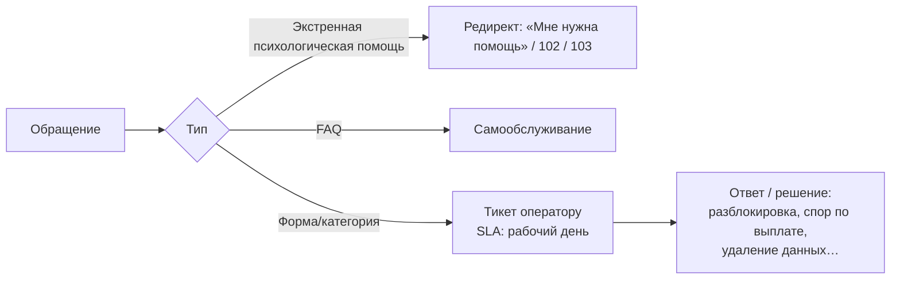

# БП-09 Поддержка

> Обращения клиентов и экспертов в службу поддержки. Хаб: [[Бизнес-процессы SmartQoldau]].

**Роли:** Клиент / Эксперт · Оператор поддержки
**SLA:** «ответим в течение рабочего дня».
**Контакты:** support@smartqoldau.kz, +7 700 000 00 00.

## Каналы и категории

- **Клиент:** FAQ, форма «Написать в поддержку» (профиль, веб-страница «Поддержка»). Явное разграничение: форма **не** для экстренной психологической помощи — за помощью на главную ([[БП-02 Экстренная помощь]]), при угрозе жизни 102/103.
- **Эксперт:** центр поддержки с категориями — Консультации, Оплата, **Выплаты**, Технические проблемы, **Верификация**, Безопасность, вопрос по клиенту.

## Особые сценарии через поддержку

- Разблокировка заблокированного профиля эксперта ([[БП-04 Онбординг и верификация эксперта]]).
- Споры по выплатам/отклонённым выводам ([[БП-06 Оплата, начисление и выплаты]]).
- Разбор жалоб на сессии/отзывы ([[БП-08 Отзывы, рейтинг и модерация]]).
- Удаление аккаунта клиента и истории по запросу (право по Политике конфиденциальности).

## Решения ([[Продуктовые решения по открытым вопросам]])

- **Тикеты (Р-23):** статусы Новый → В работе → Решён; первая реакция — в течение рабочего дня.
- **Эскалация (Р-23):** тикеты категорий «Верификация», «Выплаты», «Безопасность» передаются в профильные команды — операторы верификации, финконтроль, команда качества.
