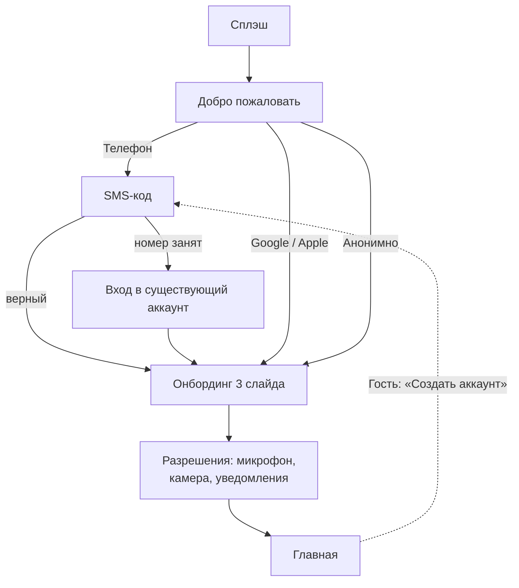

# БП-10 Онбординг клиента

> Вход клиента в продукт: анонимный режим vs регистрация. Хаб: [[Бизнес-процессы SmartQoldau]].

**Роли:** Клиент · Платформа

## Два пути входа

| | Анонимный гость | Зарегистрированный |
|---|---|---|
| Вход | «Продолжить анонимно», без данных | Телефон +7 + SMS-код (повтор 45 с), либо Google/Apple |
| Имя/фото | Не запрашиваются | Опционально |
| История консультаций | Не сохраняется, без синхронизации между устройствами | Сохраняется |
| Доступ к консультациям | ✓ (ядро работает) | ✓ |
| Premium, избранное, статистика | Ограничено | ✓ |

Анонимность — центральная фича против стигмы; в профиле гостя постоянная подсказка «Создать аккаунт» (конверсионная точка).

## Шаги

1. Сплэш → «Добро пожаловать» (ценностное предложение + ссылки на Соглашение и Политику).
2. Выбор: телефон / Google / Apple / анонимно.
3. Онбординг-слайды (3): форматы, конфиденциальность, «ответ за 1–2 минуты». Можно пропустить.
4. Разрешения: микрофон (аудио), камера (видео), уведомления (не пропустить ответ психолога).
5. Главная. Ошибочные ветки регистрации: неверный SMS-код; «номер уже зарегистрирован» → Войти.

## Решения ([[Продуктовые решения по открытым вопросам]])

- **Конверсия гостя (Р-22):** при регистрации активная консультация, привязанная карта и локальная статистика переносятся в аккаунт; история с прежних устройств не восстанавливается (её нет по дизайну анонимности).
- **Оплата гостем (Р-22):** карта привязывается к device-scoped гостевому профилю.
