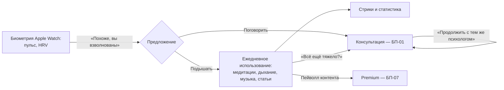

# БП-11 Самопомощь и retention

> Контур удержания: контент самопомощи, стрики, биометрия и мосты в платные консультации. Хаб: [[Бизнес-процессы SmartQoldau]]. Монетизация контента: [[БП-07 Premium-подписка]].

**Роли:** Клиент · Платформа (контент, аналитика, пуши)

## Составляющие

- **Материалы:** медитации (плеер, категории, таймер сна), дыхательные упражнения (техники с описанием «помогает при…», фазы вдох/выдох), расслабляющая музыка, статьи (прогресс чтения, «была ли полезна?»). Часть контента — за Premium-пейволлом.
- **Геймификация:** стрики («6 дней подряд»), счётчики (34 медитации), статистика в профиле.
- **Биометрия («Анализ»):** пульс и HRV с Apple Watch, график за час, проактивное предложение «Похоже, вы взволнованы» → «Подышать» / «Поговорить». Дисклеймер «не медицинский диагноз».
- **Мосты в монетизацию:** после дыхательного упражнения — «Всё ещё тяжело? Поговорить с психологом» ([[БП-01 Консультация — заявка, подбор, сессия]]); после оценки — «Продолжить с тем же психологом»; избранные психологи → «Записаться снова».

## Решения ([[Продуктовые решения по открытым вопросам]])

- **Р-25:** retention-пуши (напоминания о практиках/стриках) — opt-in, после MVP; Google Fit / Samsung Health — после запуска Android-версии. В MVP — только контент, стрики и биометрия Apple Watch.
