# 02 — Определение продукта и объём (Product Scope)

Статус: draft · Дата: 2026-09-13 · Владелец: Product · Источники: [[05_PRODUCT_DEFINITION]], [[04_FEATURE_INVENTORY]] (статусы F-* по коду `main` @ `310dde3`; HEAD `7cc0878` — только документация/архив), [[14_ROADMAP_AND_BACKLOG]] (E18–E30), [[16_RISKS_QUESTIONS_AND_ADRS]] (RK-01…15, Q-01…20, ADR-001…008), [[11a_SCREEN_REGISTRY]], [[PRD MVP SmartQoldau]] §1–§6, [[Продуктовые решения по открытым вопросам]] (Р-01…Р-27), [[Расхождения в прототипе]], прототип v2 `RAW/SmartQoldau (1)/` (тексты экранов `SmartQoldau - Investor Deck`, `SmartQoldau.kz`, `SmartQoldau - Прототип` и экраны, названные по месту), BRIEF §3 (DEC-01…38) и §6 (релизы).

Связано в пакете: [[01_EXECUTIVE_SUMMARY]] · [[03_ROLES_PERMISSIONS_AND_JTBD]] · [[04_BUSINESS_PROCESSES]] (BP-01…15) · [[07_STATE_MACHINES]] (SM-01…24) · [[08_KPI_TREE]] · [[13_COMPONENT_LIBRARY]] · [[15_BACKEND_SUPPORT_MATRIX]] · [[16_RELEASE_PLAN]]. Имена документов 04/07/08/13/15/16 даны по нумерации пакета (BRIEF §5, §9, §10); если файл получит другое имя — ссылка правится при сборке пакета, ID (BP/SM/KPI/CMP) не меняются.

Легенда меток — BRIEF §1. Дополнительно: `[FACT]` — подтверждено документом-источником (ТЗ, PRD, Р-решение, пакет планирования), но не кодом и не прототипом; там, где факт проверен в коде, стоит `[CODE FACT]` с путём/эндпоинтом/e2e-набором.

## Оглавление

1. [Определение продукта](#1-определение-продукта)
2. [Главный диагноз состояния](#2-главный-диагноз-состояния)
3. [Поверхности](#3-поверхности)
4. [Уровни объёма: MVP и Release 0…6](#4-уровни-объёма-mvp-и-release-06)
5. [Рекомендуемая очередность функций](#5-рекомендуемая-очередность-функций)
6. [Out of scope](#6-out-of-scope)
7. [Метрики успеха](#7-метрики-успеха)
8. [Рекомендации и открытые решения](#8-рекомендации-и-открытые-решения)

---

## 1. Определение продукта

Этот раздел не повторяет [[05_PRODUCT_DEFINITION]] §1–§2; он закрепляет формулировки, которые дальше используются во всех документах пакета, и привязывает их к ID экранов, процессов и решений.

### 1.1 Проблема и ценностное предложение

| Элемент | Формулировка (канон для UI-текстов и документов) | Метка · источник |
|---|---|---|
| Проблема | Человеку в Казахстане, которому плохо сейчас, психологическая помощь недоступна: запись занимает дни и недели, цена непрозрачна, стигма удерживает от обращения; существующие сервисы не работают на ru/kz и не имеют экстренного сценария | `[FACT]` PRD §1; `[PROTOTYPE FACT]` `Investor Deck` → «Проблема»: шесть карточек (страх осуждения, долгие очереди, нет быстрого доступа, высокая стоимость, нехватка цифровых решений, нет помощи в критический момент) |
| Ценностное предложение | Соединение с **верифицированным** психологом **обычно до 2 минут** в чате, аудио или видео; **конфиденциально** (без имени по умолчанию); **честные деньги** — списание только за состоявшуюся консультацию | `[FACT]` 05 §1; DEC-16 (формула «обычно до 2 минут» + честный счётчик «сейчас онлайн N»); DEC-13 (не «анонимно», а «конфиденциально»); Р-01 эскроу `[CODE FACT]` e2e `payments-hold`, `money-lifecycle` |
| Ключевой момент ценности (moment of value) | Экран `SCR-CL-08` «Поиск специалиста» → `SCR-CL-10` «Специалист найден»: человек нажал одну кнопку и через ≤ 2 мин (p90) видит живого верифицированного специалиста | `[FACT]` PRD §2 цель 1; `[CODE FACT]` e2e `request-timers`, `matching-online-count`; обещание в UI — только «обычно до 2 минут», DEC-16 `[RECOMMENDATION]` |
| Чем продукт является | Маркетплейс-посредник C2C с автоподбором и экстренной веткой; агентский договор-оферта; комиссия платформы 15 % единая | `[FACT]` Р-02, Р-07; DEC-07 |
| Чем продукт не является | Не медицинская и не экстренная служба; не мессенджер с психологом вне сессии; не канал с end-to-end-шифрованием; не юридическая консультация | `[FACT]` ТЗ §4.3 (дисклеймеры 102/103/112/150 — `[CODE FACT]` F-XS-04 `EmergencyBar`); DEC-20; DEC-24 / ADR-004; DEC-23 |

### 1.2 Аудитория и рынок запуска

| Сегмент | Кто | Роли ([[03_ROLES_PERMISSIONS_AND_JTBD]]) | Метка · источник |
|---|---|---|---|
| **Первичная — клиенты** | Жители РК 18+, ru/kz; два режима: «в кризисе, нужен человек сейчас» и «планирую работу с психологом» (персоны 05 §5: Уланбек, Дана) | R-02 Гость, R-03 Клиент, R-04 Premium | `[FACT]` 05 §1, §5; 18+ — DEC-33 `[DECISION REQUIRED]` (возраст в коде не проверяется — `[CODE FACT]` 05 §7) |
| **Первичная — специалисты** | Психологи-практики (самозанятые/ИП), несколько консультаций в день, рабочий день за ноутбуком, дежурство с телефона | R-06 Кандидат, R-07 Верифицированный, R-08 Заблокированный | `[FACT]` Р-07, Р-26; персона Айгуль 05 §5 |
| **Вторичная — операционная команда** | Верификация, поддержка, качество, финконтроль, контент, суперадмин | R-11…R-15, R-19 | `[CODE FACT]` 6 ролей `RolesGuard`, e2e `admin-staff`; DEC-25 |
| **Отложенная — компании (EAP)** | Работодатели, покупающие пул сессий; сотрудники обращаются конфиденциально | R-05, R-16, R-17 | `[PROTOTYPE FACT]` `Web - Для бизнеса`, `Admin - B2B`; `[OUT OF SCOPE]` до Release 4 (DEC-18) |
| **Отложенная — вузы и практиканты** | Партнёрство с факультетами психологии, практика под супервизией | R-09, R-10, R-18 | `[PROTOTYPE FACT]` `Web - Для вузов`, `Admin - B2G`; `[OUT OF SCOPE]` до Release 5 (DEC-17) |

Рынок запуска — Казахстан; первый рынок в терминах SAM — **Астана, Алматы, Шымкент** `[PROTOTYPE FACT]` `Investor Deck` → «Размер рынка»: «15 млрд ₸ SAM — жители Астаны, Алматы и Шымкента», «SOM 750 млн ₸ — 25 000 пользователей»; тот же список городов зашит в `SmartQoldau - Главная` (`CITIES = ['Астана','Алматы','Шымкент']`). Услуга онлайн, поэтому город — **не** фильтр матчинга и **не** пикер на главной (DEC-28 `[RECOMMENDATION]`, Q-14); город эксперта — только отображение в профиле/каталоге `[CODE FACT]` `Expert.city`, F-EX-02. Числа TAM/SAM/SOM deck считаются по чеку 15 000 ₸ — это верхняя граница коридора DEC-04, а не средний чек `[CONTRADICTION]` Q-04, см. §2 п.7.

### 1.3 Основной happy path

Опорный путь клиента (по 05 §2; ID экранов — [[11a_SCREEN_REGISTRY]] с префиксом `SCR-`; процессы — BP по BRIEF §5):

```mermaid
flowchart LR
  A[SCR-CL-03 Добро пожаловать<br/>«Продолжить конфиденциально»<br/>BP-02] --> B[SCR-CL-06 Главная<br/>12 тем · «сейчас онлайн N»]
  B --> C[SCR-CL-07 Выбор темы<br/>+ формат чат/аудио/видео<br/>BP-03]
  C --> D[SCR-CL-32 Имя и согласие Р-27<br/>перед первой заявкой]
  D --> E[SCR-CL-08 Поиск<br/>POST /requests · оффер 45 с<br/>BP-03]
  E --> F[SCR-CL-10 Специалист найден<br/>«Оплатить и начать» · холд<br/>BP-05]
  F --> G[SCR-CL-14/15/16 Сессия<br/>50 мин · BP-06]
  G --> H[SCR-EX-11 Завершение<br/>эксперт: «состоялась»<br/>capture · 85 % эксперту]
  H --> I[SCR-CL-17 Оценка<br/>рейтинг + теги + публичный<br/>+ приватный · BP-07]
  I --> J[«Продолжить с тем же»<br/>SCR-CL-13 Избранное<br/>directedExpertId]
```

| Шаг | Экран | Что проверено | Метка · источник |
|---|---|---|---|
| Гость без имени | `SCR-CL-03` | `POST /auth/guest`, device-scoped идентичность | `[CODE FACT]` e2e `auth-guest`; DEC-13 |
| Тема и формат | `SCR-CL-06`, `SCR-CL-07` | 12 тем из seed, `format` в `POST /requests` | `[CODE FACT]` `backend/prisma/seed.ts`, e2e `topics`, `requests-flow`; DEC-12 |
| Имя и согласие | `SCR-CL-32` | по `409` на первой заявке; `POST /me/expert-visibility` | `[CODE FACT]` e2e `expert-visibility-consent`; Р-27 |
| Подбор | `SCR-CL-08` ↔ `SCR-EX-07` | оффер 45 с / 20 с экстренный, ротация, `NO_EXPERTS` | `[CODE FACT]` e2e `request-timers`, `matching-accept-race`; DEC-10 |
| Оплата | `SCR-CL-10` | холд на полную цену, снимок `priceTiyn` | `[CODE FACT]` e2e `payments-hold`; DEC-05; провайдер — mock `[RISK]` RK-04 |
| Сессия | `SCR-CL-14/15/16`, `SCR-EX-10` | чат WS, LiveKit аудио/видео, эскалация формата | `[CODE FACT]` e2e `chat`, `media`, `consultation-lifecycle`; DEC-06 |
| Исход | `SCR-EX-11` | 4 исхода; несостоявшаяся → void, клиенту 0 ₸ | `[CODE FACT]` e2e `consultations-complete`, `money-lifecycle`; DEC-09 |
| Оценка | `SCR-CL-17` | рейтинг, теги, `publicText` + `privateText` | `[CODE FACT]` e2e `reviews`, `review-tags`; DEC-14 (экран прототипа правится) |
| Повтор | `SCR-CL-13`, `SCR-CL-11` | избранное, направленная заявка | `[CODE FACT]` e2e `favorites`, `requests-flow` (`directedExpertId`) |

Критические unhappy paths (никто не принял; экстренная без ответа; клиент не подключился 3 мин; техпроблема; банк отменил холд; пуш не доставлен → SMS через 10 с) реализованы — перечень и статусы в 05 §2 и [[04_FEATURE_INVENTORY]]; машины состояний — [[07_STATE_MACHINES]] (SM-08 заявка, SM-09 оффер, SM-11 консультация, SM-12 платёж). Единственный unhappy path без исполнения — обратный звонок: заявка фиксируется (`CALLBACK_REQUESTED`), очереди и самого звонка нет `[CODE FACT]` F-CL-13 PART → DEC-11.

### 1.4 Границы ответственности платформы

| Платформа делает | Платформа не делает | Метка · источник |
|---|---|---|
| Проверяет специалиста по 4 документам за ≤ 24 ч (SLA) и допускает к клиентам | Не оказывает психологическую помощь сама; не несёт ответственности за содержание консультации сверх модерации жалоб | `[FACT]` Р-18, Р-07; DEC-35 |
| Подбирает специалиста и удерживает деньги до исхода «состоялась» | Не является налоговым агентом; эксперт — самозанятый/ИП | `[FACT]` Р-07 |
| Показывает hotlines 102/103/112/150 и скрининг «угрожает ли опасность» в экстренном пути | Не заменяет экстренные службы; не обещает «перезвоним» без очереди callback | `[CODE FACT]` F-CL-09, F-XS-04; DEC-11 |
| Хранит переписку в зашифрованном виде на сервере, доступ только участникам; удаляет по `DELETE /v1/me` | Не заявляет end-to-end; не записывает звонки (LiveKit без egress — проверить в E29) | `[CODE FACT]` `backend/src/media`, e2e `account-delete`; DEC-24 / ADR-004 |
| Даёт эксперту код клиента, а имя — только по согласию клиента (Р-27) | Не раскрывает телефон клиента эксперту никогда | `[CODE FACT]` F-XS-01, e2e `expert-public-contract`, `expert-visibility-consent` |
| Только психологическая поддержка по 12 темам | Юридические консультации (README корня упоминает «юридической» — устарел) | `[CODE FACT]` F-CL-06 CONTRADICTED, `README.md:3`; DEC-23 |
| Переписка внутри сессии | Чат вне сессии / мессенджер с психологом | DEC-20; [[Расхождения в прототипе]] №10 |
| Оферта 18+ | Не обслуживает несовершеннолетних (возраст пока не подтверждается — экран согласия получает чекбокс) | DEC-33 `[DECISION REQUIRED]` |
| Интерфейс ru/kz полностью | Английский интерфейс | `[CODE FACT]` web 246/246, app_client 375/375, app_expert 205/205 ключей; DEC-22; 05 §3 |

---

## 2. Главный диагноз состояния

**Главный вывод.** Продукт уже реализован: в `main` пять приложений и общая библиотека (backend NestJS, `web/` Next.js с публичным сайтом и двумя кабинетами, `admin/` Vite SPA, `app_client`, `app_expert`, `packages/shared`), 100 e2e-наборов бэкенда (`ls backend/test/*.e2e-spec.ts`), закрыты эпики E1–E17 `[CODE FACT]` [[01_EXECUTIVE_SUMMARY]] §1, [[04_FEATURE_INVENTORY]]. По 04 в статусе `IMPLEMENTED_AND_TESTED`: клиент F-CL-01…05, 07…12, 14…18, 20…26, 28, 30, 36 (частично PART: 13, 19, 27, 29, 31); эксперт F-EX-01…08, 10, 12…18, 24 (PART: 09, 19, 20, 21); админка F-AD-01…07, 09, 10, 15, 19, 21, 23, 24; сквозные F-XS-01…05, 07. Поэтому blueprint — **не greenfield**, а (а) **контракт приёмки** того, что есть, и (б) **план управляемого разрыва с прототипом v2** там, где v2 расходится с кодом и решениями владельца (ADR-006). Ничего из перечисленного ниже не требует переписывания; требует решений, провайдеров и доводки поверхностей.

| # | Диагноз | Метка | Источник / доказательство | Следствие для blueprint |
|---|---|---|---|---|
| 1 | **Продукт реализован, но не запущен**: E1–E17 закрыты, открыты только E0 (оргблокеры), E11 (пилот), E17-8 (юрвычитка) | `[CODE FACT]` | 01 §1; 04 §1–§4; Plane | Объём R1 = доводка, не разработка «с нуля»; приёмка по ТЗ §11 |
| 2 | **Прототип v2 вводит правила, противоречащие коду и Р-решениям, — в деньгах**: тарифы Старт/Базовый/Про/Топ с комиссией 0–15 %; отмена <2 ч со штрафом 50 %; коридор цены 15 000–35 000 ₸; Premium 2 990/23 900 против 4 990/39 900; таймер оффера 240 с; «30 минут с психологом» | `[CONTRADICTION]` `[PROTOTYPE FACT]` | `Web - Стать психологом` (`plans: Старт 0 %… Топ 10–11 %`), `Expert - Тарифы`, `Admin - Настройки` (вкладка «Пакеты экспертов»); `Investor Deck` («15 000–35 000 ₸ за сессию»); `SmartQoldau - Premium` (`2 990 ₸ / месяц`) vs `Web - Premium` (`4 990 ₸ / мес`); `Expert Web - Главная` (`state.countdown: 240`); `Специалист найден` («30 минут с психологом · 18 500 ₸»). Код: `PRICE_MIN=200_000 / PRICE_MAX=1_500_000` тыин в `experts.service.ts`, `PREMIUM_PRICES`, e2e `request-timers`, `premium-discount` | DEC-01, 04, 06, 07, 08, 09, 10 — в UI действует канон; v2-правила ждут владельца (Q-01…Q-04) |
| 3 | **Поверхности расходятся по функциям**: «Клиенты» — только EW; поддержка эксперта — только EM; плановая запись — только CM; `.well-known` для deep links не отдаётся; в EW нет поддержки/настроек; гостя в вебе нет по дизайну | `[CODE FACT]` `[RISK]` | 04: F-EX-21 PART (моб.), F-EX-20 PART (веб), F-CL-23 (веб MISSING), F-CL-31 PART, F-EX-24; RK-10; 18_AI §4 правило поверхностей | §3 фиксирует «что где живёт»; DEC-19 (EW основной, EM companion); недостающее — по релизам §5 |
| 4 | **Операционных процессов нет**: callback обещан, но очереди нет; жалоб/споров как сущности нет (только тикеты `CONSULTATIONS`); регламента при угрозе жизни нет; доступ админа к документам не журналируется | `[CODE FACT]` `[RISK]` | F-CL-13 PART, F-AD-12 MISSING, RK-06; F-CL-32/F-AD-11 MISSING; 05 §7 (Q-15); 12 T-09 | R1: текст экрана callback (DEC-11); R2: E20 жалобы, E21 callback-очередь; регламент — DEC-33 с юристом |
| 5 | **Боевых провайдеров нет**: платёж, пуш, SMS — `mock`/`dev` | `[CODE FACT]` `[RISK]` | `backend/.env.example`: `PAYMENT_PROVIDER=mock`, `PUSH_PROVIDER=mock`, `SMS_PROVIDER=dev`; F-CL-24 MOCKED, F-CL-27 PART; RK-03, RK-04; Q-20 (E0) | Все денежные и пуш-критерии ТЗ §11 подтверждены только на mock; gate R1 требует sandbox/прод эквайера и FCM/APNs |
| 6 | **iOS ни разу не собирался; Android собирается, но не в сторе** | `[CODE FACT]` `[RISK]` | RK-05 (нет macOS); память проекта: APK собираются с 2026-08-26; DEC-21 (ссылок на опубликованные приложения нет) | Сторовые бейджи на PW скрыты, не «скоро» (DEC-21); E27 в R1; TestFlight с буфером 2 недели |
| 7 | **Обещания в текстах сильнее реальности**: «Полная анонимность», «AI Matching Engine», «Analytics Dashboard», «От запроса до помощи — за 1–2 минуты» (deck); «анонимным режимом», «Можно обратиться анонимно» (лендинг); «Анонимный доступ · история не сохраняется» (профиль клиента); «Теперь все консультации и практики без ограничений» (Premium); README — «юридической консультационной помощи» | `[CONTRADICTION]` `[PROTOTYPE FACT]` | `Investor Deck` → «Решение», «Технологии», «Как работает сервис»; `SmartQoldau.kz` → hero, FAQ «Можно ли обратиться анонимно?»; `SmartQoldau - Профиль`; `SmartQoldau - Premium` (`showSuccess`); `README.md:3`. Код: матчинг — скоринг по рейтингу/скорости/отменам (Р-12, e2e `matching-scoring-batch`), не «AI»; дашборда админки нет (F-AD-22 MISSING); имя раскрывается по согласию (Р-27) | DEC-13 («конфиденциально»), DEC-16 («обычно до 2 минут»), DEC-03 (запрещённый текст Premium), DEC-23, DEC-24; deck и лендинг — в VISUAL_CHANGELOG |
| 8 | **Прототип покрывает 4 продукта, кода — 5 поверхностей**: веб-кабинета клиента (8 экранов) и 7 разделов админки (вход/TOTP, сотрудники, модерация профилей, флаг < 4.0, модерация отзывов, тикеты, контент) в v2 нет; обзорная страница заявляет «4 продукта, 82 экрана» при фактических 102 продуктовых экранах | `[PROTOTYPE FACT]` `[CODE FACT]` | `SmartQoldau - Прототип` («4 продукта · 82 экрана»); 11a WB-15/16, AD-11…17; DEC-38; [[Расхождения в прототипе]] №14 | CW живёт по раскладкам CM (DEC-21); прототип дополняется, код не удаляется |
| 9 | **Админка покрывает половину ТЗ §5.9 и треть v2**: нет дашборда, списка специалистов, клиентов (и `User.isBlocked`), ledger-просмотра, тем CRUD, просмотра audit, жалоб, callback-очереди, мониторинга экстренных | `[CODE FACT]` | F-AD-08, 11, 12, 13, 14, 16, 17, 18, 20, 22 MISSING/BACKEND_ONLY; `Admin - Дашборд` (карточки «Активные сессии», «Просроченная верификация >24ч», график 7 дней) | Release 2 (E21); до этого корень админки → `/verification` |
| 10 | **Критерий приёмки ТЗ §11.6 (пуш ≤ 3 с p95, включая убитое приложение) не реализуем сейчас**: нет FCM/APNs, VoIP-push/CallKit, ConnectionService | `[CODE FACT]` `[RISK]` | F-EX-25 MISSING («единственный критерий приёмки без реализации»), F-EX-09 PART; RK-03 | E27 в R1; SMS-fallback через 10 с — страховка, не замена (e2e `offer-push-fallback`, `sms-fallback-budget`) |
| 11 | **Долг безопасности до пилота**: токены админки в localStorage при выключенном CSP; блокировка не отзывает токены/WS; ротации ключа шифрования чата нет; dev-секреты в `.env.example` | `[CODE FACT]` `[RISK]` | 12 T-05, T-06, T-13, T-15, T-16; RK-07, RK-08, RK-09 | E29 — gate R1 |
| 12 | **Эксплуатации нет в репозитории**: TLS, бэкапы, централизованные логи, алерты, TURN, runbook | `[CODE FACT]` `[RISK]` | F-XS-08, F-XS-09 MISSING; RK-11 (`infra` README «намеренно нет») | E30 — gate R1; переписка невосстановима без бэкапов |
| 13 | **Юридический контур отстаёт от продукта**: политика/оферта не вычитаны после Р-27 и v2; 18+ не подтверждается; срок хранения переписки не задан; экспорт данных отсутствует | `[FACT]` `[RISK]` | E17-8; RK-12; 05 §7; Q-15 | DEC-32, 33, 34 — юрист до пилота; экран согласия получает возраст |
| 14 | **CI не честный** — качество не измеряется тем, что заявлено: lint с `--fix`, e2e без MinIO, зависимость от сида, Jest виснет | `[CODE FACT]` `[RISK]` | RK-01, RK-13; E18 | Release 0 (E18) — до любого продуктового кода |
| 15 | **Один автор кода и знаний** | `[RISK]` | RK-15 (`git shortlog`) | Пакет документов + [[18_AI_EXECUTION_RULES]] как замена «памяти команды» |

---

## 3. Поверхности

Идентификаторы — BRIEF §2. Принципы: **функция роли появляется на всех поверхностях роли** или помечается поверхностно-ограниченной с причиной ([[18_AI_EXECUTION_RULES]] §4); **EW — основной кабинет эксперта, EM — companion** (DEC-19); **CW существует, прототипа у него нет** — раскладки берутся с мобильных экранов (DEC-21, [[Расхождения в прототипе]] №14); **AD — desktop-only** (ADR-003, отдельная идентичность).

### 3.1 Назначение, каноническое содержание, запреты

| Поверхность | Назначение | Канонически живёт здесь | Здесь быть не должно | Метка · источник |
|---|---|---|---|---|
| **PW** Public Web (`web/app/[locale]`, Next.js, SSR) | Acquisition и доверие: объяснить сервис, показать каталог поисковику, довести до входа/приложения; юрдокументы | Лендинг (`SCR-WB-01`), каталог с фильтрами в URL (`SCR-WB-02`), публичный профиль (`SCR-WB-03`, JSON-LD, sitemap), выбор темы (`SCR-WB-04`), материалы с пейволлом (`SCR-WB-05`), Premium-страница (`SCR-WB-06`), «Стать психологом» (`SCR-WB-07`), «О нас», поддержка → тикет (`SCR-WB-09`), оферта/политика (`SCR-WB-10`), вход по SMS (`SCR-WB-15`); R1: «Для бизнеса»/«Для вузов» → тикет `PARTNERSHIP` (`SCR-WB-11/12`), cookie-баннер (`SCR-WB-13`), переключатель ru/kz (`SCR-WB-14`), `EmergencyBar` на каждой странице | Блок тарифов на «Стать психологом» (DEC-08); бейджи App Store/Google Play без ссылок на опубликованные приложения (DEC-21); «Қазақша нұсқа жасалып жатыр» (DEC-22); «анонимно», «end-to-end», «за 1 минуту» (DEC-13/24/16); гостевой вход (DEC-13: гость только в мобильном) | `[CODE FACT]` 11a WB-01…10, 15 ✓; WB-11…13 ✗; `[PROTOTYPE FACT]` `SmartQoldau.kz` → блок «SmartQoldau всегда под рукой» с бейджами, `Web - LangSwitch` |
| **CM** Client Mobile (`app_client`, Flutter) | Единственная поверхность с гостем и с полным экстренным путём «телефон в руке»; весь путь клиента | Гость/SMS/конверсия (`SCR-CL-03/04`), разрешения, главная с 12 темами и счётчиком онлайн (`SCR-CL-06`), тема+формат, поиск, экстренный путь с hotlines и скринингом (`SCR-CL-09`), «найден»+оплата картой (`SCR-CL-10`), профиль/каталог/избранное, чат/аудио/видео, оценка, консультации с плановой записью/переносом (`SCR-CL-18`), материалы (один раздел с фильтрами, `SCR-CL-19`), Premium (`SCR-CL-24`), карты (`SCR-CL-25`), профиль с согласием и удалением (`SCR-CL-26`, `SCR-CL-32`), уведомления, поддержка, deep links `/e /t /sos /c` | Кнопки «Продолжить с Google/Apple» (DEC-29); шаг «У меня есть корпоративный доступ» и код `SQ-XXXX-YYYY` (DEC-18, до R4); пикер города (DEC-28); карточка «Пульс … данные с часов» и экран «Анализ» (DEC-30, R6); «Скидка 15 % у новых специалистов» и фильтр `?new=1` (DEC-08, R4+); бейдж «Психолог-практикант под супервизией», цена «Бесплатно (учебная практика)» (DEC-17, R5); Kaspi Pay/Apple Pay в шторке оплаты (DEC-26, R2); «Оплачено компанией» (R4); четыре отдельных экрана контента (№11 закрыто) | `[CODE FACT]` 11a CL-01…28, 32 ✓/◐; `[PROTOTYPE FACT]` `SmartQoldau - Регистрация` (`goToCorporate`, «Продолжить с Google/Apple»), `- Главная` (`showCityPicker`, «Пульс 96 уд/мин · данные с часов», «Скидка 15% на консультации у новых специалистов»), `- Каталог` (`isIntern`, `priceLabel: 'Бесплатно (учебная практика)'`), `- Специалист найден` (`[BTN onPay] Apple Pay / Kaspi Pay`, «Оплачено компанией») |
| **CW** Client Web cabinet (`web/app/[locale]/(client)/*`, за BFF) | Планирующий клиент за ноутбуком: заявка, ожидание, консультация (чат + звонок рядом), история, избранное, уведомления, профиль, Premium; SEO-воронка «каталог → профиль → Записаться → вход» | Вход по SMS (httpOnly-cookie), `requests/new`, `requests/[id]`, консультации, чат/звонок, избранное, уведомления, профиль (согласие Р-27, удаление), Premium, поддержка-форма; экстренный путь E16-15 с `tel:`-кнопками | Гость (по дизайну E16 — веб только SMS); обещание «установите приложение» вместо «Записаться» (DEC-21: primary — «Записаться», вторичный — «Открыть в приложении» при наличии ссылок); отдельная раскладка, не выведенная из CM (№14) | `[CODE FACT]` F-CL-36 I&T, 11a WB-16 (8 экранов); плановая запись в вебе — MISSING (F-CL-23) → R2; `[PROTOTYPE FACT]` `Web - Профиль психолога`: «Чтобы записаться … установите приложение SmartQoldau» — отклонено DEC-21 |
| **EM** Expert Mobile (`app_expert`, Flutter) — companion | Дежурство между делами: быть онлайн, принять оффер за 45/20 с с полноэкранным алертом, провести сессию с телефона, увидеть ближайшую запись и сводку дохода; онбординг, документы (4 файла — только здесь), статус верификации | Сплэш/вход, анкета (`SCR-EX-02`), документы и статус (`SCR-EX-03/04`), главная со статусом и heartbeat (`SCR-EX-05`), доступность, входящий запрос (`SCR-EX-07`), заявки, консультации, сессия/чат/звонки, завершение с исходом (`SCR-EX-11`), заметки (`SCR-EX-12`), доход/выплаты (`SCR-EX-13`), рейтинг, уведомления, профиль, расписание (`SCR-EX-17`), поддержка (`SCR-EX-18`), экран «профиль заблокирован». Уже реализованные расписание/полный профиль/выплаты **не удаляются** | Карточка «Клиент» с именем и историей (`SCR-EX-19`) — только EW (DEC-19, Р-27); «Мой тариф», экран «Тарифы» (`SCR-EX-21`, DEC-08); «Жалоба на вас»/«Мои жалобы и споры» до R2 (`SCR-EX-22/23`, DEC-15); «пробный период» в уведомлениях; напоминание «за 30 минут» (DEC-27) | `[CODE FACT]` 11a EX-01…18 ✓/◐, EX-19 ◐ (веб), F-EX-25 MISSING (убитое приложение); `[PROTOTYPE FACT]` `Expert - Тарифы` («Перейти на «{{ p.name }}»»), `Expert - Клиент` |
| **EW** Expert Web (`web/app/[locale]/(expert)/*`) — основной кабинет | Рабочий день за столом: дашборд и статус, офферы, консультации с видео+чат рядом и выбором камеры/микрофона, клиенты по согласию, расписание, доход с разбивкой «цена − 15 % = итого» и выплаты, рейтинг и ответы, профиль, уведомления; R2 — жалобы; R3 — чаты (read-only), поддержка, настройки | `SCR-EW-01…10` реализованы; честный индикатор «онлайн, пока открыта вкладка» (Р-26) | Чат вне сессии (v2 `Expert Web - Чаты` рисует «Активные консультации» с composer — DEC-20: только список переписок завершённых консультаций, R3); «Мой тариф», «комиссия по тарифу» (DEC-08); пустые пункты меню «скоро» (№10) | `[CODE FACT]` 11a EW-01…10 ✓/◐, EW-11…13 ✗; `[PROTOTYPE FACT]` `Expert Web - Чаты` (`[BTN startAudio] Начать аудио`, `[BTN startVideo] Начать видео` в списке «Активные консультации»), `Expert Web - Доход` («Комиссия платформы 15%») |
| **AD** Admin Web (`admin/`, Vite SPA, desktop-only) | Операционная команда: верификация с SLA 24 ч, тикеты по командам, выплаты и финконтроль, модерация профилей/отзывов, флаг качества, контент CMS, сотрудники и роли, TOTP; R2 — дашборд, специалисты, клиенты, ledger/финансы, audit-просмотр, темы CRUD, callback-очередь, жалобы; R3 — рассылки; R4/R5 — B2B/B2G | `/login`, `/login/totp`, `/verification`, `/tickets*`, `/payouts`, `/profile-moderation`, `/flagged-experts`, `/reviews`, `/content`, `/staff`, `/settings` (TOTP) | Две роли «супер-админ/модератор» (DEC-25: 6 ролей, «Модератор» = пресет); вкладка «Пакеты экспертов» в настройках (DEC-08); вкладка «Студенты-практиканты», «Дубликат ИИН», «Назначенный супервайзер» в верификации (DEC-17/35, R5); «B2B-контракты»/«B2G-контракты» в меню до R4/R5; мобильная раскладка | `[CODE FACT]` 11a AD-02, 06, 10 ◐, AD-11…17 ✓, AD-01/03/04/05/07/08/09 ✗; `[PROTOTYPE FACT]` `Admin - Настройки` (`tabs: Пакеты экспертов · Темы обращений · Контент · Журнал действий`), `Admin - Верификация` (`[CLICK showInterns] Студенты-практиканты`, «⚠ Дубликат ИИН»), `Admin - Дашборд` (`role === 'moderator'`) |

### 3.2 Сводная таблица

| Поверхность | Назначение (одной строкой) | Роли | Релиз появления | Статус в коде | Прототип v2 |
|---|---|---|---|---|---|
| **PW** | Acquisition, SEO-каталог, юрдокументы, вход | R-01, R-03 (вход) | MVP (есть) · R1 — тексты v2, cookie, lang, B2B/B2G-формы → тикеты | ✓ 10/14 экранов; ✗ WB-11…13 | 15 экранов `Web - …` + `SmartQoldau.kz` |
| **CM** | Полный путь клиента, гость, экстренный путь | R-02, R-03, R-04 | MVP (есть) · R1 — доводка к канону DEC | ✓ 28 экранов (◐ там, где v2 добавил вне канона) | 30 экранов `SmartQoldau - …` |
| **CW** | Кабинет планирующего клиента в браузере | R-03, R-04 | MVP (есть, E16-B) · R2 — плановая запись в вебе | ✓ 8 экранов; ✗ гость (по дизайну), ✗ booking | нет (DEC-21, №14) |
| **EM** | Companion эксперта: статус, оффер, сессия, сводка | R-06, R-07, R-08 | MVP (есть) · R2 — жалобы | ✓ 18 экранов; ✗ EX-19 (только EW), EX-21…23 | 31 экран `Expert - …` |
| **EW** | Основной кабинет эксперта | R-07 (R-06 — статус верификации) | MVP (есть, E14/E16-C) · R2 — жалобы · R3 — чаты read-only, поддержка, настройки | ✓ 10 экранов; ✗ EW-11…13 | 12 экранов `Expert Web - …` |
| **AD** | Операционная команда, desktop-only | R-11…R-15, R-19 (R-16 с R4) | MVP (есть) · R2 — E21 + жалобы · R3 — рассылки · R4/R5 — контракты | ✓ 7 разделов + вход; ✗ 7 разделов v2 | 10 экранов `Admin - …` |

`[INFERENCE]` Число экранов по поверхностям — из `SmartQoldau - Прототип` и `_summary.tsv` (106 файлов `.dc.html`, из них 4 служебных: `Прототип`, `Презентация`, `Investor Deck`, `ER-схема`) — DEC-38.

---

## 4. Уровни объёма: MVP и Release 0…6

Релизы — канон BRIEF §6; здесь для каждого: цель, что входит, что не входит, выходной критерий (gate) и внешние зависимости. Не все функции прототипа v2 — MVP: v2 рисует объём Release 1…5 одновременно, поэтому принадлежность каждого элемента v2 к релизу задаётся ниже и в §5, а не подразумевается.

### 4.1 MVP — минимально необходимое для пилота (уже реализовано)

`[CODE FACT]` 05 §3 (уровни «MVP R1 ядро» и «R2»), 04 §1–§4. В коде и покрыто e2e:

| Блок | Функции | Ключевые e2e |
|---|---|---|
| Доступ клиента | гость по устройству, SMS-вход, refresh, конверсия гостя, удаление аккаунта, согласие Р-27 | `auth-guest`, `auth-verify`, `account-delete`, `expert-visibility-consent` |
| Подбор | 12 тем, формат, обычная заявка с ротацией 45 с, экстренная 20 с + broadcast 2 мин + hotlines 5 мин, направленная заявка, счётчик онлайн, отмена | `requests-flow`, `request-timers`, `request-emergency`, `matching-*` |
| Консультация | чат (WS, история, typing), аудио/видео (LiveKit), эскалация формата, реконнект, 4 исхода + отмена, заметка эксперта | `chat`, `media`, `consultation-lifecycle`, `consultations-complete`, `expert-notes` |
| Деньги | карта-токен, холд → capture/void, ledger двойной записи, доход эксперта с разбивкой, выплаты ≥ 10 000 ₸, финконтроль > 300 000 ₸/мес | `payments-hold`, `payments-settle`, `money-lifecycle`, `ledger`, `payouts`, `payouts-admin` |
| Плановые | слоты, запись, перенос, отмена, лимит злоупотреблений | `slots`, `booking-*`, `abuse-gate` |
| Качество | отзыв (рейтинг, теги, публичный/приватный), удаление, ответ эксперта, жалоба на отзыв, модерация, флаг < 4.0 при ≥ 20 | `reviews`, `review-tags`, `reviews-moderation`, `admin-experts-flagged` |
| Эксперт | анкета, фото/«о себе» с модерацией, 4 документа, верификация с SLA 24 ч и reupload, статус (4) + тумблер срочных, heartbeat, расписание и исключения, блокировка | `experts-*`, `expert-lifecycle`, `admin-verification`, `profile-moderation`, `admin-lifecycle` |
| Premium и контент | планы 4 990/39 900 из API, подписка/отмена/GRACE, скидка 10 %, приоритет; материалы, пейволл, прогресс, стрик, CMS | `premium-*`, `content-*` |
| Уведомления и поддержка | центр, ack, устройства, outbox, SMS-fallback офферов; тикеты по командам | `notifications-*`, `offer-push-fallback`, `tickets-*` |
| Админка | вход + TOTP + lockout, 6 ролей, сотрудники, очередь верификации, тикеты, выплаты, модерация, контент | `admin-auth`, `admin-2fa`, `admin-lockout`, `admin-staff`, `tickets-admin` |
| Веб | публичный сайт с SSR/SEO, каталог, профиль, материалы, Premium, юрстраницы, вход, кабинеты клиента и эксперта | web Jest/Playwright (`catalog.spec`, `expert.spec`, `cabinet.spec`, `expert-cabinet/*`) |
| Сквозное | PII-инвариант, ru/kz, audit ~60 переходов, дисклеймеры, троттлинг, OpenAPI как контракт | `expert-public-contract`, `throttling`, `openapi` |

Не закрыто в MVP (и потому MVP ≠ «готово к пилоту»): боевые провайдеры, iOS-сборка и сторы, пуш в убитом приложении, безопасность E29, эксплуатация E30, юрвычитка, решения владельца по v2 `[CODE FACT]` 05 §3, RK-03…RK-12.

### 4.2 Release 0 — Foundation & Decisions

| | |
|---|---|
| **Цель** | Снять неопределённость до кода: подтверждённые DEC, честный CI, токены как данные |
| **Входит** | Этот пакет (01–16); подтверждение владельцем DEC со статусом `rec` (список — §8.2); `contracts/design-tokens.json` (E28 часть); E18 гигиена CI (lint без `--fix`, MinIO в CI, профиль integration, `check-all.sh`, README/CLAUDE.md); E19 — Q-01…Q-20 → Р-28+, ТЗ v1.1, реестр экранов «в объёме/вне»; VISUAL_CHANGELOG для deck/лендинга (§2 п.7) |
| **Не входит** | Любой продуктовый код (E18 out of scope); правка прототипа v2 «под код» без решения |
| **Gate** | `PLAN APPROVED — START IMPLEMENTATION` от владельца; G0–G2 из 14 (baseline подтверждён, все 5 workflow зелёные на пустом диффе, ни одного открытого `[DECISION REQUIRED]`, блокирующего R1) |
| **Зависимости** | Владелец (решения); юрист — только консультативно |
| **Источник** | `[FACT]` 14 Phase 0–3, E18, E19; BRIEF §6 |

### 4.3 Release 1 — Core Marketplace to Pilot

| | |
|---|---|
| **Цель** | Существующие пять приложений доведены до эталона v2 (раскладки) и канона DEC (правила) и проходят приёмку ТЗ §11 на боевых провайдерах и устройствах; пилот 20–30 экспертов / 50–100 клиентов (A-03) |
| **Входит — PW** | Тексты v2 (36 правок `SCR-WB-01`) с заменами DEC-13/16/24; cookie-баннер (DEC-32, S); переключатель ru/kz с полной kz (DEC-22); «Для бизнеса»/«Для вузов» → тикет `PARTNERSHIP` (DEC-17/18, E24-минимум, S); блок сторовых бейджей скрыт (DEC-21); блок тарифов отсутствует (DEC-08); `.well-known` для deep links (E27) |
| **Входит — CM/CW** | Путь гость → тема → подбор → оплата картой → чат/аудио/видео → оценка: экран оценки по DEC-14 (публичный + приватный, правка текста «психолог его не увидит»); экран имени и согласия перед первой заявкой с чекбоксом 18+ (DEC-13/33); экстренный путь с текстом «Позвоните на линию 150 или попробуйте позже» вместо обещания перезвона (DEC-11); 12 тем или 8 + «Все темы» на главной (DEC-12); шторка оплаты «50 минут», только карта (DEC-06/26); формула «обычно до 2 минут» + «сейчас онлайн N» + «ожидание может быть дольше» при N < порога (DEC-16); Premium-тексты по DEC-03; предупреждение «при удалении приложения история теряется» (DEC-13); CW: primary CTA «Записаться» (DEC-21) |
| **Входит — EM/EW** | Онбординг/анкета с коридором 2 000–15 000 ₸ (DEC-04), документы и верификация (DEC-35), офферы 45/20 с (DEC-10), статус и heartbeat, расписание, доход «цена − комиссия = итого» (DEC-07), выплаты (DEC-36), поддержка из EM и EW-формы (DEC-37 — минимум: ссылка на форму; полный раздел EW — R3), напоминания за 1 ч и 15 мин (DEC-27, S) |
| **Входит — AD** | Верификация, тикеты, модерация, выплаты, сотрудники, 6 ролей (DEC-25); audit чтения документов (T-09) |
| **Входит — платформа** | E28 realtime-ресинк (`events?since`, `Idempotency-Key`, дедуп LiveKit); E29 безопасность (T-05, 06, 09, 12, 13, 14, 15, 02, 23; проектирование `keyVersion`); E27 FCM/APNs за `PushProvider`, VoIP/CallKit-исследование, ConnectionService, iOS-сборка и TestFlight, Data Safety, скриншоты ru/kz; E30 TLS, бэкапы с проверкой восстановления, логи, алерты, TURN, runbook; E11 пилот; E0 эквайер/регион/аккаунты |
| **Не входит** | Жалобы (E20 → R2), админка v2 (E21 → R2), Kaspi/Apple/Google Pay (R2), отмены v2 (R2, условно), тарифы (R4+), B2B/B2G (R4/R5), рассылки (R3), «Чаты» EW (R3), wearable (R6), автоприём Р-11 (R3) |
| **Gate** | (1) **Один сквозной формат для приёмки — чат**: гость → оплата → чат → «состоялась» → capture → оценка проходит на sandbox/проде эквайера; аудио/видео проверяются в том же релизе на реальных iOS и Android; (2) ТЗ §11 на устройствах, включая p95 доставки оффера ≤ 3 с на 5 устройствах с убитым приложением (E27 acceptance) — либо явное решение владельца о смягчении §11.6 `[DECISION REQUIRED]`; (3) ASVS-чеклист E29 обновлён, e2e на каждую угрозу; (4) восстановление из бэкапа проверено, алерты `settle_exhausted`/очередь верификации > 24 ч/доля no-show/доставка пушей работают (E30); (5) оферта, политика, «Условия для специалистов» вычитаны юристом после Р-27 (E17-8, RK-12); (6) ни одного экрана/кнопки «скоро» и ни одного текста из запрещённого списка DEC-03/13/16/24 (grep по локалям); (7) TestFlight + внутреннее тестирование Google Play с демо-аккаунтами |
| **Зависимости** | Владелец: договор с эквайером (auth-hold, выплаты на карты), регион хостинга (ПД в РК), аккаунты Apple Developer/Google Play, macOS для сборки (Q-20/E0); юрист (Q-15); набор пилотных экспертов (операционный трек); провайдер SMS (`mobizon` адаптер есть `[CODE FACT]` `.env.example`) |
| **Источник** | `[FACT]` BRIEF §6; 14 E27–E30, E11; PRD §5 P0; ТЗ §11 |

### 4.4 Release 2 — Full Consultation & Payments

| | |
|---|---|
| **Цель** | Закрыть операционные дыры, видимые на пилоте: споры, картина дня в админке, способы оплаты, плановые консультации по v2 |
| **Входит** | **E20 жалобы и споры** (DEC-15): окно 48 ч, причины, вложение переписки, ответ эксперта, решение команды качества (отклонена / принята / страйк, без денег до DEC-09), экраны `SCR-CL-29/30`, `SCR-EX-22/23`, `SCR-AD-05`, уведомления `complaint.*`, статусы по словарю 11 §5; **E21 админка v2**: дашборд (`SCR-AD-01`, метрики по [[Дашборд метрик админки]]), специалисты (`SCR-AD-03`), клиенты с `User.isBlocked` и отзывом токенов (`SCR-AD-04`), ledger/финансы + CSV (`SCR-AD-06`), audit-просмотр, темы CRUD, callback-очередь с отметкой «связались» (E21-7) — после неё текст клиента может снова обещать перезвон (DEC-11); **E25 способы оплаты** Kaspi Pay / Apple Pay / Google Pay за `PaymentProvider.initiate(method)` (DEC-26); **E22 отмены v2** — только при DEC-09 → v2 и только для плановых (partial capture, `EXPERT_NO_SHOW`, feature-flag `CANCELLATION_POLICY`); **плановые консультации — полировка по v2**: вкладка «Отменённые», «срок истёк», плановая запись в CW (F-CL-23 веб) по правилу поверхностей |
| **Не входит** | Денежные решения по жалобам до DEC-09; тарифы; B2B; рассылки; «Пакеты» в настройках |
| **Gate** | Полный поток жалобы на стенде (48 ч на виртуальном времени, чужой участник → 403); дашборд показывает те же числа, что e2e-фикстура; заблокированный клиент получает 403 на `POST /requests`; каждый способ оплаты проходит hold/capture/void на sandbox; ledger дебет = кредит для каждого исхода E22 (если включён); ролевая матрица e2e по каждому новому эндпоинту |
| **Зависимости** | DEC-09, 15, 25, 26 подтверждены; возможности эквайера (partial capture, Kaspi/Apple/Google — E0); регламент команды качества по жалобам (BP-11, BP-15) |
| **Источник** | `[FACT]` BRIEF §6; 14 E20, E21, E22, E25 |

### 4.5 Release 3 — Retention

| | |
|---|---|
| **Цель** | Вернуть клиента и удержать эксперта: уведомления, Premium по канону, контент после сессии, полный кабинет эксперта |
| **Входит** | Уведомления v2 по типам (`SCR-CL-27`, `SCR-EX-15`: решение по жалобе, no-show специалиста — после E20/E22); Premium по канону DEC-01/02/03 на всех поверхностях (цена из API уже есть — доводка текстов и единого списка преимуществ); контент-рекомендации после сессии (BP-12; материал по теме консультации на экране оценки/истории); «Чаты» EW — список переписок завершённых консультаций, read-only (`SCR-EW-11`, DEC-20); поддержка и настройки в EW (`SCR-EW-12/13`); E26 рассылки — инцидент-алерт push по сегменту, маркетинг только с opt-in (DEC-31); автоприём заявок Р-11 (opt-in, не для экстренных) `[RECOMMENDATION]` — F-EX-11 DOCUMENTED_ONLY, PRD P1 |
| **Не входит** | Email-канал (отдельное решение, E26); чат вне сессии; retention-пуши без opt-in (Р-25) |
| **Gate** | Premium-конверсия измерима (≥ 5 % MAU через 30 дней — PRD §6); согласие на маркетинг хранится и проверяется e2e; в «Чатах» EW нет composer; автоприём выключен по умолчанию и не срабатывает на `isEmergency` (e2e) |
| **Зависимости** | DEC-20, 27, 31; данные пилота (какие уведомления реально нужны) |
| **Источник** | `[FACT]` BRIEF §6; 14 E26; PRD §5 P1 |

### 4.6 Release 4 — B2B

| | |
|---|---|
| **Цель** | Второй источник спроса: компания оплачивает пул сессий, сотрудник обращается конфиденциально |
| **Входит** | E24-B2B: `Contract` (SM-18), коды `SQ-XXXX-YYYY`, шаг «У меня есть корпоративный доступ» в регистрации (`SCR-CL-04`), пул сессий, `Payment.source=corporate`, «Оплачено компанией» в `SCR-CL-10`, `SCR-AD-08` B2B-контракты, агрегированная отчётность с порогом ≥ 5 сотрудников (BR-7xx), роль R-16 (пресет SUPERADMIN); **тарифы специалистов** Старт/Базовый/Про/Топ (DEC-08 «Release 4+»): `Tariff`, биллинг эксперта по образцу Premium, ставка комиссии из тарифа, «Мой тариф», `SCR-EX-21`, блок на `SCR-WB-07`, вкладка «Пакеты» `SCR-AD-10`; вместе с ними — «−15 % у новых» (`tier === 'start'`) |
| **Не входит** | B2G, практиканты, страховые |
| **Gate** | Ledger с корпоративным источником сходится; отчёт компании не содержит тем/личностей и скрывается при < 5 (e2e); шаблон договора с юристом; для тарифов — комиссия в ledger соответствует пакету на `consultation.startedAt` (E23 acceptance) и оферта Р-07 обновлена |
| **Зависимости** | DEC-08, 18 подтверждены владельцем (сейчас `rec`); первый B2B-лид из формы R1; решение о конфликте тарифов с Р-02 «единая 15 %» `[DECISION REQUIRED]` |
| **Источник** | `[FACT]` BRIEF §6; 14 E23, E24; `[PROTOTYPE FACT]` `Web - Для бизнеса` («агрегированную статистику использования — не темы обращений и не личности»), `SmartQoldau - Регистрация` (`VALID_CORPORATE_CODES`, формат SQ-XXXX-YYYY) |

### 4.7 Release 5 — B2G и практиканты

| | |
|---|---|
| **Цель** | Практика студентов под супервизией как источник предложения на лёгкие темы |
| **Входит** | E24-B2G: соглашение с вузом (SM-19), коды `SG-XXXX-YYYY`, второй поток верификации (`Expert.kind`, справка, курс, супервайзер — `SCR-AD-02` вкладка «Студенты-практиканты»), дубликат ИИН (DEC-35; ИИН начинает собираться только здесь), супервизия (SM-21), HEAVY_TOPICS-фильтр, «Бесплатно (учебная практика)» и бейдж в `SCR-CL-12`, согласие клиента на практиканта, часы практики и отчёт вузу, роли R-09, R-10, R-18 |
| **Не входит** | Госпрограммы и страховые (PRD §3 п.3) |
| **Gate** | Юридическое заключение об ответственности за практиканта; e2e: практикант не виден на тяжёлых темах и без супервайзера; клиент явно согласился |
| **Зависимости** | DEC-17 подтверждён; первое соглашение с вузом (форма R1); юрист |
| **Источник** | `[FACT]` BRIEF §6; 16 Q-07; `[PROTOTYPE FACT]` `Admin - Верификация` (`removedInterns`, «Назначенный супервайзер»), `Web - Для вузов` («самостоятельная регистрация студента в обход вуза не предусмотрена») |

### 4.8 Release 6 — Experiments

| | |
|---|---|
| **Цель** | Гипотезы с измеримым эффектом, не обещанные пользователю заранее |
| **Входит** | Wearable/«Анализ»/«пульс с часов» (`SCR-CL-31`, DEC-30, Р-25); AI-подбор и персонализация контента (deck «AI Matching Engine», «AI Mental Health Platform 2030»); retention-пуши о практиках/стриках (opt-in, Р-25); Google Fit / Samsung Health |
| **Не входит** | Всё, что меняет деньги или матчинг без A/B и ревью |
| **Gate** | Для каждой гипотезы — метрика из [[08_KPI_TREE]] и порог остановки; данные пилота ≥ 90 дней |
| **Зависимости** | Данные пилота; отдельное исследование ценности биометрии (PRD §3 п.4) |
| **Источник** | `[FACT]` BRIEF §6; Р-25; PRD §3, §5 P2 |

---

## 5. Рекомендуемая очередность функций

Группы по промпту §8: (1) обязательное для запуска · (2) вскоре после запуска · (3) дифференцирующие · (4) экспериментальные · (5) временно исключить. Столбец «Backend» — по BRIEF §7 (детально — [[15_BACKEND_SUPPORT_MATRIX]]).

### 5.1 Группа 1 — обязательное для запуска (Release 1)

| Функция | F-* | Экран(ы) | Поверхности | Backend | DEC | Что делать в R1 |
|---|---|---|---|---|---|---|
| Гость по устройству + SMS-вход + конверсия | F-CL-01…04 | `SCR-CL-03/04` | CM (гость), CW/PW (SMS) | SUPPORTED | DEC-13 | Тексты «конфиденциально», предупреждение о потере истории |
| Имя и согласие видимости, 18+ | F-CL-28 | `SCR-CL-32` | CM, CW | SUPPORTED (возраст — UI) | DEC-13, 33 | Добавить чекбокс возраста |
| 12 тем + формат | F-CL-05, 07 | `SCR-CL-06/07`, `SCR-WB-04` | все клиентские | SUPPORTED | DEC-12 | Главная: 12 или 8 + «Все темы» |
| Подбор с таймерами 45/20 с, счётчик онлайн, отмена | F-CL-08, 11, 12 | `SCR-CL-08`, `SCR-EX-07`, `SCR-EW-01/02` | CM, CW, EM, EW | SUPPORTED | DEC-10, 16 | Текст «обычно до 2 минут», порог N |
| Экстренный путь: скрининг, broadcast, hotlines, callback-текст | F-CL-09, 13 | `SCR-CL-09` | CM, CW (с `tel:`) | PARTIALLY_SUPPORTED (callback) | DEC-11 | Заменить обещание перезвона; без Premium-апселла |
| Каталог, профиль, избранное, направленная заявка | F-CL-10, 14, 15 | `SCR-CL-11/12/13`, `SCR-WB-02/03` | все клиентские | SUPPORTED | DEC-21, 28 | CW/PW: CTA «Записаться»; город — отображение |
| Оплата картой (холд), одна цена, 50 мин | F-CL-24 | `SCR-CL-10`, `SCR-CL-25` | CM, CW | SUPPORTED (провайдер mock → боевой) | DEC-05, 06, 26 | Только карта; «50 минут»; боевой адаптер |
| Чат / аудио / видео, эскалация, реконнект + ресинк | F-CL-16…19, F-EX-12 | `SCR-CL-14/15/16`, `SCR-EW-04` | CM, CW, EM, EW | SUPPORTED (ресинк — E28) | DEC-24 | Чат — формат приёмки; E28 `events?since` |
| Исходы и деньги: void при несостоявшейся | F-CL-20, F-EX-13 | `SCR-EX-11` | EM, EW | SUPPORTED | DEC-09 | Тексты без вины («не состоялась») |
| Оценка: рейтинг + теги + публичный + приватный | F-CL-21 | `SCR-CL-17` | CM, CW | SUPPORTED | DEC-14 | Правка текста экрана прототипа |
| Плановая запись, перенос, отмена, лимит злоупотреблений | F-CL-23 | `SCR-CL-11/18` | CM (CW — R2) | SUPPORTED | DEC-09 | Без «политики 50 %» |
| Premium: планы из API, 10 % скидка, приоритет | F-CL-25 | `SCR-CL-24`, `SCR-WB-06` | CM, CW, PW | SUPPORTED | DEC-01, 02, 03 | Запрет текста «без ограничений» |
| Материалы (один раздел), пейволл | F-CL-26 | `SCR-CL-19`, `SCR-WB-05` | CM, CW, PW, AD (CMS) | SUPPORTED | — | — |
| Уведомления: центр + боевой push | F-CL-27, F-EX-19 | `SCR-CL-27`, `SCR-EX-15`, `SCR-EW-10` | все | PARTIALLY_SUPPORTED (push mock) | DEC-27 | E27 FCM/APNs; напоминания 1 ч + 15 мин |
| Deep links `/e /t /sos /c` + `.well-known` | F-CL-31 | — | CM, PW | PARTIALLY_SUPPORTED | — | E27: assetlinks/AASA в `web/public` |
| Поддержка клиента и эксперта (тикеты) | F-CL-30, F-EX-20 | `SCR-CL-28`, `SCR-EX-18`, `SCR-WB-09` | CM, CW, EM, PW (EW — R3) | SUPPORTED | DEC-37 | — |
| Онбординг, анкета, документы, верификация, reupload | F-EX-01…05 | `SCR-EX-02/03/04`, `SCR-AD-02` | EM (документы), EW (статус), AD | SUPPORTED | DEC-04, 35 | Коридор 2 000–15 000 ₸ |
| Статус, heartbeat, расписание | F-EX-06…08 | `SCR-EX-05/06/17`, `SCR-EW-01/06` | EM, EW | SUPPORTED | DEC-19 | «Онлайн, пока вкладка открыта» |
| Оффер: алерт, accept/decline, из убитого приложения | F-EX-09, 10, 25 | `SCR-EX-07` | EM (EW — пока вкладка) | PARTIALLY_SUPPORTED (F-EX-25 MISSING) | DEC-10 | E27 VoIP/CallKit/ConnectionService |
| Заметка эксперта, история | F-EX-14, 15 | `SCR-EX-12` | EM, EW | SUPPORTED | DEC-34 | — |
| Доход «цена − 15 % = итого», выплаты | F-EX-16 | `SCR-EX-13`, `SCR-EW-07` | EM, EW, AD | SUPPORTED (провайдер выплат mock) | DEC-07, 36 | Без «Мой тариф» |
| Отзывы о себе, ответ, жалоба на отзыв, модерация | F-EX-17, F-AD-09 | `SCR-EX-14`, `SCR-EW-08`, AD `/reviews` | EM, EW, AD | SUPPORTED | — | — |
| Клиенты по согласию (карточка) | F-EX-21 | `SCR-EW-05` | EW только | SUPPORTED | DEC-19 | Поверхностно-ограничено (Р-27) |
| Блокировка эксперта с отзывом сессии | F-EX-18, F-AD-07 | AD, `SCR-EX-04` | AD, EM, EW | SUPPORTED (T-06 → E29) | — | E29 |
| Админка: вход/TOTP, 6 ролей, сотрудники, верификация, тикеты, выплаты, модерация, флаг < 4.0, CMS | F-AD-01…07, 09, 10, 15, 19, 21, 23, 24 | AD `/login*`, `/verification`, `/tickets*`, `/payouts`, `/staff`, … | AD | SUPPORTED | DEC-25, 35, 36, 37 | T-05 токены, T-09 audit чтения документов |
| Публичный сайт v2: тексты, cookie, lang, B2B/B2G-формы → тикет, скрытие бейджей, юрстраницы | — | `SCR-WB-01, 10…14` | PW | SUPPORTED (тикеты) / UI_ONLY (cookie, lang) | DEC-17, 18, 21, 22, 32 | Категория `PARTNERSHIP` |
| Локализация ru/kz, audit, дисклеймеры, троттлинг, CSP | F-XS-01…05 | все | все | SUPPORTED (CSP — E29) | DEC-22, 24 | Вычитка kz носителем (операционно) |
| Безопасность, realtime-контракты, эксплуатация, сторы | — | — | — | E29, E28, E30, E27 | — | Gate R1 |

### 5.2 Группа 2 — вскоре после запуска (Release 2)

| Функция | F-* | Экраны v2 | Поверхности | Backend | DEC | Эпик |
|---|---|---|---|---|---|---|
| Жалобы и споры (48 ч, ответ, решение без денег) | F-CL-32, F-EX-23, F-AD-11 | `Подать жалобу`, `Мои жалобы`, `Expert - Жалоба на вас`, `Мои жалобы и споры`, `Admin - Жалобы` → `SCR-CL-29/30`, `SCR-EX-22/23`, `SCR-AD-05` | CM, CW, EM, EW, AD | MISSING → E20 | DEC-15 | E20 |
| Дашборд админки | F-AD-22 | `Admin - Дашборд` → `SCR-AD-01` | AD | MISSING | DEC-25 | E21-1/2 |
| Специалисты (список, карточка, финистория) | F-AD-18 | `Admin - Специалисты` → `SCR-AD-03` | AD | PARTIALLY_SUPPORTED | — | E21-4 |
| Клиенты, `User.isBlocked`, блокировка с отзывом токенов | F-AD-17 | `Admin - Клиенты` → `SCR-AD-04` | AD | MISSING | — | E21-3 |
| Ledger/финансы, CSV, доход платформы | F-AD-20 | `Admin - Финансы` → `SCR-AD-06` | AD | BACKEND_ONLY | DEC-25 | E21-5 |
| Просмотр audit_log | F-AD-14 | `Admin - Настройки` → «Журнал действий» | AD | BACKEND_ONLY | — | E21-6 |
| Callback-очередь + возврат обещания перезвона | F-AD-12, F-CL-13 | — (нет в v2) | AD, CM | MISSING | DEC-11 | E21-7 |
| Темы CRUD | F-AD-08 | `Admin - Настройки` → «Темы обращений» | AD | MISSING | DEC-12 | E21-8 |
| Мониторинг экстренных, техпроблем | F-AD-13, 16 | — | AD | MISSING | — | E21 (расширение) `[RECOMMENDATION]` |
| Kaspi Pay / Apple Pay / Google Pay | F-CL-34 | `Специалист найден`, `Способы оплаты` → `SCR-CL-10/25` | CM, CW | MISSING (зависит от эквайера) | DEC-26 | E25 |
| Отмены v2 для плановых (50 %, `EXPERT_NO_SHOW`) | — | `Консультации` (клиент/эксперт) → `SCR-CL-18`, `SCR-EX-09` | CM, CW, EM, EW | MISSING (partial capture) | DEC-09 `[DECISION REQUIRED]` | E22 |
| Плановая запись в CW | F-CL-23 (веб) | по мобильному `SCR-CL-11/18` | CW | SUPPORTED | DEC-21 | правило поверхностей |
| Плановые — полировка v2 («Отменённые», «срок истёк») | — | `Expert - Консультации`, `Консультации` | CM, EM, EW | SUPPORTED (статусы есть) | DEC-09 | — |

### 5.3 Группа 3 — дифференцирующие (Release 3)

| Функция | F-* | Экраны v2 | Поверхности | Backend | DEC | Эпик |
|---|---|---|---|---|---|---|
| Уведомления v2 по типам (жалобы, no-show специалиста) | F-CL-27, F-EX-19 | `Уведомления`, `Expert - Уведомления`, `Expert Web - Уведомления` | все | PARTIALLY_SUPPORTED | DEC-27 | после E20/E22 |
| Premium по канону на всех поверхностях (единый список преимуществ) | F-CL-25 | `Premium`, `Web - Premium` | CM, CW, PW | SUPPORTED | DEC-01, 02, 03 | — |
| Контент-рекомендации после сессии | F-CL-26 (расширение) | `Оценка`, `Материалы` | CM, CW | SUPPORTED (нужна привязка тема → материал) | — | BP-12 `[RECOMMENDATION]` |
| «Чаты» EW — read-only переписки завершённых консультаций | F-EX-24 (расширение) | `Expert Web - Чаты` → `SCR-EW-11` | EW | SUPPORTED (`GET /consultations/{id}/messages`) | DEC-20 | S |
| Поддержка и настройки в EW | F-EX-20 (веб) | `Expert Web - Поддержка`, пункт «Настройки» → `SCR-EW-12/13` | EW | SUPPORTED | DEC-37 | S |
| Рассылки: инцидент-алерт по сегменту; маркетинг с opt-in | F-AD-25 | `Admin - Рассылки` → `SCR-AD-07` | AD | MISSING | DEC-31 | E26 |
| Автоприём заявок (opt-in, не экстренные) | F-EX-11 | тумблер в `Expert Web - Главная`, `Expert - Доступность` | EM, EW | MISSING | Р-11 `[FACT]` | `[RECOMMENDATION]` после наблюдения пилота |
| Экспорт данных клиента (право на доступ) | — | — | CM, CW | MISSING | DEC-34 / Q-15 | `[RECOMMENDATION]` после юриста |

### 5.4 Группа 4 — экспериментальные (Release 4–6)

| Функция | F-* | Экраны v2 | Релиз | Backend | DEC |
|---|---|---|---|---|---|
| B2B: контракты, коды, пул, «Оплачено компанией», отчётность ≥ 5 | F-CL-33, F-AD-26 | `Регистрация` (корпоративный шаг), `Специалист найден`, `Admin - B2B`, `Web - Для бизнеса` | R4 | MISSING | DEC-18 |
| Тарифы специалистов Старт/Базовый/Про/Топ, «Мой тариф», «Пакеты» | F-EX-22, F-AD-27 | `Expert - Тарифы`, `Web - Стать психологом` (блок), `Admin - Настройки` («Пакеты экспертов»), `Expert Web - Доход` | R4+ | MISSING (ставка-снимок есть) | DEC-08 `[DECISION REQUIRED]` |
| «Новые специалисты −15 %» | F-CL-35 | `Главная`, `Каталог` (`?new=1`) | R4+ (с тарифом Старт) | MISSING | DEC-08 |
| B2G: вуз, практиканты, супервизия, часы, дубликат ИИН | F-AD-28, F-CL-35 (часть) | `Admin - B2G`, `Admin - Верификация` (практиканты), `Каталог` (бейдж), `Web - Для вузов` | R5 | MISSING | DEC-17, 35 |
| Wearable / «Анализ» / пульс | — | `Анализ` → `SCR-CL-31`, карточка на `Главная` | R6 | MISSING | DEC-30 |
| AI-подбор, персонализация, retention-пуши (opt-in) | — | deck «AI Matching Engine» | R6 | MISSING | Р-25 |

### 5.5 Группа 5 — временно исключить (в UI отсутствует, не «скоро»)

| Элемент v2 / текста | Где | Почему | DEC | Когда пересмотреть |
|---|---|---|---|---|
| «Продолжить с Google / Apple» | `SmartQoldau - Регистрация`, `Expert - Регистрация` | Out of scope MVP; телефон — единственная идентичность | DEC-29 | После пилота, если отток на SMS-шаге > порога KPI |
| Пикер города на главной, город как фильтр | `SmartQoldau - Главная` (`CITIES`) | Онлайн-услуга; фильтр сужает предложение | DEC-28 | Если появится офлайн-формат |
| «Қазақша нұсқа жасалып жатыр» | `Web - LangSwitch` | kz реализован полностью | DEC-22 | — |
| Чат вне сессии (composer в «Чатах» EW) | `Expert Web - Чаты` | Другой продукт и нагрузка на эксперта | DEC-20 | Не планируется |
| Юридические консультации | `README.md` | Продукт — только психология | DEC-23 | Не планируется |
| «End-to-end», «полная анонимность», «за 1 минуту», «AI Matching» | deck, лендинг, профиль клиента | Не соответствует реализации | DEC-13, 16, 24 | При появлении соответствующей реализации |
| «Теперь все консультации и практики без ограничений» | `SmartQoldau - Premium` | Консультации оплачиваются отдельно | DEC-03 | — |
| Таймер 240 с | `Expert Web - Главная`, `Входящий запрос` | Ломает обещание ≤ 2 мин | DEC-10 | — |
| «30 минут с психологом», 18 500 ₸, 15 000–35 000 ₸ | `Специалист найден`, deck, `Профессиональный профиль` | Канон 50 мин, 2 000–15 000 ₸ | DEC-04, 06 | DEC-04 — по рынку (Q-04) |
| Две роли админки «супер-админ/модератор» | все `Admin - …` (`sq_admin_role`) | Ослабляет разделение финконтроля и качества | DEC-25 | — |
| Четыре отдельных экрана контента | `Медитации`, `Полезные статьи`, `Расслабляющая музыка`, `Дыхательное упражнение` | Один раздел с фильтрами (№11 закрыто) | — | — |
| Бейджи App Store / Google Play без ссылок | `SmartQoldau.kz`, `Web - Профиль психолога` | Приложений в сторах нет | DEC-21 | Автоматически при появлении ссылок |
| «Отзыв видит только команда качества — психолог его не увидит» как общий текст | `SmartQoldau - Оценка` | Верно только для приватного поля | DEC-14 | — |
| Напоминание «за 30 минут» | `Expert - …` | Канон 1 ч + 15 мин | DEC-27 | — |
| Любой экран/кнопка «скоро» | все | BRIEF §8 | — | — |

---

## 6. Out of scope

| Элемент | Причина | Метка | Когда пересмотреть |
|---|---|---|---|
| Английский интерфейс | ЦА покрыта ru/kz; en — при выходе за пределы РК (deck: Центральная Азия 2028) | `[OUT OF SCOPE]` (нет релиза) · PRD §3 п.5 | При решении о ЦА-регионе |
| Вход через Google/Apple | Телефон — единственная идентичность, гость — device-scoped | `[OUT OF SCOPE]` · DEC-29 | После пилота по KPI SMS-шага |
| Чаты вне сессии / мессенджер | Другой продукт; нагрузка на эксперта; PII-инвариант | `[OUT OF SCOPE]` · DEC-20, №10 | Не планируется |
| End-to-end-шифрование | Сервер обязан видеть текст для модерации жалоб и удаления; иначе другой продукт | `[OUT OF SCOPE]` · ADR-004, 16 §5 | Не планируется |
| Юридические консультации | Только психологическая поддержка | `[OUT OF SCOPE]` · DEC-23 | Не планируется |
| Медицинские диагнозы, назначение лечения, экстренная служба | Платформа — посредник; дисклеймеры 102/103/112/150 | `[OUT OF SCOPE]` · ТЗ §4.3 | Не планируется |
| Город как фильтр матчинга | Онлайн-услуга | `[OUT OF SCOPE]` · DEC-28 | При офлайн-формате |
| Тарифы специалистов | Конфликт с Р-02; сначала проверить ядро C2C | `[OUT OF SCOPE]` до Release 4+ · DEC-08 | После пилота (Q-02) |
| B2B-контракты, коды, пул | Отдельная инициатива после проверки C2C; форма → тикет в R1 | `[OUT OF SCOPE]` до Release 4 · DEC-18 | После пилота (Q-06) |
| B2G, практиканты, супервизия, ИИН | Юридический риск ответственности; форма → тикет в R1 | `[OUT OF SCOPE]` до Release 5 · DEC-17 | После заключения юриста (Q-07) |
| Kaspi / Apple / Google Pay | Зависит от эквайера | `[OUT OF SCOPE]` до Release 2 · DEC-26 | После договора (E0) |
| Отмены 50 % / компенсации | Требует partial capture; снижает доверие клиента в кризисе | `[OUT OF SCOPE]` до Release 2 (условно) · DEC-09 | Q-03 |
| Рассылки маркетинговые, email-канал | Согласие и канал отсутствуют | `[OUT OF SCOPE]` до Release 3 · DEC-31 | После пилота (Q-13) |
| Wearable, «Анализ», биометрия, Google Fit | Недоказанная ценность; отдельное исследование | `[OUT OF SCOPE]` до Release 6 · DEC-30, Р-25 | После 90 дней пилота |
| AI-подбор, «AI Mental Health Platform» | Обещание deck без реализации; матчинг — скоринг Р-12 | `[OUT OF SCOPE]` до Release 6 | С данными пилота |
| Автоприём заявок | Риск качества на старте | `[OUT OF SCOPE]` до Release 3 · Р-11, PRD §3 п.6 | После наблюдения пилота |
| Перенос из чата в один клик, страховые, госпрограммы | 05 §3, PRD §3 | `[OUT OF SCOPE]` | Отдельные инициативы |
| Микросервисы, workspaces, переписывание бэкенда, Flutter Web как веб | Отвергнуто ADR-002/005, 16 §5 | `[OUT OF SCOPE]` | Условия пересмотра — ADR-005 |

---

## 7. Метрики успеха

Источник — PRD §6 и 05 §6; дерево KPI с формулами, событиями аналитики и владельцами — [[08_KPI_TREE]] (нумерация `KPI-nn` закрепляется там; здесь — рабочие ссылки на те же метрики). Измерение: PostHog (мобильные — `packages/shared/lib/analytics` `[CODE FACT]` F-XS-10 PART: веб не подключён) + дашборд админки (`SCR-AD-01`, Release 2).

| Метрика | Цель | Стретч | Горизонт | Релиз, в котором измерима | Метка |
|---|---|---|---|---|---|
| Запрос → соединение, p90 | ≤ 2 мин | ≤ 60 с | 2–4 нед. после R1 | R1 (события `request.*`, `audit`) | `[FACT]` PRD §6 |
| Конверсия «подбор → оплаченная сессия» | ≥ 40 % | ≥ 55 % | 2–4 нед. | R1 | `[FACT]` |
| Принято с первого эксперта | ≥ 60 % | ≥ 75 % | 2–4 нед. | R1 | `[FACT]` |
| Исход «состоялась» от оплаченных | ≥ 85 % | ≥ 92 % | 2–4 нед. | R1 | `[FACT]` |
| Доля гостевых (конфиденциальных) обращений | измеряем (гипотеза ≥ 30 %) | — | 2–4 нед. | R1 | `[FACT]`; термин по DEC-13 |
| Доставка оффер-пуша ≤ 3 с, p95 | ≥ 99 % | — | 2–4 нед. | R1 (E27) | `[FACT]`; RK-03 |
| Оплаченные консультации за 90 дней | ≥ 500 | — | 90 дн. | R1 | `[FACT]` |
| Повторная консультация в 30 дней | ≥ 30 % клиентов | — | 90 дн. | R1 | `[FACT]` |
| Активные верифицированные эксперты | ≥ 25 к запуску, ≥ 60 через 90 дн. | — | 90 дн. | R1 | `[FACT]` PRD §2 |
| Отток экспертов за 90 дней | ≤ 20 % | — | 90 дн. | R1 | `[FACT]` |
| Средний рейтинг в сторах | ≥ 4.3 | — | 90 дн. | R1 (после публикации) | `[FACT]` |
| Premium-конверсия | ≥ 5 % MAU | — | 30 дн. после R3-канона | R3 | `[FACT]` PRD §6 (в PRD — «после R2»; Premium уже в коде, канон текстов — R3) |
| Supply-порог для честного SLA (N онлайн) | assumption — порог задаётся в 08 §supply, требует подтверждения владельца | — | — | R1 | DEC-16 `[DECISION REQUIRED]` |

Операционные SLA, которые тоже метрики: верификация ≤ 24 ч (DEC-35), выплата ≤ 3 раб. дней (DEC-36), первая реакция тикета — рабочий день (DEC-37), модерация отзыва ≤ 3 раб. дней (Р-21), окно жалобы 48 ч (DEC-15, R2).

---

## 8. Рекомендации и открытые решения

### 8.1 Топ-10 рекомендаций

| # | Рекомендация | Обоснование | Метка |
|---|---|---|---|
| 1 | **Считать blueprint контрактом приёмки, а не ТЗ на разработку**: каждая функция §5.1 получает acceptance по ТЗ §11 и e2e-набор, а не историю «сделать заново» | §2 п.1; 14 «Запрещены истории „улучшить UI“…» | `[RECOMMENDATION]` |
| 2 | **Подтвердить DEC со статусом `rec` до первой строки UI** (список §8.2); до подтверждения в интерфейсе действует канон DEC, а не v2 | ADR-006; RK-02 | `[RECOMMENDATION]` |
| 3 | **Один формат приёмки — чат**; аудио/видео проверяются в R1 на реальных устройствах, но gate не блокируется их полировкой | BRIEF §6; F-CL-17/18 «на реальных iOS не проверено» | `[RECOMMENDATION]` |
| 4 | **Убрать обещание перезвона сейчас** (текст DEC-11) и вернуть его только с очередью callback E21-7; кризисный клиент не должен упираться в невыполнимое обещание | RK-06; F-CL-13 PART | `[RECOMMENDATION]` |
| 5 | **Прогнать все тексты (лендинг, deck, сторы, локали ru/kz) через запрещённый список**: «анонимно», «end-to-end», «за 1 минуту», «без ограничений», «AI», «скоро» — и зафиксировать в VISUAL_CHANGELOG | §2 п.7; DEC-03/13/16/24 | `[RECOMMENDATION]` |
| 6 | **Закрыть разрыв поверхностей по правилу «функция роли — на всех поверхностях роли»** в порядке: `.well-known` (R1) → плановая запись в CW и жалобы везде (R2) → поддержка/настройки/чаты EW (R3); EM-дубли не удалять | DEC-19; 18_AI §4; RK-10 | `[RECOMMENDATION]` |
| 7 | **Не объявлять функции v2 частью MVP**: тарифы, B2B/B2G, практиканты, Kaspi/Apple Pay, рассылки, wearable — по релизам §4; в UI их нет, а не «скоро» | 05 §3; DEC-08/17/18/26/30/31 | `[RECOMMENDATION]` |
| 8 | **Gate R1 держать на провайдерах и устройствах, а не на функциях**: эквайер, FCM/APNs, iOS-сборка, бэкапы, юрвычитка — без них MVP не пилот | RK-03, 04, 05, 11, 12; Q-20 | `[RECOMMENDATION]` |
| 9 | **Оставить CW и SEO-воронку «каталог → профиль → Записаться»**; «установите приложение» — вторичный CTA только при наличии ссылок в сторах | DEC-21; F-CL-36 I&T; удаление ломает воронку | `[RECOMMENDATION]` |
| 10 | **Дополнить прототип v2 экранами кода, а не удалять код**: CW (8 экранов), согласие Р-27, вход в вебе, 7 разделов админки; обзорную страницу привести к 5 поверхностям и фактическому числу экранов | DEC-38; 11a «Сводка расхождений» | `[RECOMMENDATION]` |

### 8.2 Открытые решения (требуют подтверждения владельца)

Статусы — BRIEF §3. До подтверждения в документах и UI действует канон из колонки DEC.

| DEC | Тема | Канон, действующий сейчас | Блокирует | Срок |
|---|---|---|---|---|
| DEC-02 (Q-01) | Скидка Premium 10 % | оставить | R1 тексты Premium | Release 0 |
| DEC-04 (Q-04) | Коридор цены 2 000–15 000 ₸ vs 15 000–35 000 | 2 000–15 000 | R1 анкета, deck TAM | Release 0 |
| DEC-08 (Q-02) | Тарифы специалистов | Release 4+, в UI отсутствуют | R1 «Стать психологом», доход | Release 0 (подтвердить отсрочку) |
| DEC-09 (Q-03) | Отмены/no-show v2 для плановых | Р-01/Р-17 (полный возврат) | R2 E22 | до Release 2 |
| DEC-11 (Q-16) | Текст callback до очереди | «Позвоните на линию 150 или попробуйте позже» | R1 экстренный экран | Release 0 |
| DEC-12 (Р-14) | 12 тем vs список v2 | 12 из кода | R1 главная, лендинг | Release 0 |
| DEC-14 | Отзыв: публичный + приватный | split | R1 экран оценки | Release 0 |
| DEC-15 (Q-05) | Жалобы как E20 | принять | R2 | до Release 2 |
| DEC-16 | «обычно до 2 минут» + порог N | принять; порог N — assumption | R1 | Release 0 |
| DEC-17 (Q-07) / DEC-18 (Q-06) | B2G / B2B | R5 / R4; формы → тикет в R1 | R1 формы, R4/R5 | Release 0 (отсрочка), до R4/R5 (объём) |
| DEC-19 | EW основной, EM companion | принять, дубли не удалять | R1 | Release 0 |
| DEC-20 (Q-17) | «Чаты» EW read-only | принять | R3 | до Release 3 |
| DEC-21 (Q-08) | CW оставить, бейджи скрыть | принять | R1 PW/CW | Release 0 |
| DEC-22 (Q-10) | kz полноценно | принять; вычитка носителем | R1 | Release 0 |
| DEC-25 (Q-09) | 6 ролей | принять | R2 админка | до Release 2 |
| DEC-26 (Q-12) | Способы оплаты | R2 после эквайера | R2 | до Release 2 |
| DEC-27 (Q-11) | Напоминания 1 ч + 15 мин | принять | R1 | Release 0 |
| DEC-28 (Q-14) | Город не фильтр | принять | R1 главная | Release 0 |
| DEC-31 (Q-13) | Рассылки | R3, opt-in | R3 | до Release 3 |
| DEC-32 | Cookie-баннер | показывать при PostHog; текст — юрист | R1 PW | Release 0 |
| DEC-33 / DEC-34 (Q-15) | 18+, регламент при угрозе жизни, срок хранения 12 мес | принять с юристом | R1 согласие, политика | до gate R1 |
| DEC-35 | Верификация: ИИН с R5 | принять | R5 | до Release 5 |
| §11.6 ТЗ | Смягчать ли критерий «пуш ≤ 3 с в убитом приложении», если VoIP/CallKit не успевает к пилоту | не смягчать; SMS-fallback — страховка | gate R1 | до gate R1 `[DECISION REQUIRED]` |

Решения фиксируются как Р-28+ в [[Продуктовые решения по открытым вопросам]] и в ТЗ v1.1 (E19); после этого документ переводится из `draft` в `approved`, а §5 становится приложением к DoR историй E20–E30.
