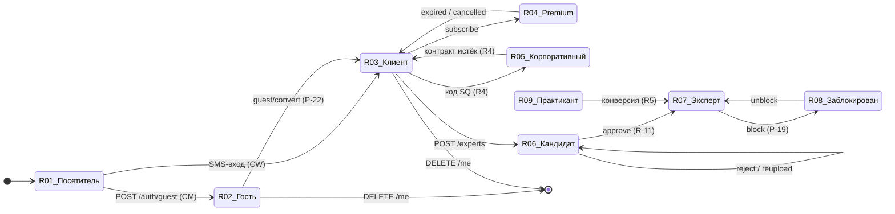

# 03 — Роли, права и JTBD

Статус: draft · Дата: 2026-09-13 · Владелец: Product · Источники: `WIKI/planning/06_ROLES_AND_PERMISSIONS.md` (модель ролей, матрица, инварианты), `05_PRODUCT_DEFINITION.md` §5 (персоны/JTBD), `12_SECURITY_AND_PRIVACY.md` §1 (классы данных), `10_DOMAIN_API_AND_EVENTS.md` §2 (группы эндпоинтов и guard'ы), `WIKI/2026-09-02-решение-Р-27-клиент-виден-психологу.md`, `WIKI/Продуктовые решения по открытым вопросам.md` (Р-06, Р-18…Р-23), ER-словарь v2 (`RAW/SmartQoldau (1)/docs/SmartQoldau-ER-Data-Dictionary.md` §1–2, §6, §9), тексты экранов прототипа v2 (`Admin - Дашборд / Верификация / Специалисты / Клиенты / Финансы / Настройки / Рассылки / B2B / B2G / Жалобы`, `SmartQoldau - Регистрация`, `Web - Для бизнеса`, `Web - Для вузов`, `SmartQoldau - Каталог`), код (`backend/prisma/schema.prisma`, `backend/src/admin/roles.guard.ts`, `backend/src/experts/*`, `backend/src/tickets/ticket-routing.ts`, `admin/src/components/RoleGate.tsx`, `web/app/[locale]/(expert)/layout.tsx`), e2e-наборы `backend/test/*.e2e-spec.ts`. Бриф: `BRIEF.md` §3 (DEC), §4 (ID ролей), §5 (BP), §6 (релизы).

Связано: [[04_BUSINESS_PROCESS_CATALOG]] · [[06_BUSINESS_RULES]] · [[07_STATE_AND_LIFECYCLE_MODELS]] · [[10_SAFETY_PRIVACY_AND_TRUST]] · `WIKI/planning/06_ROLES_AND_PERMISSIONS` · `WIKI/planning/12_SECURITY_AND_PRIVACY`.

## Оглавление

1. Принципы модели ролей
2. Карточки ролей R-01…R-20
3. RBAC/ABAC-матрица: Роль × Ресурс × Действие × Условие × Видимость
4. Матрица видимости чувствительных данных
5. Переходы между ролями
6. Пробелы модели и решения
7. Минимальный состав операционной команды для пилота

Метки: `[CODE FACT]` подтверждено кодом/тестом · `[PROTOTYPE FACT]` подтверждено прототипом v2 · `[INFERENCE]` вывод · `[RECOMMENDATION]` · `[DECISION REQUIRED]` (DEC-xx) · `[CONTRADICTION]` · `[OUT OF SCOPE]` (с релизом) · `[RISK]`.

---

## 1. Принципы модели ролей

| # | Принцип | Основание |
|---|---|---|
| P-1 | **Две идентичности.** `User` (клиенты и эксперты) и `AdminUser` (сотрудники) — разные таблицы, разные таблицы refresh-токенов (`RefreshToken` / `AdminRefreshToken`), разные guard'ы (`JwtAuthGuard` / `AdminJwtGuard`). Сотрудник не может быть клиентом тем же аккаунтом, клиент не может попасть в админку. | `[CODE FACT]` `backend/prisma/schema.prisma` (`model User`, `model AdminUser`), 06 §1 |
| P-2 | **Роль клиента/эксперта не хранится полем — выводится из анкеты.** `ExpertGuard` ищет `Expert` по `req.user.sub`; нет анкеты → `404 EXPERT_NOT_FOUND`. Эксперт — это `User` + `Expert`, и тот же `User` остаётся клиентом (может создавать заявки). Гостю анкета запрещена (`403 FORBIDDEN`). | `[CODE FACT]` `backend/src/experts/expert.guard.ts`; `experts.service.ts:50-58` |
| P-3 | **Статус эксперта = комбинация `verificationStatus` × `isBlocked` × `workStatus`.** В матчинг попадает только `VERIFIED ∧ ¬isBlocked ∧ ACCEPTING ∧ свежий heartbeat`; всё перепроверяется из БД, presence в Redis — лишь подсказка. | `[CODE FACT]` `backend/src/matching/matching.service.ts:46-70` |
| P-4 | **Сотрудники: шесть ролей enum, несколько на одного человека.** `AdminRole = {VERIFICATION_OPERATOR, CONTENT_EDITOR, SUPPORT_OPERATOR, QUALITY_TEAM, FINANCE_CONTROL, SUPERADMIN}`, поле `AdminUser.roles: AdminRole[]`. Права — `@Roles(...)` на маршруте + `RolesGuard` (читает метаданные и с метода, и с класса; без `@Roles` — пропускает любого сотрудника). | `[CODE FACT]` `schema.prisma:578-587`; `backend/src/admin/roles.guard.ts` |
| P-5 | **SUPERADMIN — суперроль в коде.** `RolesGuard`: `roles.includes(SUPERADMIN) \|\| requiredRoles.some(...)`; unit-тест «SUPERADMIN без требуемой роли -> пропускает»; e2e «роль SUPERADMIN проходит на очередь, block и unblock без роли VERIFICATION_OPERATOR»; в SPA `RoleGate` — `myRoles.includes('SUPERADMIN') \|\| …`. **`[CONTRADICTION]`** с 06 §1 («SUPERADMIN не является суперролью… получит 403») — утверждение 06 устарело или ошибочно; в этом документе истина — код. Единственное, что суперадмину недоступно, недоступно никому из сотрудников: содержимое консультаций (эндпоинтов нет). Что делать с этим — §6 (DEC-25, опасные действия). | `[CODE FACT]` `roles.guard.ts:41-44`, `roles.guard.spec.ts:84-90`, `backend/test/admin-verification.e2e-spec.ts:512-534`, `admin/src/components/RoleGate.tsx:8` |
| P-6 | **ABAC живёт в сервисах, не в guard'ах.** `owner` (фильтр `where userId`), `participant` (`resolveParticipant`), `active`, `consented` (`expertVisibilityAcceptedAt` + отсечка по времени), `team` (`staffTeams(roles)`). | `[CODE FACT]` 06 §2; `backend/src/tickets/ticket-routing.ts`; `backend/src/experts/clients.service.ts:52-130` |
| P-7 | **Конфиденциальность, не анонимность (Р-27, DEC-13).** Имя клиента — свободная строка «как к вам обращаться», собирается с явного согласия перед первой заявкой; телефон клиента эксперту не отдаётся никогда; консультации до момента согласия остаются под кодом клиента. | `[CODE FACT]` `schema.prisma` (`User.displayName`, `expertVisibilityAcceptedAt`), `requests.service.ts:73-86` (`409 EXPERT_VISIBILITY_CONSENT_REQUIRED`), `clients.service.ts:77,130` (`phone: null`), e2e `expert-visibility-consent`, `expert-clients` |
| P-8 | **Роли v2 и когда они появляются.** Прототип v2 добавляет: корпоративного сотрудника (B2B), практиканта и супервайзера (B2G), представителей компании/вуза, B2B/B2G-менеджера, «Модератора». В коде их нет (`[CODE FACT]` нет `User.isCorporate`, `Expert.isIntern/university/iin`, `HEAVY_TOPICS`, моделей Contract/Complaint/Mailing). Появление: **R-05, R-16, R-17 — Release 4** (DEC-18); **R-09, R-10, R-18 — Release 5** (DEC-17); «Модератор» — не роль, а пресет UI (DEC-25); жалобы для R-12 — Release 2 (DEC-15). До этих релизов в UI нет ни одного элемента этих ролей (не «скоро», а отсутствуют). | бриф §3, §6; `[PROTOTYPE FACT]` `Admin - Дашборд` `roleOptions: super_admin / moderator` |
| P-9 | **Система — полноценный актор.** Таймеры, sweep'ы, settle, вебхуки пишут в audit как `actorType='system'`; у них нет HTTP-идентичности, ограничитель — идемпотентность и подписи. | `[CODE FACT]` 06 §1 R-SYSTEM; 10 §1.10, §2 webhooks |

Соответствие ID этого документа и 06: R-01 (новая: посетитель без токена) · R-02 = R-GUEST · R-03 = R-CLIENT · R-04 = R-CLIENT-PREMIUM · R-06 = R-EXPERT-APPLICANT · R-07 = R-EXPERT-VERIFIED · R-08 = R-EXPERT-BLOCKED · R-11 = R-ADM-VERIFICATION · R-12 = R-ADM-QUALITY · R-13 = R-ADM-SUPPORT · R-14 = R-ADM-FINANCE · R-15 = R-ADM-CONTENT · R-19 = R-ADM-SUPER · R-20 = R-SYSTEM · R-05/09/10/16/17/18 = «v2-кандидаты» 06.

Поверхности: **PW** публичный сайт · **CM** клиентское приложение · **CW** веб-кабинет клиента (`web/app/[locale]/(client)`) · **EM** приложение эксперта · **EW** веб-кабинет эксперта (`web/app/[locale]/(expert)`) · **AD** админка (`admin/`). `[CODE FACT]` группы маршрутов `web/app/[locale]/{(public),(client),(expert)}`; `(expert)/layout.tsx:22-23` — `requireUser()` + `experts/me`.

---

## 2. Карточки ролей R-01…R-20

Формула JTBD: «Когда …, я хочу …, чтобы …». KPI — из PRD §6 / 05 §6; если числа в источниках нет — «assumption, требует подтверждения владельца».

### R-01 — Посетитель сайта

| Поле | Содержание |
|---|---|
| Role ID | **R-01** · Посетитель сайта (не аутентифицирован) |
| Описание | Человек на публичном сайте: ищет помощь, сравнивает, читает материалы; или психолог, изучающий «Стать психологом»; или HR/декан, оставляющий заявку. |
| Business goal | Довести до установки приложения / входа по SMS / отправки заявки партнёрства (BP-01). |
| JTBD | «Когда мне или близкому плохо и я гуглю “психолог онлайн Казахстан”, я хочу за минуту понять, что это конфиденциально, сколько стоит и как быстро, чтобы решиться нажать “Получить помощь”». |
| Вход в систему | Нет токена. `[CODE FACT]` публичные эндпоинты: `GET /topics`, `GET /experts`, `GET /experts/{id}`, `GET /experts/{id}/reviews`, `GET /premium/plans`, `GET /content*` (список/карточка), `POST /tickets` без токена (`authorType=GUEST`, обязателен `contactEmail`/`contactPhone` — `tickets.service.ts:63`). Гостевой режим в вебе **отсутствует**: `web/app/api/auth/{request-code,verify-code,session,logout}` — только SMS-вход (DEC-13). |
| Поверхности | PW (и публичная часть CW: каталог, профиль психолога, материалы, Premium-витрина, юрстраницы). |
| Разрешённые действия | Читать лендинг, каталог, публичный профиль и **публичные** отзывы, темы, список материалов, планы Premium; переключать ru/kz (DEC-22); принять/отклонить cookie (DEC-32); отправить формы «Для бизнеса» / «Для вузов» → тикет (Release 1, DEC-17/18); написать в поддержку с контактом; перейти к входу по SMS (→ R-03) или установить приложение (→ R-02). |
| Запрещённые действия | Создать заявку, записаться, платить, открыть тело/медиа PREMIUM-материала (`[CODE FACT]` e2e `content-paywall`), видеть приватный текст отзыва, узнать телефон/имя кого-либо, видеть «сейчас онлайн N» (`GET /matching/online-count` под `JwtAuthGuard` — `[CODE FACT]` `matching.controller.ts`; на PW честный счётчик по DEC-16 потребует публичного агрегата — `[DECISION REQUIRED]` в рамках DEC-16). |
| Видимые данные | Публичный профиль эксперта (имя, город, опыт, цена, языки, форматы, рейтинг, «о себе» после модерации, фото), публичные отзывы без идентификации автора. |
| Скрытые данные | Всё о клиентах; документы и телефон эксперта; заблокированные эксперты (`[CODE FACT]` `experts.service.ts:224` `isBlocked:false` в публичном списке). |
| Ответственность | Нет договорной. Юридические тексты — оферта 18+ (DEC-33). |
| Процессы | BP-01, BP-08 (просмотр), BP-13/BP-14 (lead), BP-15 (тикет без входа). |
| KPI | KPI-01 конверсия визит → установка/вход (assumption, целевое значение — владелец); KPI-02 доля заявок партнёрства, отвеченных за 1 рабочий день (`[PROTOTYPE FACT]` `Web - Для бизнеса`: «свяжется в течение 1 рабочего дня»). |
| Риски | `[RISK]` обещания «анонимно», «end-to-end», «за 1 минуту» на сайте — запрещены DEC-13/24/16; `[RISK]` бейджи сторов без опубликованных приложений (DEC-21). |
| Lifecycle | `anonymous → (SMS-вход в вебе) → R-03` · `anonymous → (установка приложения, «Продолжить конфиденциально») → R-02` · `anonymous → (форма) → тикет (SM-23)`. Часть SM-01. |

### R-02 — Гость (конфиденциальный клиент, device-scoped)

| Поле | Содержание |
|---|---|
| Role ID | **R-02** · Гость |
| Описание | Клиент мобильного приложения без телефона: идентичность привязана к устройству. Полноценный клиент по функциям, но история живёт только на этом устройстве. |
| Business goal | Убрать барьер «назови себя» у человека в остром состоянии; довести до первой консультации; конвертировать в аккаунт после (Р-22). |
| JTBD | «Когда мне плохо прямо сейчас и я не готов называть себя, я хочу нажать одну кнопку и через минуту говорить с человеком, чтобы не остаться один» (05 §5, персона «Клиент в кризисе»). |
| Вход в систему | `[CODE FACT]` `POST /auth/guest {deviceId}` → `User{isGuest:true, deviceId}` (частичный уникальный индекс `users_device_id_guest_uq`), JWT access 15 мин + refresh 30 дн с ротацией (`auth-guest`, `auth-verify` e2e). Только мобильное приложение. |
| Поверхности | CM. |
| Разрешённые действия | Всё клиентское: темы, каталог, заявка (обычная/экстренная/направленная; throttle 10/ч — 12 T-18/T-20; abuse-гейт 3+ за 30 дн → только ручной выбор, `requests.service.ts:39,88-95`), плановая запись, консультация (чат/аудио/видео, media-token), оплата картой (`payment-methods` без проверки `isGuest` — `[CODE FACT]`; Р-22/DEC-13), отзыв (публичный + приватный), избранное, уведомления, устройства/локаль, тикеты (с токеном — как клиент), удаление `DELETE /me`, конверсия `guest/convert`. Перед первой заявкой — экран «как к вам обращаться» + согласие видимости (`409 EXPERT_VISIBILITY_CONSENT_REQUIRED` действует и для гостя — `[CODE FACT]` `requests.service.ts:73-86`). |
| Запрещённые действия | Создать анкету эксперта (`403 FORBIDDEN` «Гостевой аккаунт не может создать анкету» — `experts.service.ts:52-58`); Premium-подписка (06 §2: `subscribe/cancel` — только зарегистрированный; `[INFERENCE]` подписка без телефона не восстанавливается на новом устройстве, поэтому и не должна продаваться гостю); восстановить историю на другом устройстве (Р-22 — по дизайну). |
| Видимые данные | Своя история на этом устройстве, свои консультации/чаты/платежи; публичные данные экспертов. |
| Скрытые данные | Заметки эксперта; чужие консультации (`resolveParticipant`, e2e `chat`, `consultations-*`); приватные тексты чужих отзывов. |
| Ответственность | Принятие оферты и согласия Р-27 («продолжая, вы соглашаетесь» — 05 §7, юрист); подтверждение 18+ (DEC-33). |
| Процессы | BP-02, BP-03, BP-04, BP-05, BP-06, BP-07, BP-12 (частично), BP-15. |
| KPI | заявка → соединение p90 ≤ 2 мин; подбор → оплата ≥ 40 %; «состоялась» ≥ 85 % (05 §6); KPI-03 конверсия гость → аккаунт после первой консультации (assumption). |
| Риски | `[RISK]` потеря истории при удалении приложения (предупреждать — DEC-13); `[RISK]` abuse-гейт привязан к `userId`: переустановка даёт новый `deviceId` и нового гостя → обход лимита злоупотреблений (`[INFERENCE]`; см. §6); `[RISK]` нет `User.isBlocked` — гостя нельзя заблокировать (06 §5). |
| Lifecycle | SM-01: `∅ → GUEST (POST /auth/guest) → REGISTERED (POST /auth/guest/convert; переносятся активная консультация, карта, статистика — Р-22) \| DELETED (DELETE /me; 409 при открытой консультации/платеже — account.service.ts:107-129)`. |

### R-03 — Зарегистрированный клиент

| Поле | Содержание |
|---|---|
| Role ID | **R-03** · Зарегистрированный клиент |
| Описание | Клиент с подтверждённым телефоном; история и карта доступны с любого устройства и из веб-кабинета. |
| Business goal | Повторные обращения (повтор в 30 дней ≥ 30 %), плановая работа с «своим» психологом, база для Premium. |
| JTBD | «Когда я нашёл своего психолога, я хочу записаться на удобное время с ноутбука или телефона, перенести без штрафа и продолжать с ним же, чтобы не начинать каждый раз заново» (05 §5, «Клиент планирующий»). |
| Вход в систему | `[CODE FACT]` `POST /auth/request-code` → `verify-code` (код 5 мин / 5 попыток / повтор через 45 с; throttle `smsRequest` 3/ч, `smsVerify` 10/15 мин — 12 T-01/T-02); мобильные — Bearer в secure storage; веб — BFF, httpOnly-cookie `secure`, `SameSite=Lax`, CSRF double-submit (12 T-22). Один телефон — один `User` (`phone unique`). |
| Поверхности | CM, CW, PW. |
| Разрешённые действия | Всё из R-02 + Premium (`GET /premium`, `subscribe`, `cancel`), управление аккаунтом (имя, локаль, согласие Р-27, удаление), история на всех устройствах, веб-кабинет (заявка, ожидание, консультации, чат, избранное, уведомления, профиль — 11a CW), жалоба на консультацию в окне 48 ч (Release 2, DEC-15, SCR-CL-29/30), экспорт данных (`MISSING`, Q-15/T-19). |
| Запрещённые действия | Всё экспертное без анкеты (`ExpertGuard` → 404); чужие ресурсы (T-07); удаление при открытой консультации/платеже (`409 CONSULTATION_IN_PROGRESS` / `PAYMENT_IN_PROGRESS`); повторный отзыв на одну консультацию (`один отзыв` — 10 §6); отзыв не на COMPLETED. |
| Видимые данные | Свои консультации (для клиента — `ConsultationClientDto`, без заметок эксперта), платежи (`maskedPan`), подписка, свои отзывы (без приватного текста в ответе — `review-created.dto.ts`), уведомления. |
| Скрытые данные | Заметки эксперта; приватный текст чужих отзывов; телефон/документы эксперта; какие ещё клиенты у эксперта. |
| Ответственность | Оферта, согласие Р-27, платёжные обязательства (холд → capture при «состоялась»). |
| Процессы | BP-02…BP-07, BP-08, BP-12, BP-15. |
| KPI | повтор в 30 дней ≥ 30 %; ≥ 500 оплаченных консультаций за 90 дней (05 §6); KPI-04 доля удалений аккаунта (assumption). |
| Риски | `[RISK]` блокировка клиента невозможна (нет `User.isBlocked`, ТЗ §5.9) — 06 §5; `[RISK]` нет «выйти со всех устройств» (12 T-03). |
| Lifecycle | SM-01: `REGISTERED → PREMIUM (SM-03) → REGISTERED` · `REGISTERED → CANDIDATE-EXPERT (POST /experts, R-06)` · `REGISTERED → DELETED (DELETE /me: PII обезличен, токены отозваны, чат/заметки/устройства удалены; строка остаётся ради финучёта)`. |

### R-04 — Premium-клиент

| Поле | Содержание |
|---|---|
| Role ID | **R-04** · Premium-клиент (R-03 с живой подпиской) |
| Описание | Не отдельная роль guard'а, а состояние `Subscription ∈ {ACTIVE, GRACE, CANCELLED до currentPeriodEnd}` (частичный уникальный индекс «одна живая»). |
| Business goal | Retention и предсказуемый доход; Premium ≥ 5 % MAU через 30 дней после R2 (05 §6). |
| JTBD | «Когда я обращаюсь регулярно, я хочу, чтобы меня подбирали первым и консультации стоили меньше, а библиотека была открыта, чтобы платить меньше и ждать меньше». |
| Вход в систему | Как R-03. Гость Premium купить не может (см. R-02). |
| Поверхности | CM, CW. |
| Разрешённые действия | Всё из R-03 + приоритетный подбор (`[CODE FACT]` e2e `premium-priority`), скидка 10 % на консультации за счёт комиссии (DEC-02/07, e2e `premium-discount`: эксперту всегда 85 % полной цены), полная библиотека самопомощи (тело/медиа PREMIUM — e2e `content-paywall`), отмена подписки с доступом до конца периода (Р-09). |
| Запрещённые действия | «Все консультации без ограничений» — такого права нет, консультации оплачиваются отдельно (DEC-03, текст запрещён); скидка не суммируется с B2B/тарифами (Release 4+, DEC-08/18 — `[DECISION REQUIRED]`). |
| Видимые данные | Как R-03 + статус подписки, следующее списание, GRACE-предупреждение. |
| Скрытые данные | Как R-03. |
| Ответственность | Автопродление: 3 попытки за 72 ч GRACE, затем даунгрейд (Р-09, e2e `premium-renewal`). |
| Процессы | BP-05 (Premium charge), BP-08, BP-12. |
| KPI | Premium ≥ 5 % MAU; KPI-05 успешность автопродления (assumption); KPI-06 churn подписки (assumption). |
| Риски | `[RISK]` расхождение цен в прототипе (2 990/23 900) и каноне (4 990/39 900 — DEC-01); `[RISK]` текст преимуществ «без скидки» в ER-словаре v2 противоречит DEC-02. |
| Lifecycle | SM-03: `∅ → ACTIVE (subscribe, charge) → GRACE (renew_failed) → ACTIVE (renewed) \| EXPIRED (3 неудачи/72 ч)`; `ACTIVE → CANCELLED (cancel) → EXPIRED (currentPeriodEnd)`; audit `subscription.*`, `premium.downgraded`. |

### R-05 — Корпоративный клиент / сотрудник компании

`[OUT OF SCOPE] до Release 4` · `[DECISION REQUIRED]` DEC-18 (B2B), DEC-25 (кто ведёт контракты).

| Поле | Содержание |
|---|---|
| Role ID | **R-05** · Сотрудник компании-клиента (B2B) |
| Описание | R-03 с активированным корпоративным доступом: консультации оплачивает работодатель из пула сессий контракта. `[PROTOTYPE FACT]` `SmartQoldau - Регистрация`: шаг «У меня есть корпоративный доступ», код `SQ-XXXX-YYYY`, дисклеймер «Ваша компания оплачивает доступ, но не видит содержание сессий… только общую статистику использования пакета»; ER-словарь: `User.is_corporate`, `corporate_contract_code`, способ оплаты `corporate` — «Оплачено компанией». В коде: ничего (`[CODE FACT]` нет полей/моделей). |
| Business goal | Канал B2B (EAP): продажа пулов сессий компаниям, доход B2B (`Admin - Финансы`: «Доход от B2B-контрактов»). |
| JTBD | «Когда компания дала мне код, я хочу активировать его один раз и обращаться без оплаты картой, чтобы работодатель не узнал ни тему, ни с кем я говорил». |
| Вход в систему | Как R-03 (телефон + SMS); активация кода — отдельный шаг регистрации или профиля. `[RECOMMENDATION]` активация кода только у зарегистрированного (не у гостя): пул сессий нужно привязать к устойчивой идентичности. В Release 1 шаг скрыт (DEC-18). |
| Поверхности | CM, CW (Release 4). |
| Разрешённые действия | Всё из R-03; выбрать «Оплачено компанией» при `contract-active` и остатке пула > 0; видеть остаток сессий по своему доступу; отвязать код. |
| Запрещённые действия | Использовать пул после окончания/приостановки контракта (fallback на карту); передавать код (одноразовая активация на сотрудника — `[RECOMMENDATION]`); суммировать со скидкой Premium (`[DECISION REQUIRED]`). |
| Видимые данные | Как R-03 + название компании, остаток пула, срок контракта. |
| Скрытые данные | Кто ещё из коллег активировал; условия контракта (скидка, цена). |
| Ответственность | Как R-03. |
| Процессы | BP-13 (activation → pool → report), BP-05, BP-06. |
| KPI | активация кодов / выдано; использование пула; KPI-07 доля сессий B2B в выручке (assumption). |
| Риски | `[RISK]` прототип `Admin - B2B` показывает компании-менеджеру список email сотрудников с датой активации — сам факт активации психологической помощи сотрудником чувствителен (BR-7xx); `[RECOMMENDATION]` компании отдавать только агрегаты при ≥ 5 сотрудников (порог DEC-18), список email — только внутри платформы (R-16), не в отчёт компании; `[RISK]` увольнение сотрудника: кто и как отзывает доступ — `[DECISION REQUIRED]` DEC-18. |
| Lifecycle | SM-02: `NONE → CODE_ENTERED → ACTIVE (contract-active) → SUSPENDED (контракт приостановлен) \| EXPIRED (end_date / пул исчерпан) → NONE (fallback R-03)`. |

### R-06 — Кандидат-эксперт

| Поле | Содержание |
|---|---|
| Role ID | **R-06** · Кандидат-эксперт (`Expert.verificationStatus ∈ {DRAFT, PENDING}`) |
| Описание | Психолог, заполняющий анкету и загружающий документы; ещё не принимает заявок. Тот же `User` остаётся клиентом. |
| Business goal | ≥ 60 активных экспертов за 90 дней при отказе ≤ 24 ч (05 §6, Р-18). |
| JTBD | «Когда я решил работать на платформе, я хочу за вечер заполнить анкету, загрузить 4 документа и получить решение за 24 часа, чтобы начать принимать заявки уже завтра» (05 §5). |
| Вход в систему | Как R-03 (телефон + SMS — `[PROTOTYPE FACT]` `Expert - Регистрация`: «Новый номер — создадим профиль специалиста»); `POST /experts` создаёт анкету (гостю запрещено; `userId unique` — одна анкета на человека). `ExpertGuard` даёт доступ к `experts/me*`. В EW — `requireUser` + `experts/me` (`(expert)/layout.tsx:22-23`); при отсутствии анкеты — 404 (`[INFERENCE]` UI должен вести на анкету, не на пустой кабинет). |
| Поверхности | EM (онбординг, анкета, документы, статус верификации), EW (профиль/статус). |
| Разрешённые действия | Создать/править анкету (специализации, языки, форматы, цена 2 000–15 000 ₸ — DEC-04, `PRICE_MIN/MAX` в `experts.service.ts`, город, опыт, образование); загрузить фото и «о себе» (модерация, старое остаётся видимым — Р-18); загрузить 4 документа (по одному на тип — `unique(expert,type)`; magic-bytes, 10 МБ), отправить на проверку (`verificationSubmittedAt`), заменить документ по `REUPLOAD_REQUIRED`; менять `work-status` (но `ACCEPTING` без VERIFIED → `400 NOT_VERIFIED` — `experts.service.ts:152-160`); расписание; тикеты категории `VERIFICATION` → команда верификации. |
| Запрещённые действия | Попасть в матчинг/каталог (`verificationStatus:'VERIFIED'` в `matching.service.ts`, публичный список — `experts.service.ts:224`); принимать офферы; выплаты (баланс пуст); удалить аккаунт через приложение (`409 EXPERT_DELETE_VIA_SUPPORT` — `account.service.ts:97-104`). |
| Видимые данные | Своя анкета, статусы документов, причина отказа (`moderationComment`; `[PROTOTYPE FACT]` `Admin - Верификация`: «Причина отказа (видна специалисту)»). |
| Скрытые данные | Кто из операторов проверяет; чек-лист; внутренние комментарии (`[RECOMMENDATION]` разделить «видимую причину» и «внутренний комментарий» в E-модели верификации). |
| Ответственность | Подлинность документов и сведений (Р-18; поддельные документы → блокировка Р-19). |
| Процессы | BP-09 (анкета/документы/верификация/reupload), BP-15. |
| KPI | решение ≤ 24 ч (Р-18); KPI-08 доля одобренных с первой подачи (assumption); KPI-09 time-to-first-offer после VERIFIED (assumption). |
| Риски | `[RISK]` ИИН не собирается — дубликаты личности не ловятся (DEC-35, Release 5); `[RISK]` вредоносный файл (12 T-10). |
| Lifecycle | SM-04/05/06: `DRAFT → PENDING (submit) → VERIFIED (R-07) \| REJECTED (причина; повторная подача) `; документ: `UPLOADED → APPROVED \| REUPLOAD_REQUIRED → UPLOADED`. Audit `expert.profile_created/updated`, `expert.document_uploaded/approved/rejected`, `expert.verification_submitted/verified/verification_rejected`. |

### R-07 — Верифицированный эксперт

| Поле | Содержание |
|---|---|
| Role ID | **R-07** · Верифицированный эксперт (`VERIFIED ∧ ¬isBlocked`) |
| Описание | Практикующий психолог: принимает заявки по статусу и расписанию, ведёт сессии, фиксирует исход, получает 85 % цены, выводит деньги. |
| Business goal | Заполненность слотов, «состоялась» ≥ 85 %, отток экспертов ≤ 20 % (05 §6). |
| JTBD | «Когда я готова работать, я хочу получать заявки только тогда, принять за 45 секунд, провести сессию и видеть “цена − 15 % = итого”, чтобы доход был прозрачен, а выплата пришла за 3 дня» (05 §5, «Эксперт-практик»). |
| Вход в систему | Как R-03; `ExpertGuard`. EW — основной кабинет (DEC-19), EM — companion. |
| Поверхности | EM, EW (+ CM/CW как клиент — тот же `User`). |
| Разрешённые действия | Статус `ACCEPTING/NOT_ACCEPTING/UNAVAILABLE` (BUSY — система), тумблер срочных `acceptsUrgent`, heartbeat, расписание и исключения; офферы: список, `accept` (только `PENDING` и не просрочен → иначе `409/410 OFFER_EXPIRED`; гонка — e2e `matching-accept-race`), `decline`; консультация: чтение (`ConsultationExpertDto`), чат/typing, media-token, эскалация формата, `complete` с исходом (COMPLETED / CLIENT_NO_SHOW / TECH_ISSUE / …; `409` при повторе), `cancel-by-expert` и `reschedule` для плановых; приватная заметка (шифрована; `expert-notes` e2e); доход `earnings(/daily)`, `balance`, выплата `POST /payouts` (≥ 10 000 ₸; > 300 000 ₸/мес → `PENDING_REVIEW` — DEC-36); свои отзывы `experts/me/reviews`, ответ, жалоба на отзыв (→ FLAGGED); клиенты `experts/me/clients*` (только `consented`, телефон никогда, журнал `client.card_read` — `clients.service.ts:113-130`); профиль (фото/«о себе» через модерацию, цена в коридоре); уведомления, устройства, тикеты (EM и EW — DEC-37). Release 2: ответ на жалобу (SCR-EX-22/23, DEC-15). Release 3: «Чаты» read-only (DEC-20). |
| Запрещённые действия | Телефон клиента (`phone: null` в `toClientCard` — `[CODE FACT]`); имя и история клиента до согласия / за консультации до момента согласия (`visibleConsultations`); чужие консультации/чаты/заметки (`resolveParticipant`; e2e `chat`, `expert-notes`); приватный текст отзыва (`review-item.dto.ts`: «privateText НИКОГДА»); ответ автору отзыва напрямую; цена вне 2 000–15 000 ₸; `ACCEPTING` при `isBlocked`; удаление аккаунта из приложения (через поддержку); общение с клиентом вне платформы (Р-27 «общение остаётся в платформе» — правило, не код). |
| Видимые данные | Код клиента, тема, формат, снимок цены `priceTiyn`, статус; после согласия — `displayName` и история встреч **с этим экспертом** (не с другими); свои заметки, доход, ledger-выписка по себе, публичные отзывы с тегами. |
| Скрытые данные | Телефон, `deviceId`, история клиента с другими экспертами, приватные тексты отзывов, внутренние решения команды качества (кроме уведомления о результате). |
| Ответственность | Профессиональная этика, честный исход (исход определяет деньги: несостоявшаяся → 0 ₸, DEC-09), дисклеймеры 102/103/112/150, сообщение об угрозе жизни (регламент — Q-15). |
| Процессы | BP-06, BP-07 (ответ на отзыв/жалоба), BP-09 (замена документа), BP-10, BP-15. |
| KPI | принято с первого эксперта ≥ 60 %; «состоялась» ≥ 85 %; выплата ≤ 3 раб. дн (Р-06); рейтинг ≥ 4.0 при ≥ 20 (Р-20); KPI-10 доля офферов, просроченных без ответа (assumption). |
| Риски | `[RISK]` неверный исход ради денег (settle без второй стороны — споры E20); `[RISK]` blocked-эксперт продолжает сессию: токены не отзываются (T-06); `[RISK]` заметка эксперта — особо чувствительные данные без ретенции (DEC-34). |
| Lifecycle | SM-07: `NOT_ACCEPTING ⇄ ACCEPTING` (эксперт), `ACCEPTING → BUSY → ACCEPTING` (система), `* → UNAVAILABLE`; SM-17: `VERIFIED → FLAGGED (<4.0 при ≥20: audit expert.rating_below_threshold) → VERIFIED \| BLOCKED (R-08)`. |

### R-08 — Заблокированный эксперт

| Поле | Содержание |
|---|---|
| Role ID | **R-08** · Заблокированный эксперт (`Expert.isBlocked=true`, `blockedReason`) |
| Описание | Эксперт, отстранённый решением платформы (Р-19: подтверждённые жалобы, поддельные документы, систематические отмены, рейтинг ниже порога). Доступ к кабинету сохраняется в режиме «только чтение + поддержка». |
| Business goal | Защита клиентов; обратимость (разблокировка после устранения). |
| JTBD | «Когда меня заблокировали, я хочу понять причину и что нужно исправить, чтобы вернуться к работе или хотя бы вывести заработанное». |
| Вход в систему | Как R-07 — токены **не отзываются**, WS не разрывается (`[CODE FACT]` 12 T-06). |
| Поверхности | EM, EW: экран «профиль заблокирован» (06 §1). `[INFERENCE]` в `app_expert/lib` строки `blocked` есть в `home_screen.dart`/l10n — экран есть; в EW явной обработки `isBlocked` в layout нет (`[RISK]` кабинет открывается как обычный — проверить в E29). |
| Разрешённые действия | Читать свою анкету/историю/доход; запросить выплату (`payouts` проверяют только `ExpertGuard` — `[INFERENCE]`; `[RECOMMENDATION]` оставить: деньги за состоявшиеся сессии не заложник блокировки, но выплата идёт через ручной финконтроль); открыть тикет (категория `VERIFICATION` → команда верификации, `SECURITY` → качество); менять локаль/устройства. |
| Запрещённые действия | `work-status` (`403 EXPERT_BLOCKED` — `experts.service.ts:156`), попасть в матчинг (`isBlocked:false`), в публичный каталог (`experts.service.ts:224`), в избранное клиентов (`favorites.service.ts:57`), в плановую запись (`booking.service.ts:70`); принять оффер (06 §2: `VERIFIED && !blocked`). |
| Видимые данные | Причина блокировки (`blockedReason`; уведомление — Р-19). |
| Скрытые данные | Материалы жалоб/расследования (кроме того, что показывается в ответе на жалобу — DEC-15). |
| Ответственность | Не пытаться обойти (новая анкета на тот же `User` невозможна — `userId unique`; новый телефон — не ловится без ИИН, DEC-35). |
| Процессы | BP-09 (block/restore), BP-11, BP-15. |
| KPI | KPI-11 время от блокировки до отзыва токенов (цель: немедленно — после E29); KPI-12 доля разблокировок (assumption). |
| Риски | `[RISK]` T-06 (активные токены до 15 мин, живой WS, текущая консультация не прерывается); `[RISK]` повторная регистрация под другим номером (дубликат ИИН — Release 5). |
| Lifecycle | SM-17: `VERIFIED → BLOCKED (POST /admin/experts/{id}/block {reason}; audit expert.blocked; уведомление) → VERIFIED (POST …/unblock после тикета; audit expert.unblocked)`. `[CONTRADICTION]` Р-19: «блокировка — решение **команды качества**», а эндпоинт `@Roles(VERIFICATION_OPERATOR)` (`verification.controller.ts:90-109`) — см. §6. |

### R-09 — Студент-практикант

`[OUT OF SCOPE] до Release 5` · `[DECISION REQUIRED]` DEC-17 (Q-07: юридическая ответственность за практиканта требует заключения).

| Поле | Содержание |
|---|---|
| Role ID | **R-09** · Студент-практикант (B2G) |
| Описание | Студент психологического факультета вуза-партнёра, проводящий бесплатные (учебная практика) или льготные сессии под супервизией. `[PROTOTYPE FACT]` `Admin - Верификация`: вкладка «Студенты-практиканты» (ФИО, вуз/курс, код B2G `SG-XXXX-YYYY`, 2 документа: справка с места учёбы, подтверждение специальности/курса, поле «Назначенный супервайзер»); `SmartQoldau - Каталог`: бейдж «Психолог-практикант под супервизией {вуз}», `priceLabel: 'Бесплатно (учебная практика)'`, `HEAVY_TOPICS = ['depression','addiction']` — практиканты скрыты для тяжёлых тем; `Web - Для вузов`: «самостоятельная регистрация студента в обход вуза невозможна». ER-словарь: `is_intern`, `university`, `b2g_contract_code`, `work_model: платно со скидкой / бесплатно`. В коде: ничего (`[CODE FACT]` grep `HEAVY_TOPICS|isIntern|iin` пуст). |
| Business goal | Дешёвое предложение для лёгких тем, воронка будущих экспертов, госпартнёрства (B2G). |
| JTBD | «Когда вуз подключил меня к программе, я хочу проводить сессии по лёгким темам под супервизией и видеть свои часы, чтобы засчитать практику и потом стать экспертом». |
| Вход в систему | Как R-06/R-07 (телефон + SMS), но второй поток верификации: код `SG-…` (вводит студент, не клиент — комментарий в скрипте `SmartQoldau - Регистрация`), `Expert.kind=INTERN` (10 §1.2 [TO-BE]), связь с B2G-соглашением и супервайзером. |
| Поверхности | EM, EW (Release 5). |
| Разрешённые действия | Как R-07 в пределах: темы ∉ HEAVY_TOPICS (`intern-allowed-topic`), цена 0 или льготная по `work_model`, сессии засчитываются в часы (SM-20), видеть своего супервайзера и его комментарии. |
| Запрещённые действия | Тяжёлые темы (какие именно — `[DECISION REQUIRED]`: прототип `depression, addiction`, ER — «Депрессия/апатия, Зависимости»; `[RECOMMENDATION]` добавить «Панические атаки», «Потеря и горе», «Жизненные кризисы» и **экстренные заявки целиком** — `acceptsUrgent` принудительно `false`); выплаты (при бесплатной модели баланса нет); приём заявок без назначенного супервайзера (`supervisor-of` обязателен); скрыть статус практиканта от клиента. |
| Видимые данные | Как R-07 по своим сессиям; часы практики; статус соглашения вуза. |
| Скрытые данные | Как R-07. |
| Ответственность | Границы компетенции, обязательная эскалация к супервайзеру/на hotlines; клиент **явно** информирован, что говорит с практикантом (бейдж в каталоге + подтверждение в шторке — `[RECOMMENDATION]` BR-8xx). |
| Процессы | BP-14 (student → verification → supervisor → consent → session → review → hours → conversion), BP-06. |
| KPI | сессий проведено по соглашению (`Admin - B2G`: «сессий проведено»); KPI-13 доля практикантов, конвертированных в R-07 (assumption); KPI-14 удовлетворённость клиентов практикантов (assumption). |
| Риски | `[RISK]` юридическая ответственность платформы за неквалифицированную помощь (Q-07); `[RISK]` автоподбор может отдать практиканту клиента в остром состоянии — только ручной выбор из каталога (`[RECOMMENDATION]`: практикант никогда не в автоподборе, только `directed`); `[RISK]` персональные данные студентов (ФИО, вуз, курс) — PII эксперта. |
| Lifecycle | SM-20: `APPLIED (код SG + 2 документа) → VERIFIED_INTERN (R-11 + супервайзер назначен) → ACTIVE (соглашение active) → HOURS_COMPLETE → CONVERTED (обычная верификация → R-06/R-07) \| EXPIRED (соглашение закончилось) \| BLOCKED (SM-17)`. |

### R-10 — Супервайзер

`[OUT OF SCOPE] до Release 5` · `[DECISION REQUIRED]` DEC-17.

| Поле | Содержание |
|---|---|
| Role ID | **R-10** · Супервайзер практикантов |
| Описание | Преподаватель вуза или опытный эксперт платформы, отвечающий за практикантов. `[PROTOTYPE FACT]` у супервайзера **нет ни одного экрана и входа**: он существует как текстовое поле «ФИО супервайзера» в `Admin - Верификация` и строка «Супервайзер: {name}» в `Admin - B2G`; ER-словарь: `supervisor_name` «назначается админом». То есть в v2-минимуме это атрибут практиканта, а не актор. |
| Business goal | Качество и безопасность сессий практикантов; выполнение соглашения с вузом. |
| JTBD | «Когда мой студент ведёт сессии, я хочу видеть его нагрузку, исходы и оценки и разбирать сложные случаи, чтобы отвечать за практику, не нарушая тайну клиента». |
| Вход в систему | `[DECISION REQUIRED]`: (а) атрибут без входа (R5-минимум; отчёты передаёт R-16 вузу), (б) `User`+`Expert` с ролью-атрибутом `supervisorOf[]`, (в) `AdminUser` с ролью `SUPERVISOR`. `[RECOMMENDATION]` (б): супервайзер — специалист, а не сотрудник платформы; доступ к содержанию сессий — **только** с отдельного согласия клиента на супервизию (BR-8xx) и с журналом доступа, как у карточки клиента. |
| Поверхности | EW (раздел «Практиканты», Release 5). |
| Разрешённые действия | Список своих практикантов (`supervisor-of`), их часы, метаданные сессий (тема, формат, исход, оценка), комментарий практиканту; при согласии клиента на супервизию — заметки практиканта. |
| Запрещённые действия | Чат/медиа сессии без согласия клиента; имя/телефон клиента; изменение статуса верификации (это R-11); финансы. |
| Видимые данные | Метаданные сессий практикантов (MASKED: код клиента), оценки, теги. |
| Скрытые данные | Содержание переписки (по умолчанию), PII клиентов. |
| Ответственность | Профессиональная супервизия; эскалация нарушений в команду качества. |
| Процессы | BP-14 (supervisor → review), BP-15. |
| KPI | KPI-15 доля сессий практикантов, разобранных супервайзером в срок (assumption). |
| Риски | `[RISK]` расширение круга лиц с доступом к тайне помощи — требует явного согласия и текстов политики (10_SAFETY). |
| Lifecycle | SM-21: `ASSIGNED (R-11/R-16 назначает) → ACTIVE → UNASSIGNED (замена, окончание соглашения)`. |

### R-11 — Оператор верификации

| Поле | Содержание |
|---|---|
| Role ID | **R-11** · Оператор верификации (`AdminRole.VERIFICATION_OPERATOR`) |
| Описание | Сотрудник, допускающий экспертов на платформу: очередь, документы, модерация фото/«о себе», блокировка. |
| Business goal | 0 заявок старше 24 ч; ни одного поддельного диплома на платформе. |
| JTBD | «Когда приходят заявки, я хочу видеть очередь по сроку, открыть документы и решить по каждому по чек-листу, чтобы решение было за 24 часа и обоснованным» (05 §5). |
| Вход в систему | `[CODE FACT]` `POST /admin/auth/login` (email + bcrypt-пароль), TOTP обязателен в prod (`TOTP_REQUIRED`; `totp/setup|confirm|verify`), lockout, throttle `adminLogin` 5/15 мин, refresh с ротацией, `isActive` проверяется в `AdminJwtGuard` (кеш 30 с). Токены в `localStorage` SPA — `[RISK]` T-05 (H, до пилота). |
| Поверхности | AD: `/verification`, `/profile-moderation`, `/tickets` (команда VERIFICATION), `/settings` (TOTP). `[CODE FACT]` `admin/src/routes/AppLayout.tsx:28-60`. |
| Разрешённые действия | `GET /admin/verification/queue` (PENDING, SLA по `verificationSubmittedAt`), `POST …/documents/{id}/decision` (approve / reject → `REUPLOAD_REQUIRED` с комментарием), `POST …/{expertId}/decision` (approve / reject с причиной, видимой эксперту), `POST /admin/experts/{id}/block|unblock` (Р-19), `GET/POST /admin/profile-moderation*` (фото, «о себе»), тикеты команды `VERIFICATION_OPERATOR`: очередь, назначение, ответ, решение. Просмотр документа — presigned URL 300 с. |
| Запрещённые действия | Отзывы/жалобы/флаг качества (`QUALITY_TEAM`), выплаты (`FINANCE_CONTROL`), контент, сотрудники, тикеты других команд (`canAccessTicketTeam`); любое содержимое консультаций (эндпоинтов нет); смена тарифа (Release 4+, `[PROTOTYPE FACT]` `Admin - Специалисты`: «Доступно только супер-админу»). |
| Видимые данные | PII эксперта: ФИО, город, образование, телефон (через `User.phone` — `[INFERENCE]` в DTO очереди; в прототипе поле «Телефон» есть), документы (удостоверение, диплом, сертификаты, квалификация), фото. Release 5: ИИН, дубликат ИИН (DEC-35). |
| Скрытые данные | Клиенты полностью; чаты/заметки; деньги эксперта; приватные отзывы. |
| Ответственность | Чек-лист Р-18 (подлинность удостоверения, профильный диплом, действительность сертификатов, стаж); журналируемые решения (`expert.document_approved/rejected`, `expert.verified`, `expert.verification_rejected`, `expert.blocked/unblocked`). |
| Процессы | BP-09, BP-11 (очередь верификации, блокировки), BP-15 (тикеты VERIFICATION). Release 5: второй поток практикантов (BP-14). |
| KPI | 0 просроченных > 24 ч (05 §5); KPI-16 доля reupload-запросов (assumption). |
| Риски | `[RISK]` T-09: просмотр документа не журналируется (`expert.document_read` отсутствует); `[RISK]` T-10: документ открывается в браузере оператора без санитизации; `[RISK]` T-05. |
| Lifecycle | сотрудник: `CREATED (POST /admin/staff, SUPERADMIN) → ACTIVE (TOTP настроен) → ROLES_CHANGED (PATCH /admin/staff/{id}) → DEACTIVATED (isActive=false → revokeAccess: refresh отозваны, `admin.access_revoked`)`. |

### R-12 — Команда качества

| Поле | Содержание |
|---|---|
| Role ID | **R-12** · Команда качества (`AdminRole.QUALITY_TEAM`) |
| Описание | Разбирает отзывы, флаги качества, инциденты безопасности; с Release 2 — жалобы и споры, страйки; по Р-19 — решения о блокировке. |
| Business goal | Безопасность клиентов; справедливость к экспертам; рейтинг платформы. |
| JTBD | «Когда приходит жалоба или отзыв с флагом, я хочу видеть метаданные сессии, историю обеих сторон и приватное сообщение клиента, чтобы принять решение по регламенту и зафиксировать его». |
| Вход в систему | Как R-11. |
| Поверхности | AD: `/flagged-experts`, `/reviews` (`RoleGate QUALITY_TEAM`), `/tickets` (команда QUALITY = категория `SECURITY`), Release 2: `/complaints` (SCR-AD-05). |
| Разрешённые действия | `GET /admin/reviews/flagged` (видит **всё**, включая `privateText` и жалобу эксперта — `flagged-review.dto.ts`), `POST …/resolve` (`FLAGGED → HIDDEN \| PUBLISHED`; Р-21 ≤ 3 раб. дн), `GET /admin/experts/flagged` (рейтинг < 4.0 при ≥ 20 — `rating-threshold.ts`, audit `expert.rating_below_threshold`), тикеты `SECURITY`. Release 2 (DEC-15, E20): жалобы — чтение, запрос ответа эксперта, решение отклонена / принята / страйк, внутренний комментарий; денежные решения — после DEC-09 v2 (исполняет R-14). |
| Запрещённые действия | Верификация и документы; выплаты; сотрудники; чаты/заметки консультаций (нет эндпоинта; `[RISK]` вложение к жалобе по чат-формату — DEC-15 — вносит фрагмент переписки в контур сотрудников: хранить как особо чувствительные, доступ только QUALITY, журнал); блокировать эксперта **сейчас нельзя** — эндпоинт `block` под `VERIFICATION_OPERATOR` (`[CONTRADICTION]` с Р-19, §6). |
| Видимые данные | Приватный текст отзыва, публичный отзыв, теги, рейтинг и его история, метаданные консультации (тема, формат, исход, длительность, цена — E20), история жалоб сторон, содержание жалобы и ответа эксперта, тикеты SECURITY. |
| Скрытые данные | Телефон клиента (`[RECOMMENDATION]` карточка клиента в админке — только код + сегмент, как в `Admin - Клиенты`: «Анонимные ID, без персональных данных вне этого раздела»); переписка; документы; PAN. |
| Ответственность | Регламент при угрозе жизни (Q-15 — отсутствует, `[DECISION REQUIRED]` DEC-33); решения по Р-19/Р-20/Р-21; журнал решений (`review.hidden/restored`, E20: `complaint.*`). |
| Процессы | BP-07 (жалоба), BP-11 (жалобы, страйки, флаги, модерация), BP-15 (SECURITY, кризис). |
| KPI | модерация отзыва ≤ 3 раб. дн (Р-21); жалоба без решения > 48 ч = алерт (`[PROTOTYPE FACT]` `Admin - Дашборд`: «Необработанная жалоба >48ч»; SLA решения — assumption); KPI-17 доля жалоб, принятых (assumption). |
| Риски | `[RISK]` совмещение с финконтролем нарушает «четыре глаза» (§7); `[RISK]` без `User.isBlocked` меры к клиенту невозможны. |
| Lifecycle | как R-11. |

### R-13 — Оператор поддержки

| Поле | Содержание |
|---|---|
| Role ID | **R-13** · Оператор поддержки (`AdminRole.SUPPORT_OPERATOR`) |
| Описание | Первая линия: тикеты категорий `CONSULTATIONS, PAYMENT, TECHNICAL, CLIENT_QUESTION, ACCOUNT_DATA, OTHER` (`routeCategory` default → `SUPPORT_OPERATOR`), эскалация в профильные команды. |
| Business goal | Первая реакция в рабочий день (Р-23); снижение оттока из-за нерешённых проблем. |
| JTBD | «Когда приходит обращение, я хочу видеть, кто пишет (клиент/эксперт/гость с контактом), по какой консультации и что уже отвечали, чтобы решить сам или передать в нужную команду за один шаг». |
| Вход в систему | Как R-11. |
| Поверхности | AD: `/tickets`, `/settings`. Также обрабатывает Release 1 заявки «Для бизнеса/вузов» как тикеты (категория — `[DECISION REQUIRED]`: в `enum TicketCategory` нет `PARTNERSHIP` — `[CODE FACT]` `schema.prisma`: 9 значений, последнее `OTHER`; добавить `PARTNERSHIP` с маршрутизацией на R-16/SUPERADMIN — DEC-18). |
| Разрешённые действия | `GET /admin/tickets` (свои команды), `GET /{id}` (`ticket.viewed_by_staff`), `assign`, `reply` (уведомление автору), `resolve`; переназначение в другую команду (`[INFERENCE]` через `assign`/смену команды — проверить в E-Release 1). |
| Запрещённые действия | Тикеты других команд (`canAccessTicketTeam`); любые решения по верификации, деньгам, отзывам; содержимое консультаций; удаление аккаунтов (запрос → `ACCOUNT_DATA`, исполняет пользователь сам через `DELETE /me`; для эксперта — ручная процедура `[DECISION REQUIRED]`). |
| Видимые данные | Текст обращения, контакты гостя (`contactEmail/Phone`), тип автора, привязанная консультация (id/статус — метаданные), история переписки по тикету. |
| Скрытые данные | Чат консультации, заметки, документы, ledger, приватные отзывы. |
| Ответственность | Р-23: статусы `NEW → IN_PROGRESS → RESOLVED`; корректная маршрутизация. |
| Процессы | BP-15, BP-02 (удаление/экспорт по запросу), BP-13/14 (lead intake, Release 1). |
| KPI | первая реакция ≤ 1 раб. день (Р-23); KPI-18 доля тикетов, решённых без эскалации (assumption). |
| Риски | `[RISK]` контакты гостя в тикете — PII, хранится бессрочно (10 §6 Ticket: «бессрочно») — ретенция `[DECISION REQUIRED]` DEC-34. |
| Lifecycle | как R-11. |

### R-14 — Финконтроль

| Поле | Содержание |
|---|---|
| Role ID | **R-14** · Финконтроль (`AdminRole.FINANCE_CONTROL`) |
| Описание | Ручная проверка выводов > 300 000 ₸/мес, тикеты по выплатам; Release 2 — ledger/финансы/CSV (E21-5), исполнение денежных решений по спорам. |
| Business goal | Ни одной выплаты мошеннику; выплаты ≤ 3 раб. дн; сходимость ledger. |
| JTBD | «Когда выплата попала на проверку, я хочу видеть, чьи это деньги, за какие сессии, на какую карту и есть ли открытые споры, чтобы одобрить или отклонить с основанием» (Р-06). |
| Вход в систему | Как R-11. |
| Поверхности | AD: `/payouts` (`RoleGate FINANCE_CONTROL`), `/tickets` (команда FINANCE = `PAYOUTS`), Release 2: `/finance` (SCR-AD-06: доход, выплачено, к выводу, транзакции, CSV; «B2B» и «пакеты» — Release 4+). |
| Разрешённые действия | `GET /admin/payouts` (PENDING_REVIEW), `POST …/approve`, `POST …/reject` (резерв возвращается на баланс) — `payouts-admin.controller.ts:44-75`, e2e `payouts-admin`; тикеты `PAYOUTS`. Release 2: просмотр ledger, экспорт CSV, refund по решению R-12 (`[DECISION REQUIRED]` DEC-15/DEC-09: ручной refund/partial capture — `MISSING`). |
| Запрещённые действия | Верификация, блокировки, отзывы/жалобы (решение — R-12), контент, сотрудники; ручные корректировки ledger без второго подтверждения (`[RECOMMENDATION]` F-AD-20 «двойное подтверждение»). |
| Видимые данные | Суммы, ledger-проводки, статусы платежей/выплат, `maskedPan` и держатель карты выплаты (основание отклонения «карта не на имя эксперта» — Р-06), доход эксперта, реквизиты. |
| Скрытые данные | PAN (не хранится — `providerToken` + `maskedPan`), содержимое консультаций, документы эксперта (кроме идентификации для AML — `[DECISION REQUIRED]`), приватные отзывы. |
| Ответственность | AML/антифрод (Р-06), сходимость дебет = кредит, чек/возврат клиенту. |
| Процессы | BP-05 (refund), BP-10 (выплата), BP-11 (финконтроль), BP-13 (Release 4: доход B2B). |
| KPI | выплаты ≤ 3 раб. дн; KPI-19 доля выплат на ручной проверке и их среднее время (assumption); `settle_exhausted` = 0. |
| Риски | `[RISK]` совмещение с R-12 ломает «четыре глаза» (§7); `[RISK]` `Admin - Финансы` в прототипе «только супер-админ» — в коде это FINANCE_CONTROL (+SUPERADMIN как суперроль) — расхождение зафиксировано 11a AD-06. |
| Lifecycle | как R-11. |

### R-15 — Редактор контента

| Поле | Содержание |
|---|---|
| Role ID | **R-15** · Редактор контента (`AdminRole.CONTENT_EDITOR`) |
| Описание | Ведёт библиотеку самопомощи (статьи, медитации, дыхательные практики, музыка) ru/kz, флаг PREMIUM. `[CODE FACT]` комментарий в `schema.prisma`: «К заявкам, деньгам и данным консультаций отношения не имеет». |
| Business goal | Ценность Premium и retention (BP-08, BP-12). |
| JTBD | «Когда готов материал, я хочу завести его на двух языках, проверить, что PREMIUM-часть закрыта пейволлом, и опубликовать без релиза, чтобы библиотека росла каждую неделю». |
| Вход в систему | Как R-11. |
| Поверхности | AD: `/content` (`RoleGate CONTENT_EDITOR`), `/settings`. `[PROTOTYPE FACT]` в v2 контент — вкладка `Admin - Настройки` «только супер-админ»; канон — отдельная роль (DEC-25). |
| Разрешённые действия | `admin/content*`: создать, править, опубликовать/снять, удалить (`CONTENT_ROLES = [CONTENT_EDITOR, SUPERADMIN]`, e2e `content-admin`); audit `content.created/published/unpublished/deleted`. |
| Запрещённые действия | Всё остальное; тикеты (`CONTENT_EDITOR` не в `TICKET_TEAM_ROLES` — обращения по контенту идут в SUPPORT). |
| Видимые данные | Материалы, агрегированные прогресс/голоса (`[INFERENCE]` без привязки к пользователю — проверить в DTO). |
| Скрытые данные | Все пользовательские и финансовые данные. |
| Ответственность | Корректность ru/kz, дисклеймеры в материалах, отсутствие медицинских утверждений (05 §3 out of scope: диагнозы). |
| Процессы | BP-08 (CMS/review/localize/archive), BP-12 (рекомендации после сессии — Release 3). |
| KPI | KPI-20 материалов опубликовано ru+kz / всего (assumption); KPI-21 доля прочтений из рекомендаций (assumption). |
| Риски | `[RISK]` ошибочный флаг PREMIUM открывает платный материал анониму (e2e `content-paywall` защищает контракт, не разметку). |
| Lifecycle | как R-11. |

### R-16 — B2B/B2G-менеджер

`[OUT OF SCOPE] до Release 4 (B2B) / Release 5 (B2G)` · `[DECISION REQUIRED]` DEC-18, DEC-17, DEC-25 (до R4 — атрибут SUPERADMIN).

| Поле | Содержание |
|---|---|
| Role ID | **R-16** · B2B/B2G-менеджер |
| Описание | Ведёт контракты с компаниями и соглашения с вузами: коды, пулы, приглашения, продление/приостановка, отчёты. `[PROTOTYPE FACT]` `Admin - B2B`: создать контракт (компания, контакт, период, пул сессий, скидка) → код `SQ-XXXX-YYYY`; «Сгенерировать приглашения» по email; использование пула; продлить/приостановить; `Admin - B2G`: вуз/ведомство, контакт, номер соглашения, период, число студентов, модель работы (`paid_discount` / бесплатно) → код `SG-XXXX-YYYY`; список студентов со статусом и супервайзером. Оба раздела `restricted: isModerator` — «только супер-админ». |
| Business goal | Выручка B2B, госпартнёрства, воронка практикантов. |
| JTBD | «Когда компания подписала договор, я хочу за минуту завести контракт, выдать код и приглашения и потом видеть использование пула и отчёт для клиента, чтобы продлить контракт вовремя». |
| Вход в систему | Как R-11. До Release 4 — сотрудник с `SUPERADMIN` (DEC-25); с Release 4 — `[RECOMMENDATION]` отдельная роль `PARTNER_MANAGER` в `AdminRole` (иначе менеджер продаж получает суперроль — нарушение минимальных привилегий). |
| Поверхности | AD: SCR-AD-08 B2B, SCR-AD-09 B2G; Release 1: тикеты `PARTNERSHIP` (как SUPPORT/SUPERADMIN). |
| Разрешённые действия | CRUD контрактов/соглашений (SM-18/SM-19), выпуск и отзыв кодов, приглашения, приостановка, продление; назначение супервайзера практиканту (или R-11 при верификации — `[DECISION REQUIRED]`); отчёт компании/вузу. |
| Запрещённые действия | Видеть, **кто из сотрудников по какой теме и у кого** консультировался (BR-7xx; `[PROTOTYPE FACT]` `Web - Для бизнеса`: «платформа не передаёт компании темы обращений, список специалистов или содержание консультаций»); отдавать компании поимённый список (см. R-05 риск); верификация, деньги, отзывы. |
| Видимые данные | Контакты представителя компании/вуза, условия контракта, использование пула (агрегат), список активаций (внутри платформы), список студентов (ФИО, статус верификации, супервайзер, часы). |
| Скрытые данные | Темы/эксперты/содержание сессий сотрудников; PII клиентов. |
| Ответственность | Договорные обязательства, `aggregate-threshold` в отчётах (≥ 5 — DEC-18), сроки. |
| Процессы | BP-13, BP-14, BP-15 (lead intake). |
| KPI | продления контрактов; использование пула; KPI-22 время lead → contract (assumption). |
| Риски | `[RISK]` смешение B2B-кода (клиенты) и B2G-кода (студенты) — прототип разводит форматами `SQ-`/`SG-` (`[PROTOTYPE FACT]` комментарий в скрипте `Регистрация`); `[RISK]` отчёт компании с < 5 сотрудников деанонимизирует. |
| Lifecycle | как R-11; контракты — SM-18: `DRAFT → ACTIVE → EXPIRING (<14 дн, ER) → EXPIRED \| SUSPENDED`; SM-19 аналогично. |

### R-17 — Представитель компании

`[OUT OF SCOPE] до Release 4` · внешний, **без входа** в R4-минимуме · `[DECISION REQUIRED]` DEC-18 (портал компании — отдельное решение).

| Поле | Содержание |
|---|---|
| Role ID | **R-17** · Представитель компании (HR/руководитель) |
| Описание | Внешний контакт по контракту B2B. `[PROTOTYPE FACT]` `Web - Для бизнеса`: форма (компания, контакт, email, телефон, число сотрудников, комментарий), «Менеджер свяжется… для расчёта тарифа и оформления договора», «без автоматической оплаты на этом этапе». Никакого кабинета компании в прототипе нет. |
| Business goal | Купить и продлить пакет; показать заботу о сотрудниках без доступа к их тайне. |
| JTBD | «Когда мы оплатили пакет, я хочу знать, сколько сессий использовано и сколько сотрудников активировали доступ, чтобы отчитаться и решить о продлении — не зная, кто и о чём говорил». |
| Вход в систему | Нет (Release 4-минимум): взаимодействие через R-16 — email, документы, отчёт. Позже — `[DECISION REQUIRED]` портал с отдельной идентичностью (не `User`, не `AdminUser`). |
| Поверхности | PW (форма). |
| Разрешённые действия | Оставить заявку; получить код и приглашения; получить агрегированный отчёт (использовано / всего, число активаций при ≥ 5, период). |
| Запрещённые действия | Любая персонализация: кто активировал, темы, эксперты, содержание, даты сессий конкретного человека (BR-7xx). |
| Видимые данные | AGG: пул, использование, число активаций (при `aggregate-threshold`), срок. |
| Скрытые данные | Всё персональное о сотрудниках. |
| Ответственность | Не принуждать сотрудников; не запрашивать данные (оговорить в договоре — юрист). |
| Процессы | BP-13 (lead → contract → renewal). |
| KPI | конверсия lead → contract; продление. |
| Риски | `[RISK]` давление работодателя на платформу «дайте список» — правило BR-7xx и договор; `[RISK]` прототип показывает email-активации — не отдавать компании. |
| Lifecycle | `LEAD (форма → тикет) → CONTACTED → CONTRACT (SM-18) → RENEWAL \| CHURN`. |

### R-18 — Представитель вуза

`[OUT OF SCOPE] до Release 5` · внешний, без входа в R5-минимуме · `[DECISION REQUIRED]` DEC-17.

| Поле | Содержание |
|---|---|
| Role ID | **R-18** · Представитель вуза (деканат / кафедра / куратор практики) |
| Описание | `[PROTOTYPE FACT]` `Web - Для вузов`: форма (вуз, контакт, должность «декан / зав. кафедрой / куратор», email, телефон, число студентов, комментарий); «Подключение возможно только через официальное партнёрство с вузом». Release 1: форма → тикет. |
| Business goal | Практика студентов под супервизией; отчёт о часах. |
| JTBD | «Когда вуз заключил соглашение, я хочу передать код студентам, видеть, кто верифицирован, сколько часов набрал и кто супервайзер, чтобы засчитать практику». |
| Вход в систему | Нет (R5-минимум): через R-16. `[DECISION REQUIRED]` портал вуза (позже). |
| Поверхности | PW (форма). |
| Разрешённые действия | Заявка; получить код `SG-…`; получать список своих студентов со статусом и часами (это его студенты — легитимно); согласовать супервайзеров. |
| Запрещённые действия | Данные клиентов практикантов (полностью), содержание сессий, оценки клиентов в персонализированном виде (`[RECOMMENDATION]` только агрегат по студенту). |
| Видимые данные | Студенты: ФИО, статус верификации, супервайзер, часы, число сессий. |
| Скрытые данные | Всё о клиентах. |
| Ответственность | Отбор студентов, супервизия по соглашению. |
| Процессы | BP-14. |
| KPI | студентов подключено / заявлено; часы засчитаны. |
| Риски | `[RISK]` юридический (Q-07). |
| Lifecycle | `LEAD → AGREEMENT (SM-19) → ACTIVE → EXPIRED/RENEWED`. |

### R-19 — Суперадмин

| Поле | Содержание |
|---|---|
| Role ID | **R-19** · Суперадмин (`AdminRole.SUPERADMIN`) |
| Описание | Владелец/руководитель операций. В коде — суперроль (P-5): проходит любой `@Roles`, видит тикеты всех команд, единственный, кто управляет сотрудниками. |
| Business goal | «Знать, что происходит сегодня, и менять правила без релиза» (05 §5). |
| JTBD | «Когда я открываю админку утром, я хочу видеть картину дня (сессии, очередь, жалобы, деньги) и завести/отключить сотрудника, чтобы платформа работала без меня в коде». |
| Вход в систему | Как R-11 + bootstrap: `ADMIN_BOOTSTRAP_EMAIL/PASSWORD` (`admin-bootstrap.service.ts:32-33`) или CLI `npm run admin:seed -- --email=… --password=…` (`backend/src/cli/seed-superadmin.ts`: перевыпуск пароля, возврат роли, активация, сброс TOTP). Последний активный SUPERADMIN не может быть деактивирован; нельзя деактивировать себя / снять с себя SUPERADMIN (`STAFF_SELF_LOCKOUT_FORBIDDEN` — `admin-staff.service.ts:96-104,142`). |
| Поверхности | AD — все разделы (`RoleGate` пропускает); Release 2: дашборд (SCR-AD-01), специалисты (AD-03), клиенты (AD-04), финансы (AD-06), настройки/темы/журнал (AD-10); Release 3: рассылки (AD-07); Release 4/5: B2B/B2G. |
| Разрешённые действия | `POST/GET /admin/staff`, `PATCH /admin/staff/{id}` (роли, `isActive`); всё, что доступно R-11…R-15 (суперроль); контент (явно в `CONTENT_ROLES`); тикеты всех команд. Release 2+: темы CRUD (F-AD-08 `MISSING`), журнал действий (F-AD-14 `BACKEND_ONLY`), блокировка клиента (`User.isBlocked` `MISSING`), рассылки (DEC-31), тарифы (R4+, DEC-08). |
| Запрещённые действия | Содержимое консультаций (нет эндпоинта — единственный инвариант, действующий и на суперадмина); PAN; расшифровка чата (ключ в env — операционный, не продуктовый доступ: `[RISK]` инфраструктурный доступ к `CHAT_ENCRYPTION_KEY` — 12 T-16/T-17); деактивировать последнего SUPERADMIN. |
| Видимые данные | Всё, что видят сотрудники в сумме; метаданные консультаций (Release 2); финансы полностью. |
| Скрытые данные | Тайна помощи (чат, заметки). |
| Ответственность | Назначение ролей по принципу минимальных привилегий; «четыре глаза» (§7); подтверждение и журнал опасных действий (§6). |
| Процессы | BP-11 (роли, справочники, audit, рассылки), все остальные — как контроль. |
| KPI | дашборд §5.9 (05 §5); KPI-23 число сотрудников с SUPERADMIN (цель ≤ 2 — `[RECOMMENDATION]`). |
| Риски | `[RISK]` T-05 (токены в localStorage — XSS уносит суперроль); `[RISK]` концентрация прав без подтверждений и без просмотра audit (§6); `[RISK]` bootstrap-пароль в env. |
| Lifecycle | `BOOTSTRAP (env/CLI) → ACTIVE → (назначает других SUPERADMIN) → DEACTIVATED (другим SUPERADMIN; не последний)`. |

### R-20 — System Actor

| Поле | Содержание |
|---|---|
| Role ID | **R-20** · Система (`actorType='system'` в audit) |
| Описание | Интервал-задачи и вебхуки без человека: таймеры офферов (скан 1 с), broadcast/callback экстренных, no-show hint 3 мин, settle (10 × 60 с → `settle_exhausted`), rehold, sweep плановых, продление Premium, dispatch уведомлений/outbox, ретенция уведомлений, вебхуки LiveKit/платежей/выплат. |
| Business goal | Выполнять правила времени и денег детерминированно и идемпотентно. |
| JTBD | «Когда истёк дедлайн или пришёл вебхук, я хочу перевести сущность в следующее состояние ровно один раз, чтобы ни деньги, ни заявки не зависли». |
| Вход в систему | Нет идентичности; вебхуки — подпись (`WebhookReceiver` LiveKit; HMAC-SHA256 timing-safe для платежей/выплат — 12 T-12/T-21). |
| Поверхности | — (бэкенд). |
| Разрешённые действия | Переходы SM-08/09/11/12/13/14/03/23/24 по времени и событиям: `offer.timeout/revoked`, `request.broadcast/callback_requested/no_experts`, `consultation.no_show_hint/reminder_sent`, `payment.captured/voided/reheld/settle_*`, `payout.paid`, `subscription.renewed/expired`, `premium.downgraded`, `BUSY ⇄ ACCEPTING`, sweep `SCHEDULED → ACTIVE`. |
| Запрещённые действия | Инициировать деньги без основания (settle только по исходу консультации); дублировать (`@@unique(kind, refId)`, `ProviderEvent(kind, providerEventId)`, `remindedAt/noShowNotifiedAt`). |
| Видимые данные | Всё в БД (сервисный доступ); в audit `payload` — id и переходы, без PII (T-14: тест на маску отсутствует — `[RISK]`). |
| Скрытые данные | — |
| Ответственность | Идемпотентность, алерты (`settle_exhausted`, `payment.stuck_pending_on_settle`), дедуп LiveKit `event.id` (`[TO-BE]` T-12). |
| Процессы | BP-03 (timeout/retry), BP-04 (broadcast/hotlines), BP-05 (settle/void/refund), BP-06 (no-show/reminder), BP-10 (BUSY), BP-12 (renewal, напоминания DEC-27). |
| KPI | пуш ≤ 3 с p95 ≥ 99 % (05 §6); `settle_exhausted` = 0; расхождение ledger = 0. |
| Риски | `[RISK]` replay LiveKit-вебхука (T-12); `[RISK]` ротация ключа шифрования невозможна (T-16). |
| Lifecycle | — (на время жизни процесса; при рестарте состояние восстанавливается из БД — `remindedAt`, дедлайны в БД). |

---

## 3. RBAC/ABAC-матрица: Роль × Ресурс × Действие × Условие × Видимость

**Условия ABAC** (проверяются в сервисах): `owner` — `userId` совпадает · `participant` — клиент или эксперт консультации (`resolveParticipant`) · `active` — консультация `ACTIVE` · `completed` — `COMPLETED` · `consented` — `expertVisibilityAcceptedAt ≠ null` и консультация после этого момента · `verified` — `VERIFIED ∧ ¬isBlocked` · `pending-offer` — оффер `PENDING` и не просрочен · `team` — `Ticket.team ∈ staffTeams(roles)` · `self-not-lockout` — нельзя деактивировать себя / последнего SUPERADMIN · `window-48h` — 48 ч после завершения (DEC-15) · `contract-active` — контракт/соглашение активны и дата в периоде (R4/R5) · `intern-allowed-topic` — тема ∉ HEAVY_TOPICS (R5) · `supervisor-of` — супервайзер назначен этому практиканту (R5) · `aggregate-threshold` — отчёт только при ≥ 5 сотрудников (DEC-18) · `consent-supervision` — отдельное согласие клиента на супервизию (R5).

**Видимость** (что именно отдаётся): `FULL` · `MASKED` — код клиента вместо имени/без телефона · `META` — метаданные без содержания · `AGG` — агрегаты · `NONE`.

**Обеспечено в коде**: guard / сервис / e2e-набор; `MISSING` — ресурса или проверки нет; `MISSING (Rn)` — появится в Release n. Роли, не перечисленные в строке, доступа не имеют. `R-04` = `R-03` везде, где не сказано иное; `R-05` = `R-03` + строки B2B; `R-19` проходит все строки сотрудников (суперроль, P-5) — в строках указан явно только там, где это единственная роль.

| # | Ресурс | Действие | Разрешено (роль → условие) | Запрещено явно | Видимость | Обеспечено в коде |
|---|---|---|---|---|---|---|
| 1 | Topics | read | R-01…R-10 — без условий | — | FULL | публичный `GET /topics`; e2e `topics` |
| 2 | Topics | create/update/archive | R-19 (Release 2) | R-11…R-15 | FULL | `MISSING` (seed; F-AD-08; E21) |
| 3 | Experts (public) | list/read/reviews | R-01…R-10 — только `VERIFIED ∧ ¬isBlocked` | R-08 не показывается | FULL публичная часть; отзывы без автора | `experts.service.ts:224`; `experts-public`, `expert-public-contract` e2e |
| 4 | Expert profile (me) | create | R-03 (не гость) | R-02 → 403 `FORBIDDEN`; вторая анкета → `userId unique` | FULL own | `experts.service.ts:52-58`; `experts-profile` e2e |
| 5 | Expert profile (me) | read/update | R-06, R-07, R-08 → `owner`; цена в 2 000–15 000 ₸ | — | FULL own | `ExpertGuard`; `PRICE_MIN/MAX`; `experts-profile`, `expert-profile-lifecycle` |
| 6 | Expert photo / about | submit (модерация) | R-06, R-07 → `owner` | R-08 (`[INFERENCE]` не запрещено кодом — `[RISK]`) | опубликованное + pending | `expert-photo`, `expert-about`, `profile-moderation` e2e |
| 7 | Expert documents | upload/replace/submit | R-06, R-07 → `owner`; один на тип | R-02, R-03 (нет анкеты) | FULL own | `unique(expert,type)`, magic-bytes; `experts-documents` |
| 8 | Expert documents | read (presigned 300 с) | R-11 (+R-19) | все остальные сотрудники | FULL | `verification/queue` DTO; `[RISK]` T-09 не журналируется |
| 9 | Verification queue / decisions | read queue, approve/reject анкеты и документа | R-11 (+R-19) | R-12…R-15 → 403 | FULL PII эксперта | `@Roles(VERIFICATION_OPERATOR)` `verification.controller.ts:47-74`; `admin-verification` e2e |
| 10 | Verification (interns) | второй поток, ИИН, дубликат, супервайзер | R-11 (Release 5) | — | FULL | `MISSING (R5)` DEC-17/35 |
| 11 | Expert block/unblock | block {reason} / unblock | R-11 (+R-19); Р-19 — решение R-12 | R-12 → 403 сейчас | причина видна эксперту | `verification.controller.ts:90-109`; `[CONTRADICTION]` §6 |
| 12 | Profile moderation | queue, photo/about decision | R-11 (+R-19) | остальные | FULL | класс-уровень `@Roles(VERIFICATION_OPERATOR)` `profile-moderation.controller.ts:43`; `profile-moderation` e2e |
| 13 | Flagged experts (<4.0 при ≥20) | read | R-12 (+R-19) | R-11 → 403 | рейтинг, счётчики | `verification.controller.ts:125-126`; `admin-experts-flagged` e2e |
| 14 | Work status / acceptsUrgent | update | R-07 → `owner ∧ verified`; R-06 → `owner`, но не `ACCEPTING` (`400 NOT_VERIFIED`) | R-08 → `403 EXPERT_BLOCKED` | own | `experts.service.ts:152-160`; `experts-status` e2e |
| 15 | Heartbeat / presence | post | R-06, R-07 → `owner` (в матчинг — только R-07) | — | — | `experts-heartbeat`; `matching.service.ts:56-70` |
| 16 | Schedule / exceptions | read/update | R-06, R-07, R-08 → `owner` | — | own | `experts-schedule`, `schedule-exceptions` e2e |
| 17 | Slots (public) | read | R-02, R-03 | заблокированный эксперт не отдаёт слоты | FULL | `booking.service.ts:70`; `slots` e2e |
| 18 | Request | create (обычная/экстренная/directed) | R-02, R-03, R-06/07 как клиент → консент Р-27 (`409`), throttle 10/ч, abuse-гейт (3+/30 дн → только directed) | R-09 (R5): не получает экстренные | own | `requests.service.ts:39,73-95`; `requests-flow`, `request-emergency`, `abuse-gate`, `throttling` e2e |
| 19 | Request | read/cancel | R-02, R-03 → `owner` | чужой → 404 | own | `requests-flow` e2e |
| 20 | Request | timeout / broadcast / callback / no_experts | R-20 | — | — | `request-timers`, `matching-lifecycle` e2e |
| 21 | Offer | list/accept/decline | R-07 → `owner ∧ verified ∧ pending-offer` | R-06, R-08; просроченный → `410 OFFER_EXPIRED` | тема, формат, код клиента, цена | `matching-accept-race`, `request-timers` e2e |
| 22 | Offer | timeout/revoke | R-20 | — | — | `request-timers` |
| 23 | Consultation | read (list/detail) | R-02, R-03 → `participant` (ClientDto); R-07/08 → `participant` (ExpertDto) | чужой → 404; сотрудники — эндпоинта нет | клиент: без заметок; эксперт: MASKED до consented | `resolveParticipant`; audit `consultation.metadata_read/list_read` (актор — участник); `consultation-access-log`, `consultations-*` e2e |
| 24 | Consultation | metadata read (admin) | R-12, R-14, R-19 (Release 2, E20/E21) | — | META | `MISSING (R2)` |
| 25 | Consultation | cancel (client) / late-cancel | R-02, R-03 → `participant`; поздняя (<2 ч) → счётчик злоупотреблений | — | own | `booking-cancel`, `abuse-gate` |
| 26 | Consultation | complete + outcome / cancel-by-expert / reschedule | R-07 → `participant ∧ active` (плановая — SCHEDULED) | R-08 (`[INFERENCE]` не запрещено кодом для текущей ACTIVE — T-06) | own | `consultations-complete`, `booking-reschedule` e2e |
| 27 | Consultation | media-token | R-02, R-03, R-07 → `participant ∧ active` | — | токен комнаты | `media` e2e |
| 28 | Consultation | no-show hint / reminder / sweep | R-20 | — | — | `scheduled-sweep`, `consultation-lifecycle` |
| 29 | Chat messages | read history | R-02, R-03, R-07 → `participant` | сотрудники — эндпоинта нет; R-10 (R5) → `consent-supervision` | FULL для участников | `chat.service.ts:108` audit `messages_read`; `chat` e2e |
| 30 | Chat messages | send/typing (WS) | R-02, R-03, R-07 → `participant ∧ active` | иначе `chat.error` | — | `ws-events`, `chat` e2e |
| 31 | Expert note | read/write | R-07 → `participant ∧ owner(expert)` | клиент, другие эксперты, сотрудники | FULL own | `consultation.note_read/updated`; `expert-notes` e2e |
| 32 | Review | create (rating+tags+public+privateText) | R-02, R-03 → `participant-client ∧ completed`, один на консультацию | эксперт | автор не получает privateText обратно (`review-created.dto`) | `reviews`, `review-tags` e2e |
| 33 | Review | delete own | R-02, R-03 → `owner` (пересчёт рейтинга) | — | — | `reviews` e2e |
| 34 | Review | read public (expert page) | R-01…R-10 | — | без автора, без privateText (`review-item.dto`) | `experts-public`, `expert-reviews-me` |
| 35 | Review | reply / complaint (→ FLAGGED) | R-07 → `owner(expert)`, отзыв `PUBLISHED` | — | публичный текст | `reviews` e2e; audit `review.replied/flagged` |
| 36 | Review (admin) | flagged list / resolve (HIDDEN\|PUBLISHED) | R-12 (+R-19) | R-11, R-13… → 403 | FULL incl. privateText | `@Roles(QUALITY_TEAM)` `reviews-admin.controller.ts:41-52`; `reviews-moderation` e2e |
| 37 | Complaint | create (клиент → эксперт / эксперт → клиент / спор no-show) | R-02, R-03 → `participant ∧ completed ∧ window-48h`; R-07 → `participant` (Release 2) | вне окна | own | `MISSING (R2)` DEC-15, E20 |
| 38 | Complaint | respond (эксперт) | R-07 → `participant`, до решения | — | содержание жалобы (без privateText отзыва) | `MISSING (R2)` |
| 39 | Complaint | read all / decide (отклонена / принята / страйк) / внутренний комментарий | R-12 (+R-19) | R-11, R-13, R-14, R-15 | FULL + META консультации + вложение (особо чувствительное) | `MISSING (R2)` E20-3 |
| 40 | Complaint | money resolution (refund/partial) | R-12 решает, R-14 исполняет (после DEC-09 v2) | — | суммы | `MISSING` DEC-09/15 |
| 41 | Favorites | CRUD | R-02, R-03 → `owner`; заблокированные эксперты исключены | — | own | `favorites.service.ts:57`; `favorites` e2e |
| 42 | Booking | create/reschedule/cancel | R-02, R-03 → `owner`; слот свободен (partial unique); холд | R-08 как эксперт не бронируется | own | `booking-*` e2e |
| 43 | Payment methods | CRUD | R-02, R-03, R-07 → `owner` | чужой → 404 | `maskedPan`, бренд; PAN никогда | `payment-methods` e2e |
| 44 | Payment | pay / status | R-02, R-03 → `participant-client` | — | own | `payments-hold`, `payments-settle` e2e |
| 45 | Payment | settle / rehold / void / webhook | R-20 | — | — | `payments-sweep`, `ledger`, `money-lifecycle` e2e |
| 46 | Refund (ручной) | initiate / approve | R-14 по решению R-12 (Release 2) | R-19 в одиночку — `[RECOMMENDATION]` §6 | суммы | `MISSING (R2)` |
| 47 | Earnings / balance | read | R-07, R-08 → `owner` | клиент, сотрудники (кроме Release 2 ledger) | own | `ExpertGuard`; `money-lifecycle` |
| 48 | Payout | request / list | R-07 (R-08 — `[INFERENCE]`) → `owner`, ≥ 10 000 ₸ | — | own | `payouts` e2e |
| 49 | Payout (admin) | list PENDING_REVIEW / approve / reject | R-14 (+R-19) | R-11, R-12, R-13, R-15 → 403 | суммы, держатель карты, `maskedPan` | `@Roles(FINANCE_CONTROL)` `payouts-admin.controller.ts:44-75`; `payouts-admin` e2e |
| 50 | Payout | webhook paid | R-20 (подпись) | — | — | `payouts` e2e |
| 51 | Ledger / финансы / CSV | read / export | R-14 (+R-19) (Release 2) | — | FULL финансовые, клиент — код | `MISSING (R2)` E21-5 |
| 52 | Premium | plans read | R-01…R-10 | — | FULL | публичный `GET /premium/plans` |
| 53 | Premium | subscribe / cancel / status | R-03 → `owner` (одна живая) | R-02 | own | partial unique; `premium-subscribe`, `premium-renewal` e2e |
| 54 | Premium | priority / discount 10 % | R-04 автоматически | — | — | `premium-priority`, `premium-discount` e2e |
| 55 | Premium | renewal / grace / downgrade | R-20 | — | — | `premium-charge`, `premium-renewal` |
| 56 | Content | list / card | R-01…R-10 | — | FULL превью | `content-list` e2e |
| 57 | Content | body/media PREMIUM, progress, vote, streak | R-04 → подписка; FREE — R-02, R-03 | R-01 → `403 PAYWALL` | own progress | `content-paywall`, `content-progress` e2e |
| 58 | Content (admin) | CRUD / publish | R-15, R-19 | остальные | FULL | `CONTENT_ROLES`; `content-admin` e2e |
| 59 | Notifications | list / read / ack | R-02, R-03, R-07 → `owner` | — | own | `notifications-center` e2e |
| 60 | Notifications | dispatch / outbox / retention | R-20 | — | — | `notifications-dispatch`, `outbox`, `retention` |
| 61 | Devices / locale | register / remove / locale | R-02, R-03, R-07 → `owner` | — | own | `devices` e2e |
| 62 | Account | read me / set name / consent Р-27 | R-02, R-03, R-07 → `owner`; повторное согласие не сдвигает дату | — | own | `expert-visibility-consent` e2e |
| 63 | Account | delete | R-02, R-03 → `owner`, нет открытой консультации/платежа | R-06/07/08 → `409 EXPERT_DELETE_VIA_SUPPORT` | обезличивание | `account.service.ts:97-129`; `account-delete` e2e |
| 64 | Account | export (право на доступ к ПД) | R-03 (после Q-15) | — | own | `MISSING` T-19 |
| 65 | Client block | block / unblock клиента | R-12/R-19 (Release 2) | — | код клиента, причина | `MISSING` (`User.isBlocked` нет) |
| 66 | ClientCard (Р-27) | list / detail | R-07 → `owner(expert) ∧ consented`; журнал `client.card_read` | телефон — никогда; консультации до согласия — под кодом | `displayName` + история с этим экспертом | `clients.service.ts:52-130`; `expert-clients` e2e |
| 67 | Clients (admin) | list / card | R-12, R-13, R-19 (Release 2) | — | MASKED: код, сегмент, сессии, жалобы (без ПД — `Admin - Клиенты`) | `MISSING (R2)` E21-3 |
| 68 | Specialists (admin) | list / card / финистория | R-11, R-12, R-14 по своим срезам; R-19 (Release 2) | смена тарифа — R4+ | FULL PII эксперта | `MISSING (R2)` E21-4 |
| 69 | Tickets | create / read own / reply | R-01 (без токена, `contact` обязателен) → `authorType=GUEST`; R-02…R-08 → `owner` | чужой | own | `tickets.service.ts:63`; `tickets-create`, `tickets-reply-author` e2e |
| 70 | Tickets (admin) | queue / view / assign / reply / resolve | R-11, R-12, R-13, R-14 → `team`; R-19 — все | R-15 (не в `TICKET_TEAM_ROLES`) → 403 | текст, контакты автора, META консультации | `ticket-routing.ts`; `tickets-admin`, `tickets-assignment` e2e; audit `ticket.viewed_by_staff` |
| 71 | Tickets `PARTNERSHIP` | intake / handle | R-13 (Release 1), R-16 | — | контакты компании/вуза | `MISSING` — категории нет в enum (DEC-18) |
| 72 | Staff | list / create / update roles / deactivate | R-19 → `self-not-lockout`; деактивация → `revokeAccess` | все остальные → 403 | email, роли, активность | `@Roles(SUPERADMIN)` `admin-staff.controller.ts:52-72`; `admin-staff.service.ts:96-172`; `admin-staff`, `admin-lifecycle` e2e |
| 73 | Admin auth | login / TOTP / refresh | любой активный `AdminUser` | деактивированный → 401 | — | `admin-auth`, `admin-2fa`, `admin-lockout`, `admin-session` e2e |
| 74 | Audit log | write | R-20 и все сервисы (append-only) | — | id и переходы | `AuditService` |
| 75 | Audit log | read / filter / export | R-19 (Release 2, E21-6); `[RECOMMENDATION]` R-12 — чтение по своим сущностям | — | FULL | `MISSING` (F-AD-14 `BACKEND_ONLY`) |
| 76 | Mailing | incident alert (push по сегменту) | R-19 (Release 3) | «Модератор»-пресет (`[PROTOTYPE FACT]` `Admin - Рассылки`: «только супер-админ») | сегмент, счётчик | `MISSING (R3)` DEC-31, E26 |
| 77 | Mailing | marketing (opt-in) | R-19, R-15 (`[RECOMMENDATION]` тексты) | без opt-in — запрещено | — | `MISSING (R3)` |
| 78 | Tariff (Старт/Базовый/Про/Топ) | read / change tier / prices | R-19 (Release 4+); эксперт — read own | R-11/R-12 — «Доступно только супер-админу» (`Admin - Специалисты`) | — | `MISSING (R4)` DEC-08 |
| 79 | B2B contract | CRUD / suspend / renew / invites | R-16 (до R4 — R-19) → `contract-active` для операций пула | R-11…R-15 | контакты, пул, активации (внутри платформы) | `MISSING (R4)` DEC-18, E24 |
| 80 | B2B code | activate | R-03 → код валиден, `contract-active`, не активирован другим | R-02 (`[RECOMMENDATION]`) | название компании, остаток | `MISSING (R4)` |
| 81 | B2B session pool | consume («Оплачено компанией») | R-05 → `contract-active ∧ pool > 0` | после приостановки — fallback карта | — | `MISSING (R4)` |
| 82 | B2B report | aggregated usage | R-17 через R-16 → `aggregate-threshold` (≥ 5) | поимённо — никогда | AGG | `MISSING (R4)` BR-7xx |
| 83 | B2G agreement | CRUD / suspend / renew | R-16 (до R5 — R-19) | — | контакты, код `SG-`, модель работы | `MISSING (R5)` DEC-17 |
| 84 | B2G student | enroll (код SG) / verify / assign supervisor | R-09 → код валиден, `contract-active`; R-11 verify; R-16/R-11 assign | самостоятельная регистрация в обход вуза | ФИО, вуз, курс, статус | `MISSING (R5)` |
| 85 | B2G hours | accrue / report | R-20 accrue; R-18 через R-16 report; R-10 → `supervisor-of` | — | часы, число сессий, AGG оценок | `MISSING (R5)` |
| 86 | Supervision | view intern sessions META / notes | R-10 → `supervisor-of`; заметки/чат — только `consent-supervision` | без согласия клиента | META / FULL при согласии | `MISSING (R5)` BR-8xx |
| 87 | Intern matching | directed only, `intern-allowed-topic`, price 0 | R-09 | автоподбор, экстренные, HEAVY_TOPICS | — | `MISSING (R5)` |
| 88 | Webhooks | livekit / payments / payouts | R-20 (подпись; `ProviderEvent` unique) | без подписи → отказ | — | `media`, `payments-sweep`, `payouts` e2e; `[TO-BE]` дедуп LiveKit `event.id` |

Итого 88 строк; из них обеспечено в коде (guard/сервис/e2e) — 61, `MISSING` — 27 (Release 2 — 8, Release 3 — 2, Release 4 — 5, Release 5 — 6, без привязки к релизу / ждут решения — 6: темы CRUD, денежные решения по жалобам, экспорт данных, блокировка клиента, категория `PARTNERSHIP`, просмотр audit).

---

## 4. Матрица видимости чувствительных данных

Классы — по 12 §1. «Никогда» — инвариант продукта; «Где обеспечено» — `[CODE FACT]` из 06 §3 и кода, иначе `[RISK]`.

| Сущность | Класс | Кто видит | Кто не видит никогда | Где обеспечено |
|---|---|---|---|---|
| Телефон клиента | PII клиента | сам клиент (R-02/03); R-13 — только если клиент сам указал в тикете; R-20 (SMS) | **эксперт (R-06…R-10)** — всегда; R-17/R-18; R-11/R-12/R-14/R-15 (нет эндпоинта) | `[CODE FACT]` `clients.service.ts:77,130` `phone: null`; `ConsultationExpertDto` без телефона; e2e `expert-clients`; `[RISK]` Release 2 `Admin - Клиенты` должен остаться «без персональных данных» — закрепить DTO (E21-3) |
| Имя клиента (`displayName`) | PII клиента | клиент; эксперт — только `consented` и только по консультациям после согласия; R-13 — при обращении клиента | R-17/R-18; R-11/R-14/R-15; эксперт — до согласия / за консультации до согласия | `[CODE FACT]` `visibleConsultations(rows, expertVisibilityAcceptedAt)`; `requests.service.ts:73-86`; e2e `expert-visibility-consent`; `[RISK]` Release 2 карточка клиента в админке — показывать код, не имя (`[RECOMMENDATION]`) |
| Код клиента (`clientCode`) | псевдоним | эксперт (оффер, консультация), сотрудники (Release 2), клиент | — | `[CODE FACT]` `OfferDto`, `Request.clientCode` |
| Содержание чата | особо чувствительные (тайна помощи) | только участники (R-02/03 и R-07) | **все сотрудники, включая R-19** (эндпоинта нет); R-17/R-18; R-10 — без `consent-supervision`; компания | `[CODE FACT]` AES-256-GCM `chat_messages.ciphertext`; `resolveParticipant`; e2e `chat`; `[RISK]` инфраструктурный доступ к `CHAT_ENCRYPTION_KEY` (T-16/17); `[RISK]` вложение к жалобе (DEC-15) переносит фрагмент в контур R-12 — хранить как особо чувствительные, журналировать чтение |
| Заметки эксперта | особо чувствительные | только автор-эксперт (`participant ∧ owner`) | клиент; другие эксперты; все сотрудники; супервайзер без согласия | `[CODE FACT]` `expert_notes.ciphertext`; `DTO ConsultationClientDto` без заметок; e2e `expert-notes`; audit `consultation.note_read/updated` |
| Приватный текст отзыва (`privateText`) | медицинско-смежные метаданные | R-12 (+R-19) — только в очереди FLAGGED | **эксперт**; публика; автор после отправки (в ответе не возвращается); R-11/R-13/R-14/R-15 | `[CODE FACT]` `flagged-review.dto.ts` (единственная выдача); `review-item.dto.ts`, `review-created.dto.ts` «НИКОГДА»; e2e `reviews-moderation`; `[RISK]` privateText не-FLAGGED отзывов сейчас **никто не читает** — команда качества видит его только если эксперт пожаловался на отзыв; DEC-14 обещает «сообщение команде качества» — нужен `GET /admin/reviews?hasPrivateText` (E20/E21, `[DECISION REQUIRED]`) |
| Публичный текст отзыва | публичные | все (R-01+), эксперт с ответом | автор не раскрывается (ни id, ни код) | `[CODE FACT]` `reviews.service.ts:307`; e2e `reviews` |
| Документы эксперта | PII эксперта | R-11 (+R-19) через presigned 300 с; сам эксперт | клиенты; R-12/R-13/R-14/R-15; публика (uuid-ключи, приватный бакет) | `[CODE FACT]` бакет `expert-documents`, presigned, magic-bytes; `[RISK]` T-09: чтение не журналируется; T-10: нет антивируса/санитизации PDF |
| ИИН эксперта | PII эксперта (Release 5) | R-11 (+R-19) | все остальные | `[CODE FACT]` не собирается (модель `Expert` без `iin`); Release 5 — DEC-35: хранить хеш + маску, дубликат по хешу (`[RECOMMENDATION]`) |
| Данные карты (PAN, CVC) | финансовые | **никто** — токен у эквайера | все, включая R-14/R-19 и БД | `[CODE FACT]` `PaymentMethod.providerToken` + `maskedPan`; e2e `payment-methods` |
| Держатель карты выплаты / `maskedPan` | финансовые | эксперт-владелец; R-14 (+R-19) при проверке | клиенты; R-11/R-12/R-13/R-15 | `[CODE FACT]` `@Roles(FINANCE_CONTROL)`; e2e `payouts-admin` |
| Доход эксперта / ledger | финансовые | эксперт → own; R-14 (+R-19); Release 2 — финансы/CSV | клиенты; другие эксперты; R-11/R-12/R-13/R-15 (R-12 — только суммы по спорной консультации, E20) | `[CODE FACT]` `ExpertGuard` на `earnings/balance`; `[RISK]` `Admin - Специалисты` v2 показывает «финансовую историю» в карточке для «модератора» — в каноне R-11 деньги не видит |
| Темы обращений сотрудников компании (R4) | медицинско-смежные | сам сотрудник; его эксперт | **компания (R-17) и R-16 в персонализированном виде**; отчёт только AGG при ≥ 5 | `MISSING (R4)`; правило BR-7xx; `[PROTOTYPE FACT]` `Web - Для бизнеса`, дисклеймер в `Регистрация`; `[RISK]` прототип `Admin - B2B` показывает email + дату активации — не выдавать компании |
| Факт активации корпоративного доступа | PII (чувствительный контекст) | R-16 (внутри платформы), сам сотрудник | компания поимённо | `MISSING (R4)`; `[RECOMMENDATION]` компании — только число активаций при `aggregate-threshold` |
| Личности студентов-практикантов | PII эксперта (R5) | R-11, R-16, R-18 (свои студенты), R-10 (свои) | клиенты (только «практикант под супервизией {вуз}» и имя как у любого эксперта); компания | `MISSING (R5)`; `[PROTOTYPE FACT]` `Каталог` бейдж |
| Клиенты практикантов (R5) | PII клиента | практикант (как R-07, `consented`) | **вуз (R-18), супервайзер (R-10) — без имени/телефона всегда** | `MISSING (R5)`; BR-8xx |
| Содержание жалобы | медицинско-смежные | автор; ответчик (в части, нужной для ответа); R-12 (+R-19) | R-11/R-13/R-14/R-15; публика | `MISSING (R2)` DEC-15; `[RECOMMENDATION]` ответчику — без privateText отзыва и без контактов автора |
| Контакты гостя в тикете | PII | автор; команда тикета; R-19 | другие команды | `[CODE FACT]` `canAccessTicketTeam`; `[RISK]` ретенция бессрочна (DEC-34) |
| Push-токен / `deviceId` | PII клиента | система | все люди (не отдаётся в DTO) | `[CODE FACT]` `Device.token` только upsert; `[INFERENCE]` не в `GET /me` — проверить в E29 |
| Причина блокировки эксперта | метаданные | эксперт; R-11, R-12 (+R-19) | клиенты, публика | `[CODE FACT]` `Expert.blockedReason`; уведомление Р-19 |
| Audit `payload` | может содержать PII | R-19 (Release 2) | — | `[RISK]` T-14: теста на отсутствие телефона/текста в `payload` нет |

---

## 5. Переходы между ролями

Формат: `из → в · актор · команда/эндпоинт · предусловие · побочные эффекты · audit`. Машины — [[07_STATE_AND_LIFECYCLE_MODELS]].

| # | Переход | Актор | Команда / эндпоинт | Предусловие | Побочные эффекты | Audit | Источник |
|---|---|---|---|---|---|---|---|
| T1 | R-01 → R-02 | человек | установка приложения → `POST /auth/guest {deviceId}` | — | `User{isGuest}` (или существующий по `deviceId`), токены | `user.guest_created` | `[CODE FACT]` `auth-guest` e2e; SM-01 |
| T2 | R-01 → R-03 (веб) | человек | BFF `POST /api/auth/request-code` → `verify-code` | код верный ≤ 5 попыток, 5 мин | httpOnly-cookie сессия | `user.registered` | `[CODE FACT]` `web/app/api/auth/*`; 12 T-22 |
| T3 | R-02 → R-03 | гость | `POST /auth/request-code` → `POST /auth/guest/convert` | телефон свободен или тот же человек | переносятся активная консультация, карта, статистика; история с других устройств не восстанавливается (Р-22) | `user.guest_converted` | `[CODE FACT]` 06 §4; `auth-verify` e2e |
| T4 | R-02 → R-02′ (имя + согласие) | гость/клиент | экран «как к вам обращаться» → `POST /me/expert-visibility` | перед первой заявкой (`409 EXPERT_VISIBILITY_CONSENT_REQUIRED` без него) | `displayName`, `expertVisibilityAcceptedAt = now()` (повтор не сдвигает) | — (`[RECOMMENDATION]` добавить `user.consent_recorded` с версией текста, 12 §5) | `[CODE FACT]` `requests.service.ts:73-86`; `expert-visibility-consent` e2e |
| T5 | R-03 ⇄ R-04 | клиент / система | `POST /premium/subscribe` · `cancel` · renewal (R-20) | одна живая подписка; успешный charge | приоритет, скидка, контент; GRACE 72 ч / 3 попытки → EXPIRED | `subscription.created/renewed/renew_failed/cancelled/expired`, `premium.downgraded` | `[CODE FACT]` `premium-*` e2e; SM-03 |
| T6 | R-03 → R-05 (R4) | клиент | ввод кода `SQ-XXXX-YYYY` (регистрация или профиль) | код валиден, `contract-active`, не использован | `User.corporate*`, способ оплаты «Оплачено компанией» | `corporate.activated` | `MISSING (R4)` DEC-18; SM-02 |
| T7 | R-05 → R-03 | система / R-16 | окончание/приостановка контракта; увольнение (`[DECISION REQUIRED]`) | — | fallback на карту, уведомление | `corporate.deactivated` | `MISSING (R4)` |
| T8 | R-03 → R-06 | клиент (не гость) | `POST /experts` | нет анкеты (`userId unique`); `isGuest=false` (иначе 403) | `Expert{DRAFT}`; тот же `User` остаётся клиентом | `expert.profile_created` | `[CODE FACT]` `experts.service.ts:50-58`; SM-04 |
| T9 | R-06 → R-06 (PENDING) | кандидат | загрузка документов → submit | 4 документа, фото/«о себе» на модерации | `verificationSubmittedAt` (SLA 24 ч) | `expert.document_uploaded`, `expert.verification_submitted` | `[CODE FACT]` `experts-documents`, `expert-lifecycle` e2e; SM-05/06 |
| T10 | R-06 → R-07 | R-11 (+R-19) | `POST /admin/verification/{expertId}/decision {approve}` | все документы `APPROVED` | `VERIFIED`; уведомление `verification.approved`; попадает в каталог/матчинг при `ACCEPTING` | `expert.verified` | `[CODE FACT]` `admin-verification` e2e |
| T11 | R-06 → R-06 (REJECTED / REUPLOAD) | R-11 | `…/decision {reject, reason}` · `…/documents/{id}/decision {reject}` | — | причина видна эксперту; повторная загрузка одного документа | `expert.verification_rejected`, `expert.document_rejected` | `[CODE FACT]`; Р-18 |
| T12 | R-07 → R-08 | R-11 (+R-19) сейчас; по Р-19 — решение R-12 | `POST /admin/experts/{id}/block {reason}` | — | `isBlocked`, `blockedReason`; исключение из каталога/матчинга/избранного/бронирования; **токены не отзываются, WS не рвётся (T-06)** | `expert.blocked` | `[CODE FACT]` `verification.controller.ts:90-105`; `[CONTRADICTION]` §6 |
| T13 | R-08 → R-07 | R-11 (+R-19) | `POST /admin/experts/{id}/unblock` | тикет поддержки, устранение причины (Р-19) | возвращается в каталог при `ACCEPTING` | `expert.unblocked` | `[CODE FACT]` |
| T14 | R-07 → «флаг качества» | R-20 | пересчёт рейтинга после отзыва | рейтинг < 4.0 при ≥ 20 | попадает в `GET /admin/experts/flagged` для R-12 | `expert.rating_below_threshold` | `[CODE FACT]` `reviews.service.ts:453`; Р-20; SM-17 |
| T15 | R-09 → R-07 (R5) | R-11 | обычная верификация (4 документа) после завершения часов | соглашение вуза, часы набраны | `Expert.kind: INTERN → REGULAR`, цена в коридоре, снятие ограничений тем | `intern.converted` | `MISSING (R5)` DEC-17; SM-20 |
| T16 | R-09 → выбыл (R5) | система / R-16 | окончание соглашения / отчисление | — | `NOT_ACCEPTING`, скрытие из каталога | `intern.expired` | `MISSING (R5)` |
| T17 | ∅ → R-11…R-15 / R-19 | R-19 | `POST /admin/staff {email, password, roles[]}` | — | сотрудник `isActive`; при первом входе — TOTP setup (обязателен в prod) | `staff.created` | `[CODE FACT]` `admin-staff.controller.ts:51-53`; `admin-staff` e2e |
| T18 | смена ролей сотрудника | R-19 | `PATCH /admin/staff/{id} {roles}` | `self-not-lockout` (нельзя снять с себя SUPERADMIN); последний активный SUPERADMIN защищён | кеш guard'а 30 с → новые права | `staff.updated` | `[CODE FACT]` `admin-staff.service.ts:88-142` |
| T19 | деактивация сотрудника | R-19 | `PATCH /admin/staff/{id} {isActive:false}` | не себя; не последнего SUPERADMIN | `revokeAccess`: refresh отозваны; access-токен живёт ≤ 15 мин (кеш 30 с) | `staff.updated`, `admin.access_revoked` | `[CODE FACT]` `admin-staff.service.ts:169-172`; `admin-lifecycle` e2e |
| T20 | восстановление доступа | оператор сервера | CLI `npm run admin:seed -- --email --password` или env `ADMIN_BOOTSTRAP_*` | доступ к серверу | перевыпуск пароля, роль SUPERADMIN, активация, сброс TOTP | — (`[RECOMMENDATION]` писать `admin.bootstrap`) | `[CODE FACT]` `cli/seed-superadmin.ts`, `admin-bootstrap.service.ts` |
| T21 | R-03/R-02 → удалён | клиент | `DELETE /me` | нет открытой консультации (`409 CONSULTATION_IN_PROGRESS`), нет открытого платежа (`409 PAYMENT_IN_PROGRESS`), не эксперт (`409 EXPERT_DELETE_VIA_SUPPORT`) | PII обезличен, телефон освобождён, токены отозваны, чат/заметки/устройства удалены; строка остаётся | `user.deleted` | `[CODE FACT]` `account.service.ts:90-129`; `account-delete` e2e |
| T22 | R-06/07/08 → удалён | R-13 + R-14 (ручная процедура) | тикет `ACCOUNT_DATA` → проверка баланса/выплат/документов | баланс выведен, нет открытых споров | `[DECISION REQUIRED]` процедура и удаление документов (T-19) | — | `[CODE FACT]` `EXPERT_DELETE_VIA_SUPPORT`; `MISSING` регламент |
| T23 | «Модератор» (v2) | R-19 | пресет в UI = `[VERIFICATION_OPERATOR, QUALITY_TEAM]` при создании сотрудника | — | нет новой роли в enum | `staff.created` | DEC-25 `[RECOMMENDATION]`; `[PROTOTYPE FACT]` `Admin - Дашборд` `roleOptions.moderator: 'Верификация и жалобы, без финансов и настроек'` |
| T24 | клиент → заблокирован | R-12 / R-19 (Release 2) | `POST /admin/clients/{id}/block {reason}` | — | заявки/бронирования запрещены; уведомление | `client.blocked` | `MISSING` (`User.isBlocked` нет); `[PROTOTYPE FACT]` `Admin - Клиенты` «Заблокировать клиента» |

---

## 6. Пробелы модели и решения

| # | Пробел / вопрос | Факт | Решение / рекомендация | Метка | Релиз |
|---|---|---|---|---|---|
| G-1 | Клиента нельзя заблокировать | `model User` без `isBlocked` (`schema.prisma`); abuse-гейт — Redis TTL 30 дн по `userId`; ТЗ §5.9 требует блокировку с причиной; `Admin - Клиенты` v2 имеет «Заблокировать клиента» | Добавить `User.isBlocked/blockedReason/blockedAt` + проверка в `requests`, `booking`, `payments`; экран AD-04; отзыв refresh при блокировке | `[CODE FACT]` + `[RECOMMENDATION]` (E21-3) | Release 2 |
| G-2 | Блокировка эксперта не отзывает токены и не рвёт WS | 12 T-06; `experts.service.ts:156` защищает только `work-status`; матчинг/бронирование фильтруют `isBlocked` | При `block`: revoke refresh, disconnect `expert:{id}`, завершить текущую ACTIVE как `TECH_ISSUE`/`EXPERT_CANCELLED` по решению; e2e «после блокировки accept → 403» | `[CODE FACT]` → `[RECOMMENDATION]` (E29) | Release 1 (до пилота) |
| G-3 | Кто блокирует эксперта | Р-19: «решение команды качества»; код: `@Roles(VERIFICATION_OPERATOR)` на `block/unblock` | Добавить `QUALITY_TEAM` в `@Roles` этих маршрутов; UI кнопки — у обеих ролей; поддельные документы — R-11, этика/рейтинг/споры — R-12 | `[CONTRADICTION]` → `[RECOMMENDATION]` (E20-3) | Release 2 |
| G-4 | SUPERADMIN — суперроль | `roles.guard.ts:41-44`, `roles.guard.spec.ts:84`, `admin-verification.e2e:512`, `RoleGate.tsx:8`; 06 §1 утверждает обратное | Оставить суперроль (иначе владелец на пилоте блокируется на каждом шаге), **но**: (а) опасные действия — подтверждение + журнал (G-6); (б) ≤ 2 активных SUPERADMIN; (в) исправить 06 §1 (в этом документе — истина код) | `[CONTRADICTION]` → `[DECISION REQUIRED]` DEC-25 | Release 0 |
| G-5 | «Модератор» из v2 | `roleOptions` в `Admin - *`: `super_admin` / `moderator` («Верификация и жалобы, без финансов и настроек»; `restricted` на Финансы, B2B, B2G, Настройки; смена пакета и инцидент-алерты — только супер) | Не роль, а **пресет** при создании сотрудника: `[VERIFICATION_OPERATOR, QUALITY_TEAM]`; шесть ролей кода сохраняются (разделение финконтроля и качества — AML) | DEC-25 `[RECOMMENDATION]` (Q-09) | Release 2 (UI пресета) |
| G-6 | Опасные действия суперадмина без подтверждения и журнала просмотра | Audit пишется (`staff.*`, `expert.blocked`, `payout.*`), но нет экрана журнала (F-AD-14) и нет второго шага в UI | Список **опасных действий** (модальное подтверждение с причиной + запись в audit с `actorId`, причиной, `X-Request-Id`; для денег — «четыре глаза», §7): 1) блокировка эксперта/клиента; 2) refund / ручная корректировка ledger; 3) approve выплаты > 300 000 ₸; 4) смена ролей / деактивация сотрудника; 5) смена тарифа/цен/комиссии (R4+); 6) удаление/снятие с публикации контента; 7) рассылка «всем» или инцидент-алерт; 8) приостановка B2B/B2G-контракта (R4/5); 9) решение по жалобе «страйк»; 10) экспорт CSV финансов. Экран журнала — E21-6 | `[RECOMMENDATION]` | Release 2 (журнал), подтверждения — Release 1 для 1, 3, 4 |
| G-7 | Просмотр документа эксперта не журналируется | 12 T-09 | Audit `expert.document_read` при выдаче presigned; фильтр в журнале | `[RISK]` → `[RECOMMENDATION]` (E29) | Release 1 |
| G-8 | privateText отзыва без жалобы никто не читает | Единственная выдача — `flagged-review.dto.ts` (очередь FLAGGED) | DEC-14 обещает «сообщение команде качества» → очередь `privateText ≠ null` для R-12 (без действия — только прочтение и, при необходимости, тикет `SECURITY`) | `[CODE FACT]` + `[DECISION REQUIRED]` (DEC-14) | Release 2 |
| G-9 | Категория тикета для B2B/B2G-заявок | `enum TicketCategory` — 9 значений без `PARTNERSHIP` | Добавить `PARTNERSHIP` → команда SUPPORT (R-13) с уведомлением R-19/R-16 | `[CODE FACT]` + `[RECOMMENDATION]` (DEC-18, Release 1 минимум) | Release 1 |
| G-10 | Abuse-гейт обходится переустановкой (новый гость) | Гейт по `userId`; гость — новый `User` на новый `deviceId` | Принять как известный риск пилота; после пилота — сигнал устройства/карты (`providerToken`) как дополнительный ключ | `[INFERENCE]` → `[RISK]` | после пилота |
| G-11 | Удаление аккаунта эксперта | `409 EXPERT_DELETE_VIA_SUPPORT`; регламента нет; документы после отказа/блокировки не удаляются (05 §7) | Процедура T22 + ретенция документов (DEC-34); `[DECISION REQUIRED]` юрист | `[CODE FACT]` + `[DECISION REQUIRED]` | Release 2 |
| G-12 | R-08 в веб-кабинете | `(expert)/layout.tsx` не проверяет `isBlocked` | Экран «профиль заблокирован» в EW как в EM; проверка в layout | `[RISK]` | Release 1 |
| G-13 | Supervisor как актор | Прототип — только поле ФИО; вход не предусмотрен | Решить модель (§2 R-10: рекомендация — `User`+`Expert` с `supervisorOf`), согласие клиента на супервизию, тексты политики | `[DECISION REQUIRED]` DEC-17 | Release 5 |
| G-14 | B2B/B2G-менеджер = SUPERADMIN до R4 | DEC-25 | С Release 4 — роль `PARTNER_MANAGER` без суперправ; отчёт компании — только AGG ≥ 5 | `[RECOMMENDATION]` DEC-18 | Release 4 |
| G-15 | Регламент при угрозе жизни и 18+ | Q-15; DEC-33; нет кнопки «сообщить о риске» | Кнопка эксперта → тикет `SECURITY` (R-12); регламент с профильным специалистом и юристом | `[DECISION REQUIRED]` DEC-33 | Release 1 (кнопка), регламент — владелец |
| G-16 | Ретенция чувствительных данных | Чат/заметки — до удаления аккаунта; тикеты, документы — бессрочно | DEC-34: чат 12 мес после консультации, заметки — до удаления эксперта, аудит — бессрочно; добавить: документы отклонённых — 90 дн (assumption), контакты гостя в тикете — 12 мес (assumption) | `[DECISION REQUIRED]` DEC-34 | Release 2 |

---

## 7. Минимальный состав операционной команды для пилота

`[RECOMMENDATION]`. Требуется закрыть роли R-11 (верификация), R-12 (качество), R-13 (поддержка), R-14 (финконтроль), R-15 (контент), R-19 (суперадмин) при команде 1–3 человека. Принцип «четырёх глаз»: **FINANCE_CONTROL и QUALITY_TEAM не совмещаются в одном аккаунте** — иначе один человек и признаёт жалобу, и назначает/одобряет возврат или выплату (AML-риск Р-06, Q-09). SUPERADMIN проходит любые проверки (P-5), поэтому владелец с SUPERADMIN не должен быть ещё и рабочим аккаунтом финконтроля/качества: для повседневной работы — отдельный аккаунт с явными ролями.

| Состав | Кто | Роли (`AdminUser.roles`) | Что закрывает | Ограничение |
|---|---|---|---|---|
| **1 человек** (владелец) | владелец | аккаунт A: `SUPERADMIN` (только сотрудники, справочники, восстановление); аккаунт B: `VERIFICATION_OPERATOR, QUALITY_TEAM, SUPPORT_OPERATOR, CONTENT_EDITOR` | всё, кроме финконтроля | Финконтроль — **вторым лицом вне команды** (бухгалтер/партнёр) с `FINANCE_CONTROL`; до его появления выплаты > 300 000 ₸/мес не одобряются автоматически и ждут (DEC-36). «Четыре глаза» соблюдены формально: качество (B) ≠ финансы (внешний) |
| **2 человека** | владелец + операционный менеджер | владелец: `SUPERADMIN` (A) + `FINANCE_CONTROL` (B); менеджер: `VERIFICATION_OPERATOR, QUALITY_TEAM, SUPPORT_OPERATOR, CONTENT_EDITOR` (пресет «Модератор» + поддержка + контент) | все роли | Финансы у владельца, качество у менеджера — разделение соблюдено; контент можно передать внешнему редактору с одной ролью `CONTENT_EDITOR` |
| **3 человека** (рекомендуемый минимум пилота) | владелец · оператор верификации/поддержки · специалист по качеству (психолог с опытом супервизии) | владелец: `SUPERADMIN` (A) + `FINANCE_CONTROL` (B); оператор: `VERIFICATION_OPERATOR, SUPPORT_OPERATOR, CONTENT_EDITOR`; качество: `QUALITY_TEAM` (+ `SUPPORT_OPERATOR` для тикетов `SECURITY` — уже маршрутизируются в QUALITY, доп. роль не нужна) | все роли с профильным качеством | Верификация и качество — разные люди: тот, кто допустил эксперта, не разбирает жалобы на него (конфликт интересов). Блокировка (G-3) — по решению качества, исполняет любой из двух |

Запреты совмещения (в одном рабочем аккаунте): `FINANCE_CONTROL + QUALITY_TEAM` — запрещено (деньги и решения по спорам); `SUPERADMIN` + любая рабочая роль — не рекомендуется (суперроль обходит явные проверки; рабочие действия должны идти с аккаунта, который `RolesGuard` реально проверяет). Допустимо: `VERIFICATION_OPERATOR + SUPPORT_OPERATOR + CONTENT_EDITOR`; `QUALITY_TEAM + SUPPORT_OPERATOR`.

Нагрузка на пилот (assumption, требует подтверждения владельца после E11): верификация — до 10 заявок/день × 15 мин; тикеты — до 20/день; модерация отзывов — по факту флагов; выплаты на ручной проверке — единицы в месяц. Дежурство по кризисным тикетам `SECURITY` — R-12 в рабочие часы, вне их — текст hotlines 150/103/112 (DEC-11), без обещания обратного звонка до E21-7.

Связанные документы: процессы BP-09/BP-11/BP-15 — [[04_BUSINESS_PROCESS_CATALOG]]; правила BR-1xx (конфиденциальность), BR-5xx (отзывы/жалобы), BR-7xx (B2B privacy), BR-8xx (B2G/практиканты), BR-9xx (safety) — [[06_BUSINESS_RULES]]; машины SM-01…SM-24 — [[07_STATE_AND_LIFECYCLE_MODELS]]; классы данных, ретенция, согласия — [[10_SAFETY_PRIVACY_AND_TRUST]].
