# 07 — Машины состояний и жизненные циклы

Статус: draft · Дата: 2026-09-13 · Владелец: Product · Источники: `backend/prisma/schema.prisma` (enum'ы), `backend/src/**` (сервисы переходов, `audit.transition`, `notification-templates.ts`), `docs/openapi.json`, [[10_DOMAIN_API_AND_EVENTS]] §1/§3/§6, [[03_AS_IS_ARCHITECTURE]] §7, [[11_UX_UI_FOUNDATION]] §4–§5, [[11a_SCREEN_REGISTRY]], `RAW/SmartQoldau (1)/docs/SmartQoldau-ER-Data-Dictionary.md` (v2), тексты прототипа v2 (`proto/*.txt`), `WIKI/Продуктовые решения по открытым вопросам.md` (Р-01…Р-27), [[14_ROADMAP_AND_BACKLOG]] (E20–E26), BRIEF §3 (DEC-01…DEC-38).

Оглавление
0. Правила использования каталога
1. Реестр машин состояний SM-01…SM-24
2. Машины по одной (диаграмма · переходы · статусы)
3. Сводный State catalog (→ `state-catalog.yaml`)
4. Матрица «событие → уведомление → канал → получатель → deep link»
5. Расхождения статусов между поверхностями и канон
6. Приложение: схема `state-catalog.yaml`, индекс audit-событий

---

## 0. Правила использования каталога

| # | Правило | Основание |
|---|---|---|
| R-1 | **Frontend не придумывает статусы.** Любой статус, показанный пользователю, существует в §3 этого документа как строка с кодом. Нет строки — нет бейджа: сначала правка каталога, потом UI | [[11_UX_UI_FOUNDATION]] §5 «источник истины — словарь» |
| R-2 | **Каждый label/badge берётся из каталога по коду**: `StatusBadge(domain, code)` (CMP-15) отдаёт текст ru/kz, семантический токен и иконку; никаких строковых литералов статусов в компонентах и экранах | `[CODE FACT]` компонент запланирован 11 §6 «Бейджи/статусы» |
| R-3 | **Таймеры — только по серверному `deadlineAt`** (`Countdown(deadlineAt)`, CMP-16): оффер (`RequestCandidate.deadlineAt`), поиск (`Request.createdAt` + 120 с), повтор SMS (45 с), окно жалобы (`canComplainUntil`). Локальный старт таймера запрещён — расхождение часов и reconnect ломают отсчёт | 11 §4 «timer»; `[CODE FACT]` `requests/offer-timer.service.ts` сканирует `deadlineAt` каждую 1 с |
| R-4 | **Коды API = Prisma-enum** без переименований (`RequestStatus.SEARCHING`, `ConsultationPaymentStatus.HELD` …). Для сущностей со статусом `MISSING` (Complaint, B2B/B2G Contract, Intern, Supervision, Mailing, Sanction, Refund) коды предложены и помечены `[RECOMMENDATION]`; до их появления в схеме UI их не показывает | BRIEF §7 |
| R-5 | **Семантические токены `status.*`** — ровно набор из 11 §5/§6: `searching · matched · waiting · active · completed · cancelled · failed · urgent · verified · available · busy · unavailable`. Новые состояния маппятся на существующие токены, новых токенов документ не вводит | [[11_UX_UI_FOUNDATION]] §5–§6 |
| R-6 | **Семантика статуса дублируется иконкой**, не только цветом (a11y) — колонка «Иконка» в таблицах статусов обязательна | 11 §6 «Иконки», §9 |
| R-7 | **Производные статусы** (например, «Просрочено» верификации = `PENDING` + 24 ч, «Не в сети» = `ACCEPTING` + stale heartbeat) — вычисляются на клиенте из полей API и помечены в каталоге `derived`. В БД их нет, и фильтровать по ним на сервере нельзя, пока не появится поле | R-4 |
| R-8 | **Две перспективы одного состояния** (клиент / эксперт / админ) — разные label при одном коде; каталог хранит label по перспективе (`label.client`, `label.expert`, `label.admin`), UI выбирает по роли, не по экрану | тон 11 §1 «без вины» |
| R-9 | **Тон**: несостоявшееся — «не состоялась», «клиент не подключился», «вы не подключились»; никаких «прогул», «нарушение», «штраф» в клиентских и экспертных текстах | BRIEF §8 |
| R-10 | **Поддержка в коде**: `SUPPORTED · PARTIALLY_SUPPORTED · UI_ONLY · BACKEND_ONLY · MISSING · CONTRADICTED · UNKNOWN`; e2e-набор указывается по имени файла в `backend/test/` | BRIEF §7 |

Формат таблиц переходов (одинаков для всех SM): `Actor · Command · Preconditions · Prev → Next · Timers · Side effects · Notifications · Financial effect · Rollback · Frontend response · Audit · Support`. Для машин `MISSING` поля Audit/Support содержат предлагаемые имена `[RECOMMENDATION]`.

---

## 1. Реестр машин состояний

| SM | Сущность / поле | Enum в коде | Состояний | Переходов | Support | Релиз | Ключевые e2e |
|---|---|---|---|---|---|---|---|
| SM-01 | Клиент — `User` (isGuest, phone, deletedAt) | нет enum; флаги | 4 (+1 rec) | 6 (+1 rec) | SUPPORTED (блокировка MISSING) | R1 (блокировка R2/E21-3) | `auth-guest`, `auth-verify`, `account-delete`, `expert-visibility-consent`, `abuse-gate` |
| SM-02 | Корпоративный доступ сотрудника | — | 5 rec | 6 rec | MISSING | R4 (DEC-18) | — |
| SM-03 | Premium-подписка — `Subscription.status` | `SubscriptionStatus` | 5 (вкл. NONE) | 8 | SUPPORTED | R1/R3 | `premium-subscribe`, `premium-renewal`, `premium-charge` |
| SM-04 | Заявка эксперта (анкета + модерируемые поля профиля) | `ProfileFieldStatus` | 3 + 4 (поля) | 8 | SUPPORTED | R1 | `experts-profile`, `expert-photo`, `expert-about`, `profile-moderation` |
| SM-05 | Верификация — `Expert.verificationStatus` (+ isBlocked) | `VerificationStatus` | 3 (+1 derived, +BLOCKED) | 7 | SUPPORTED (ИИН MISSING) | R1 (интерны R5) | `experts-documents`, `admin-verification`, `expert-lifecycle` |
| SM-06 | Документ — `ExpertDocument.status` | `DocumentStatus` | 4 (вкл. NOT_UPLOADED) | 5 | SUPPORTED | R1 | `experts-documents`, `admin-verification` |
| SM-07 | Доступность — `Expert.workStatus` + presence | `WorkStatus` | 4 (+1 derived) | 9 | SUPPORTED | R1 | `experts-status`, `experts-heartbeat`, `matching-*` |
| SM-08 | Заявка — `Request.status` | `RequestStatus` | 5 | 9 | SUPPORTED (callback-очередь MISSING) | R1 (E21-7) | `requests-flow`, `request-timers`, `request-emergency`, `abuse-gate` |
| SM-09 | Оффер — `RequestCandidate.response` | `CandidateResponse` | 5 | 6 | SUPPORTED | R1 | `request-timers`, `matching-accept-race`, `offer-push-fallback` |
| SM-10 | Плановая запись (booking) — `Consultation` в SCHEDULED | `ConsultationStatus` | 4 (вкл. SLOT_FREE) | 7 | SUPPORTED | R1/R2 | `booking-create/-cancel/-reschedule/-money/-lifecycle`, `slots`, `scheduled-sweep` |
| SM-11 | Консультация — `status × outcome × paymentStatus` | `ConsultationStatus`, `ConsultationOutcome`, `ConsultationPaymentStatus` | 4 × 5 × 5 → 14 допустимых комбинаций (+3 rec) | 12 | SUPPORTED (EXPERT_NO_SHOW MISSING) | R1 (E22 — R2) | `consultation-lifecycle`, `consultations-complete`, `media`, `chat` |
| SM-12 | Платёж — `Payment.status` | `PaymentStatus` | 5 | 9 | SUPPORTED | R1 | `payments-hold`, `payments-settle`, `payments-sweep`, `ledger`, `money-lifecycle` |
| SM-13 | Возврат | — (void холда) | 1 факт + 5 rec | 5 rec | PARTIALLY_SUPPORTED (только void) | R1 void / R2 partial | `payments-settle` |
| SM-14 | Выплата — `Payout.status` | `PayoutStatus` | 4 (+NONE) | 6 | SUPPORTED | R1 | `payouts`, `payouts-admin` |
| SM-15 | Отзыв — `Review.status` | `ReviewStatus` | 3 (+DELETED) | 6 | SUPPORTED | R1 | `reviews`, `reviews-moderation`, `review-tags`, `expert-reviews-me` |
| SM-16 | Жалоба | — | 3 + 2 substate + 3 resolution rec | 7 rec | MISSING | R2 (E20, DEC-15) | — |
| SM-17 | Санкция специалиста | флаг `isBlocked`; audit `rating_below_threshold` | 2 факт + 2 rec | 4 (+3 rec) | PARTIALLY_SUPPORTED | R1 block / R2 strikes | `admin-experts-flagged`, `admin-lifecycle` |
| SM-18 | B2B-контракт | — | 6 rec | 7 rec | MISSING | R4 (DEC-18) | — |
| SM-19 | B2G-соглашение | — | 6 rec | 7 rec | MISSING | R5 (DEC-17) | — |
| SM-20 | Практикант | — | 6 rec | 7 rec | MISSING | R5 | — |
| SM-21 | Супервизия | — | 4 rec | 4 rec | MISSING | R5 | — |
| SM-22 | Материал контента — `ContentItem.publishedAt` | нет enum (`publishedAt` null/дата) | 2 (+2 rec) | 3 (+3 rec) | SUPPORTED (review/archive MISSING) | R1 (review R3) | `content-admin`, `content-list`, `content-paywall` |
| SM-23 | Тикет — `Ticket.status` | `TicketStatus` | 3 | 5 | SUPPORTED | R1 | `tickets-create`, `tickets-admin`, `tickets-reply-author`, `tickets-assignment` |
| SM-24 | Рассылка | — | 6 rec | 6 rec | MISSING | R3 (E26, DEC-31) | — |

`[CODE FACT]` enum'ы — `backend/prisma/schema.prisma`; счётчики переходов — по таблицам §2.

---

## 2. Машины по одной

### 2.1 SM-01 — Клиент (`User`)

Состояния: `VISITOR` (записи нет) · `GUEST` (`isGuest=true`, `deviceId`, телефона нет) · `REGISTERED` (`phone` уникален) · `DELETED` (`deletedAt`, PII обезличен) · `BLOCKED` `[RECOMMENDATION]` (`User.isBlocked`, E21-3). Атрибуты-гейты, не состояния: `expertVisibilityAcceptedAt` (Р-27), счётчик `abuse:client:{id}` в Redis (TTL 30 дн; ≥ 3 → только ручной выбор), живая подписка (SM-03).

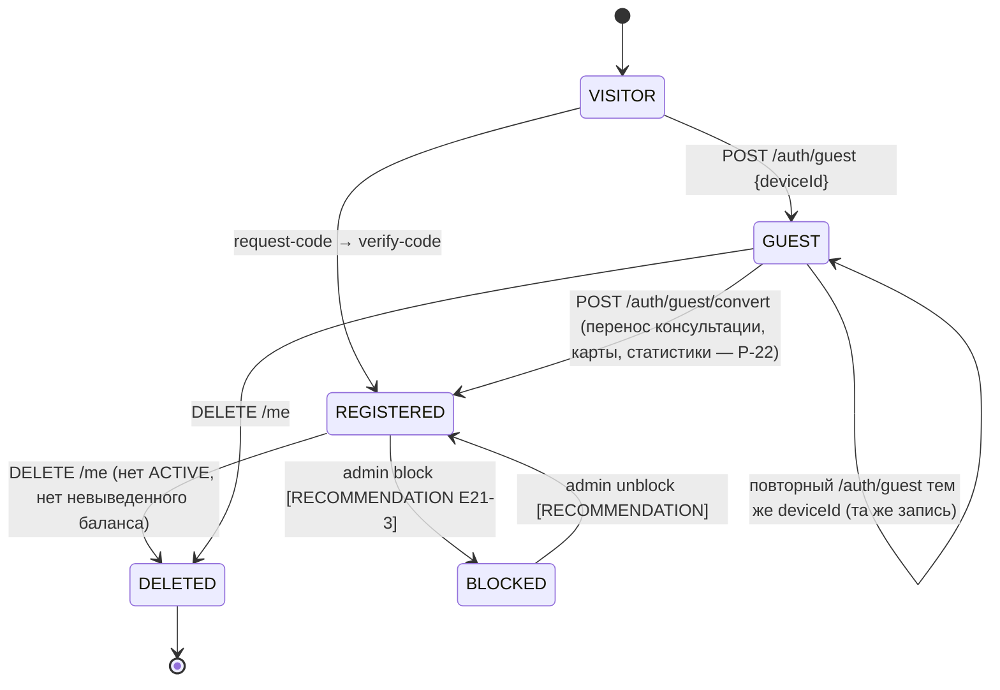

| Actor | Command | Preconditions | Prev → Next | Timers | Side effects | Notifications | Financial | Rollback | Frontend response | Audit | Support |
|---|---|---|---|---|---|---|---|---|---|---|---|
| R-02 гость | `POST /auth/guest {deviceId}` | deviceId валиден | VISITOR → GUEST (или существующий GUEST по deviceId) | — | токены (access 15 мин / refresh 30 дн) | — | — | — | SCR-CL-03 «Продолжить конфиденциально» → SCR-CL-05; предупреждение «история хранится на этом устройстве» (DEC-13) | `user.guest_created` | SUPPORTED · `auth-guest` |
| R-01/R-03 | `POST /auth/request-code` → `verify-code` | throttle 3/ч; повтор ≥ 45 с; код TTL 5 мин, ≤ 5 попыток | VISITOR → REGISTERED | Countdown 45 с (повтор SMS) | SmsCode; токены | SMS с кодом (провайдер, не Notification) | — | код одноразовый | SCR-CL-04 / SCR-WB-15: OTPInput (CMP-28), ошибки `SMS_CODE_INVALID`, `SMS_CODE_EXPIRED`, 429 с `Retry-After` | `user.registered` | SUPPORTED · `auth-request-code`, `auth-verify`, `throttling` |
| R-02 | `POST /auth/guest/convert` | bearer гостя; телефон свободен или тот же | GUEST → REGISTERED | — | перенос ACTIVE-консультации, карт, статистики (Р-22) | — | — | атомарно | SCR-CL-26 `/profile/convert`: успех → тост «Аккаунт создан, история сохранена» | `user.guest_converted` | SUPPORTED · `auth-guest` |
| R-02/R-03 | `POST /me/expert-visibility` | — | атрибут `expertVisibilityAcceptedAt` | — | повтор не сдвигает дату | — | — | — | SCR-CL-32 (ConsentSheet CMP-47) показывается по 409 `EXPERT_VISIBILITY_CONSENT_REQUIRED` из `POST /requests` | — | SUPPORTED · `expert-visibility-consent` |
| система | завершение с исходом `CLIENT_NO_SHOW` / поздняя отмена (< 2 ч) | — | атрибут abuse++ (TTL 30 дн) | 30 дн | при ≥ 3 → `POST /requests` без `expertId` → 409 `AUTO_MATCH_BLOCKED` | `[RECOMMENDATION]` in-app «Автоподбор временно недоступен — выберите специалиста из каталога» (Р-01 обещает уведомление; типа в коде нет) | — | истечение TTL | SCR-CL-06/07: состояние `forbidden` с путём в каталог (11 §4), не пустой экран | `request.auto_match_blocked`, `consultation.late_cancelled` | SUPPORTED (гейт) · `abuse-gate` |
| R-03 | `DELETE /me` | нет ACTIVE-консультации, нет невыведенного баланса (эксперт) | REGISTERED/GUEST → DELETED | — | PII обезличен, токены отозваны, чат/заметки/устройства/избранное удалены | — | — | повтор → 404 | SCR-CL-26 диалог с последствиями (деструктивное — Modal CMP-21); 409 → объяснение «завершите консультацию» | `user.deleted` | SUPPORTED · `account-delete` |
| R-12/R-19 | `POST /admin/clients/{code}/block` | — | REGISTERED → BLOCKED | — | отзыв токенов; `POST /requests` → 403 | `[RECOMMENDATION]` без пуша (причина — через поддержку) | — | unblock | SCR-AD-04 «Заблокировать клиента» (диалог); клиент — экран `forbidden` «Доступ ограничен, обратитесь в поддержку» | `user.blocked` `[RECOMMENDATION]` | MISSING → E21-3 (R2) |

Статусы SM-01

| Код | Label ru | Label kz | Токен | Иконка | Где показывается |
|---|---|---|---|---|---|
| GUEST | Без регистрации (история на этом устройстве) | Тіркеусіз (тарих осы құрылғыда) | `status.waiting` | `device` | SCR-CL-26 карточка аккаунта; SCR-AD-04 «Гость» |
| REGISTERED | Аккаунт подтверждён | Аккаунт расталған | `status.verified` | `check-circle` | SCR-CL-26; SCR-AD-04 «Активен» `[PROTOTYPE FACT]` `Admin - Клиенты` |
| DELETED | Удалён | Жойылған | `status.cancelled` | `user-x` | только SCR-AD-04 (клиент экран не видит) |
| BLOCKED `[RECOMMENDATION]` | Заблокирован | Бұғатталған | `status.failed` | `ban` | SCR-AD-04 `[PROTOTYPE FACT]` «Заблокирован» |
| derived `autoMatchRestricted` | Доступен только ручной выбор | Тек қолмен таңдау қолжетімді | `status.waiting` | `hand` | SCR-CL-06/07 баннер по 409 `AUTO_MATCH_BLOCKED` |

Термин «анонимный клиент #1048» прототипа (`Expert - Консультации`, `Admin - Клиенты`) в UI не используется: по DEC-13 — «Клиент #1048» (clientCode 1000–9999) `[DECISION REQUIRED → DEC-13, решено owner]`.

### 2.2 SM-02 — Корпоративный доступ сотрудника `[RECOMMENDATION · Release 4 · DEC-18]`

Поддержка: MISSING (`User.isCorporate`, `corporate_contract_code` — только в ER-словаре v2 §1). В R1–R3 шаг «У меня есть корпоративный доступ» в регистрации скрыт; форма «Для бизнеса» → тикет.

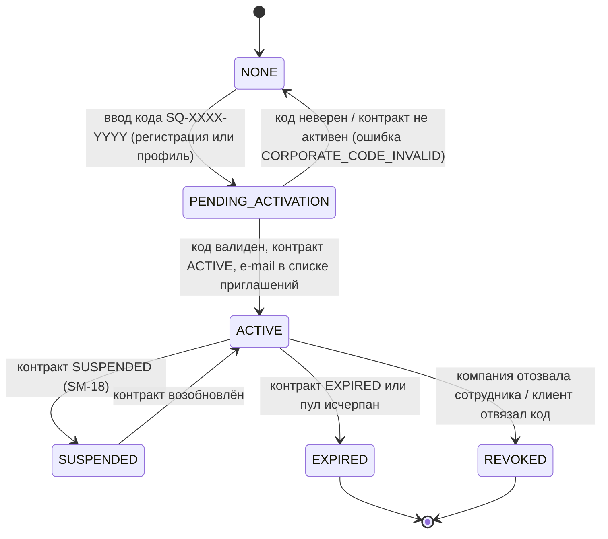

| Actor | Command `[RECOMMENDATION]` | Preconditions | Prev → Next | Timers | Side effects | Notifications | Financial | Rollback | Frontend response | Audit | Support |
|---|---|---|---|---|---|---|---|---|---|---|---|
| R-05 | `POST /me/corporate-access {code}` | код формата `SQ-XXXX-YYYY`; контракт ACTIVE | NONE → ACTIVE (через PENDING_ACTIVATION) | — | `Employee.activatedAt`; источник платежа `CORPORATE` доступен | `corporate.activated` (in-app) | сессии списываются из пула контракта; клиент видит «Оплачено компанией» | отвязка кода | SCR-CL-04 (шаг регистрации, скрыт до R4) / SCR-CL-26; ошибка inline | `corporate.activated` | MISSING → E24-B2B |
| система | контракт истёк / пул исчерпан | — | ACTIVE → EXPIRED | по `endDate` | шторка оплаты возвращается к карте | `corporate.expired` (in-app) | — | продление контракта → ACTIVE | SCR-CL-10: способ «Оплачено компанией» исчезает без «скоро» | `corporate.expired` | MISSING |
| R-16 | `POST /admin/b2b/contracts/{id}/employees/{id}/revoke` | — | ACTIVE → REVOKED | — | — | `corporate.revoked` | — | повторное приглашение | SCR-AD-08 | `corporate.revoked` | MISSING |

Статусы SM-02 `[RECOMMENDATION]`

| Код | Label ru | Label kz | Токен | Иконка | Где показывается |
|---|---|---|---|---|---|
| ACTIVE | Корпоративный доступ активен | Корпоративтік қолжетімділік белсенді | `status.verified` | `building` | SCR-CL-26; SCR-CL-10 «Оплачено компанией» `[PROTOTYPE FACT]` `Специалист найден` v2 |
| SUSPENDED | Доступ приостановлен | Қолжетімділік тоқтатылды | `status.waiting` | `pause` | SCR-CL-26 |
| EXPIRED | Доступ истёк | Қолжетімділік мерзімі өтті | `status.cancelled` | `calendar-x` | SCR-CL-26 |
| REVOKED | Доступ отозван | Қолжетімділік кері қайтарылды | `status.cancelled` | `user-x` | SCR-CL-26, SCR-AD-08 |

### 2.3 SM-03 — Premium-подписка (`Subscription.status`)

`[CODE FACT]` `premium/premium.service.ts`, `premium-renewal.service.ts` (TICK 60 с), `premium.constants.ts`: `MAX_RENEW_ATTEMPTS = 3`, `RENEW_WINDOW_HOURS = 72`, цены `PREMIUM_PRICES` (DEC-01: 4 990 / 39 900 ₸), `LIVE_STATUSES = [ACTIVE, GRACE, CANCELLED]`, одна живая подписка (partial unique). Доступ: `now < currentPeriodEnd` для live-статусов **или** статус GRACE.

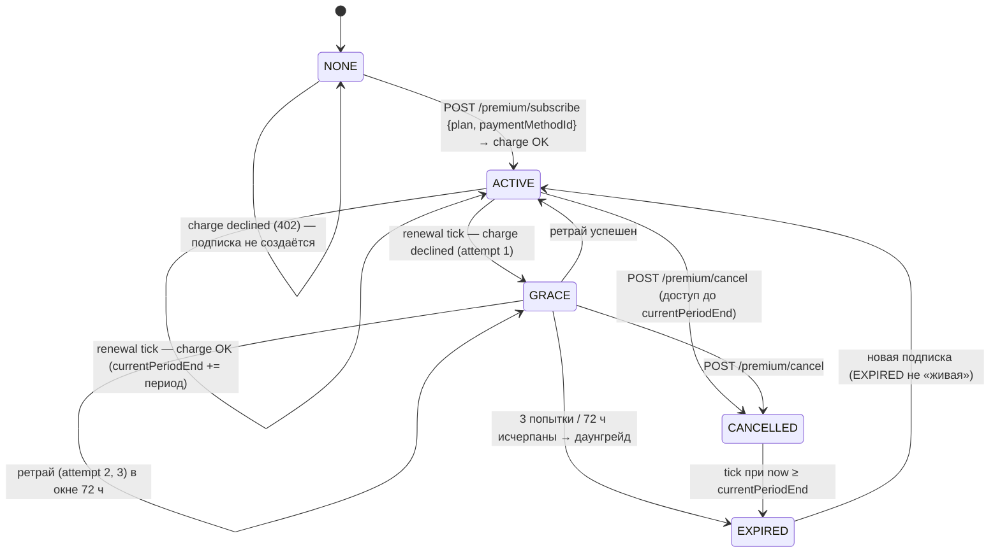

| Actor | Command | Preconditions | Prev → Next | Timers | Side effects | Notifications | Financial | Rollback | Frontend response | Audit | Support |
|---|---|---|---|---|---|---|---|---|---|---|---|
| R-03 | `POST /premium/subscribe` | нет live-подписки (иначе 409 `SUBSCRIPTION_EXISTS`); карта есть (404 `PAYMENT_METHOD_NOT_FOUND`) | NONE/EXPIRED → ACTIVE | период 30/365 дн (`PERIOD_DAYS`) | charge у провайдера; `currentPeriodEnd` | — (успех показывается экраном) | списание 4 990 / 39 900 ₸ | отказ провайдера → 402, записи нет | SCR-CL-24 / SCR-WB-06: успех — «Подписка активна до {date}»; **запрещён текст «все консультации без ограничений»** (DEC-03) | `subscription.created` | SUPPORTED · `premium-subscribe`, `premium-charge` |
| система (tick 60 с) | renewal | `currentPeriodEnd ≤ now`, статус ACTIVE/GRACE | ACTIVE → ACTIVE | — | продление периода | `premium.renewed` (push+in-app, `{amountTenge}`) | списание | — | SCR-CL-27 карточка; SCR-CL-24 обновляет дату | `subscription.renewed` | SUPPORTED · `premium-renewal` |
| система | renewal declined | attempts < 3 и с первого отказа < 72 ч | ACTIVE → GRACE, GRACE → GRACE | 72 ч / 3 попытки | `renewAttempts++`, доступ сохраняется | `premium.renew_failed` («доступ сохраняется ещё 3 дня») — только на первом отказе `[INFERENCE]` по коду `markFailed` | нет | успех ретрая → ACTIVE | SCR-CL-24: баннер «Ждём оплату — проверьте карту» + CTA «Сменить карту» (SCR-CL-25); токен `status.waiting` | `subscription.renew_failed` | SUPPORTED · `premium-renewal` |
| система | grace exhausted | attempts = 3 или 72 ч | GRACE → EXPIRED | — | доступ закрыт (пейволл `PAYWALL` 403 на PREMIUM-контент) | `premium.downgraded` («переведены на Базовый тариф») | — | новая подписка | SCR-CL-19: пейволл на PREMIUM-материалах; SCR-CL-24 — «Истекла» | `subscription.expired` | SUPPORTED |
| R-04 | `POST /premium/cancel` | статус ACTIVE или GRACE (иначе 404 `SUBSCRIPTION_NOT_FOUND`) | → CANCELLED | до `currentPeriodEnd` | автопродление выключено | — | — | повторная подписка после EXPIRED | SCR-CL-24 диалог «Отменить? Доступ сохранится до {date}» (деструктивное) → badge «Отменена (до {date})» | `subscription.cancelled` | SUPPORTED · `premium-subscribe` |
| система | expire cancelled | `currentPeriodEnd ≤ now` | CANCELLED → EXPIRED | — | — | `premium.downgraded` `[INFERENCE]` (код: `expire()` шлёт при обоих источниках) | — | — | как выше | `subscription.expired` | SUPPORTED |

Статусы SM-03 (label ru — 11 §5; kz для GRACE/CANCELLED/EXPIRED в словаре нет → `[RECOMMENDATION]`, вычитка по DEC-22)

| Код | Label ru | Label kz | Токен | Иконка | Где показывается |
|---|---|---|---|---|---|
| NONE / EXPIRED (нет live) | Базовый тариф | Базалық тариф `[CODE FACT]` `premiumStatusInactive` | `status.cancelled` (muted) | `circle` | SCR-CL-24/26, SCR-WB-06 |
| ACTIVE | Активна (до {date}) | Белсенді ({date} дейін) | `status.completed` | `star` | SCR-CL-24/26, SCR-CL-06 бейдж Premium, SCR-AD-04 сегмент «Premium» |
| GRACE | Ждём оплату | Төлемді күтеміз | `status.waiting` (warning) | `alert-circle` | SCR-CL-24 баннер, SCR-CL-27 |
| CANCELLED | Отменена (до {date}) | Тоқтатылған ({date} дейін) | `status.cancelled` | `x-circle` | SCR-CL-24 |
| EXPIRED | Истекла | Мерзімі өтті | `status.cancelled` | `clock` | SCR-CL-24 (одна строка истории), SCR-CL-27 |

`[CONTRADICTION]` Прототип `SmartQoldau - Premium`: 2 990/23 900 ₸ и «Теперь все консультации и практики без ограничений» — не канон (DEC-01, DEC-03). ER-словарь v2 `plan.active: boolean` не покрывает GRACE/CANCELLED — канон: enum кода.

### 2.4 SM-04 — Заявка эксперта (анкета и модерируемые поля профиля)

Две части: (a) существование анкеты `Expert` (создаётся `POST /experts`, статус верификации DRAFT — дальше SM-05); (b) модерация публичных полей `Expert.photoStatus`, `aboutStatus` (`ProfileFieldStatus NONE/PENDING/APPROVED/REJECTED`, `[CODE FACT]` E2a, `profile-moderation.e2e`).

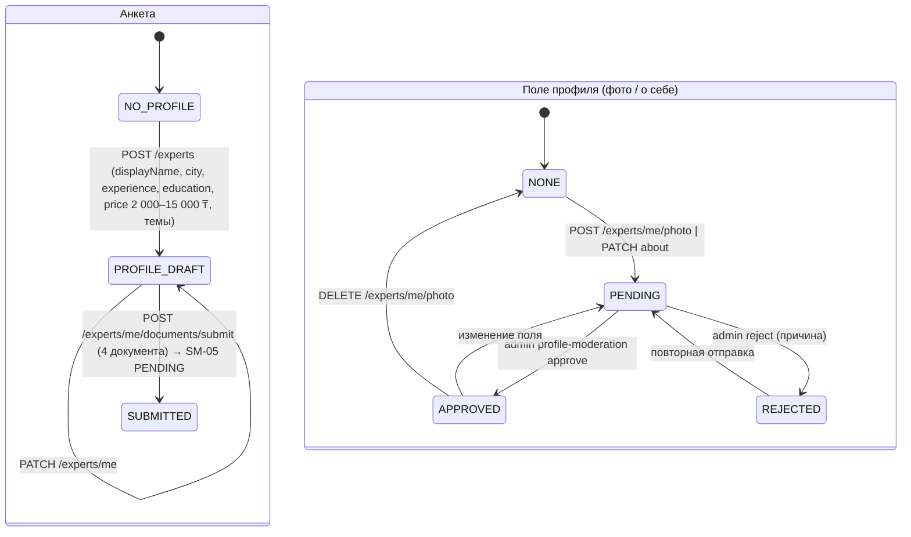

| Actor | Command | Preconditions | Prev → Next | Timers | Side effects | Notifications | Financial | Rollback | Frontend response | Audit | Support |
|---|---|---|---|---|---|---|---|---|---|---|---|
| R-06 | `POST /experts` | у user нет анкеты (409 `EXPERT_EXISTS`); цена в коридоре `PRICE_MIN/MAX` (DEC-04) | NO_PROFILE → PROFILE_DRAFT | — | `Expert{verificationStatus: DRAFT, workStatus: NOT_ACCEPTING, isBlocked: false}` | — | — | — | SCR-EX-02 (2 шага) → SCR-EX-03; ошибки полей inline | `expert.profile_created` | SUPPORTED · `experts-profile`, `expert-profile-schema` |
| R-06/R-07 | `PATCH /experts/me` | — | DRAFT → DRAFT; для VERIFIED — фото/about → PENDING | — | модерируемые поля уходят в очередь | — | — | — | SCR-EX-16 / SCR-EW-09: тост «Сохранено»; для фото — badge «Фото на проверке» | `expert.profile_updated`, `expert.photo_submitted` | SUPPORTED · `expert-photo`, `expert-about` |
| R-11/R-19 | `POST /admin/profile-moderation/{id}/{field}` approve/reject | поле PENDING | PENDING → APPROVED / REJECTED | — | публичный профиль показывает поле только APPROVED | `[RECOMMENDATION]` `profile.field_rejected` (push, без причины в тексте) — сейчас нет | — | повторная отправка | SCR-AD-13; эксперт: SCR-EX-16 badge «Отклонено: {причина}» | `expert.photo_*`/`about_*` `[INFERENCE]` (имена по 10 §1.2) | SUPPORTED · `profile-moderation` |
| R-06 | `POST /experts/me/documents/submit` | 4 документа UPLOADED; статус DRAFT | SUBMITTED (= SM-05 PENDING) | SLA 24 ч (DEC-35) | `verificationSubmittedAt` | — | — | — | SCR-EX-03 → SCR-EX-04 «Профиль на проверке — обычно до 24 часов» `[PROTOTYPE FACT]` | `expert.verification_submitted` | SUPPORTED · `experts-documents` |

Статусы SM-04 (модерируемое поле)

| Код | Label ru | Label kz | Токен | Иконка | Где показывается |
|---|---|---|---|---|---|
| NONE | Не заполнено | Толтырылмаған | `status.cancelled` (muted) | `minus-circle` | SCR-EX-16, SCR-EW-09 |
| PENDING | На проверке | Тексерілуде | `status.waiting` | `clock` | SCR-EX-16 («Фото тексеруге жіберілді» `[CODE FACT]` `photoStatusPending`), SCR-AD-13 |
| APPROVED | Одобрено | Мақұлданды `[CODE FACT]` `photoStatusApproved` | `status.verified` | `check` | SCR-EX-16, SCR-AD-13 |
| REJECTED | Отклонено | Қабылданбады `[CODE FACT]` `photoStatusRejected` | `status.failed` | `x-circle` | SCR-EX-16 (с причиной), SCR-AD-13 |

### 2.5 SM-05 — Верификация (`Expert.verificationStatus` + `isBlocked`)

`[CODE FACT]` `verification/verification.service.ts`: `decideDocument` (документ → APPROVED / REUPLOAD_REQUIRED; у PENDING-эксперта отказ документа возвращает анкету в DRAFT, у VERIFIED — статус не меняется, Р-18), `decideExpert` (только из PENDING; approve требует все 4 документа APPROVED → VERIFIED, иначе → DRAFT), `block/unblock` (isBlocked + blockedReason). Уведомления `verification.approved/rejected` шлются в `decideExpert`; `decideDocument` уведомления не шлёт.

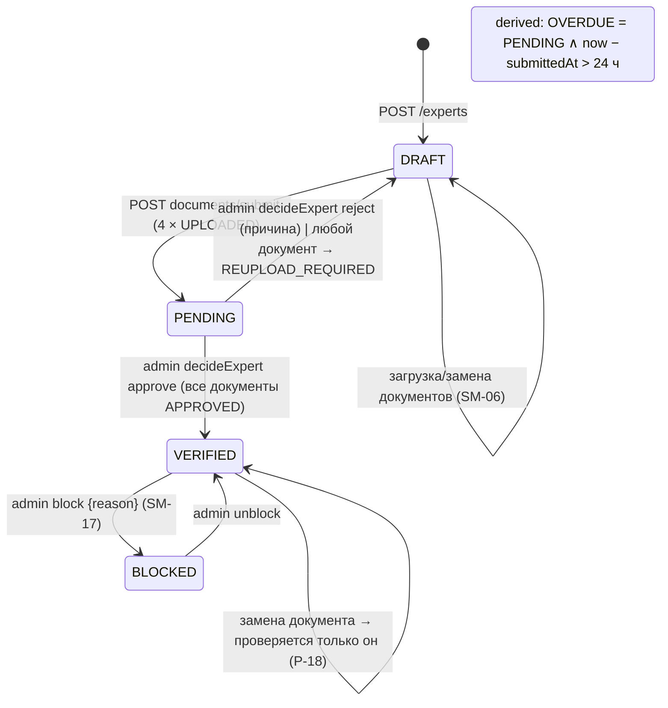

| Actor | Command | Preconditions | Prev → Next | Timers | Side effects | Notifications | Financial | Rollback | Frontend response | Audit | Support |
|---|---|---|---|---|---|---|---|---|---|---|---|
| R-06 | `POST /experts/me/documents/submit` | DRAFT; 4 документа UPLOADED (или APPROVED при повторе) | DRAFT → PENDING | SLA 24 ч (Р-18/DEC-35) | `verificationSubmittedAt`; попадает в `GET /admin/verification` | — | — | — | SCR-EX-04 «Профиль на проверке — обычно до 24 часов»; переключатель «Принимаю» заблокирован с подсказкой `homeAcceptingBlockedByVerification` `[CODE FACT]` | `expert.verification_submitted` | SUPPORTED · `experts-documents` |
| R-11 | `POST /admin/verification/{id}/documents/{docId}` `{approve|reject, reason}` | документ UPLOADED | документ → APPROVED / REUPLOAD_REQUIRED; при reject и PENDING → анкета DRAFT | — | — | **нет** (`[RISK]` эксперт узнаёт только открыв SCR-EX-04) → `[RECOMMENDATION]` тип `verification.document_rejected` | — | повторная загрузка | SCR-AD-02: карточка, «Просмотреть» документ; эксперт: SCR-EX-03 слот «Нужна повторная загрузка» + CTA «Загрузить заново» | `expert.document_approved` / `expert.document_rejected` (10 §1.2) | SUPPORTED · `admin-verification` |
| R-11 | `POST /admin/verification/{id}` `{approve}` | PENDING; все документы APPROVED (иначе 400) | PENDING → VERIFIED | — | эксперт может включить ACCEPTING; появляется в каталоге и матчинге | `verification.approved` (push + in-app) «Верификация пройдена — можно принимать клиентов» | — | block (SM-17) | SCR-AD-02 тост «Специалист одобрен и допущен на платформу» `[PROTOTYPE FACT]`; SCR-EX-04 «Профиль подтверждён»; SCR-EX-05 переключатель разблокирован | `expert.verified` | SUPPORTED · `admin-verification`, `expert-lifecycle` |
| R-11 | `POST /admin/verification/{id}` `{reject, reason}` | PENDING | PENDING → DRAFT | — | причина хранится `[INFERENCE]` (поле в DTO есть: `dto.reason`) | `verification.rejected` «Подробности в приложении» | — | повторный submit | SCR-AD-02 «Причина отказа (видна специалисту)» `[PROTOTYPE FACT]`; SCR-EX-04: причина + документы со статусами + CTA | `expert.verification_rejected` | SUPPORTED · `admin-verification` |
| R-07 | замена документа после VERIFIED | VERIFIED | VERIFIED → VERIFIED (документ UPLOADED → проверка) | — | профиль продолжает работать (Р-18) | — | — | — | SCR-EX-03/16: слот «На проверке», остальное без изменений | `expert.document_uploaded` | SUPPORTED · `experts-documents` |
| R-12/R-11 | `POST /admin/experts/{id}/block {reason}` | — | VERIFIED → BLOCKED | — | presence remove; `PATCH work-status` → 403 `EXPERT_BLOCKED`; исключён из матчинга/каталога/слотов/избранного | `[RECOMMENDATION]` `expert.blocked` push «Профиль временно заблокирован» (без причины в пуше) — сейчас нет | активные выплаты не блокируются `[INFERENCE]` (код не проверяет) | unblock | SCR-AD-03 диалог «Заблокировать {name}? Специалист потеряет доступ к платформе и будущим заявкам» `[PROTOTYPE FACT]`; SCR-EX-04 «Профиль временно заблокирован… Обратитесь в поддержку» `[PROTOTYPE FACT]` | `expert.blocked` | SUPPORTED · `admin-lifecycle` |
| R-12/R-19 | `POST /admin/experts/{id}/unblock` | isBlocked | BLOCKED → VERIFIED | — | — | `[RECOMMENDATION]` `expert.unblocked` | — | — | SCR-AD-03; SCR-EX-04 «Профиль подтверждён» | `expert.unblocked` | SUPPORTED |

Статусы SM-05 (ru — 11 §5; kz — `[CODE FACT]` `app_expert` l10n, где есть)

| Код | Label ru | Label kz | Токен | Иконка | Где показывается |
|---|---|---|---|---|---|
| DRAFT | Черновик (анкета не отправлена) | Анкета жіберілмеген `[CODE FACT]` `verificationDraft` | `status.cancelled` (muted) | `edit` | SCR-EX-04, SCR-EX-05 |
| PENDING | На проверке (обычно до 24 ч) | Тексерілуде (әдетте 24 сағатқа дейін) | `status.waiting` | `clock` | SCR-EX-04 `[PROTOTYPE FACT]`, SCR-AD-02 «Ожидает» |
| PENDING + derived OVERDUE | Просрочено (SLA 24 ч) — только админ | Мерзімі өтті (SLA 24 сағ) | `status.failed` | `alert-triangle` | SCR-AD-02 колонка SLA «+2ч просрочка» `[PROTOTYPE FACT]` `Admin - Верификация` |
| VERIFIED | Верифицирован | Верификациядан өтті `[CODE FACT]` | `status.verified` | `shield-check` | SCR-EX-04 «Профиль подтверждён», SCR-AD-03 «Активен», SCR-CL-11/WB-03 бейдж «Проверенный специалист» |
| VERIFIED + isBlocked | Заблокирован | Бұғатталған | `status.failed` | `ban` | SCR-EX-04 `[PROTOTYPE FACT]`, SCR-AD-03 |
| v2 «Отклонено» | → в коде это DRAFT с причиной: label «Отклонено — нужны исправления» | Қабылданбады — түзету қажет | `status.warning` (= `status.waiting`) | `x-circle` | SCR-EX-04 при `rejectionReason` `[RECOMMENDATION]` поле `verificationRejectReason` в `GET /experts/me` — сейчас причина только в audit `[INFERENCE]` |

`[OUT OF SCOPE → R5]` Дубликат ИИН и второй поток «практиканты» (SCR-AD-02 вкладка) — DEC-17/DEC-35: ИИН не собирается (`[CODE FACT]` модель Expert без `iin`).

### 2.6 SM-06 — Документ (`ExpertDocument.status`)

`[CODE FACT]` `DocumentType IDENTITY/DIPLOMA/CERTIFICATES/QUALIFICATION`, один документ на тип (unique), `experts/documents.controller.ts` `POST :type`, `POST submit`, `GET`.

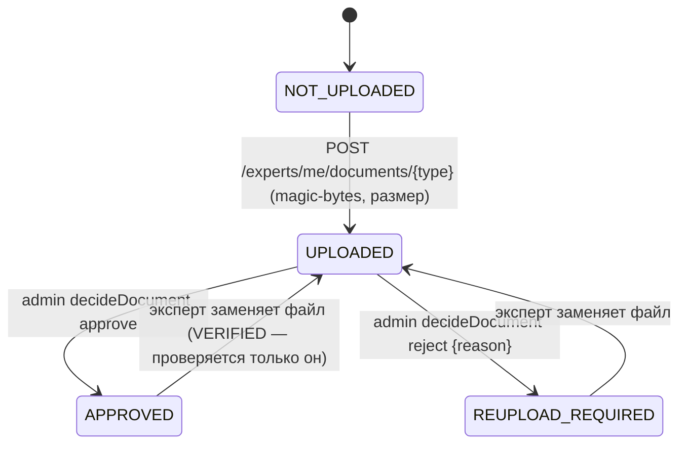

| Actor | Command | Preconditions | Prev → Next | Timers | Side effects | Notifications | Financial | Rollback | Frontend response | Audit | Support |
|---|---|---|---|---|---|---|---|---|---|---|---|
| R-06/R-07 | `POST /experts/me/documents/{type}` (multipart) | тип из 4; файл проходит проверку magic-bytes и размера (400 `VALIDATION_FAILED`) | NOT_UPLOADED/REUPLOAD_REQUIRED/APPROVED → UPLOADED | — | S3-ключ; старый файл заменяется | — | — | повторная загрузка | SCR-EX-03 FileUpload (CMP-29): 4 слота со статусами, ошибка «файл не похож на PDF/JPG» человеческим текстом (11 §6) | `expert.document_uploaded` | SUPPORTED · `experts-documents` |
| R-11 | decideDocument approve | UPLOADED | → APPROVED | — | — | — | — | — | SCR-AD-02; SCR-EX-04 «Подтверждено» `[PROTOTYPE FACT]` | `expert.document_approved` | SUPPORTED · `admin-verification` |
| R-11 | decideDocument reject | UPLOADED | → REUPLOAD_REQUIRED (+ анкета PENDING → DRAFT) | — | — | `[RECOMMENDATION]` `verification.document_rejected` | — | — | SCR-EX-03/04 слот `status.waiting` «Нужна повторная загрузка» + причина + CTA «Загрузить заново» (`actionReupload` `[CODE FACT]`) | `expert.document_rejected` | SUPPORTED |

Статусы SM-06 (kz `[CODE FACT]` `documentStatus*` в `app_expert`)

| Код | Label ru | Label kz | Токен | Иконка | Где показывается |
|---|---|---|---|---|---|
| NOT_UPLOADED (нет строки) | Не загружен | Жүктелмеген | `status.cancelled` (muted) | `upload` | SCR-EX-03 |
| UPLOADED | На проверке | Тексерілуде | `status.waiting` | `clock` | SCR-EX-03/04, SCR-AD-02 |
| APPROVED | Подтверждён | Қабылданды | `status.verified` | `check` | SCR-EX-03/04 («Подтверждено» `[PROTOTYPE FACT]`), SCR-AD-02 |
| REUPLOAD_REQUIRED | Нужна повторная загрузка | Қайта жіберу қажет | `status.waiting` (warning) | `refresh-cw` | SCR-EX-03/04, SCR-AD-02 |

ER-словарь v2 «пусто / загружен / подтверждено» не имеет REUPLOAD_REQUIRED — канон: enum кода (DEC-35 «повторная загрузка одного документа»).

### 2.7 SM-07 — Доступность эксперта (`Expert.workStatus` + presence)

`[CODE FACT]` `experts/experts.service.ts` (`PATCH /experts/me/work-status`: blocked → 403 `EXPERT_BLOCKED`; ACCEPTING без VERIFIED → 400 `NOT_VERIFIED`; порядок Redis → БД с компенсацией), `presence/presence.service.ts` (`experts:available` set + `experts:lastseen`, `DEFAULT_STALE_MS = 90_000`), `POST /experts/me/heartbeat`, `consultations.service.ts` `setExpertBusy` (при создании ACTIVE-консультации) и `returnExpertToAccepting` (только если всё ещё BUSY). Веб: `web/components/expert-cabinet/WorkStatusToggle.tsx` шлёт heartbeat **только пока вкладка видима** (`visibilitychange`) — «онлайн пока вкладка открыта» `[CODE FACT]`; текст `app_expert`: «Өтінімдер осы қойынды ашық тұрғанда келеді. Жапсаңыз — қабылдау өшеді.»

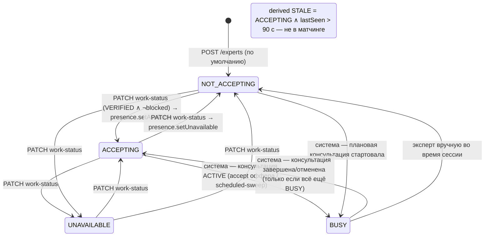

| Actor | Command | Preconditions | Prev → Next | Timers | Side effects | Notifications | Financial | Rollback | Frontend response | Audit | Support |
|---|---|---|---|---|---|---|---|---|---|---|---|
| R-07 | `PATCH /experts/me/work-status {workStatus}` | VERIFIED и не blocked для ACCEPTING | любой → ACCEPTING/NOT_ACCEPTING/UNAVAILABLE | — | presence add/remove; онлайн-счётчик `GET /matching/online-count` | — | — | компенсация presence при сбое БД | SCR-EX-05 шторка «Рабочий статус» (4 опции с описаниями `[PROTOTYPE FACT]` `Expert - Главная`), SCR-EW-01 переключатель; 400 → подсказка «доступно после верификации»; 403 → SCR-EX-04 | `expert.work_status_changed {from,to}` | SUPPORTED · `experts-status` |
| R-07 (клиент приложения) | `POST /experts/me/heartbeat` | ACCEPTING | атрибут `lastSeen` | каждые ≤ 90 с; веб — только при видимой вкладке | `listFresh()` матчинга видит только свежих | — | — | — | SCR-EW-01 баннер «Заявки приходят, пока вкладка открыта»; при потере сети — OfflineBanner (CMP-20) «Вы не получаете заявки» `[RECOMMENDATION]` | — | SUPPORTED · `experts-heartbeat` |
| система | accept оффера / старт плановой | консультация стала ACTIVE | ACCEPTING/NOT_ACCEPTING → BUSY | — | presence remove (если был ACCEPTING) | — | — | сбой BUSY не ломает консультацию (компенсация) | SCR-EX-05 карточка «Вы заняты — сейчас на консультации»; SCR-CL-12/WB-02 карточка эксперта без «свободен сейчас» | `expert.work_status_changed` | SUPPORTED · `consultation-lifecycle` |
| система | complete / cancel | эксперт всё ещё BUSY | BUSY → ACCEPTING (+ presence add) | — | — | — | — | — | SCR-EX-05 возвращается в «Принимаю клиентов» | `expert.work_status_changed` | SUPPORTED · `consultations-complete` |
| R-07 | атрибут `acceptsUrgent` (`Expert - Доступность` «Принимать срочные обращения») | — | флаг | — | до broadcast экстренные заявки идут только `acceptsUrgent` (`urgentOnly`) | — | — | — | SCR-EX-06 тумблер | `expert.availability_updated` | SUPPORTED · `request-emergency` |

Статусы SM-07 (ru — 11 §5; kz — `[RECOMMENDATION]`, в l10n есть только `homeAcceptingOn/Off`)

| Код | Label ru | Label kz | Токен | Иконка | Где показывается |
|---|---|---|---|---|---|
| ACCEPTING | Принимаю клиентов | Клиенттерді қабылдаймын | `status.available` | `dot-live` (зелёная точка + пульс) | SCR-EX-05, SCR-EW-01/03/07 шапка «Принимаю клиентов» `[PROTOTYPE FACT]`, SCR-CL-12/WB-02 «свободен сейчас» |
| BUSY | Занят (на консультации) | Бос емес (кеңесте) | `status.busy` | `phone-call` | SCR-EX-05, SCR-EW-01; каталог — карточка без «свободен» |
| NOT_ACCEPTING | Не принимаю | Қабылдамаймын | `status.unavailable` | `pause-circle` | SCR-EX-05, SCR-EW-01 |
| UNAVAILABLE | Временно недоступен (скрыт из подбора) | Уақытша қолжетімсіз | `status.unavailable` | `eye-off` | SCR-EX-05, SCR-EW-01; SCR-CL-18 «Психолог временно недоступен — рекомендуем перенести» `[PROTOTYPE FACT]` (derived для предстоящей записи) |
| derived STALE | Не в сети — заявки не приходят | Желіде емес — өтінімдер келмейді | `status.unavailable` | `wifi-off` | SCR-EX-05 / SCR-EW-01 баннер (клиент считает по `lastSeen` из `GET /experts/me` `[RECOMMENDATION]` добавить поле) |

`[CONTRADICTION]` `Expert - Главная` v2 для BUSY: «Новые заявки поступают, но подбор снижен» — в коде BUSY полностью исключён из матчинга (одна ACTIVE на эксперта, `expert_active_uq`). Канон: «Занят — новые заявки не поступают до завершения консультации» (см. §5 D-07).

### 2.8 SM-08 — Заявка (`Request.status`)

`[CODE FACT]` `requests/requests.service.ts` (`NORMAL_DEADLINE_MS = 45_000`, `EMERGENCY_DEADLINE_MS = 20_000`, `ABUSE_AUTO_MATCH_THRESHOLD = 3`, `HOTLINES = ['150','103','112']`; DTO `topicSlug, format, isEmergency?, expertId?`), `offer-timer.service.ts` (`REQUEST_MAX_AGE_MS = 120_000` → NO_EXPERTS для обычной заявки без PENDING-офферов; `RESCAN_DELAY_MS = 5_000`; tick 1 с), `escalation.service.ts` (`BROADCAST_AGE_MS = 120_000`, `CALLBACK_AGE_MS = 300_000`). Гейты при создании: 409 `EXPERT_VISIBILITY_CONSENT_REQUIRED` (Р-27), 409 `AUTO_MATCH_BLOCKED` (abuse ≥ 3, только без `expertId`), 409 `ACTIVE_REQUEST_EXISTS`, 400 `VALIDATION_FAILED` (тема). Directed-заявка (`expertId` из каталога/избранного) — тот же SM, круг кандидатов = один эксперт `[CODE FACT]` DTO; поведение таймеров одинаково.

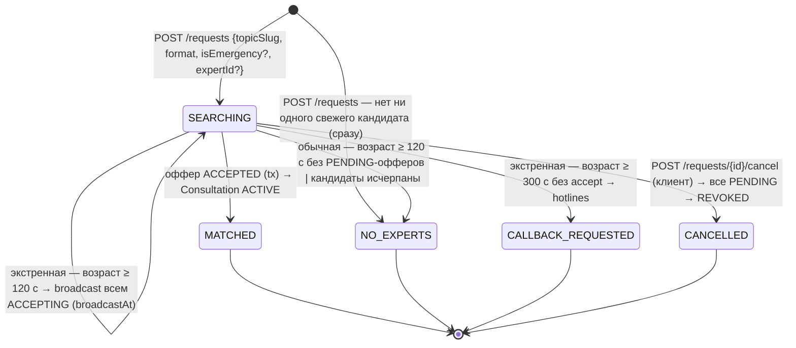

| Actor | Command | Preconditions | Prev → Next | Timers | Side effects | Notifications | Financial | Rollback | Frontend response | Audit | Support |
|---|---|---|---|---|---|---|---|---|---|---|---|
| R-02/R-03 | `POST /requests` | согласие Р-27; нет SEARCHING-заявки; abuse < 3 (или `expertId`) | ∅ → SEARCHING (+ первый оффер PENDING) | оффер 45 с / 20 с; поиск ≤ 120 с | `clientCode` 1000–9999; кандидаты `presence.listFresh` → score → tieBreak; WS `request.updated` клиенту | эксперту `offer.incoming` (см. SM-09) | — | cancel | SCR-CL-08 / SCR-WB-04 / SCR-CW: SearchProgress (CMP-17) «Подбираем… обычно до 2 минут» (DEC-16, **не** «не более 2 минут» из прототипа), счётчик «сейчас онлайн N» из `GET /matching/online-count`; стадии прототипа — декоративные, привязать к событиям: создана → `offer.sent` → `request.matched`; 409 → ConsentSheet / состояние `forbidden` с CTA «Каталог» | `request.created` | SUPPORTED · `requests-flow`, `matching-*` |
| R-02/R-03 | `POST /requests {isEmergency:true}` | скрининг «угрожает ли опасность» пройден на клиенте (DEC-11) | ∅ → SEARCHING | оффер 20 с; broadcast 120 с; callback 300 с | круг кандидатов = `acceptsUrgent` до broadcast; приоритет в скоринге | `offer.incoming` эксперту с пометкой «Приоритетный запрос» | — | cancel | SCR-CL-09 «Приоритетный поиск», постоянная кнопка «Позвонить 103 / 112» (EmergencyBar CMP-46), без Premium-апселла; таймер по серверному `createdAt + 300 с`, не «0:30» из прототипа `[CONTRADICTION]` `Экстренный поиск` | `request.created {isEmergency}` | SUPPORTED · `request-emergency` |
| система (1 с) | offer timeout / decline → `offerToNext` | статус всё ещё SEARCHING | SEARCHING → SEARCHING | — | следующий кандидат PENDING | `offer.incoming` следующему | — | — | клиент: без изменений экрана (стадия «подбираем подходящего»); `request.updated` не шлётся `[INFERENCE]` | `offer.sent` | SUPPORTED · `request-timers` |
| R-07 | accept оффера (SM-09) | оффер PENDING, дедлайн не истёк, эксперт без ACTIVE | SEARCHING → MATCHED | — | Consultation ACTIVE (`paymentStatus UNPAID`), эксперт BUSY, остальные PENDING → REVOKED (broadcast) | WS `request.updated {MATCHED}` + `consultation.updated` клиенту; `[RECOMMENDATION]` push `request.matched` клиенту, если приложение свернуто — сейчас только WS | — | — | SCR-CL-10 «Специалист найден» → «Оплатить и начать» (SM-12) | `request.matched`, `offer.accepted` | SUPPORTED · `matching-accept-race` |
| система | sweep 120 с (обычная) | нет PENDING-офферов | SEARCHING → NO_EXPERTS (`closedAt`) | 120 с | — | WS `request.updated {NO_EXPERTS}`; `[RECOMMENDATION]` push `request.no_experts` при свернутом приложении | — | новая заявка | SCR-CL-08 состояние «Свободных специалистов пока нет» + «Попробовать снова» / «Каталог» / «Запланировать» `[PROTOTYPE FACT]` `Поиск специалиста` notFound; DEC-16: при N < порога — «ожидание может быть дольше» ещё до создания | `request.no_experts` | SUPPORTED · `request-timers` |
| система | broadcast (экстренная) | SEARCHING, `broadcastAt = null`, возраст ≥ 120 с | SEARCHING → SEARCHING (`broadcastAt`) | 120 с | PENDING всем свежим ACCEPTING (partial unique per expert), дедлайн 20 с у каждого | `offer.incoming` всем (батч) | — | — | клиент: стадия «Расширяем круг специалистов» `[RECOMMENDATION]` текст; эксперты: алерт оффера с «Приоритетный запрос» | `request.broadcast` | SUPPORTED · `request-emergency` |
| система | callback (экстренная) | SEARCHING, возраст ≥ 300 с | SEARCHING → CALLBACK_REQUESTED; все PENDING → REVOKED | 300 с | `closedAt`; заявка попадает в очередь callback `[MISSING]` (E21-7) | WS `request.updated {CALLBACK_REQUESTED, hotlines}`; экспертам `offer.revoked` | — | новая заявка | SCR-CL-09 `/emergency/hotlines`: **текст до E21-7** — «Сейчас никто не смог подключиться. Позвоните на линию 150 или попробуйте позже» (DEC-11); обещание «мы перезвоним» только после E21-7 | `request.callback_requested` | PARTIALLY_SUPPORTED (статус есть, очередь MISSING) |
| R-02/R-03 | `POST /requests/{id}/cancel` | SEARCHING | SEARCHING → CANCELLED | — | все PENDING → REVOKED; `offer.revoked` экспертам | WS `request.updated` | — | — | SCR-CL-08 диалог «Отменить поиск? / Продолжить ожидание» `[PROTOTYPE FACT]` → возврат на SCR-CL-06 | `request.cancelled`, `offer.revoked` | SUPPORTED · `requests-flow` |

Статусы SM-08 (ru/kz/токен — 11 §5 без изменений)

| Код | Label ru | Label kz | Токен | Иконка | Где показывается |
|---|---|---|---|---|---|
| SEARCHING | Ищем специалиста | Маман іздеп жатырмыз | `status.searching` (анимация; `prefers-reduced-motion` → статично) | `radar` | SCR-CL-08, SCR-CL-09, SCR-WB-04, SCR-CW (заявка), SCR-CL-06 баннер «У вас активная заявка» (`funnelActiveRequestTitle` `[CODE FACT]`) |
| SEARCHING + isEmergency | Приоритетный поиск · Срочно | Басым іздеу · Шұғыл | `status.urgent` | `alert-octagon` | SCR-CL-09 `[PROTOTYPE FACT]`; SCR-EX-07/EW-02 «Приоритетный запрос» |
| MATCHED | Специалист найден | Маман табылды | `status.matched` | `user-check` | SCR-CL-10 |
| NO_EXPERTS | Никто не свободен | Бос маман жоқ | `status.waiting` | `users` | SCR-CL-08 состояние empty-with-action; SCR-CL-27 |
| CALLBACK_REQUESTED | Ждём обратный звонок (после E21-7) / до этого: «Никто не смог подключиться» | Кері қоңырауды күтеміз | `status.urgent` | `phone-incoming` | SCR-CL-09 hotlines; SCR-AD (callback-очередь, E21-7) |
| CANCELLED | Отменена | Бас тартылды | `status.cancelled` | `x-circle` | история заявок (только админ E21) |

### 2.9 SM-09 — Оффер кандидату (`RequestCandidate.response`)

`[CODE FACT]` `requests.service.ts` `claimOffer` (tx: candidate ACCEPTED + request MATCHED + Consultation ACTIVE + `expert_active_uq`; 410 `OFFER_EXPIRED` при TIMEOUT/REVOKED, 409 `OFFER_ALREADY_TAKEN`, 409 `EXPERT_BUSY` «У вас уже идёт консультация — этот запрос уйдёт другому специалисту» с переводом оффера в REVOKED), `offer-timer.service.ts` `timeoutOffer` (TIMEOUT + WS `offer.revoked`), `notifications/offer-push-fallback.service.ts` (`FALLBACK_DELAY_MS = 10_000`, SMS «SmartQoldau: новая заявка, откройте приложение», бюджет SMS `sms-budget.service.ts`), `CRITICAL_TYPES = {offer.incoming}` (data-only + CallKit/VoIP).

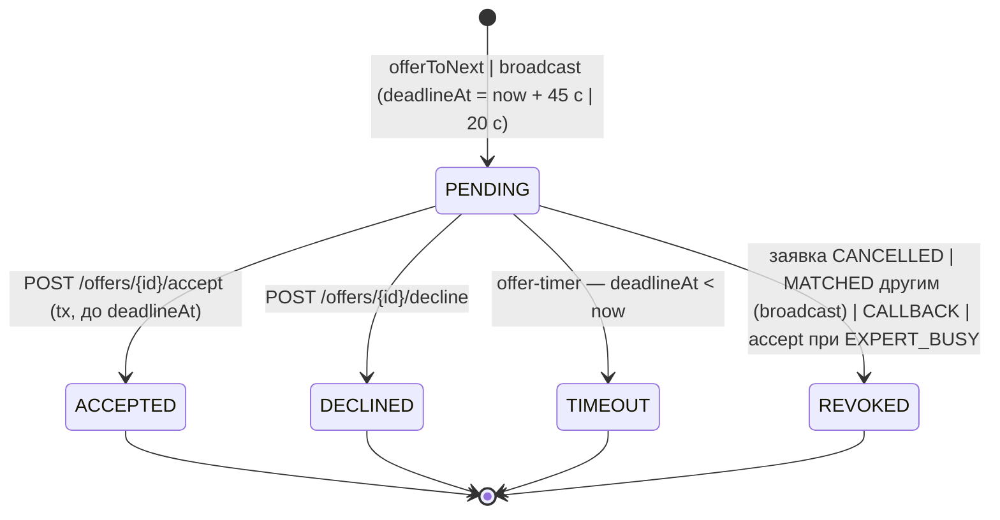

| Actor | Command | Preconditions | Prev → Next | Timers | Side effects | Notifications | Financial | Rollback | Frontend response | Audit | Support |
|---|---|---|---|---|---|---|---|---|---|---|---|
| система | `offerToNext` / `broadcast` | эксперт свежий ACCEPTING, нет PENDING у него по этой заявке | ∅ → PENDING | `deadlineAt` (+45 с обычная / +20 с экстренная и broadcast) | WS `offer.new {тема, формат, clientCode, priceTiyn, deadlineAt}` в `expert:{id}` | `offer.incoming` push (critical) → без ack через 10 с — SMS; in-app | — | — | SCR-EX-07 полноэкранный алерт «Новый запрос на консультацию» / «Приоритетный запрос», Countdown по `deadlineAt` (CMP-16), `status.urgent` при < 10 с; SCR-EW-01/02 карточка с таймером; после reconnect — `GET /experts/me/offers`; **240 с в `Expert Web - Главная` — ошибка прототипа (DEC-10)** | `offer.sent` | SUPPORTED · `request-timers`, `offer-push-fallback`, `sms-fallback-budget` |
| R-07 | `POST /offers/{id}/accept` | PENDING; `deadlineAt ≥ now`; у эксперта нет ACTIVE | PENDING → ACCEPTED | — | Consultation ACTIVE; BUSY; заявка MATCHED; прочие PENDING → REVOKED | WS `consultation.updated` обеим сторонам | цена снимком `priceTiyn` (DEC-05) | — | SCR-EX-07 «Принять» → SCR-EX-10 сессия; 410 → тост «Заявка уже ушла другому специалисту» и закрытие алерта; 409 `EXPERT_BUSY` → тост с текстом из API | `offer.accepted` | SUPPORTED · `matching-accept-race` |
| R-07 | `POST /offers/{id}/decline` | PENDING | PENDING → DECLINED | — | `offerToNext` | — | — | — | SCR-EX-07 «Отклонить» → возврат на SCR-EX-05; в скоринге учитывается `avgResponse`/decline `[CODE FACT]` `scoring.service.ts` | `offer.declined` | SUPPORTED |
| система (1 с) | timeout | `deadlineAt < now`, PENDING | PENDING → TIMEOUT | — | `offerToNext` | WS `offer.revoked {offerId}` | — | — | SCR-EX-07 алерт закрывается с тостом «Время ответа истекло»; SCR-EX-08 список: «Истекла» | `offer.timeout` | SUPPORTED · `request-timers` |
| система | revoke | заявка закрылась / принята другим | PENDING → REVOKED | — | — | WS `offer.revoked` | — | — | алерт закрывается: «Заявка уже принята другим специалистом» / «Клиент отменил поиск» `[RECOMMENDATION]` причину передавать в payload `offer.revoked {reason}` (сейчас только `offerId, requestId`) | `offer.revoked` | SUPPORTED |

Статусы SM-09 (label списка `GET /experts/me/offers`; 11 §5 задаёт только PENDING)

| Код | Label ru | Label kz | Токен | Иконка | Где показывается |
|---|---|---|---|---|---|
| PENDING | Новая заявка · {mm:ss} | Жаңа өтінім · {mm:ss} | `status.matched` → `status.urgent` при < 10 с | `bell-ring` | SCR-EX-07, SCR-EX-08, SCR-EW-01/02 |
| PENDING + isEmergency | Приоритетный запрос · {mm:ss} | Басым сұраныс · {mm:ss} | `status.urgent` | `alert-octagon` | SCR-EX-07 `[PROTOTYPE FACT]` `Входящий запрос` |
| ACCEPTED | Принята | Қабылданды | `status.completed` | `check` | SCR-EX-08 «принятые» |
| DECLINED | Отклонена вами | Сіз қабылдамадыңыз | `status.cancelled` | `x` | SCR-EX-08 история |
| TIMEOUT | Время ответа истекло | Жауап беру уақыты өтті | `status.cancelled` | `clock` | SCR-EX-08 история |
| REVOKED | Ушла другому специалисту / Клиент отменил | Басқа маманға кетті / Клиент бас тартты | `status.cancelled` | `corner-up-right` | SCR-EX-08 история |

### 2.10 SM-10 — Плановая запись (booking: `Consultation` в SCHEDULED)

`[CODE FACT]` `booking/booking.constants.ts`: `SLOT_MINUTES 60`, `SESSION_MINUTES 50` (DEC-06), `HORIZON_DAYS 14`, `LEAD_MINUTES 60`, `LATE_CANCEL_HOURS 2`, `REMINDER_MINUTES 15`, Asia/Almaty UTC+5. `booking.service.ts`: `create` (409 `SLOT_TAKEN` / `SLOT_UNAVAILABLE`, 404 `EXPERT_NOT_FOUND`/`TOPIC_NOT_FOUND`; холд сразу; `rollback()` при сбое), `reschedule` (400 `SLOT_OUT_OF_RANGE`; уведомляется вторая сторона), `cancelByExpert` (исход EXPERT_CANCELLED, уведомление клиенту `consultation.cancelled`). `consultations/scheduled-sweep.service.ts` (tick 30 с: напоминание за 15 мин обеим сторонам, `remindedAt`; активация при `startedAt ≤ now`, эксперт → BUSY). Слоты: `GET /experts/{id}/slots` (blocked/не VERIFIED → пусто).

```mermaid
stateDiagram-v2
  [*] --> SLOT_FREE : GET /experts/{id}/slots (расписание − исключения − занятые)
  SLOT_FREE --> SCHEDULED : POST /bookings {expertId, topicSlug, format, slotStartAt, paymentMethodId} → холд HELD
  SCHEDULED --> SCHEDULED : POST /consultations/{id}/reschedule {slotStartAt} (обе стороны; перехолд при необходимости)
  SCHEDULED --> SCHEDULED : sweep — за 15 мин → consultation.reminder обеим (remindedAt)
  SCHEDULED --> ACTIVE : sweep — startedAt ≤ now → эксперт BUSY (далее SM-11)
  SCHEDULED --> CANCELLED : POST cancel (клиент; < 2 ч до старта → late → abuse++) — исход CLIENT_CANCELLED, void
  SCHEDULED --> CANCELLED : POST cancel-by-expert — исход EXPERT_CANCELLED, void
  CANCELLED --> SLOT_FREE : слот освобождён
```

| Actor | Command | Preconditions | Prev → Next | Timers | Side effects | Notifications | Financial | Rollback | Frontend response | Audit | Support |
|---|---|---|---|---|---|---|---|---|---|---|---|
| R-03 (R-02 — тоже, карта Р-22) | `POST /bookings` | эксперт VERIFIED, не blocked; слот в расписании, ≥ 60 мин от «сейчас», ≤ 14 дн; партиальный unique на слот | SLOT_FREE → SCHEDULED | напоминание 15 мин (DEC-27: + 1 ч `[RECOMMENDATION]`) | Consultation SCHEDULED + Payment HELD (SM-12); при сбое холда — `rollback()` (запись удаляется) | эксперту `consultation.booked` (push+in-app); клиенту — экран успеха | холд полной цены (`priceTiyn`) | rollback при сбое холда | SCR-CL-11 `…/booking` → успех «Запись на {date}, сумма заморожена» → SCR-CL-18 «Предстоящие»; 409 `SLOT_TAKEN` → «Это время уже занято» и перезапрос слотов | `consultation.booked`, `payment.held` | SUPPORTED · `booking-create`, `booking-money`, `slots` |
| R-03 / R-07 | `POST /consultations/{id}/reschedule` | SCHEDULED; новый слот валиден | SCHEDULED → SCHEDULED (новый `startedAt`) | — | старый слот освобождён; перехолд, если требуется `[CODE FACT]` 03 §7.3 | второй стороне `consultation.rescheduled` | без изменений суммы | — | SCR-CL-18 шторка «Выберите новое время» → тост «Консультация перенесена на {label}» `[PROTOTYPE FACT]`; SCR-EW-03/EX-09 | `consultation.rescheduled {from,to}` | SUPPORTED · `booking-reschedule` |
| система (30 с) | reminder | `startedAt − 15 мин ≤ now`, `remindedAt = null` | атрибут | 15 мин | `remindedAt` | `consultation.reminder` обеим сторонам («через 15 минут») | — | — | SCR-CL-27/EX-15/EW-10 карточка → deep link `/c/{id}` | `consultation.reminder_sent` | SUPPORTED · `scheduled-sweep` |
| система (30 с) | activate | `startedAt ≤ now` | SCHEDULED → ACTIVE | — | эксперт BUSY; WS `consultation.updated` | — (напоминание уже было) | — | — | SCR-CL-18: карточка переезжает в «Активные» с CTA «Присоединиться»; SCR-EX-09 «Сегодня» → «Идёт сейчас» | `consultation.activated` | SUPPORTED · `scheduled-sweep` |
| R-03 | `POST /consultations/{id}/cancel` | SCHEDULED (или ACTIVE — SM-11) | SCHEDULED → CANCELLED, `outcome = CLIENT_CANCELLED` | < 2 ч → late | void холда; при late → `abuse:client++` | эксперту `consultation.cancelled` («Клиент отменил консультацию») | **полный возврат (void), эксперту 0 ₸** (DEC-09/Р-01). Текст «Будет возвращено 50 %» из `SmartQoldau - Консультации` v2 — **не показывать** до E22 | — | SCR-CL-18 диалог «Отменить консультацию? До сессии {N ч}» с текстом политики: > 2 ч — «Бесплатная отмена. Средства будут возвращены в полном объёме»; < 2 ч — «Средства вернутся полностью; частые поздние отмены ограничивают автоподбор» `[RECOMMENDATION]` вместо 50 % | `consultation.cancelled_by_client`, `consultation.late_cancelled`, `payment.voided` | SUPPORTED · `booking-cancel`, `abuse-gate` |
| R-07 | `POST /consultations/{id}/cancel-by-expert` | SCHEDULED, участник-эксперт | SCHEDULED → CANCELLED, `outcome = EXPERT_CANCELLED` | — | void; фиксируется для скоринга (Р-17: 3+/30 дн → разбор) | клиенту `consultation.cancelled` — **шаблон говорит «Клиент отменил консультацию»** `[CONTRADICTION]` → `[RECOMMENDATION]` новый тип `consultation.cancelled_by_expert` «Специалист отменил консультацию — средства вернутся полностью» | полный возврат клиенту, эксперту 0 ₸ | — | SCR-EX-09/EW-03 диалог с последствием «клиент получит полный возврат»; клиент: SCR-CL-18 карточка «Отменена специалистом», CTA «Записаться к другому» | `consultation.cancelled_by_expert`, `payment.voided` | SUPPORTED · `booking-cancel` |

Статусы SM-10 — совпадают с SM-11 (SCHEDULED / CANCELLED + исход); дополнительно derived-состояния карточки предстоящей записи:

| Код (derived) | Label ru | Label kz | Токен | Иконка | Где показывается |
|---|---|---|---|---|---|
| SCHEDULED · `startedAt − now > 2 ч` | Запланирована · бесплатная отмена | Жоспарланған · тегін бас тарту | `status.waiting` | `calendar` | SCR-CL-18 карточка |
| SCHEDULED · `≤ 2 ч` | Скоро начнётся | Жақында басталады | `status.matched` | `calendar-clock` | SCR-CL-18, SCR-EX-09 «Сегодня», SCR-EW-01 «ближайшая» |
| SCHEDULED · эксперт UNAVAILABLE/blocked | Психолог временно недоступен — рекомендуем перенести | Психолог уақытша қолжетімсіз — ауыстыруды ұсынамыз | `status.waiting` (warning) | `alert-triangle` | SCR-CL-18 `[PROTOTYPE FACT]`; `[RECOMMENDATION]` поле `expertAvailable` в `ConsultationClientDto` |

### 2.11 SM-11 — Консультация (`status × outcome × paymentStatus`)

`[CODE FACT]` `consultations/consultations.service.ts`: `complete` — только эксперт (403), только ACTIVE (409 `CONSULTATION_NOT_ACTIVE`), `CLIENT_NO_SHOW` недоступен, если `clientJoinedAt` есть (409 `INVALID_OUTCOME`); после исхода — `settleSafely` (capture при COMPLETED, иначе void), возврат эксперта в ACCEPTING, `abuse++` при `CLIENT_NO_SHOW`; `cancel` — только клиент (403), ACTIVE/SCHEDULED → CANCELLED с `CLIENT_CANCELLED`. `no-show.service.ts` `NO_SHOW_THRESHOLD_MS = 180_000` → `consultation.no_show_hint` эксперту (`noShowNotifiedAt`). `media-token` эскалирует формат chat → audio → video (`consultation.format_escalated`), LiveKit webhook ставит `clientJoinedAt/expertJoinedAt` (`consultation.participant_joined`). Оплата **не гейтирует** чат/медиа (`media/`, `chat/`, `ws/` не читают `paymentStatus`) — `[CODE FACT]`; неоплаченное завершение фиксируется `payment.missing_on_completion`.

```mermaid
stateDiagram-v2
  [*] --> SCHEDULED : POST /bookings (paymentStatus HELD)
  [*] --> ACTIVE : accept оффера (paymentStatus UNPAID)
  SCHEDULED --> ACTIVE : scheduled-sweep
  ACTIVE --> ACTIVE : POST /consultations/{id}/pay → HELD | FAILED
  ACTIVE --> ACTIVE : media-token — эскалация chat→audio→video; participant_joined
  ACTIVE --> ACTIVE : 3 мин без клиента → no_show_hint эксперту
  ACTIVE --> COMPLETED : POST complete {outcome: COMPLETED} → capture
  ACTIVE --> COMPLETED : POST complete {CLIENT_NO_SHOW | CLIENT_CANCELLED | TECH_ISSUE} → void
  ACTIVE --> CANCELLED : POST cancel (клиент) → CLIENT_CANCELLED, void
  SCHEDULED --> CANCELLED : cancel | cancel-by-expert (SM-10)
  COMPLETED --> [*]
  CANCELLED --> [*]
```

Переходы (в дополнение к SM-10)

| Actor | Command | Preconditions | Prev → Next | Timers | Side effects | Notifications | Financial | Rollback | Frontend response | Audit | Support |
|---|---|---|---|---|---|---|---|---|---|---|---|
| система | accept оффера | — | ∅ → ACTIVE · `paymentStatus UNPAID` · `outcome null` | — | BUSY; WS `consultation.updated` обеим | (см. SM-09) | цена снимком | — | SCR-CL-10 → «Оплатить и начать»; SCR-EX-10 сессия открывается сразу | `consultation.created` | SUPPORTED · `consultations-create` |
| R-02/R-03 | `POST /consultations/{id}/pay {paymentMethodId}` | ACTIVE; участник-клиент; Payment не HELD | UNPAID/FAILED → HELD (или FAILED) | — | Payment PENDING → HELD (SM-12) | — | холд полной цены; для Premium — скидка 10 % (DEC-02) | повтор после FAILED разрешён | SCR-CL-10 PaymentMethod (CMP-30) только карта (DEC-26); 402 `PROVIDER_DECLINED` → «Банк отклонил операцию — попробуйте другую карту», ввод сохраняется | `payment.held` / `payment.failed` | SUPPORTED · `payments-hold` |
| R-02/R-03/R-07 | `POST /consultations/{id}/media-token {format}` | ACTIVE; участник | атрибут `format` (эскалация только вверх) | TTL токена | LiveKit room = consultation id; WS `consultation.updated {format}` | — | — | — | SCR-CL-14 «перейти в аудио/видео» → SCR-CL-15/16; SCR-EW-04 | `consultation.format_escalated` | SUPPORTED · `media` |
| LiveKit → система | webhook `participant_joined/left` | подпись | атрибуты `clientJoinedAt`, `expertJoinedAt` | — | — | — | — | — | CallControls (CMP-33): «собеседник переподключается» при `left` без завершения | `consultation.participant_joined` | SUPPORTED · `media` |
| система (sweep) | no-show hint | ACTIVE; `expertJoinedAt` есть, `clientJoinedAt` нет 3 мин; `noShowNotifiedAt = null` | атрибут | 3 мин | — | эксперту `consultation.no_show_hint` «Клиент не подключился — прошло 3 минуты» (push+in-app); WS `consultation.updated` | — | — | SCR-EX-10/EW-04 баннер с двумя действиями: «Подождать ещё» / «Завершить: клиент не подключился» | `consultation.client_no_show_hint` | SUPPORTED · `consultation-lifecycle` |
| R-07 | `POST /consultations/{id}/complete {outcome}` | ACTIVE; эксперт; для CLIENT_NO_SHOW — `clientJoinedAt = null` | ACTIVE → COMPLETED (`outcome`, `endedAt`) | — | settle (capture/void); BUSY → ACCEPTING; WS обеим | при capture — эксперту `earning.credited {amountTenge}`; клиенту — **нет** `[RECOMMENDATION]` `consultation.completed` «Спасибо, что были с нами — оцените консультацию» (см. §4) | COMPLETED → capture: эксперт 85 %, платформа 15 % (Premium: 5 %, DEC-07); иные исходы → void, эксперту 0 ₸ (DEC-09) | 409 при повторе | SCR-EX-11 шторка исходов (4 варианта `outcome*` `[CODE FACT]`) → SCR-EX-12 заметка; клиент: SCR-CL-17 оценка (только при COMPLETED) | `consultation.completed {outcome, durationMin}` | SUPPORTED · `consultations-complete` |
| R-02/R-03 | `POST /consultations/{id}/cancel` | ACTIVE или SCHEDULED; клиент | → CANCELLED · `CLIENT_CANCELLED` | late при SCHEDULED < 2 ч | void; ACCEPTING; при late → abuse++ | эксперту `consultation.cancelled` | полный возврат | — | SCR-CL-14 «Завершить» → диалог «Отменить консультацию? Средства вернутся полностью» | `consultation.cancelled_by_client` | SUPPORTED · `consultation-lifecycle` |
| R-07 | `[RECOMMENDATION E22]` `complete {outcome: EXPERT_NO_SHOW}` / автоисход при отсутствии `expertJoinedAt` 10 мин | ACTIVE | ACTIVE → COMPLETED · `EXPERT_NO_SHOW` | 10 мин — assumption, требует подтверждения владельца (DEC-09) | void; страйк эксперту (SM-17) | клиенту `consultation.expert_no_show` «Специалист не вышел на связь — средства возвращены полностью» `[PROTOTYPE FACT]` `SmartQoldau - Уведомления` v2 | полный возврат | — | SCR-CL-18 история «Специалист не вышел на связь» `[PROTOTYPE FACT]` | `consultation.expert_no_show` | MISSING → E22 (R2) |

**Таблица допустимых комбинаций** `status × outcome × paymentStatus` и что видит каждая сторона (label.client / label.expert; токен). `✓` — достижимо кодом; `⚠` — переходное/аварийное; `✗` — недостижимо; `rec` — E22.

| # | status | outcome | paymentStatus | Как возникает | Клиент видит | Эксперт видит | Токен | Допустимость |
|---|---|---|---|---|---|---|---|---|
| C-01 | SCHEDULED | null | HELD | booking успешен | Запланирована · сумма заморожена | Запланирована | `status.waiting` | ✓ |
| C-02 | SCHEDULED | null | UNPAID | между созданием и холдом (внутри tx) | — | — | — | ⚠ переходное, UI не показывает |
| C-03 | SCHEDULED | null | FAILED | холд отклонён при booking → `rollback()` удаляет запись | — | — | — | ✗ (rollback) |
| C-04 | ACTIVE | null | UNPAID | мгновенная после accept, до оплаты | Специалист найден · оплатите, чтобы начать | Идёт сейчас · ожидаем оплату клиента | `status.matched` / `status.active` | ✓ |
| C-05 | ACTIVE | null | HELD | оплачено / плановая стартовала | Идёт сейчас | Идёт сейчас | `status.active` | ✓ |
| C-06 | ACTIVE | null | FAILED | банк отклонил холд / `hold_voided_by_bank` во время сессии | Оплата не прошла — повторите | Идёт сейчас · оплата не прошла | `status.failed` (оплата), `status.active` (сессия) | ✓ |
| C-07 | ACTIVE | null | VOIDED / CAPTURED | — | — | — | — | ✗ (settle только после исхода) |
| C-08 | COMPLETED | COMPLETED | CAPTURED | исход «состоялась» + capture | Состоялась · оплачено {price} | Состоялась · начислено {85 %} | `status.completed` | ✓ |
| C-09 | COMPLETED | COMPLETED | HELD | settle в ретраях (до 10 × 60 с) | Состоялась · оплата обрабатывается | Состоялась · начисление обрабатывается | `status.waiting` | ⚠ переходное |
| C-10 | COMPLETED | COMPLETED | UNPAID / FAILED | завершена без успешного холда (`payment.missing_on_completion`) | Состоялась · оплата не прошла | Состоялась · без начисления — обратитесь в поддержку | `status.failed` | ⚠ аварийное; тикет PAYMENT |
| C-11 | COMPLETED | CLIENT_NO_SHOW | VOIDED | эксперт: клиент не подключился | Вы не подключились · средства возвращены | Клиент не подключился · 0 ₸ | `status.failed` (без вины-лексики) | ✓ |
| C-12 | COMPLETED | CLIENT_NO_SHOW | UNPAID | не было оплаты | Вы не подключились | Клиент не подключился | `status.failed` | ✓ |
| C-13 | COMPLETED | TECH_ISSUE | VOIDED / UNPAID | техническая проблема | Не состоялась: техническая проблема · средства возвращены | Техническая проблема · 0 ₸ | `status.failed` | ✓ |
| C-14 | COMPLETED | CLIENT_CANCELLED | VOIDED / UNPAID | эксперт зафиксировал отмену по просьбе клиента | Отменена · средства возвращены | Отменена клиентом · 0 ₸ | `status.cancelled` | ✓ |
| C-15 | CANCELLED | CLIENT_CANCELLED | VOIDED / UNPAID | клиент отменил (ACTIVE или SCHEDULED) | Отменена вами · средства возвращены | Отменена клиентом (при late — «менее чем за 2 ч») | `status.cancelled` | ✓ |
| C-16 | CANCELLED | EXPERT_CANCELLED | VOIDED | эксперт отменил плановую | Отменена специалистом · средства возвращены | Отменена вами | `status.cancelled` | ✓ |
| C-17 | COMPLETED | EXPERT_NO_SHOW | VOIDED | `[RECOMMENDATION]` E22 | Специалист не вышел на связь · средства возвращены | Не состоялась: вы не подключились · страйк | `status.failed` | rec (R2) |
| C-18 | CANCELLED | CLIENT_CANCELLED (late) | PARTIALLY_CAPTURED (50 %) | `[RECOMMENDATION]` E22, только плановые, после DEC-09 → v2 | Отменена · возвращено 50 % | Отменена клиентом · компенсация 50 % `[PROTOTYPE FACT]` `Expert - Консультации` | `status.cancelled` + `status.completed` (деньги) | rec (R2, требует partial capture) |
| C-19 | COMPLETED | CLIENT_NO_SHOW | CAPTURED | `[RECOMMENDATION]` E22 v2 «компенсация эксперту 100 %» | Вы не подключились · оплата удержана | Клиент не подключился · начислено | `status.failed` / `status.completed` | rec (R2) |

Правило отображения: клиентские экраны берут label из `label.client`, экспертные — из `label.expert`; страница деталей показывает две строки — статус консультации и статус оплаты (SM-12) — раздельными бейджами, а не одним слитным текстом.

Статусы SM-11 (ru — 11 §5; kz — `[CODE FACT]` l10n `app_client`/`app_expert`; `[RECOMMENDATION]` где нет)

| Код | Label ru (client / expert) | Label kz (client / expert) | Токен | Иконка | Где показывается |
|---|---|---|---|---|---|
| SCHEDULED | Запланирована | Жоспарланған / Жоспарлы жазба | `status.waiting` | `calendar` | SCR-CL-18 «Предстоящие», SCR-EX-09 «Сегодня/Предстоящие», SCR-EW-01/03 |
| ACTIVE | Идёт сейчас | Жүріп жатыр / Қазір жүріп жатыр | `status.active` | `radio` (live) | SCR-CL-06 «Активная консультация», SCR-CL-18 «Активные», SCR-EX-05/09, SCR-EW-01/03/04 |
| COMPLETED · COMPLETED | Состоялась | Өтті / Кеңес өтті | `status.completed` | `check-circle` | SCR-CL-18 «Завершённые», SCR-EX-09/EW-03 «Завершённые», SCR-EW-05 карточка клиента |
| COMPLETED · CLIENT_NO_SHOW | Вы не подключились / Клиент не подключился | Сіз қосылмадыңыз / Клиент қосылмады | `status.failed` | `user-x` | SCR-CL-18, SCR-EX-09 (v2 «Не пришёл клиент» → канон «Клиент не подключился», D-05), SCR-EW-03 |
| COMPLETED · TECH_ISSUE | Техническая проблема | Техникалық ақау | `status.failed` | `wifi-off` | SCR-CL-18, SCR-EX-09, SCR-EW-03 |
| COMPLETED · CLIENT_CANCELLED / CANCELLED · CLIENT_CANCELLED | Отменена (вами) / Отменена клиентом | Тоқтатылды (сіз тоқтаттыңыз) / Клиент бас тартты | `status.cancelled` | `x-circle` | SCR-CL-18, SCR-EX-09 «Отменённые» `[PROTOTYPE FACT]`, SCR-EW-03 |
| CANCELLED · EXPERT_CANCELLED | Отменена специалистом / Отменена вами | Маман бас тартты / Сіз бас тарттыңыз | `status.cancelled` | `x-circle` | SCR-CL-18, SCR-EX-09, SCR-EW-03 |
| COMPLETED · EXPERT_NO_SHOW `[RECOMMENDATION]` | Специалист не вышел на связь / Вы не подключились | Маман байланысқа шықпады / Сіз қосылмадыңыз | `status.failed` | `user-x` | SCR-CL-18 `[PROTOTYPE FACT]`, SCR-CL-27, SCR-AD-05 (E22) |
| derived `canComplainUntil` (COMPLETED + 48 ч, E20) | Подать жалобу / Срок подачи жалобы истёк | Шағым беру / Шағым беру мерзімі өтті | — (ссылка) | `flag` | SCR-CL-18 `[PROTOTYPE FACT]`; до E20 не показывать |

### 2.12 SM-12 — Платёж (`Payment.status`; зеркало `Consultation.paymentStatus`)

`[CODE FACT]` `payments/payments.service.ts` (`pay`: upsert PENDING → провайдер hold → HELD | FAILED + 402; `holdAttempts` растёт только FAILED → PENDING; `settle`: COMPLETED → `captureAndCredit` (idempotency `capture:{payment.id}`, ledger `capture`, `earning.credited`), иначе `voidAndRelease` (`void:{payment.id}`); `payment.missing_on_completion`, `payment.stuck_pending_on_settle`), `settle-retry.service.ts` (`SETTLE_MAX_ATTEMPTS 10`, интервал 60 с → `payment.settle_exhausted`; `payment.reheld` / `payment.rehold_failed`), `payments-webhook.controller.ts` (HELD → FAILED `payment.hold_voided_by_bank` / `hold_voided_after_completion`; `ProviderEvent(kind, id)` дедуп). Соответствие: `Payment.PENDING ↔ Consultation.UNPAID`; остальные коды совпадают.

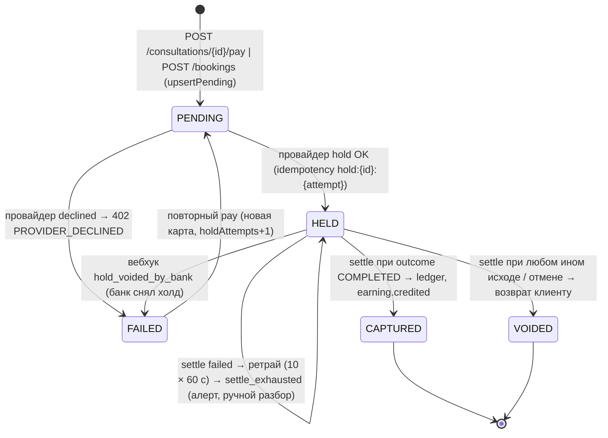

| Actor | Command | Preconditions | Prev → Next | Timers | Side effects | Notifications | Financial | Rollback | Frontend response | Audit | Support |
|---|---|---|---|---|---|---|---|---|---|---|---|
| R-02/R-03 | `POST /consultations/{id}/pay` | ACTIVE; клиент; карта клиента (`payment-methods`) | PENDING → HELD | — | `Consultation.paymentStatus HELD`; WS `consultation.updated` | — | холд полной цены (Premium: цена − 10 %) | — | SCR-CL-10 → сессия; строка «Сумма заморожена · спишется после консультации» | `payment.held` | SUPPORTED · `payments-hold`, `premium-discount` |
| провайдер | declined | — | PENDING → FAILED | — | `paymentStatus FAILED` | `[RECOMMENDATION]` in-app клиенту `payment.failed` при вебхуке (если не в сессии) | нет | повтор pay | 402 → inline «Банк отклонил операцию»; кнопки «Другая карта» / «Повторить» | `payment.failed` | SUPPORTED |
| банк → вебхук | hold voided | HELD | HELD → FAILED | — | `paymentStatus FAILED`; после завершения — `hold_voided_after_completion` (эксперт без начисления) | `[RECOMMENDATION]` клиенту «Оплата не прошла — повторите» | нет списания | повтор pay в ACTIVE | SCR-CL-14 баннер «Оплата не прошла» с CTA; SCR-CL-18 «Оплата не прошла» | `payment.hold_voided_by_bank` | SUPPORTED · `payments-sweep` |
| система | settle capture | outcome COMPLETED; Payment HELD | HELD → CAPTURED | ретраи 10 × 60 с | ledger: клиент → платформа 15 % / эксперт 85 % (Premium: платформа 5 %, дебет=кредит); `Consultation CAPTURED` | эксперту `earning.credited {amountTenge}` | списание | нет (финал) | SCR-EX-13/EW-07 строка «Начислено {85 %}» с разбивкой «цена − комиссия = итого» (DEC-07); SCR-CL-18 «Оплачено» | `payment.captured` | SUPPORTED · `payments-settle`, `ledger` |
| система | settle void | outcome ≠ COMPLETED или CANCELLED | HELD → VOIDED | ретраи | `Consultation VOIDED` | — (клиенту показывает экран; `[RECOMMENDATION]` `payment.voided` in-app «Средства возвращены») | возврат клиенту, эксперту 0 ₸ | — | SCR-CL-18 «Возвращено»; SCR-EX-09 «0 ₸» | `payment.voided {outcome}` | SUPPORTED · `payments-settle` |
| система | settle exhausted | 10 неудач | HELD (застрял) | — | audit-алерт; sweep не трогает | админ-алерт `[RECOMMENDATION]` (нет канала) | — | ручной разбор FINANCE_CONTROL | SCR-AD-06 очередь «Требует разбора» (E21-5) | `payment.settle_exhausted` | PARTIALLY_SUPPORTED (алерт есть, экрана нет) |
| система | reheld | холд истёк у провайдера до исхода | HELD → HELD | — | новый `providerHoldId` | — | — | `rehold_failed` → FAILED | UI не отражает | `payment.reheld` / `payment.rehold_failed` | SUPPORTED · `payments-sweep` |

Статусы SM-12 (ru/kz/токен — 11 §5; kz `HELD` в `app_client` («Ақша бұғатталған») расходится со словарём («Сома қатырылды») — канон 11 §5, см. §5 D-10)

| Код (Payment / Consultation) | Label ru | Label kz | Токен | Иконка | Где показывается |
|---|---|---|---|---|---|
| PENDING / UNPAID | Ожидает оплаты | Төлемді күтуде `[CODE FACT]` | `status.waiting` | `credit-card` | SCR-CL-10, SCR-CL-18 деталь, SCR-EX-10 «ожидаем оплату» |
| HELD | Сумма заморожена | Сома қатырылды | `status.waiting` | `lock` | SCR-CL-10/14/18, SCR-AD-06 |
| CAPTURED | Оплачено | Төленді | `status.completed` | `check-circle` | SCR-CL-18; SCR-EX-13/EW-07 «Начислено» (перспектива эксперта); SCR-AD-06 «Начислено» `[PROTOTYPE FACT]` `Admin - Финансы` |
| VOIDED | Возвращено | Қайтарылды | `status.cancelled` | `rotate-ccw` | SCR-CL-18; SCR-AD-06 «Возвращено» `[PROTOTYPE FACT]` |
| FAILED | Не удалось списать | Төлем өтпеді | `status.failed` | `alert-circle` | SCR-CL-10/14/18; SCR-AD-06 |
| PARTIALLY_CAPTURED `[RECOMMENDATION E22]` | Списано частично (50 %) | Ішінара шегерілді (50 %) | `status.completed` | `percent` | SCR-CL-18, SCR-EX-09, SCR-AD-06 |

### 2.13 SM-13 — Возврат

Факт R1: отдельной сущности нет — возврат клиенту = **void холда** (SM-12 `HELD → VOIDED`), всегда полный, всегда автоматически по исходу (DEC-09/Р-01). Возврат после capture (CAPTURED → refund) в коде **отсутствует** (`[CODE FACT]` ledger не имеет kind `refund`; провайдерский `refund()` не вызывается) — `[RISK]` любое решение по жалобе «полный/частичный возврат» (E20/`Admin - Жалобы`) после состоявшейся сессии невыполнимо до E22. Срок зачисления возврата на карту после void — зависит от банка; число в источниках отсутствует → «assumption, требует подтверждения владельца (DEC-09)»: показывать «обычно до 5 рабочих дней».

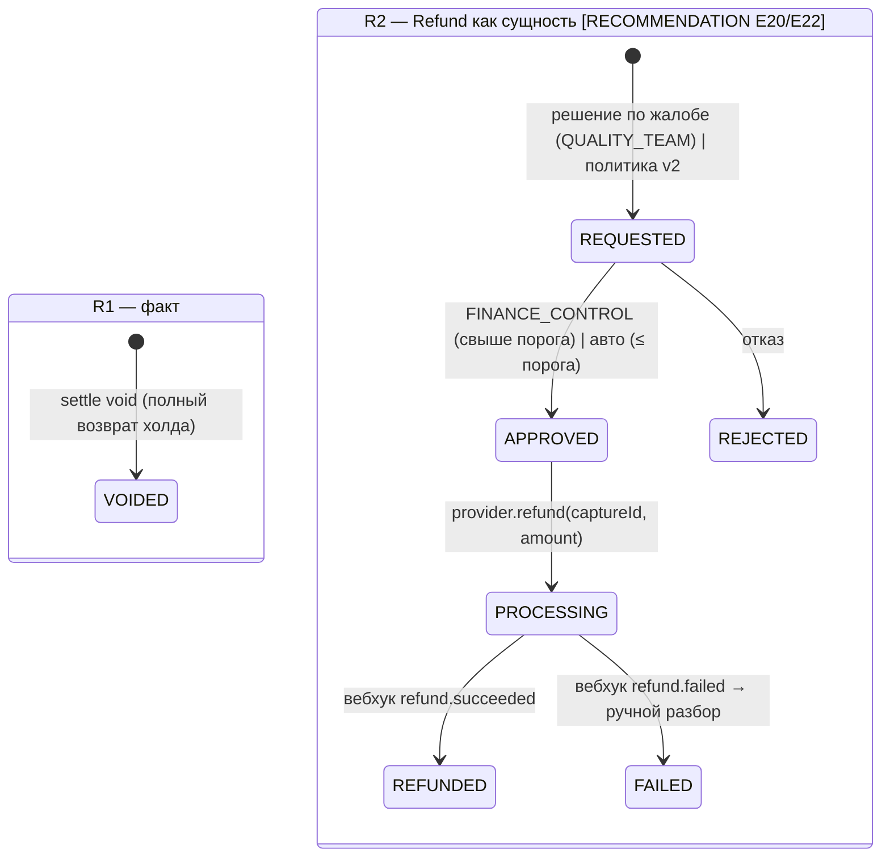

| Actor | Command | Preconditions | Prev → Next | Timers | Side effects | Notifications | Financial | Rollback | Frontend response | Audit | Support |
|---|---|---|---|---|---|---|---|---|---|---|---|
| система | settle void | исход ≠ COMPLETED | HELD → VOIDED | ретраи settle | ledger не трогается (холд не был списан) | `[RECOMMENDATION]` `payment.voided` клиенту | полный возврат | — | SCR-CL-18 «Возвращено · банк зачислит обычно до 5 рабочих дней» | `payment.voided` | SUPPORTED · `payments-settle` |
| R-12 → R-14 | `[RECOMMENDATION]` `POST /admin/complaints/{id}/resolve {resolution: FULL_REFUND|PARTIAL_REFUND}` | Payment CAPTURED; жалоба IN_REVIEW | ∅ → REQUESTED → … → REFUNDED | порог автоодобрения — assumption (как у выплат 300 000 ₸/мес — DEC-36 по аналогии) | ledger `refund` (дебет платформы/эксперта, кредит клиента); баланс эксперта уменьшается, если начисление ещё не выведено | клиенту `refund.completed`; эксперту `earning.reversed` | возврат части/всей суммы | REJECTED | SCR-AD-05 решение; SCR-CL-30 «Средства возвращены» `[PROTOTYPE FACT]` `Мои жалобы`; SCR-EX-23 | `refund.requested/approved/rejected/processed` | MISSING → E22 (R2) |

Статусы SM-13 (R2 коды `[RECOMMENDATION]`)

| Код | Label ru | Label kz | Токен | Иконка | Где показывается |
|---|---|---|---|---|---|
| VOIDED (факт) | Возвращено | Қайтарылды | `status.cancelled` | `rotate-ccw` | SCR-CL-18, SCR-AD-06 |
| REQUESTED | Возврат запрошен | Қайтару сұралды | `status.waiting` | `clock` | SCR-AD-05/06, SCR-CL-30 |
| APPROVED / PROCESSING | Возврат обрабатывается | Қайтару өңделуде | `status.searching` | `loader` | SCR-CL-30, SCR-AD-06 |
| REFUNDED | Средства возвращены | Қаражат қайтарылды | `status.completed` | `check-circle` | SCR-CL-30, SCR-CL-27, SCR-AD-06 |
| REJECTED | В возврате отказано | Қайтарудан бас тартылды | `status.failed` | `x-circle` | SCR-CL-30, SCR-AD-05 |
| FAILED | Возврат не прошёл — разбор | Қайтару өтпеді — талдау | `status.failed` | `alert-triangle` | SCR-AD-06 |

### 2.14 SM-14 — Выплата (`Payout.status`)

`[CODE FACT]` `payouts/payouts.service.ts`: `MIN_PAYOUT_TIYN = 1 000 000` (10 000 ₸), `MONTHLY_AUTO_APPROVE_LIMIT_TIYN = 30 000 000` (300 000 ₸/мес, сумма выводов месяца кроме REJECTED), 400 `INSUFFICIENT_BALANCE`, ledger `payout_reserve` в момент заявки; `approve` только из PENDING_REVIEW; `reject {reason}` возвращает резерв; `retryStrandedSends` для PROCESSING без `providerRefId`; вебхук `payouts` → PAID. Уведомления `payout.paid {amountTenge, maskedPan}`, `payout.rejected {reason}`.

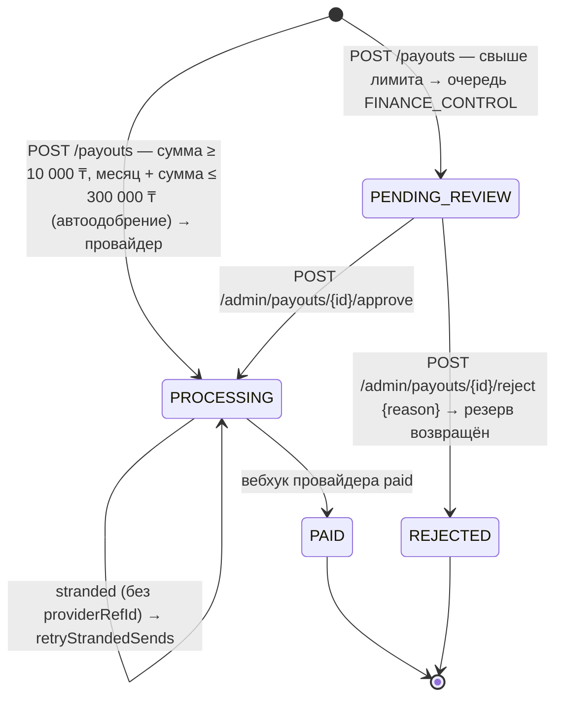

| Actor | Command | Preconditions | Prev → Next | Timers | Side effects | Notifications | Financial | Rollback | Frontend response | Audit | Support |
|---|---|---|---|---|---|---|---|---|---|---|---|
| R-07 | `POST /payouts {amountTiyn, pan, expiry, holder}` | VERIFIED; баланс ≥ суммы; сумма ≥ 10 000 ₸ | ∅ → PROCESSING (авто) / PENDING_REVIEW | зачисление до 3 рабочих дней (Р-06/DEC-36) | ledger `payout_reserve`; баланс «доступно» уменьшается сразу | — | резерв | reject возвращает резерв | SCR-EX-13 `/earnings/payout` форма (ошибки `payoutError*` `[CODE FACT]`) → тост «Заявка на вывод отправлена» `[PROTOTYPE FACT]` `Expert - Выплаты`; статус строки: «Обрабатывается» или «На проверке» | `payout.requested {autoApproved}` | SUPPORTED · `payouts` |
| R-14 | `POST /admin/payouts/{id}/approve` | PENDING_REVIEW | → PROCESSING | — | отправка провайдеру | — (`[RECOMMENDATION]` `payout.approved` in-app эксперту) | — | — | SCR-AD-06 очередь (`monthTotalTiyn` как контекст `[CODE FACT]`) | `payout.approved` | SUPPORTED · `payouts-admin` |
| R-14 | `POST /admin/payouts/{id}/reject {reason}` | PENDING_REVIEW | → REJECTED | — | резерв возвращён на баланс | эксперту `payout.rejected {reason}` (push+in-app) | 0 | новая заявка | SCR-AD-06 диалог с обязательной причиной (Р-06: карта не на имя, подозрительная активность, споры); SCR-EX-13 строка «Отклонено · {reason}» | `payout.rejected` | SUPPORTED · `payouts-admin` |
| провайдер → вебхук | paid | PROCESSING, `providerRefId` | → PAID | — | ledger settle резерва `[INFERENCE]` | эксперту `payout.paid {amountTenge, maskedPan}` | зачисление | — | SCR-EX-13 «Выплачено»; SCR-EX-15/EW-10 карточка `[PROTOTYPE FACT]` «Выплата 48 500 ₸ отправлена на карту **** 4521» | `payout.paid` | SUPPORTED · `payouts` |

Статусы SM-14 (ru — 11 §5; kz — `app_expert` даёт длинные фразы (`payoutPendingReview`, `payoutProcessing`), короткие бейджи — `[RECOMMENDATION]`)

| Код | Label ru | Label kz | Токен | Иконка | Где показывается |
|---|---|---|---|---|---|
| PENDING_REVIEW | На проверке | Тексерілуде | `status.waiting` | `shield` | SCR-EX-13, SCR-EW-07, SCR-AD-06 очередь; в `Expert - Выплаты` v2 отсутствует — добавить (D-08) |
| PROCESSING | Обрабатывается | Өңделуде | `status.searching` | `loader` | SCR-EX-13 `[PROTOTYPE FACT]`, SCR-EW-07, SCR-AD-06 «Обрабатывается» `[PROTOTYPE FACT]` `Admin - Финансы` |
| PAID | Выплачено | Төленді `[CODE FACT]` | `status.completed` | `check-circle` | SCR-EX-13 `[PROTOTYPE FACT]`, SCR-EW-07, SCR-EX-15, SCR-AD-06 |
| REJECTED | Отклонено · {reason} | Қабылданбады · {reason} | `status.failed` | `x-circle` | SCR-EX-13 `[PROTOTYPE FACT]`, SCR-EX-15, SCR-AD-06 |

Строки дохода (`GET /experts/me/earnings` = Payment CAPTURED): один статус — «Начислено». Статус «Выплачено» у транзакции (`Expert - Доход` v2, ER v2 `transactions[].status: начислено/выплачено`) кодом не поддерживается: выплата — отдельная сущность с суммой, не привязанная к транзакциям (D-08).

### 2.15 SM-15 — Отзыв (`Review.status`)

`[CODE FACT]` `reviews/reviews.service.ts`: `create` — только клиент, консультация COMPLETED с исходом COMPLETED `[INFERENCE]`, один отзыв (409 `REVIEW_EXISTS`), теги допустимы только для своей оценки (`isTagAllowed`), пересчёт агрегатов + `checkRatingThreshold` (Р-20: `RATING_THRESHOLD_AVG 4.0` при `COUNT ≥ 20` → audit `expert.rating_below_threshold`, очередь `GET /admin/experts/flagged`); `reply` — только PUBLISHED (409); `complaint` — PUBLISHED → FLAGGED (409 повторно); `remove` — клиент, пересчёт; admin `resolve {hide|restore}` — только FLAGGED. DEC-14: поля `publicText` + `privateText` (только QUALITY_TEAM) — атрибуты, не состояния.

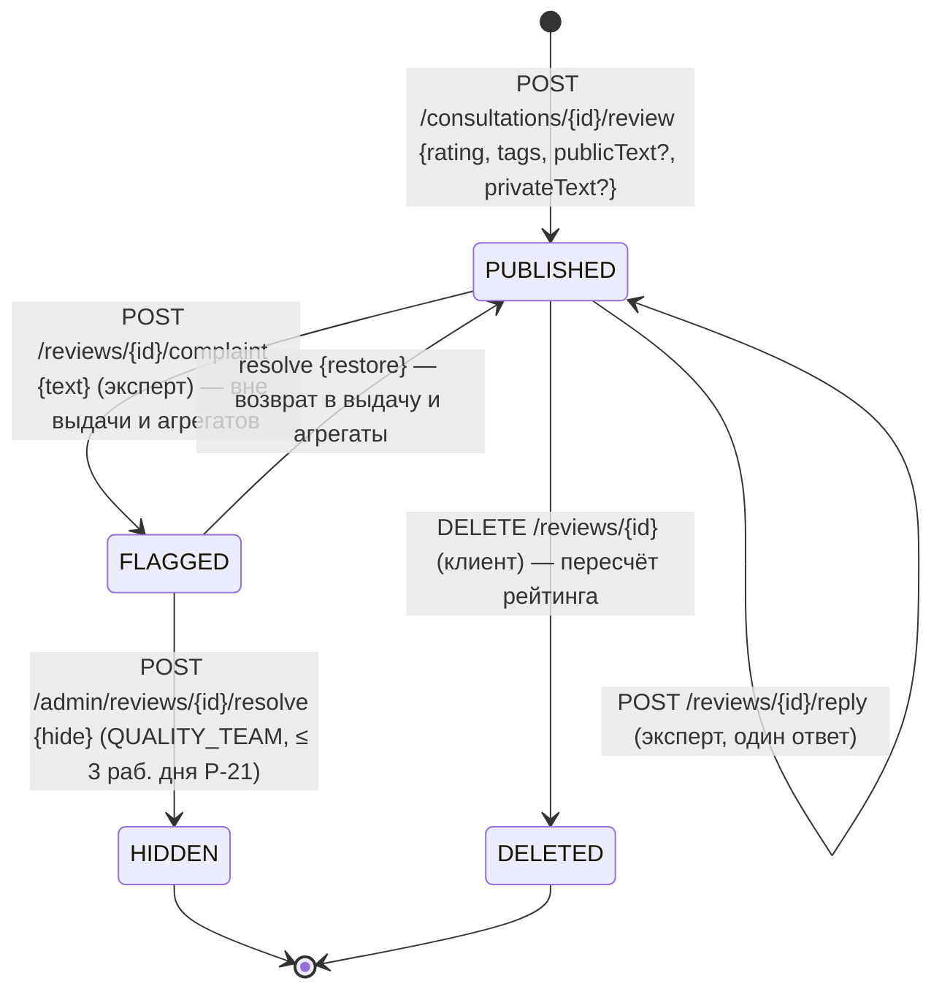

| Actor | Command | Preconditions | Prev → Next | Timers | Side effects | Notifications | Financial | Rollback | Frontend response | Audit | Support |
|---|---|---|---|---|---|---|---|---|---|---|---|
| R-02/R-03 | `POST /consultations/{id}/review` | участник-клиент; COMPLETED; отзыва нет | ∅ → PUBLISHED | — | агрегаты эксперта; при < 4.0 и ≥ 20 → флаг | `[RECOMMENDATION]` эксперту `review.received` (без текста в пуше) — сейчас нет | — | DELETE | SCR-CL-17 Rating (CMP-35): одна форма — оценка + теги + публичный отзыв + приватное поле «команде качества» (DEC-14); текст «Отзыв видит только команда качества» — только у приватного поля; 409 → «Отзыв уже оставлен» | `review.created`, `expert.rating_below_threshold` | SUPPORTED · `reviews`, `review-tags` |
| R-07 | `POST /reviews/{id}/reply {text}` | PUBLISHED; свой отзыв; ответа нет | атрибут `reply` | — | виден в профиле | — | — | — | SCR-EX-14 / SCR-EW-08 «Ответить»; 409 → «Сначала дождитесь решения по жалобе» | `review.replied` | SUPPORTED · `expert-reviews-me` |
| R-07 | `POST /reviews/{id}/complaint {text}` | PUBLISHED | PUBLISHED → FLAGGED | ≤ 3 раб. дня (Р-21) | скрыт из выдачи и агрегатов | `[RECOMMENDATION]` in-app эксперту при решении `review.moderated` | — | restore | SCR-EX-14/EW-08 форма «Опишите, почему отзыв нарушает правила» (`[CODE FACT]` l10n) → badge «На модерации» | `review.flagged` | SUPPORTED · `reviews-moderation` |
| R-12 | `POST /admin/reviews/{id}/resolve {hide|restore}` | FLAGGED | → HIDDEN / PUBLISHED | — | пересчёт агрегатов в той же tx | `[RECOMMENDATION]` `review.moderated {result}` эксперту; клиенту при HIDDEN — `review.hidden` (Р-21 основания) | — | — | SCR-AD-15 очередь (видит и `privateText` `[CODE FACT]`) | `review.hidden` / `review.restored` | SUPPORTED · `reviews-moderation` |
| R-03 | `DELETE /reviews/{id}` | свой отзыв | PUBLISHED → DELETED | — | пересчёт рейтинга | — | — | — | SCR-CL-18 деталь → диалог «Удалить отзыв?» | `review.deleted` | SUPPORTED · `reviews` |

Статусы SM-15 (kz `[RECOMMENDATION]`)

| Код | Label ru | Label kz | Токен | Иконка | Где показывается |
|---|---|---|---|---|---|
| PUBLISHED | Опубликован | Жарияланды | `status.completed` | `message-square` | SCR-CL-11/WB-03 (только PUBLISHED, без статуса), SCR-EX-14, SCR-EW-08 |
| FLAGGED | На модерации | Модерацияда | `status.waiting` | `flag` | SCR-EX-14/EW-08 (свой), SCR-AD-15; клиент не видит |
| HIDDEN | Скрыт модерацией | Модерация жасырды | `status.cancelled` | `eye-off` | SCR-EX-14/EW-08, SCR-AD-15; клиенту — «Отзыв скрыт: {основание}» `[RECOMMENDATION]` |
| DELETED (строки нет) | Удалён | Жойылды | `status.cancelled` | `trash` | SCR-AD-15 журнал |
| derived `ratingBelowThreshold` | Рейтинг ниже 4.0 при ≥ 20 — разбор | Рейтинг 4.0-ден төмен (≥ 20) — талдау | `status.failed` | `trending-down` | SCR-AD-14 (E8a) — эксперт не видит |

### 2.16 SM-16 — Жалоба `[RECOMMENDATION · Release 2 · E20 · DEC-15]`

Поддержка: MISSING. Модель по [[14_ROADMAP_AND_BACKLOG]] E20: `Complaint {consultationId, type, reason, description, status NEW/IN_REVIEW/CLOSED, expertResponse, resolution, adminComment, deadlines}`; API `POST /consultations/{id}/complaint`, `GET /complaints`, `POST /complaints/{id}/respond`, `GET /admin/complaints`, `POST /admin/complaints/{id}/resolve`; WS `complaint.updated`. Окно подачи 48 ч после COMPLETED (`[PROTOTYPE FACT]` `Подать жалобу`: «Рассмотрим в течение 48 часов»; ER v2 `can_complain_until`). Типы `CLIENT_TO_EXPERT / EXPERT_TO_CLIENT / NO_SHOW_DISPUTE`; причины `UNETHICAL / NO_SHOW / TECH_ISSUE / OTHER` (`[PROTOTYPE FACT]` `REASONS`). Денежные решения — только после DEC-09 → v2 (SM-13). Срок ответа эксперта в источниках отсутствует → assumption 24 ч, требует подтверждения (DEC-15). `[RISK]` вложение «скриншот переписки» (`Подать жалобу`, только формат chat) — PII на устройстве и в S3; `[RECOMMENDATION]` вместо скриншота — ссылка на диапазон сообщений (сервер хранит переписку, QUALITY_TEAM читает по журналу доступа).

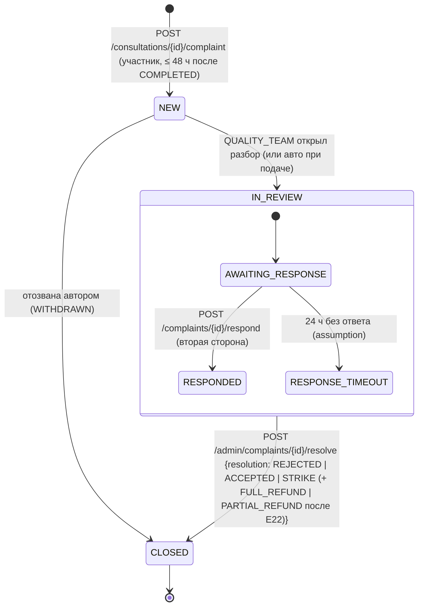

| Actor | Command | Preconditions | Prev → Next | Timers | Side effects | Notifications | Financial | Rollback | Frontend response | Audit | Support |
|---|---|---|---|---|---|---|---|---|---|---|---|
| R-02/R-03 (R-07 — тип EXPERT_TO_CLIENT) | `POST /consultations/{id}/complaint {type, reason, description}` | участник; COMPLETED/CANCELLED; `now ≤ endedAt + 48 ч`; одна жалоба на сторону | ∅ → NEW | 48 ч (окно), далее SLA разбора 48 ч | счётчик в карточке клиента/эксперта (`prior_complaints_count`) | второй стороне `complaint.created` «По консультации подана жалоба — требуется ваш ответ» (push+in-app); QUALITY_TEAM — очередь | — | WITHDRAWN до решения | SCR-CL-29: причина (radio) + описание + [chat: ссылка на переписку] → экран «Жалоба отправлена. Рассмотрим в течение 48 часов» `[PROTOTYPE FACT]` → SCR-CL-30; ошибки inline «Выберите причину жалобы» | `complaint.created` | MISSING → E20-1/2 |
| R-07 / R-03 | `POST /complaints/{id}/respond {text}` | IN_REVIEW; сторона-ответчик; ответа нет | AWAITING_RESPONSE → RESPONDED | до 24 ч | — | QUALITY_TEAM in-app | — | — | SCR-EX-22 «Ожидает вашего ответа» → «Ваше объяснение отправлено» → «На рассмотрении администратором» `[PROTOTYPE FACT]` | `complaint.responded` | MISSING → E20-2 |
| R-12 | `POST /admin/complaints/{id}/resolve {resolution, adminComment}` | IN_REVIEW | → CLOSED | SLA 48 ч | STRIKE → `Expert.strikeCount++` (SM-17); (E22) деньги → SM-13 | обеим `complaint.resolved` «Решение по вашей жалобе принято» `[PROTOTYPE FACT]` `Уведомления` v2 | E20: нет; E22: возврат | — | SCR-AD-05 панель: данные сессии, история, варианты решения (без «Полный/Частичный возврат» до E22), внутренний комментарий, «Закрыть жалобу» → тост «Жалоба закрыта, решение зафиксировано» `[PROTOTYPE FACT]` | `complaint.resolved {resolution}` | MISSING → E20-3 |

Статусы SM-16 (три перспективы; прототип даёт разные слова на разных экранах — канон ниже, см. §5 D-04)

| Код | Label ru (client / expert / admin) | Label kz | Токен | Иконка | Где показывается |
|---|---|---|---|---|---|
| NEW | На рассмотрении / — / Новая | Қаралуда / — / Жаңа | `status.waiting` | `flag` | SCR-CL-30 `[PROTOTYPE FACT]` «На рассмотрении», SCR-AD-05 «Новая» |
| IN_REVIEW · AWAITING_RESPONSE | На рассмотрении / Ожидает вашего ответа / В работе | Қаралуда / Сіздің жауабыңызды күтуде / Жұмыста | `status.urgent` (эксперт) · `status.waiting` | `message-circle` | SCR-EX-22 `[PROTOTYPE FACT]`, SCR-EX-23 «На рассмотрении», SCR-AD-05 «В работе» |
| IN_REVIEW · RESPONDED | На рассмотрении / На рассмотрении администратором / В работе | Қаралуда / Әкімші қарауда / Жұмыста | `status.waiting` | `clock` | SCR-EX-22 `[PROTOTYPE FACT]` |
| CLOSED · REJECTED | Отклонено / Отклонена / Закрыта | Қабылданбады / Қабылданбады / Жабылды | `status.cancelled` | `x-circle` | SCR-CL-30, SCR-EX-23, SCR-AD-05 |
| CLOSED · ACCEPTED | Решено (в вашу пользу) / Подтверждена / Закрыта | Шешілді / Расталды / Жабылды | `status.completed` | `check-circle` | SCR-CL-30 «Решено», SCR-EX-23 «Подтверждена» |
| CLOSED · STRIKE | Решено / Подтверждена — страйк / Закрыта | Шешілді / Расталды — ескерту / Жабылды | `status.failed` (эксперт) | `alert-triangle` | SCR-EX-23 `[PROTOTYPE FACT]` «Подтверждена — страйк», SCR-AD-05 |
| CLOSED · FULL_REFUND / PARTIAL_REFUND `[E22]` | Средства возвращены / Возврат клиенту / Закрыта | Қаражат қайтарылды | `status.completed` | `rotate-ccw` | SCR-CL-30 `[PROTOTYPE FACT]`, SCR-AD-05 |
| CLOSED · WITHDRAWN | Отозвана вами / — / Отозвана | Кері қайтарылды | `status.cancelled` | `undo` | SCR-CL-30 |

### 2.17 SM-17 — Санкция специалиста

Факт R1: `Expert.isBlocked + blockedReason` (SM-05 BLOCKED; `verification.service.ts` block/unblock; следствия — SM-07 403 `EXPERT_BLOCKED`, исключение из матчинга/каталога/слотов/избранного `[CODE FACT]` `matching.service.ts`, `favorites.service.ts`, `slots.controller.ts`); флаг качества `expert.rating_below_threshold` + очередь `GET /admin/experts/flagged` (Р-20); отмены эксперта фиксируются `consultation.cancelled_by_expert` (Р-17 «3+ за 30 дн → разбор» — счётчика и автоматики нет, `[INFERENCE]`). Основания блокировки — Р-19. Страйки (`Admin - Жалобы` «Страйк специалисту», `Expert - Мои жалобы и споры` «Подтверждена — страйк») — MISSING → E20 (`strikeCount`). Число страйков до блокировки в источниках отсутствует → assumption «3 за 12 мес → разбор с приостановкой», требует подтверждения (DEC-15).

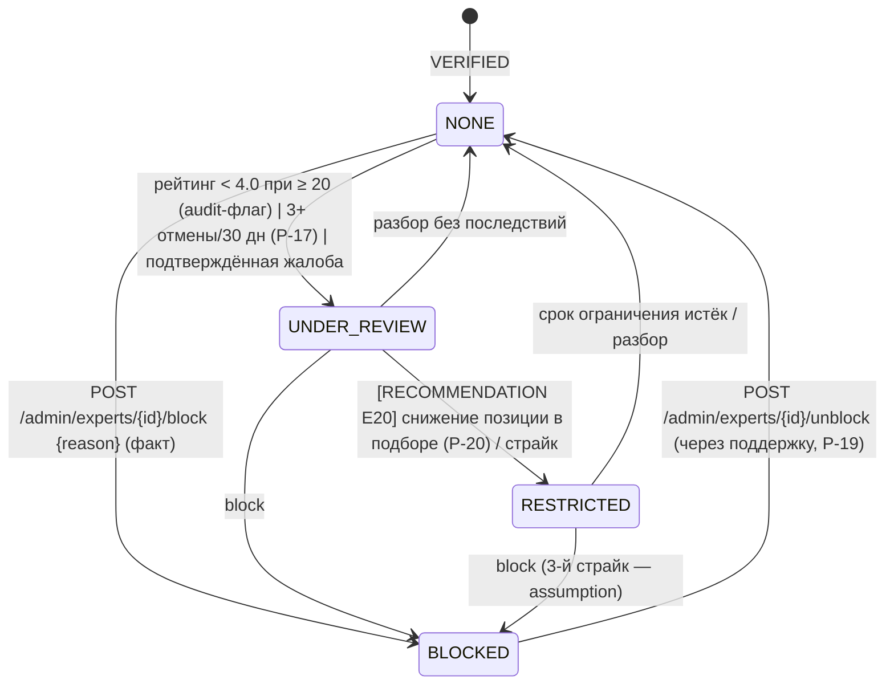

| Actor | Command | Preconditions | Prev → Next | Timers | Side effects | Notifications | Financial | Rollback | Frontend response | Audit | Support |
|---|---|---|---|---|---|---|---|---|---|---|---|
| система | пересчёт агрегатов после отзыва | avg < 4.0 ∧ count ≥ 20 | NONE → UNDER_REVIEW (derived: наличие флага в очереди) | — | попадает в `GET /admin/experts/flagged` | — (эксперт не уведомляется) | — | — | SCR-AD-14 очередь; в профиле эксперта ничего | `expert.rating_below_threshold` | SUPPORTED · `admin-experts-flagged` |
| R-12 | `POST /admin/experts/{id}/block {reason}` | — | * → BLOCKED | — | см. SM-05 | `[RECOMMENDATION]` `expert.blocked` (push «Профиль временно заблокирован») | текущие начисления и выплаты не замораживаются `[INFERENCE]`; Р-06 «незакрытые споры» — основание отказа в выплате вручную | unblock | SCR-AD-03 диалог `[PROTOTYPE FACT]`; SCR-EX-04 «Профиль временно заблокирован. Приём новых консультаций приостановлен. Обратитесь в поддержку» `[PROTOTYPE FACT]` (причина не показывается — Р-19 требует «с уведомлением причины» → `[DECISION REQUIRED → DEC-15]` показывать ли причину) | `expert.blocked {reason}` | SUPPORTED · `admin-lifecycle` |
| R-12/R-19 | unblock | BLOCKED | → NONE | — | — | `[RECOMMENDATION]` `expert.unblocked` | — | — | SCR-AD-03; SCR-EX-04 | `expert.unblocked` | SUPPORTED |
| R-12 | `[RECOMMENDATION]` resolve жалобы `STRIKE` | жалоба IN_REVIEW | `strikeCount++`; NONE/UNDER_REVIEW → RESTRICTED | срок ограничения — assumption 30 дн | понижающий коэффициент в скоринге (`matching/scoring.service.ts` — новый фактор) | эксперту `complaint.resolved` (страйк в тексте in-app, не в пуше) | — | разбор | SCR-EX-23 «Подтверждена — страйк»; SCR-AD-03 карточка «Страйков: N» | `expert.strike_added` | MISSING → E20 |

Статусы SM-17 (эксперту показывается только BLOCKED; остальное — админ)

| Код | Label ru | Label kz | Токен | Иконка | Где показывается |
|---|---|---|---|---|---|
| NONE | Активен | Белсенді | `status.verified` | `check-circle` | SCR-AD-03 «Активен» `[PROTOTYPE FACT]` |
| UNDER_REVIEW (derived) | На контроле качества | Сапа бақылауында | `status.waiting` | `search` | SCR-AD-03/14 |
| RESTRICTED `[RECOMMENDATION]` | Ограничен в подборе (страйк N/3) | Іріктеуде шектелген (ескерту N/3) | `status.busy` (warning) | `trending-down` | SCR-AD-03/05; SCR-EX-23 только факт страйка |
| BLOCKED | Заблокирован | Бұғатталған | `status.failed` | `ban` | SCR-AD-03 `[PROTOTYPE FACT]`, SCR-EX-04 |

### 2.18 SM-18 — B2B-контракт `[RECOMMENDATION · Release 4 · E24-B2B · DEC-18]`

Поддержка: MISSING. Прототип `Admin - B2B`: статусы «Активен / Истекает / Завершён», код `SQ-XXXX-YYYY`, пул `used/total`, действия «Продлить контракт», «Приостановить», «Сгенерировать приглашения». ER v2 §6: «истекает (<14 дней)» — производный статус по `end_date`. Release 1: форма «Для бизнеса» (SCR-WB-11) → тикет; в `TicketCategory` нет `PARTNERSHIP` → `[RECOMMENDATION]` добавить (S) либо `OTHER` + тег `partnership`.

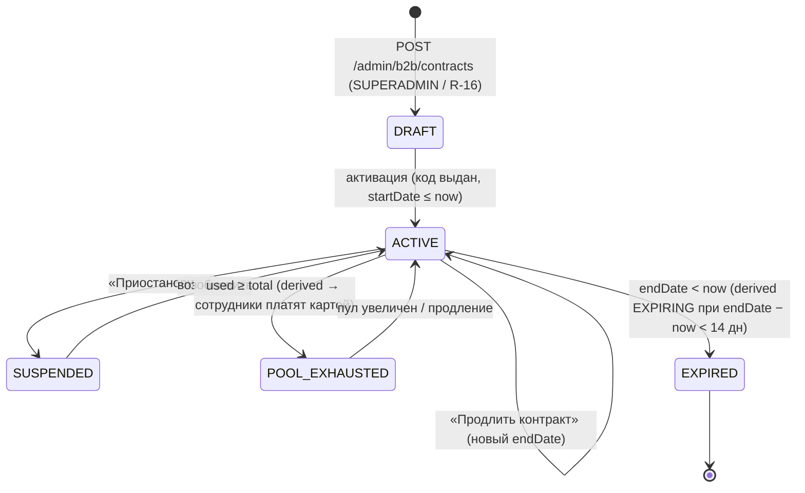

| Actor | Command `[RECOMMENDATION]` | Preconditions | Prev → Next | Timers | Side effects | Notifications | Financial | Rollback | Frontend response | Audit | Support |
|---|---|---|---|---|---|---|---|---|---|---|---|
| R-16 | `POST /admin/b2b/contracts {company, contact, start, end, poolTotal, discount}` | — | ∅ → DRAFT → ACTIVE | — | код `SQ-…` | — | — | — | SCR-AD-08 модал «Создать контракт» → «Контракт создан · код» `[PROTOTYPE FACT]` | `b2b.contract_created` | MISSING |
| R-16 | `POST …/{id}/invitations {emails[]}` | ACTIVE | сотрудники INVITED | — | e-mail с кодом (канал e-mail MISSING) | e-mail | — | — | SCR-AD-08 «Сгенерировать приглашения» → тост «Приглашения отправлены (N)» `[PROTOTYPE FACT]` | `b2b.invitations_sent` | MISSING |
| R-16 | `POST …/{id}/suspend` / `resume` / `extend {endDate}` | ACTIVE / SUSPENDED | см. диаграмму | — | SM-02 SUSPENDED у сотрудников | сотрудникам `corporate.*` | — | — | SCR-AD-08 «Приостановить», «Продлить контракт» | `b2b.contract_suspended/resumed/extended` | MISSING |
| система (daily) | expiry | endDate | ACTIVE → EXPIRED | 14 дн до конца — EXPIRING | SM-02 EXPIRED | R-16 in-app «Контракт истекает через 14 дней» | сессии больше не списываются из пула | продление | SCR-AD-08 badge «Истекает» `[PROTOTYPE FACT]` | `b2b.contract_expired` | MISSING |

Статусы SM-18 `[RECOMMENDATION]`

| Код | Label ru | Label kz | Токен | Иконка | Где показывается |
|---|---|---|---|---|---|
| DRAFT | Черновик | Жоба | `status.cancelled` (muted) | `file` | SCR-AD-08 |
| ACTIVE | Активен | Белсенді | `status.verified` | `briefcase` | SCR-AD-08 `[PROTOTYPE FACT]`, SCR-AD-06 «Доход B2B» |
| ACTIVE · derived EXPIRING (< 14 дн) | Истекает | Мерзімі аяқталуда | `status.waiting` | `calendar-clock` | SCR-AD-08 `[PROTOTYPE FACT]` |
| ACTIVE · derived POOL_EXHAUSTED | Пул исчерпан | Пул таусылды | `status.busy` | `battery-low` | SCR-AD-08 (ContractUsage CMP-39) |
| SUSPENDED | Приостановлен | Тоқтатылған | `status.unavailable` | `pause-circle` | SCR-AD-08 |
| EXPIRED | Завершён | Аяқталған | `status.cancelled` | `archive` | SCR-AD-08 `[PROTOTYPE FACT]` |

### 2.19 SM-19 — B2G-соглашение `[RECOMMENDATION · Release 5 · E24-B2G · DEC-17]`

Та же машина, что SM-18 (DRAFT → ACTIVE → EXPIRING/SUSPENDED → EXPIRED), с отличиями: код `SG-XXXX-YYYY` вводит **студент при верификации**, не клиент (`[PROTOTYPE FACT]` комментарий в `Admin - Верификация`); атрибут `workModel: PAID_DISCOUNT | FREE_PRACTICE`; список студентов со статусами SM-20; счётчик `sessionsConducted`. Release 1: форма «Для вузов» (SCR-WB-12) → тикет. Статусы — как SM-18 (label те же: Активен / Истекает / Завершён `[PROTOTYPE FACT]` `Admin - B2G`); отдельная строка в каталоге §3 не дублируется — домен `b2g` ссылается на `b2b`.

```mermaid
stateDiagram-v2
  [*] --> DRAFT : POST /admin/b2g/contracts (код SG-XXXX-YYYY)
  DRAFT --> ACTIVE : активация (startDate ≤ now)
  ACTIVE --> ACTIVE : студент вводит код при верификации → SM-20; назначение супервайзера → SM-21
  ACTIVE --> SUSPENDED : «Приостановить»
  SUSPENDED --> ACTIVE : возобновить
  ACTIVE --> EXPIRED : endDate < now (derived EXPIRING при < 14 дн)
  ACTIVE --> ACTIVE : «Продлить контракт»
  EXPIRED --> [*]
```

| Actor | Command `[RECOMMENDATION]` | Preconditions | Prev → Next | Timers | Side effects | Notifications | Financial | Rollback | Frontend response | Audit | Support |
|---|---|---|---|---|---|---|---|---|---|---|---|
| R-16 | `POST /admin/b2g/contracts {org, contact, position, contractNumber?, start, end, studentsCount, workModel}` | — | ∅ → ACTIVE | — | код `SG-…` | — | FREE_PRACTICE: цена сессии 0, комиссия 0; PAID_DISCOUNT: скидка — число в источниках отсутствует (assumption) | — | SCR-AD-09 модал `[PROTOTYPE FACT]` | `b2g.contract_created` | MISSING |
| R-16 | назначение супервайзера студенту | студент VERIFIED_INTERN | атрибут `supervisorId` (SM-21 ASSIGNED) | — | — | студенту `intern.supervisor_assigned` | — | — | SCR-AD-02 вкладка «Студенты-практиканты», поле «ФИО супервайзера» `[PROTOTYPE FACT]` | `b2g.supervisor_assigned` | MISSING |

### 2.20 SM-20 — Практикант `[RECOMMENDATION · Release 5 · DEC-17]`

Поддержка: MISSING (`Expert.kind/isIntern/university` — только ER v2). Второй поток верификации: 2 документа (справка с места учёбы, подтверждение курса/специальности), код B2G, назначение супервайзера при одобрении; после одобрения — флаг «Практикант», цена 0 ₸ или скидка, скрыт для `HEAVY_TOPICS` (Депрессия/апатия, Зависимости — ER v2 §8), в каталоге бейдж. В R1–R4 ни одного элемента интернов в UI (DEC-17).

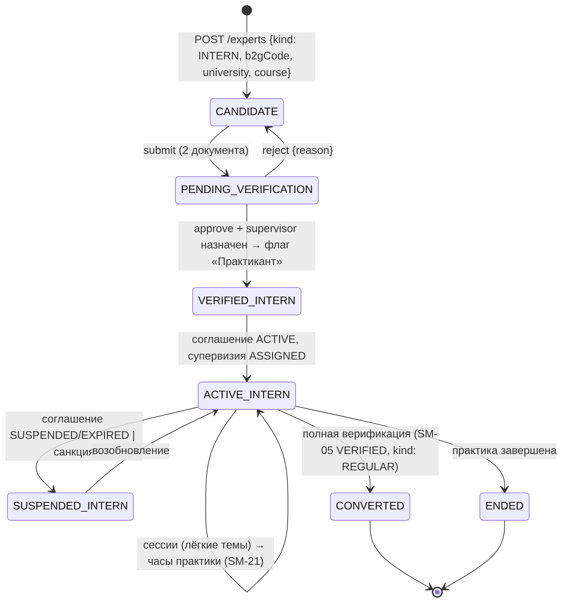

| Actor | Command `[RECOMMENDATION]` | Preconditions | Prev → Next | Timers | Side effects | Notifications | Financial | Rollback | Frontend response | Audit | Support |
|---|---|---|---|---|---|---|---|---|---|---|---|
| R-09 | `POST /experts {kind: INTERN, b2gCode}` | код SG валиден, соглашение ACTIVE | ∅ → CANDIDATE | — | — | — | — | — | SCR-EX-02 (ветка «Я студент-практикант» — скрыта до R5) | `intern.profile_created` | MISSING |
| R-11 | approve/reject в очереди «Студенты-практиканты» | PENDING; супервайзер указан | → VERIFIED_INTERN / CANDIDATE | SLA 24 ч | `isIntern = true`, price 0/скидка, HEAVY_TOPICS исключены | `verification.approved` | — | — | SCR-AD-02 тост «Практикант одобрен — профилю присвоен флаг «Практикант»» `[PROTOTYPE FACT]` | `intern.verified` | MISSING |
| R-16 | конверсия | часы практики ≥ норматива (число отсутствует — assumption) | ACTIVE_INTERN → CONVERTED | — | обычная верификация SM-05 | `intern.converted` | цена по коридору DEC-04 | — | SCR-AD-09 карточка студента | `intern.converted` | MISSING |

Статусы SM-20 `[RECOMMENDATION]`

| Код | Label ru | Label kz | Токен | Иконка | Где показывается |
|---|---|---|---|---|---|
| CANDIDATE / PENDING_VERIFICATION | На проверке | Тексерілуде | `status.waiting` | `clock` | SCR-AD-02 (вкладка), SCR-AD-09 «На проверке» `[PROTOTYPE FACT]` |
| VERIFIED_INTERN / ACTIVE_INTERN | Практикант (под супервизией) | Практикант (супервизиямен) | `status.verified` | `graduation-cap` | SCR-AD-09 «Верифицирован» `[PROTOTYPE FACT]`, SCR-CL-12/WB-02 бейдж «Практикант · бесплатно (учебная практика)» |
| SUSPENDED_INTERN | Практика приостановлена | Тәжірибе тоқтатылды | `status.unavailable` | `pause-circle` | SCR-AD-09 |
| CONVERTED | Переведён в специалисты | Маманға ауыстырылды | `status.completed` | `arrow-up-right` | SCR-AD-09 |
| ENDED | Практика завершена | Тәжірибе аяқталды | `status.cancelled` | `archive` | SCR-AD-09 |

### 2.21 SM-21 — Супервизия `[RECOMMENDATION · Release 5]`

Две малые машины: назначение (`UNASSIGNED → ASSIGNED → REASSIGNED/RELEASED`) и разбор сессии практиканта (`SESSION_COMPLETED → PENDING_REVIEW → REVIEWED` с зачётом часов; `RETURNED` — замечания). Источник — ER v2 §2 (`supervisor_name`), BP-14 (`supervisor → consent → session → review → hours`). Согласие клиента на сессию с практикантом под супервизией — обязательный шаг ConsentSheet (CMP-47) `[RECOMMENDATION]`, юридическое заключение — Q-07.

```mermaid
stateDiagram-v2
  [*] --> UNASSIGNED
  UNASSIGNED --> ASSIGNED : admin назначил супервайзера (SM-19)
  ASSIGNED --> ASSIGNED : сессия практиканта COMPLETED → запись на разбор PENDING_REVIEW
  ASSIGNED --> RELEASED : практика завершена / конверсия
  state "Разбор сессии" as R {
    [*] --> PENDING_REVIEW
    PENDING_REVIEW --> REVIEWED : супервайзер подтвердил → часы зачтены
    PENDING_REVIEW --> RETURNED : замечания (сессия не засчитана)
  }
```

| Actor | Command `[RECOMMENDATION]` | Preconditions | Prev → Next | Timers | Side effects | Notifications | Financial | Rollback | Frontend response | Audit | Support |
|---|---|---|---|---|---|---|---|---|---|---|---|
| R-10 | `POST /supervision/reviews/{id} {result, notes}` | сессия практиканта COMPLETED | PENDING_REVIEW → REVIEWED / RETURNED | assumption 7 дн | `practiceHours += 50 мин` при REVIEWED | практиканту `supervision.reviewed` | — | — | кабинет супервайзера (экрана в прототипе нет — `[DECISION REQUIRED → Q-07]`) | `supervision.reviewed` | MISSING |

Статусы SM-21 `[RECOMMENDATION]`: `ASSIGNED` «Супервайзер назначен» / `Супервайзер тағайындалды` (`status.verified`, `user-check`); `PENDING_REVIEW` «Ждёт разбора» / `Талдауды күтуде` (`status.waiting`, `clock`); `REVIEWED` «Разобрана · часы зачтены» / `Талданды · сағат есептелді` (`status.completed`, `check-circle`); `RETURNED` «Возвращена с замечаниями» / `Ескертулермен қайтарылды` (`status.failed`, `corner-down-left`). Экраны: кабинет супервайзера (R5), SCR-AD-09.

### 2.22 SM-22 — Материал контента (`ContentItem.publishedAt`)

`[CODE FACT]` `content/content-admin.service.ts`: `published: boolean` в DTO → `publishedAt = now | null`; audit `content.published` / `content.unpublished`; роли CONTENT_EDITOR + SUPERADMIN; публичная выдача — только `publishedAt ≠ null`; `access FREE | PREMIUM` (пейволл 403 `PAYWALL` для PREMIUM без live-подписки). Enum статуса нет; «На проверке» (review) и архив (`Admin - Настройки` v2 «Опубликовано / На проверке», BP-08 `review/archive`) — MISSING → `[RECOMMENDATION]` Release 3.

```mermaid
stateDiagram-v2
  [*] --> DRAFT : POST /admin/content {published:false}
  DRAFT --> PUBLISHED : PATCH {published:true} | POST {published:true}
  PUBLISHED --> DRAFT : PATCH {published:false} («Скрыть»)
  DRAFT --> IN_REVIEW : [RECOMMENDATION R3] отправить на проверку (второй редактор / SUPERADMIN)
  IN_REVIEW --> PUBLISHED : approve
  IN_REVIEW --> DRAFT : return
  PUBLISHED --> ARCHIVED : [RECOMMENDATION R3] архив (скрыт, прогресс пользователей сохранён)
  DRAFT --> [*] : DELETE /admin/content/{id}
```

| Actor | Command | Preconditions | Prev → Next | Timers | Side effects | Notifications | Financial | Rollback | Frontend response | Audit | Support |
|---|---|---|---|---|---|---|---|---|---|---|---|
| R-15/R-19 | `POST /admin/content` / `PATCH /admin/content/{id} {…, published}` | payload по `kind` валиден | DRAFT ↔ PUBLISHED | — | появляется/исчезает из `GET /content*`; ContentProgress сохраняется | `[RECOMMENDATION R3]` `content.recommended` клиентам по теме (после сессии) | — | unpublish | SCR-AD-17 (существует) / SCR-AD-10 вкладка «Контент»: кнопки «Опубликовать» / «Скрыть» `[PROTOTYPE FACT]` | `content.published` / `content.unpublished` | SUPPORTED · `content-admin` |
| R-15 | `DELETE /admin/content/{id}` | — | → удалён (cascade progress/votes) | — | — | — | — | нет | диалог с последствием «прогресс пользователей будет удалён» | `[RECOMMENDATION]` `content.deleted` | SUPPORTED · `content-admin` |

Статусы SM-22

| Код | Label ru | Label kz | Токен | Иконка | Где показывается |
|---|---|---|---|---|---|
| DRAFT (`publishedAt = null`) | Не опубликовано | Жарияланбаған | `status.cancelled` (muted) | `file` | SCR-AD-17/10 |
| PUBLISHED | Опубликовано | Жарияланды | `status.completed` | `globe` | SCR-AD-17/10 `[PROTOTYPE FACT]` |
| IN_REVIEW `[RECOMMENDATION R3]` | На проверке | Тексерілуде | `status.waiting` | `clock` | SCR-AD-10 `[PROTOTYPE FACT]` `Admin - Настройки` |
| ARCHIVED `[RECOMMENDATION R3]` | В архиве | Мұрағатта | `status.cancelled` | `archive` | SCR-AD-10 |
| attr `access = PREMIUM` | Premium | Premium | `status.completed` (бейдж-акцент) | `star` | SCR-CL-19, SCR-WB-05 (`materialsPremiumOnly` `[CODE FACT]`) |

### 2.23 SM-23 — Тикет поддержки (`Ticket.status`)

`[CODE FACT]` `tickets/tickets.service.ts`: `create` (автор клиент/эксперт/гость с контактом; категория по типу автора — `ticket-routing.ts`; маршрутизация в `team`); admin `reply` — первый ответ ставит `firstReplyAt` и NEW → IN_PROGRESS (идемпотентно), RESOLVED → 409 `TICKET_ALREADY_RESOLVED`; `resolve` → RESOLVED (`resolvedAt`); `replyByAuthor` — пока не RESOLVED; `assign` (`ticket.assigned`); уведомление автору `ticket.replied` (без темы/текста). Р-23/DEC-37: первая реакция — в рабочий день.

```mermaid
stateDiagram-v2
  [*] --> NEW : POST /tickets {category, subject, body, contact?}
  NEW --> NEW : POST /tickets/{id}/reply (автор дополняет)
  NEW --> IN_PROGRESS : первый ответ сотрудника (firstReplyAt) | назначение
  IN_PROGRESS --> IN_PROGRESS : ответы сторон
  NEW --> RESOLVED : POST /admin/tickets/{id}/resolve
  IN_PROGRESS --> RESOLVED : resolve
  RESOLVED --> [*] : ответы → 409 TICKET_ALREADY_RESOLVED (новое обращение)
```

| Actor | Command | Preconditions | Prev → Next | Timers | Side effects | Notifications | Financial | Rollback | Frontend response | Audit | Support |
|---|---|---|---|---|---|---|---|---|---|---|---|
| R-01…R-07 | `POST /tickets` | категория разрешена автору (400 `TICKET_CATEGORY_NOT_ALLOWED`); гость — контакт (400 `TICKET_CONTACT_REQUIRED`) | ∅ → NEW | первая реакция — рабочий день | `team` по категории (VERIFICATION → операторы верификации, PAYOUTS → финконтроль, SECURITY → команда качества, иначе поддержка) | — | — | — | SCR-CL-28 / SCR-EX-18 / SCR-WB-09 / SCR-EW-12: форма → «Обращение отправлено, ответим в рабочий день»; статус «Новый» | `ticket.created` | SUPPORTED · `tickets-create` |
| R-13 (+ профильные команды) | `POST /admin/tickets/{id}/reply {text}` | не RESOLVED | NEW → IN_PROGRESS | — | `firstReplyAt` | автору `ticket.replied` «По вашему обращению есть ответ» (push+in-app, `ticketId` в data) | — | — | SCR-AD-16; автор: SCR-CL-28 деталь с лентой (`ticketAuthorStaff/You` `[CODE FACT]`) | `ticket.replied` | SUPPORTED · `tickets-admin`, `tickets-notifications` |
| автор | `POST /tickets/{id}/reply` | не RESOLVED | статус не меняется | — | — | — | — | — | 409 → «Обращение решено — создайте новое» (`errorTicketAlreadyResolved` `[CODE FACT]`) | `ticket.replied_by_author` | SUPPORTED · `tickets-reply-author` |
| R-13 | `POST /admin/tickets/{id}/assign` | — | атрибут `assigneeId` | — | — | — | — | — | SCR-AD-16 | `ticket.assigned` | SUPPORTED · `tickets-assignment` |
| R-13 | `POST /admin/tickets/{id}/resolve` | не RESOLVED | → RESOLVED | — | `resolvedAt` | `[RECOMMENDATION]` `ticket.resolved` автору — сейчас нет | — | нет (новый тикет) | SCR-AD-16; автор: «Решён» + CTA «Создать новое обращение» | `ticket.resolved` | SUPPORTED · `tickets-admin` |

Статусы SM-23 (ru/kz `[CODE FACT]` l10n обоих приложений)

| Код | Label ru | Label kz | Токен | Иконка | Где показывается |
|---|---|---|---|---|---|
| NEW | Новый | Жаңа | `status.matched` | `mail` | SCR-CL-28, SCR-EX-18, SCR-EW-12, SCR-AD-16 |
| IN_PROGRESS | В работе | Жұмыста | `status.waiting` | `message-circle` | те же |
| RESOLVED | Решён | Шешілді | `status.completed` | `check-circle` | те же |

### 2.24 SM-24 — Рассылка `[RECOMMENDATION · Release 3 · E26 · DEC-31]`

Поддержка: MISSING (`Mailing` только в ER v2 §9). Прототип `Admin - Рассылки`: тип «Маркетинг / Инцидент-алерт (только супер-админ)», сегменты, каналы Push/Email, «Отправить сейчас» / «Запланировать», история со статусами «Отправлено / Запланировано». DEC-31: инцидент-алерт — push по сегменту; маркетинг — только с opt-in (`User.marketingOptIn` MISSING); e-mail канал MISSING. Сегмент «Специалисты — Старт / Про/Топ» зависит от тарифов (DEC-08 → R4+), в R3 не показывается.

```mermaid
stateDiagram-v2
  [*] --> DRAFT : POST /admin/mailings {type, segment, channels, title, body}
  DRAFT --> SCHEDULED : «Запланировать» {sendAt}
  DRAFT --> SENDING : «Отправить сейчас»
  SCHEDULED --> SENDING : sendAt ≤ now
  SCHEDULED --> CANCELLED : отмена до отправки
  SENDING --> SENT : outbox доставил (delivered/failed счётчики)
  SENDING --> FAILED : ошибка провайдера / бюджет исчерпан
  SENT --> [*]
```

| Actor | Command `[RECOMMENDATION]` | Preconditions | Prev → Next | Timers | Side effects | Notifications | Financial | Rollback | Frontend response | Audit | Support |
|---|---|---|---|---|---|---|---|---|---|---|---|
| R-19 (инцидент) / R-15 (маркетинг) | `POST /admin/mailings` + `send` / `schedule` | инцидент — только SUPERADMIN; маркетинг — сегмент фильтруется по `marketingOptIn` | DRAFT → SENDING/SCHEDULED | `sendAt` | N × `Notification{type: mailing.incident|mailing.marketing}` через outbox (батч 50, 5 попыток) | получателям push + in-app (текст рассылки — единственный тип с произвольным текстом; PII-правило пушей остаётся) | SMS-бюджет не расходуется (push only) | CANCELLED до SENDING | SCR-AD-07 форма с предпросмотром push `[PROTOTYPE FACT]`, тосты «Рассылка отправлена / запланирована» | `mailing.created/sent/scheduled/cancelled` | MISSING → E26 |

Статусы SM-24 `[RECOMMENDATION]`

| Код | Label ru | Label kz | Токен | Иконка | Где показывается |
|---|---|---|---|---|---|
| DRAFT | Черновик | Жоба | `status.cancelled` (muted) | `file` | SCR-AD-07 |
| SCHEDULED | Запланировано | Жоспарланған | `status.waiting` | `calendar-clock` | SCR-AD-07 `[PROTOTYPE FACT]` |
| SENDING | Отправляется | Жіберілуде | `status.searching` | `loader` | SCR-AD-07 |
| SENT | Отправлено · {delivered}/{total} | Жіберілді · {delivered}/{total} | `status.completed` | `send` | SCR-AD-07 `[PROTOTYPE FACT]` |
| FAILED | Ошибка отправки | Жіберу қатесі | `status.failed` | `alert-triangle` | SCR-AD-07 |
| CANCELLED | Отменена | Бас тартылды | `status.cancelled` | `x-circle` | SCR-AD-07 |

---

## 3. Сводный State catalog (→ `contracts/state-catalog.yaml`)

Одна таблица на весь документ: это данные, из которых генерируются `StatusBadge` (CMP-15), l10n-ключи (`packages/shared`, `web/messages`, шаблоны уведомлений) и фильтры списков. Колонка **Badge variant** — визуальный вариант компонента, выведенный из токена по единому правилу (один токен → один вариант):

| Token | Badge variant | Смысл |
|---|---|---|
| `status.searching` | `neutral` (+ `animated`) | процесс идёт |
| `status.matched` | `success` | положительное событие |
| `status.waiting` | `warning` | ждём чего-то |
| `status.active` | `live` | происходит сейчас (точка-пульс) |
| `status.completed` | `success` | завершено успешно |
| `status.cancelled` | `muted` | закрыто без результата |
| `status.failed` | `danger` | не удалось (без вины-лексики) |
| `status.urgent` | `urgent` | экстренный набор (не переиспользует `danger`) |
| `status.verified` | `success` | подтверждено |
| `status.available` | `success` (+ `dot`) | принимает |
| `status.busy` | `warning` (+ `dot`) | занят |
| `status.unavailable` | `muted` (+ `dot`) | недоступен |

Обозначения в колонке Code: `~` — derived (вычисляется на клиенте), `†` — `[RECOMMENDATION]` (в схеме нет), `·` — комбинация полей. Label ru с двумя вариантами через ` / ` = client / expert (см. R-8). Kz, помеченные `*`, — предложены в этом документе (в словаре 11 §5 и l10n отсутствуют), вычитка по DEC-22.

| Domain | Code | Label ru | Label kz | Token | Badge variant | Экраны |
|---|---|---|---|---|---|---|
| client | GUEST | Без регистрации (история на этом устройстве) | Тіркеусіз (тарих осы құрылғыда)* | status.waiting | warning | SCR-CL-26, SCR-AD-04 |
| client | REGISTERED | Аккаунт подтверждён | Аккаунт расталған* | status.verified | success | SCR-CL-26, SCR-AD-04 |
| client | DELETED | Удалён | Жойылған* | status.cancelled | muted | SCR-AD-04 |
| client | BLOCKED † | Заблокирован | Бұғатталған* | status.failed | danger | SCR-AD-04 |
| client | ~AUTO_MATCH_RESTRICTED | Доступен только ручной выбор | Тек қолмен таңдау қолжетімді* | status.waiting | warning | SCR-CL-06, SCR-CL-07 |
| corporate | ACTIVE † | Корпоративный доступ активен | Корпоративтік қолжетімділік белсенді* | status.verified | success | SCR-CL-26, SCR-CL-10 |
| corporate | SUSPENDED † | Доступ приостановлен | Қолжетімділік тоқтатылды* | status.waiting | warning | SCR-CL-26 |
| corporate | EXPIRED † | Доступ истёк | Қолжетімділік мерзімі өтті* | status.cancelled | muted | SCR-CL-26 |
| corporate | REVOKED † | Доступ отозван | Қолжетімділік кері қайтарылды* | status.cancelled | muted | SCR-CL-26, SCR-AD-08 |
| subscription | NONE | Базовый тариф | Базалық тариф | status.cancelled | muted | SCR-CL-24, SCR-CL-26, SCR-WB-06 |
| subscription | ACTIVE | Активна (до {date}) | Белсенді ({date} дейін)* | status.completed | success | SCR-CL-24, SCR-CL-26, SCR-CL-06, SCR-AD-04 |
| subscription | GRACE | Ждём оплату | Төлемді күтеміз* | status.waiting | warning | SCR-CL-24, SCR-CL-27 |
| subscription | CANCELLED | Отменена (до {date}) | Тоқтатылған ({date} дейін)* | status.cancelled | muted | SCR-CL-24 |
| subscription | EXPIRED | Истекла | Мерзімі өтті* | status.cancelled | muted | SCR-CL-24, SCR-CL-27 |
| profileField | NONE | Не заполнено | Толтырылмаған* | status.cancelled | muted | SCR-EX-16, SCR-EW-09 |
| profileField | PENDING | На проверке | Тексерілуде | status.waiting | warning | SCR-EX-16, SCR-EW-09, SCR-AD-13 |
| profileField | APPROVED | Одобрено | Мақұлданды | status.verified | success | SCR-EX-16, SCR-AD-13 |
| profileField | REJECTED | Отклонено | Қабылданбады | status.failed | danger | SCR-EX-16, SCR-AD-13 |
| verification | DRAFT | Черновик (анкета не отправлена) | Анкета жіберілмеген | status.cancelled | muted | SCR-EX-04, SCR-EX-05 |
| verification | PENDING | На проверке (обычно до 24 ч) | Тексерілуде (әдетте 24 сағатқа дейін)* | status.waiting | warning | SCR-EX-04, SCR-AD-02 |
| verification | ~PENDING·OVERDUE | Просрочено (SLA 24 ч) | Мерзімі өтті (SLA 24 сағ)* | status.failed | danger | SCR-AD-02 |
| verification | ~DRAFT·REJECTED | Отклонено — нужны исправления | Қабылданбады — түзету қажет* | status.waiting | warning | SCR-EX-04 |
| verification | VERIFIED | Верифицирован | Верификациядан өтті | status.verified | success | SCR-EX-04, SCR-AD-03, SCR-CL-11, SCR-WB-03 |
| verification | VERIFIED·isBlocked | Заблокирован | Бұғатталған* | status.failed | danger | SCR-EX-04, SCR-AD-03 |
| document | NOT_UPLOADED | Не загружен | Жүктелмеген | status.cancelled | muted | SCR-EX-03 |
| document | UPLOADED | На проверке | Тексерілуде | status.waiting | warning | SCR-EX-03, SCR-EX-04, SCR-AD-02 |
| document | APPROVED | Подтверждён | Қабылданды | status.verified | success | SCR-EX-03, SCR-EX-04, SCR-AD-02 |
| document | REUPLOAD_REQUIRED | Нужна повторная загрузка | Қайта жіберу қажет | status.waiting | warning | SCR-EX-03, SCR-EX-04, SCR-AD-02 |
| workStatus | ACCEPTING | Принимаю клиентов | Клиенттерді қабылдаймын* | status.available | success+dot | SCR-EX-05, SCR-EW-01, SCR-CL-12, SCR-WB-02 |
| workStatus | BUSY | Занят (на консультации) | Бос емес (кеңесте)* | status.busy | warning+dot | SCR-EX-05, SCR-EW-01 |
| workStatus | NOT_ACCEPTING | Не принимаю | Қабылдамаймын* | status.unavailable | muted+dot | SCR-EX-05, SCR-EW-01 |
| workStatus | UNAVAILABLE | Временно недоступен | Уақытша қолжетімсіз* | status.unavailable | muted+dot | SCR-EX-05, SCR-EW-01, SCR-CL-18 |
| workStatus | ~STALE | Не в сети — заявки не приходят | Желіде емес — өтінімдер келмейді* | status.unavailable | muted | SCR-EX-05, SCR-EW-01 |
| request | SEARCHING | Ищем специалиста | Маман іздеп жатырмыз | status.searching | neutral+animated | SCR-CL-08, SCR-WB-04, SCR-CW, SCR-CL-06 |
| request | SEARCHING·isEmergency | Приоритетный поиск · Срочно | Басым іздеу · Шұғыл* | status.urgent | urgent | SCR-CL-09, SCR-EX-07, SCR-EW-02 |
| request | MATCHED | Специалист найден | Маман табылды | status.matched | success | SCR-CL-10 |
| request | NO_EXPERTS | Никто не свободен | Бос маман жоқ | status.waiting | warning | SCR-CL-08, SCR-CL-27 |
| request | CALLBACK_REQUESTED | Никто не смог подключиться (до E21-7) / Ждём обратный звонок | Кері қоңырауды күтеміз | status.urgent | urgent | SCR-CL-09, SCR-AD (E21-7) |
| request | CANCELLED | Отменена | Бас тартылды | status.cancelled | muted | SCR-AD (E21) |
| offer | PENDING | Новая заявка · {mm:ss} | Жаңа өтінім · {mm:ss} | status.matched → status.urgent (< 10 с) | success → urgent | SCR-EX-07, SCR-EX-08, SCR-EW-01, SCR-EW-02 |
| offer | PENDING·isEmergency | Приоритетный запрос · {mm:ss} | Басым сұраныс · {mm:ss}* | status.urgent | urgent | SCR-EX-07, SCR-EW-02 |
| offer | ACCEPTED | Принята | Қабылданды | status.completed | success | SCR-EX-08 |
| offer | DECLINED | Отклонена вами | Сіз қабылдамадыңыз* | status.cancelled | muted | SCR-EX-08 |
| offer | TIMEOUT | Время ответа истекло | Жауап беру уақыты өтті* | status.cancelled | muted | SCR-EX-08 |
| offer | REVOKED | Ушла другому специалисту / Клиент отменил | Басқа маманға кетті / Клиент бас тартты* | status.cancelled | muted | SCR-EX-08 |
| booking | ~SCHEDULED·FREE_CANCEL | Запланирована · бесплатная отмена | Жоспарланған · тегін бас тарту* | status.waiting | warning | SCR-CL-18 |
| booking | ~SCHEDULED·SOON | Скоро начнётся | Жақында басталады* | status.matched | success | SCR-CL-18, SCR-EX-09, SCR-EW-01 |
| booking | ~SCHEDULED·EXPERT_UNAVAILABLE | Психолог временно недоступен — рекомендуем перенести | Психолог уақытша қолжетімсіз — ауыстыруды ұсынамыз* | status.waiting | warning | SCR-CL-18 |
| consultation | SCHEDULED | Запланирована | Жоспарланған / Жоспарлы жазба | status.waiting | warning | SCR-CL-18, SCR-EX-09, SCR-EW-01, SCR-EW-03 |
| consultation | ACTIVE | Идёт сейчас | Жүріп жатыр / Қазір жүріп жатыр | status.active | live | SCR-CL-06, SCR-CL-18, SCR-EX-05, SCR-EX-09, SCR-EW-01, SCR-EW-03, SCR-EW-04 |
| consultation | COMPLETED·COMPLETED | Состоялась | Өтті / Кеңес өтті | status.completed | success | SCR-CL-18, SCR-EX-09, SCR-EW-03, SCR-EW-05 |
| consultation | COMPLETED·CLIENT_NO_SHOW | Вы не подключились / Клиент не подключился | Сіз қосылмадыңыз / Клиент қосылмады | status.failed | danger | SCR-CL-18, SCR-EX-09, SCR-EW-03 |
| consultation | COMPLETED·TECH_ISSUE | Техническая проблема | Техникалық ақау | status.failed | danger | SCR-CL-18, SCR-EX-09, SCR-EW-03 |
| consultation | ·CLIENT_CANCELLED | Отменена вами / Отменена клиентом | Сіз тоқтаттыңыз / Клиент бас тартты | status.cancelled | muted | SCR-CL-18, SCR-EX-09, SCR-EW-03 |
| consultation | CANCELLED·EXPERT_CANCELLED | Отменена специалистом / Отменена вами | Маман бас тартты / Сіз бас тарттыңыз* | status.cancelled | muted | SCR-CL-18, SCR-EX-09, SCR-EW-03 |
| consultation | COMPLETED·EXPERT_NO_SHOW † | Специалист не вышел на связь / Вы не подключились | Маман байланысқа шықпады / Сіз қосылмадыңыз* | status.failed | danger | SCR-CL-18, SCR-CL-27, SCR-AD-05 |
| consultation | ~CAN_COMPLAIN † | Подать жалобу | Шағым беру* | — | link | SCR-CL-18 |
| consultation | ~COMPLAINT_WINDOW_EXPIRED † | Срок подачи жалобы истёк | Шағым беру мерзімі өтті* | status.cancelled | muted | SCR-CL-18 |
| payment | UNPAID | Ожидает оплаты | Төлемді күтуде | status.waiting | warning | SCR-CL-10, SCR-CL-18, SCR-EX-10 |
| payment | HELD | Сумма заморожена | Сома қатырылды | status.waiting | warning | SCR-CL-10, SCR-CL-14, SCR-CL-18, SCR-AD-06 |
| payment | CAPTURED | Оплачено / Начислено | Төленді / Есептелді* | status.completed | success | SCR-CL-18, SCR-EX-13, SCR-EW-07, SCR-AD-06 |
| payment | VOIDED | Возвращено | Қайтарылды | status.cancelled | muted | SCR-CL-18, SCR-AD-06 |
| payment | FAILED | Не удалось списать | Төлем өтпеді | status.failed | danger | SCR-CL-10, SCR-CL-14, SCR-CL-18, SCR-AD-06 |
| payment | PARTIALLY_CAPTURED † | Списано частично (50 %) | Ішінара шегерілді (50 %)* | status.completed | success | SCR-CL-18, SCR-EX-09, SCR-AD-06 |
| refund | VOIDED | Возвращено | Қайтарылды | status.cancelled | muted | SCR-CL-18, SCR-AD-06 |
| refund | REQUESTED † | Возврат запрошен | Қайтару сұралды* | status.waiting | warning | SCR-AD-05, SCR-AD-06, SCR-CL-30 |
| refund | PROCESSING † | Возврат обрабатывается | Қайтару өңделуде* | status.searching | neutral+animated | SCR-CL-30, SCR-AD-06 |
| refund | REFUNDED † | Средства возвращены | Қаражат қайтарылды* | status.completed | success | SCR-CL-30, SCR-CL-27, SCR-AD-06 |
| refund | REJECTED † | В возврате отказано | Қайтарудан бас тартылды* | status.failed | danger | SCR-CL-30, SCR-AD-05 |
| refund | FAILED † | Возврат не прошёл — разбор | Қайтару өтпеді — талдау* | status.failed | danger | SCR-AD-06 |
| payout | PENDING_REVIEW | На проверке | Тексерілуде* | status.waiting | warning | SCR-EX-13, SCR-EW-07, SCR-AD-06 |
| payout | PROCESSING | Обрабатывается | Өңделуде* | status.searching | neutral+animated | SCR-EX-13, SCR-EW-07, SCR-AD-06 |
| payout | PAID | Выплачено | Төленді | status.completed | success | SCR-EX-13, SCR-EW-07, SCR-EX-15, SCR-AD-06 |
| payout | REJECTED | Отклонено · {reason} | Қабылданбады · {reason}* | status.failed | danger | SCR-EX-13, SCR-EX-15, SCR-AD-06 |
| earning | CREDITED | Начислено | Есептелді | status.completed | success | SCR-EX-13, SCR-EW-07, SCR-AD-06 |
| review | PUBLISHED | Опубликован | Жарияланды* | status.completed | success | SCR-EX-14, SCR-EW-08 |
| review | FLAGGED | На модерации | Модерацияда* | status.waiting | warning | SCR-EX-14, SCR-EW-08, SCR-AD-15 |
| review | HIDDEN | Скрыт модерацией | Модерация жасырды* | status.cancelled | muted | SCR-EX-14, SCR-EW-08, SCR-AD-15 |
| review | DELETED | Удалён | Жойылды* | status.cancelled | muted | SCR-AD-15 |
| review | ~RATING_BELOW_THRESHOLD | Рейтинг ниже 4.0 при ≥ 20 — разбор | Рейтинг 4.0-ден төмен (≥ 20) — талдау* | status.failed | danger | SCR-AD-14 |
| complaint | NEW † | На рассмотрении / — / Новая | Қаралуда / — / Жаңа* | status.waiting | warning | SCR-CL-30, SCR-AD-05 |
| complaint | IN_REVIEW·AWAITING_RESPONSE † | На рассмотрении / Ожидает вашего ответа / В работе | Қаралуда / Сіздің жауабыңызды күтуде / Жұмыста* | status.urgent (expert) · status.waiting | urgent / warning | SCR-EX-22, SCR-EX-23, SCR-AD-05 |
| complaint | IN_REVIEW·RESPONDED † | На рассмотрении / На рассмотрении администратором / В работе | Қаралуда / Әкімші қарауда / Жұмыста* | status.waiting | warning | SCR-EX-22, SCR-AD-05 |
| complaint | CLOSED·REJECTED † | Отклонено / Отклонена / Закрыта | Қабылданбады / Қабылданбады / Жабылды* | status.cancelled | muted | SCR-CL-30, SCR-EX-23, SCR-AD-05 |
| complaint | CLOSED·ACCEPTED † | Решено / Подтверждена / Закрыта | Шешілді / Расталды / Жабылды* | status.completed | success | SCR-CL-30, SCR-EX-23, SCR-AD-05 |
| complaint | CLOSED·STRIKE † | Решено / Подтверждена — страйк / Закрыта | Шешілді / Расталды — ескерту / Жабылды* | status.failed (expert) | danger | SCR-EX-23, SCR-AD-05 |
| complaint | CLOSED·REFUND † (E22) | Средства возвращены / Возврат клиенту / Закрыта | Қаражат қайтарылды* | status.completed | success | SCR-CL-30, SCR-AD-05 |
| complaint | CLOSED·WITHDRAWN † | Отозвана вами / — / Отозвана | Кері қайтарылды* | status.cancelled | muted | SCR-CL-30 |
| sanction | NONE | Активен | Белсенді* | status.verified | success | SCR-AD-03 |
| sanction | ~UNDER_REVIEW | На контроле качества | Сапа бақылауында* | status.waiting | warning | SCR-AD-03, SCR-AD-14 |
| sanction | RESTRICTED † | Ограничен в подборе (страйк N/3) | Іріктеуде шектелген (ескерту N/3)* | status.busy | warning+dot | SCR-AD-03, SCR-AD-05 |
| sanction | BLOCKED | Заблокирован | Бұғатталған* | status.failed | danger | SCR-AD-03, SCR-EX-04 |
| b2b | DRAFT † | Черновик | Жоба* | status.cancelled | muted | SCR-AD-08 |
| b2b | ACTIVE † | Активен | Белсенді* | status.verified | success | SCR-AD-08, SCR-AD-06 |
| b2b | ~EXPIRING † | Истекает | Мерзімі аяқталуда* | status.waiting | warning | SCR-AD-08 |
| b2b | ~POOL_EXHAUSTED † | Пул исчерпан | Пул таусылды* | status.busy | warning+dot | SCR-AD-08 |
| b2b | SUSPENDED † | Приостановлен | Тоқтатылған* | status.unavailable | muted+dot | SCR-AD-08 |
| b2b | EXPIRED † | Завершён | Аяқталған* | status.cancelled | muted | SCR-AD-08 |
| b2g | * † | = b2b.* (те же коды и label) | = b2b.* | = b2b.* | = b2b.* | SCR-AD-09 |
| intern | PENDING_VERIFICATION † | На проверке | Тексерілуде* | status.waiting | warning | SCR-AD-02, SCR-AD-09 |
| intern | ACTIVE_INTERN † | Практикант (под супервизией) | Практикант (супервизиямен)* | status.verified | success | SCR-AD-09, SCR-CL-12, SCR-WB-02 |
| intern | SUSPENDED_INTERN † | Практика приостановлена | Тәжірибе тоқтатылды* | status.unavailable | muted+dot | SCR-AD-09 |
| intern | CONVERTED † | Переведён в специалисты | Маманға ауыстырылды* | status.completed | success | SCR-AD-09 |
| intern | ENDED † | Практика завершена | Тәжірибе аяқталды* | status.cancelled | muted | SCR-AD-09 |
| supervision | ASSIGNED † | Супервайзер назначен | Супервайзер тағайындалды* | status.verified | success | SCR-AD-09 |
| supervision | PENDING_REVIEW † | Ждёт разбора | Талдауды күтуде* | status.waiting | warning | кабинет супервайзера (R5) |
| supervision | REVIEWED † | Разобрана · часы зачтены | Талданды · сағат есептелді* | status.completed | success | кабинет супервайзера (R5) |
| supervision | RETURNED † | Возвращена с замечаниями | Ескертулермен қайтарылды* | status.failed | danger | кабинет супервайзера (R5) |
| content | DRAFT | Не опубликовано | Жарияланбаған* | status.cancelled | muted | SCR-AD-17, SCR-AD-10 |
| content | PUBLISHED | Опубликовано | Жарияланды* | status.completed | success | SCR-AD-17, SCR-AD-10 |
| content | IN_REVIEW † | На проверке | Тексерілуде | status.waiting | warning | SCR-AD-10 |
| content | ARCHIVED † | В архиве | Мұрағатта* | status.cancelled | muted | SCR-AD-10 |
| content | access·PREMIUM | Premium | Premium | status.completed | success | SCR-CL-19, SCR-WB-05 |
| ticket | NEW | Новый | Жаңа | status.matched | success | SCR-CL-28, SCR-EX-18, SCR-EW-12, SCR-AD-16 |
| ticket | IN_PROGRESS | В работе | Жұмыста | status.waiting | warning | SCR-CL-28, SCR-EX-18, SCR-EW-12, SCR-AD-16 |
| ticket | RESOLVED | Решён | Шешілді | status.completed | success | SCR-CL-28, SCR-EX-18, SCR-EW-12, SCR-AD-16 |
| mailing | DRAFT † | Черновик | Жоба* | status.cancelled | muted | SCR-AD-07 |
| mailing | SCHEDULED † | Запланировано | Жоспарланған* | status.waiting | warning | SCR-AD-07 |
| mailing | SENDING † | Отправляется | Жіберілуде* | status.searching | neutral+animated | SCR-AD-07 |
| mailing | SENT † | Отправлено · {delivered}/{total} | Жіберілді · {delivered}/{total}* | status.completed | success | SCR-AD-07 |
| mailing | FAILED † | Ошибка отправки | Жіберу қатесі* | status.failed | danger | SCR-AD-07 |
| mailing | CANCELLED † | Отменена | Бас тартылды* | status.cancelled | muted | SCR-AD-07 |

---

## 4. Матрица «событие → уведомление → канал → получатель → deep link»

`[CODE FACT]` `backend/src/notifications/notification-templates.ts`: 16 типов `NOTIFICATION_TYPES`; `CRITICAL_TYPES = {offer.incoming}` (data-only + CallKit/VoIP, SMS-fallback через 10 с без ack, бюджет SMS); остальные — push (outbox, батч 50, до 5 попыток, backoff 2 с) + in-app (`GET /notifications`, WS `notification.new`; прочитанные хранятся 90 дн). PII-правило: в пуше нет имён, тем, цен и текстов сообщений — только фиксированный текст и `{amountTenge}`/`{maskedPan}`/`{reason}`. Deep link: публичная схема `docs/deeplinks.md` (`/c/{id}`, `/e/{id}`, `/t/{slug}`, `/sos`); для остальных — маршрут приложения из `router.dart`/`app/[locale]` (публичной https-ссылки нет → `[RECOMMENDATION]` расширить `deeplinks.md`: `/o/{offerId}`, `/p` (выплаты), `/v` (верификация), `/s/{ticketId}`, `/n` (уведомления), `/k/{complaintId}`). Канал: **P** push, **S** SMS, **I** in-app, **W** WS-событие (не уведомление, но UI-реакция), **E** e-mail (канала нет — MISSING).

| # | Событие (SM · переход) | Тип уведомления | Каналы | Получатель | Текст (ru, из шаблона / предложение) | Deep link / маршрут | Статус |
|---|---|---|---|---|---|---|---|
| N-01 | SM-09 PENDING (offerToNext / broadcast) | `offer.incoming` | P (critical) → S через 10 с + I + W `offer.new` | эксперт | «Новая заявка — Откройте приложение, чтобы принять клиента» | EM `/offers` (алерт), EW `/expert/offers`; `[REC]` `/o/{offerId}` | SUPPORTED |
| N-02 | SM-12 CAPTURED | `earning.credited` | P + I | эксперт | «Начисление — Вам начислено {amountTenge} ₸» | EM `/earnings`, EW `/expert/earnings` | SUPPORTED |
| N-03 | SM-14 PAID | `payout.paid` | P + I | эксперт | «Выплата отправлена — Выплата {amountTenge} ₸ отправлена на карту {maskedPan}» | EM `/earnings/payout`, EW `/expert/earnings` | SUPPORTED |
| N-04 | SM-14 REJECTED | `payout.rejected` | P + I | эксперт | «Выплата отклонена — Причина: {reason}» | EM `/earnings/payout` | SUPPORTED |
| N-05 | SM-10/11 CANCELLED · CLIENT_CANCELLED | `consultation.cancelled` | P + I + W | эксперт | «Консультация отменена — Клиент отменил консультацию» | EM `/consultations`, EW `/expert/consultations` | SUPPORTED |
| N-06 | SM-10 CANCELLED · EXPERT_CANCELLED | `consultation.cancelled` (**тот же шаблон** — текст «Клиент отменил» неверен для клиента) → `[RECOMMENDATION]` `consultation.cancelled_by_expert` | P + I + W | клиент | «Консультация отменена специалистом — Средства вернутся полностью. Выберите другое время или специалиста» | `/c/{id}` → CM `/consultations/{id}` | CONTRADICTED → R1 (S) |
| N-07 | SM-11 ACTIVE, 3 мин без клиента | `consultation.no_show_hint` | P + I + W | эксперт | «Клиент не подключился — Прошло 3 минуты — решите, завершать ли консультацию» | EM `/session/{id}`, EW `/expert/consultations/{id}` | SUPPORTED |
| N-08 | SM-10 SCHEDULED (create) | `consultation.booked` | P + I | эксперт | «Новая запись — Клиент записался на консультацию — подробности в приложении» | EM `/consultations`, EW `/expert/consultations` | SUPPORTED |
| N-09 | SM-10 reschedule | `consultation.rescheduled` | P + I | вторая сторона | «Время консультации изменилось — Откройте приложение, чтобы увидеть новое время» | `/c/{id}` / EW `/expert/consultations/{id}` | SUPPORTED |
| N-10 | SM-10 за 15 мин | `consultation.reminder` | P + I | обе стороны | «Консультация через 15 минут — Подключитесь к сессии в приложении» | `/c/{id}` | SUPPORTED |
| N-11 | SM-10 за 1 ч (DEC-27) | `consultation.reminder_1h` `[RECOMMENDATION]` | P + I | обе стороны | «Консультация через час — Подключитесь в приложении в {time}» (`{time}` не PII) | `/c/{id}` | MISSING → R1 (S) |
| N-12 | SM-05 PENDING → VERIFIED | `verification.approved` | P + I | эксперт | «Профиль подтверждён — Верификация пройдена — можно принимать клиентов» | EM `/home`, EW `/expert` | SUPPORTED |
| N-13 | SM-05 PENDING → DRAFT (reject) | `verification.rejected` | P + I | эксперт | «Верификация отклонена — Подробности в приложении» | EM `/verification/status` | SUPPORTED |
| N-14 | SM-06 → REUPLOAD_REQUIRED | `verification.document_rejected` `[RECOMMENDATION]` | P + I | эксперт | «Нужна повторная загрузка документа — Откройте раздел документов» | EM `/verification/documents` | MISSING → R1 (S) |
| N-15 | SM-11 chat.message, получатель офлайн | `chat.message` | P + I | вторая сторона | «Новое сообщение — Откройте чат консультации» | `/c/{id}` | SUPPORTED |
| N-16 | SM-23 reply staff | `ticket.replied` | P + I | автор | «Ответ поддержки — По вашему обращению есть ответ» (`ticketId` в data) | CM/EM `/support/{id}`, WB `/support` | SUPPORTED |
| N-17 | SM-23 RESOLVED | `ticket.resolved` `[RECOMMENDATION]` | I | автор | «Обращение решено — Если вопрос остался, создайте новое обращение» | `/support/{id}` | MISSING → R3 |
| N-18 | SM-03 ACTIVE renewed | `premium.renewed` | P + I | клиент | «Premium продлён — Списано {amountTenge} ₸, подписка активна» | CM `/premium`, WB `/premium` | SUPPORTED |
| N-19 | SM-03 → GRACE | `premium.renew_failed` | P + I | клиент | «Не удалось продлить Premium — Проверьте карту — доступ сохраняется ещё 3 дня» | CM `/cards` | SUPPORTED |
| N-20 | SM-03 → EXPIRED | `premium.downgraded` | P + I | клиент | «Подписка Premium завершена — Вы переведены на Базовый тариф» | CM `/premium` | SUPPORTED |
| N-21 | SM-08 MATCHED (приложение свернуто) | `request.matched` `[RECOMMENDATION]` | P + I (сейчас только W `request.updated`) | клиент | «Специалист найден — Откройте приложение, чтобы начать» | CM `/found/{requestId}` | MISSING → R1 (S) |
| N-22 | SM-08 NO_EXPERTS | `request.no_experts` `[RECOMMENDATION]` | P + I (сейчас W) | клиент | «Сейчас никто не свободен — Попробуйте снова или выберите время» | CM `/home` | MISSING → R1 (S) |
| N-23 | SM-08 CALLBACK_REQUESTED | `request.callback_requested` `[RECOMMENDATION]` | P + I (сейчас W с hotlines) | клиент | до E21-7: «Никто не смог подключиться — Позвоните на линию 150 или попробуйте позже»; после: «Мы перезвоним вам в ближайшее время» (DEC-11) | CM `/emergency/hotlines` | PARTIALLY_SUPPORTED → E21-7 |
| N-24 | SM-11 COMPLETED · COMPLETED | `consultation.completed` `[RECOMMENDATION]` | P + I | клиент | «Консультация завершена — Оцените, как прошла встреча» | CM `/review/{id}` | MISSING → R1 (S) (`[PROTOTYPE FACT]` «Не забудьте оценить консультацию» `SmartQoldau - Уведомления`) |
| N-25 | SM-11 EXPERT_NO_SHOW (E22) | `consultation.expert_no_show` `[RECOMMENDATION]` | P + I | клиент | «Специалист не вышел на связь — Средства возвращены в полном объёме» `[PROTOTYPE FACT]` | CM `/consultations/{id}` | MISSING → E22 (R2) |
| N-26 | SM-12 HELD → FAILED (банк) | `payment.failed` `[RECOMMENDATION]` | P + I | клиент | «Оплата не прошла — Повторите оплату другой картой» | CM `/consultations/{id}` | MISSING → R1 (S) |
| N-27 | SM-12/13 VOIDED | `payment.voided` `[RECOMMENDATION]` | I | клиент | «Средства возвращены — Банк зачислит их в свой срок» | CM `/consultations/{id}` | MISSING → R2 |
| N-28 | SM-04 REJECTED (фото/о себе) | `profile.field_rejected` `[RECOMMENDATION]` | P + I | эксперт | «Изменение профиля отклонено — Подробности в профиле» | EM `/profile`, EW `/expert/profile` | MISSING → R1 (S) |
| N-29 | SM-17 BLOCKED | `expert.blocked` `[RECOMMENDATION]` | P + I | эксперт | «Профиль временно заблокирован — Обратитесь в поддержку» (причина только in-app — `[DECISION REQUIRED → DEC-15]`) | EM `/verification/status` | MISSING → R2 |
| N-30 | SM-17 unblock | `expert.unblocked` `[RECOMMENDATION]` | P + I | эксперт | «Доступ восстановлен — Можно снова принимать клиентов» | EM `/home` | MISSING → R2 |
| N-31 | SM-15 PUBLISHED (новый отзыв) | `review.received` `[RECOMMENDATION]` | P + I | эксперт | «Новый отзыв — Откройте раздел рейтинга» | EM `/reviews`, EW `/expert/reviews` | MISSING → R3 |
| N-32 | SM-15 HIDDEN / PUBLISHED (resolve) | `review.moderated` `[RECOMMENDATION]` | I | эксперт; при HIDDEN — и клиент | «Решение по отзыву принято — Подробности в разделе» | EM `/reviews`; CM `/consultations/{id}` | MISSING → R3 |
| N-33 | SM-01 abuse ≥ 3 | `client.auto_match_restricted` `[RECOMMENDATION]` | I | клиент | «Автоподбор временно недоступен — Выберите специалиста из каталога» (Р-01 требует уведомить) | CM `/catalog` | MISSING → R1 (S) |
| N-34 | SM-14 PENDING_REVIEW → PROCESSING | `payout.approved` `[RECOMMENDATION]` | I | эксперт | «Вывод одобрен — Зачисление до 3 рабочих дней» | EM `/earnings/payout` | MISSING → R3 |
| N-35 | SM-16 NEW | `complaint.created` `[RECOMMENDATION E20]` | P + I | вторая сторона (эксперт/клиент) | «По консультации подана жалоба — Требуется ваш ответ» (`[PROTOTYPE FACT]` `Expert - Уведомления`, без «Клиент #» в пуше) | EM `/complaints/{id}` (SCR-EX-22), CM `/complaints/{id}` | MISSING → E20 (R2) |
| N-36 | SM-16 CLOSED | `complaint.resolved` `[RECOMMENDATION E20]` | P + I | обе стороны | «Решение по жалобе принято — Посмотрите итог в разделе «Мои жалобы»» `[PROTOTYPE FACT]` | CM `/complaints` (SCR-CL-30), EM `/complaints` (SCR-EX-23) | MISSING → E20 (R2) |
| N-37 | SM-13 REFUNDED (E22) | `refund.completed` `[RECOMMENDATION]` | P + I | клиент | «Средства возвращены — {amountTenge} ₸ вернутся на карту» | CM `/complaints/{id}` | MISSING → E22 |
| N-38 | SM-13 REFUNDED (E22) | `earning.reversed` `[RECOMMENDATION]` | P + I | эксперт | «Начисление отменено по решению команды качества — {amountTenge} ₸» | EM `/complaints/{id}` | MISSING → E22 |
| N-39 | SM-22 PUBLISHED по теме клиента (R3) | `content.recommended` `[RECOMMENDATION]` | P + I (только opt-in) | клиент | «Новая статья по вашей теме» `[PROTOTYPE FACT]` `SmartQoldau - Уведомления` (без названия темы в пуше) | CM `/materials/{id}` | MISSING → R3 |
| N-40 | SM-24 SENDING, type INCIDENT | `mailing.incident` `[RECOMMENDATION E26]` | P + I | сегмент | текст рассылки (SUPERADMIN) | CM/EM `/notifications` | MISSING → E26 (R3) |
| N-41 | SM-24 SENDING, type MARKETING | `mailing.marketing` `[RECOMMENDATION E26]` | P + I (opt-in) + E (канала нет) | сегмент | текст рассылки | CM `/notifications` | MISSING → E26 (R3) |
| N-42 | SM-02 ACTIVE / EXPIRED / REVOKED (R4) | `corporate.activated` · `corporate.expired` · `corporate.revoked` `[RECOMMENDATION]` | I (+ E приглашения) | сотрудник / R-16 | «Корпоративный доступ активирован» / «истёк» / «отозван» | CM `/profile` | MISSING → E24-B2B (R4) |
| N-43 | SM-18/19 EXPIRING (R4/R5) | `contract.expiring` `[RECOMMENDATION]` | I | R-16 | «Контракт {company} истекает через 14 дней» | AD `/b2b/{id}` | MISSING → E24 |
| N-44 | SM-20/21 (R5) | `intern.supervisor_assigned` · `supervision.reviewed` `[RECOMMENDATION]` | P + I | практикант | «Назначен супервайзер» / «Сессия разобрана — часы зачтены» | EM `/home` | MISSING → E24-B2G (R5) |

Не порождают уведомлений (только WS/экран): SM-08 SEARCHING→SEARCHING (offerToNext), SM-09 TIMEOUT/REVOKED (`offer.revoked` — W), SM-07 любые, SM-11 эскалация формата (`consultation.updated` — W), SM-12 HELD (экран оплаты), SM-22 unpublish, SM-23 create.

Итог: типов в коде — **16**; предложено новых — **28** (N-06, N-11, N-14, N-17, N-21…N-44, где N-42 = 3 типа, N-44 = 2 типа → 28 кодов), из них к Release 1 (S): `consultation.cancelled_by_expert`, `consultation.reminder_1h`, `verification.document_rejected`, `request.matched`, `request.no_experts`, `consultation.completed`, `payment.failed`, `profile.field_rejected`, `client.auto_match_restricted`. Все новые типы — с фиксированным текстом без PII (правило `notification-templates.ts`), кроме рассылок E26.

---

## 5. Расхождения статусов между поверхностями прототипа и канон

| ID | Где | Расхождение | Канон (решение) | Метка |
|---|---|---|---|---|
| D-01 | `Expert - Доход` (статусы транзакций «Начислено / Выплачено»), ER v2 §4 `transactions[].status` ↔ ledger | В коде доход = список Payment CAPTURED; выплата — отдельная сущность на сумму, не привязанная к транзакциям. «Выплачено» у строки дохода невычислимо | Строки дохода — только `earning.CREDITED` «Начислено» с разбивкой «цена − комиссия = итого» (DEC-07); «Выплачено» — только в истории выплат (SM-14). Экран правится, не код | `[CODE FACT]` `payments.service.ts getEarnings`; `[PROTOTYPE FACT]` |
| D-02 | `Admin - Верификация` («Ожидает / Просрочено / Одобрено / Отклонено»), ER v2 §2 ↔ `VerificationStatus DRAFT/PENDING/VERIFIED` | Четыре слова v2 против трёх состояний кода; «Просрочено» и «Отклонено» не хранятся | «Ожидает» = PENDING; «Просрочено» = derived PENDING ∧ > 24 ч (только админ); «Одобрено» = VERIFIED; «Отклонено» = DRAFT с причиной (`[RECOMMENDATION]` поле `verificationRejectReason` в `GET /experts/me`). Список админа фильтруется по PENDING, сортируется по `verificationSubmittedAt` | `[CODE FACT]` `verification.service.ts` |
| D-03 | `Expert - Статус верификации`, ER v2 («пусто / загружен / подтверждено») ↔ `DocumentStatus` | Нет состояния «нужна повторная загрузка», хотя DEC-35 и код его требуют | 4 состояния SM-06; в слот документа добавляется `REUPLOAD_REQUIRED` с причиной и CTA | `[CODE FACT]` |
| D-04 | `Admin - Жалобы` («Новая / В работе / Закрыта»), `Мои жалобы` («На рассмотрении / Решено / Отклонено»), `Мои жалобы и споры` («На рассмотрении / Подтверждена / Отклонена»), `Жалоба на вас` («Ожидает вашего ответа / На рассмотрении администратором») | Четыре словаря одной сущности; «Решено» у клиента = «Подтверждена» у эксперта = «Закрыта» у админа | Один код (SM-16 `NEW / IN_REVIEW·{AWAITING_RESPONSE, RESPONDED} / CLOSED·{resolution}`) + три перспективы label (R-8); слова прототипа сохраняются как label соответствующей перспективы | `[RECOMMENDATION]` E20 |
| D-05 | `Expert - Консультации` («Не пришёл клиент», «Компенсация 50%», «Отменено клиентом, компенсация 50% зачислена»), `SmartQoldau - Консультации` («Будет возвращено 50% суммы»), ER v2 §3 (`cancelled_partial`, `noshow_client` с компенсацией, `noshow_specialist`) ↔ DEC-09 | v2 вводит деньги за несостоявшееся; в коде — void, эксперту 0 ₸; исхода `EXPERT_NO_SHOW` нет | R1–R3: label «Клиент не подключился» / «Вы не подключились» без сумм компенсации; тексты политики отмены — «средства вернутся полностью»; `noshow_specialist` → `EXPERT_NO_SHOW` и 50 % — только после DEC-09 → v2 (E22, feature-flag `CANCELLATION_POLICY`) | `[CONTRADICTION]` → DEC-09 (rec, Q-03) |
| D-06 | ER v2 §3 `status: upcoming / active / completed / cancelled_free / cancelled_partial / noshow_client / noshow_specialist / tech_issue` ↔ `status × outcome` кода | v2 плющит исход в статус | Канон — два поля (`status`, `outcome`) + `paymentStatus`; UI показывает две строки-бейджа (SM-11) | `[CODE FACT]` |
| D-07 | `Expert - Главная` v2: BUSY «Новые заявки поступают, но подбор снижен» | В коде BUSY исключён из матчинга полностью (одна ACTIVE на эксперта) | Описание статуса: «Сейчас на консультации — новые заявки не поступают до её завершения». Уточнить текст шторки статуса | `[CONTRADICTION]` `[CODE FACT]` `expert_active_uq` |
| D-08 | `Expert - Выплаты` v2 («Обрабатывается / Выплачено / Отклонено»), `Admin - Финансы` | Нет статуса «На проверке» (PENDING_REVIEW, > 300 000 ₸/мес) | Добавить `PENDING_REVIEW` «На проверке» в историю выплат и в админ-очередь; лимиты — DEC-36 | `[CODE FACT]` `payouts.service.ts` |
| D-09 | `SmartQoldau - Premium` v2 (`plan.active: boolean`, 2 990/23 900 ₸, «все консультации без ограничений») ↔ `SubscriptionStatus` | Нет GRACE/CANCELLED в v2; цены и обещание устарели | 4 статуса SM-03 + NONE; цены из `GET /premium/plans` (DEC-01); текст успеха — по DEC-03 | `[CONTRADICTION]` DEC-01/03 (owner) |
| D-10 | `app_client` l10n `paymentStatusHeld` «Ақша бұғатталған» ↔ 11 §5 «Сома қатырылды» | Два kz-перевода одного статуса | Канон 11 §5 «Сома қатырылды»; ключ в `app_client` привести к словарю при E19/DEC-22 | `[CODE FACT]` `app_localizations_kk.dart:806` |
| D-11 | `Admin - Финансы` v2 строки «Подписка · 0 ₸ · Пробный период (Старт)», `Expert - Уведомления` «Пробный период заканчивается», `Admin - Специалисты` колонка «Пакет» | Статусы тарифов специалистов | Release 4+ (DEC-08); в R1–R3 нет ни одной строки/колонки/уведомления о тарифах — не «скоро», а отсутствуют | `[OUT OF SCOPE → R4]` |
| D-12 | Шаблон `consultation.cancelled` («Клиент отменил консультацию») используется и при `cancelByExpert` для клиента | Клиент получает пуш «Клиент отменил» о собственной консультации, отменённой специалистом | Новый тип `consultation.cancelled_by_expert` (N-06), R1 (S) | `[CONTRADICTION]` `[CODE FACT]` `booking.service.ts:384` |
| D-13 | `Expert - Консультации`, `Expert Web - Консультации`, `Admin - Клиенты`: «Анонимный клиент #1048» / «Марат Ж. · Клиент 1» | Слово «анонимный» и смешение имени с номером | «Клиент #1048»; при согласии Р-27 — имя, указанное клиентом, без «анонимный» (DEC-13) | DEC-13 (owner) |
| D-14 | `Admin - Настройки` v2 «Контент: Опубликовано / На проверке» ↔ `publishedAt` boolean | Стадии review нет | R1: «Не опубликовано / Опубликовано»; `IN_REVIEW`, `ARCHIVED` — R3 `[RECOMMENDATION]` | `[CODE FACT]` `content-admin.service.ts` |
| D-15 | `Admin - Клиенты` v2 «Активен / Заблокирован» | `User.isBlocked` отсутствует | R1: колонка статуса показывает `REGISTERED / GUEST / DELETED`; «Заблокирован» — после E21-3 | MISSING → E21 |
| D-16 | ER v2 §7 список уведомлений (no-show специалиста, напоминание за 1 ч, результат жалобы, «[Специалист] ждёт вас сегодня в [время]», «компенсация 50 %», «пробный период») ↔ 16 типов кода | v2-тексты содержат имена/время/суммы компенсации; часть событий не существует | Матрица §4: имена и темы в пуш не кладутся (PII-правило); напоминание за 1 ч — N-11; жалобы — E20; компенсация и тарифы — вне R1–R3 | `[CONTRADICTION]` PII-правило `notification-templates.ts` |
| D-17 | `Expert Web - Главная` таймер оффера 240 с, `Expert - Входящий запрос` 20 с для обычного запроса, `Поиск специалиста` «не более 2 минут», `Экстренный поиск` 0:30 | Таймеры прототипа не совпадают с кодом | 45 с / 20 с (DEC-10), поиск «обычно до 2 минут» (DEC-16), экстренный — счётчик от `createdAt` до 300 с с этапами 120/300; все таймеры по серверному времени (R-3) | `[CONTRADICTION]` DEC-10 (owner) |
| D-18 | `SmartQoldau - Консультации` v2 «Подать жалобу / Срок подачи жалобы истёк» в истории | Сущности жалобы нет | До E20 ссылка и текст не показываются (не «скоро»); после E20 — derived `canComplainUntil = endedAt + 48 ч` | `[OUT OF SCOPE → R2]` |
| D-19 | `SmartQoldau - Оценка` «Отзыв видит только команда качества — психолог его не увидит» ↔ `Review.status PUBLISHED` (виден в профиле) | Текст противоречит публичности отзыва | Текст относится только к приватному полю `privateText` (DEC-14); публичный отзыв помечен «виден в профиле специалиста» | DEC-14 (rec) |
| D-20 | `Expert - Статус верификации` blocked: «Обратитесь в поддержку, чтобы узнать причину» ↔ Р-19 «блокировка… с уведомлением причины» | Прототип скрывает причину, решение владельца требует её сообщить | `[DECISION REQUIRED → DEC-15]`: рекомендуется показывать `blockedReason` in-app (не в пуше) | `[CONTRADICTION]` Р-19 |

---

## 6. Приложение

### 6.1 Схема `contracts/state-catalog.yaml` (генерируется из §3)

```yaml
# contracts/state-catalog.yaml — единственный источник статусов для StatusBadge, l10n и фильтров
version: 1
tokens: [searching, matched, waiting, active, completed, cancelled, failed, urgent, verified, available, busy, unavailable]
variants: [neutral, success, warning, live, muted, danger, urgent]   # + modifiers: animated, dot
domains:
  consultation:
    source: prisma        # prisma | derived | recommendation
    enum: [ConsultationStatus, ConsultationOutcome]   # для комбинаций — список полей
    states:
      - code: COMPLETED.CLIENT_NO_SHOW
        kind: combo                # state | combo | derived
        label:
          ru: { client: "Вы не подключились", expert: "Клиент не подключился", admin: "Клиент не подключился" }
          kz: { client: "Сіз қосылмадыңыз", expert: "Клиент қосылмады", admin: "Клиент қосылмады" }
        token: failed
        variant: danger
        icon: user-x
        screens: [SCR-CL-18, SCR-EX-09, SCR-EW-03]
        support: SUPPORTED
        release: R1
      - code: COMPLETED.EXPERT_NO_SHOW
        kind: combo
        status: RECOMMENDATION      # не показывать, пока support != SUPPORTED
        release: R2
        epic: E22
        # …
  workStatus:
    source: prisma
    enum: WorkStatus
    derived:
      - code: STALE
        rule: "workStatus == ACCEPTING && now - lastSeenAt > 90s"
        # …
rules:
  timers: server-deadline-only        # R-3
  perspective: [client, expert, admin] # R-8
  tone: no-blame                       # R-9
```

Правила генерации: строка §3 → элемент `states[]`; `~` → `kind: derived` + `rule`; `†` → `status: RECOMMENDATION` с `release`/`epic`; ` / ` в label → объект перспектив; `*` в kz → `kzReview: pending` (DEC-22). Контрактный тест `packages/shared`: каждый код Prisma-enum присутствует в каталоге и наоборот (кроме `RECOMMENDATION`).

### 6.2 Индекс audit-событий по машинам (`AuditLog.transition`, `[CODE FACT]` grep `transition:` в `backend/src`)

| SM | События (факт) | Предложено `[RECOMMENDATION]` |
|---|---|---|
| SM-01 | `user.guest_created`, `user.registered`, `user.guest_converted`, `user.deleted`, `auth.refresh_rotated`, `request.auto_match_blocked` | `user.blocked`, `user.unblocked` |
| SM-03 | `subscription.created`, `subscription.renewed`, `subscription.renew_failed`, `subscription.cancelled`, `subscription.expired` | — |
| SM-04 | `expert.profile_created`, `expert.profile_updated`, `expert.photo_submitted`, `expert.photo_removed`, `expert.schedule_updated`, `expert.availability_updated`, `schedule_exception.set/removed` | `expert.about_*` (проверить имена) |
| SM-05/06 | `expert.document_uploaded`, `expert.verification_submitted`, `expert.document_approved/rejected`, `expert.verified`, `expert.verification_rejected` (10 §1.2), `expert.blocked`, `expert.unblocked` | — |
| SM-07 | `expert.work_status_changed {from,to}` | `expert.presence_stale` (метрика, не audit) |
| SM-08 | `request.created`, `request.matched`, `request.no_experts`, `request.cancelled`, `request.broadcast`, `request.callback_requested`, `request.auto_match_blocked` | `request.callback_contacted` (E21-7) |
| SM-09 | `offer.sent`, `offer.accepted`, `offer.declined`, `offer.timeout`, `offer.revoked` | — |
| SM-10/11 | `consultation.booked`, `consultation.rescheduled`, `consultation.created`, `consultation.activated`, `consultation.format_escalated`, `consultation.participant_joined`, `consultation.client_no_show_hint`, `consultation.reminder_sent`, `consultation.completed {outcome,durationMin}`, `consultation.cancelled_by_client`, `consultation.cancelled_by_expert`, `consultation.late_cancelled`, `consultation.note_updated`; доступ: `consultation.metadata_read`, `messages_read`, `note_read`, `list_read`, `client.card_read` | `consultation.expert_no_show` (E22) |
| SM-12/13 | `payment.held`, `payment.failed`, `payment.captured`, `payment.voided {outcome}`, `payment.reheld`, `payment.rehold_failed`, `payment.hold_voided_by_bank`, `payment.hold_voided_after_completion`, `payment.settle_failed`, `payment.settle_exhausted`, `payment.stuck_pending_on_settle`, `payment.missing_on_completion` | `refund.requested/approved/rejected/processed` (E22) |
| SM-14 | `payout.requested {autoApproved}`, `payout.approved`, `payout.rejected`, `payout.paid` | `payout.send_failed` |
| SM-15 | `review.created`, `review.replied`, `review.flagged`, `review.hidden`, `review.restored`, `review.deleted`, `expert.rating_below_threshold` | — |
| SM-16/17 | — | `complaint.created/responded/resolved`, `expert.strike_added`, `expert.restricted/restriction_lifted` (E20) |
| SM-18…21 | — | `b2b.*`, `b2g.*`, `intern.*`, `supervision.*` (E24) |
| SM-22 | `content.published`, `content.unpublished` | `content.deleted`, `content.review_requested`, `content.archived` (R3) |
| SM-23 | `ticket.created`, `ticket.replied`, `ticket.replied_by_author`, `ticket.assigned`, `ticket.resolved`, `ticket.viewed_by_staff` | — |
| SM-24 | — | `mailing.created/scheduled/sent/cancelled` (E26) |
| прочее | `admin.logged_in/login_failed/totp_*/session_refreshed/access_revoked/recovery_code_used`, `staff.created/updated`, `notification.sms_fallback`, `notification.sms_budget_exceeded`, `maintenance.retention_swept` | — |

### 6.3 Перекрёстные ссылки
[[03_AS_IS_ARCHITECTURE]] §7 · [[10_DOMAIN_API_AND_EVENTS]] §1/§3 · [[11_UX_UI_FOUNDATION]] §4–§6 · [[11a_SCREEN_REGISTRY]] · [[14_ROADMAP_AND_BACKLOG]] E20–E26 · [[16_RISKS_QUESTIONS_AND_ADRS]] Q-03/Q-05/Q-06/Q-07/Q-13 · BRIEF DEC-09/10/11/13/14/15/17/18/27/31/35/36/37 · 13 (компоненты CMP-15 StatusBadge, CMP-16 Timer, CMP-40 NotificationItem).
