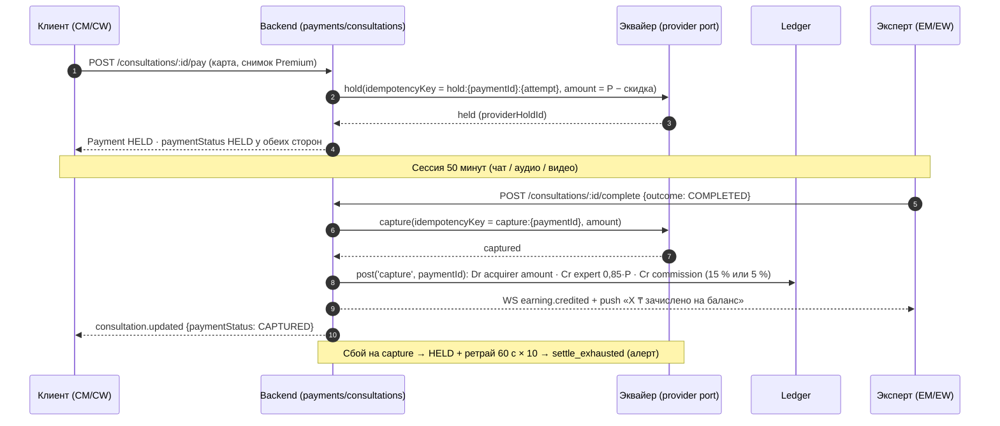
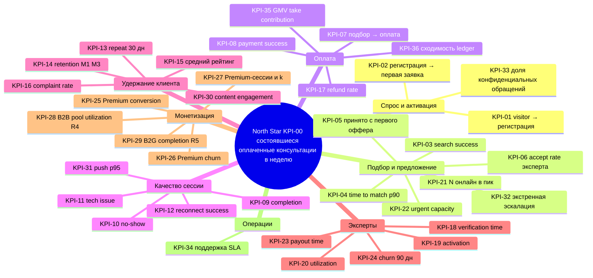

# 08 — Монетизация и юнит-экономика

Статус: draft · Дата: 2026-09-13 · Владелец: Product · Источники: [[Продуктовые решения по открытым вопросам]] (Р-01…Р-09, Р-12, Р-16, Р-17), [[БП-06 Оплата, начисление и выплаты]], [[БП-07 Premium-подписка]], [[10_DOMAIN_API_AND_EVENTS]] §1.10 и §6, [[05_PRODUCT_DEFINITION]] §6, [[PRD MVP SmartQoldau]] §2/§6, [[Дашборд метрик админки]], [[16_RISKS_QUESTIONS_AND_ADRS]] §2–3 (A-03, Q-01…Q-07), [[2026-08-26-нагрузочный-тест]], код `backend/src/{ledger,payments,payouts,premium,matching,requests,booking,presence}`, e2e-наборы `money-lifecycle`, `ledger`, `payments-*`, `payouts*`, `premium-*`, `booking-money`, `matching-*`, `request-timers`, прототип v2 `Investor Deck`, `Admin - Финансы`, `Admin - Дашборд`, `Expert Web - Доход`, `Expert - Доход`, `Expert - Тарифы`. Связанные документы: [[02_PRODUCT_SCOPE]] §7, [[19_DECISION_LOG_AND_OPEN_QUESTIONS]] (OQ-01, OQ-02, OQ-03, OQ-07), [[BRIEF]] §3 (DEC-01…DEC-38).

Оглавление:
0. Принципы документа
1. Потоки выручки (revenue streams) и счета ledger
2. Движение денег по сценариям (money movement)
3. Модель спроса и предложения: проверка обещания «до 2 минут»
4. Юнит-экономика: формулы, assumptions, безубыточность Premium и тарифов
5. Дерево KPI (KPI-00…KPI-36)
6. Что показано в прототипе и чего нет в коде
7. Числа, требующие подтверждения владельца
8. Источники и воспроизводимость

---

## 0. Принципы документа

- **Не выдумывать числа.** Каждое число в документе относится к одной из категорий: `факт` (подтверждено кодом или тестом — `[CODE FACT]`), `цель PRD` (целевое значение из [[PRD MVP SmartQoldau]] §6), `DEC` (канон брифа §3), `assumption` (наша оценка, **требует подтверждения владельца**, всегда со ссылкой на DEC-xx или OQ-xx). Сводный список assumptions — §7.
- **Деньги в тиынах** (`int`), отображение в ₸ делением на 100 только при выводе; перцентили считаются на выборке периода; пустая выборка — «—», не 0 (правила [[Дашборд метрик админки]]).
- **Прототип — источник раскладок, а не правил** (ADR-006). Демо-числа экранов (248 500 ₸, 22 000 ₸ средний чек, 17 350 000 ₸ дохода) — моки (Р-24) и здесь не используются как факты. **Investor Deck — модель, не правило**: его TAM/SAM/SOM, тарифы и «15 000–35 000 ₸ за сессию» помечены `[PROTOTYPE FACT]` и разобраны как противоречия.
- Обозначения: `P` — полная цена эксперта (снимок `Consultation.priceTiyn`, DEC-05); `c = 0,15` — комиссия (DEC-07); `c_p = 0,05` — комиссия на Premium-консультации; `d = 0,10` — скидка Premium (DEC-02); `f` — ставка эквайринга (assumption); `N` — число экспертов онлайн (ACCEPTING, свежий heartbeat); `λ` — интенсивность заявок в час.

---

## 1. Потоки выручки (revenue streams) и счета ledger

### 1.1 Сводная таблица

| ID | Поток | Формула дохода платформы | Когда включается | Что есть в коде | Риски |
|---|---|---|---|---|---|
| RS-01 | **Take rate с консультаций** — 15 % полной цены; на Premium-консультации 5 % | `Revenue = Σ commissionTiyn` по `Payment.status = CAPTURED`; `commission = round(P × 1500 / 10 000)` обычная, `round(P × 500 / 10 000)` Premium | Release 1 (уже работает) | `[CODE FACT]` `COMMISSION_BP_REGULAR = 1500`, `COMMISSION_BP_PREMIUM = 500` (`backend/src/premium/premium.constants.ts`); проводка `capture` (`payments.service.ts` `captureAndCredit`); e2e `payments-settle` («399000 → 339150 + комиссия 59850»), `premium-discount`, `money-lifecycle` | Единственный работающий поток; при нижней границе коридора (2 000 ₸) комиссия 300 ₸ едва покрывает переменные расходы (§4.3). Эквайер боевой не выбран (`PAYMENT_PROVIDER=mock`, Q-20/E0) `[RISK]` |
| RS-02 | **Premium-подписка** 4 990 ₸/мес, 39 900 ₸/год | `Revenue = Σ amountTiyn` по проводкам `subscription_charge`; минус недобор комиссии `d × P` на каждой Premium-консультации (§4.5) | Release 1 в коде; канон текстов — Release 3 (бриф §6) | `[CODE FACT]` `PREMIUM_PRICES = {MONTH: 499_000, YEAR: 3_990_000}` тиын, `PERIOD_DAYS = {30, 365}`, `MAX_RENEW_ATTEMPTS = 3`, `RENEW_WINDOW_HOURS = 72`; отдельный счёт `platform:subscription` (`ledger.service.ts`); e2e `premium-subscribe`, `premium-renewal`, `premium-charge` | Скидка 10 % делает подписку убыточной относительно не-Premium клиента начиная с 4–25 сессий в месяц в зависимости от цены (§4.5); `[DECISION REQUIRED]` DEC-02/Q-01 |
| RS-03 | **Абонентская плата экспертов** (тарифы Старт/Базовый/Про/Топ) | `Revenue = Σ monthlyFee(tier) − Σ (0,15 − c(tier)) × P` по сессиям экспертов на тарифе (плата минус недобор комиссии) | **Release 4+** (DEC-08, Q-02) | `[PROTOTYPE FACT]` `Investor Deck` «Бизнес-модель»: Старт 0 ₸ / 0 % 30 дней · Базовый 0 ₸ / 15 % · Про 12 000 ₸/мес / 13 % + приоритет · Топ 20 000 ₸/мес / 10–11 % + первые позиции; `Expert - Тарифы` (EX-21). В коде — **MISSING** (нет сущности Tariff; `commissionRateBp` — снимок ставки уже есть) | Конфликт с Р-02 «единая 15 %»; отрицательный отбор: тариф выгоден эксперту ровно тогда, когда платформа теряет больше, чем получает (§4.6) `[RISK]`; «приоритет в выдаче» за деньги ломает обещание «лучший по скору» (Р-12) |
| RS-04 | **B2B-пакеты (EAP)** | `Revenue = Σ contractPrice − Σ expertPayout(used sessions)`; на сессию: `P_b2b − 0,85 × P − fees`; `breakage = unused × P_b2b` (если пакет сгорает — `[DECISION REQUIRED]`) | **Release 4** (DEC-18, Q-06); Release 1 — форма «Для бизнеса» → тикет `PARTNERSHIP` | `[PROTOTYPE FACT]` deck: «компания покупает пакет сессий на период; сотрудники активируют по коду, анонимно; работодатель видит только статистику»; `Admin - Финансы` показывает «Доход от B2B-контрактов». В коде **MISSING**: `Payment.source`, контракт, пул, коды (бриф §7) | Новый денежный поток в ledger (предоплата → пул → списание на сессию); агрегированная отчётность ≥ 5 сотрудников (OQ-03); НДС/акты — юрист `[RISK]` |
| RS-05 | **B2G — вузы и практиканты** | Вариант A «бесплатно»: `Revenue = 0`, `Cost = supervision + verification ops`; вариант B «платно со скидкой»: `Revenue = (1 − s) × P_intern × c` при цене практиканта `P_intern` и скидке `s` | **Release 5** (DEC-17, Q-07); Release 1 — форма «Для вузов» → тикет | `[PROTOTYPE FACT]` deck: «студенты консультируют под супервизией — бесплатно или со скидкой; часы засчитываются как практика». В коде **MISSING** (интерны, `Expert.kind`, супервайзер) | Юридическая ответственность за практиканта (Q-07); поток не даёт выручки, но даёт supply и бренд — считать как маркетинговую статью, а не revenue `[INFERENCE]` |
| RS-06 | **Партнёрские каналы** (медцентры, госпрограммы, университеты, корпоративные продажи) | Это **каналы привлечения**, не потоки выручки: влияют на CAC (§4.4) и на λ (§3), а не на формулу дохода. Если появится реферальная комиссия партнёру — это расход `partnerFee × GMV` | По мере договоров (Release 3+) | `[PROTOTYPE FACT]` deck «Маркетинговая стратегия»: TikTok · Instagram · Google Ads · Telegram · Корпоративные продажи · Университеты · Медицинские центры · Государственные программы. В коде ничего (реферальных кодов нет) | Госпрограммы = закупки с ТЗ и отчётностью, другой цикл продаж `[RISK]`; без метки источника (UTM/реферал) CAC по каналам не измерим — см. KPI-01 |

Расходные статьи, которые не потоки, но нужны для маржи: эквайринг `f` (assumption 2–3 %, Q-20/E0), выплаты экспертам (payout-провайдер, возможно отдельная комиссия — assumption), видео-инфраструктура (LiveKit, `[CODE FACT]` `infra/docker-compose.dev.yml` — self-hosted `livekit/livekit-server`; в `docker-compose.prod.yml` LiveKit не описан → боевая топология не решена `[RISK]`), SMS-добивка офферов (`[CODE FACT]` «пуш оффера → SMS через 10 с», расход считается по audit `notification.sms_fallback`), поддержка. Все — §4.2.

### 1.2 Счета и виды проводок ledger `[CODE FACT]`

Двойная запись: каждая операция — `LedgerTransaction(kind, refId)` с ≥ 2 `LedgerEntry`, в каждой ровно одно из `debitTiyn`/`creditTiyn` > 0, `Σdebit = Σcredit` (иначе `LEDGER_UNBALANCED` до записи); идемпотентность `@@unique(kind, refId)` (`backend/src/ledger/ledger.service.ts`, e2e `ledger`). Баланс счёта = `Σcredit − Σdebit` (для `expert:{id}` кредит = приход).

| Счёт | Константа | Смысл |
|---|---|---|
| `acquirer:settlement` | `ACC_ACQUIRER` | Деньги, списанные с карт клиентов у эквайера (дебетуется при capture и charge подписки) |
| `platform:commission` | `ACC_COMMISSION` | Доход платформы с консультаций (RS-01) |
| `platform:subscription` | `ACC_SUBSCRIPTION` | Доход от подписок (RS-02) — **отдельно от комиссии**, чтобы отчёт «сколько заработали на консультациях» не смешивался с подписками (комментарий в коде) |
| `expert:{expertId}` | `expertAccount()` | Внутренний баланс эксперта («Начислено») |
| `payout:pending` | `ACC_PAYOUT_PENDING` | Резерв выводов, отправленных провайдеру или ждущих финконтроля |
| `payout:sent` | `ACC_PAYOUT_SENT` | Выплаты, подтверждённые провайдером |

| `kind` | refId | Проводка (Dr = дебет, Cr = кредит) | Где | Тест |
|---|---|---|---|---|
| `capture` | `payment.id` | Dr `acquirer:settlement` = `amountTiyn` (уплачено клиентом, уже за вычетом скидки) · Cr `expert:{id}` = `full − round(full × 0,15)` · Cr `platform:commission` = `commissionTiyn` (15 % или 5 % от `full = amount + discount`) | `payments.service.ts` `captureAndCredit`, в одной транзакции с `Payment → CAPTURED` | `payments-settle`, `premium-discount`, `booking-money` |
| `subscription_charge` | `{subscriptionId}:{periodEnd}` | Dr `acquirer:settlement` · Cr `platform:subscription` = цена плана | `premium.service.ts` (первая оплата), `premium-renewal.service.ts` (продление) | `premium-subscribe`, `premium-renewal` |
| `payout_reserve` | `payout.id` | Dr `expert:{id}` · Cr `payout:pending` = сумма вывода — списывается **сразу при заявке** | `payouts.service.ts` | `payouts` («баланс уменьшен сразу (резерв)») |
| `payout_sent` | `payout.id` | Dr `payout:pending` · Cr `payout:sent` | `payouts-webhook.controller.ts` по вебхуку `payout.paid` | `payouts` |
| `payout_reject` | `payout.id` | Dr `payout:pending` · Cr `expert:{id}` — компенсирующая, резерв возвращается | `payouts.service.ts` `reject` | `payouts-admin` |
| `adjustment` | — | Зарезервирован комментарием в `schema.prisma` (`LedgerTransaction.kind`), **не постится нигде** — ручных корректировок и возвратов после capture в коде нет | — | — |

Чего в ledger **нет** (`MISSING`): `refund` после capture (жалобы E20 / DEC-09 v2), `partial_capture` (50 % при поздней отмене, Q-03), `b2b_prepay`/`b2b_consume` (R4), `tariff_fee` (R4), учёт комиссии эквайера (она не проходит через ledger — сверка с эквайером внешняя `[RISK]`). VOID холда проводок не создаёт — деньги не покидали карту (`voidAndRelease`, «ledger пуст» в `payments-settle`).

### 1.3 Пояснения по потокам

- **RS-01.** Эксперт всегда получает 85 % **полной** цены независимо от ставки комиссии (Р-03): `netTiyn = full − round(full × 0,15)`; на Premium платформа берёт 5 %, а 10 % «отдаёт» клиенту скидкой — проводка сходится, потому что `amount = net + commission` в обоих случаях (комментарий `captureAndCredit`). Разбивка «цена − комиссия = итого» — `GET /v1/experts/me/earnings` возвращает `priceTiyn = amount + discount`, комиссию и итог `[CODE FACT]` (`payments.service.ts` строки 546–561).
- **RS-02.** Подписка **не включает** консультации (DEC-03, БП-07); её ценность — приоритетный подбор (`[CODE FACT]` `requests.service.ts`: Premium-заявка идёт к лучшему по скору без `tieBreakSeed`, e2e `premium-priority`), скидка 10 % и контент. Возврата при отмене нет — доступ до конца периода (Р-09, OQ-02).
- **RS-03.** Промо-вариант «Старт: 0 % первые 30 дней» обсуждался в Q-02 как допустимый до тарифов; технически = `commissionRateBp = 0` на снимке платежа — в коде такого значения нет, ставка выбирается только из двух констант `[CODE FACT]`. `[DECISION REQUIRED]` DEC-08.
- **RS-04.** Deck обещает работодателю «только статистику использования»; порог агрегации ≥ 5 сотрудников (OQ-03, DEC-18). Что с неиспользованными сессиями (сгорают / переносятся / возвращаются) — `[DECISION REQUIRED]` (новый вопрос, предложено фиксировать как OQ в [[19_DECISION_LOG_AND_OPEN_QUESTIONS]]).
- **RS-05.** Если сессия практиканта бесплатна, платёж не создаётся; путь «`complete` без оплаты → COMPLETED без денег, audit `payment.missing_on_completion`» уже существует `[CODE FACT]` (e2e `payments-settle`), но сейчас это **сигнал аномалии**, а не штатный режим — для R5 потребуется явный признак «бесплатная сессия».

---

## 2. Движение денег по сценариям (money movement)

Общий каркас `[CODE FACT]` (`[[10_DOMAIN_API_AND_EVENTS]]` §1.10): `Payment: PENDING → HELD → CAPTURED | VOIDED | FAILED`; `HELD → HELD (reheld)`; settle-ретраи 10 × 60 с → audit `payment.settle_exhausted` (`settle-retry.service.ts`: `SETTLE_MAX_ATTEMPTS = 10`, `SETTLE_RETRY_INTERVAL_MS = 60_000`, `REHOLD_AGE_MS = 5 дней`). Мгновенная консультация: холд **после матча** (карта → матч → холд, e2e `money-lifecycle`); плановая: холд **при записи** (e2e `booking-money`). Капча/void вызываются по исходу, который фиксирует эксперт (`POST /consultations/:id/complete`, исходы `COMPLETED | CLIENT_NO_SHOW | CLIENT_CANCELLED | TECH_ISSUE`; `EXPERT_CANCELLED` — через отмену плановой записи).

| # | Сценарий | Холд | Capture / Void | Проводки ledger | Баланс эксперта | Комиссия платформы | Уведомления и события | Статус в UI (клиент / эксперт) | Метка |
|---|---|---|---|---|---|---|---|---|---|
| MM-01 | **Состоялась** (`COMPLETED`) | HELD на `amount = P` (обычный) | capture `amount` | `capture`: Dr acquirer `P` · Cr expert `0,85P` · Cr commission `0,15P` | +0,85 P | 0,15 P | эксперту `earning.credited` (WS + push, «X ₸ зачислено на баланс»); audit `payment.captured` | «Оплачено» / «Начислено: цена − комиссия 15 % = итого» | `[CODE FACT]` e2e `payments-settle`, `money-lifecycle` |
| MM-02 | **Клиент не подключился** (`CLIENT_NO_SHOW`; подсказка эксперту через 180 с без `clientJoinedAt`, `no-show.service.ts`; исход недоступен, если клиент подключался) | HELD | void | нет | 0 | 0 | клиенту `consultation.updated {paymentStatus: VOIDED}`; audit `payment.voided {outcome}`; счётчик злоупотреблений `abuse:client:{id}` +1 (Redis, 30 дн) → при 3+ `AUTO_MATCH_DISABLED` (только ручной выбор, Р-01) | «Не состоялась · холд снят, деньги не списаны» / «0 ₸ — клиент не подключился» | `[CODE FACT]` `consultations.service.ts` `ABUSE_CLIENT_TTL_SECONDS`; e2e `money-lifecycle` («no-show + 2 отмены → AUTO_MATCH_DISABLED») |
| MM-03 | **Техническая проблема** (`TECH_ISSUE`) | HELD | void | нет | 0 | 0 | как MM-02, без счётчика злоупотреблений | «Не состоялась по техническим причинам · возврат холда» / «0 ₸» | `[CODE FACT]` DEC-09 |
| MM-04a | **Отменил клиент, > 2 ч до начала** (плановая) или до старта мгновенной | HELD | void | нет | 0 | 0 | `consultation.cancelled_by_client`; без штрафа, без счётчика | «Отменено · холд снят» / «Клиент отменил, 0 ₸» | `[CODE FACT]` `LATE_CANCEL_HOURS = 2` (`booking.constants.ts`); e2e `booking-money` («ранняя отмена ledger не трогает») |
| MM-04b | **Отменил клиент, < 2 ч** (поздняя) — **канон v1 (DEC-09)** | HELD | void | нет | 0 | 0 | audit `late_cancelled`; счётчик злоупотреблений +1 (3+ за 30 дн → ручной выбор) | «Отменено · холд снят. Частые поздние отмены ограничивают автоподбор» / «Поздняя отмена, 0 ₸» | `[CODE FACT]` Р-17 |
| MM-04b′ | то же — **v2-альтернатива** (после Q-03, только плановые, E22) | HELD | **partial capture 50 %** | `capture_partial` (нет в коде): Dr acquirer `0,5P` · Cr expert `0,5P × 0,85` · Cr commission `0,5P × 0,15` — или компенсация эксперту целиком `[DECISION REQUIRED]` | +0,425 P (или иное) | 0,075 P | клиенту чек на 50 %; эксперту «компенсация» | «Возврат 50 %» / «Компенсация за поздную отмену» | **MISSING** partial capture у эквайера, новый kind, тексты (Q-03, L) `[OUT OF SCOPE]` Release 2 при DEC-09 → v2 |
| MM-05 | **Отменил эксперт** (`EXPERT_CANCELLED`, плановая) | HELD | void | нет | 0 | 0 | клиенту `consultation.cancelled`; отмена фиксируется и снижает скор (Р-17); 3+ за 30 дн → разбор командой качества (ручной — счётчика в коде нет `[INFERENCE]`) | «Специалист отменил · холд снят · предложить другого» / «Отмена учтена в рейтинге» | `[CODE FACT]` enum `EXPERT_CANCELLED`; e2e `booking-money`; `EXPERT_NO_SHOW` — MISSING (бриф §7) |
| MM-06 | **Premium-скидка** (клиент Premium на момент `pay`) | HELD на `amount = 0,9P`, `discountTiyn = 0,1P`, `commissionRateBp = 500` (снимок; отмена подписки позже платёж не пересчитывает) | capture `0,9P` | `capture`: Dr acquirer `0,9P` · Cr expert `0,85P` · Cr commission `0,05P` | +0,85 P | 0,05 P | как MM-01 | «Со скидкой Premium −10 %» / «цена P − комиссия 15 % = итого» (чужая скидка в разбивке эксперта не видна) | `[CODE FACT]` `premium.constants.ts`, e2e `premium-discount` |
| MM-07 | **Плановая запись** (холд при записи; перехолд > 5 дней) | HELD при `POST booking`; sweep каждые 60 с: если `holdCreatedAt` старше 5 дн → `void:rehold:{id}:{n}` + `rehold:{id}:{n}`, `reholdCount++`, статус остаётся HELD; отказ банка при перехолде → `FAILED` + audit `payment.rehold_failed`; удалённая карта → `FAILED` | по исходу после сессии (MM-01…05) | как MM-01 при COMPLETED | как MM-01 | как MM-01 | напоминания за 15 мин обеим сторонам (Р-15; DEC-27 добавляет «за 1 ч» — `rec`); при `rehold_failed` клиенту нужно оплатить заново — **уведомления и экран для этого в коде нет** `[RISK]` | «Запись подтверждена · сумма заморожена на карте» / «Запись» | `[CODE FACT]` `settle-retry.service.ts`, e2e `payments-sweep`, `booking-money` |
| MM-08 | **Refund по жалобе** (E20, после DEC-09) | — (уже CAPTURED) | **refund у эквайера** | предлагаемый kind `refund`: Dr `expert:{id}` `0,85P` · Dr `platform:commission` `0,15P` · Cr `acquirer:settlement` `P` (полный) или пропорционально (частичный); если баланс эксперта уже выведен — отрицательный баланс / удержание из будущих начислений `[DECISION REQUIRED]` | −0,85 P | −0,15 P | клиенту «возврат по решению команды качества»; эксперту «удержание» + страйк (DEC-15) | AD-05 решение / CL-30 «Возврат одобрен» | **MISSING** (`adjustment` только зарезервирован); Release 2 без денег, денежные решения — после DEC-09 |
| MM-09 | **Выплата** | — | — | (1) заявка: `payout_reserve` Dr expert · Cr payout:pending — **сразу**; (2) `payout.paid` вебхук: `payout_sent` Dr payout:pending · Cr payout:sent; (3) reject: `payout_reject` обратно на expert | −сумма при заявке; +сумма при reject | — | `payout.approved`, `payout.paid` (audit + уведомление); reject с причиной | «Обрабатывается / Выплачено / Отклонено (причина)» — EX-13, EW-07 | `[CODE FACT]` порог `MIN_PAYOUT_TIYN = 1 000 000` (10 000 ₸), `MONTHLY_AUTO_APPROVE_LIMIT_TIYN = 30 000 000` (300 000 ₸/мес, без REJECTED, календарный месяц UTC); ≤ лимита → `PROCESSING`, `reviewedBy = 'auto'`; > лимита → `PENDING_REVIEW` (провайдер не вызывается); e2e `payouts`, `payouts-admin`; срок «до 3 раб. дней» (DEC-36) — SLA провайдера, в коде не измеряется |
| MM-10 | **Подписка**: charge → renewal → grace → downgrade | — | charge сразу (не холд) | `subscription_charge` при оформлении и при каждом продлении (refId = `{sub}:{periodEnd}` — идемпотентно по периоду) | — | цена плана целиком | `subscription.created/renewed/renew_failed/cancelled/expired` (audit); клиенту `premium.renewed`, `premium.downgraded`; отказ банка при продлении → `GRACE` (доступ сохраняется), 3 попытки за 72 ч → `EXPIRED`; отмена → `CANCELLED`, доступ до `currentPeriodEnd`, затем `EXPIRED` без списания | CL-24 «Premium активен до …» / «Оплата не прошла — доступ сохранён до …» | `[CODE FACT]` e2e `premium-subscribe`, `premium-renewal`, `premium-charge`; возврат при отмене — нет (OQ-02) |
| MM-11 | **B2B-сессия** (R4) | холда на карту нет: сессия списывается из **пула контракта** | «capture» = списание из пула | предлагаемые kinds: `b2b_prepay` Dr acquirer · Cr `b2b:{contractId}` (при оплате контракта); `b2b_consume` Dr `b2b:{contractId}` `P_b2b` · Cr expert `0,85P` · Cr commission `P_b2b − 0,85P`; no-show → пул не списывается (по аналогии с void) | +0,85 P | `P_b2b − 0,85P` | сотруднику «Оплачено компанией»; компании — агрегированный отчёт | CL «Оплачено компанией» (без суммы) / эксперту обычная разбивка | **MISSING** `Payment.source = corporate`, счёт пула, контракт (DEC-18) `[OUT OF SCOPE]` Release 4 |
| MM-12 | **Интерн** (R5): 0 ₸ или скидка | 0 ₸ — платёж не создаётся; скидка — HELD на `(1 − s) × P_intern` | по исходу | 0 ₸ — проводок нет; скидка — `capture` по обычной формуле от `(1 − s) × P_intern` | 0 или 0,85 × уплаченного | 0 или 15 % уплаченного | как обычная консультация; отдельный признак «учебная практика» в чеке/истории | «Бесплатно (учебная практика)» — **только в R5** (DEC-17) | **MISSING** `[OUT OF SCOPE]` Release 5; `[DECISION REQUIRED]` DEC-17 (0 ₸ или скидка) |
| MM-13 | **Отказ банка при холде** | `FAILED` (402 `PAYMENT_DECLINED`), `holdAttempts++` при повторе другой картой | — | нет | 0 | 0 | клиенту «Банк отклонил операцию — повторить / другая карта» | шторка оплаты, error state | `[CODE FACT]` e2e `payments-hold` («declined → FAILED, затем хорошая карта → HELD») |
| MM-14 | **Банк снял холд сам** (`hold.voided_by_bank` вебхук) | HELD → `FAILED`; повторный `pay` держит новый холд | если консультация уже COMPLETED → audit `payment.hold_voided_after_completion` — **недособранная выручка, ручной разбор** | нет | 0 (эксперт не получил начисление) | 0 | алерт финконтролю (audit-крошка) | клиенту «Оплата не завершена — оплатите повторно» / эксперту «Начисление задерживается» — текстов в коде нет `[RISK]` | `[CODE FACT]` e2e `payments-sweep`; процедура «дособрать» — `[DECISION REQUIRED]` для финконтроля |
| MM-15 | **Сбой settle** (эквайер недоступен на capture/void) | HELD | ретрай раз в 60 с, до 10 попыток; затем `payment.settle_exhausted` (алерт), sweep больше не трогает | как MM-01/02 после успешного ретрая; без задвоения баланса | как по исходу | — | алерт финконтролю | эксперту «Начисление в обработке» (текст рекомендуется) | `[CODE FACT]` `settle-retry.service.ts`, e2e `payments-sweep` |

### 2.1 Диаграмма: консультация состоялась



### 2.2 Диаграмма: консультация не состоялась (no-show / отмена / техпроблема)

```mermaid
sequenceDiagram
    autonumber
    participant C as Клиент (CM/CW)
    participant B as Backend
    participant A as Эквайер
    participant L as Ledger
    participant E as Эксперт (EM/EW)
    C->>B: pay → HELD (как в 2.1)
    Note over B,E: Клиент не подключился 180 с → подсказка эксперту (no-show.service)
    E->>B: complete {outcome: CLIENT_NO_SHOW | CLIENT_CANCELLED | TECH_ISSUE}
    B->>A: void(idempotencyKey = void:{paymentId})
    A-->>B: voided
    B-->>B: Payment VOIDED · Consultation.paymentStatus VOIDED (одна транзакция)
    Note over B,L: Проводок нет — деньги не покидали карту клиента
    B-->>C: consultation.updated {paymentStatus: VOIDED} · «Холд снят»
    B-->>E: 0 ₸ (исход виден в истории)
    alt CLIENT_NO_SHOW или поздняя отмена (< 2 ч)
        B-->>B: abuse:client:{id} += 1 (30 дн); при 3+ → AUTO_MATCH_DISABLED
        B-->>C: уведомление об ограничении автоподбора
    end
```

`[RISK]` Ни в одном из «несостоявшихся» сценариев ledger не фиксирует событие — отчёт «возвращено клиентам» ([[Дашборд метрик админки]] §3) считается по `payments.status = VOIDED`, а не по проводкам; это корректно, пока нет возвратов после capture (MM-08).

---

## 3. Модель спроса и предложения: проверка обещания «до 2 минут»

### 3.1 Переменные

| Переменная | Значение | Источник / статус |
|---|---|---|
| `N` — экспертов онлайн | `ACCEPTING` со свежим heartbeat (`DEFAULT_STALE_MS = 90_000`, `presence.service.ts`); клиенту показывается `GET /v1/matching/online-count?topicSlug&format&urgentOnly` — **уже отфильтровано по теме и формату** | `[CODE FACT]` e2e `matching-online-count` |
| `T_s` — длительность сессии | 50 мин (DEC-06) + 10 мин буфер = **60 мин** занятости эксперта | `[CODE FACT]` `SLOT_MINUTES = 60`, `SESSION_MINUTES = 50` (`booking.constants.ts`); буфер для мгновенных — assumption (после сессии статус возвращается в ACCEPTING сразу, Р-13) |
| `p` — вероятность принятия оффера | **0,60** (цель PRD «принято с первого эксперта ≥ 60 %», стретч 0,75) | цель PRD §6; фактическое значение — KPI-05 |
| `t_o` — таймаут оффера | 45 с обычная / 20 с экстренная | `[CODE FACT]` `NORMAL_DEADLINE_MS = 45_000`, `EMERGENCY_DEADLINE_MS = 20_000` (`requests.service.ts`), e2e `request-timers` |
| `r_max` — ротаций внутри 2 мин | 2 при таймаутах (45 + 45 = 90 с < 120; третья — 135 с > 120), до 4 при быстрых явных отказах (~25 с) | `[CODE FACT]` Р-10 «45 с дают до двух ротаций»; 2 мин без принятия → `NO_EXPERTS` (`REQUEST_MAX_AGE_MS = 120_000`); 25 с — assumption |
| `λ` — заявок в час | сценарии 2 / 5 / 10 / 20 в час; пилот: PRD ≥ 500 оплаченных за 90 дн = 5,6/день | цель PRD; часовое распределение — assumption |
| Часы пик | 19:00–23:00 Asia/Almaty, 40 % дневного спроса | assumption, требует подтверждения (KPI-21 измерит) |
| Доля времени онлайн у эксперта | 25 % (6 ч в сутки) | assumption (A-03, DEC-16) |
| Экстренный резерв | доля экспертов с `acceptsUrgent = true`; после 120 с — broadcast всем ACCEPTING (`BROADCAST_AGE_MS = 120_000`), после 300 с — `CALLBACK_REQUESTED` + hotlines (`CALLBACK_AGE_MS = 300_000`) | `[CODE FACT]` `escalation.service.ts` |

### 3.2 Формулы

Нагрузка в эрлангах: `a = λ × T_s / 60` (при `T_s = 60 мин` → `a = λ`). Занятость экспертов — M/M/N (Erlang-C): вероятность, что все `N` заняты,

`P_busy = [a^N/N! × N/(N−a)] / [Σ_{k<N} a^k/k! + a^N/N! × N/(N−a)]`, устойчиво только при `a < N`.

Условное ожидание освобождения при `P_busy`: `W | W>0 ~ Exp(N·μ − λ)`, `μ = 60/T_s`; среднее ожидание в очереди `E[W] = P_busy / (N·μ − λ)`.

Вероятность матча в пределах 120 с:

`P(≤2 мин) = Σ_{k=1..N} π(N−k заняты) × [1 − (1−p)^min(k, r_max)] + P_busy × [1 − e^{−(Nμ−λ)·t_left}] × p`, где `t_left = 120 − 45 с` (эксперт должен освободиться, оставив время на один оффер).

Оговорки `[INFERENCE]`: (1) M/M/N с экспоненциальным временем обслуживания консервативен — реальные сессии почти детерминированы (50 мин), очередь при этом короче; (2) модель не учитывает фильтр по теме/формату — **эффективное `N` меньше показанного счётчика на главной**, потому что `online-count` считается уже с фильтром, а «все ACCEPTING» — нет; (3) `p` в цепочке считается независимым по ротациям; (4) при `P_busy` клиент в коде не ждёт освобождения — через 120 с заявка закрывается `NO_EXPERTS`, поэтому второй член — «повезло, кто-то освободился внутри окна».

### 3.3 Скрипт расчёта (Python 3, без зависимостей)

```python
# Supply-demand model for the promise "usually up to 2 minutes" (SmartQoldau, 08 §3).
# M/M/N (Erlang-C) for expert occupancy + offer-chain model for acceptance.
import math

SERVICE_MIN = 50 + 10   # DEC-06: 50 min session + 10 min buffer (SLOT_MINUTES=60, booking.constants.ts)
P_ACCEPT = 0.60         # PRD §6 target: accepted by the first expert >= 60 %
OFFER_TIMEOUT_S = 45    # DEC-10
SLA_S = 120             # DEC-16 "usually up to 2 minutes"
ROT_CONSERVATIVE = 2    # every non-accept is a 45 s TIMEOUT: only 2 rotations fit in 120 s (Р-10)
ROT_OPTIMISTIC = 4      # every non-accept is a quick DECLINE (~25 s): 4 rotations fit (assumption)

def erlang_c(N, a):
    if a >= N:
        return 1.0
    terms = [math.exp(k * math.log(a) - math.lgamma(k + 1)) for k in range(N)]
    tail = math.exp(N * math.log(a) - math.lgamma(N + 1)) * N / (N - a)
    return tail / (sum(terms) + tail)

def busy_dist(N, a):
    terms = [math.exp(k * math.log(a) - math.lgamma(k + 1)) for k in range(N)]
    tail = math.exp(N * math.log(a) - math.lgamma(N + 1)) * N / (N - a)
    p0 = 1 / (sum(terms) + tail)
    return [p0 * t for t in terms]

def model(N, lam, rot_max):
    """(P_match_le_2min, P_all_busy, mean_queue_wait_min, P_at_least_2_free, a)"""
    a = lam * SERVICE_MIN / 60.0
    if a >= N:
        return 0.0, 1.0, float('inf'), 0.0, a
    pis = busy_dist(N, a)
    pc = erlang_c(N, a)
    p = 0.0
    for busy, pi in enumerate(pis):
        free = N - busy
        p += pi * (1 - (1 - P_ACCEPT) ** min(free, rot_max))
    mu = 60.0 / SERVICE_MIN
    rate = N * mu - lam
    t_left_h = (SLA_S - OFFER_TIMEOUT_S) / 3600.0
    p += pc * (1 - math.exp(-rate * t_left_h)) * P_ACCEPT
    mean_wait_min = pc / rate * 60
    p2free = sum(pi for busy, pi in enumerate(pis) if N - busy >= 2)
    return p, pc, mean_wait_min, p2free, a

for N in [3, 5, 8, 12, 20]:
    for lam in [2, 5, 10, 20]:
        pc_, pcb, w, p2, a = model(N, lam, ROT_CONSERVATIVE)
        po = model(N, lam, ROT_OPTIMISTIC)[0]
        print(N, lam, f"{pc_:.2f}/{po:.2f}", f"busy={pcb:.2f}", f"wait={w:.1f}", f"2free={p2:.2f}")

for lam in [2, 5, 10, 20]:
    a = lam * SERVICE_MIN / 60
    n_busy5 = next(N for N in range(1, 80) if erlang_c(N, a) <= 0.05)
    n_2free90 = next(N for N in range(1, 80) if model(N, lam, ROT_CONSERVATIVE)[3] >= 0.90)
    print(lam, n_busy5, n_2free90)

for p in [0.5, 0.6, 0.75]:
    print(p, [round(1 - (1 - p) ** r, 2) for r in (2, 3, 4)])

for P in [2000, 5000, 8500, 15000]:          # Premium break-even, §4.5
    print(P, 4990 / (0.10 * P), (39900 / 12) / (0.10 * P))
```

Скрипт сохранён в scratchpad сессии (`supply_model.py`); результат ниже получен его запуском 2026-09-13.

### 3.4 Результаты: `N` онлайн × `λ` заявок/час

Ячейка: **P(матч ≤ 2 мин)** консервативно (все отказы — таймауты 45 с) / оптимистично (быстрые явные отказы) · P(все заняты) · среднее ожидание освобождения · P(≥ 2 свободных).

| `N` \ `λ` | 2/ч (a = 2) | 5/ч (a = 5) | 10/ч (a = 10) | 20/ч (a = 20) |
|---|---|---|---|---|
| **3** | 42 / 43 % · заняты 44 % · ожид. 26,7 мин · ≥2 своб. 33 % | перегрузка (a ≥ N) | перегрузка | перегрузка |
| **5** | 77 / 85 % · заняты 6 % · 1,2 мин · 85 % | перегрузка (a ≥ N) | перегрузка | перегрузка |
| **8** | **84 / 97 %** · заняты 0 % · 0,0 мин · 100 % | 68 / 75 % · заняты 17 % · 3,3 мин · 73 % | перегрузка | перегрузка |
| **12** | 84 / 97 % · 0 % · 0,0 · 100 % | **83 / 96 %** · заняты 1 % · 0,1 мин · 99 % | 45 / 50 % · заняты 45 % · 13,5 мин · 46 % | перегрузка |
| **20** | 84 / 97 % · 0 % · 0,0 · 100 % | 84 / 97 % · 0 % · 0,0 · 100 % | **84 / 97 %** · заняты 0 % · 0,0 мин · 99 % | перегрузка (a = 20 = N) |

Минимальное `N` по критериям предложения (та же модель):

| `λ`, заявок/час | P(все заняты) ≤ 5 % | P(≥ 2 свободных) ≥ 90 % | P(матч ≤ 2 мин) ≥ 90 % (оптимистичная цепочка) |
|---|---|---|---|
| 2 | N ≥ 6 | N ≥ 6 | N ≥ 6 |
| 5 | N ≥ 10 | N ≥ 10 | N ≥ 10 |
| 10 | N ≥ 17 | N ≥ 16 | N ≥ 17 |
| 20 | N ≥ 29 | N ≥ 28 | N ≥ 28 |

Потолок цепочки офферов при **бесконечном** предложении (никто не занят):

| `p` (accept) | 2 ротации | 3 ротации | 4 ротации |
|---|---|---|---|
| 0,50 | 75 % | 88 % | 94 % |
| **0,60 (цель PRD)** | **84 %** | 94 % | 97 % |
| 0,75 (стретч) | 94 % | 98 % | ≈ 100 % |

### 3.5 Что из этого следует `[INFERENCE]`

1. **Обещание «до 2 минут» ограничено не только предложением, но и скоростью ответа экспертов.** При целевых `p = 0,6` и худшем случае (все отказы — таймауты по 45 с) даже при неограниченном `N` только 84 % заявок матчатся за 2 мин. Значит p90 ≤ 2 мин (цель PRD) достижим **только если** эксперты отвечают явным отказом быстро (тогда влезает 3–4 ротации → 94–97 %) или `p ≥ 0,75`. Скоринг Р-12 (`score = acceptRate × 0,6 + speed × 0,4`, `speed = max(0, 1 − avgОтветСек/45)`, `[CODE FACT]` `scoring.service.ts`) уже поощряет и то и другое — это правильная механика, её надо мерить (KPI-05, KPI-06).
2. **Порог предложения зависит от `λ`, а не абсолютен.** При пилотном спросе (5,6 заявок/день, пик ≈ 0,56/ч при assumption 40 % в 4 часа) даже `N = 3` почти никогда не занят; порог `N ≥ 8` нужен не из-за занятости, а чтобы после фильтра по теме и формату в момент заявки оставалось ≥ 2–3 подходящих кандидата для ротации. При росте до 5 заявок/час в пик требуется `N ≥ 10`, при 10/час — `N ≥ 17`.
3. **Нагрузочный тест — про сервер, не про людей.** `[CODE FACT]` [[2026-08-26-нагрузочный-тест]]: 500 экспертов онлайн и 200 одновременных заявок проходят за 12,1 с, «заявка → MATCHED» p50 3,6 с, p95 8,4 с; стоимость подбора не зависит от числа кандидатов (e2e `matching-online-count-perf`: 5 запросов у полного конвейера, 3 у `online-count`); равные кандидаты разводятся сидом заявки (e2e `matching-fairness`, `EXPERT_BUSY` 443 вместо 4 190). Инфраструктура не является ограничением SLA на горизонте пилота и Release 1–3.
4. **Эффективное `N` меньше видимого.** Счётчик на главной (`online-count`) — по теме и формату; «все онлайн» — нет. Для честного текста DEC-16 клиенту нужен именно фильтрованный счётчик — он и реализован `[CODE FACT]`.

### 3.6 Резерв urgent capacity

- Экстренная заявка до 120 с ротируется только среди `acceptsUrgent = true` (`urgentOnly = isEmergency && !broadcastAt`), после — всем ACCEPTING (broadcast), после 300 с — `CALLBACK_REQUESTED` + hotlines `[CODE FACT]` `escalation.service.ts`, `requests.service.ts`.
- Следствие: для экстренного пути действует **своё `N_urgent`** = число ACCEPTING с opt-in; при `N_urgent = 0` и ненулевом потоке экстренных — критический алерт ([[Дашборд метрик админки]] §2) → KPI-22.
- `[RECOMMENDATION]` Целевой резерв: в пик `N_urgent ≥ 2` (две 20-секундные ротации до broadcast); доля opt-in среди онлайн ≥ 30 % — assumption, требует подтверждения (DEC-11/Q-16). Обратный звонок обещать только после очереди callback (E21-7).

### 3.7 Что показывать клиенту при недостатке предложения (DEC-16)

| Состояние | Условие (`[CODE FACT]` источники) | Текст и поведение | Метка |
|---|---|---|---|
| Норма | `online-count ≥ N_min` (по теме/формату) | «Обычно до 2 минут · сейчас онлайн N» | DEC-16 |
| Низкое предложение | `0 < online-count < N_min` | «Сейчас онлайн N · ожидание может быть дольше» + вторичное действие «Записаться на удобное время» (плановая запись, холд при записи) | DEC-16, `[RECOMMENDATION]` |
| Нет предложения | `online-count = 0` | Без запуска поиска: «Сейчас по этой теме никого нет онлайн» → плановая запись / другая тема / другой формат; экстренный путь — скрининг и hotlines (DEC-11) | `[RECOMMENDATION]`; `NO_EXPERTS` в коде наступает только после 120 с (`request-timers`) — до старта поиска проверка счётчика делается на клиенте `[INFERENCE]` |
| Поиск идёт > 60 с | таймер `SearchProgress` (CMP-17) | «Ищем дальше — предложили ещё одному специалисту» (без «за 1 минуту») | бриф §8 тон |
| Не нашли за 2 мин | `NO_EXPERTS` | «Не удалось найти сейчас» → повторить / плановая запись / избранный специалист (directed) | `[CODE FACT]` `request-timers` |

Никаких «за 1 минуту», «мгновенно» — только «обычно до 2 минут» (DEC-16; deck и лендинг v2 говорят «за 1–2 минуты» — `[CONTRADICTION]`, текст сайта правится в Release 1).

### 3.8 Какой SLA можно обещать на старте `[RECOMMENDATION]` (OQ-07)

- Обещание в UI: **«обычно до 2 минут»**, показывается при `online-count ≥ N_min`; стартовое **`N_min = 8`** в час пик по всем темам (и **≥ 3 по выбранной теме/формату** — счётчик `online-count` и есть этот фильтрованный порог). Обоснование: при пилотной `λ` занятость не ограничивает, но ротация ≤ 2 требует ≥ 2–3 подходящих свободных кандидата; `N = 8` при `λ ≤ 2/ч` даёт P(≥ 2 свободных) ≈ 100 %.
- Ниже порога — честный текст §3.7; измеряется **p90 времени до матча** (KPI-04) с порогом тревоги p95 > 120 с; порог `N_min` пересматривается после 2 недель пилота по фактическим `λ_peak` и `p` (обе величины — KPI-05, KPI-21).
- Что не обещать: «p90 ≤ 60 с» (стретч PRD) до подтверждения `p ≥ 0,75`; «каждому — за 2 минуты» (потолок цепочки 84–97 %).
- `[DECISION REQUIRED]` OQ-07: владелец подтверждает `N_min = 8` (или 5/12) и правило пересмотра.

### 3.9 Размер пула экспертов в пилоте

Пул `= N_min / доля_онлайн`, при assumption 25 % времени онлайн (6 ч/сутки, расписание в EW/EM):

| `N` онлайн в пик | Нужный пул экспертов |
|---|---|
| 3 | 12 |
| 5 | 20 |
| **8** | **32** |
| 12 | 48 |

A-03 «пилот 20–30 экспертов» ([[16_RISKS_QUESTIONS_AND_ADRS]] §3) и PRD «≥ 25 к запуску, ≥ 60 через 90 дней» дают `N ≈ 5–8` в пик — на границе рекомендации. `[RECOMMENDATION]` Онбордить пилот с **дежурными слотами** в 19:00–23:00 (расписание EW «Расписание», статус `ACCEPTING`) так, чтобы в каждый час пика было ≥ 8 онлайн суммарно и ≥ 3 по каждой из 4–5 самых частых тем; доля времени онлайн 25 % — assumption, подтвердить по KPI-20/21 после первых двух недель.

---

## 4. Юнит-экономика: формулы, assumptions, безубыточность

### 4.1 Формулы

| Показатель | Формула | Источник данных |
|---|---|---|
| GMV (оборот) | `Σ (amountTiyn − discountTiyn)` по `Payment.status = CAPTURED` — **уплачено клиентами**; `GMV_full = Σ (amount + discount)` — по полным ценам | `payments` ([[Дашборд метрик админки]] §3: «Оборот») |
| Средний чек `P̄` | `GMV_full / count(CAPTURED)` | `payments` |
| Take (комиссия) | `Σ commissionTiyn` по CAPTURED; take rate `= Take / GMV_full` (15 % обычная, 5 % Premium → смешанная ниже 15 %) | `payments` |
| Начислено экспертам | `Σ (amount + discount) × 0,85` = `Σ(amount − commission)` — совпадает и на Premium | `payments`, ledger `expert:*` |
| Платёжная комиссия | `Fee = f × Σ amount` (по уплаченному; на void — 0, assumption) + `f × Σ subscription_charge` | вне ledger — сверка с эквайером |
| Возвраты | `RefundRate = Σ amount(VOIDED) / Σ amount(CAPTURED + VOIDED)`; после E20 — плюс `refund`-проводки | `payments` |
| Contribution на сессию | `CM_s = commission − f × amount − video − sms − support_alloc − refund_alloc` | §4.3 |
| Contribution на клиента | `CM_c = L × CM_s + Premium_margin`, `L` — ожидаемое число сессий на клиента: при повторяемости `r` (доля клиентов, приходящих ещё раз) `L = 1/(1 − r)` (геометрическое приближение) | PostHog cohort (KPI-13) |
| ARPU (мес, на активного клиента) | `(Take + SubscriptionRevenue) / активные клиенты за месяц` | `payments`, `subscriptions`, MAU |
| Payback CAC | `CAC / CM_c`; правило: `CAC < CM_c` для положительной экономики | §4.4 |
| Premium margin (мес) | `4 990 × (1 − f) − k × d × P̄_premium − content_cost`, `k` — Premium-консультаций клиента в месяц | §4.5 |
| Tariff margin (R4) | `fee(tier) − (0,15 − c(tier)) × GMV_expert` | §4.6 |
| B2B contract margin | `contractPrice − Σ_used 0,85 × P − f × contractPrice − account_mgmt` | §4.7 |

### 4.2 Таблица assumptions

| Величина | Значение | Источник | Статус |
|---|---|---|---|
| Комиссия | 15 % / 5 % Premium | `premium.constants.ts` | факт (DEC-07) |
| Скидка Premium | 10 % | `PREMIUM_DISCOUNT_BP = 1000` | факт (DEC-02, `rec`) |
| Цена Premium | 4 990 ₸/мес; 39 900 ₸/год (3 325 ₸/мес) | `PREMIUM_PRICES` | факт (DEC-01) |
| Коридор цены эксперта | 2 000–15 000 ₸ | `PRICE_MIN/MAX` (`experts.service.ts`) | факт (DEC-04, `rec`) |
| Средний чек `P̄` | **8 500 ₸** — середина коридора (расчётная); deck считает **15 000 ₸** | нет данных | **assumption**; `[CONTRADICTION]` deck 15 000 = верхняя граница DEC-04; Q-04 |
| Длительность | 50 мин (+ 10 буфер) | `booking.constants.ts` | факт (DEC-06) |
| Эквайринг `f` | 2–3 % (расчёт при 2,5 %) | эквайер не выбран (`PAYMENT_PROVIDER=mock`) | **assumption**, Q-20/E0 |
| Комиссия payout-провайдера | 0–1 % или фикс за перевод | нет | **assumption**, Q-20 |
| Видео-инфраструктура | 50 ₸/сессия при self-hosted LiveKit (амортизация сервера); cloud-тариф не проверялся | `infra/docker-compose.dev.yml` (self-hosted, dev) | **assumption**, E30 |
| SMS-добивка | ~15 ₸/сессия (≈ 1 SMS на 2 оффера при цене SMS ~10 ₸ — цена оператора не проверялась) | audit `notification.sms_fallback` | **assumption** |
| Поддержка | 100 ₸/сессия (≈ 5 % сессий дают тикет) | нет | **assumption** |
| Refund rate (void) | цель ≤ 15 % от оплаченных (85 % «состоялась» PRD) | PRD §6 | цель PRD |
| Refund после capture | 0 до E20 | код | факт (MISSING) |
| Accept rate первый оффер | ≥ 60 % | PRD §6 | цель PRD |
| Конверсия подбор → оплата | ≥ 40 % | PRD §6 | цель PRD |
| Повторная консультация 30 дн `r` | ≥ 30 % | PRD §6 | цель PRD |
| Сессий на активного клиента в месяц | 1,2 | нет | **assumption** |
| CAC по каналам | нет числа; каналы: TikTok, Instagram, Google Ads, Telegram, корпоративные продажи, вузы, медцентры, госпрограммы | deck | **assumption** — ставки по каналам должны дать владелец/маркетинг |
| Activation rate (регистрация → первая заявка) | нет | нет | **assumption**, фиксируется после 2 нед пилота |
| Premium-конверсия | ≥ 5 % MAU | PRD §6 | цель PRD |
| Premium churn | ≤ 8 %/мес | нет | **assumption** |
| Доля времени онлайн эксперта | 25 % | нет | **assumption** (§3.9) |
| Пул экспертов пилота | 20–30 | A-03 | assumption пакета планирования |
| Тарифы экспертов | Про 12 000 ₸/мес (13 %), Топ 20 000 ₸/мес (10–11 %) | deck, `Expert - Тарифы` | `[PROTOTYPE FACT]`, R4, DEC-08 |
| TAM/SAM/SOM | KZ: 60,9 млрд / 15 млрд / 750 млн ₸ (25 000 пользователей); ЦА: 248 млрд / 36 млрд / 1,08 млрд ₸; расчёт «10 % населения × 2 консультации × 15 000 ₸» | deck | `[PROTOTYPE FACT]` — модель, не правило; при `P̄ = 8 500` все три числа ниже в 1,76 раза `[CONTRADICTION]` |

### 4.3 Пример расчёта: contribution на сессию

Переменные расходы на сессию (assumptions §4.2): `f = 2,5 %` от уплаченного; видео 50 ₸; SMS 15 ₸; поддержка 100 ₸; итого фиксированных 165 ₸.

| Цена `P` | Тип | Уплачено клиентом | Комиссия | Эквайринг 2,5 % | Прочие | **CM_s** | CM_s / P |
|---|---|---|---|---|---|---|---|
| 2 000 (мин DEC-04) | обычная | 2 000 | 300 | 50 | 165 | **85 ₸** | 4,3 % |
| 2 000 | Premium | 1 800 | 100 | 45 | 165 | **−110 ₸** | −5,5 % |
| 8 500 (assumption) | обычная | 8 500 | 1 275 | 213 | 165 | **897 ₸** | 10,6 % |
| 8 500 | Premium | 7 650 | 425 | 191 | 165 | **69 ₸** | 0,8 % |
| 15 000 (макс DEC-04 = deck) | обычная | 15 000 | 2 250 | 375 | 165 | **1 710 ₸** | 11,4 % |
| 15 000 | Premium | 13 500 | 750 | 338 | 165 | **247 ₸** | 1,6 % |

Выводы `[INFERENCE]`: у нижней границы коридора обычная сессия почти ничего не приносит, а Premium-сессия убыточна сама по себе (без учёта подписки). Это аргумент **не** за подъём коридора до 15 000–35 000 (Q-04, deck), а за то, что решение по DEC-04 нельзя принимать без CM-таблицы: при `P̄ < 4 000 ₸` экономика 15 % не сходится с расходами на эквайринг и поддержку. `[RISK]` Несостоявшиеся сессии (void) при assumption «void бесплатен» стоят 0; если эквайер берёт комиссию за авторизацию — добавить `f_hold × P × (1 − CompletionRate)` к расходам.

### 4.4 На клиента: LTV и потолок CAC

`L = 1 / (1 − r)`: при `r = 0,30` (цель PRD) `L ≈ 1,43` сессии на клиента; при `r = 0,50` — 2,0.

| `P̄` | `r` | `L` | `CM_c` (без Premium) | Потолок CAC (`CAC < CM_c`) |
|---|---|---|---|---|
| 8 500 | 0,30 | 1,43 | ≈ 1 280 ₸ | **≈ 1 300 ₸** |
| 8 500 | 0,50 | 2,0 | ≈ 1 790 ₸ | ≈ 1 800 ₸ |
| 15 000 | 0,30 | 1,43 | ≈ 2 440 ₸ | ≈ 2 400 ₸ |

`[RISK]` При take rate 15 % и целевой повторяемости 30 % платный трафик (Google Ads, TikTok) окупается только при CAC порядка 1–2 тыс. ₸ на **оплатившего** клиента — с учётом конверсии подбор → оплата 40 % это 400–800 ₸ на клиента, дошедшего до подбора. Реалистичность таких CAC — вопрос владельцу/маркетингу (§7); органика, B2B и партнёрские каналы (RS-06) важнее платного трафика для экономики Release 1–3 `[INFERENCE]`. ARPU при 1,2 сессии/мес и `P̄ = 8 500`: `1 275 × 1,2 = 1 530 ₸` + Premium `0,05 × 4 990 ≈ 250 ₸` ≈ **1 780 ₸/мес** на активного клиента (assumptions).

### 4.5 Premium: безубыточность подписки

Относительно того же клиента без Premium платформа на каждой Premium-консультации недобирает `d × P = 10 %` полной цены (комиссия 15 % → 5 %; эксперт получает те же 85 %). Точка, где подписка перестаёт быть выгодной платформе: `k* = Price_month / (0,10 × P)`.

| Цена сессии `P` | Месячная 4 990 ₸: покрывает сессий | Убыточна (vs не-Premium) начиная с | Годовая 39 900 ₸ (3 325 ₸/мес): покрывает | Убыточна начиная с |
|---|---|---|---|---|
| 2 000 | 24,9 | 25-й сессии в месяц | 16,6 | 17-й |
| 5 000 | 10,0 | 10-й | 6,7 | 7-й |
| **8 500** (assumption) | **5,9** | **6-й** | 3,9 | 4-й |
| 15 000 (макс DEC-04) | 3,3 | 4-й | 2,2 | 3-й |

С учётом эквайринга 2,5 % на саму подписку (`4 865 ₸` нетто) точки сдвигаются на ~2,5 % вниз (при 8 500 ₸ — 5,7 сессий).

Две оптики `[INFERENCE]`:
- **Относительная** (выше): Premium-клиент, ходящий ≥ 6 раз в месяц при 8 500 ₸ (≥ 4 при 15 000 ₸), приносит платформе меньше, чем тот же клиент без подписки. Раз в неделю (4–5 сессий) — ещё выгодно; годовой план при 15 000 ₸ убыточен уже с 3-й сессии в месяц.
- **Абсолютная**: Premium-клиент никогда не убыточен в нуле — 5 % комиссии + подписка > 0 (при `P = 8 500`, `k = 8`: `4 865 + 8 × 69 ≈ 5 400 ₸` против `8 × 897 ≈ 7 200 ₸` без Premium). Вопрос — что Premium даёт сверх денег: приоритет подбора и контент повышают `r` (повторяемость); если Premium поднимает `r` с 0,3 до 0,5, `L` растёт с 1,43 до 2,0 и это перекрывает недобор при `k ≤ 5` — гипотеза для пилота, не факт.
- Р-03 обосновывал 10 % вместо 25 % именно этим: при 25 % скидка (998 ₸ с чека 3 990) превышала комиссию (599 ₸) — каждая сессия была бы убыточна. При 10 % убыточна не сессия, а «частый» подписчик. `[DECISION REQUIRED]` DEC-02/Q-01: оставить 10 % до пилота (рекомендация брифа) и **ввести измерение KPI-27** (доля Premium-сессий и `k` на подписчика); при медианном `k ≥ 4` — рассмотреть лимит скидки (например, первые 4 сессии в месяц) — это новое правило, требует решения владельца.

### 4.6 Тарифы специалистов (R4, DEC-08): кому выгодно

Эксперт платит `fee` за снижение комиссии на `Δc`; выгодно при `GMV_expert > fee / Δc`:

| Тариф (deck) | fee | Δc | Порог GMV эксперта/мес | Сессий/мес при 8 500 ₸ | при 15 000 ₸ | при 25 000 ₸ (середина deck) |
|---|---|---|---|---|---|---|
| Про | 12 000 ₸ | 2 п.п. | 600 000 ₸ | 71 | 40 | 24 |
| Топ | 20 000 ₸ | 4–5 п.п. | 400 000–500 000 ₸ | 47–59 | 27–33 | 16–20 |

`[INFERENCE]` `[RISK]` Отрицательный отбор: рациональный эксперт покупает тариф ровно тогда, когда его экономия превышает плату, то есть когда платформа теряет на комиссии больше, чем получает абонентской платой; в чистой комиссионной арифметике тарифы для платформы **нейтральны или отрицательны** и держатся только на «приоритете в выдаче» — а он конфликтует с Р-12 (ранжирование по скору) и с обещанием клиенту лучшего специалиста. При коридоре DEC-04 (≤ 15 000 ₸) пороги 40–70 сессий в месяц (2–3 в день) достижимы единицами экспертов → поток RS-03 в R4 малозначим. Правильная развилка для DEC-08: тарифы **как продукт видимости** (профиль, бейдж, аналитика, а не скидка на комиссию) или не вводить.

### 4.7 B2B contract margin (R4)

`Margin = contractPrice − Σ_used 0,85 × P_expert − f × contractPrice − account_mgmt − breakage_policy`.
- Если цена сессии для компании `P_b2b = P_expert` (без наценки) — маржа та же 15 %, но без CAC на сотрудника и с предоплатой (cash-flow плюс); с наценкой `m` — `0,15P + m`.
- Утилизация пула `U = used / purchased`: при `U < 1` и «сгорании» неиспользованных сессий — маржа растёт за счёт breakage (этично спорно в EAP, `[DECISION REQUIRED]`); при переносе/возврате — маржа = только по использованным.
- Порог агрегации отчёта ≥ 5 сотрудников (OQ-03) — не влияет на деньги, влияет на доверие.
- Все числа (`P_b2b`, `m`, размер пакета, срок) — assumptions, требуют владельца.

### 4.8 B2G (R5)

Доходов нет или минимальны (вариант B «со скидкой»: `(1 − s) × P_intern × 0,15`); расходы — супервизия (capacity ≤ 8 студентов на супервайзера, OQ-04), второй поток верификации, юр-риски. Считать как инвестицию в supply (дешёвые сессии по лёгким темам, `HEAVY_TOPICS` фильтр — Q-07) и в бренд. `[DECISION REQUIRED]` DEC-17: 0 ₸ или скидка `s`.

---

## 5. Дерево KPI

**North Star (KPI-00): состоявшиеся оплаченные консультации в неделю** — `count(consultations.outcome = COMPLETED AND payments.status = CAPTURED)` за 7 суток по Алматы. Цель PRD: ≥ 500 за 90 дней ≈ **39/нед** (со 2-го месяца — выше, кривая роста — assumption). Guardrail: доля из них с временем до матча ≤ 2 мин (KPI-04). Владелец: Product. Показ: AD-01 (E21, Release 2), PostHog.

Источники данных `[CODE FACT]`: мобильный клиент шлёт в PostHog события `topic_selected`, `format_selected`, `request_created`, `expert_matched`, `payment_succeeded`, `payment_declined`, `session_started`, `session_ended`, `review_submitted`, `guest_converted`, `emergency_escalated` (`packages/shared/lib/analytics/analytics_event.dart`), **только если заданы `POSTHOG_HOST`/`POSTHOG_KEY` при сборке — иначе `NoopAnalytics`** (`analytics_provider.dart`). Веб (`web/`, `admin/`) и `app_expert` к PostHog **не подключены** (grep пуст) — MISSING. Серверные источники: таблицы `requests`, `request_candidates`, `consultations`, `payments`, `payouts`, `subscriptions`, `reviews`, `experts`, `tickets`, `notifications`, `ledger_entries`, `content_progress`, `content_vote`, журнал `audit_log` (переходы `request.matched`, `expert.verified`, `expert.work_status_changed`, `subscription.*`, `payout.*`, `payment.*`). Эндпоинта `GET /v1/admin/dashboard` в коде **нет** (grep по контроллерам пуст) — E21.

| ID | KPI | Формула | Источник | Цель | Порог тревоги | Владелец | Где показывается | Статус |
|---|---|---|---|---|---|---|---|---|
| KPI-01 | Visitor → регистрация/гость | (`POST /auth/guest` + SMS-регистрации) / уникальные посетители PW | веб-аналитика — **нет** (PW без PostHog; cookie DEC-32) | assumption | — | Product | PostHog | MISSING |
| KPI-02 | Регистрация → первая заявка (activation) | пользователей с ≥ 1 `requests` за 7 дн после создания / новых пользователей | `users`, `requests`; событие `request_created` | assumption (фиксировать после 2 нед) | — | Product | PostHog | PARTIALLY_SUPPORTED |
| KPI-03 | Search success rate | `count(status = MATCHED) / count(*)` заявок периода | `requests` ([[Дашборд метрик админки]] §1) | assumption ≥ 90 % | `NO_EXPERTS` > 10 % | Ops | AD-01 | SUPPORTED (данные), эндпоинт MISSING |
| KPI-04 | Time to match p50/p90/p95 | `audit(request.matched).createdAt − requests.createdAt` | `audit_log`, `requests`; `expert_matched` | p90 ≤ 2 мин (PRD), стретч ≤ 60 с | p95 > 120 с | Product/Ops | AD-01 | SUPPORTED (данные) |
| KPI-05 | Принято с первого оффера | заявок, где первый по `offeredAt` кандидат `ACCEPTED` / `MATCHED` | `request_candidates` | ≥ 60 %, стретч ≥ 75 % (PRD) | < 50 % | Product + Quality | AD-01 (E21) | SUPPORTED (данные) |
| KPI-06 | Accept rate эксперта (скор) | `ACCEPTED / (ACCEPTED + DECLINED + TIMEOUT)` по последним 50 офферам; `speed = max(0, 1 − avgОтвет/45)` | `scoring.service.ts` | ≥ 0,6; скор ≥ 0,5 | скор < 0,4 при ≥ 20 офферах → разбор | Quality | EW «Рейтинг» `[RECOMMENDATION]`; AD «Специалисты» (E21) | SUPPORTED (вычисляется), UI MISSING |
| KPI-07 | Подбор → оплата | `Payment.status ∈ {HELD, CAPTURED, VOIDED}` / `requests MATCHED` | `payments`, `requests`; `payment_succeeded` | ≥ 40 %, стретч ≥ 55 % (PRD) | < 30 % | Product | PostHog, AD-01 | SUPPORTED (данные) |
| KPI-08 | Payment success | `HELD / (HELD + FAILED)` по попыткам | `payments`; `payment_declined` | assumption ≥ 90 % | `FAILED` > 15 %; `PENDING` > 15 мин > 0 | Finance | AD-06 | SUPPORTED (данные) |
| KPI-09 | Session completion | `COMPLETED / count(outcome IS NOT NULL)` | `consultations` | ≥ 85 %, стретч ≥ 92 % (PRD) | < 80 % | Quality | AD-01 | SUPPORTED (данные) |
| KPI-10 | Client no-show | `CLIENT_NO_SHOW / outcomes` | `consultations` | assumption ≤ 8 % | > 10 % | Quality | AD-01 | SUPPORTED (данные) |
| KPI-11 | Tech issue rate | `TECH_ISSUE / outcomes` | `consultations` | assumption ≤ 3 % | > 5 % | CTO | AD-01 | SUPPORTED (данные) |
| KPI-12 | Reconnect success | успешных переподключений / обрывов в сессии | **нет события**; `livekit-webhook.controller.ts` существует — добавить `participant_left/joined`; `session_ended{reason}` в PostHog | assumption ≥ 90 % | < 80 % | CTO | PostHog | MISSING (E28/E29) |
| KPI-13 | Repeat booking 30 дн | клиентов с ≥ 2 `COMPLETED` в 30 дн от первой / клиентов с первой COMPLETED в когорте | `consultations` (device-scoped гость учитывается) | ≥ 30 % (PRD) | < 20 % | Product | PostHog cohort | SUPPORTED (данные) |
| KPI-14 | Retention M1/M3 | активных (≥ 1 COMPLETED) в месяце m+1 / когорта m | `consultations`, PostHog | assumption | — | Product | PostHog | PARTIALLY_SUPPORTED |
| KPI-15 | Средний рейтинг | `avg(rating)` по `reviews.status = PUBLISHED` периода | `reviews`; `review_submitted` | assumption ≥ 4,5 (сторы ≥ 4,3 — PRD, другая метрика) | экспертов `rating_avg < 4,0 при rating_count ≥ 20` > 0 (Р-20) | Quality | AD `FlaggedExpertsPage` `[CODE FACT]` | SUPPORTED |
| KPI-16 | Complaint rate | жалоб / COMPLETED | `Complaint` — **нет** (E20) | assumption ≤ 2 % | > 5 % | Quality | AD-05 (Release 2) | MISSING |
| KPI-17 | Refund rate | `Σ amount(VOIDED) / Σ amount(CAPTURED + VOIDED)`; после E20 — плюс `refund` | `payments` («Возвращено клиентам») | ≤ 15 % (следствие ≥ 85 % «состоялась») | > 20 % | Finance | AD-06 | SUPPORTED (void), MISSING (refund) |
| KPI-18 | Verification time | `audit(expert.verified) − experts.submittedAt` (p50/p90); возраст самой старой PENDING | `audit_log`, `experts` (миграция `submitted_at`) | ≤ 24 ч (DEC-35) | самая старая PENDING > 24 ч | R-11 | AD `VerificationQueuePage` `[CODE FACT]` | SUPPORTED |
| KPI-19 | Expert activation | verified с ≥ 1 COMPLETED в 14 дн после верификации / verified | `experts`, `consultations`, `audit` | assumption ≥ 60 % | < 40 % | Ops | AD (E21) | SUPPORTED (данные) |
| KPI-20 | Expert utilization | Σ минут сессий / Σ минут в `ACCEPTING` (интервалы между `expert.work_status_changed`) | `audit_log`, `consultations`; heartbeat не персистится | assumption 30–50 % | < 15 % (простой) или > 80 % (нет резерва) | Ops | EW «Доход» `[RECOMMENDATION]`, AD | PARTIALLY_SUPPORTED |
| KPI-21 | Supply в пик (`N` онлайн 19–23) | среднее по снимкам `PresenceService.listFresh()` ∩ ACCEPTING каждые 5 мин | **нет истории** (Redis) → снимки в таблицу `supply_snapshots` (E21) `[RECOMMENDATION]` | `N ≥ 8` (§3.8, OQ-07) | `N < 3` в пик | Ops | AD-01 «Специалистов онлайн сейчас» | MISSING (история), SUPPORTED (текущее) |
| KPI-22 | Urgent capacity | `count(acceptsUrgent)` среди ACCEPTING свежих | `experts` + Redis | `N_urgent ≥ 2` в пик (assumption) | `= 0` при потоке экстренных | Ops/Quality | AD-01 | SUPPORTED (текущее) |
| KPI-23 | Payout time | `payouts.updatedAt(PAID) − createdAt`, p90; возраст `PENDING_REVIEW` | `payouts`, `audit payout.*` | ≤ 3 раб. дн (DEC-36) | `PENDING_REVIEW` > 2 раб. дн; `PROCESSING` без `providerRefId` > 1 ч | R-14 | AD `PayoutsPage` `[CODE FACT]`; EX-13/EW-07 статусы | SUPPORTED |
| KPI-24 | Expert churn 90 дн | verified без `ACCEPTING` и без COMPLETED 30 дн / активные на начало | `audit`, `consultations` | ≤ 20 % (PRD) | > 30 % | Ops | AD (E21) | PARTIALLY_SUPPORTED |
| KPI-25 | Premium conversion | `subscriptions ACTIVE / MAU` | `subscriptions`; MAU — PostHog | ≥ 5 % MAU через 30 дн после канона (PRD, R3) | — | Product | AD (E21; [[Дашборд метрик админки]]: «Premium-показатели добавятся») | PARTIALLY_SUPPORTED |
| KPI-26 | Premium churn / renewal failure | `(EXPIRED + CANCELLED за мес) / ACTIVE на начало`; `renew_failed / renewals`; `GRACE → EXPIRED` | `audit subscription.*`, `subscriptions` | assumption ≤ 8 %/мес | GRACE → EXPIRED > 20 % | Product/Finance | AD-06 | SUPPORTED (данные) |
| KPI-27 | Premium-сессии и `k` | `count(commissionRateBp = 500) / CAPTURED`; медиана Premium-сессий на подписчика в месяц | `payments`, `subscriptions` | `k` медиана ≤ 4 (§4.5) | медиана `k ≥ 6` при 8 500 ₸ | Finance | AD-06 `[RECOMMENDATION]` | SUPPORTED (данные) |
| KPI-28 | B2B pool utilization | использовано / куплено по контракту за период | контракт — **нет** (R4) | assumption ≥ 60 % | < 30 % к середине срока | R-16 | AD B2B (R4) | MISSING |
| KPI-29 | B2G practice completion | практикантов, закрывших план часов / зачисленных | — (R5) | assumption | — | R-16/R-18 | AD B2G (R5) | MISSING |
| KPI-30 | Content engagement | пользователей с ≥ 1 завершённым `content_progress` / MAU; доля 👍 в `content_vote` | `ContentProgress`, `ContentVote` `[CODE FACT]` | assumption | — | R-15 | PostHog, AD (E21) | SUPPORTED (данные) |
| KPI-31 | Push ≤ 3 с p95 | `push_delivered_at − push_sent_at` p95; доставляемость | `notifications` ([[Дашборд метрик админки]] §6) | ≥ 99 % (PRD) | < 95 % | CTO | AD-01 | SUPPORTED (данные, внутренний конвейер до боевого провайдера) |
| KPI-32 | Экстренная эскалация | `broadcast_at IS NOT NULL / is_emergency`; `CALLBACK_REQUESTED / is_emergency`; `emergency_escalated` | `requests` | assumption: callback ≤ 10 % экстренных | callback > 20 % | Quality | AD-01 | SUPPORTED (данные) |
| KPI-33 | Доля конфиденциальных (гостевых) обращений | заявок гостей / всех | `users.deviceId`, `requests`; `guest_converted` | гипотеза ≥ 30 % (PRD) | — | Product | PostHog | SUPPORTED (данные) |
| KPI-34 | Поддержка: первая реакция в SLA | доля тикетов с `first_reply_at` в рабочий день (§5 Дашборда) | `tickets` | 100 % (DEC-37) | без реакции > 1 раб. дн | R-13 | AD `TicketsPage` `[CODE FACT]` | SUPPORTED |
| KPI-35 | GMV, take, contribution | §4.1 | `payments`, ledger | — | смешанный take rate < 12 % (много Premium) | Finance | AD-06 | SUPPORTED (GMV/take), MISSING (fees) |
| KPI-36 | Сходимость ledger | `Σ debit − Σ credit` за всё время **= 0** | `ledger_entries` | 0 | ≠ 0 — красным, всегда | Finance/CTO | AD-06 | SUPPORTED (данные) |

Пороги тревоги, не восходящие к PRD/DEC/[[Дашборд метрик админки]], — инженерные первые приближения; пересмотреть после 2 недель пилота (та же оговорка, что в Дашборде).



---

## 6. Что показано в прототипе и чего нет в коде

| Экран (11a) | Элемент прототипа | Источник данных в коде | Статус | Комментарий |
|---|---|---|---|---|
| `SmartQoldau Admin - Финансы` (AD-06) | Переключатель периода «месяц / неделя / квартал» | `payments.createdAt` (период по Алматы) | SUPPORTED (данные), эндпоинт MISSING | Дашборд: период по умолчанию 7 дн; «квартал» — добавить как 90 дн |
| AD-06 | Фильтр «Все пакеты / Старт / Базовый / Про / Топ» | Tariff — нет | `[CONTRADICTION]` DEC-08 | В R1–R3 фильтр **отсутствует** (не «скоро») |
| AD-06 | «Доход платформы (комиссии)» | `Σ commissionTiyn` CAPTURED = баланс `platform:commission` | SUPPORTED (данные) | Формула из Дашборда §3; демо 17 350 000 ₸ — мок |
| AD-06 | «Выплачено экспертам» | баланс `payout:sent` (или `Σ payouts PAID`) | SUPPORTED (данные) | `[INFERENCE]` в прототипе, вероятно, «начислено»; в коде два разных числа — «начислено» (`Σ(amount − commission)`) и «выплачено» (`payout:sent`); показывать оба |
| AD-06 | «Ожидает вывода» | баланс `payout:pending` (заявки в обработке) + `Σ expert:*` (ещё не выведено) | SUPPORTED (данные) | Два смысла — назвать явно: «В обработке» и «На балансах экспертов» |
| AD-06 | «Доход от B2B-контрактов» | нет (R4) | MISSING `[OUT OF SCOPE]` Release 4 | Скрыт в R1–R3 |
| AD-06 | Таблица «Доход по пакетам экспертов» (пакет, активных, комиссия, доход) | нет | `[CONTRADICTION]` DEC-08 | Отсутствует до R4 |
| AD-06 | Транзакции: «Дата · Клиент · Специалист · Сумма · Тип · Статус», «Экспортировать CSV» | `payments` (+ `ledger_transactions`); клиент — только `clientCode`/id | PARTIALLY_SUPPORTED; `[CONTRADICTION]` DEC-13 | Имя клиента показывать нельзя — конфиденциальность; CSV-экспорт — MISSING (E21) |
| AD-06 | «Раздел доступен только супер-админу» | RBAC: `FINANCE_CONTROL` видит финансы (`payouts-admin` e2e: QUALITY_TEAM → 403, SUPERADMIN проходит) | `[CONTRADICTION]` DEC-25 | Доступ: FINANCE_CONTROL + SUPERADMIN |
| AD-06 | Нет: сходимость ledger, отказы банка, зависшие PENDING, очередь выплат с `monthTotalTiyn`, Premium-выручка отдельно | все есть в данных (`ledger_entries`, `payments`, `payouts`, `platform:subscription`) | `[RECOMMENDATION]` добавить (Дашборд §3) | Сходимость — красным всегда; очередь выплат уже реализована в `PayoutsPage` `[CODE FACT]` |
| `SmartQoldau Admin - Дашборд` (AD-01) | «Активные сессии сейчас» | `count(consultations.status = ACTIVE)` | SUPPORTED (данные) | — |
| AD-01 | «Заявок на верификации», «Просроченная верификация > 24 ч» | `count(verification_status = PENDING)`, возраст самой старой | SUPPORTED (`VerificationQueuePage`) | KPI-18 |
| AD-01 | «Открытых жалоб», «Необработанная жалоба > 48 ч» | Complaint — нет | MISSING (E20, Release 2) | До E20 — открытые тикеты по командам (`tickets`) |
| AD-01 | «Доход платформы сегодня / за неделю / за месяц», график «Сессии и выручка · 7 дней» | `payments` по дням Алматы | SUPPORTED (данные), эндпоинт MISSING (E21) | — |
| AD-01 | Нет: время до специалиста p50/p95, доля «нет специалистов», онлайн сейчас, принимают экстренные, здоровье пушей | данные есть (Дашборд §1, §2, §6) | `[RECOMMENDATION]` | Это «обещание продукта» — главный блок дашборда по [[Дашборд метрик админки]], в прототипе его нет `[CONTRADICTION]` |
| `SmartQoldau Expert Web - Доход` (EW-07) | «Доход за месяц», «Консультаций», «Средний чек», «Комиссия платформы 15 %» | `GET /v1/experts/me/earnings` (`balanceTiyn`, `items[]` с `priceTiyn`, комиссией, итогом), `GET .../earnings/daily` (`days[].amountTiyn`, `consultations`) | SUPPORTED `[CODE FACT]` (`web/app/[locale]/(expert)/expert/earnings/page.tsx` вызывает `/balance` и `earnings/daily`) | Демо «22 000 ₸ средний чек» > 15 000 ₸ (DEC-04) — мок; надпись «v2: комиссия по тарифу» в 11a — DEC-08, в R1–R3 всегда 15 % |
| EW-07 | «Доход по дням» (график) | `earnings/daily` (Asia/Almaty, до 366 дн) | SUPPORTED | — |
| EW-07 | «Доступно к выводу», кнопка «Вывести средства» | `GET /v1/payouts/balance` (`balanceTiyn`, `availableTiyn`), `POST /v1/payouts` | SUPPORTED | Минимум 10 000 ₸, порог 300 000 ₸/мес — тексты ошибок `PAYOUT_MIN_AMOUNT`, `INSUFFICIENT_BALANCE` |
| EW-07 | «Последние операции: Дата · Тип консультации · Сумма · Комиссия · Итого» | `items[]` earnings | PARTIALLY_SUPPORTED | «Тип консультации» (формат) в `EarningsItemDto` не подтверждён — проверить при реализации; на Premium-сессии эксперт видит полную цену и 15 % (чужая скидка не видна) `[CODE FACT]` |
| EW-07 | Нет: список выплат со статусами, причина отклонения | `GET /v1/payouts` (статусы `PENDING_REVIEW / PROCESSING / PAID / REJECTED`, `rejectReason`) | `[RECOMMENDATION]` добавить в EW (DEC-19: доход/выплаты — основной кабинет) | В EM уже есть (l10n `payoutPendingReview/Processing/Paid/Rejected`) `[CODE FACT]` |
| `SmartQoldau Expert - Доход` (EX-13) | «Сегодня / За неделю / За месяц», график, «Последние операции: тема · дата · сумма · статус», «Выплаты» | `earnings/daily`, `earnings`, `payouts` | SUPPORTED | Демо 582 000 ₸ vs 248 500 ₸ в EW — Р-24 (несущественно); статус «Начислено → Выплачено» из БП-06 в коде — это два разных объекта (Payment CAPTURED и Payout PAID) `[INFERENCE]` |
| `SmartQoldau Expert - Тарифы` (EX-21) | Пакеты и «Перейти на …» | нет | `[OUT OF SCOPE]` Release 4, DEC-08 | В R1–R3 экрана нет |
| `Investor Deck` | «Комиссия с сессий + платные пакеты», «15 000–35 000 ₸ за сессию», TAM/SAM/SOM с 15 000 ₸ | код: 2 000–15 000 ₸, единая 15 % | `[CONTRADICTION]` DEC-04, DEC-07, DEC-08 | Deck — модель, не правило; после решения Q-04 пересчитать SOM |
| `Investor Deck` | «Полная анонимность», «за 1–2 минуты» | DEC-24 «конфиденциально», DEC-16 «обычно до 2 минут» | `[CONTRADICTION]` | Тексты |

---

## 7. Числа, требующие подтверждения владельца

| # | Число | Где используется | Наша рабочая величина | Решение |
|---|---|---|---|---|
| 1 | Средний чек `P̄` (и коридор цены) | §4 весь, SOM deck | 8 500 ₸ (середина 2 000–15 000) | DEC-04 / Q-04 |
| 2 | Ставка эквайринга `f`, комиссия за холд/void, комиссия payout-провайдера | §4.2–4.3 | 2,5 %; void бесплатен; payout 0–1 % | Q-20 / E0 (выбор эквайера) |
| 3 | Стоимость видео-минуты (LiveKit self-hosted vs cloud) и боевая топология | §4.2, RS-06 расходы | 50 ₸/сессия | E30; `docker-compose.prod.yml` без LiveKit |
| 4 | Стоимость SMS и доля офферов с SMS-добивкой | §4.2 | 15 ₸/сессия | E27/E30 |
| 5 | Стоимость поддержки на сессию | §4.2 | 100 ₸ | DEC-37 (штат) |
| 6 | CAC по каналам (TikTok, Instagram, Google Ads, Telegram, партнёры) | §4.4 | нет числа; потолок ≈ 1 300 ₸ на оплатившего | владелец/маркетинг |
| 7 | Сессий на активного клиента в месяц, retention M1 | §4.1, ARPU | 1,2; — | измерить (KPI-13/14) |
| 8 | Порог `N_min` онлайн для «обычно до 2 минут» и `N_urgent` | §3.8, DEC-16 | 8 (и ≥ 3 по теме); `N_urgent ≥ 2` | **OQ-07** |
| 9 | Часы пик и доля спроса в них; доля времени онлайн эксперта | §3.1, §3.9 | 19:00–23:00, 40 %; 25 % | измерить (KPI-21) |
| 10 | Скидка Premium 10 % и/или лимит скидки по числу сессий | §4.5 | оставить 10 %, измерять `k` | DEC-02 / Q-01 |
| 11 | Тарифы экспертов: вводить ли, и как «скидка на комиссию» vs «видимость» | §4.6 | не вводить до R4; если вводить — как видимость | DEC-08 / Q-02 |
| 12 | Поздняя отмена v2 (50 %) — partial capture, компенсация эксперту | §2 MM-04b′ | v1 (0 ₸) в R1–R3 | DEC-09 / Q-03 |
| 13 | Refund после capture по жалобе: из чьих средств, отрицательный баланс эксперта | §2 MM-08 | предложенная проводка `refund` | DEC-15 + DEC-09 |
| 14 | B2B: цена сессии для компании, наценка, размер пакета, судьба неиспользованных сессий | §4.7, MM-11 | `P_b2b = P`, сгорание не решено | DEC-18 / Q-06 (новый OQ) |
| 15 | B2G: 0 ₸ или скидка `s` | §4.8, MM-12 | — | DEC-17 / Q-07 |
| 16 | Пороги тревоги KPI без источника в PRD/DEC (no-show 10 %, activation 40 %, Premium churn 8 % и др.) | §5 | инженерные | пересмотр после 2 нед пилота |
| 17 | Процедура «дособрать выручку» при `hold_voided_after_completion` | MM-14 | ручной разбор финконтролем | DEC-36 (финконтроль) |

---

## 8. Источники и воспроизводимость

- Расчёты §3.4 и §4.5 воспроизводятся скриптом §3.3 (Python 3, стандартная библиотека); входные параметры перечислены в §3.1 и §4.2 с метками. Значения таблиц §4.3–4.4, §4.6 — арифметика по формулам §4.1 (пример: `8 500 × 0,15 = 1 275`; `1 275 − 213 − 165 = 897`).
- Факты кода: `backend/src/ledger/ledger.service.ts` (счета, инварианты), `backend/src/payments/payments.service.ts` (hold/capture/void, разбивка earnings), `backend/src/payments/settle-retry.service.ts` (ретраи, перехолд), `backend/src/payouts/payouts.service.ts` и `payouts-webhook.controller.ts` (пороги, проводки), `backend/src/premium/premium.constants.ts`, `premium.service.ts`, `premium-renewal.service.ts`, `backend/src/requests/requests.service.ts`, `escalation.service.ts`, `offer-timer.service.ts`, `backend/src/matching/scoring.service.ts`, `matching.controller.ts`, `backend/src/presence/presence.service.ts`, `backend/src/booking/booking.constants.ts`, `backend/src/consultations/no-show.service.ts`, `consultations.service.ts`, `backend/prisma/schema.prisma` (модели Payment, LedgerTransaction, LedgerEntry, Payout, Subscription, enum'ы), `packages/shared/lib/analytics/*`, `web/app/[locale]/(expert)/expert/earnings/page.tsx`, `admin/src/routes/*`, `infra/docker-compose.*.yml`, `backend/.env.example`.
- Тесты: `backend/test/{money-lifecycle,ledger,payments-hold,payments-settle,payments-sweep,booking-money,payouts,payouts-admin,premium-charge,premium-discount,premium-renewal,premium-subscribe,premium-priority,matching-fairness,matching-online-count,matching-online-count-perf,request-timers}.e2e-spec.ts`.
- Прототип: `RAW/SmartQoldau (1)/` — `SmartQoldau - Investor Deck`, `SmartQoldau Admin - Финансы`, `SmartQoldau Admin - Дашборд`, `SmartQoldau Expert Web - Доход`, `SmartQoldau Expert - Доход`, `SmartQoldau Expert - Тарифы` (извлечённый текст в scratchpad сессии `proto/*.txt`).
- Документы хранилища — см. шапку. Перекрёстная ссылка: [[19_DECISION_LOG_AND_OPEN_QUESTIONS]] OQ-07 ссылается на «§2» этого документа — модель предложения здесь в **§3**; [[02_PRODUCT_SCOPE]] §7 ссылается на `[[08_KPI_TREE]]` — дерево KPI и нумерация `KPI-nn` закреплены здесь, в §5.
