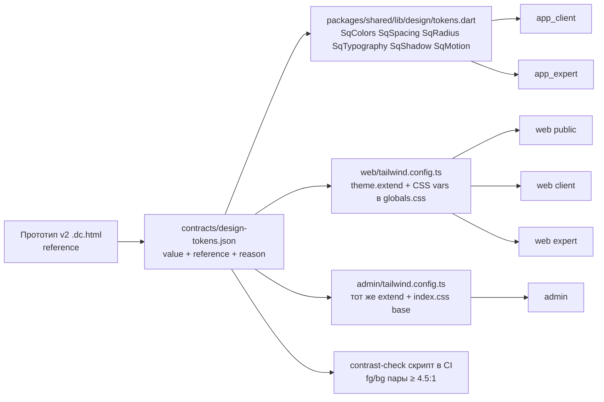

# 13 — Design System & Visual Contract

Статус: draft · Дата: 2026-09-13 · Владелец: Product · Источники: прототип v2 `RAW/SmartQoldau (1)/*.dc.html` (106 экранов; извлечения `scratchpad/proto/*.txt`, шапка `hex=` и `## SCRIPT`), `ios-frame.jsx`, `deck-stage.js`; код `packages/shared/lib/design/{tokens,theme,fonts,breakpoints,readable_width,sheet_or_dialog,split_layout,session_layout}.dart` и `design/widgets/*`, `web/tailwind.config.ts`, `web/app/globals.css`, `web/components/**`, `web/app/[locale]/(public|client|expert)/layout.tsx`, `admin/tailwind.config.ts`, `admin/src/index.css`, `admin/src/routes/AppLayout.tsx`, `admin/src/components/*`, `app_client/lib/features/**`, `app_expert/lib/features/**`; [[11_UX_UI_FOUNDATION]] §1, §4–§9; [[Расхождения в прототипе]] §13; BRIEF §3 (DEC-01…38), §10 (CMP-01…47).

Оглавление
0. Как читать документ и метод извлечения
1. Принципы визуального контракта
2. Design tokens
3. Геометрия и плотность по поверхностям
4. Design System Inventory (CMP-01…CMP-47)
5. Паттерны состояний UI
6. Запрещённый визуальный drift — чек-лист ревью
7. Существующие ассеты
8. Пути внедрения токенов и сверка с кодом

---

## 0. Как читать документ и метод извлечения

| Что | Как получено | Метка |
|---|---|---|
| Частоты свойств (`font-size`, `font-weight`, `border-radius`, `padding`, `gap`, `box-shadow`, `border`, `width`, `height`, `line-height`, `letter-spacing`, `z-index`, `transition`) | `grep -oh "<свойство>:…" *.dc.html \| sort \| uniq -c \| sort -rn` по всем 106 `.dc.html` | `[PROTOTYPE FACT]` |
| Палитра экрана | строка `hex=` в шапке каждого `proto/<экран>.txt`; глобальная частота hex — grep по HTML | `[PROTOTYPE FACT]` |
| Цвета статусов | тройки `status/statusBg/statusColor` и пары `label/bg/color` в `## SCRIPT` демо-данных | `[PROTOTYPE FACT]` |
| Геометрия | inline-стили 15 представительных экранов: CM `SmartQoldau - Главная`, `- Специалист найден`, `- Чат`, `- Оценка`; EM `Expert - Главная`, `- Входящий запрос`; EW `Expert Web - Главная`, `- Доход`, `- Расписание`; PW `SmartQoldau.kz`, `Web - Каталог`, `Web - Профиль психолога`; AD `Admin - Дашборд`, `- Верификация`, `- Жалобы` | `[PROTOTYPE FACT]` |
| Что в коде | чтение файлов дизайн-слоя и grep по `web/components`, `admin/src`, `app_*/lib/features` | `[CODE FACT]` |
| Контраст | значения из [[Расхождения в прототипе]] §13 (`#6b8580` 3.97:1, `#8fa6a1` 2.58:1, затемнённые `#445b57` 7.29, `#516561` 6.21, `#5a716c` 5.23); остальные пары — расчёт по формуле относительной яркости WCAG, округлено до 0.1, помечены «≈» и подлежат подтверждению скриптом при генерации `contracts/design-tokens.json` | `[INFERENCE]` |

Правило `value` / `reference` (действует во всём документе и в будущем `contracts/design-tokens.json`): каждый токен хранит **`reference`** — сырое значение прототипа v2 (что нарисовано) и **`value`** — production-значение (что рендерится). Они равны, кроме случаев, где прототип не проходит WCAG AA или ломает 4-pt сетку; тогда `value` отличается, а поле `reason` обязательно (`"WCAG AA 4.5:1"`, `"4-pt grid ±2 px"`, `"one destructive hue"`). Сырой hex в коде компонентов и в описаниях компонентов после §2 запрещён — только имена токенов (BRIEF §8).

Что не считается продуктом (полная таблица — §3.4): рамка `IOSDevice` (`ios-frame.jsx`: bezel 402×874, r48, dynamic island, статус-бар «9:41», home indicator 34 px, фон `#F2F2F7`, клавиатура), showcase-контейнер десктопа (фон `#EEF2F0`, `padding:24px`, карточка 1440/1520 px с `border-radius:20px` и тенью `0 30px 70px -30px`), экраны `Investor Deck`, `Презентация`, `Прототип` (обзор), `ER-схема` (оттуда идут `#a8bcb8`, `#e6eeec`, `#c7d3cf`, `#7b918d`), брендовые цвета сторонних платёжных систем и Google.

---

## 1. Принципы визуального контракта

Контракт фиксирует, **как** сделан интерфейс; **что** на экране — по прототипу (CLAUDE.md, ADR-006). Это не редизайн: ни одно значение не меняется «по вкусу», только по правилам `reason` из §0.

| # | Принцип | Как выражен в прототипе | Источник |
|---|---|---|---|
| P1 | Не редизайн: раскладки прототипа v2 воспроизводятся; токены нормализуют, а не переосмысляют | 106 экранов; отклонения только `WCAG AA`, `4-pt`, showcase | CLAUDE.md, ADR-006 `[PROTOTYPE FACT]` |
| P2 | Одна гарнитура — Inter, веса 500/600/700/800; 400 почти не используется (1 вхождение из 2 363) | `font-family:'Inter'` 67+25 вхождений; `font-weight:700` 968, `800` 569, `600` 474, `500` 352, `400` 1 | `[PROTOTYPE FACT]` grep |
| P3 | Спокойная бело-зелёная палитра: чернила `#0f3f3a` (1 076 вхождений), основной `#0f766e` (621), мягкие поверхности `#f7faf9`/`#f2fbf8`, чипы `#e3f3ee` | нет чёрного текста, нет насыщенных фонов кроме тёмного сайдбара/подвала на `ink` | `[PROTOTYPE FACT]` |
| P4 | Большие округления: карточки 14–20, крупные блоки 22–28, кнопки-пилюли 24–27 (высота 48–54), поля 12–16, чипы pill, аватары 50 % | `border-radius:14px` 295, `16px` 163, `12px` 153, `20px` 118, `50%` 331 | `[PROTOTYPE FACT]` |
| P5 | Тонкие борды вместо теней у статичных карточек: 1 / 1.5 px, оттенок `#eef2f0`/`#edf2f0` | `border:1px solid #eef2f0` 82, `1.5px solid #edf2f0` 70, `1.5px solid #eef2f0` 49 | `[PROTOTYPE FACT]` |
| P6 | Лёгкие цветные тени только у плавающего и у главного действия: `rgba(15,118,110,.4)` под primary-кнопкой, `rgba(0,0,0,.2–.25)` под шторкой/диалогом | `0 8px 20px -12px rgba(15,118,110,0.4)` 99; `0 12px 24px -8px rgba(15,118,110,0.4)` 14; `0 24px 48px -12px rgba(0,0,0,0.25)` 12 | `[PROTOTYPE FACT]` |
| P7 | Одна главная action на экран; вторичные — outline/ghost; деструктивные в кабинетах — outline, solid-красный только для экстренного пути и завершения звонка | `Специалист найден`: одна primary h54 + secondary outline; `Admin - Верификация`: «Одобрить» solid primary, «Отклонить» outline `#f5d9df` | `[PROTOTYPE FACT]`, [[11_UX_UI_FOUNDATION]] §1.2 |
| P8 | Не SaaS-дашборд: цифры — там, где решение (цена, время, доход); KPI-плитки только в `Expert Web - Доход`, `Admin - Дашборд`, `Admin - Финансы` | сетка `repeat(4,1fr)` KPI встречается только на этих экранах | [[11_UX_UI_FOUNDATION]] §1.10, §7 |
| P9 | Статус объясняет, что будет дальше; красная семантика — только угроза жизни; «экстренно» — отдельный набор `urgent`, не `error` | `Экстренный поиск`: свой градиент `#fff8f7→#fdeeec→#fce3e0`, текст `#5c2420/#8a4540` | [[11_UX_UI_FOUNDATION]] §1.1–1.2, §6 |
| P10 | Доступность как ограничение, не опция: контраст ≥ 4.5:1, фокус 2 px, цели ≥ 44 pt, движение отключаемо, статус дублируется иконкой/текстом | прототип этому не соответствует (§2.3) — контракт исправляет через `value` | [[11_UX_UI_FOUNDATION]] §1.8, §9; [[Расхождения в прототипе]] §13 |

---

## 2. Design tokens

### 2.0 Схема `contracts/design-tokens.json`

```json
{
  "$schema": "smartqoldau-design-tokens/1",
  "color": {
    "brand": {
      "primary": { "value": "#0F766E", "reference": "#0F766E", "type": "color",
                   "source": "SmartQoldau - Главная; 621 вхождений в 106 экранах" }
    },
    "text": {
      "secondary": { "value": "#445B57", "reference": "#6B8580", "type": "color",
                     "reason": "WCAG AA 4.5:1 (reference 3.97:1)", "source": "Расхождения §13" }
    }
  },
  "font": { "family": { "sans": { "value": "Inter, -apple-system, BlinkMacSystemFont, sans-serif" } } },
  "space": {}, "radius": {}, "border": {}, "shadow": {}, "elevation": {},
  "motion": {}, "z": {}, "breakpoint": {}, "container": {}, "safe": {}, "target": {}
}
```

Правила схемы: имена — `group.role.variant` в kebab/dot-нотации; `reference` обязателен для всего, что взято из прототипа; `reason` обязателен при `value ≠ reference`; генераторы (Dart `SqColors/SqSpacing/…`, Tailwind `theme.extend`, CSS-переменные) читают только `value`. `[OUT OF SCOPE]` реализация генераторов — до команды `PLAN APPROVED` (Release 0 — токены как данные, BRIEF §6).

### 2.1 Базовая палитра (BRIEF §16.1 промпта + подтверждение прототипом)

| Токен (CSS-переменная) | `value` | `reference` | Вхождений / экраны-источники | Метка |
|---|---|---|---|---|
| `--color-ink` / `color.brand.ink` | `#0F3F3A` | `#0f3f3a` | 1 076; все поверхности; заголовки, сайдбар EW/AD, подвал PW, тост | `[PROTOTYPE FACT]` |
| `--color-primary` / `color.brand.primary` | `#0F766E` | `#0f766e` | 621; primary-кнопки, ссылки (`a{color:#0f766e}`), активная вкладка нижней навигации | `[PROTOTYPE FACT]` |
| `--color-primary-accent` / `color.brand.accent` | `#159A7C` | `#159a7c` | 222; текст success-бейджа, инициалы аватара в сайдбаре, «Начислено», акцентная цифра AD | `[PROTOTYPE FACT]` |
| `--color-primary-hover` / `color.brand.primary-hover` | `#0A5951` | `#0a5951` | 11; `a:hover{color:#0a5951}` во всех `Web - *`, `SmartQoldau.kz`, `Web - Premium` | `[PROTOTYPE FACT]` |
| `--color-text-secondary` / `color.text.secondary` | `#445B57` | `#6b8580` | 197 (raw); подписи, описания карточек | `[CODE FACT]` web `body` — WCAG AA |
| `--color-text-muted` / `color.text.muted` | `#516561` | `#8fa6a1` | 371 (raw); время, счётчики, placeholder-подписи | `[CODE FACT]` web `muted` — WCAG AA |
| `--color-surface` / `color.bg.surface` | `#FFFFFF` | `#fff` | все карточки, шторки, диалоги, фон мобильных экранов (`body{background:#fff}`) | `[PROTOTYPE FACT]` |
| `--color-surface-soft` / `color.bg.surface-soft` | `#F7FAF9` | `#f7faf9` | 34; рабочая область EW/AD (`flex:1;background:#f7faf9`), чередующиеся секции PW (`background:#f7faf9;padding:80px 32px`) | `[PROTOTYPE FACT]` |
| `--color-surface-tint` / `color.bg.surface-tint` | `#F2FBF8` | `#f2fbf8` | 84; активный фильтр-чип, карточка «к выплате», Premium-блок | `[PROTOTYPE FACT]` |
| `--color-border` / `color.border.default` | `#EEF2F0` | `#eef2f0` | 236; `border:1px solid #eef2f0` 82, `1.5px` 49; showcase-фон десктопа тоже `#eef2f0` (не продукт) | `[PROTOTYPE FACT]` |
| `--color-danger` / `color.feedback.danger` | `#C0392B` | `#c0392b` | 91; экстренные кнопки, бейдж-точка, «Удалить аккаунт», ошибки полей | `[PROTOTYPE FACT]` |

### 2.2 Извлечённые семантические цвета (сверх базовой палитры)

| Токен | `value` | `reference` | Вхождений | Экраны-источники / роль | Метка |
|---|---|---|---|---|---|
| `color.feedback.success` (fg) | `#0F766E` | `#159a7c` | 222 | `statusColor:'#159a7c'` — «Верифицирован», «Активен», «Опубликовано», «Начислено», «Решено» (`Admin - *`, `Expert - Профиль`, `Expert Web - Доход`); reference на `#e3f3ee` ≈ 3.1:1 → `value` = primary (≈ 4.8:1) | `[PROTOTYPE FACT]` + `[INFERENCE]` контраст |
| `color.feedback.success-bg` | `#E3F3EE` | `#e3f3ee` | 172 | тот же набор; чипы тем, «Конфиденциальность», аватар-инициалы | `[PROTOTYPE FACT]` |
| `color.feedback.warning` (fg) | `#8A6A2E` | `#c98a2e` | 32 (raw) / 2 (`#8a6a2e`) | «На проверке», «Истекает», «Запланировано», «На рассмотрении» (`Admin - Верификация`, `Admin - B2B/B2G`, `Expert - Статус верификации`, `Expert Web - Главная`); `#8a6a2e` уже есть в `Expert - Главная` на `#f5e3c4`; `#c98a2e` на `#fdf3e3` ≈ 2.7:1, `#8a6a2e` ≈ 4.6:1 | `[PROTOTYPE FACT]` + `[INFERENCE]` |
| `color.feedback.warning-bg` | `#FDF3E3` | `#fdf3e3` | 23 | тот же набор | `[PROTOTYPE FACT]` |
| `color.feedback.danger-bg` | `#FDEDEC` | `#fdedec` | 21 | «Ожидает вашего ответа», «Подтверждена» (жалоба), кнопки 103/112 на `Главная`, alert-карточка `Admin - Дашборд` (border `#f6d3cf`); `#c0392b` на `#fdedec` ≈ 4.8:1 ✓ | `[PROTOTYPE FACT]` |
| `color.feedback.danger-border` | `#F6D3CF` | `#f6d3cf` | 3 | `Admin - Дашборд`, `Admin - Рассылки`, `Admin - Верификация` | `[PROTOTYPE FACT]` |
| `color.feedback.danger-soft` (fg) | `#C0392B` | `#c0435f` | 28 | розово-красный кабинетов: outline-кнопки «Отклонить»/«Отменить» (`Expert Web - Главная`, `Admin - Верификация`), «Мои жалобы», «Удалить аккаунт»; `reason`: одна деструктивная hue на продукт; reference на `#fbe7ec` ≈ 4.2:1 | `[PROTOTYPE FACT]` + `[RECOMMENDATION]` |
| `color.feedback.danger-soft-bg` | `#FBE7EC` | `#fbe7ec` | 11 | там же | `[PROTOTYPE FACT]` |
| `color.feedback.danger-soft-border` | `#F5D9DF` | `#f5d9df` | 10 | outline деструктивных кнопок | `[PROTOTYPE FACT]` |
| `color.feedback.info` (fg) | `#2F6EA8` (кандидат) | `#3b82c4` | 38 | «Техническая проблема», «Оплата», «Способы оплаты», «Язык» — иконки-плитки уведомлений/профиля (`Главная`, `Профиль`, `Expert Web - Главная`); reference на `#e6f0fb` ≈ 3.5:1 (ок для иконок, не для текста) | `[PROTOTYPE FACT]` + `[INFERENCE]` |
| `color.feedback.info-bg` | `#E6F0FB` | `#e6f0fb` | 38 | там же | `[PROTOTYPE FACT]` |
| `color.accent.purple` / `-bg` | `#6F46A8` (кандидат) / `#F1EAFB` | `#8b5fc9` / `#f1eafb` | 31 / 32 | плитки «Медитации», «Помощь и FAQ», «Тема оформления», «Вопрос по клиенту»; reference ≈ 3.9:1 | `[PROTOTYPE FACT]` + `[INFERENCE]` |
| `color.accent.orange` / `-bg` | `#9A5A2A` (кандидат) / `#FDECE3` | `#e08a4d` / `#fdece3` | 31 / 39 | «Полезные статьи», «Личные данные», «Выплаты», «Вопрос по выплатам»; reference ≈ 2.3:1 — только иконка, текст не допускается | `[PROTOTYPE FACT]` + `[INFERENCE]` |
| `color.accent.pink` / `-bg` | `#D9698A` / `#FBE7EC` | `#d9698a` | 7 | декоративный акцент `Медитации`, `Расслабляющая музыка`; только иконки/иллюстрации | `[PROTOTYPE FACT]` |
| `color.status.premium` / `-fg` | `#F2B134` / `#0F3F3A` | `#f2b134` | 7 | бейдж «Популярный» на `Premium` (`padding:3px 9px;border-radius:10px;font 10/800`) | `[PROTOTYPE FACT]` |
| `color.status.online` | `#2ECC71` | `#2ecc71` | 14 | точка 6–7 px «онлайн» (`Каталог`, `Специалист найден`, `Профиль психолога`, звонок); на белом ≈ 2.1:1 → только точка + текст токеном `text.secondary`, не цветной текст (прототип красит текст «онлайн» 11.5 px в `#2ecc71` — нарушение) | `[PROTOTYPE FACT]` + `[RECOMMENDATION]` |
| `color.status.urgent` (fg) | `#8A4540` | `#8a4540` | 4 | `Экстренный поиск` подсказки; заголовок `#5c2420`; описания `#a8564d` | `[PROTOTYPE FACT]` |
| `color.status.urgent-title` | `#5C2420` | `#5c2420` | 1 | заголовок 21/800 экстренного экрана | `[PROTOTYPE FACT]` |
| `color.bg.urgent-gradient` | `linear-gradient(180deg,#FFF8F7 0%,#FDEEEC 55%,#FCE3E0 100%)` | то же | 1 | фон `Экстренный поиск`; пульсирующее кольцо `rgba(240,145,138,.5)` во `Входящий запрос` при `isEmergency` | `[PROTOTYPE FACT]` |
| `color.rating.star` | `#F5A623` | `#f5a623` | 8 | `fill="#f5a623"` звёзды каталога/избранного/профиля; интерактивные звёзды `Оценка` 34 px `st.fill` | `[PROTOTYPE FACT]` |
| `color.brand.mint` | `#7FD6C2` | `#7fd6c2` | 30 | подпись «EXPERT»/«ADMIN» под логотипом на `ink` (≈ 6.9:1 ✓), акценты на тёмных карточках | `[PROTOTYPE FACT]` |
| `color.brand.primary-deep` | `#0C5F58` | `#0c5f58` | 4 | цифры на tint-карточках `Expert Web - Доход/Главная/Заявки/Профиль` | `[PROTOTYPE FACT]` |
| `color.text.soft` | `#3F5450` | `#3f5450` | 19 | вторичный текст PW на белом (≈ 8.1:1 ✓): `SmartQoldau.kz`, `Web - Профиль психолога`, `Expert Web - Рейтинг` | `[PROTOTYPE FACT]`, `[CODE FACT]` web `ink-soft` |
| `color.text.faint` | `#5A716C` | `#a9bdb9` | 79 (raw) | неактивные иконки нижней навигации, placeholder, разделители; reference ≈ 2.0:1 — ниже даже порога 3:1 для нетекстовых элементов | `[CODE FACT]` web `faint` |
| `color.text.disabled` | `#C4D3CF` | `#c4d3cf` | 17 | серые шаги/отключённый текст (`Admin - Финансы`, `Expert - Документы`); только для неинтерактивного декоративного текста | `[PROTOTYPE FACT]` |
| `color.call.end` | `#E14B3F` | `#e14b3f` | 6 | кнопка «Завершить» 68 px, тень `0 14px 28px -8px rgba(225,75,63,.5)` | `[PROTOTYPE FACT]` |
| `color.call.surface` | `linear-gradient(160deg,#2F4744,#233A36)` | то же | 3 | фон видеозвонка (CM/EM/EW); аудио — `linear-gradient(180deg,#0F3F3A,#0A2E2A)` | `[PROTOTYPE FACT]` |
| `color.call.control` | `rgba(255,255,255,.12)` | то же | — | круглые контролы 56 px; «отклонить» во `Входящий запрос` | `[PROTOTYPE FACT]` |

Не токены (brand-цвета третьих сторон, не входят в контракт): `#fc3f1d` Kaspi (`Способы оплаты`, `Специалист найден`) — DEC-26 Release 2; `#1976d2/#4caf50/#ffc107/#ff3d00` Google (`Регистрация`, `Способы оплаты`) — DEC-29 out of scope, кнопки не показываем.

### 2.3 Доступные варианты вторичного текста (обязательное правило)

| Роль | `reference` (прототип) | Контраст на белом | `value` (production) | Контраст на белом / `surface-soft` / `chip` | Где уже так | Метка |
|---|---|---|---|---|---|---|
| `color.text.primary` | `#0f3f3a` | ≈ 11.7:1 | `#0F3F3A` | ✓ везде | все поверхности | `[PROTOTYPE FACT]` |
| `color.text.secondary` («body») | `#6b8580` | 3.97:1 ✗ | `#445B57` | 7.29:1 ✓ (проверено на трёх подложках) | `web/tailwind.config.ts` `body` | `[CODE FACT]`, §13 |
| `color.text.muted` | `#8fa6a1` | 2.58:1 ✗ | `#516561` | 6.21:1 ✓ | `web` `muted` | `[CODE FACT]`, §13 |
| `color.text.faint` | `#a9bdb9` | ≈ 2.0:1 ✗ | `#5A716C` | 5.23:1 ✓ | `web` `faint` | `[CODE FACT]`, §13 |
| `color.text.inverse-secondary` | `rgba(255,255,255,.55)` на `ink` | ≈ 4.2:1 (граница) | `rgba(255,255,255,.72)` | ≈ 6:1 | — | `[RECOMMENDATION]`, проверить скриптом |

Правило: порядок светлоты сохраняется (`faint` светлее `muted` светлее `secondary`), меняется только светлота, оттенок прототипа сохранён (§13). Flutter `SqColors.textSecondary/textTertiary` и admin `sq-text-secondary/-tertiary` до сих пор хранят reference-значения — `[CODE FACT]` расхождение, см. §8.

### 2.4 Семантические алиасы

| Алиас | Ссылается на | Назначение | Источник |
|---|---|---|---|
| `color.bg.canvas` | `#FFFFFF` (mobile) · `color.bg.surface-soft` (рабочая область EW/AD) | фон экрана | `body{background:#fff}` на всех ios-frame экранах; `flex:1;background:#f7faf9` в EW/AD `[PROTOTYPE FACT]` |
| `color.bg.surface` | `#FFFFFF` | карточки, шторки, диалоги, таблицы | |
| `color.bg.surface-soft` | `#F7FAF9` | секции PW, рабочая область кабинетов | |
| `color.bg.surface-tint` | `#F2FBF8` | выделенные карточки, активный фильтр | |
| `color.bg.surface-muted` | `#EDF2F0` | подложка сегментированных вкладок EW (`background:#eef2f0;border-radius:14px;padding:4px`), баннер соединения | 140 `[PROTOTYPE FACT]` |
| `color.bg.neutral` | `#F2F2F0` | нейтральный бейдж («Завершён», «Отклонено»), сегмент EM, круглая кнопка «закрыть» 32 px AD | 73 |
| `color.bg.tile` | `#F7FBFA` | плитки тем на `Главная` (`border-radius:18px;padding:14px 10px`) | 16 |
| `color.bg.input` | `#FAFCFB` | поля ввода CM (`background:#fafcfb`), OTP | 57 |
| `color.bg.chip` | `#E3F3EE` | чипы тем, EmergencyBar веба, CTA-полоса PW (`border-radius:28px;padding:48px 44px`) | 172 |
| `color.bg.table-header` | `#F8FAF9` | шапка таблиц AD (`padding:14px 20px;background:#f8faf9`), карточки таймлайна жалоб | 65 |
| `color.bg.inverse` | `#0F3F3A` | сайдбар EW/AD, подвал PW, тост, тёмная карточка баланса (`Expert Web - Доход`) | |
| `color.bg.scrim` | `rgba(15,40,37,.45)` | подложка шторок и диалогов (37 вхождений); AD-диалоги `rgba(0,0,0,.2–.25)` → нормализуется в scrim | `[PROTOTYPE FACT]` |
| `color.bg.glass` | `rgba(255,255,255,.92)` + `backdrop-filter:blur(10px)` | липкая шапка PW (13 вхождений blur) | |
| `color.bg.hero-gradient` | `linear-gradient(135deg,#0F3F3A,#0F766E)` | карточка активной консультации на `Главная`, «Стать психологом» | 3 |
| `color.bg.calm-gradient` | `linear-gradient(180deg,#FFFFFF 0%,#F6FBFA 55%,#E6F3EE 100%)` | фон онбординга, дыхания, медитаций, «Специалист найден» | 4+2 |
| `color.text.link` / `link-hover` | `brand.primary` / `brand.primary-hover` | ссылки | `a{color}` |
| `color.text.on-primary` | `#FFFFFF` | текст на primary (≈ 5.5:1 ✓); на `brand.accent` белый ≈ 3.5:1 ✗ — accent не фон для текста | `[INFERENCE]` |
| `color.text.placeholder` | `color.text.faint` | placeholder полей | |
| `color.border.default` | `#EEF2F0` 1 px | карточки, разделители | 82 |
| `color.border.strong` | `#EDF2F0` 1.5 px | поля AD, карточки документов | 70 |
| `color.border.input` | `#E6EFEC` 1.5 px | поля CM (`Чат`, `Оценка`, `Регистрация`, `Добавить карту`) | 11 |
| `color.border.subtle` | `#F2F2F0` 1 px | строки таблиц, разделители списков | |
| `color.border.tint` | `#D9EDE7` | активный фильтр, tint-карточки | 13+7 |
| `color.border.filter` | `#E3E9E7` 1.5 px | фильтр-чипы, поиск AD | 9 |
| `color.border.focus` | `brand.primary` 2 px | кольцо фокуса (web уже `focus:ring-2 focus:ring-primary`) | `[CODE FACT]` |
| `color.border.selected` | `brand.primary` 1.5 px | выбранная карта/формат/слот (`border:1.5px solid #0f766e` 7) | |
| `color.border.dashed` | `#E3F3EE` 1.5 px dashed | пустые состояния и dropzone (`border:1.5px dashed #e3f3ee` 5) | |
| `color.border.inverse` | `rgba(255,255,255,.10)` | разделители в сайдбаре/подвале | |
| `color.nav.active` / `inactive` / `badge` | `brand.primary` / `text.faint` / `feedback.danger` | нижняя навигация: `color:'#0f766e'` активная, `'#a9bdb9'` остальные, точка 8 px `#c0392b` с `1.5px solid #fff` | `Главная` SCRIPT `[PROTOTYPE FACT]` |
| `color.sidebar.item-active-bg` / `item-hover-bg` / `item-fg` / `user-bg` / `label` | `rgba(255,255,255,.12)` / `.10` / `.55→.72` / `.08` / `brand.mint` | `Expert Web - Главная` SCRIPT: `bg: isActive ? 'rgba(255,255,255,0.12)' : 'transparent'`, `style-hover="background:rgba(255,255,255,0.1)"` | `[PROTOTYPE FACT]` |

### 2.5 `color.status.*` — пары fg/bg (словарь [[11_UX_UI_FOUNDATION]] §5 → цвет)

| Токен | fg | bg | Иконка/доп. | Экраны-источники | Метка |
|---|---|---|---|---|---|
| `color.status.searching` | `text.secondary` | `bg.surface-muted` | анимация кольца (`sq-pulse`), не цвет | `Поиск специалиста` (аватар с пульсирующим кольцом) | `[PROTOTYPE FACT]` |
| `color.status.matched` | `feedback.success` | `feedback.success-bg` | галочка в круге 64 px `brand.primary` (`sq-pop`) | `Специалист найден` | `[PROTOTYPE FACT]` |
| `color.status.waiting` | `feedback.warning` | `feedback.warning-bg` | часы | «Запланировано», «На проверке», «Ожидает» — `Expert Web - Главная`, `Admin - Верификация` | `[PROTOTYPE FACT]` |
| `color.status.active` | `brand.primary` | `bg.surface-tint` | точка `status.online` + «Идёт сейчас» | карточка активной консультации (`hero-gradient`) | `[PROTOTYPE FACT]` |
| `color.status.completed` | `feedback.success` | `feedback.success-bg` | галочка | «Состоялась», «Выплачено», «Опубликовано» | `[PROTOTYPE FACT]` |
| `color.status.cancelled` | `text.muted` | `bg.neutral` | — | «Завершён», «Отклонено», «Отменена» (`statusBg:'#f2f2f0', statusColor:'#6b8580'`) | `[PROTOTYPE FACT]` |
| `color.status.failed` | `feedback.danger` | `feedback.danger-bg` | — | «Не удалось списать», «Клиент не подключился» (текст без вины, §5) | `[INFERENCE]` из «Ожидает вашего ответа» `#c0392b/#fdedec` |
| `color.status.urgent` | `status.urgent` (`#8A4540`) | `bg.urgent-gradient` / `feedback.danger-bg` для кнопок | иконка + текст «Срочно» | `Экстренный поиск`, `Входящий запрос` (`isEmergency`) | `[PROTOTYPE FACT]` |
| `color.status.verified` | `feedback.success` | `feedback.success-bg` | щит/галочка | «Верифицирован» (`Admin - Специалисты`, `Expert - Профиль`) | `[PROTOTYPE FACT]` |
| `color.status.available` | `text.primary` | — | точка 6–7 px `status.online` | «Принимаю клиентов» (`Expert Web - Главная` user-card, `Каталог` «онлайн») | `[PROTOTYPE FACT]` |
| `color.status.busy` | `feedback.warning` | `feedback.warning-bg` | точка `feedback.warning` | «Занят» | `[INFERENCE]` (в прототипе только `accepting`) |
| `color.status.unavailable` | `text.muted` | `bg.neutral` | точка `text.faint` | «Не принимаю», «Временно недоступен» | `[INFERENCE]` |
| `color.status.premium` | `status.premium-fg` (`ink`) | `status.premium` (`#F2B134`) | корона | `Premium` бейдж «Популярный» | `[PROTOTYPE FACT]` |
| `color.status.info` | `feedback.info` | `feedback.info-bg` | — | уведомления «Оплата», «Техническая проблема» | `[PROTOTYPE FACT]` |

Правило: `StatusBadge(code)` (CMP-15) берёт текст из словаря §5 документа 11 и пару токенов из этой таблицы; никакого прямого выбора цвета в экранах. Семантика дублируется иконкой или текстом (11 §6 «Иконки»).

### 2.6 Типографика

Гарнитура: `font.family.sans = "Inter, -apple-system, BlinkMacSystemFont, sans-serif"` (`[PROTOTYPE FACT]` `<link … Inter:wght@400;500;600;700;800>` и `font-family:'Inter',-apple-system,…` 67 вхождений). `[CODE FACT]` Flutter бандлит Inter 400/500/600/700 (`packages/shared/pubspec.yaml`, `assets/fonts/Inter-{Regular,Medium,SemiBold,Bold}.ttf`) — **начертания 800 нет**; web и admin не загружают Inter вовсе (нет `next/font`, `<link>`, `@font-face` — grep по `web/` и `admin/`), Tailwind `fontFamily.sans: ['Inter','sans-serif']` работает только при системно установленном шрифте → `[RISK]` R-13-1: extrabold-заголовки прототипа (569 вхождений `800`) на всех поверхностях рендерятся другим начертанием/шрифтом.

Частоты кеглей по поверхностям (`[PROTOTYPE FACT]`, топ по `find -name "<поверхность>*.dc.html" | xargs grep -oh "font-size"`):

| Поверхность | Топ кеглей (px: вхождений) | Топ весов |
|---|---|---|
| CM (`SmartQoldau - *`, включая deck/обзор) | 13.5: 154 · 24: 151 (в основном deck/обзор) · 11: 147 · 13: 103 · 12: 60 · 12.5: 46 · 15: 43 · 20: 39 · 11.5: 36 · 14: 32 · 10.5: 32 · 16: 30 · 17: 22 · 22: 21 · 21: 26 (заголовки экранов) | 700: 385 · 800: 228 · 600: 226 · 500: 172 |
| EM (`Expert - *`) | 13: 59 · 14: 44 · 13.5: 40 · 12: 37 · 12.5: 34 · 11: 25 · 10.5: 24 · 11.5: 22 · 18: 15 · 15.5: 15 · 21: 13 | 700: 165 · 600: 79 · 800: 75 · 500: 53 |
| EW (`Expert Web - *`) | 13: 50 · 12.5: 45 · 13.5: 33 · 11: 28 · 12: 23 · 14: 20 · 11.5: 18 · 10.5: 17 · 24: 11 · 15: 10 · 22: 3 | 700: 112 · 800: 74 · 600: 59 · 500: 17 |
| AD (`Admin - *`) | 12.5: 78 · 11: 74 · 13.5: 71 · 13: 70 · 11.5: 50 · 12: 24 · 14: 22 · 15: 18 · 24: 13 · 17: 12 · 20: 7 | 700: 230 · 800: 97 · 600: 81 · 500: 43 |
| PW (`Web - *`, `SmartQoldau.kz`) | 14: 45 · 13: 40 · 12.5: 29 · 12: 25 · 15: 24 · 26: 14 · 16: 16 · 28: 5 · 30: 2 · 44: 1 (hero) · 36: 3 | 800: 69 · 700: 52 · 500: 49 · 600: 24 |

Общие: `line-height` 1.5 (107), 1.4 (40), 1.6 (25), 1.1 (23 — заголовки/цифры), 1.2 (17), 1.3 (14); `letter-spacing` 0.5 px (26) и 1.5 px (21) у капс-подписей 10.5–11 px, `-0.02em` у крупных заголовков, `14px` у OTP-поля.

Шкала токенов (нормализация к полупиксельным кеглям прототипа; `value` = `reference`, кроме веса body):

| Токен | size / line-height / weight / tracking | Где в прототипе | `SqTypography` (Dart) | Tailwind в `web/components` | Метка |
|---|---|---|---|---|---|
| `font.display` | 44 / 1.15 / 800 / −0.5 px | hero `SmartQoldau.kz` (`font-size:44px;font-weight:800;line-height:1.15;letter-spacing:-0.5px`) | — | `text-[44px]` (нет) | `[PROTOTYPE FACT]` |
| `font.h1` | 28 / 1.2 / 800 / −0.02em | заголовки секций PW (`28px;800;text-align:center`), `LegalPageLayout` | `h1` 28 / 34 / **700** | `text-[28px] font-extrabold` (`LegalPageLayout.tsx`) | вес: прототип 800, Dart 700 — `[CODE FACT]` расхождение |
| `font.h2` | 24 / 1.2 / 800 | заголовок страницы EW/AD (`24px;800`, 11+13 вхождений) | `h2` 22 / 28 / 600 | `text-2xl font-extrabold` (`DashboardStats`, `ExpertProfile`, `EarningsSummary`) | Dart h2 = 22/600 ближе к `font.h3` |
| `font.h3` | 22 / 1.25 / 800 | секции EW (`22px;800`), h2 CM | — | `text-xl font-extrabold` (`RequestStatus`) | |
| `font.screen-title` | 21 / 1.3 / 800 | заголовок мобильного экрана (`Главная`, `Оценка`, `Экстренный поиск`: `21px;800;line-height:1.3`) | нет (экраны используют h1 28) | — | `[CODE FACT]` CM-экраны крупнее прототипа на 7 px |
| `font.section` | 18 / 1.3 / 800 | подзаголовки CM/EM (`18px;800`, 29) | `title` 17 / 22 / 600 | `text-lg font-extrabold` (`PremiumCard`) | |
| `font.title` | 15.5 / 1.35 / 800 | имя в карточке специалиста (`15.5px;800`), `SpecialistCard.tsx` `text-[15.5px]` | `title` 17/600 | `text-[15.5px] font-extrabold` | |
| `font.label-strong` | 14.5–15 / 1.35 / 700 | primary-кнопки CM (`16px;700` h54, `14.5px;700` h56/52, `15.5px;700`) | `title` 17/600 в `SqButton` | `text-sm font-bold` | |
| `font.body` | 14 / 1.5 / **500** | основной текст CM (`14px;500;line-height:1.45–1.5`), PW (14: 45) | `body` 15 / 22 / **400** | `text-sm text-body` | `value` вес 500 по прототипу; `[RECOMMENDATION]` 400 оставить только для длинного чтения (статьи, оферта) |
| `font.body-compact` | 13.5 / 1.5 / 500–700 | десктоп (EW/AD 13.5: 71+33), пузыри чата | — | `text-[13px]`/`text-sm` | |
| `font.body-small` | 13 / 1.5 / 500 | подписи, описания (13: 322 — самый частый кегль) | `caption` 13 / 18 / 400 | `text-[13px]` (`CatalogFilters`) | |
| `font.caption` | 12.5 / 1.4 / 600 | вторичные строки карточек (232), тост (`12.5px;600`) | — | `text-xs` (12) | |
| `font.caption-small` | 11.5 / 1.3 / 600 | время, счётчики (133) | — | `text-[11px]` (admin `ADMIN`) | |
| `font.overline` | 11 / 1.2 / 700 / +0.5…1.5 px, uppercase | подпись «EXPERT», заголовки колонок таблиц (282) | — | `text-[11px] font-bold tracking-wide` (`AppLayout.tsx`) | |
| `font.nav-label` | 10.5 / 1.2 / 700 | подписи нижней навигации (`10.5px;700`) | Material `NavigationBar` default (12) | — | |
| `font.badge` | 10–11 / 1 / 800, +0.3 px | статус-бейджи, «Популярный» (`10px;800`) | — | `text-xs font-bold` (`OfferList` chip) | |
| `font.number-lg` | 26–30 / 1.1 / 800 | KPI PW/EW/AD (`26px;800`, `30px;800`), баланс | — | `text-2xl font-extrabold` | |
| `font.otp` | 28 / 1 / 700 / 14 px | поле кода (`180×64`) | — | — | |

Минимальный кегль интерактивного/читаемого текста — 12.5 px на мобильном, 12 px на десктопе; 10.5–11 px только для nav-label, overline и бейджей с дублированием смысла иконкой (`[RECOMMENDATION]`, WCAG не задаёт кегль, но 11 §6 «кегль 16 базовый на мобильном» — `[CONTRADICTION]` с прототипом, где body 14/500; контракт фиксирует 14/500 как `value` и 16 не вводит — прототип первичен по CLAUDE.md).

### 2.7 Spacing (4-pt)

Частоты прототипа: `gap` 10 (164), 12 (149), 8 (134), 11 (102), 6 (85), 14 (81), 2 (53), 16 (40), 4 (34); `padding` 13 15 (102), 14 (76), 11 12 (38), 22 (37), 24 (30), 20 (30), 16 (29), 28 (24), 18 (20) — половина значений вне сетки 4. Правило: `value` — ближайшее кратное 4 (при равенстве — большее, чтобы не уплотнять), `reference` сохраняется, допуск визуальной регрессии ±2 px.

| Токен | `value` | `reference` (снап) | Типовое применение | `SqSpacing` | Tailwind |
|---|---|---|---|---|---|
| `space.0-5` | 2 | 2 | зазор между пузырями чата, бейдж-точка | — | `gap-0.5` |
| `space.1` | 4 | 4, 5 | padding сегментированных вкладок, gap иконка↔текст в бейдже | `xs` 4 | `gap-1` |
| `space.1-5` | 6 | 6, 7 | gap чипов, gap колонок дней | — | `gap-1.5` |
| `space.2` | 8 | 8, 9 | gap строк списка, между звёздами | `s` 8 | `gap-2` |
| `space.3` | 12 | 10, 11, 12, 13 | gap иконка↔текст, padding пункта сайдбара `11px 12px`, вертикаль поля `13px 15px` | `m` 12 | `gap-3`, `p-3` |
| `space.4` | 16 | 14, 15, 16 | padding карточек CM/AD (14, 16), горизонталь поля 15, gap сетки KPI 16 | `l` 16 | `p-4`, `gap-4` |
| `space.5` | 20 | 18, 20 | padding карточек EW «Расписание» 20, KPI AD 18, диалог 360/20 | — | `p-5` |
| `space.6` | 24 | 22, 24, 26 | боковой inset мобильного экрана 22, padding карточек EW 22, шторка `22px 22px 32px`, page padding showcase 24 | `xl` 24 | `p-6` |
| `space.7` | 28 | 28, 30 | padding сайдбара 28 18, диалог 440/28, drawer 28, dashed-пусто 30 | — | `p-7` |
| `space.8` | 32 | 32, 34 | нижний padding шторки 32, боковые поля PW 32, AD page 34 | `xxl` 32 | `px-8` |
| `space.9` | 36 | 36, 38 | EW page `36px 40px`, AD `34px 38px`, gap колонок профиля PW 36 | — | `p-9` |
| `space.10` | 40 | 40, 44 | EW page x 40, CTA-полоса PW `48px 44px` | — | `p-10` |
| `space.12` | 48 | 48 | gap hero PW 48, padding CTA-полосы 48 | — | `p-12` |
| `space.14` | 56 | 56 | gap hero 56, подвал `56px 32px 30px` | — | `p-14` |
| `space.20` | 80 | 72, 80 | секции PW `padding:80px 32px`, hero `72px 32px 56px` | — | `py-20` |

Читаемая ширина текста: `container.readable = 720` (`[CODE FACT]` `readable_width.dart` maxWidth 720, `LegalPageLayout.tsx` `max-w-[720px]`; 11 §6 говорит 640 — `[CONTRADICTION]`, контракт берёт 720 по коду и прототипу `max-width:720px` 3 вхождения).

### 2.8 Radius

| Токен | `value` | `reference` (вхождений) | Применение | `SqRadius` | Tailwind |
|---|---|---|---|---|---|
| `radius.xs` | 4 | 4 (7), 2 (13 — прогресс-бары) | прогресс-бары, мини-элементы | — | `rounded` |
| `radius.s` | 8 | 8 (11), 9 (42 — логотип 34 px), 10 (62 — иконки-плитки 36–46) | логотип, иконки-плитки, «Популярный» | `s` 8 | `rounded-lg` |
| `radius.m` | 12 | 12 (153), 11 (12) | поля EW/AD (`border-radius:12px`), пункт сайдбара, кнопки-бейджи сторов, плитки дней 38 px | `m` 12 | `rounded-xl` |
| `radius.l` | 14 | 14 (295 — самый частый), 13 (6) | компактные кнопки EW/AD/EM (h44–48), карточки CM, экстренные кнопки, тост, сегментированные вкладки, карточки таймлайна | **нет** | `rounded-[14px]` (нет в коде) |
| `radius.xl` | 16 | 16 (163), 18 (62 — плитки тем, hero-карточка CM) | карточки CM `18`, поля CM/textarea, поповер меню, KPI AD, alert AD | `l` 16 | `rounded-2xl` |
| `radius.2xl` | 20 | 20 (118), 19 (3) | карточки EW/AD/PW (`border-radius:20px;border:1px solid #eef2f0;padding:22px`), диалог 360, тёмная карточка, фильтр-чипы h40 (=pill) | **нет** | `rounded-[20px]` (`OfferList`, `Session`, `NotificationList` ✓) |
| `radius.3xl` | 24 | 22 (22), 23, 24 (27), 25 (19) | мобильный диалог 340 (`24`), диалог EW 440 (`22`), sticky-карточка профиля PW (`22`), secondary-кнопка h48 (`24`) | — | `rounded-3xl` |
| `radius.sheet` | 26 | 26 (29), 28 (4) | верх шторки `26px 26px 0 0`, CTA-полоса PW 28, hero-CTA 26, hero-кнопка PW 52/26 | — | `rounded-[26px]` |
| `radius.pill` | 999 | 27 (41 — кнопка h54), 29 (кнопка h58), 25, 26, 20 (h40), 21 (h42), 19 (h38) | все кнопки-пилюли, чипы, composer, поиск AD | `pill` 999 | `rounded-full` |
| `radius.circle` | 50 % | 50% (331) | аватары, иконочные кнопки, точки статуса, звонок | — | `rounded-full` |
| `radius.bubble` | `16 16 4 16` (своё) / `16 16 16 4` (чужое) | 3+1 (`Чат`, `Expert Web - Чаты`), `14 14 14 4` (1) | пузыри чата | — | — |

### 2.9 Borders

| Токен | `value` | Применение | Вхождений |
|---|---|---|---|
| `border.hairline` | 1 px `color.border.default` | карточки, разделители, шапка PW (`border-bottom:1px solid #eef2f0`), нижняя навигация (`border-top:1px solid #eef2f0`) | 82+29+13 |
| `border.control` | 1.5 px `color.border.strong` / `color.border.input` | поля, outline-кнопки, чипы (1.5 px — 70+49+11+10+9) | 150+ |
| `border.selected` | 1.5 px `color.border.selected` | выбранный вариант | 7 |
| `border.dashed` | 1.5 px dashed `color.border.dashed` | пустые состояния, dropzone | 5 |
| `border.avatar-ring` | 2–2.5 px `#FFFFFF` | аватар поверх цветного фона, точка бейджа (`1.5px solid #fff`) | 2 |

### 2.10 Shadows и elevation

| Токен | `value` | Где | Вхождений | Метка |
|---|---|---|---|---|
| `shadow.none` | — | все статичные карточки (борд вместо тени) | — | P5 |
| `shadow.subtle` | `0 2px 8px -4px rgba(15,63,58,.10)` | чужой пузырь чата, hover карточки | 3 | `[PROTOTYPE FACT]` |
| `shadow.raised` | `0 4px 12px -4px rgba(15,63,58,.20)` | поднятая карточка/чип при перетаскивании | 2+1 | |
| `shadow.primary-s` | `0 8px 20px -12px rgba(15,118,110,.40)` | компактные primary-кнопки в списках (самая частая тень) | 99 | |
| `shadow.primary-m` | `0 12px 24px -8px rgba(15,118,110,.40)` | главная CTA мобильного экрана h54 | 14 | |
| `shadow.primary-l` | `0 16px 32px -10px rgba(15,118,110,.45)` | hero-CTA «Мне нужна помощь» на `Главная`, «Принять» во `Входящий запрос` (`0 14px 28px -10px`) | 1+1 | |
| `shadow.danger` | `0 14px 28px -8px rgba(225,75,63,.50)` / `0 8px 20px -12px rgba(192,57,43,.40)` | «Завершить звонок», экстренная CTA | 5+1 | |
| `shadow.popover` | `0 16px 32px -10px rgba(15,63,58,.25)` | меню в чате 220 px | 2+3 | |
| `shadow.modal` | `0 24px 48px -12px rgba(0,0,0,.25)` | диалоги CM 340 / EW-AD 360 | 12 | |
| `shadow.sheet` | `0 -20px 40px -16px rgba(0,0,0,.20)` | шторка снизу | 8 | |
| `shadow.drawer` | `-24px 0 48px -20px rgba(0,0,0,.20)` | боковая панель AD 440/460 | 6 | |
| showcase (не токен) | `0 30px 70px -30px rgba(15,63,58,.18)` (21), `0 40px 80px rgba(0,0,0,.18), 0 0 0 1px rgba(0,0,0,.12)` (bezel) | рамки прототипа | — | §3.4 |

Elevation (11 §6 «0/1/2», расширено до реальных слоёв прототипа):

| Уровень | Тень | z-index | Что |
|---|---|---|---|
| `elevation.0` | `shadow.none` + `border.hairline` | `z.base` | карточки, таблицы, поля |
| `elevation.1` | `shadow.primary-*` / `shadow.subtle` | `z.base` | primary-кнопки, чужой пузырь |
| `elevation.2` | `shadow.popover` | `z.popover` | меню, тост (тост без тени — на `bg.inverse`) |
| `elevation.3` | `shadow.sheet` / `shadow.modal` / `shadow.drawer` + `bg.scrim` | `z.sheet` / `z.drawer` | шторка, диалог, панель |
| `elevation.4` | — | `z.banner` | offline-баннер, входящий оффер (полноэкранный), splash |

### 2.11 Motion

| Токен | `value` | Источник в прототипе | Метка |
|---|---|---|---|
| `motion.duration.fast` | 150 мс | `transition:left 0.15s`, `box-shadow 0.15s` | `[PROTOTYPE FACT]` |
| `motion.duration.base` | 200 мс | `border-color 0.2s ease, background 0.2s ease`, `left 0.2s` | |
| `motion.duration.slow` | 250 мс | `background 0.25s ease, color 0.25s ease` | |
| `motion.duration.enter` | 300 мс | `sq-fade 0.3s ease-out` (`Оценка`), `all 0.3s` | |
| `motion.duration.pop` | 500 мс | `sq-pop 0.5s ease-out` (галочка «Специалист найден»: scale .6→1.08→1) | |
| `motion.duration.pulse` | 2 000 мс, infinite | `sq-pulse 2s ease-out infinite` (кольца входящего оффера, поиск) | |
| `motion.duration.breath` | по фазе (`phaseDuration`) | `cubic-bezier(0.45,0,0.55,1)` дыхательного круга | |
| `motion.easing.standard` | `ease` / `cubic-bezier(.2,0,0,1)` | прототип использует `ease`, `ease-out` | `[RECOMMENDATION]` единый easing |
| `motion.toast.auto-dismiss` | 4 000 мс (`reference` 2 200) | `setTimeout(…, 2200)` в `Expert - Выплаты` | `reason`: 2.2 с не хватает для чтения; 4–6 с + пауза при hover/фокусе `[RECOMMENDATION]` |
| `motion.reduced` | при `prefers-reduced-motion: reduce` / `MediaQuery.disableAnimations`: отключить `pulse`, `pop`, `spin`, `tip`; оставить opacity-переходы ≤ 150 мс; таймеры — только текст | нет ни в прототипе, ни в коде (`grep reduced-motion` пуст) | `[CODE FACT]` MISSING, 11 §6 |

### 2.12 z-index

| Токен | `value` | `reference` (прототип) | Что |
|---|---|---|---|
| `z.base` | 0 | 5, 10 | контент |
| `z.sticky` | 10 | `position:sticky;top:90px` карточка профиля PW | липкие блоки в потоке |
| `z.header` | 20 | 100 (липкая шапка PW) | шапка PW; `[CODE FACT]` `Header.tsx` `z-50` — совпадает с уровнем scrim, при появлении диалога в CW возможен конфликт → нормализовать |
| `z.nav` | 30 | 30 (нижняя навигация) | нижняя навигация, сайдбар |
| `z.popover` | 40 | 40/41 (меню чата) | меню, подсказки |
| `z.scrim` | 50 | 50 (23 вхождения) | подложка |
| `z.sheet` | 51 | 51 (шторка), диалоги | шторка/диалог |
| `z.drawer` | 60 | 60/61 (панель AD) | боковая панель |
| `z.toast` | 70 | 55 (mobile), 70 (AD) | тост |
| `z.banner` | 80 | 70 (splash/overlay), 80 | offline/emergency баннер, входящий оффер |
| `z.skip-link` | 100 | — | `[CODE FACT]` `focus:z-[100]` ссылка «Перейти к содержимому» |
| showcase | 10/20/50/60 в `ios-frame.jsx` (статус-бар, island, home indicator) | не продукт |

### 2.13 Breakpoints и контейнеры

| Токен | `value` | Источник | Метка |
|---|---|---|---|
| `breakpoint.phone` | 0–599 | 11 §6 «0/600/900/1200», BRIEF | контракт |
| `breakpoint.tablet` | 600–899 | там же | |
| `breakpoint.desktop` | 900–1199 | «≥ 900 px — диалог вместо шторки» (11 §6, §8) | |
| `breakpoint.wide` | ≥ 1200 | боковая навигация с подписями | |
| Код Flutter | `sqTabletMinWidth = 840`, `sqDesktopMinWidth = 1200` (M3), `isWide` = ≥ 840 управляет `showSqSheetOrDialog`, `SqSplitLayout`, `ExpertShell` (260/76) | `breakpoints.dart` | `[CODE FACT]` `[CONTRADICTION]` с 900 → DEC-39 (предложение, §8) |
| Код web | Tailwind default `sm 640 / md 768 / lg 1024`; сайдбары кабинетов на `lg:` | `(expert)/layout.tsx`, `ExpertNav.tsx` | `[CODE FACT]` третий набор → DEC-39 |
| `container.public` | 1240 + gutter 32 | `max-width:1240px` 31 вхождение, `padding:16px 32px` шапка, `80px 32px` секции; `[CODE FACT]` `Header.tsx`/`Footer.tsx` `max-w-[1240px] px-8` ✓ | `[PROTOTYPE FACT]` |
| `container.profile` | 1000, колонки `1.4fr 1fr`, gap 36 | `Web - Профиль психолога` `max-width:1000px;…grid-template-columns:1.4fr 1fr;gap:36px` | `[PROTOTYPE FACT]` |
| `container.readable` | 720 | §2.7 | |
| `container.cabinet-frame` | 1440 × 1024 (EW), 1520 × 1024 (AD) — **showcase-размер холста**, не max-width продукта | `width:1440px;…min-height:1024px` (14), `1520px` (10) | `[PROTOTYPE FACT]` §3.4 |
| `container.sidebar` | 260 (`reference` EW 260, AD 250 → `value` 260 для обеих) | `width:260px` 33, `250px` 12; `[CODE FACT]` `expert_shell.dart` 260/76, `AppLayout.tsx` `w-[260px]` ✓ | `[PROTOTYPE FACT]` |
| `container.sidebar-compact` | 76 | `[CODE FACT]` `expert_shell.dart` (планшет — только иконки) | |
| `container.workspace-padding` | 36 / 40 (EW), 32 / 40 (AD: `reference` 34/38) | `padding:36px 40px`, `34px 38px` | |
| `container.aside` | 320 / 340 / 360 | `grid-template-columns:1fr 320px` (`Доход`), 340 (`Рейтинг`), `lg:grid-cols-[1fr_360px]` (`Session.tsx`), `session_layout.dart` 320/260 | `[PROTOTYPE FACT]` + `[CODE FACT]` |
| `container.drawer` | 440 / 460 | `Admin - Верификация` 440, `Admin - Жалобы` 460 | |
| `container.dialog` | 340 (mobile, `max-width`), 360 (confirm), 440 (форма), `max-height:85vh` | §3 | |
| `container.mobile-reference` | 390 × 844 | `hint-size="390,844"` у `IOSDevice` (по умолчанию компонент 402×874) | showcase-холст |

### 2.14 Safe-area, touch targets, фокус

| Токен | `value` | Обоснование |
|---|---|---|
| `safe.top` | `env(safe-area-inset-top)` / `MediaQuery.padding.top` | прототип отступает 64 px (`padding:64px 22px 110px`) = статус-бар iOS + 17; 60 px в EM. В продукте — системный inset + `space.4` `[PROTOTYPE FACT]` → showcase |
| `safe.bottom` | `env(safe-area-inset-bottom)` | нижняя навигация прототипа 88 px включает home indicator 34 → продукт: 54 + inset |
| `target.min` | 44 × 44 pt (мобильный и мобильный веб), 24 × 24 CSS px минимум на десктопе (WCAG 2.5.8) — целевое 40 | 11 §9; прототип: back-кнопка 36 px, composer-кнопки 40, close 32 → визуал сохраняется, hit-area расширяется до 44 |
| `focus.ring` | 2 px `color.border.focus`, offset 2 px, всегда видим с клавиатуры | `[CODE FACT]` web `focus:outline-none focus:ring-2 focus:ring-primary focus:ring-offset-2` ✓; admin — ни одного `focus:` (grep пуст) `[CODE FACT]`; Flutter — Material default |
| `hit.icon-button` | визуал 36/40, цель 44 | §4 CMP-11 |

---

## 3. Геометрия и плотность по поверхностям

### 3.1 Mobile — CM / EM (390 × 844 reference)

| Элемент | Значение прототипа | Экран-источник | Продукт | Метка |
|---|---|---|---|---|
| Контент-контейнер | `position:absolute;inset:0;overflow-y:auto;padding:64px 22px 110px` (CM), `60px 22px 110px` (EM) | `Главная`, `Expert - Главная` | `safe.top + space.4` сверху, `space.6` (24, reference 22) по бокам, снизу высота nav + `safe.bottom` | `[PROTOTYPE FACT]` |
| Шапка экрана | назад: круг 36 px `rgba(15,118,110,.07)` на `top:64px;left:24px`; правое действие текст 13/700 `text.muted`; заголовок 21/800 lh 1.3 | `Оценка`, `Экстренный поиск` | CMP-03 | |
| Нижняя навигация | `height:88px;background:#fff;padding-top:12px;border-top:1px solid #eef2f0;z-index:30`; 5 вкладок; иконка 22–24 + подпись 10.5/700; активная `brand.primary`, остальные `text.faint`; бейдж 8 px `danger` с белой обводкой 1.5 | `Главная`, `Expert - Главная` | 54 + `safe.bottom` | |
| Плитка темы | `background:#f7fbfa;border-radius:18px;padding:14px 10px;gap:6px`; иконка круг 36 с tint (`info-bg`, `purple-bg`, `orange-bg`, `pink-bg`); 3 в ряд | `Главная` | CMP-13 | |
| Hero-карточка | `linear-gradient(135deg,#0f3f3a,#0f766e);border-radius:18px;padding:15px 16px` (активная консультация); hero-CTA `border-radius:26px;padding:20px;shadow.primary-l` | `Главная` | CMP-12 variant `hero` | |
| Карточка списка | `border:1px solid #edf2f0;border-radius:18px;padding:14px 16px` | `Главная` | CMP-12 | |
| Primary-кнопка | `height:54px;border-radius:27px;font 16/700;shadow.primary-m` (реже `56/25`, `52/26`) | `Специалист найден`, `Оценка` | CMP-08 | |
| Secondary-кнопка | `height:48px;border:1.5px solid #e6efec;border-radius:24px;font 14/600` | `Оценка` | CMP-09 | |
| Пара экстренных кнопок | `flex:1;height:46px;border-radius:14px;background:#fdedec;color:#c0392b;font 13/800` | `Главная` | CMP-46 | |
| Кнопки оффера | `height:58px;border-radius:29px`; принять — `accentColor` (primary / danger при `isEmergency`) + тень; отклонить — `rgba(255,255,255,.12)` на тёмном; таймер «Автоотклонение через N с» (прототип 20/240 с — DEC-10: 45/20 с) | `Expert - Входящий запрос` | CMP-16/08 | `[PROTOTYPE FACT]` + DEC-10 |
| Кнопки в карточках EM | `flex:1;height:46px;border-radius:14px` primary / outline `#f5d9df` `#c0435f` | `Expert - Главная` | | |
| Поле ввода | `border:1.5px solid #e6efec;background:#fafcfb;border-radius:16px;padding:14px;font 14`; textarea `height:96px`; composer `height:42px;border-radius:21px;padding:0 15px` | `Оценка`, `Чат` | CMP-27/32 | |
| OTP | одно поле `180×64;border-radius:16px;font 28/700;letter-spacing:14px` (4 цифры) | `Регистрация` (CM/EM) | CMP-28 (код — 6 ячеек) | `[CONTRADICTION]` |
| Шторка | `border-radius:26px 26px 0 0;padding:22px 22px 32px` (EM 40 снизу);`shadow.sheet`;`z:51`; scrim `rgba(15,40,37,.45)` `z:50` | `Главная`, `Специалист найден`, `Expert - Главная` | CMP-22 | |
| Диалог | `max-width:340px;border-radius:24px;padding:26px 22px;gap:10px;shadow.modal`; центр, `padding:28px` от краёв | `Главная` | CMP-21 | |
| Поповер | `width:220px;border-radius:16px;padding:6px;shadow.popover;z:41` | `Чат` | CMP-11/23 | |
| Тост | `left/right:20px;bottom:40px` (108 над nav);`background:#0f3f3a;color:#fff;border-radius:14px;padding:13px 16px;font 12.5/600;z:55` | `Expert - Выплаты`, `Консультации` | CMP-44 | |
| Пузыри чата | своё: `primary`/белый, `16 16 4 16`, `padding:12px 15px`, `max-width:78%`; чужое: белый/`ink`, `16 16 16 4`, `shadow.subtle`, 14/500 lh 1.45 | `Чат` | CMP-31 | |
| Звонок | фон `call.surface`; контролы 56 px `call.control`; завершить 68 px `call.end` + `shadow.danger`; точка 7 px `status.online`; кольцо `1.5px rgba(240,145,138,.5)` при экстренном | `Видеозвонок`, `Аудиозвонок`, `Входящий запрос` | CMP-33 | |
| Аватар | 44 (строка), 64–72 (найден), 88 (оффер), инициалы 46 px `chip`/`accent` 16/800 | `Оценка`, `Специалист найден` | `SqAvatar` size 44 ✓ | `[CODE FACT]` |
| Сегментированные вкладки | `background:#f2f2f0;border-radius:14px;padding:4px;gap:6px` | `Expert - Консультации` | CMP-24 | |
| Пустое состояние | `border:1.5px dashed #e3f3ee;border-radius:20px;padding:26px 20px;text-align:center` | `Консультации` | CMP-18 | |

### 3.2 Desktop-кабинеты — EW / AD

| Элемент | EW (`Expert Web - Главная / Доход / Расписание`) | AD (`Admin - Дашборд / Верификация / Жалобы`) | Продукт |
|---|---|---|---|
| Холст showcase | `1440×1024`, `border-radius:20px`, тень, внешний фон `#eef2f0` `padding:24px` | `1520×1024`, то же | не продукт: полноэкранная раскладка `sidebar + workspace` |
| Сайдбар | `width:260px;background:#0f3f3a;padding:28px 18px`; логотип 34 px r9 + «SmartQoldau» 14/800 + «EXPERT» 11/700 `mint` ls .5, `margin-bottom:36px`; пункт `padding:11px 12px;border-radius:12px;gap:12px;font 13.5/700`, иконка 18 stroke 1.8; активный `rgba(255,255,255,.12)`; нижний блок `border-top:1px solid rgba(255,255,255,.1)`, пункты 13/600 `.55`; user-card `rgba(255,255,255,.08);border-radius:12px;padding:12px 10px`, аватар 34 | `250px;padding:26px 16px`, «ADMIN», `margin-bottom:32px`, пункт `11px 12px;r12` | `container.sidebar` 260 / 76 |
| Рабочая область | `background:#f7faf9;padding:36px 40px;overflow-y:auto` | `padding:34px 38px` | `bg.surface-soft`, `space.9`/`space.10` |
| Заголовок страницы | 24/800 (или 22/800) + подзаголовок 13/500 `muted`; справа фильтр-чипы `height:40px;padding:0 16px;border:1.5px solid #e3e9e7;border-radius:20px;font 13/700` (активный `#f2fbf8`/`#d9ede7`) и primary `height:44px;padding:0 22px;border-radius:14px;font 13.5/700` | 24/800; поиск `height:38px;border-radius:19px;border:1px solid #e3e9e7;width:240px` | CMP-07/25 |
| Карточки | `border-radius:20px;background:#fff;border:1px solid #eef2f0;padding:22px` (×5 на `Доход`); tint `#f2fbf8`/`#d9ede7`; тёмная `#0f3f3a`; dashed пустая `padding:30px` | KPI `border-radius:16px;padding:18px`; основная `20px/22px`; alert `#fdedec`/`#f6d3cf` `16px/16px 18px` | CMP-12 |
| Сетки | KPI `repeat(4,1fr);gap:16px`; `1.3fr 1fr 1fr 1fr`; две колонки `1.4fr 1fr` / `1fr 320px` `gap:16px` | `repeat(4,1fr);gap:16px`; `2fr 1fr` | `space.4` gap |
| Таблица | строки-гриды `100px 1.4fr 1fr 1fr 1fr;padding:11px 4px;border-bottom:1px solid #f8faf9`; шапка `padding:0 4px 10px;border-bottom:1px solid #f2f2f0` | шапка `padding:14px 20px;background:#f8faf9;border-bottom:1px solid #eef2f0` 11.5/700; строка `padding:16px 20px;border-bottom:1px solid #f2f2f0;cursor:pointer` | CMP-26 (высота строки ≈ 52–56 AD, ≈ 40 EW) |
| Поля | `height:42px;border:1.5px solid #eef2f0;border-radius:12px;padding:0 12px;font 13` | `height:46px;border:1.5px solid #edf2f0;border-radius:12px;padding:0 14px;font 13.5` | CMP-27 |
| Расписание | `repeat(7,1fr);gap:10px` внутри карточки r20; день-плитка `38×38;border-radius:11px;font 12/700`; переключатель вида `background:#eef2f0;border-radius:14px;padding:4px;gap:6px` | — | CMP-34/24 |
| Диалог | `width:440px;max-width:90vw;border-radius:22px;padding:28px;max-height:85vh` (форма) / `360px;r20;padding:20px` (confirm) | `360px;r20;padding:20px` | CMP-21 |
| Drawer | — | `position:fixed;right:0;top:0;bottom:0;width:440/460px;padding:28px;shadow.drawer;z:61`; закрыть — круг 32 `#f2f2f0` | CMP-23 |
| Тост | — | `position:fixed;bottom:28px;left:50%;background:#0f3f3a;border-radius:14px;padding:14px 22px;font 13.5/700;z:70` | CMP-44 |
| Кнопки в drawer | — | `flex:1;height:48px;border-radius:14px` primary / solid `#c0435f` / outline `#f5d9df`; secondary `border:1.5px solid #edf2f0` | CMP-08/09/10 |
| Видеоконсультация | видео на всю область + панель чата 320 px (`session_layout.dart` ✓) | — | CMP-33 |

### 3.3 Public web — PW

| Элемент | Значение | Экран |
|---|---|---|
| Шапка | `position:sticky;top:0;z-index:100;background:rgba(255,255,255,.92);backdrop-filter:blur(10px);border-bottom:1px solid #eef2f0`; внутри `max-width:1240px;padding:16px 32px` (высота ≈ 72; `[CODE FACT]` `--header-height:60px` в `globals.css`); CTA `height:40px;padding:0 20px;border-radius:20px;font 13.5/700` | `SmartQoldau.kz`, `Web - Каталог` |
| Hero | `padding:72px 32px 56px;gap:56px;flex-wrap`; заголовок `font.display`; кнопки `height:52px;border-radius:26px` primary 14.5/700 и outline `1.5px solid #d9e3e0` 15/700 `padding:0 28px`; бейджи сторов `height:48px;border-radius:12px;background:#0f3f3a;font 12.5/700` (DEC-21: скрыты до публикации) | `SmartQoldau.kz` |
| Секции | `padding:80px 32px`; чередование белый / `surface-soft`; заголовок 28/800 центр `margin-bottom:36–44px`; сетки `repeat(auto-fit,minmax(220–320px,1fr));gap:14–24px` | `SmartQoldau.kz` |
| Каталог | `padding:44px 32px 60px`; фильтры `height:44px;padding:0 16px;border-radius:14px;border:1px solid #eef2f0;font 13/600` (×4, без подписей — исправлено в коде, §13); сетка `repeat(auto-fit,minmax(270px,1fr));gap:18px`; карточка `border-radius:20px;border:1px solid #eef2f0;padding:22px`; пусто `padding:60px 20px;color:#8fa6a1;14/600` | `Web - Каталог` |
| Профиль психолога | `max-width:1000px;padding:48px 32px 90px;grid 1.4fr 1fr;gap:36px`; правая карточка `position:sticky;top:90px;border-radius:22px;border:1px solid #eef2f0;padding:24px`; кнопки сторов `height:44px;border-radius:12px;font 11/700` (DEC-21) | `Web - Профиль психолога` |
| CTA-полоса | `background:#e3f3ee;border-radius:28px;padding:48px 44px;gap:32px` | `SmartQoldau.kz` |
| Подвал | `background:#0f3f3a;padding:56px 32px 30px`; сетка `1.4fr 1fr 1fr 1fr 1fr;gap:24px;margin-bottom:40px`; текст `rgba(255,255,255,.55)` 12 px; копирайт `.4` 12/500; на внутренних страницах короткий `padding:30px 32px` | `SmartQoldau.kz`, `Web - Каталог` |
| Диалог (cookie/lang) | `max-width:400px;border-radius:24px;padding:30px 26px;shadow.modal` | `SmartQoldau.kz` |

### 3.4 Showcase vs продукт

| Элемент прототипа | Статус | Что в продукт |
|---|---|---|
| `IOSDevice` (`ios-frame.jsx`): bezel 402×874, `border-radius:48`, `box-shadow:0 40px 80px…`, dynamic island 126×37, статус-бар «9:41» (SF Pro 17/590), home indicator 139×5, фон `#F2F2F7` (64 вхождений), `IOSKeyboard`, `IOSNavBar` (SF, large title 34) | showcase | системные элементы платформы; `safe.*`; шрифт Inter, не SF |
| `hint-size="390,844"` | reference-холст | ничего; раскладка отзывчивая |
| `padding:64px 22px 110px` — 64 сверху, 110 снизу | 64 = статус-бар; 110 = nav 88 (с 34 индикатора) + 22 | `safe.top + space.4`; nav 54 + `safe.bottom` + `space.6` |
| Десктоп: внешний `background:#eef2f0;padding:24px`, карточка `1440/1520×1024;border-radius:20px;shadow 0 30px 70px -30px` | showcase | полноэкранный `sidebar + workspace`; `bg.surface-soft` |
| `SmartQoldau - Прототип` (обзор «4 продукта, 82 экрана» — DEC-38), `Investor Deck`, `Презентация`, `ER-схема`, `deck-stage.js`, `image-slot.js` | не продукт | источник ложных «токенов» `#a8bcb8` (94), `#e6eeec` (94), `#c7d3cf` (16), `#7b918d`, `#9fb2ae` — в контракт не входят |
| `assets/screens/*.png` (25 скриншотов v1) | устаревшая история | не эталон (DEC-38) |
| Google Fonts `<link>` | showcase-загрузка | бандл Inter (Flutter ✓; web/admin — `[RISK]` R-13-1) |
| Демо-данные `## SCRIPT` (цены 18 500 ₸, 5 000 ₸, 2 990 ₸, таймер 240 с, «Айгуль Сатпаева») | демо | канон DEC-01/04/06/10; реальные данные из API |
| Google-кнопки, Kaspi/Apple/Google Pay, «Мой тариф», «Практикант», пикер города, wearable-карточка | вне релиза | DEC-29/26/08/17/28/30 — не рисуются |

---

## 4. Design System Inventory (CMP-01…CMP-47)

Формат карточки: назначение · variants · states · tokens (только имена) · accessibility · platform differences (Flutter CM/EM · Next.js PW/CW/EW · Vite AD; шторка ↔ диалог при `breakpoint.desktop`) · prototype examples (экран, элемент/handler) · forbidden misuse · код (`[CODE FACT]` путь или `MISSING`). Статусы кода: **есть** — компонент DS; **частично** — собрано ad hoc в экране; **MISSING** — нет ни в одном пакете.

Сводка: из 47 компонентов реализованы как DS-компонент или экранный виджет 33; частично (собрано ad hoc или только на одной поверхности) 6 — CMP-03, 16, 18, 23, 26, 44; MISSING 8 — CMP-07, 11, 15, 20, 24, 37, 39, 45. Матрица «компонент × поверхность» — §8.3.

### CMP-01 AppShell

| | |
|---|---|
| Назначение | каркас поверхности: safe-area, навигация (нижняя / сайдбар / шапка), слот EmergencyBar, слот offline-баннера, контейнер контента |
| Variants | `mobile` (нижняя навигация, 5 вкладок), `cabinet` (сайдбар 260/76 + workspace), `public` (шапка + подвал), `session` (полноэкранный звонок без навигации), `focus` (онбординг/оффер — без навигации) |
| States | default · `offline` (баннер `z.banner`, навигация не блокируется) · `emergency` (EmergencyBar всегда виден) · `loading` (skeleton внутри контента, каркас не мигает) |
| Tokens | `color.bg.canvas`, `color.bg.surface-soft`, `container.sidebar`, `container.public`, `safe.top/bottom`, `z.nav`, `z.banner` |
| Accessibility | skip-link первым в порядке табуляции (`[CODE FACT]` web все три layout: `href="#main"` + `focus:not-sr-only`); `<main id="main">`; `lang` по локали; одна `<nav aria-label>` на блок навигации; фокус не перекрывается липкой шапкой (`scroll-padding-top: var(--header-height)` `[CODE FACT]` `globals.css`) |
| Platform | Flutter: `StatefulShellRoute.indexedStack` + `NavigationBar` на телефоне, `WebHeader` на широком (CM); `ExpertShell` — сайдбар на широком, телефон без оболочки (EM). Next.js: три layout-группы. AD: `AppLayout` (сайдбар + `<main class="flex-1 p-8">`) |
| Prototype | `Главная` (nav 88 px, `padding:64px 22px 110px`), `Expert Web - Главная` (сайдбар 260), `Admin - Дашборд` (250), `SmartQoldau.kz` (sticky header + footer) |
| Forbidden | showcase-рамка/тень в продукте; нижняя навигация на десктопе (растянутый телефон); скрытие EmergencyBar за раскрытием; пункты меню в «скоро» (расхождение №10) |
| Код | `[CODE FACT]` есть: `app_client/lib/features/shell/ui/app_shell.dart`, `app_client/lib/features/shell/ui/web_header.dart`, `app_expert/lib/features/shell/ui/expert_shell.dart`, `web/app/[locale]/(public)/layout.tsx`, `(client)/layout.tsx`, `(expert)/layout.tsx`, `admin/src/routes/AppLayout.tsx`. Расхождения: EW web — светлый `aside lg:w-60` внутри `max-w-[1240px]` вместо тёмного полноэкранного сайдбара 260 (§8); offline-слот отсутствует везде |

### CMP-02 PublicHeader

| | |
|---|---|
| Назначение | липкая шапка публичного сайта: логотип, разделы, переключатель языка, CTA «Мне нужна помощь»/«Войти» |
| Variants | `default` (гость), `authenticated` (аватар/«Кабинет» вместо «Войти» — CW, DEC-21), `compact` (< `breakpoint.desktop`: бургер + CTA) |
| States | default · `scrolled` (тень не добавляется — только `bg.glass` + `border.hairline`) · пункт `hover` (`text.link-hover`) · `current` (`aria-current="page"`, подчёркивание `underline-offset-4`) · `focus` (`focus.ring`) |
| Tokens | `color.bg.glass`, `color.border.default`, `container.public`, `space.4`/`space.8` (`padding:16px 32px`), `font.body-small`/700 для пунктов, CTA: `color.brand.primary`, `color.text.on-primary`, `radius.pill`, высота 40 |
| Accessibility | `<header>` + `<nav aria-label="Основная">`; `aria-current="page"` (`[CODE FACT]` `NavLink.tsx` через `aria-[current=page]:` стили, 16 вхождений `aria-current` в web); переключатель языка — `<a hreflang>`/кнопка с `lang`; цель CTA ≥ 44 на мобильном вебе (в прототипе 40) |
| Platform | Next.js PW/CW: `Header.tsx`; Flutter CM web-wide: `web_header.dart` (добавлены «Консультации»/«Профиль» — обоснование в файле); EW/AD — нет (сайдбар) |
| Prototype | `SmartQoldau.kz` (`position:sticky;…backdrop-filter:blur(10px)`), `Web - Каталог` (CTA `height:40px;border-radius:20px`), `Web - LangSwitch` |
| Forbidden | `z.header` выше scrim; бейджи сторов до публикации (DEC-21); «Войти через Google» (DEC-29) |
| Код | `[CODE FACT]` есть: `web/components/Header.tsx` (`sticky top-0 z-50 bg-white/90 backdrop-blur border-b border-border`, `max-w-[1240px] px-8 py-4`, CTA `h-10 px-5 rounded-full bg-primary text-xs font-bold`), `web/components/NavLink.tsx`, `app_client/lib/features/shell/ui/web_header.dart`. Расхождение: `z-50` = уровень scrim (§2.12); кегль пунктов `text-xs` (12) при прототипе 13.5/700 |

### CMP-03 MobileHeader

| | |
|---|---|
| Назначение | шапка мобильного экрана: назад, заголовок, одно правое действие |
| Variants | `large` (заголовок 21/800 под кнопкой «назад», как `Оценка`), `inline` (заголовок в строке с кнопками — `Чат`: аватар 36–44, имя, статус, меню), `transparent` (поверх градиента — онбординг, звонок), `session` (таймер сессии + меню) |
| States | default · `back` disabled (корень вкладки) · `action` loading |
| Tokens | назад: `radius.circle` 36, `color.brand.primary` на `rgba(brand.primary,.07)` (→ токен `color.bg.icon-tint`), правое действие `font.body-small`/700 `color.text.muted`; заголовок `font.screen-title`; отступы `safe.top + space.4`, `space.6` по бокам |
| Accessibility | кнопка «назад» с `tooltip`/`semanticsLabel`; заголовок — `Semantics(header: true)`; правое действие — не только иконка |
| Platform | Flutter CM/EM: собственный виджет вместо Material `AppBar` (у Material — центрированный заголовок 22/500, что не прототип); web CW < desktop — тот же паттерн в `(client)` страницах (сейчас нет) |
| Prototype | `Оценка` (`position:absolute;top:64px;left:24px;width:36px;height:36px;border-radius:50%;background:rgba(15,118,110,0.07)`, «Пропустить» справа 13/700 `#8fa6a1`), `Чат` (меню 220 px), `Экстренный поиск` |
| Forbidden | Material `AppBar` с elevation/цветным фоном; два правых действия; заголовок 28 px (`SqTypography.h1`) |
| Код | частично: `app_client/lib/features/session/chat/ui/session_header.dart`, `app_expert/lib/features/session/ui/session_header_wrapper.dart` (только сессия); общий компонент — **MISSING** (`[INFERENCE]` экраны используют `Scaffold`/`AppBar` Material) |

### CMP-04 BottomNavigation

| | |
|---|---|
| Назначение | 5 вкладок мобильного приложения |
| Variants | `client` (прототип: Главная · Консультации · Избранное · Материалы · Профиль), `expert` (`Expert - Главная`: Главная · Заявки · Консультации · Доход · Профиль — `[INFERENCE]` по составу экранов EM) |
| States | `active` (`color.nav.active`, filled-иконка), `inactive` (`color.nav.inactive`), `badge` (точка `color.nav.badge` 8 px + `border.avatar-ring`; число — только если > 1 смысла нет, точка достаточна), `hidden` (сессия, онбординг, оффер), `desktop` — не рендерится (≥ `breakpoint.tablet` в коде `isWide`) |
| Tokens | высота 54 + `safe.bottom` (`reference` 88), `color.bg.surface`, `border.hairline` сверху, `font.nav-label`, иконка 24, `z.nav` |
| Accessibility | `<nav aria-label>` / `Semantics` с `selected`; подпись всегда видима (не только иконка); цель ≥ 44 × 44 (ширина 390/5 = 78 ✓); бейдж дублируется текстом «непрочитанные: N» для скринридера |
| Platform | Flutter: `NavigationBar` M3 (высота 80, индикатор-«пилюля» — не прототип); web CW < desktop — нижняя навигация отсутствует (используется `CabinetNav` списком) |
| Prototype | `Главная` (`height:88px;padding-top:12px;border-top:1px solid #eef2f0;z-index:30`; SCRIPT `nav`: `color:'#0f766e'` активная, `'#a9bdb9'` остальные; label `10.5px;700`), `Expert - Главная` |
| Forbidden | M3-индикатор под иконкой; > 5 вкладок; вкладка «скоро»; нижняя навигация на планшете/десктопе |
| Код | `[CODE FACT]` есть: `app_client/lib/features/shell/ui/app_shell.dart` — `NavigationBar` с 5 destinations `sq-nav-home / catalog / materials / consultations / profile`. Расхождения: состав — код «Каталог» вместо «Избранное» прототипа (избранное внутри каталога `favorites_screen.dart`) → `[DECISION REQUIRED]` DEC-40 (предложение: оставить «Каталог», избранное — вкладка внутри; записать в VISUAL_CHANGELOG); стиль M3 вместо прототипа. EM: телефонная навигация внутри `app_expert/lib/features/home/ui/home_screen.dart` (`homeNavConsultations`) — общий компонент MISSING |

### CMP-05 ExpertSidebar

| | |
|---|---|
| Назначение | навигация кабинета эксперта на десктопе: логотип, разделы, служебные ссылки, user-card со статусом |
| Variants | `expanded` 260 (≥ `breakpoint.wide`), `compact` 76 (иконки, `tooltip`), `expert` / `admin` (CMP-06 — та же анатомия, подпись «ADMIN») |
| States | пункт `default` (`color.sidebar.item-fg`), `hover` (`item-hover-bg`), `active` (`item-active-bg`, `text.inverse`, `aria-current`), `focus` (`focus.ring` на тёмном — белое кольцо 2 px), `badge` (счётчик заявок), user-card `status` (точка `status.available/busy/unavailable` + текст) |
| Tokens | `container.sidebar`, `color.bg.inverse`, `space.7`/`space.4` (`padding:28px 18px`), пункт `space.3`×`space.3` `radius.m` `font.body-compact`/700, иконка 18, `color.brand.mint` для подписи, `color.border.inverse`, `color.sidebar.user-bg` |
| Accessibility | `<nav aria-label="Кабинет">`; `aria-current="page"`; в compact — подписи через `tooltip` + `aria-label`; контраст неактивных пунктов `.55` ≈ 4.2:1 → `value` `.72` (§2.3); клавиатурная навигация по пунктам |
| Platform | Flutter EM-wide: `ExpertShell` (260/76, `SqColors.primaryDark`, активный полупрозрачный белый) ✓; Next.js EW: `ExpertNav.tsx` — светлый список `flex gap-1 lg:flex-col` в `aside lg:w-60` — **не прототип**; AD: CMP-06 |
| Prototype | `Expert Web - Главная` (`width:260px;background:#0f3f3a;padding:28px 18px`; пункт `padding:11px 12px;border-radius:12px;gap:12px;font 13.5/700`; SCRIPT `bg: isActive ? 'rgba(255,255,255,0.12)' : 'transparent'`; `style-hover="background:rgba(255,255,255,0.1)"`; user-card `rgba(255,255,255,0.08)`), все `Expert Web - *` |
| Forbidden | пункты без экрана («Клиенты», «Чаты», «Настройки» до соответствующих релизов DEC-19/20 — не «скоро», а отсутствуют); светлый сайдбар; сайдбар на телефоне |
| Код | `[CODE FACT]` есть (Flutter): `app_expert/lib/features/shell/ui/expert_shell.dart` (`_sidebarWidthExpanded = 260`, `_sidebarWidthCompact = 76`, raw `Color(0xFF7FD6C2)` для подписи — нет токена `brand.mint`); частично (web): `web/components/expert-cabinet/ExpertNav.tsx` + `WorkStatusToggle.tsx` (`role="switch"`) в `(expert)/layout.tsx` |

### CMP-06 AdminSidebar

| | |
|---|---|
| Назначение | навигация админки по ролям (DEC-25: 6 ролей; пункты фильтруются `RoleGate`) |
| Variants | те же, что CMP-05; группы «Операции / Качество / Финансы / Контент / Система» разделителями `color.border.inverse` |
| States | как CMP-05 + `restricted` (пункт не рендерится, не «disabled») |
| Tokens | как CMP-05, `container.sidebar` 260 (`reference` 250) |
| Accessibility | как CMP-05 |
| Platform | AD only (Vite) |
| Prototype | `Admin - Дашборд` (`width:250px;padding:26px 16px`; пункт `11px 12px;r12`; «ADMIN» 11/700 `mint`), все `Admin - *` |
| Forbidden | пункты «B2B», «B2G», «Рассылки», «Пакеты» до Release 4/5/3 (DEC-18/17/31/08) |
| Код | `[CODE FACT]` есть: `admin/src/routes/AppLayout.tsx` (`aside w-[260px] bg-sq-primary-dark p-5`, `linkClass` `px-3 py-2.5 rounded-sq text-sm font-semibold`, active `bg-white/10 text-white`, raw `text-[#7FD6C2]`, `RoleGate`). Расхождение: активный `.10` (прототип `.12`), нет `aria-current` (NavLink даёт `aria-current="page"` автоматически — `[INFERENCE]` react-router `NavLink` ставит атрибут), нет `focus:` стилей |

### CMP-07 PageHeader

| | |
|---|---|
| Назначение | заголовок страницы кабинета/админки: h2, подзаголовок, правый блок действий (фильтр-чипы, primary) |
| Variants | `default`, `with-filters` (CMP-25 справа), `with-tabs` (CMP-24 под заголовком), `with-back` (страница детали: «← Заявки» 13/700 `text.muted`) |
| States | `loading` (заголовок виден сразу, счётчики — skeleton), `sticky` (при длинных таблицах — `z.sticky`, `bg.surface-soft`) |
| Tokens | `font.h2` (24/800), подзаголовок `font.body-small` `color.text.muted`, зазор `space.6` снизу, действия `space.2` gap |
| Accessibility | ровно один `<h1>` на страницу (визуально `font.h2`); действия в `<div role="group" aria-label>`; порядок фокуса: заголовок → фильтры → primary |
| Platform | EW/CW (Next.js), AD (Vite); в CM/EM роль выполняет CMP-03 |
| Prototype | `Expert Web - Главная` («Добрый день, Айгуль» 24/800 + 13/500), `Expert Web - Доход` (период-чипы `height:40px;border-radius:20px`), `Admin - Дашборд` (24/800 + поиск 240×38) |
| Forbidden | KPI-плитки в шапке; два primary-действия; заголовок 28+ px в кабинете |
| Код | **MISSING** как компонент; ad hoc `text-2xl font-extrabold text-ink` (`DashboardStats.tsx`, `ExpertProfile.tsx`, `EarningsSummary.tsx`), admin — `<h1>` без общего стиля |

### CMP-08 PrimaryButton

| | |
|---|---|
| Назначение | единственное главное действие экрана/блока |
| Variants | `pill-l` (CM/EM: h54, `radius.pill`, `font.label-strong` 16/700, `shadow.primary-m`), `pill-m` (PW hero h52/r26 14.5/700; шапка h40/r20 13.5/700), `compact` (EW h44 / AD h48 / EM-карточки h46, `radius.l` 14, 13.5/700 — без тени в потоке, `shadow.primary-s` при плавающем), `hero` (`Главная`: r26, `padding:20px`, две строки текста, `shadow.primary-l`), `full-width` / `inline` |
| States | default · `hover` (`brand.primary-hover`) · `focus` (`focus.ring` + offset) · `active` (scale .98 или `primary-hover`, без тени) · `disabled` (`opacity:.6` — `[CODE FACT]` web `disabled:opacity-60`; SCRIPT `canContinue ? shadow : 'none'`) · `loading` (спиннер 20 px `on-primary`, ширина фиксируется, `aria-busy`) · `success` (кратко галочка, затем следующий шаг) |
| Tokens | `color.brand.primary`, `color.text.on-primary`, `radius.pill`/`radius.l`, `shadow.primary-*`, `font.label-strong`, высота по варианту, `space.6` горизонталь |
| Accessibility | `<button type>`/`Semantics(button)`; текст — глагол; `aria-disabled` вместо удаления из DOM при `loading`; контраст белого на `brand.primary` ≈ 5.5:1 ✓ (на `brand.accent` — нет, §2.4); цель ≥ 44 |
| Platform | Flutter `SqButton` (все kind), web — Tailwind-классы, AD — классы; шторка/диалог: primary всегда последняя в порядке фокуса, но визуально первая (сверху) на мобильном |
| Prototype | `Специалист найден` (`height:54px;border-radius:27px;font 16/700;box-shadow:0 12px 24px -8px rgba(15,118,110,0.4)`), `Главная` (hero-CTA), `Expert Web - Главная` (`height:44px;padding:0 22px;border-radius:14px;13.5/700`), `Admin - Верификация` («Одобрить» `height:48px;border-radius:14px`), `SmartQoldau.kz` (hero `52/26`) |
| Forbidden | две primary на экране; primary на `brand.accent` или `ink` (`[CODE FACT]` admin `DecisionModal` «Одобрить» `bg-sq-primary-dark` — нарушение); primary для деструктивного; текст «скоро» |
| Код | `[CODE FACT]` есть: `packages/shared/lib/design/widgets/button.dart` `SqButton(kind: primary)` — h48, `SqRadius.m` (12), `SqTypography.title` 17/600, `loading` со спиннером; расхождение с прототипом: радиус 12 вместо pill 27 на CM/EM, нет тени, кегль/вес 17/600 вместо 16/700. Web частично: `SupportForm.tsx` `h-12 rounded-full bg-primary text-sm font-bold` ✓ pill; `OfferList/WeekSchedule/ReviewList/PremiumCard` `rounded-2xl bg-primary px-5 py-3 text-sm font-bold` (r16 vs 14 — в допуске); `CatalogFilters` `h-11 rounded-2xl`; `Chat.tsx` `h-12 rounded-2xl`. AD частично: `DecisionModal.tsx` `px-4 py-2 rounded bg-sq-primary-dark` (r4, ink) — вне контракта |

### CMP-09 SecondaryButton

| | |
|---|---|
| Назначение | вторичное действие рядом с primary («Позже», «Изменить фильтры», «Пропустить») |
| Variants | `outline-pill` (CM: h48 r24 `border.control` `color.border.input`, 14/600 `text.primary`), `outline-compact` (EW/AD: h44–48 r14 `border.control` `color.border.strong`, 13.5/700), `ghost` (текст `brand.primary` 13–14/700 без рамки — «Ответить», «Показать все»), `on-dark` (`rgba(255,255,255,.12)` на `bg.inverse`/звонке), `outline-pw` (hero h52 r26 `1.5px #d9e3e0` 15/700) |
| States | default · `hover` (`bg.surface-soft`) · `focus` · `active` · `disabled` (`opacity:.6`) · `loading` |
| Tokens | `color.bg.surface`, `color.text.primary`, `color.border.input`/`strong`, `radius.pill`/`radius.l`, `font.body`/600 |
| Accessibility | как CMP-08; ghost-вариант — подчёркивание при фокусе, не только цвет |
| Platform | как CMP-08 |
| Prototype | `Оценка` («Позже» `height:48px;border:1.5px solid #e6efec;border-radius:24px;font 14/600`), `Admin - Верификация` (`height:48px;border:1.5px solid #edf2f0;border-radius:14px`), `Expert Web - Рейтинг` (ghost «Ответить»), `Входящий запрос` («Отклонить» `rgba(255,255,255,0.12)`) |
| Forbidden | secondary с тенью; secondary на цветном фоне (только `on-dark`); больше двух кнопок в ряд |
| Код | `[CODE FACT]` есть: `SqButton(kind: secondary)` (surface, `SqColors.border` `#C7D3CF` — темнее прототипа `#E6EFEC/#EDF2F0`, r12), `SqButton(kind: ghost)`; web `rounded-2xl border border-border px-5 py-3 text-sm font-bold text-ink` (`OfferList`, `NotificationList`), ghost `text-sm font-bold text-primary` (`ReviewList`); AD `px-4 py-2 rounded border` (серая рамка по умолчанию — вне контракта) |

### CMP-10 DestructiveButton

| | |
|---|---|
| Назначение | необратимое/отклоняющее действие: «Отклонить», «Отменить консультацию», «Удалить аккаунт», «Завершить звонок» |
| Variants | `outline` (кабинеты, по умолчанию: `border.control` `color.feedback.danger-soft-border`, текст `color.feedback.danger-soft`, r14 h44–48), `solid` (только подтверждение в диалоге/drawer и завершение звонка: `feedback.danger`, `on-primary`, `shadow.danger` для звонка), `ghost` (в меню/списке: текст `feedback.danger`), `tinted` (экстренные 103/112: `feedback.danger-bg` + `feedback.danger` 13/800 r14 h46 — семантика `urgent`, CMP-46) |
| States | default · `hover` (`feedback.danger-bg`) · `focus` · `disabled` · `loading` · `confirming` (вторичное подтверждение — диалог, §5) |
| Tokens | `color.feedback.danger`, `danger-soft`, `danger-soft-border`, `danger-bg`, `color.call.end`, `shadow.danger`, `radius.l`/`radius.circle` |
| Accessibility | текст называет последствие («Отменить и вернуть деньги»); подтверждение — диалог с фокусом на безопасной кнопке; для звонка — `aria-label="Завершить звонок"`, цель 68 px |
| Platform | одинаково; в шторке подтверждения на мобильном деструктивная кнопка — solid, safe — secondary |
| Prototype | `Expert Web - Главная` («Отклонить» `border:1.5px solid #f5d9df;color:#c0435f;height:44px;border-radius:14px`), `Admin - Верификация` drawer («Отклонить» `background:#c0435f;height:48px`), `Видеозвонок` (68 px `#e14b3f` + тень), `Профиль` («Удалить аккаунт» `#fbe7ec/#c0435f`) |
| Forbidden | solid-красная кнопка в потоке списка; красный для «Отмена» в смысле «закрыть»; деструктив без подтверждения; `error`-семантика для экстренного пути (11 §6) |
| Код | `[CODE FACT]` есть: `SqButton(kind: danger)` — только solid (`SqColors.danger` + белый); используется для «Мне нужна помощь» (`home_screen.dart`) и отмены поиска (`search_screen.dart`) — по контракту это `tinted`/`urgent` и `outline`; `emergency_disclaimer.dart` — solid 102/103. Web: `text-red-700`/`bg-red-700` Tailwind-дефолт (6+2 вхождений — вне токенов); AD: `bg-sq-danger` solid в `DecisionModal` ✓ (drawer-подтверждение). Outline-вариант — MISSING везде |

### CMP-11 IconButton

| | |
|---|---|
| Назначение | действие-иконка: назад, закрыть, меню, вложение, отправить, избранное, микрофон/камера |
| Variants | `tint` (36–40 круг `rgba(brand.primary,.07)`, иконка `brand.primary` — назад/вложение), `filled` (40 круг `brand.primary`, иконка белая — отправить), `neutral` (32 круг `bg.neutral` — закрыть в AD), `on-dark` (56 круг `call.control`), `danger` (68 круг `call.end`), `plain` (иконка без фона — «сердце» избранного, меню) |
| States | default · `hover` · `focus` (`focus.ring`) · `active`/`toggled` (`aria-pressed`; избранное — `feedback.danger-soft` заливка) · `disabled` (`opacity:.4`) |
| Tokens | `radius.circle`, размеры 32/36/40/56/68, `color.bg.icon-tint`, `color.brand.primary`, `color.bg.neutral`, `color.call.control`, `color.call.end`, `hit.icon-button` 44 |
| Accessibility | обязательный `aria-label`/`tooltip`/`semanticsLabel`; `aria-pressed` для toggle (`[CODE FACT]` web 4 вхождения `aria-pressed`); цель 44 при визуале 36 (`hit.icon-button`) |
| Platform | Flutter: обёртка над `IconButton` с `constraints` 44 и `style`; web/AD: `<button>` |
| Prototype | `Оценка` (назад 36 `rgba(15,118,110,0.07)`), `Чат` (вложение 40 tint, отправить 40 `#0f766e`), `Admin - Верификация` (закрыть `32px;#f2f2f0`), `Видеозвонок` (56 `rgba(255,255,255,0.12)`, 68 `#e14b3f`) |
| Forbidden | иконка без подписи для скринридера; hit-area 36; квадратные иконочные кнопки (кроме плиток дней) |
| Код | **MISSING** как DS-компонент; Material `IconButton` по умолчанию (`call_controls.dart` и др.); web — нет |

### CMP-12 Card

| | |
|---|---|
| Назначение | поверхность для группы содержимого |
| Variants | `default` (`bg.surface`, `border.hairline`, r20 desktop / r16–18 mobile, padding `space.6`/`space.4`), `tint` (`bg.surface-tint` + `border.tint` — выделенное: «к выплате», активный план), `dark` (`bg.inverse`, текст `inverse`, цифры `brand.mint` — баланс), `hero` (`bg.hero-gradient`, r18 — активная консультация), `kpi` (AD r16 padding `space.5`, число `font.number-lg`), `alert` (`feedback.danger-bg` + `danger-border` r16 — «требует внимания»), `tile` (`bg.tile` r18 — плитки тем, CMP-13), `interactive` (`cursor:pointer`, hover `shadow.subtle`, `focus.ring`), `dashed` (пустое, CMP-18) |
| States | default · `hover` (только interactive) · `focus` · `selected` (`border.selected`) · `loading` (skeleton внутри той же геометрии) · `disabled` (opacity .6) |
| Tokens | `color.bg.surface*`, `color.border.default`/`tint`, `radius.xl`/`2xl`, `space.4–6`, `shadow.none`/`subtle` |
| Accessibility | интерактивная карточка — один `<a>`/`<button>` внутри, а не `onClick` на `div`; вложенные действия не вложены в ссылку; `aria-labelledby` заголовка |
| Platform | одинаково; на мобильном r18/padding 16, на десктопе r20/padding 22→24 |
| Prototype | `Expert Web - Доход` (`border-radius:20px;background:#fff;border:1px solid #eef2f0;padding:22px` ×5; tint `#f2fbf8/#d9ede7`; dark `#0f3f3a`), `Главная` (list `1px solid #edf2f0;r18;padding:14px 16px`; hero gradient), `Admin - Дашборд` (kpi `r16;padding:18px`, alert `#fdedec/#f6d3cf`) |
| Forbidden | тень у статичной карточки; вложенные карточки > 2 уровней; карточка как декор без содержимого (11 §1.10) |
| Код | `[CODE FACT]` есть: `packages/shared/lib/design/widgets/card.dart` `SqCard` (`SqColors.surface`, `SqRadius.l` 16, `Border.all(SqColors.border)` = `#C7D3CF` — **не прототип**, из Investor Deck); web `rounded-[20px] border border-border bg-white p-5` (`OfferList`, `Session`, `NotificationList`, `MaterialsList`, `DashboardStats`, `EarningsSummary`, `PremiumCard` p-6) ✓; `SpecialistCard.tsx` `rounded-2xl … p-6`; `FaqAccordion.tsx` `rounded-2xl`; AD — MISSING (страницы без карточек) |

### CMP-13 TopicCard

| | |
|---|---|
| Назначение | плитка темы (DEC-12: 12 тем; главная показывает 12 или 8 + «Все темы») |
| Variants | `tile` (3 в ряд, `bg.tile` r18 `padding:14px 10px`, иконка-круг 36 с tint-парой `feedback.info-bg`/`accent.purple-bg`/`accent.orange-bg`/`accent.pink-bg`/`success-bg`, подпись 11.5–12/700 две строки), `chip` (в фильтрах/профиле: `bg.chip` pill 12.5/600), `row` (в `Выбор темы`: строка с чекбоксом/радио), `web-card` (`Web - Выбор темы`: карточка r20) |
| States | default · `hover` · `focus` · `selected` (`border.selected` 1.5 + `bg.surface-tint`) · `disabled` |
| Tokens | `color.bg.tile`, `radius.xl` (18→16/20 по сетке — `reference` 18 сохраняется как `radius.xl` 16 ± 2), иконочные tint-пары §2.2, `font.caption-small`/700, `space.1-5` gap |
| Accessibility | плитка = `<button>`/`Semantics(button)` с полным названием темы; цвет иконки — декоративный (`aria-hidden`), смысл в подписи; в `row` — `role="radio"`/checkbox |
| Platform | Flutter CM: `TopicGrid`; web CW: `RequestForm.tsx` (выбор темы селектом — `[INFERENCE]`); PW `Web - Выбор темы` — карточки |
| Prototype | `Главная` (`flex:1;background:#f7fbfa;border-radius:18px;padding:14px 10px;gap:6px`; круг `36px;#f1eafb/#fdece3/#e6f0fb/#fbe7ec`), `Выбор темы`, `Web - Выбор темы` |
| Forbidden | 9 плиток из v2 как канон (DEC-12); цвет плитки как единственный носитель категории; пикер города рядом (DEC-28) |
| Код | `[CODE FACT]` есть: `app_client/lib/features/home/ui/topic_grid.dart` `TopicGrid`, `app_client/lib/features/funnel/ui/topic_picker_sheet.dart`, `topic_screen.dart`; `app_expert/lib/features/onboarding/ui/topics_step_screen.dart` (чипы); web — частично (`RequestForm.tsx`, `catalog/CatalogFilters.tsx` select) |

### CMP-14 SpecialistCard

| | |
|---|---|
| Назначение | карточка психолога в каталоге/избранном/«Специалист найден»/на главной сайта |
| Variants | `catalog` (фото/инициалы 56–64, имя `font.title`, опыт/цена `font.caption` `text.muted`, темы-чипы ≤ 3, рейтинг ★ + число, точка `status.online` + «свободен сейчас», CTA compact), `found` (центрированная: аватар 72, галочка 64 `brand.primary` `sq-pop`, цена и формат, primary h54), `compact-row` (в списках консультаций/клиентов EW: аватар 44 + имя + статус), `web-catalog` (PW r20 padding 22, CTA «Записаться» pill) |
| States | default · `hover` (`shadow.subtle`) · `focus` · `favorite` (сердце `feedback.danger-soft` заливка, `aria-pressed`) · `unavailable` (точка `text.faint`, CTA secondary «Записаться на время») · `premium-priority` (бейдж `status.premium` только для Premium-клиента, не апселл) · `loading` (skeleton: круг 56 + 3 строки) |
| Tokens | CMP-12 `default` + `color.rating.star`, `color.status.online`, `color.bg.chip`, `font.title`, `font.caption`, `space.3` gap |
| Accessibility | одна ссылка на профиль на карточку; рейтинг — `aria-label="Рейтинг 4.9 из 5, 120 отзывов"` (`[CODE FACT]` `ReviewList.tsx` `sr-only`); «онлайн» — текст, не только точка; фото — `alt` с именем или пустой `alt` при инициалах; цена в ₸ по DEC-04/05 |
| Platform | Flutter: `ExpertCard` (+ `SqAvatar` с инициалами при отсутствии фото — обязательный фолбэк); Next.js: `SpecialistCard.tsx` (PW, SSR, JSON-LD рядом `ExpertJsonLd.tsx`) |
| Prototype | `Web - Каталог` (`background:#fff;border-radius:20px;border:1px solid #eef2f0;padding:22px`; сетка `minmax(270px,1fr);gap:18px`), `Каталог` (`fill="#f5a623"`, `6px` точка `#2ecc71`, текст «онлайн» `11.5px;#2ecc71` — заменить на `text.secondary`), `Специалист найден` (`72px` фото, `64px` галочка) |
| Forbidden | демо-фото `psychologist-aigerim.jpg` в продукте (§7); цена вне коридора DEC-04; «анонимно» (DEC-13); бейдж «практикант» (DEC-17); пустой круг вместо инициалов |
| Код | `[CODE FACT]` есть: `app_client/lib/features/catalog/ui/expert_card.dart` `ExpertCard` (+ `RatingDistributionView`, `ReviewItemView`), `expert_grid.dart`, `packages/shared/lib/design/widgets/avatar.dart` `SqAvatar`; web `web/components/SpecialistCard.tsx` (`w-16 h-16 rounded-full bg-chip` — заглушка без фото/инициалов → доработать до `ExpertAvatar.tsx`, который есть в `web/components/expert/`) |

### CMP-15 StatusBadge

| | |
|---|---|
| Назначение | статус из словаря 11 §5 → текст + пара `color.status.*` + иконка |
| Variants | `pill` (по умолчанию: `padding 3–4 × 9–10`, `radius.s`/pill, `font.badge` 10–11/800), `dot` (точка 6–8 px + текст `font.caption`), `inline` (текст статуса цветом без фона — только для `completed/cancelled` в списках), `banner` (широкая полоса — CMP-20/46) |
| States | по коду статуса (13 семантик §2.5) · `live` (`searching/active` — анимация только при `motion.reduced` выкл.) |
| Tokens | `color.status.<code>` fg/bg, `font.badge`, `radius.pill`, `space.1`/`space.2` |
| Accessibility | `role="status"` только для меняющихся живых статусов, иначе обычный текст; иконка/точка `aria-hidden`; текст из единого словаря (ru/kz); контраст fg/bg ≥ 4.5:1 обеспечен `value` (§2.2) |
| Platform | одинаково; в таблицах AD — `pill`; в мобильных списках — `dot` |
| Prototype | `Admin - Верификация` (`status:'На проверке', statusBg:'#fdf3e3', statusColor:'#c98a2e'`), `Admin - B2B` («Активен» `#e3f3ee/#159a7c`, «Завершён» `#f2f2f0/#6b8580`), `Мои жалобы` («На рассмотрении», «Решено», «Отклонено»), `Premium` («Популярный» `#f2b134`), `Expert - Статус верификации` |
| Forbidden | выбор цвета в экране; `error` для «клиент не подключился» с обвиняющим текстом; статус только цветом |
| Код | **MISSING** как компонент `StatusBadge(code)` (план 11 §6). Частично: `app_client/lib/features/consultations/ui/consultation_card.dart` (локализованные подписи статусов без цветовой семантики), `app_expert/lib/features/verification/ui/verification_status_screen.dart`, web `OfferList.tsx` `rounded-full bg-chip px-3 py-1 text-xs font-bold text-ink` (один нейтральный стиль), admin `text-green-700`/`text-red-800 bg-red-100` (Tailwind-дефолт, 4 вхождения) |

### CMP-16 Timer

| | |
|---|---|
| Назначение | обратный отсчёт по `deadlineAt` сервера: оффер (45/20 с — DEC-10), повтор SMS (45 с), ожидание подбора (≤ 2 мин p90), no-show (3 мин) |
| Variants | `inline` («Автоотклонение через 12 с» `font.caption`), `ring` (кольцо-прогресс вокруг аватара 88 — оффер), `bar` (полоса 6–8 px `radius.xs`), `large` (мм:сс 28–34/800 — звонок/сессия) |
| States | `running` · `warning` (< 10 с — `color.status.urgent` текст, кольцо `feedback.danger`; 11 §5 «`status.urgent` при < 10 с») · `expired` (текст «время вышло» + действие) · `paused` (offline — «мы держим место», §5) · `reduced-motion` (без анимации кольца, только цифры) |
| Tokens | `font.caption`/`font.number-lg`, `color.text.muted`, `color.status.urgent`, `color.feedback.danger`, `motion.duration.pulse` |
| Accessibility | `role="timer"` + `aria-live="off"` (обновлять `aria-live="polite"` только на порогах 30/10 с, не каждую секунду); текст дублирует визуал («осталось 12 секунд»); звук оффера дублируется вибрацией/визуалом (11 §9) |
| Platform | Flutter — `Timer.periodic` от серверного `deadlineAt`, пересчёт при возврате из фона; web — `setInterval` + `Date` c коррекцией на серверное время из ответа |
| Prototype | `Expert - Входящий запрос` («Автоотклонение через {{ countdown }}с», `countdown: 20`; кольца `sq-pulse 2s`), `Регистрация` (повтор SMS), `Поиск специалиста` |
| Forbidden | отсчёт от локального старта (11 §4); 240 с из `Expert Web - Главная`/`Входящий запрос` (DEC-10); таймер без текстового дубля |
| Код | частично: `app_expert/lib/features/offers/ui/incoming_offer_screen.dart` (`Timer.periodic`, `widget.offer.deadlineAt.difference(DateTime.now())`) ✓ по `deadlineAt`; `app_client/lib/features/auth/ui/code_screen.dart` (`codeResendCooldown = 45 s`), `app_expert/.../auth/ui/code_screen.dart`; web `OfferList.tsx` (`deadlineAt` в тестах). Общий `Countdown(deadlineAt)` — **MISSING** |

### CMP-17 SearchProgress

| | |
|---|---|
| Назначение | экран/блок «ищем специалиста»: что происходит, сколько обычно ждать, сколько онлайн, отмена |
| Variants | `standard` (`bg.calm-gradient`, аватар-плейсхолдер с кольцом `sq-pulse`, заголовок 21/800, «обычно до 2 минут» DEC-16, «сейчас онлайн N»), `emergency` (`bg.urgent-gradient`, заголовок `status.urgent-title`, подсказки `status.urgent`, шаги «2 мин → всем, 5 мин → 150/103/112» DEC-11, без Premium-апселла), `inline` (в CW: карточка статуса заявки с `aria-live`), `no-experts` (переход в CMP-18 с действиями «плановая запись»/«каталог») |
| States | `searching` · `broadcast` (2 мин) · `escalated` (5 мин — hotlines) · `matched` (→ `Специалист найден`) · `cancelled` · `offline` (пауза, §5) |
| Tokens | `color.bg.calm-gradient`/`urgent-gradient`, `color.status.searching`, `font.screen-title`, `motion.duration.pulse`, `motion.reduced` |
| Accessibility | `role="status" aria-live="polite"` для смены фазы (`[CODE FACT]` `RequestStatus.tsx` `role="status"`, `aria-live="polite"`); анимация отключается при reduced motion; кнопка отмены — secondary/outline, не solid-red |
| Platform | Flutter CM `SearchScreen`; web CW `RequestStatus.tsx`; EM — зеркало в `Expert - Входящий запрос` |
| Prototype | `Поиск специалиста` (`linear-gradient(180deg,#ffffff 0%,#f6fbfa 55%,#e6f3ee 100%)`), `Экстренный поиск` (шаги `color: i <= stepIndex ? '#5c2420' : '#c9a8a4'`), `Web - Поиск специалиста` |
| Forbidden | «за 1 минуту» (DEC-16); обещание обратного звонка до очереди callback (DEC-11); Premium-апселл в экстренном пути; спиннер на весь экран |
| Код | `[CODE FACT]` есть: `app_client/lib/features/funnel/ui/search_screen.dart` (`_SearchingContent`, `SqChip(emergencySearchBadge)`, отмена `SqButtonKind.danger` — по контракту `outline`), `no_experts_screen.dart`, `app_client/lib/features/emergency/ui/{screening,danger,hotlines}_screen.dart`; web `web/components/client/RequestStatus.tsx` |

### CMP-18 EmptyState

| | |
|---|---|
| Назначение | объясняет, почему пусто, и даёт действие (11 §4) |
| Variants | `dashed-card` (`border.dashed` r20 `padding:26–30px` центр — в списках), `page` (иконка 48 `text.faint`, заголовок `font.section`, текст `font.body` `text.secondary`, primary/secondary), `inline` (одна строка `text.muted` 14/600 — каталог PW `padding:60px 20px`), `filtered` («по фильтрам ничего» + «Сбросить фильтры») |
| States | `empty` · `empty-filtered` · `empty-offline` (текст другой: «покажем, когда появится сеть») |
| Tokens | `color.border.dashed`, `radius.2xl`, `color.text.faint`/`secondary`, `font.section`, `space.7` |
| Accessibility | заголовок — `h2`/`Semantics(header)`; действие — настоящая кнопка; иллюстрация `aria-hidden` |
| Platform | одинаково |
| Prototype | `Консультации` (`border:1.5px dashed #e3f3ee;border-radius:20px;padding:26px 20px;text-align:center`), `Expert Web - Главная` (`1.5px dashed #e3f3ee;padding:30px`), `Web - Каталог` (`padding:60px 20px;color:#8fa6a1;14/600`) |
| Forbidden | пустой экран без действия; «скоро»; empty вместо error при сбое загрузки |
| Код | `[CODE FACT]` частично: `packages/shared/lib/design/widgets/empty_state.dart` `SqEmptyState(title, subtitle, icon)` — **без слота действия** (нарушает 11 §4); web `py-12 text-body` текст (`OfferList`, `NotificationList`, `MaterialsList`); admin `QueueTable` `emptyText` `<p>` |

### CMP-19 ErrorState

| | |
|---|---|
| Назначение | ошибка загрузки/операции с человеческим текстом из словаря кодов API и recovery |
| Variants | `page` (иконка 48 `feedback.danger`, текст, «Повторить» secondary), `inline` (под полем/блоком: `font.caption` `feedback.danger` + `aria-invalid`), `banner` (в потоке формы: `feedback.danger-bg` + `danger-border` r16, текст `text.primary`, действие), `money` (ошибка платежа — обязательное объяснение состояния денег: «сумма не списана», 11 §1.6) |
| States | `error` · `retrying` (кнопка loading) · `error-with-draft` (ввод сохранён — текст «ваш текст сохранён») |
| Tokens | `color.feedback.danger`, `danger-bg`, `danger-border`, `radius.xl`, `font.body` |
| Accessibility | `role="alert"` для появившейся ошибки (`[CODE FACT]` web 8 вхождений `role="alert"`); поле — `aria-invalid` + `aria-describedby` (в web не найдено — `[RISK]`); фокус переводится на первую ошибку формы |
| Platform | одинаково |
| Prototype | `Добавить карту` (ошибка поля `#c0392b`), `Admin - Дашборд` (alert-карточка `#fdedec/#f6d3cf`), `Регистрация` (`codeBorderColor` при неверном коде) |
| Forbidden | код ошибки пользователю; потеря ввода; toast для блокирующей ошибки; красный экран целиком |
| Код | `[CODE FACT]` есть: `packages/shared/lib/design/widgets/error_view.dart` `SqErrorView(text, onRetry, retryLabel)` ✓; `app_client/lib/core/error_text.dart` (словарь); web — inline `text-red-700` (`Chat.tsx`, `LoginForm.tsx`); admin `text-sq-danger text-sm` в `DecisionModal` |

### CMP-20 OfflineBanner

| | |
|---|---|
| Назначение | «нет сети» + reconnect; действия, требующие сервера, блокируются; после `ready` — ресинк без потери ввода (11 §4, E28) |
| Variants | `top-banner` (под шапкой/над контентом, `bg.surface-muted`, текст `text.secondary` 13/600, иконка), `session` (в звонке/чате: «собеседник переподключается» / «восстанавливаем соединение» — `connection_banner.dart`), `inline-hold` (в поиске/оффере: «мы держим место, вернёмся» + пауза таймера) |
| States | `offline` · `reconnecting` (индикатор без спиннера на весь экран) · `resynced` (кратко `feedback.success`, автоскрытие) · `stale` (данные устарели: «обновлено N минут назад») |
| Tokens | `color.bg.surface-muted`, `color.text.secondary`, `font.body-small`/600, `z.banner`, `motion.duration.base` |
| Accessibility | `role="status" aria-live="polite"`; не перекрывает фокус; не модальный |
| Platform | Flutter — слот в `AppShell`, источник `connectivity` + WS `ready`; web — слот в layout + `navigator.onLine`/WS |
| Prototype | нет экрана (прототип не рисует offline) — `[INFERENCE]` по 11 §4; ближайшее — баннер соединения в звонке |
| Forbidden | тост вместо баннера; блокировка навигации; повтор запроса неидемпотентно |
| Код | **MISSING** (grep `offline|connectivity` — только строки l10n и `api_exception.dart`); частично для звонка: `app_client/lib/features/session/call/ui/connection_banner.dart` (`SqColors.surfaceMuted`, body `textSecondary`) |

### CMP-21 Modal

| | |
|---|---|
| Назначение | подтверждение/короткая форма на десктопе и критичные подтверждения на мобильном (выход, удаление аккаунта, отмена) |
| Variants | `confirm` (мобайл `max-width:340` r24 `padding:26px 22px`; десктоп 360 r20 padding 20: заголовок `font.section`, текст `font.body`, кнопки в столбик на мобильном / в ряд справа на десктопе), `form` (десктоп 440 r22 padding 28, `max-height:85vh`, прокрутка внутри), `destructive` (primary заменена на CMP-10 solid, фокус на secondary), `fullscreen-mobile` (< desktop формы открываются шторкой — CMP-22) |
| States | `open` (scrim `bg.scrim`, `z.sheet`) · `loading` · `error` (inline) · `closing` (`motion.duration.base`) |
| Tokens | `color.bg.surface`, `color.bg.scrim`, `radius.3xl`/`2xl`, `shadow.modal`, `container.dialog`, `space.6–7` |
| Accessibility | `role="dialog" aria-modal="true" aria-labelledby`; focus trap; Esc закрывает (не деструктивные); возврат фокуса на инициатор; scrim-клик не закрывает деструктивные; кнопки ≥ 44 |
| Platform | Flutter: `showSqSheetOrDialog` (диалог при `isWide`, `maxWidth 520`, `SqRadius.l`); web: нативный `<dialog>` или portal; AD: `DecisionModal` |
| Prototype | `Главная` (`max-width:340px;border-radius:24px;padding:26px 22px;shadow.modal`), `Expert Web - Главная`/`Admin - Дашборд` (`width:360px;border-radius:20px;padding:20px`), `Expert Web - Расписание` (`width:440px;border-radius:22px;padding:28px;max-height:85vh`), `SmartQoldau.kz` (`max-width:400px;r24;padding:30px 26px`) |
| Forbidden | диалог на телефоне для форм (только шторка); диалог без заголовка; закрытие деструктивного по Esc/scrim; стек диалогов |
| Код | `[CODE FACT]` есть: `packages/shared/lib/design/sheet_or_dialog.dart` `showSqSheetOrDialog` (Dialog `maxWidth 520`, `maxHeight 0.8`, `SqRadius.l` 16 — прототип 20–22/360–440), `app_client/lib/features/consultations/ui/cancel_dialog.dart`, `app_expert/lib/features/reviews/ui/review_text_dialog.dart`; AD `admin/src/components/DecisionModal.tsx` (`fixed inset-0 bg-black/30`, `w-96 rounded-xl p-6` — без `role="dialog"`, focus trap, Esc — `[RISK]` a11y); web — MISSING |

### CMP-22 BottomSheet

| | |
|---|---|
| Назначение | мобильная шторка для выбора/формы/подтверждения (тема, формат, оплата, фильтры, карта, исход консультации, согласие) |
| Variants | `action` (список действий), `form` (поля + primary внизу, клавиатура поднимает), `picker` (радио-список), `confirm` (текст + 2 кнопки), `payment` (сумма-разбивка DEC-07 + карта DEC-26 + primary «Оплатить N ₸» + текст холда), `consent` (CMP-47) |
| States | `open` · `dragging` (ручка) · `keyboard` (высота адаптируется) · `loading` · `error` |
| Tokens | `color.bg.surface`, `radius.sheet` (26 сверху), `space.6` по бокам, `space.6`/`space.8` низ (+ `safe.bottom`), `shadow.sheet`, `color.bg.scrim`, `z.sheet` |
| Accessibility | `role="dialog"`; фокус внутрь; заголовок первым; свайп-закрытие дублируется кнопкой «Закрыть»/Esc; контент прокручивается, primary закреплена |
| Platform | Flutter CM/EM: `showModalBottomSheet`/`showSqSheetOrDialog`; ≥ `breakpoint.desktop` → CMP-21 (`sheet_or_dialog.dart` ✓); web CW < desktop — шторки нет (страницы) |
| Prototype | `Главная` (`border-radius:26px 26px 0 0;padding:22px 22px 32px;box-shadow:0 -20px 40px -16px rgba(0,0,0,0.2);z-index:51`, scrim `rgba(15,40,37,0.45)`), `Специалист найден` (оплата: `padding:24px 22px 32px`; «30 минут» — ошибка, DEC-06), `Expert - Главная` (`padding:22px 22px 40px`) |
| Forbidden | шторка на десктопе; шторка без заголовка; в шторке оплаты — способы кроме карты до Release 2 (DEC-26), «без скидки»/«2 990 ₸» (DEC-01/02) |
| Код | `[CODE FACT]` есть: `showModalBottomSheet` в `app_client/lib/features/{payment/ui/payment_sheet,booking/ui/card_picker_sheet,consent/ui/expert_visibility_sheet,funnel/ui/topic_picker_sheet,funnel/ui/format_sheet,catalog/ui/filters_sheet,profile/ui/profile_screen}.dart`, `app_expert/lib/features/{consultations/ui/outcome_sheet,schedule/ui/exceptions_screen,session/ui/expert_chat_screen}.dart`; форма шторки — Material по умолчанию (не r26, нет `shadow.sheet`, scrim чёрный) → унифицировать через `showSqSheetOrDialog(shape:)`; web CW — MISSING |

### CMP-23 Drawer / DetailPanel

| | |
|---|---|
| Назначение | боковая панель детали в админке (заявка на верификацию, жалоба, тикет) и вспомогательная колонка в кабинетах (цена/запись, сводка рейтинга, чат в видео) |
| Variants | `drawer` (AD: `fixed right`, 440/460, `padding:28px`, `shadow.drawer`, `z.drawer`, закрыть 32 `bg.neutral`; внизу ряд кнопок primary/destructive), `aside` (EW/PW: колонка 320/340/360 или `1.4fr 1fr`, `position:sticky;top:90px` на PW), `session-panel` (чат 320 справа от видео) |
| States | `open`/`closed` · `loading` (skeleton внутри) · `dirty` (несохранённый комментарий — подтверждение при закрытии) |
| Tokens | `container.drawer`, `container.aside`, `color.bg.surface`, `shadow.drawer`, `space.7`, `z.drawer`, `color.border.default` (левая граница панели) |
| Accessibility | drawer — `role="dialog" aria-modal` + focus trap + Esc; aside — `<aside aria-label>`; на < desktop панель становится страницей/шторкой |
| Platform | AD (Vite): drawer; Flutter EM-wide/CM-wide: `SqSplitLayout` (aside `1.4:1` или фикс 320/340), `SqSessionLayout` (320/260); web: `Session.tsx` `lg:grid-cols-[1fr_360px]` |
| Prototype | `Admin - Верификация` (`position:fixed;top:0;right:0;bottom:0;width:440px;padding:28px;…z-index:61`), `Admin - Жалобы` (460), `Web - Профиль психолога` (`position:sticky;top:90px;border-radius:22px;padding:24px`), `Expert Web - Видеоконсультация` (панель чата), `Expert Web - Доход` (`1fr 320px`) |
| Forbidden | drawer на телефоне; открытие drawer поверх drawer; таблица внутри drawer шире панели без прокрутки |
| Код | `[CODE FACT]` есть (aside): `packages/shared/lib/design/split_layout.dart` `SqSplitLayout` (flex 14:10, `asideWidth` 320/340), `session_layout.dart` `SqSessionLayout`; web `Session.tsx`; drawer AD — **MISSING** (детали открываются страницами `TicketDetailPage.tsx`, `VerificationQueuePage.tsx`) |

### CMP-24 Tabs

| | |
|---|---|
| Назначение | переключение представлений одного набора данных (Предстоящие/Прошедшие, Неделя/Месяц, периоды дохода) |
| Variants | `segmented` (подложка `bg.surface-muted`/`bg.neutral` r14 padding 4 gap 6; активный сегмент `bg.surface` + `shadow.subtle`, текст `text.primary` 13/700; неактивный `text.muted`), `chips` (период дохода — CMP-25 `filter-chip` с single-select), `underline` (только PW/CW для длинных наборов: текст 14/700, подчёркивание 2 px `brand.primary`) |
| States | `selected` · `hover` · `focus` · `disabled` · `badge` (счётчик в сегменте) |
| Tokens | `color.bg.surface-muted`, `color.bg.neutral`, `radius.l`, `space.1`, `space.1-5`, `font.body-small`/700, `shadow.subtle` |
| Accessibility | `role="tablist"`/`tab`/`tabpanel` + стрелки; `aria-selected`; на Flutter `TabBar` семантика встроена; активность не только цветом (заливка + вес) |
| Platform | одинаково; `underline` не используется в кабинетах |
| Prototype | `Expert Web - Расписание` (`display:flex;gap:6px;background:#eef2f0;border-radius:14px;padding:4px`), `Expert - Консультации` (`background:#f2f2f0;border-radius:14px;padding:4px`), `Expert Web - Доход` (период-чипы) |
| Forbidden | Material `TabBar` с индикатором-линией на мобильном (не прототип); вкладки как навигация между разделами; вкладка «скоро» |
| Код | **MISSING** как DS-компонент (`[INFERENCE]` `consultations_screen.dart` использует Material `TabBar`/`SegmentedButton` — не проверялось построчно); web/AD — нет |

### CMP-25 Filter

| | |
|---|---|
| Назначение | фильтрация списков: каталог (тема, формат, цена, доступность), заявки/консультации EW, очереди AD |
| Variants | `chip-row` (h40 pill `border.control` `color.border.filter` 13/700; активный `bg.surface-tint` + `border.tint`; прокрутка по горизонтали на мобильном), `select-row` (PW: 3–4 `<select>` h44 r14 `border.hairline` 13/600 **с видимыми подписями** над полями — §13 расхождение исправлено), `search` (AD: pill h38 r19 `border.filter`, 240 px, иконка), `sheet` (CM: фильтры в шторке CMP-22 с «Показать N»), `reset` (ghost «Сбросить») |
| States | `default` · `active` (число активных на кнопке «Фильтры (2)») · `focus` · `loading` (список — skeleton, фильтры доступны) · `empty-result` (→ CMP-18 `filtered`) |
| Tokens | `radius.pill`, `color.border.filter`, `color.bg.surface-tint`, `color.border.tint`, `font.body-small`/700, `space.2` gap, `font.overline` для подписей |
| Accessibility | видимая `<label>` у каждого поля (`[CODE FACT]` `CatalogFilters.tsx` `text-xs font-semibold text-muted` подписи); chip-row — `role="group"` + `aria-pressed`; форма GET с кнопкой (работает без JS, `[CODE FACT]`); результат объявляется `aria-live` («найдено 12») |
| Platform | PW: GET-форма; CM: шторка; EW/AD: chip-row + search |
| Prototype | `Web - Каталог` (`height:44px;padding:0 16px;border-radius:14px;border:1px solid #eef2f0;font 13/600` ×4 без подписей), `Expert Web - Главная` (`height:40px;padding:0 16px;border:1.5px solid #e3e9e7;border-radius:20px`; активный `#f2fbf8/#d9ede7`), `Admin - Дашборд` (поиск `height:38px;border-radius:19px;width:240px`) |
| Forbidden | фильтр «город» как матчинг (DEC-28); `onChange` без кнопки на PW; чипы без состояния «выбрано» для скринридера |
| Код | `[CODE FACT]` есть: `web/components/catalog/CatalogFilters.tsx` (+ `CatalogList.tsx`), `app_client/lib/features/catalog/ui/filters_sheet.dart`; EW/AD — MISSING |

### CMP-26 Table

| | |
|---|---|
| Назначение | табличные данные только в AD и десктопных кабинетах (11 §6): очереди, ledger, клиенты, история дохода |
| Variants | `queue` (AD: шапка `bg.table-header` `padding:14px 20px` `font.overline` 11.5/700; строка `padding:16px 20px` `border.subtle` `cursor:pointer` → drawer; колонки — CSS grid), `compact` (EW: строки `padding:11px 4px` `border-bottom` `bg.table-header`-оттенок; шапка 12/700 `text.muted`), `responsive` (< desktop — карточки-строки CMP-12 `compact-row`, не сжатие) |
| States | строка `hover` (`bg.surface-soft`) · `selected` · `focus` (строка-кнопка) · `loading` (5 skeleton-строк той же высоты) · `empty` (CMP-18 `inline` внутри карточки) · `sorted` (иконка + `aria-sort`) · `overflow` (горизонтальная прокрутка контейнера, липкая первая колонка) |
| Tokens | `color.bg.table-header`, `color.border.subtle`, `color.border.default`, `font.overline`, `font.body-compact`, `radius.xl` (обёртка `overflow:hidden`), высота строки ≈ 52–56 AD / 40 EW |
| Accessibility | настоящая `<table>` с `<th scope="col">`, `<caption>`/`aria-label`; кликабельная строка — ссылка/кнопка в первой ячейке, не `onClick` на `tr`; `aria-sort`; контейнер `overflow-x:auto` с `tabindex="0"` |
| Platform | AD (Vite), EW (Next.js); CM/EM/PW — не используется |
| Prototype | `Admin - Верификация` (`grid-template-columns:2fr 1.4fr 1.4fr 1fr 1fr;padding:16px 20px;border-bottom:1px solid #f2f2f0`; шапка `padding:14px 20px;background:#f8faf9`), `Admin - Жалобы` (`1.6fr 1fr 1fr 1fr 1fr`), `Expert Web - Доход` (`100px 1.4fr 1fr 1fr 1fr;padding:11px 4px`) |
| Forbidden | таблица на мобильном; данные только цветом; grid-`div` без табличной семантики; таблица в шторке |
| Код | `[CODE FACT]` частично: `admin/src/components/QueueTable.tsx` (`<table class="w-full text-sm">`, `border-b` Tailwind-дефолт, `py-2 pr-4`, `<th>` без `scope`, нет обёртки прокрутки, нет шапки-фона), `web/components/expert-cabinet/EarningsSummary.tsx` (`border-collapse text-sm`, `py-2 pr-4`); `ClientList.tsx`, `ExpertConsultationList.tsx` — списки |

### CMP-27 FormField

| | |
|---|---|
| Назначение | текстовое поле/textarea/select с подписью над полем, подсказкой и ошибкой под полем (11 §6 «Формы») |
| Variants | `text` (CM: h48–52 r16 `border.control` `color.border.input` `bg.input` 14/500; EW: h42 r12 `border.control` `color.border.strong`; AD: h46 r12; PW: h44–48 r14 `border.hairline`), `textarea` (h96 r16 `padding:14px`), `phone` (маска +7, `inputmode="tel"`), `card` (маска номера карты, `autocomplete="cc-number"`), `select`, `search` (pill), `with-prefix/suffix` (₸, иконка), `readonly` |
| States | `default` · `hover` · `focus` (`border.selected` 1.5 + `focus.ring`) · `filled` · `error` (`border` `feedback.danger`, текст под полем `font.caption` `feedback.danger`, `aria-invalid`) · `disabled` (`bg.surface-muted`, `text.faint`) · `success` (только для проверенного кода/карты) |
| Tokens | `color.bg.input`, `color.border.input`/`strong`/`selected`, `color.feedback.danger`, `radius.xl`/`m`, `font.body`, `font.overline` (подпись 11–12/700 `text.muted`), `space.3`/`space.4` |
| Accessibility | `<label for>` видимая над полем (не floating и не placeholder-как-подпись); `aria-describedby` для подсказки/ошибки; `autocomplete`/`inputmode`; ошибка объявляется (`role="alert"` или `aria-live`); высота ≥ 44 |
| Platform | Flutter: `SqTextField` (сейчас Material `labelText` — floating label, что противоречит правилу «подпись над полем»); web: `LoginForm.tsx` подпись `mb-1 block text-xs font-semibold text-muted` ✓; AD: `<textarea class="border rounded px-3 py-2">` без подписи |
| Prototype | `Оценка` (textarea `height:96px;border-radius:16px;border:1.5px solid #e6efec;background:#fafcfb;padding:14px;font 14`), `Expert Web - Расписание` (`height:42px;border:1.5px solid #eef2f0;border-radius:12px;padding:0 12px;font 13`), `Admin - Верификация` (`height:46px;border:1.5px solid #edf2f0;border-radius:12px;padding:0 14px;font 13.5`), `Web - Каталог` (`height:44px;r14`) |
| Forbidden | placeholder вместо подписи; floating label; ошибка только цветом рамки; поле уже 44 px высотой на мобильном |
| Код | `[CODE FACT]` есть: `packages/shared/lib/design/widgets/text_field.dart` `SqTextField` (Material `InputDecoration(labelText, filled, contentPadding 12, OutlineInputBorder(SqRadius.m 12, SqColors.border))`, канал `inputFormatters`/`focusNode`); web `LoginForm.tsx`, `SupportForm.tsx` (`h-12 border border-border rounded-2xl px-4 text-sm`), `WeekSchedule.tsx` (select `rounded-xl border border-border px-3 py-2`); AD `DecisionModal.tsx` textarea без подписи |

### CMP-28 OTPInput

| | |
|---|---|
| Назначение | ввод SMS-кода (5 мин / 5 попыток, повтор через 45 с) |
| Variants | `cells` (6 ячеек, автопереход, автоподтверждение по последней — код), `single` (прототип: одно поле 180×64 r16 28/700 `letter-spacing:14px` на 4 цифры) |
| States | `default` · `focus` (текущая ячейка `border.selected`) · `filled` · `error` (`codeBorderColor` → `feedback.danger`, тряска запрещена при reduced motion) · `verifying` (loading) · `resend-cooldown` (CMP-16 inline «Отправить снова через 45 с») · `locked` (5 попыток — текст и путь) |
| Tokens | `color.bg.input`, `color.border.input`/`selected`/`feedback.danger`, `radius.xl`, `font.otp`, `space.2` gap |
| Accessibility | `autocomplete="one-time-code"` / `AutofillHints.oneTimeCode`; `inputmode="numeric"`; одна `<label>` для группы («Код из SMS»); ячейки — `aria-label="Цифра N из 6"`; ошибка — `role="alert"`; вставка кода целиком распределяется по ячейкам |
| Platform | Flutter CM/EM `CodeScreen`; web `LoginForm.tsx` (поле кода); AD — TOTP `TotpChallengePage.tsx` (тот же компонент, 6 цифр) |
| Prototype | `Регистрация` / `Expert - Регистрация` (`width:180px;height:64px;border-radius:16px;border:1.5px solid {{ codeBorderColor }};background:#fafcfb;font-size:28px;font-weight:700;letter-spacing:14px`) |
| Forbidden | 4-значный код (прототип) — код требует 6 (`[CODE FACT]` `_cellCount = 6`, комментарий OWASP ASVS V2.7.6) → `[CONTRADICTION]` прототип ↔ код; решение: **6 цифр, `cells`**, запись в VISUAL_CHANGELOG, без DEC (безопасность, не продуктовое правило) |
| Код | `[CODE FACT]` есть: `app_client/lib/features/auth/ui/code_screen.dart` (6 ячеек, `codeResendCooldown` 45 с, автоподтверждение), `app_expert/lib/features/auth/ui/code_screen.dart`; web `web/components/auth/LoginForm.tsx`; AD `admin/src/routes/TotpChallengePage.tsx` |

### CMP-29 FileUpload

| | |
|---|---|
| Назначение | загрузка документов верификации (4 типа, DEC-35), фото профиля, вложения к жалобе (E20) |
| Variants | `document-slot` (карточка r14 `border.control` `color.border.strong` `padding:14px` центр: иконка, название типа, требования «PDF/JPG до N МБ», статус CMP-15, кнопка «Загрузить»/«Заменить»), `dropzone` (десктоп: `border.dashed` r20, drag-over `bg.surface-tint`), `avatar` (круг 88–96 + «Изменить фото»), `attachment-row` (имя файла + размер + удалить) |
| States | `empty` · `selecting` · `uploading` (прогресс-бар 6 px `radius.xs` `brand.primary` + %) · `uploaded` (`status.completed`) · `pending-review` (`status.waiting`) · `reupload-required` (`feedback.warning` + причина) · `error` (magic-bytes/размер — человеческий текст, `role="alert"`) · `disabled` |
| Tokens | `color.border.strong`/`dashed`, `radius.l`/`2xl`, `color.status.*`, `font.caption`, `space.4` |
| Accessibility | `<input type="file">` с `<label>`; статус текстом; прогресс `role="progressbar" aria-valuenow`; ошибка сохраняет остальные слоты |
| Platform | Flutter EM `DocumentsScreen` (верификация — только EM по DEC-19/35), `photo_screen.dart`; AD `Admin - Верификация` — просмотр документов (не загрузка); web EW — MISSING |
| Prototype | `Expert - Документы` (карточки, `border:1.5px solid #edf2f0`), `Admin - Верификация` (`border:1.5px solid #edf2f0;border-radius:14px;padding:14px;text-align:center` ×2), `Expert - Профессиональный профиль` (фото) |
| Forbidden | загрузка ИИН до Release 5 (DEC-35); «скоро» на слоте; тост для ошибки файла |
| Код | `[CODE FACT]` есть: `app_expert/lib/features/verification/ui/documents_screen.dart` (`_DocumentCard` на `SqCard`, 4 слота, статус-бейдж, `SnackBar` `documentTooLarge` — по контракту inline-ошибка), `photo_screen.dart`; AD `VerificationQueuePage.tsx` (просмотр); web — MISSING |

### CMP-30 PaymentMethod

| | |
|---|---|
| Назначение | выбор/добавление карты и отображение способа оплаты в шторке оплаты (DEC-26: R1 только карта) |
| Variants | `card-row` (иконка бренда 36 r10, «•••• 4242», «до 12/27», радио-выбор `border.selected`), `add-card` (dashed-строка «Добавить карту» → `add_card_screen`), `summary` (в шторке: «Visa •••• 4242 · Изменить»), `breakdown` (цена − комиссия = итого — только у эксперта, DEC-07; у клиента — «сумма замораживается, спишется только если состоялась») |
| States | `default` · `selected` · `expired` (`feedback.warning`, недоступна) · `adding` (форма с масками) · `error` (деклайн — текст «не удалось заморозить сумму, деньги не списаны») · `loading` |
| Tokens | `color.border.selected`, `radius.s` (иконка 36/10), `radius.xl`, `font.body`, `font.caption` `text.muted`, `space.3` |
| Accessibility | `role="radiogroup"` + `radio`; маски полей карты с `autocomplete="cc-*"`; сумма и валюта текстом («4 000 тенге»), не только «₸» |
| Platform | Flutter CM (`PaymentSheet`, `CardPickerSheet`, `CardsScreen`, `AddCardScreen`); web CW — статус `UNKNOWN` (в `web/components/client` компонента оплаты нет) |
| Prototype | `Способы оплаты` (строки; Kaspi `36px;border-radius:10px;background:#fc3f1d`, Google/Apple — DEC-26 Release 2), `Добавить карту`, `Специалист найден` (шторка оплаты) |
| Forbidden | логотипы Kaspi/Apple/Google до Release 2; «30 минут» (DEC-06); скидка Premium иначе, чем 10 % за счёт комиссии (DEC-02); сохранение PAN на клиенте (токен у эквайера) |
| Код | `[CODE FACT]` есть: `app_client/lib/features/payment/ui/{payment_sheet,cards_screen,add_card_screen,found_screen}.dart`, `booking/ui/card_picker_sheet.dart`; web — MISSING/UNKNOWN |

### CMP-31 ChatBubble

| | |
|---|---|
| Назначение | сообщение в сессии (клиент ↔ эксперт), системные сообщения, разделители дат |
| Variants | `mine` (`brand.primary` фон, `text.on-primary`, `radius.bubble` `16 16 4 16`, `padding:12px 15px`, `max-width:78%` mobile / `60%` desktop), `theirs` (`bg.surface`, `text.primary`, `16 16 16 4`, `shadow.subtle`, 14/500 lh 1.45), `system` (по центру, `font.caption` `text.muted`, `bg.surface-muted` pill — «консультация началась», «клиент не подключился»), `date-divider`, `typing` (три точки `sq-dot-b`), `status` (время 11/500 + «доставлено/ожидает/не отправлено» — иконка + текст) |
| States | `sent` · `pending` (эхо не пришло: `opacity:.7` + «отправляется») · `failed` (`feedback.danger` текст + «повторить») · `read` (только если бэкенд отдаёт) |
| Tokens | `color.brand.primary`, `color.bg.surface`, `radius.bubble`, `shadow.subtle`, `font.body`/`body-compact`, `space.3`, `space.0-5` между пузырями |
| Accessibility | контейнер `role="log" aria-live="polite"` (`[CODE FACT]` `Chat.tsx` `role="log"`); каждый пузырь — автор для скринридера («Вы:»/«Айгуль:»); время в `<time datetime>`; контраст белого на `brand.primary` ✓ |
| Platform | Flutter CM `MessageBubble`, EM `expert_chat_screen.dart`; web CW `Chat.tsx`, EW `Expert Web - Чаты` (read-only, Release 3 — DEC-20) |
| Prototype | `Чат` (`align-self:flex-start;max-width:78%;background:#fff;border-radius:16px 16px 16px 4px;padding:11px 14px;font 14/500;line-height:1.45;box-shadow:0 2px 8px -4px rgba(15,63,58,0.1)`), `Expert Web - Чаты` (`align-self:flex-end;max-width:60%;background:#0f766e;color:#fff;border-radius:16px 16px 4px 16px;padding:12px 15px;font 13.5`) |
| Forbidden | вложения (11 §6 «вложения — нет» до E20); «end-to-end» в подписи (DEC-24); чат вне сессии (DEC-20) |
| Код | `[CODE FACT]` есть: `app_client/lib/features/session/chat/ui/message_bubble.dart` (`isMine ? SqColors.chipBg : SqColors.surface`, `SqRadius.l` 16 все углы, `Border.all(SqColors.border)`, статусы доставки) — расхождение: своё сообщение на `chip` вместо `brand.primary`, нет «хвоста» 4 px; web `web/components/client/Chat.tsx` |

### CMP-32 Composer

| | |
|---|---|
| Назначение | строка ввода сообщения: поле, отправка, (вложение — E20) |
| Variants | `chat` (поле pill h42 `bg.input` `border.control` `color.border.input` 14 + отправить 40 круг `brand.primary`), `note` (заметка эксперта — textarea + «Сохранить», EM `note_editor.dart`), `ticket` (поддержка: textarea h96 + primary) |
| States | `empty` (отправка disabled) · `typing` · `sending` (loading на кнопке, поле не блокируется) · `offline` (поле активно, отправка в очередь + текст «отправим, когда появится сеть») · `ended` (сессия завершена — поле заменяется на CTA «Оценить») |
| Tokens | `color.bg.input`, `color.border.input`, `radius.pill`, `radius.circle` 40, `color.brand.primary`, `font.body`, `space.2` gap, `safe.bottom` |
| Accessibility | `<textarea aria-label="Сообщение">` авторастущий до 4 строк; Enter — отправка на десктопе, Shift+Enter — перенос; кнопка `aria-label="Отправить"`; цель 44 |
| Platform | Flutter CM/EM; web CW `Chat.tsx` (`h-12 flex-1 rounded-2xl border` + `h-12 rounded-2xl bg-primary`) |
| Prototype | `Чат` (`flex:1;height:42px;border-radius:21px;border:1.5px solid #e6efec;background:#fafcfb;padding:0 15px;font 14`; вложение `40px` круг `rgba(15,118,110,0.07)`; отправить `40px` круг `#0f766e`) |
| Forbidden | кнопка вложения без функции (E20 — не показывать); блокировка поля во время отправки |
| Код | `[CODE FACT]` есть: `app_client/lib/features/session/chat/ui/chat_screen.dart` (`[INFERENCE]` TextField + кнопка), `app_expert/lib/features/session/ui/expert_chat_screen.dart`, `app_expert/lib/features/consultations/ui/note_editor.dart`; web `Chat.tsx` |

### CMP-33 CallControls

| | |
|---|---|
| Назначение | управление аудио/видеозвонком: микрофон, камера, (динамик), переключение камеры, завершить; индикатор соединения |
| Variants | `video` (поверх `color.call.surface`: ряд 56-px кругов `call.control` + 68 `call.end`), `audio` (на `bg.inverse`-градиенте, аватар 88 + имя + таймер `font.number-lg`), `expert` (+ «Завершить консультацию» с исходом → `outcome_sheet`), `web` (`Session.tsx`: `aspect-video` `bg.inverse` + панель) |
| States | mic/cam `on`/`off` (`aria-pressed`, off — перечёркнутая иконка + белая заливка), `connecting`, `reconnecting` (баннер CMP-20 `session`), `poor-quality` (индикатор 3 полоски `feedback.warning`), `ended` |
| Tokens | `color.call.surface`, `color.call.control`, `color.call.end`, `shadow.danger`, `color.status.online` (точка 7 px), `radius.circle`, `font.number-lg`, `safe.bottom` |
| Accessibility | каждая кнопка с `aria-label` и `aria-pressed`; таймер `role="timer"`; «Завершить» — подтверждение только у эксперта (исход); горячие клавиши на десктопе (M, V) |
| Platform | Flutter CM `CallControls`, `CallScreen`, EM `expert_call_screen.dart` + `device_picker.dart`; web CW/EW `Session.tsx` (LiveKit, `DeviceCheck.tsx`) |
| Prototype | `Видеозвонок` (`width:56px;height:56px;border-radius:50%;background:{{ muteBg }}`; `width:68px;…background:#e14b3f;box-shadow:0 14px 28px -8px rgba(225,75,63,0.5)`; точка `7px #2ecc71`), `Аудиозвонок`, `Expert - Видеозвонок (эксперт)`, `Expert Web - Видеоконсультация` |
| Forbidden | кнопка динамика без реализации (`[CODE FACT]` `call_controls.dart` осознанно без неё); «запись звонка» (DEC-24 — не записываются); красный для mute |
| Код | `[CODE FACT]` есть: `app_client/lib/features/session/call/ui/{call_controls,call_screen,connection_banner}.dart` (end — `SqColors.danger`; подпись `SqTypography.caption` `textSecondary`), `app_expert/lib/features/session/ui/{expert_call_screen,device_picker}.dart`, `packages/shared/lib/design/session_layout.dart`; web `web/components/client/Session.tsx`, `DeviceCheck.tsx` |

### CMP-34 ScheduleGrid

| | |
|---|---|
| Назначение | расписание эксперта (недельные часы, исключения) и выбор слота клиентом |
| Variants | `week-grid` (EW: 7 колонок `gap:10px` в карточке r20; день-плитка 38×38 r11 12/700; слоты — чипы h36 pill; переключатель Неделя/Месяц CMP-24), `day-rows` (EM: строка дня = тумблер + «с/до» + перерыв — `day_row.dart`), `slot-picker` (CM: лента дней `day_strip.dart` + сетка слотов `slot_grid.dart` чипы h40 pill; выбранный `border.selected` + `bg.surface-tint`), `exceptions` (список дат-исключений) |
| States | слот `available` · `selected` · `booked` (`bg.surface-muted`, `text.faint`, недоступен) · `past` · `break`; день `off` (тумблер выкл. — время не рендерится, `[CODE FACT]` `day_row.dart`) · `loading` (skeleton сетки) · `saving` |
| Tokens | `radius.m` (11→12), `radius.pill`, `color.border.selected`, `color.bg.surface-tint`, `color.bg.surface-muted`, `font.caption`/700, `space.2`/`space.3` gap |
| Accessibility | сетка — `role="grid"` или список кнопок с датой/временем в `aria-label` («Вт 16 сен, 14:00, свободно»); навигация стрелками; тумблер дня `role="switch"`; напоминания DEC-27 не здесь |
| Platform | EM: `ScheduleScreen`/`DayRow`/`ExceptionsScreen`; EW web: `WeekSchedule.tsx` (ряды с select — не сетка прототипа); CM: `SlotPickerScreen` |
| Prototype | `Expert Web - Расписание` (`border-radius:20px;border:1px solid #eef2f0;padding:20px;display:grid;grid-template-columns:repeat(7,1fr);gap:10px`; `width:38px;height:38px;border-radius:11px;font 12/700`; сегмент `background:#eef2f0;border-radius:14px;padding:4px`), `Expert - Расписание`, `Профиль психолога` (слоты) |
| Forbidden | «−15 % у новых»/тарифы рядом (DEC-08); слоты короче 50 мин (DEC-06); скрытые booked-слоты (показывать как занятые) |
| Код | `[CODE FACT]` есть: `app_expert/lib/features/schedule/ui/{schedule_screen,day_row,exceptions_screen}.dart`, `app_client/lib/features/booking/ui/{slot_picker_screen,day_strip,slot_grid}.dart`; web `web/components/expert-cabinet/WeekSchedule.tsx` (`rounded-2xl border border-border bg-white p-4`, select `rounded-xl`) |

### CMP-35 Rating

| | |
|---|---|
| Назначение | отображение рейтинга (★ 4.9 · 120) и ввод оценки после консультации (DEC-14: рейтинг + теги + публичный отзыв + приватное сообщение) |
| Variants | `display` (одна звезда `color.rating.star` 14–16 + число `font.title`/800 + «(120)» `text.muted`), `stars-row` (5 звёзд 20 px — распределение/в карточке отзыва), `input` (5 интерактивных звёзд 34 px `gap:8px` центр; выбранные `color.rating.star`, пустые `color.border.strong`), `distribution` (5 полос 6–8 px `radius.xs`: `brand.primary` заливка на `bg.surface-muted`, проценты `font.caption`), `tags` (чипы CMP-13 `chip`, multi-select) |
| States | input: `empty` (primary disabled) · `hover` (десктоп — подсветка до курсора) · `selected` · `submitted`; display: `new` («новый специалист», без числа — не «0.0») |
| Tokens | `color.rating.star`, `color.border.strong`, `font.title`, `font.caption`, `space.2`, `radius.xs` |
| Accessibility | input — `role="radiogroup"` с 5 `radio` («3 из 5»), клавиши ←/→; display — `aria-label="Рейтинг 4.9 из 5, 120 отзывов"` (`[CODE FACT]` `ReviewList.tsx` `sr-only`); цвет звезды декоративный |
| Platform | Flutter: `SqRatingStars` (display), `ReviewScreen` (input); web: `ReviewList.tsx`, `ExpertProfile.tsx` (`sr-only`) |
| Prototype | `Оценка` (`<svg width="34" height="34" … fill="{{ st.fill }}">`, `display:flex;flex-wrap:wrap;gap:8px;justify-content:center`; textarea h96; текст «Отзыв видит только команда качества» — относится только к приватному полю, DEC-14), `Каталог` (`fill="#f5a623"`), `Expert Web - Рейтинг` (распределение) |
| Forbidden | «0.0» у нового; звёзды `brand.accent` вместо `rating.star` (`[CODE FACT]` `SqRatingStars` красит `SqColors.accent` — расхождение); оценка без тегов/приватного поля (DEC-14) |
| Код | `[CODE FACT]` есть: `packages/shared/lib/design/widgets/rating_stars.dart` `SqRatingStars` (20 px, `SqColors.accent`, только display), `app_client/lib/features/review/ui/review_screen.dart` (`SqCard`, `SqAvatar 44`, `SqChip` теги, две `SqButton`), `expert_card.dart` `RatingDistributionView`; web `ReviewList.tsx`, `ExpertProfile.tsx` |

### CMP-36 ReviewCard

| | |
|---|---|
| Назначение | публичный отзыв в профиле психолога (PW/CM), свои отзывы у эксперта (EM/EW) с ответом, модерация в AD |
| Variants | `public` (звёзды-row 16 + дата `font.caption` `text.muted` + текст `font.body` `text.secondary`; автор — только «Клиент» без имени/кода), `own` (EW/EM: + «Ответить» ghost → форма ответа; ответ эксперта — вложенная карточка `bg.surface-soft`), `moderation` (AD: + статус CMP-15 + «Опубликовать/Отклонить» outline), `with-reply` |
| States | `published` · `pending-moderation` (только у автора и AD) · `replied` · `deleted-by-client` (DEC-14: клиент может удалить) · `expanded` («Читать полностью» > 4 строк) |
| Tokens | CMP-12 `default`, `color.rating.star`, `font.body`, `font.caption`, `color.bg.surface-soft`, `space.3` |
| Accessibility | `<article aria-label="Отзыв, 5 из 5, 12 сентября">`; текст ответа связан `aria-describedby`; «Читать полностью» — кнопка |
| Platform | Flutter CM `ReviewItemView` (в `expert_card.dart`), EM `ReviewItemCard`; web PW `ExpertProfile.tsx`, EW `ReviewList.tsx`; AD `ReviewsModerationPage.tsx` |
| Prototype | `Expert Web - Рейтинг` (карточки r20 padding 22, distribution, «Ответить»), `Профиль психолога` (лента), `Expert - Рейтинг` |
| Forbidden | имя/код клиента в отзыве эксперту (PII-инвариант `[CODE FACT]` `OwnReviewItemDto`); «анонимно» (DEC-13 — «конфиденциально»); модерация дольше 3 рабочих дней без статуса |
| Код | `[CODE FACT]` есть: `app_expert/lib/features/reviews/ui/{expert_reviews_screen,review_item_card,review_text_dialog}.dart`, `app_client/lib/features/catalog/ui/expert_card.dart` `ReviewItemView`; web `web/components/expert-cabinet/ReviewList.tsx`, `expert/ExpertProfile.tsx`; AD `admin/src/routes/ReviewsModerationPage.tsx` |

### CMP-37 ComplaintTimeline

| | |
|---|---|
| Назначение | ход жалобы/спора: подача (48 ч после завершения), ответ эксперта, решение команды качества (DEC-15, E20 — Release 2) |
| Variants | `client` (CM `Мои жалобы`: карточка с CMP-15 + шаги), `expert` (EM/EW `Жалоба на вас`/`Мои жалобы и споры`: + форма ответа CMP-32 `ticket`), `admin` (AD `Жалобы` drawer: таймлайн карточек `bg.table-header` r14 `padding:14px` + вложения + решение outline/solid: отклонена / принята / страйк) |
| States | `submitted` (`status.waiting`) · `awaiting-expert` (`status.failed`-пара «Ожидает вашего ответа» у эксперта — по прототипу `#fdedec/#c0392b`; по контракту — `status.urgent`-текст без красной заливки, чтобы не путать с ошибкой; `[RECOMMENDATION]`) · `in-review` · `resolved-rejected` (`status.cancelled`) · `resolved-accepted` (`status.completed`) · `strike` (`feedback.danger`) |
| Tokens | `color.bg.table-header`, `radius.l`, `color.status.*`, `font.body-small`, `font.caption`, `space.4` |
| Accessibility | `<ol>` шагов с датами `<time>`; текущий шаг `aria-current="step"`; вложение — ссылка с типом/размером |
| Platform | CM/EM (Flutter), EW/AD (web) — все `[OUT OF SCOPE]` до Release 2 |
| Prototype | `Admin - Жалобы` (`border-radius:14px;background:#f8faf9;padding:14px` ×2, drawer 460), `Мои жалобы` («На рассмотрении» `#fdf3e3/#c98a2e`, «Решено», «Отклонено»), `Expert - Жалоба на вас` («Ожидает вашего ответа»), `Подать жалобу` |
| Forbidden | денежные решения в UI до DEC-09 v2; обвиняющая лексика; жалоба вне окна 48 ч без объяснения |
| Код | **MISSING** везде (`Complaint` — MISSING в бэкенде, BRIEF §7); `[OUT OF SCOPE]` Release 2 |

### CMP-38 FinanceMetric

| | |
|---|---|
| Назначение | KPI-плитка там, где принимается решение: доход эксперта (нетто, DEC-07), выплаты (DEC-36), дашборд/финансы AD |
| Variants | `kpi` (карточка r16–20: подпись `font.overline` `text.muted`, число `font.number-lg` 26–30/800, дельта `font.caption` `feedback.success`/`danger` с иконкой ↑↓), `balance-dark` (`bg.inverse`, число белое, «к выплате» `brand.mint`, кнопка «Вывести» outline `on-dark`), `breakdown` (строки «цена − комиссия 15 % = итого», DEC-07), `progress` (порог выплаты ≥ 10 000 ₸ — полоса 8 px) |
| States | `loading` (skeleton числа) · `empty` («пока нет консультаций» + действие) · `stale` (offline) · `negative` (только AD) |
| Tokens | CMP-12 `kpi`/`dark`, `font.number-lg`, `font.overline`, `color.feedback.success`/`danger`, `color.brand.mint`, `space.4` gap сетки |
| Accessibility | число + подпись в одном `aria-label`; дельта текстом («+12 % к прошлому месяцу»); суммы с валютой словом |
| Platform | EM `EarningsStats`, EW `EarningsSummary.tsx`/`DashboardStats.tsx`, AD `PayoutsPage.tsx`; CM — нет (11 §1.10) |
| Prototype | `Expert Web - Доход` (`grid-template-columns:1.3fr 1fr 1fr 1fr;gap:16px`; карточки r20 padding 22; `border-radius:20px;background:#0f3f3a;padding:22px`; tint `#f2fbf8/#d9ede7`), `Admin - Дашборд` (`repeat(4,1fr)`, r16 padding 18), `Admin - Финансы` |
| Forbidden | графики без решения пользователя; брутто под словом «доход» (`[CODE FACT]` комментарий `earnings_stats.dart`); тарифы «Старт/Про» (DEC-08) |
| Код | `[CODE FACT]` есть: `app_expert/lib/features/earnings/ui/{earnings_stats,earnings_screen,payout_screen}.dart`; web `web/components/expert-cabinet/EarningsSummary.tsx` (`text-2xl font-extrabold`), `DashboardStats.tsx` (`grid-cols-[repeat(auto-fit,minmax(180px,1fr))] gap-4`); AD `PayoutsPage.tsx` |

### CMP-39 ContractUsage

| | |
|---|---|
| Назначение | B2B/B2G: пул сессий контракта, использование, срок, статус (Release 4/5 — DEC-18/17) |
| Variants | `admin-card` (контракт: код `SQ-XXXX-YYYY`, период, полоса использования 8 px `radius.xs`, статус CMP-15 «Активен/Истекает/Завершён»), `employee-badge` («Оплачено компанией» в шторке оплаты), `report` (агрегат ≥ 5 сотрудников) |
| States | `active` · `expiring` (`status.waiting`) · `exhausted` (`status.cancelled` + CTA продления) · `ended` |
| Tokens | CMP-12, `color.status.*`, `radius.xs`, `color.brand.primary` (заливка), `color.bg.surface-muted` (дорожка), `font.number-lg` |
| Accessibility | `role="progressbar"` с `aria-valuenow/max` и текстом «214 из 500» |
| Platform | AD (Release 4), CM шторка оплаты (Release 4) |
| Prototype | `Admin - B2B` / `Admin - B2G` (SCRIPT: `status:'Активен', statusBg:'#e3f3ee'…`, `sessionsCount`, `height:8px` полосы) |
| Forbidden | любые элементы до Release 4; «Бесплатно (учебная практика)» до Release 5; отчёт < 5 сотрудников |
| Код | **MISSING** (`[OUT OF SCOPE]` Release 4) |

### CMP-40 NotificationItem

| | |
|---|---|
| Назначение | строка уведомления (типы Release 3 v2) с дип-линком |
| Variants | `row` (иконка-плитка 44 r14 с tint-парой по типу — `feedback.info-bg` оплата, `accent.purple-bg` техническое, `accent.orange-bg` выплаты, `success-bg` консультации; заголовок `font.body-compact`/700, текст `font.body-small` `text.secondary`, время `font.caption-small` `text.muted`), `unread` (точка `brand.primary` 8 px + `bg.surface-tint` фон строки), `grouped-by-day` (разделители), `push-preview` (в настройках) |
| States | `unread` · `read` · `actionable` (кнопка внутри — «Открыть консультацию») · `expired` (ссылка неактивна, текст) |
| Tokens | `radius.l`, tint-пары §2.2, `font.body-compact`, `font.caption-small`, `color.bg.surface-tint`, `space.3` |
| Accessibility | `<li>` в `<ul aria-label="Уведомления">`; непрочитанное — текст «непрочитано» для SR; «Отметить все прочитанными» — кнопка; вся строка — одна ссылка |
| Platform | CM/EM `NotificationTile` (общий разбор дип-линков), CW `NotificationList.tsx`, EW `Expert Web - Уведомления` |
| Prototype | `Уведомления`, `Expert - Уведомления`, `Expert Web - Уведомления` (`width:44px;height:44px;border-radius:14px;background:#e6f0fb`), `Expert Web - Главная` (`46px;r14;#e6f0fb`) |
| Forbidden | маркетинг без opt-in (DEC-31); Premium-апселл в уведомлении экстренного пути; счётчик «99+» |
| Код | `[CODE FACT]` есть: `app_client/lib/features/notifications/ui/notification_tile.dart`, `app_expert/lib/features/notifications/ui/notification_tile.dart`; web `web/components/client/NotificationList.tsx` (`rounded-[20px] … p-5`, unread `rounded-full bg-chip px-2 py-0.5 text-xs font-bold`) |

### CMP-41 ContentCard

| | |
|---|---|
| Назначение | материал самопомощи: статья, медитация, музыка, дыхание; paywall Premium (DEC-03) |
| Variants | `cover` (обложка 16:9/1:1 r16 + тип-чип + длительность + заголовок `font.title`), `row` (список: иконка-плитка 46 r14 + заголовок + подзаголовок), `locked` (замок + «Premium» `status.premium` бейдж; открывает `Premium` экран, не тост), `featured` (крупная на главной), `category-tile` (CMP-13 `tile` с иконкой категории) |
| States | `default` · `hover` · `locked` · `in-progress` (полоса прогресса для аудио) · `loading` |
| Tokens | CMP-12, `radius.xl`, `color.status.premium`, `color.bg.chip`, `font.title`, `font.caption`, сетка `minmax(260px,1fr)` `gap:18px` (`space.4`) |
| Accessibility | обложка `alt=""` (декор) + заголовок-ссылка; «Premium» — текст, не только иконка; длительность в `<time>`/словами |
| Platform | CM `MaterialsScreen`/`ArticleScreen`; PW/CW `MaterialsList.tsx`; AD `ContentPage.tsx` (CMS) |
| Prototype | `Материалы` (4 категории), `Полезные статьи`, `Медитации`, `Расслабляющая музыка` (`accent.pink`), `Web - Материалы` (`repeat(auto-fit,minmax(260px,1fr));gap:18px`) |
| Forbidden | четыре раздела вместо одного с фильтрами (расхождение №11 — закрыто: один раздел); «все консультации без ограничений» в paywall (DEC-03); юридический контент (DEC-23) |
| Код | `[CODE FACT]` есть: `app_client/lib/features/content/ui/{materials_screen,article_screen,content_router_screen}.dart`; web `web/components/content/MaterialsList.tsx` (`grid-cols-[repeat(auto-fit,minmax(260px,1fr))] gap-[18px]` ✓); AD `ContentPage.tsx` |

### CMP-42 AudioPlayer

| | |
|---|---|
| Назначение | воспроизведение музыки/медитации (ссылку выдаёт сервер, доступ решает он) |
| Variants | `full` (экран: обложка, заголовок, прогресс-полоса 6 px `radius.xs` с ползунком 16, время, контролы: назад 15 с / play 68 круг `brand.primary` / вперёд 15 с; фон `bg.calm-gradient`), `mini` (закреплённый над навигацией: 56 px, обложка 40, play 36) |
| States | `loading` · `playing` · `paused` · `buffering` (без спиннера на весь экран) · `error` (ссылка истекла — «обновить») · `locked` (→ CMP-41 `locked`) |
| Tokens | `color.brand.primary`, `color.bg.surface-muted` (дорожка), `radius.circle`, `font.number-lg`, `color.bg.calm-gradient`, `safe.bottom` |
| Accessibility | play/pause `aria-label` + `aria-pressed`; ползунок `role="slider"` с временем; клавиши пробел/←/→; фоновая работа с медиа-сессией |
| Platform | Flutter CM `PlayerScreen`; web — `[OUT OF SCOPE]` (контент в CW — списки, плеер не реализован; `UNKNOWN`) |
| Prototype | `Расслабляющая музыка`, `Медитации` (плеер, `#d9698a` акцент, `linear-gradient(180deg,#ffffff 0%,#f6fbfa 55%,#e6f3ee 100%)`) |
| Forbidden | autoplay со звуком; скрытие play под жестом |
| Код | `[CODE FACT]` есть: `app_client/lib/features/content/ui/player_screen.dart`; web — MISSING |

### CMP-43 MeditationPlayer

| | |
|---|---|
| Назначение | дыхательная практика/медитация с фазами по таймеру («вдох 4 · задержка 4 · выдох 6»), счёт циклов |
| Variants | `breathing` (круг 200–220 px `bg.chip`→`brand.accent` масштабируется по фазе `motion.duration.breath` с `cubic-bezier(.45,0,.55,1)`; подпись фазы `font.h3`; счётчик циклов `font.caption`), `guided` (аудио CMP-42 + текст фазы), `complete` (экран завершения `sq-fade` + «Ещё раз»/«Готово») |
| States | `ready` · `running` · `paused` · `complete` · `reduced-motion` (круг не анимируется, фаза — текст + прогресс-полоса) |
| Tokens | `color.bg.calm-gradient`, `color.bg.chip`, `color.brand.accent`, `motion.duration.breath`, `motion.reduced`, `font.h3` |
| Accessibility | фаза объявляется `aria-live="polite"`; вибрация на смене фазы как альтернатива анимации; пауза по одному нажатию |
| Platform | Flutter CM `BreathingScreen`; web — MISSING |
| Prototype | `Дыхательное упражнение` (`transition:transform {{ phaseDuration }}s cubic-bezier(0.45,0,0.55,1)`, градиент), `Медитации` |
| Forbidden | анимация без reduced-motion фолбэка; пульс с часов/«Анализ» (DEC-30) |
| Код | `[CODE FACT]` есть: `app_client/lib/features/content/ui/breathing_screen.dart` (фазы по таймеру, счёт циклов); web — MISSING |

### CMP-44 Toast

| | |
|---|---|
| Назначение | неблокирующее подтверждение («Заявка на выплату отправлена», «Скопировано») — правило 11 §6: тост только для неблокирующего |
| Variants | `mobile` (над навигацией: `left/right 20`, `bottom 40/108`, `bg.inverse`, `text.inverse`, r14, `padding:13px 16px`, `font.caption`/600, центр), `desktop` (`fixed bottom 28` центр, r14, `padding:14px 22px`, 13.5/700), `with-action` (одна ссылка «Отменить» — undo в течение показа), `success`/`info` (иконка слева; без цветной заливки — тон один) |
| States | `visible` (auto-dismiss `motion.toast.auto-dismiss` 4 с, пауза при hover/фокусе) · `stacked` (не более 1 одновременно — следующий заменяет) · `dismissed` |
| Tokens | `color.bg.inverse`, `color.text.inverse`, `radius.l`, `font.caption`/`body-compact`, `z.toast`, `motion.duration.enter`, `safe.bottom` |
| Accessibility | `role="status" aria-live="polite"` (не `alert`); не перехватывает фокус; действие в тосте дублируется в интерфейсе (undo доступен иначе); контраст белого на `ink` ✓ |
| Platform | Flutter — `SnackBar` с `SnackBarThemeData` (сейчас не задана); web — portal; AD — portal |
| Prototype | `Expert - Выплаты` (`position:absolute;left:20px;right:20px;bottom:40px;background:#0f3f3a;color:#fff;border-radius:14px;padding:13px 16px;font 12.5/600;z-index:55`; `setTimeout 2200`), `Консультации` (`bottom:108px`), `Admin - Верификация` (`position:fixed;bottom:28px;…border-radius:14px;padding:14px 22px;13.5/700;z-index:70`) |
| Forbidden | тост для ошибки платежа/сети/403; тост с двумя действиями; цветные тосты (красный/зелёный фон); тост, перекрывающий primary-кнопку |
| Код | частично: Material `SnackBar` без темы в `app_client/lib/features/onboarding/ui/{welcome,permissions}_screen.dart`, `app_expert/lib/features/{verification/ui/documents_screen,offers/ui/offers_list_screen,reviews/ui/expert_reviews_screen}.dart`; `theme.dart` — `SnackBarThemeData` не задан; web/AD — **MISSING** |

### CMP-45 Skeleton

| | |
|---|---|
| Назначение | loading в форме контента (11 §4: не спиннер на весь экран; > 1 с — текст «загружаем») |
| Variants | `text-lines` (3 линии 12 px r6, ширины 100/80/60 %), `card` (та же геометрия CMP-12), `specialist` (круг 56 + 3 линии), `table-rows` (5 строк высоты строки), `kpi` (число 28 px), `avatar` |
| States | `shimmer` (градиент `bg.surface-muted`→`bg.surface-soft`, 1.2 с) · `static` (reduced motion — без переливa) · `timeout` (> 1 с — подпись «загружаем…», > 8 с — CMP-19 `page` с «повторить») |
| Tokens | `color.bg.surface-muted`, `color.bg.surface-soft`, `radius.s`/`xl`, `motion.reduced` |
| Accessibility | контейнер `aria-busy="true"`; скелетон `aria-hidden`; текст «загружаем» через `aria-live` один раз |
| Platform | одинаково |
| Prototype | нет (`grep skeleton|shimmer` по прототипу пуст) — `[INFERENCE]` по 11 §4 |
| Forbidden | спиннер на весь экран; скелетон не в геометрии контента («серые прямоугольники где попало»); мигание каркаса AppShell |
| Код | **MISSING** везде (grep `skeleton|shimmer` по `app_*`, `packages/shared`, `web`, `admin` пуст); есть только `packages/shared/lib/design/widgets/loader.dart` `SqLoader` (спиннер 32 px) — `[RISK]` R-13-2: loading-правило 11 §4 не выполняется ни на одной поверхности |

### CMP-46 EmergencyBar / SOS

| | |
|---|---|
| Назначение | постоянный доступ к 150/103/112 и к экстренному пути (DEC-11); дисклеймер «не заменяет экстренные службы» |
| Variants | `bar` (PW/CW/EW: полоса над шапкой `bg.chip`, `font.caption` `text.secondary`, ссылки `tel:` `text.primary`/700 подчёркнуты), `buttons-pair` (CM `Главная`: две кнопки h46 r14 `feedback.danger-bg`/`feedback.danger` 13/800 «103» «112»), `disclaimer-card` (`bg.surface-muted` r16: текст + кнопки 102/103 — код), `sos-cta` («Мне нужна помощь» hero-CTA `shadow.primary-l` — primary, **не красная**), `notice` (`emergency_situation_notice.dart`: бледно-розовая карточка `danger-bg`/`danger-border`), `emergency-screen` (CMP-17 `emergency`) |
| States | `default` (всегда виден, не сворачивается) · `active-emergency` (в экстренном поиске полоса заменяется шагами) · `offline` (номера остаются — `tel:` работает без сети) |
| Tokens | `color.bg.chip`, `color.feedback.danger`, `color.feedback.danger-bg`, `color.feedback.danger-border`, `color.status.urgent*`, `radius.l`, `font.caption`, `z.banner` |
| Accessibility | `<nav aria-label="Экстренная помощь">` (`[CODE FACT]` `EmergencyBar.tsx`); ссылки `tel:` с текстом «150 — телефон доверия»; фокус-кольцо; не прячется за раскрытием (комментарий в `EmergencyBar.tsx`) |
| Platform | web — все три layout; Flutter CM — `SqEmergencyDisclaimer` + `EmergencySituationNotice` + экраны `emergency/`; EM — по DEC-19 companion, дисклеймер в поддержке |
| Prototype | `Главная` (`flex:1;height:46px;border-radius:14px;background:#fdedec;color:#c0392b;font 13/800` ×2), `SmartQoldau.kz` (`height:48px;r14;#fdedec/#c0392b;14/800` ×2), `Экстренный поиск` |
| Forbidden | красная кнопка «Мне нужна помощь» (в прототипе она primary-зелёная); Premium-апселл; обещание обратного звонка до очереди callback (DEC-11); `error`-семантика вместо `urgent` |
| Код | `[CODE FACT]` есть: `web/components/emergency/EmergencyBar.tsx` (150/103/112, `bg-chip px-4 py-2 text-xs text-body`, `focus:ring-2`); `packages/shared/lib/design/widgets/emergency_disclaimer.dart` (`SqEmergencyDisclaimer` — кнопки **102/103**, solid danger) — `[CONTRADICTION]` с DEC-11 (150/103/112) и с web; `app_client/lib/features/home/ui/emergency_situation_notice.dart` (raw `Color(0xFFFDECEA)`/`0xFFF3C6C0` — нет токенов `danger-bg/border`, в файле это признано), `home_screen.dart` («Мне нужна помощь» — `SqButtonKind.danger`, по прототипу primary), `emergency/ui/{screening,danger,hotlines}_screen.dart` |

### CMP-47 ConsentSheet

| | |
|---|---|
| Назначение | согласия: видимость имени и истории психологу (Р-27/DEC-13), разрешения (уведомления, микрофон/камера), 18+ (DEC-33), cookie (DEC-32, PW) |
| Variants | `visibility` (шторка/диалог: заголовок «Как к вам обращаться» + поле имени + список «что увидит психолог / что не увидит» с иконками ✓/✗ + чекбокс + primary «Продолжить» + secondary «Не сейчас» — с объяснением последствий), `permissions` (экран с иконкой-кругом 64 `bg.chip`, текст, «Разрешить»/«Позже»), `age` (чекбокс «Мне есть 18» в экране согласия), `cookie` (PW: карточка снизу/диалог `max-width:400` r24 `padding:30px 26px`, «Принять»/«Настроить» — DEC-32 текст от юриста) |
| States | `pending` · `accepted` · `declined` (путь продолжается с ограничением, объяснено — не пустой 403, 11 §4 forbidden) · `error` |
| Tokens | CMP-22/21, `color.bg.chip`, `color.feedback.success`, `color.text.muted`, `font.section`, `font.body`, `space.4` |
| Accessibility | чекбокс — нативный `<input type="checkbox">`/`Checkbox` с `label`; список «увидит/не увидит» — `<ul>` с текстом, иконки `aria-hidden`; primary недоступна до чекбокса с объяснением (`aria-describedby`) |
| Platform | Flutter CM `ExpertVisibilitySheet` (по ответу сервера 403/409 → шторка), `PermissionsScreen`; web CW `ExpertVisibilityConsent.tsx`; PW `CookieBanner` |
| Prototype | Р-27 в v2 нет — раскладка из решения `WIKI/2026-09-02-решение-Р-27-клиент-виден-психологу.md` (`[DECISION]` owner); `Разрешения` (`SmartQoldau - Разрешения`), `Web - CookieBanner` (`#0f3f3a`, `#7fd6c2`) |
| Forbidden | слово «анонимно» (DEC-13); согласие по умолчанию отмечено; блокировка без объяснения; cookie-баннер без не-необходимых cookie (DEC-32) |
| Код | `[CODE FACT]` есть: `app_client/lib/features/consent/ui/expert_visibility_sheet.dart`, `app_client/lib/features/onboarding/ui/permissions_screen.dart`; web `web/components/client/ExpertVisibilityConsent.tsx`; cookie-баннер PW — MISSING (DEC-32, Release 1, S) |

Вне реестра, но есть в коде (не дублировать): `web/components/FaqAccordion.tsx` (аккордеон FAQ — использует CMP-12 + `<button aria-expanded>`), `web/components/client/DeviceCheck.tsx` (проверка устройств перед звонком — часть CMP-33), `DeleteAccount.tsx`/`LogoutButton.tsx` (CMP-10 + CMP-21 `destructive`), `expert/ExpertJsonLd.tsx` (SEO, не визуальный), `admin/src/components/RoleGate.tsx` (логика).

---

## 5. Паттерны состояний UI

Матрица состояний обязательна для каждого экрана реестра ([[11_UX_UI_FOUNDATION]] §4); здесь — как каждое состояние выглядит и из каких компонентов собирается.

| Состояние (11 §4) | Паттерн | Компоненты | Токены | Правила и запреты |
|---|---|---|---|---|
| **loading** | skeleton в геометрии будущего контента; каркас (шапка, навигация, заголовок) рендерится сразу; > 1 с — подпись «загружаем…»; > 8 с — переход в error с «повторить» | CMP-45 внутри CMP-12/26/14; кнопка с `loading` (CMP-08) для операций | `color.bg.surface-muted`, `motion.reduced`, `aria-busy` | Запрещено: `SqLoader` на весь экран (сейчас единственный вариант — `[CODE FACT]`), блокирующий overlay при фоновом обновлении; `[RISK]` R-13-2 |
| **empty** | объяснение причины + одно действие; в списках — dashed-карточка, на странице — иконка 48 + заголовок + текст + primary/secondary; при активных фильтрах — «Сбросить фильтры» | CMP-18, CMP-25 `reset` | `color.border.dashed`, `radius.2xl`, `font.section` | `SqEmptyState` без слота действия — доработать; «скоро» запрещено |
| **error** | человеческий текст из словаря кодов API; кнопка «Повторить» secondary; ввод сохраняется (черновик в состоянии экрана/`sessionStorage`); ошибка денег — обязательная фраза о состоянии платежа («сумма не списана» / «сумма заморожена, спишется только если состоялась») | CMP-19 `page`/`inline`/`banner`/`money`, CMP-27 `error` | `color.feedback.danger*`, `role="alert"`, `aria-invalid` + `aria-describedby` | Запрещено: код ошибки, тост для блокирующей ошибки, очистка формы, красный экран |
| **partial** | пришла часть данных — показываем её, недостающий блок в skeleton или с inline-ошибкой блока, без общего error | CMP-12 + CMP-45/19 `inline` | — | пример из 11 §4: статус подписки без справочника планов |
| **offline / reconnect** | баннер `z.banner` под шапкой «Нет сети — покажем, когда появится» + `reconnecting`; кнопки, требующие сервера, `disabled` с подсказкой; поля ввода активны; после WS `ready` — ресинк без потери ввода и без мигания списков; в поиске/оффере таймер на паузе с текстом «мы держим место» | CMP-20 (`top-banner`, `session`, `inline-hold`), CMP-16 `paused`, CMP-32 `offline` | `color.bg.surface-muted`, `color.text.secondary`, `z.banner`, `role="status"` | Запрещено: тост «нет сети», блокировка навигации, неидемпотентный повтор; `[CODE FACT]` MISSING на всех поверхностях (E28) |
| **forbidden (403/409)** | не пустой экран, а объяснение + путь: «нужно согласие» → CMP-47 `visibility`; «доступен только ручной выбор» (лимит злоупотреблений DEC-09) → карточка с объяснением и CTA «Открыть каталог»; «Premium-функция» → CMP-41 `locked` → экран Premium (не тост) | CMP-47, CMP-18 `page` с иконкой замка/щита, CMP-08 | `color.bg.chip`, `font.section`, `font.body` | Запрещено: голый «403», редирект без объяснения, красная семантика |
| **success** | подтверждение с следующим шагом (не тупик): «Специалист найден» → primary «Перейти в чат»; «Отзыв отправлен» → «Вернуться на главную»; неблокирующие подтверждения — тост | CMP-17 `matched`, CMP-08, CMP-44 | `color.feedback.success`, `motion.duration.pop` (галочка `sq-pop`), `motion.reduced` | Тост только для неблокирующего (11 §6); успех платежа — экран, не тост |
| **destructive confirm** | диалог (≥ desktop) / шторка (mobile) с заголовком-вопросом, последствиями («деньги вернутся полностью», «история на этом устройстве будет удалена» — DEC-13), safe-кнопка secondary в фокусе, деструктивная CMP-10 `solid` второй; Esc/scrim не закрывают; поле «причина», если нужно | CMP-21 `destructive` / CMP-22 `confirm`, CMP-10, CMP-27 | `color.feedback.danger`, `radius.3xl`/`sheet`, `shadow.modal`/`sheet` | Запрещено: деструктив без подтверждения; primary-зелёная для удаления; тост с undo вместо диалога для необратимого (аккаунт, блокировка эксперта) |
| **timer** | отсчёт по `deadlineAt` сервера; текстовый дубль; порог < 10 с — `status.urgent`; истечение — состояние с действием («время вышло — искать снова»); при offline — пауза с текстом | CMP-16 | `font.caption`/`number-lg`, `color.status.urgent`, `role="timer"` | Запрещено: локальный старт, 240 с (DEC-10), объявление каждой секунды в `aria-live` |
| **toast** | одна строка + не более одного действия (undo), 4 с, `polite`, над навигацией/внизу по центру, тон один (`bg.inverse`) | CMP-44 | `z.toast`, `motion.toast.auto-dismiss` | Только для неблокирующего: отправлено, скопировано, сохранено. Не для ошибок сети/платежа/доступа, не для успеха платежа |

Правило маршрутизации обратной связи (11 §6): **inline** — ошибки полей; **тост** — неблокирующие подтверждения; **диалог/шторка** — деструктивное и требующее решения; **баннер** — системные состояния (offline, экстренное); **экран** — успех/ошибка денег и подбора.

---

## 6. Запрещённый визуальный drift — чек-лист ревью

Чек-лист применяется к каждому PR, меняющему разметку/стили (CLAUDE.md: весь веб-фронтенд — через `ui-ux-pro-max`). Каждый пункт — «плохо / хорошо» с источником.

| # | Правило | Плохо (`[CODE FACT]` там, где найдено) | Хорошо |
|---|---|---|---|
| D1 | Никаких raw hex/rgba в компонентах и экранах — только токены | `expert_shell.dart` `Color(0xFF7FD6C2)`; `emergency_situation_notice.dart` `Color(0xFFFDECEA)`, `0xFFF3C6C0`; `AppLayout.tsx` `text-[#7FD6C2]`; web 6 raw hex (`#fdece3`, `#f2f2f0`, `#8a3a2e`, `#7fd6c2`, `#52736b`, `#3f6b62`); `FaqAccordion.tsx` `bg-[#f2f2f0]` | `color.brand.mint`, `color.feedback.danger-bg`, `color.bg.neutral` |
| D2 | Никаких дефолтных цветов фреймворка (Tailwind `red-700`, `green-700`, `gray-*`, Material `Colors.*`) | web `text-red-700` ×6, `bg-red-700` ×2, `text-red-600`; admin `text-red-800`, `bg-red-50/100`, `text-green-700`; admin `border`/`rounded` без токенов | `color.feedback.danger`, `color.feedback.success`, `color.border.default`, `radius.l` |
| D3 | Вторичный текст только `value`-оттенками (AA); reference `#6b8580/#8fa6a1/#a9bdb9` запрещены для текста | `SqColors.textSecondary #6B8580`, `textTertiary #8FA6A1`; admin `sq-text-secondary/-tertiary`; прототип «онлайн» `#2ecc71` 11.5 px | `color.text.secondary #445B57`, `muted #516561`, `faint #5A716C`; онлайн — точка + `text.secondary` |
| D4 | Цветной текст на tint-фоне только парами из §2.5 (fg ≥ 4.5:1) | бейдж `#159a7c` на `#e3f3ee` (≈ 3.1:1), `#c98a2e` на `#fdf3e3` (≈ 2.7:1), `#e08a4d` на `#fdece3` (≈ 2.3:1) — как в прототипе | `feedback.success` (`#0F766E`), `feedback.warning` (`#8A6A2E`), orange — только иконка |
| D5 | Белый текст только на `brand.primary`/`ink`/`danger`; не на `brand.accent`, не на `status.online`, не на `rating.star` | primary-кнопка на `#159a7c` (≈ 3.5:1) | `color.brand.primary` (≈ 5.5:1) |
| D6 | Одна hue для деструктива: `feedback.danger`; `#c0435f` — только как `reference` | два красных на одном экране (`Профиль`: `#c0392b` и `#c0435f`) | `feedback.danger` solid/outline/tinted (CMP-10) |
| D7 | Одна primary-кнопка на экран; форма кнопок по поверхности: pill h54 (CM/EM), r14 h44–48 (EW/AD), pill h52/40 (PW) | `SqButton` r12 h48 везде; admin `rounded` r4 на `ink`; web смесь `rounded-full`/`rounded-2xl` на одной странице | CMP-08 варианты `pill-l`/`compact`/`pill-m` по поверхности |
| D8 | Карточки без тени, с `border.hairline`; тень только у плавающего/primary | карточка с `box-shadow` в потоке; `SqCard` с рамкой `#C7D3CF` (темнее прототипа) | `SqCard` → `color.border.default`, `shadow.none`; `shadow.primary-*` только у CMP-08 |
| D9 | Радиусы из шкалы §2.8; никаких 4/6/8 у карточек и кнопок, никаких 30+ кроме pill | admin `rounded` (4) у кнопок/полей; Material `showModalBottomSheet` без формы (r28 M3 default `[INFERENCE]`) | `radius.l/xl/2xl/sheet/pill` |
| D10 | Типографика из шкалы §2.6: заголовки 800, body 500, кегли 21/24/28 по роли; Inter обязателен и бандлится | заголовок экрана 28/700 (`SqTypography.h1`) при прототипе 21/800; web/admin без загрузки Inter; Flutter без 800 | `font.screen-title`, `font.h2`; `next/font` + Inter 800 в бандле (Release 1) |
| D11 | Подпись над полем; ошибка под полем; placeholder ≠ подпись | `SqTextField` floating `labelText`; admin textarea с `placeholder="Комментарий"` без label; фильтры прототипа без подписей | CMP-27: `<label>` + `aria-describedby` |
| D12 | Статус — только через `StatusBadge(code)` из словаря §5 (11) и пар §2.5; текст без вины | `text-green-700` «одобрено», «прогул», «провал» | «Клиент не подключился» с `status.failed` |
| D13 | Экстренный путь — `urgent`, не `error`; «Мне нужна помощь» — primary, не красная; hotlines 150/103/112 | `home_screen.dart` `SqButtonKind.danger` для помощи; `SqEmergencyDisclaimer` 102/103 | CMP-46 `sos-cta` primary + `buttons-pair` tinted; DEC-11 номера |
| D14 | Showcase не в продукте: рамка iPhone, «9:41», `#F2F2F7`, холст 1440/1520 с r20 и тенью, `padding:64px` сверху | скриншот-подобные фиксированные отступы под статус-бар | `safe.top`, полноэкранная раскладка |
| D15 | Loading — skeleton в геометрии контента; `SqLoader` только внутри кнопок/мини-блоков | `SqLoader` на весь экран | CMP-45 |
| D16 | Тост только для неблокирующего; никаких цветных тостов | `SnackBar` для «файл слишком большой» (`documents_screen.dart`) | inline-ошибка слота (CMP-29 `error`) |
| D17 | Фокус видим везде: `focus.ring` 2 px; hit-area ≥ 44 | admin без единого `focus:`; иконки 36 без расширенной цели | `focus:ring-2 focus:ring-primary focus:ring-offset-2` (как в web); `hit.icon-button` |
| D18 | Движение ≤ 250 мс, пульс/поп отключаются при reduced motion | нет обработки reduced motion нигде | `motion.reduced` в CMP-16/17/43/45 |
| D19 | Сайдбар кабинета — тёмный 260/76 (`bg.inverse`), не светлый список в контейнере | `(expert)/layout.tsx` `aside lg:w-60` + `ExpertNav` светлый | CMP-05 как `expert_shell.dart`/`AppLayout.tsx` |
| D20 | Никаких «скоро», заглушек, скрытых-но-нарисованных функций (DEC-08/17/18/26/28/29/30) | пункт меню «Чаты» → «скоро»; бейджи сторов без ссылок | элемент отсутствует; появляется с релизом |
| D21 | Демо-данные прототипа не попадают в продукт: `psychologist-aigerim.jpg`, «Айгуль Сатпаева», 18 500 ₸, 2 990 ₸, 240 с, «30 минут» | `SpecialistCard.tsx` серый круг без инициалов при отсутствии фото | `SqAvatar`/`ExpertAvatar` с инициалами; данные из API |
| D22 | Три набора брейкпоинтов не допускаются: один контракт (DEC-39) | Flutter 840/1200, Tailwind 640/768/1024, документ 600/900/1200 | `breakpoint.*` из `contracts/design-tokens.json` |

---

## 7. Существующие ассеты

| Ассет (прототип) | Файл | Использовать? | Правило замены |
|---|---|---|---|
| Логотип | `RAW/SmartQoldau (1)/uploads/logo_smartqoldau.png` (PNG; в сайдбарах `34×34;border-radius:9px`, в шапке PW) | **да** как reference; в продукт — SVG-версия (`[CODE FACT]` `web/public/favicon.svg`, `icons.svg` есть; полноразмерного SVG-логотипа в репо не найдено) | заказать SVG у владельца; до этого PNG @2x/@3x; в Flutter — asset пакета `shared`; размеры `radius.s` (9→8) |
| Фото психолога «Айгерим» | `assets/psychologist-aigerim.jpg` (используется на `Специалист найден` 72 px, `Профиль психолога`, `Web - Профиль психолога`) | **нет** — демо-персона; только для тестовых стендов/скриншотов | в продукте фото из одобренного профиля (`photoUrl` после модерации `ProfileModerationPage`), фолбэк — инициалы `SqAvatar`/`ExpertAvatar.tsx` |
| Иллюстрация онбординга | `assets/onboarding-illustration.png` | **да** (11 §7: иллюстрации только в онбординге) | экспорт в WebP/SVG, `alt=""` (декор); при смене стиля — заменить всю серию, не одну |
| Обложка контента «цветы» | `assets/psych-cover-flowers.jpg` | **да** как обложка-плейсхолдер материалов (CMP-41) до загрузки обложек в CMS | обложки из CMS (`ContentPage.tsx`, `content.ts`); плейсхолдер — один на тип материала |
| Скриншоты v1 | `assets/screens/*.png` (25) | **нет** — история (DEC-38) | — |
| Вставки deck/ER | `uploads/{GUID}.png`, `pasted-*.png` (18) | **нет** — иллюстрации Investor Deck/ER-схемы | — |
| Иконки | inline SVG 24×24 `stroke-width:1.8` `stroke-linecap:round` в каждом экране (`[PROTOTYPE FACT]` `<svg width="18" height="18" viewBox="0 0 24 24" fill="none"><path … stroke-width="1.8"`) | **да** — стиль: линейные, 24 px viewBox, stroke 1.8, скруглённые концы (11 §6 «один набор, линейные, 24 px») | один набор на все поверхности (`[CODE FACT]` Flutter использует Material Icons — `Icons.home_outlined` и т.д. — другой стиль; `[RECOMMENDATION]` собрать SVG-набор из прототипа в `packages/shared` + `web/public/icons.svg`) |
| Шрифт | Google Fonts Inter 400–800 (прототип) | **да**, бандлить | Flutter: добавить `Inter-ExtraBold.ttf` (800) в `packages/shared/assets/fonts` (OFL); web: `next/font/google` Inter с `weight: ['400','500','600','700','800']`; admin: self-host в `admin/public/fonts` |
| Звук оффера/вибрация | нет в прототипе | — | `[OUT OF SCOPE]` до E27 push; дублировать визуалом (11 §9) |

---

## 8. Пути внедрения токенов и сверка с кодом

### 8.1 Пайплайн (данные, без реализации — `[OUT OF SCOPE]` до `PLAN APPROVED`, Release 0 «токены как данные»)



Правила пайплайна: (1) единственный источник — JSON; правка hex в `tokens.dart`/`tailwind.config.ts` вручную запрещена (lint: grep raw hex в `lib/features`, `components`, `src` → fail); (2) генератор пишет `value`, комментарий с `reference` и `reason`; (3) контраст-проверка всех пар `text.* × bg.*` и `status.* fg × bg` в CI (`quality gates` 15); (4) Dart-имена сохраняются (`SqColors.primary`), добавляются недостающие (`SqColors.textFaint`, `SqRadius.l14`, `SqShadow.*`); (5) Tailwind: `colors` по семантике (`ink`, `body`, `muted`, `faint`, `primary`, `chip`, `surface`, `tint`, `border`, `danger`, `warning`, `success`, `info`), `borderRadius` (`l:14px`, `2xl:20px`, `sheet:26px`), `boxShadow` (`primary-s/m/l`, `modal`, `sheet`, `drawer`, `popover`), `fontSize` с line-height, `screens` из `breakpoint.*`.

### 8.2 Сверка «токен | прототип | app tokens.dart | web tailwind | admin»

| Токен | Прототип (`reference`) | `packages/shared/lib/design/tokens.dart` | `web/tailwind.config.ts` | `admin/tailwind.config.ts` | Вердикт |
|---|---|---|---|---|---|
| `color.brand.primary` | `#0f766e` | `SqColors.primary #0F766E` ✓ | `primary #0f766e` ✓ | `sq.primary #0F766E` ✓ | совпадает |
| `color.brand.primary-hover` | `#0a5951` | — | `primary-dark #0a5951` ✓ | — (`sq.primary-dark` = **ink**, коллизия имён с web) | добавить в Dart/admin; переименовать в `primary-hover` |
| `color.brand.accent` | `#159a7c` | `SqColors.accent` ✓ | — | `sq.accent` ✓ | добавить в web |
| `color.brand.ink` | `#0f3f3a` | `primaryDark` = `textPrimary` ✓ | `ink` ✓ | `sq.primary-dark` = `sq.text` ✓ | совпадает |
| `color.brand.mint` | `#7fd6c2` | raw в `expert_shell.dart` | raw (1) | raw `text-[#7FD6C2]` | нет токена нигде |
| `color.text.secondary` | `#6b8580` → `#445b57` | `textSecondary #6B8580` ✗ (raw, 3.97:1) | `body #445b57` ✓ | `sq.text-secondary #6B8580` ✗ | Dart и admin — затемнить |
| `color.text.muted` | `#8fa6a1` → `#516561` | `textTertiary #8FA6A1` ✗ (2.58:1) | `muted #516561` ✓ | `sq.text-tertiary #8FA6A1` ✗ | то же |
| `color.text.faint` | `#a9bdb9` → `#5a716c` | — | `faint #5a716c` ✓ | — | добавить |
| `color.text.soft` | `#3f5450` | — | `ink-soft #3f5450` ✓ | — | добавить |
| `color.bg.canvas` | `#fff` (mobile) / `#f7faf9` (desktop) | `background #FAFCFB` ✗ (оттенок поля ввода, не фона) | `bg-white` (default) ✓ | `sq.background #FAFCFB` ✗ | Dart: canvas = white, `input = #FAFCFB`; admin: `surface-soft` |
| `color.bg.surface-soft` | `#f7faf9` | — | `surface #f7faf9` ✓ (имя вводит в заблуждение — это soft) | — | добавить; web переименовать |
| `color.bg.surface-tint` | `#f2fbf8` | — | — | — | добавить везде |
| `color.bg.surface-muted` | `#edf2f0` | `surfaceMuted` ✓ | — | `sq.surface-muted` ✓ | добавить в web |
| `color.bg.neutral` | `#f2f2f0` | — | raw `bg-[#f2f2f0]` | — | добавить |
| `color.bg.chip` | `#e3f3ee` | `chipBg` ✓ | `chip` ✓ | `sq.chip` ✓ | совпадает |
| `color.bg.table-header` | `#f8faf9` | — | — | — | добавить (EW/AD) |
| `color.border.default` | `#eef2f0` | `border #C7D3CF` ✗ (из Investor Deck, 16 вхождений; в продуктовых экранах прототипа нет) | `border #eef2f0` ✓ | `sq.border #C7D3CF` ✗ | Dart и admin — заменить |
| `color.border.strong/input` | `#edf2f0` / `#e6efec` | — | — | — | добавить |
| `color.feedback.danger` | `#c0392b` | `danger` ✓ | — (`text-red-700` default) ✗ | `sq.danger` ✓ | web — добавить |
| `color.feedback.danger-bg/border` | `#fdedec` / `#f6d3cf` | raw в `emergency_situation_notice.dart` | raw `#fdece3` (это orange-bg — ошибка оттенка) | `bg-red-50/100` default | добавить везде |
| `color.feedback.success/-bg` | `#159a7c`→`#0F766E` / `#e3f3ee` | — | — | `text-green-700` default | добавить везде |
| `color.feedback.warning/-bg` | `#c98a2e`→`#8A6A2E` / `#fdf3e3` | — | — | — | добавить везде |
| `color.feedback.info/-bg` | `#3b82c4`→кандидат / `#e6f0fb` | — | — | — | добавить |
| `color.status.*` (14 пар) | §2.5 | — | — | — | MISSING везде (вместе с CMP-15) |
| `color.rating.star` | `#f5a623` | `SqRatingStars` красит `accent` ✗ | — | — | добавить |
| `color.status.online` | `#2ecc71` | — | — | — | добавить |
| `color.call.*` | §2.2 | `call_controls.dart` использует `danger` для end (`#c0392b` vs `#e14b3f`) | `Session.tsx` `bg-ink` | — | добавить `call.end`, `call.surface`, `call.control` |
| `font.family` | Inter 400–800 | бандл 400/500/600/700 (нет 800) | `sans: Inter` без загрузки | без загрузки | R-13-1 |
| `font.*` шкала | §2.6 (21/24/28 заголовки 800; body 14/500) | `h1 28/700, h2 22/600, title 17/600, body 15/400, caption 13/400` | Tailwind default `text-xs…2xl` + arbitrary `text-[13px]`, `[15px]`, `[15.5px]`, `[28px]` | Tailwind default | Dart: добавить `screenTitle 21/800`, `h2 24/800`, вес body 500; web/admin: `fontSize` из JSON |
| `space.*` | 4-pt (§2.7) | `xs4 s8 m12 l16 xl24 xxl32` ✓ | Tailwind 4-pt ✓ | ✓ | совпадает (расширить 20/28/36/40) |
| `radius.*` | 12 / **14** / 16 / **20** / 26 / pill | `s8 m12 l16 pill` (нет 14, 20, 26) | `rounded-xl/2xl/[20px]/full` (ad hoc) | `rounded-sq 12` только | добавить `l14`, `2xl20`, `sheet26` |
| `shadow.*` | §2.10 | нет | нет | нет | добавить `primary-s/m/l`, `modal`, `sheet`, `drawer`, `popover`, `subtle` |
| `motion.*` | §2.11 | нет (Material default) | нет | нет | добавить + reduced motion |
| `z.*` | §2.12 | — | `z-50` header, `z-[100]` skip-link | — | нормализовать по шкале |
| `breakpoint.*` | 600/900/1200 (11 §6) | `840/1200` | `640/768/1024` | — | DEC-39 |
| `container.sidebar` | 260 (EW) / 250 (AD) | `260/76` ✓ | `lg:w-60` (240) светлый ✗ | `w-[260px]` тёмный ✓ | web EW — привести к CMP-05 |
| `container.public` | 1240 + 32 | — | `max-w-[1240px] px-8` ✓ | — | совпадает |
| `container.readable` | 720 | `readable_width.dart` 720 ✓ | `max-w-[720px]` ✓ | — | совпадает (11 §6 говорит 640 — обновить документ 11) |
| `focus.ring` | — (прототип не рисует) | Material default | `focus:ring-2 focus:ring-primary` ✓ | нет ✗ | admin — добавить base-стили в `index.css` |

`[CONTRADICTION]` с [[11_UX_UI_FOUNDATION]] §6: «admin сейчас без палитры продукта» — фактически `admin/tailwind.config.ts` содержит `sq.*` палитру (копия `tokens.dart`, с теми же ошибками `border #C7D3CF`, `text-secondary #6B8580`), но без типографики/радиусов/теней/фокуса и с дефолтными Tailwind-цветами в компонентах; `admin/src/index.css` — только три `@tailwind` директивы. Формулировку в 11 обновить: «палитра есть, применена частично, вторичные оттенки не AA».

### 8.3 Матрица «компонент × поверхность» (✓ есть · ◐ частично/ad hoc · — MISSING · n/a не нужен)

| CMP | CM | EM | PW | CW | EW | AD |
|---|---|---|---|---|---|---|
| 01 AppShell | ✓ | ✓ | ✓ | ✓ | ◐ | ✓ |
| 02 PublicHeader | ◐ | n/a | ✓ | ✓ | n/a | n/a |
| 03 MobileHeader | ◐ | ◐ | n/a | — | n/a | n/a |
| 04 BottomNavigation | ✓ | ◐ | n/a | — | n/a | n/a |
| 05 ExpertSidebar | n/a | ✓ | n/a | n/a | ◐ | n/a |
| 06 AdminSidebar | n/a | n/a | n/a | n/a | n/a | ✓ |
| 07 PageHeader | — | — | — | — | — | — |
| 08 PrimaryButton | ✓ | ✓ | ◐ | ◐ | ◐ | ◐ |
| 09 SecondaryButton | ✓ | ✓ | ◐ | ◐ | ◐ | ◐ |
| 10 DestructiveButton | ◐ | ◐ | ◐ | ◐ | ◐ | ◐ |
| 11 IconButton | — | — | — | — | — | — |
| 12 Card | ✓ | ✓ | ✓ | ✓ | ✓ | — |
| 13 TopicCard | ✓ | ◐ | ◐ | ◐ | n/a | n/a |
| 14 SpecialistCard | ✓ | n/a | ◐ | ◐ | ◐ | n/a |
| 15 StatusBadge | — | — | — | — | — | — |
| 16 Timer | ◐ | ◐ | n/a | ◐ | ◐ | n/a |
| 17 SearchProgress | ✓ | n/a | n/a | ✓ | n/a | n/a |
| 18 EmptyState | ◐ | ◐ | ◐ | ◐ | ◐ | ◐ |
| 19 ErrorState | ✓ | ✓ | ◐ | ◐ | ◐ | ◐ |
| 20 OfflineBanner | ◐ | ◐ | — | — | — | — |
| 21 Modal | ✓ | ✓ | — | — | — | ◐ |
| 22 BottomSheet | ✓ | ✓ | n/a | — | n/a | n/a |
| 23 Drawer/DetailPanel | ◐ | ◐ | ◐ | ◐ | ◐ | — |
| 24 Tabs | — | — | — | — | — | — |
| 25 Filter | ✓ | — | ✓ | ✓ | — | — |
| 26 Table | n/a | n/a | n/a | n/a | ◐ | ◐ |
| 27 FormField | ✓ | ✓ | ◐ | ◐ | ◐ | ◐ |
| 28 OTPInput | ✓ | ✓ | ✓ | n/a | n/a | ✓ |
| 29 FileUpload | n/a | ✓ | n/a | n/a | — | ◐ |
| 30 PaymentMethod | ✓ | n/a | n/a | ? | n/a | n/a |
| 31 ChatBubble | ✓ | ✓ | n/a | ✓ | — (R3) | n/a |
| 32 Composer | ✓ | ✓ | n/a | ✓ | — | n/a |
| 33 CallControls | ✓ | ✓ | n/a | ✓ | ✓ | n/a |
| 34 ScheduleGrid | ✓ | ✓ | ◐ | ◐ | ◐ | n/a |
| 35 Rating | ✓ | ✓ | ✓ | ✓ | ✓ | ◐ |
| 36 ReviewCard | ✓ | ✓ | ✓ | n/a | ✓ | ✓ |
| 37 ComplaintTimeline | — | — | n/a | — | — | — |
| 38 FinanceMetric | n/a | ✓ | n/a | n/a | ✓ | ◐ |
| 39 ContractUsage | n/a | n/a | n/a | n/a | n/a | — |
| 40 NotificationItem | ✓ | ✓ | n/a | ✓ | — | n/a |
| 41 ContentCard | ✓ | n/a | ✓ | ✓ | n/a | ◐ |
| 42 AudioPlayer | ✓ | n/a | — | — | n/a | n/a |
| 43 MeditationPlayer | ✓ | n/a | — | — | n/a | n/a |
| 44 Toast | ◐ | ◐ | — | — | — | — |
| 45 Skeleton | — | — | — | — | — | — |
| 46 EmergencyBar/SOS | ✓ | ◐ | ✓ | ✓ | ✓ | n/a |
| 47 ConsentSheet | ✓ | ◐ | — | ✓ | n/a | n/a |

### 8.4 Решения, которых требует контракт

| ID | Вопрос | Предложение (`rec`) | Статус |
|---|---|---|---|
| DEC-39 (новый) | Единый набор брейкпоинтов: документ 11 (0/600/900/1200) vs Flutter (840/1200) vs Tailwind (640/768/1024) | принять 0/600/900/1200 в `contracts/design-tokens.json`; Flutter: `sqTabletMinWidth` 840 → 900 не менять до проверки виджет-тестов (тестовая поверхность 800×600 остаётся телефоном при обоих); Tailwind `screens: {sm:600, md:900, lg:1200}` в Release 1 вместе с токенами | `[DECISION REQUIRED]` |
| DEC-40 (новый) | Состав нижней навигации CM: прототип «Главная · Консультации · Избранное · Материалы · Профиль», код «Главная · Каталог · Материалы · Консультации · Профиль» | оставить код (каталог нужен для ручного выбора — DEC-09 лимит злоупотреблений); избранное — вкладка каталога; порядок вкладок — по прототипу; запись в VISUAL_CHANGELOG | `[DECISION REQUIRED]` |
| — | OTP 4 (прототип) vs 6 (код, OWASP) | 6, без DEC — безопасность (12) | `[CONTRADICTION]` закрыта в пользу кода |
| — | `SqEmergencyDisclaimer` 102/103 vs DEC-11 150/103/112 | привести к DEC-11 (owner) в Release 1 | `[CONTRADICTION]` |
| — | Вес body 400 (код) vs 500 (прототип) | 500 по прототипу; 400 — `font.body-reading` для статей/оферты | `[RECOMMENDATION]` |
| — | `#c0435f` как вторая деструктивная hue | не токен, `reference` только | `[RECOMMENDATION]` |

### 8.5 Риски

| ID | Риск | Следствие | Митигация |
|---|---|---|---|
| R-13-1 | Inter не загружается в web/admin, в Flutter нет 800 | все extrabold-заголовки (569 в прототипе) рендерятся системным/синтетическим жирным; бренд «плывёт» между поверхностями | §7 «Шрифт»; quality gate: скриншот-тест заголовка |
| R-13-2 | Skeleton отсутствует; loading = спиннер | нарушение 11 §4 на всех экранах; при медленной сети — «пустой» экран | CMP-45 в Release 1 вместе с токенами |
| R-13-3 | admin: нет фокус-стилей, `DecisionModal` без `role="dialog"`/trap/Esc, `QueueTable` без `scope` | недоступность внутреннего инструмента; операторы работают с клавиатуры | база `index.css` + CMP-21/26 по контракту (E21) |
| R-13-4 | Три набора токенов (Dart/web/admin) расходятся в border/text | одинаковый бренд выглядит по-разному; часть текста не AA (Flutter, admin) | пайплайн §8.1, контраст-проверка в CI |
| R-13-5 | Кандидаты `value` для info/purple/orange рассчитаны вручную | возможна ошибка в сотых контраста | скрипт контраста при генерации JSON; до него — использовать эти цвета только для иконок |
| R-13-6 | Прототип использует `#2ecc71`/`#159a7c`/`#c98a2e` как текст | при копировании «как нарисовано» — провал AA | D3/D4 чек-листа; lint на raw hex |

Связано: [[11_UX_UI_FOUNDATION]] · [[11a_SCREEN_REGISTRY]] · [[14_ROADMAP_AND_BACKLOG]] (E16, E18, E21, E28) · [[15_QUALITY_GATES]] · [[16_RISKS_QUESTIONS_AND_ADRS]] (ADR-006, Q-01…Q-20) · [[Расхождения в прототипе]] · BRIEF §3, §10.
